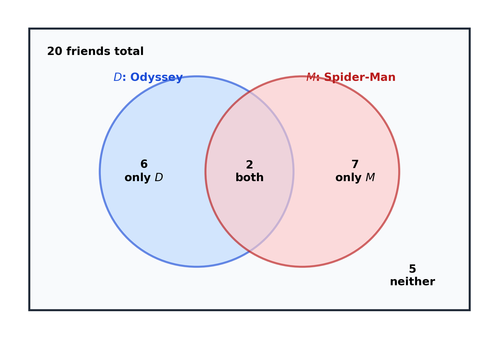
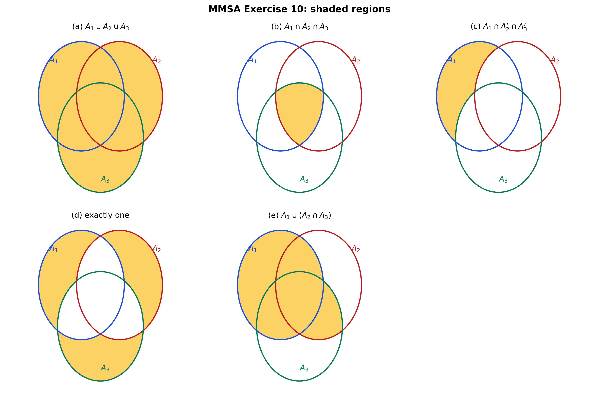
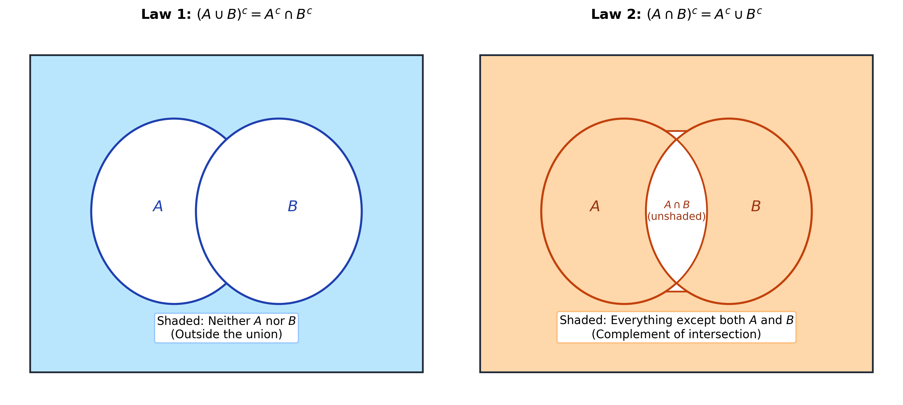
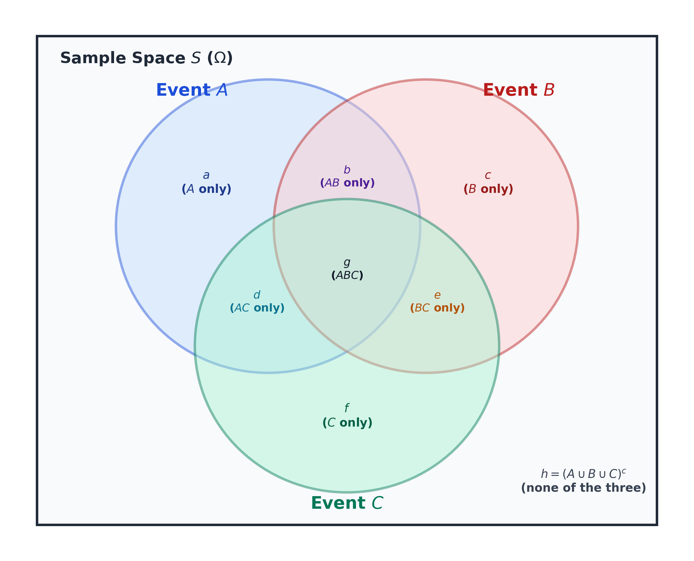
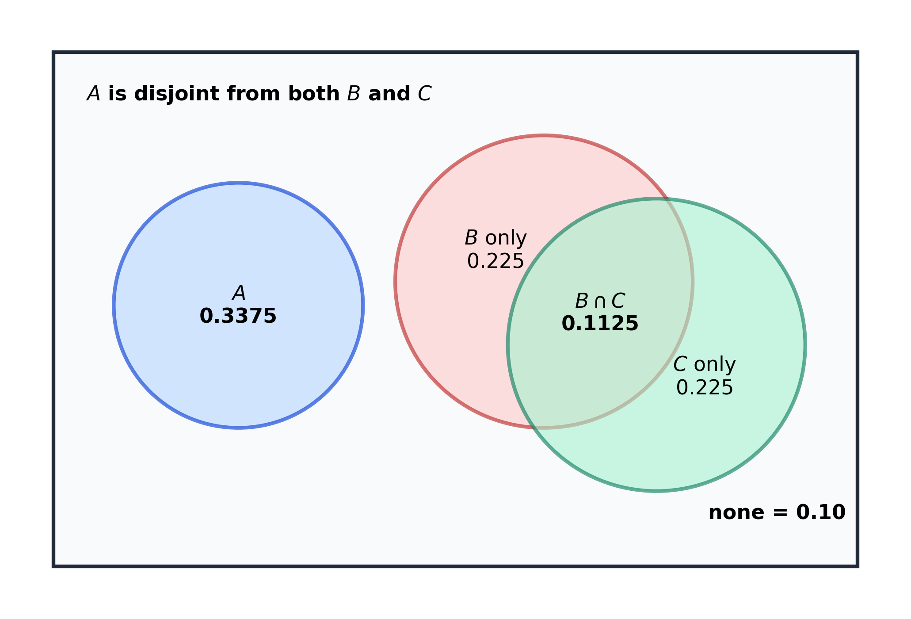

# STA237 Week 1: Answers, Worked Solutions, and Practice Exercises

---

### Table of Contents
- [Section A: Problem Type Teaching-Example Solutions](#section-a-problem-type-teaching-example-solutions)
  - [Problem Type PT-01: Specifying Random Experiments, Sample Spaces, and Events](#problem-type-pt-01-specifying-random-experiments-sample-spaces-and-events)
  - [Problem Type PT-02: Event Operations and Set Algebra](#problem-type-pt-02-event-operations-and-set-algebra)
  - [Problem Type PT-03: Classifying Event Relations: Independence vs. Mutual Exclusivity](#problem-type-pt-03-classifying-event-relations-independence-vs-mutual-exclusivity)
  - [Problem Type PT-04: Probability Models, Kolmogorov Axioms, and Model Validation](#problem-type-pt-04-probability-models-kolmogorov-axioms-and-model-validation)
  - [Problem Type PT-05: Axiomatic Proofs and Probability Identities](#problem-type-pt-05-axiomatic-proofs-and-probability-identities)
  - [Problem Type PT-06: Venn Diagrams and Regional Decompositions](#problem-type-pt-06-venn-diagrams-and-regional-decompositions)
  - [Problem Type PT-07: Classical Probability with Equally Likely Outcomes](#problem-type-pt-07-classical-probability-with-equally-likely-outcomes)
  - [Problem Type PT-08: Monte Carlo Simulation and Empirical Probability in R](#problem-type-pt-08-monte-carlo-simulation-and-empirical-probability-in-r)
- [Section B: Actual Weekly Questions and Solutions](#section-b-actual-weekly-questions-and-solutions)
  - [Weekly Lecture Example 1: Election Sample Space](#weekly-lecture-example-1-election-sample-space)
  - [Weekly Lecture Example 2: Election Event Specification](#weekly-lecture-example-2-election-event-specification)
  - [Weekly Lecture "Try for Yourself": Pair of Dice Events](#weekly-lecture-try-for-yourself-pair-of-dice-events)
  - [Weekly Lecture Example 3: Event Relationship Analysis](#weekly-lecture-example-3-event-relationship-analysis)
  - [Weekly Lecture Example 4: Movie Survey Regional Decomposition](#weekly-lecture-example-4-movie-survey-regional-decomposition)
  - [Weekly Lecture Progress Check: Tongue Rolling and Earlobes](#weekly-lecture-progress-check-tongue-rolling-and-earlobes)
- [Section C: Textbook Exercises and Solutions](#section-c-textbook-exercises-and-solutions)
  - [MMSA - Basic Practice](#mmsa---basic-practice)
    - [MMSA Section 2.1, Exercise 2 (p. 53)](#mmsa-section-21-exercise-2-p-53)
    - [MMSA Section 2.1, Exercise 3 (p. 53)](#mmsa-section-21-exercise-3-p-53)
    - [MMSA Section 2.2, Exercise 14 (p. 62)](#mmsa-section-22-exercise-14-p-62)
    - [MMSA Section 2.2, Exercise 15 (p. 62)](#mmsa-section-22-exercise-15-p-62)
  - [MMSA - Medium Practice](#mmsa---medium-practice)
    - [MMSA Section 2.1, Exercise 5 (p. 53)](#mmsa-section-21-exercise-5-p-53)
    - [MMSA Section 2.1, Exercise 6 (p. 53)](#mmsa-section-21-exercise-6-p-53)
    - [MMSA Section 2.2, Exercise 16 (p. 63)](#mmsa-section-22-exercise-16-p-63)
    - [MMSA Section 2.2, Exercise 17 (p. 63)](#mmsa-section-22-exercise-17-p-63)
    - [MMSA Section 2.2, Exercise 24 (p. 64)](#mmsa-section-22-exercise-24-p-64)
  - [MMSA - Test Level](#mmsa---test-level)
    - [MMSA Section 2.1, Exercise 10 (p. 55)](#mmsa-section-21-exercise-10-p-55)
    - [MMSA Section 2.1, Exercise 11 (p. 55)](#mmsa-section-21-exercise-11-p-55)
    - [MMSA Section 2.2, Exercise 26 (p. 65)](#mmsa-section-22-exercise-26-p-65)
    - [MMSA Section 2.2, Exercise 28 (p. 65)](#mmsa-section-22-exercise-28-p-65)
    - [MMSA Section 2.2, Exercise 30 (p. 65)](#mmsa-section-22-exercise-30-p-65)
  - [PAR - Basic Practice](#par---basic-practice)
    - [PAR Chapter 1, Exercise 1 (p. 36)](#par-chapter-1-exercise-1-p-36)
    - [PAR Chapter 1, Exercise 2 (p. 36)](#par-chapter-1-exercise-2-p-36)
    - [PAR Chapter 1, Exercise 3 (p. 36)](#par-chapter-1-exercise-3-p-36)
    - [PAR Chapter 1, Exercise 4 (p. 36)](#par-chapter-1-exercise-4-p-36)
    - [PAR Chapter 1, Exercise 5 (p. 36)](#par-chapter-1-exercise-5-p-36)
    - [PAR Chapter 1, Exercise 6 (p. 36)](#par-chapter-1-exercise-6-p-36)
    - [PAR Chapter 1, Exercise 11 (p. 37)](#par-chapter-1-exercise-11-p-37)
    - [PAR Chapter 1, Exercise 33 (p. 40)](#par-chapter-1-exercise-33-p-40)
  - [PAR - Medium Practice](#par---medium-practice)
    - [PAR Chapter 1, Exercise 8 (p. 37)](#par-chapter-1-exercise-8-p-37)
    - [PAR Chapter 1, Exercise 9 (p. 37)](#par-chapter-1-exercise-9-p-37)
    - [PAR Chapter 1, Exercise 13 (p. 37)](#par-chapter-1-exercise-13-p-37)
    - [PAR Chapter 1, Exercise 32 (p. 40)](#par-chapter-1-exercise-32-p-40)
    - [PAR Chapter 1, Exercise 44 (p. 43)](#par-chapter-1-exercise-44-p-43)
    - [PAR Chapter 1, Exercise 51 (p. 43)](#par-chapter-1-exercise-51-p-43)
  - [PAR - Test Level](#par---test-level)
    - [PAR Chapter 1, Exercise 36 (p. 41)](#par-chapter-1-exercise-36-p-41)
    - [PAR Chapter 1, Exercise 38 (p. 41)](#par-chapter-1-exercise-38-p-41)
    - [PAR Chapter 1, Exercise 43 (p. 42)](#par-chapter-1-exercise-43-p-42)
    - [PAR Chapter 1, Exercise 47 (p. 43)](#par-chapter-1-exercise-47-p-43)
    - [PAR Chapter 1, Exercise 48 (p. 43)](#par-chapter-1-exercise-48-p-43)
    - [PAR Chapter 1, Exercise 52 (p. 44)](#par-chapter-1-exercise-52-p-44)
- [Section D: Original Self-Test Questions](#section-d-original-self-test-questions)
- [Section E: Self-Test Answers](#section-e-self-test-answers)
- [Section F: Compact Coverage and Unresolved-Items Appendix](#section-f-compact-coverage-and-unresolved-items-appendix)

---

## Section A: Problem Type Teaching-Example Solutions

This section contains the complete, rigorous solutions to the teaching examples presented in [Study-Notes.md](Study-Notes.md#9-standardized-problem-types-pt-framework).

---

#### Problem Type PT-01: Specifying Random Experiments, Sample Spaces, and Events

**Question reference:** [PT-01 Teaching Example in Study-Notes.md](Study-Notes.md#problem-type-pt-01-specifying-random-experiments-sample-spaces-and-events)

**Worked solution.**
- **Part (a)**: Let $i$ denote the number of votes received by Yolanda. Since there are 1000 voters and every vote is cast for one of the two candidates, Zach must receive $j = 1000 - i$ votes. The integer $i$ can range from $0$ (all votes for Zach) to $1000$ (all votes for Yolanda). 
  In ordered pair notation $(i, j)$:
  $$S = \{(i, 1000 - i) \mid i \in \{0, 1, 2, \dots, 1000\}\}$$
  In roster form:
  $$S = \{(0, 1000), (1, 999), (2, 998), \dots, (999, 1), (1000, 0)\}$$
  The total number of outcomes is $|S| = 1001$.
- **Part (b)**: If the outcome of interest is simply the winner of the election, the qualitative sample space consists of three possibilities: Yolanda wins ($i > 500$), Zach wins ($i < 500$), or there is a tie ($i = 500$):
  $$S = \{\text{Yolanda}, \text{Zach}, \text{Tie}\}$$
- **Part (c)**: Yolanda beats Zach by at least 100 votes if and only if:
  $$\text{Votes}_Y - \text{Votes}_Z \ge 100$$
  Substituting $\text{Votes}_Z = 1000 - \text{Votes}_Y$:
  $$i - (1000 - i) \ge 100 \iff 2i - 1000 \ge 100 \iff 2i \ge 1100 \iff i \ge 550$$
  Since $i$ is capped at 1000 votes, the event $Y$ in set-builder notation is:
  $$Y = \{(i, 1000 - i) \mid i \in \mathbb{Z}, 550 \le i \le 1000\}$$
  In roster form:
  $$Y = \{(550, 450), (551, 449), \dots, (1000, 0)\}$$
  The total number of favorable outcomes is $|Y| = 1000 - 550 + 1 = 451$.

**Answer.**
- (a) $S = \{(i, 1000 - i) \mid i \in \{0, 1, \dots, 1000\}\}$, with $|S| = 1001$.
- (b) $S = \{\text{Yolanda}, \text{Zach}, \text{Tie}\}$.
- (c) $Y = \{(i, 1000 - i) \mid 550 \le i \le 1000\}$, requiring Yolanda to receive between $550$ and $1000$ votes inclusive ($|Y| = 451$ outcomes).

---

#### Problem Type PT-02: Event Operations and Set Algebra

**Question reference:** [PT-02 Teaching Example in Study-Notes.md](Study-Notes.md#problem-type-pt-02-event-operations-and-set-algebra)

**Worked solution.**
- **Part (a)**: An outcome is an ordered pair $(i, j)$ where $i$ is the face on the first die and $j$ is the face on the second die:
  $$\Omega = \{(i, j) \mid i, j \in \{1, 2, 3, 4, 5, 6\}\}$$
  By the multiplication rule of counting, $|\Omega| = 6 \times 6 = 36$.
- **Part (b)**: Doubles occur when $i = j$:
  $$D = \{(1, 1), (2, 2), (3, 3), (4, 4), (5, 5), (6, 6)\}, \quad |D| = 6$$
- **Part (c)**: The sum equals 8 when $i + j = 8$:
  $$E = \{(2, 6), (3, 5), (4, 4), (5, 3), (6, 2)\}, \quad |E| = 5$$
- **Part (d)**:
  - (i) **Yes**, $(2, 6)$ and $(6, 2)$ are distinct elements in $\Omega$. By definition of an ordered pair, the first coordinate represents Die 1 and the second represents Die 2. Rolling a 2 on Die 1 and a 6 on Die 2 is physically and probabilistically distinct from rolling a 6 on Die 1 and a 2 on Die 2.
  - (ii) The outcome $(4, 4)$ has $i = j$ ($4 = 4$, so $(4, 4) \in D$) and $i + j = 8$ ($4 + 4 = 8$, so $(4, 4) \in E$). Thus $(4, 4) \in D \cap E$. In the union $D \cup E$, by the fundamental axiom of set theory (idempotence), each distinct element is included **exactly once**.
- **Part (e)**: One die is twice the other if $i = 2j$ or $j = 2i$:
  - If $j = 1 \implies i = 2 \implies (2, 1)$
  - If $i = 1 \implies j = 2 \implies (1, 2)$
  - If $j = 2 \implies i = 4 \implies (4, 2)$
  - If $i = 2 \implies j = 4 \implies (2, 4)$
  - If $j = 3 \implies i = 6 \implies (6, 3)$
  - If $i = 3 \implies j = 6 \implies (3, 6)$
  - For $i, j \ge 4$, $2 \times 4 = 8 > 6$, which exceeds die faces.
  $$T = \{(1, 2), (2, 1), (2, 4), (4, 2), (3, 6), (6, 3)\}, \quad |T| = 6$$

**Answer.**
- (a) $\Omega = \{(i, j) \mid 1 \le i, j \le 6\}$, $|\Omega| = 36$.
- (b) $D = \{(1,1), (2,2), (3,3), (4,4), (5,5), (6,6)\}$.
- (c) $E = \{(2,6), (3,5), (4,4), (5,3), (6,2)\}$.
- (d) (i) Yes, order distinguishes Die 1 from Die 2. (ii) $(4, 4) \in D \cap E$; counted once in $D \cup E$.
- (e) $T = \{(1,2), (2,1), (2,4), (4,2), (3,6), (6,3)\}$.

---

#### Problem Type PT-03: Classifying Event Relations: Independence vs. Mutual Exclusivity

**Question reference:** [PT-03 Teaching Example in Study-Notes.md](Study-Notes.md#problem-type-pt-03-classifying-event-relations-independence-vs-mutual-exclusivity)

**Worked solution.**
- **Scenario 1 (Course Enrollment)**:
  - *Mutual Exclusivity*: A student can be concurrently enrolled in both a 100-level course and a 300-level course (e.g., an upper-year student taking an elective or a second-year student taking courses across levels). Thus $A \cap B \ne \emptyset$. The events are **not mutually exclusive**.
  - *Independence*: The wording supplies no values for $P(A)$, $P(B)$, or $P(A\cap B)$. The fact that both events can occur rules out mutual exclusivity, but it does not determine independence. Enrollment data are required to test whether $P(A\cap B)=P(A)P(B)$.
- **Scenario 2 (Card Drawing)**:
  - In a standard 52-card deck, there are 26 black cards ($A$) and 1 Ace of Spades ($B$). Since the Ace of Spades is a spade, and spades are black, $B \subset A$.
  - *Mutual Exclusivity*: $A \cap B = B = \{\text{Ace of Spades}\} \ne \emptyset$. The events are **not mutually exclusive**.
  - *Independence*: $P(B) = \frac{1}{52}$. If the drawn card is known to be black ($A$), the probability of it being the Ace of Spades becomes $P(B \mid A) = \frac{1}{26}$. Since $P(B \mid A) = \frac{1}{26} \ne \frac{1}{52} = P(B)$, the events are **dependent**.
- **Scenario 3 (Coin Flips)**:
  - You and your friend conduct coin flips independently on physically separate coins.
  - *Mutual Exclusivity*: The joint outcome where you land $HH$ and your friend lands $TT$ is entirely possible: $(HH, TT) \in S$. Thus $A \cap B \ne \emptyset$. They are **not mutually exclusive**.
  - *Independence*: Because the physical actions are completely separated and coin tosses are memoryless, your outcome has zero physical or statistical influence on your friend's outcome: $P(B \mid A) = P(B) = \frac{1}{4}$, and $P(A \cap B) = \frac{1}{4} \times \frac{1}{4} = \frac{1}{16}$. The events are **independent**.

**Answer.**
- Scenario 1: Not mutually exclusive; independence cannot be determined from the information given.
- Scenario 2: Not mutually exclusive; Dependent.
- Scenario 3: Not mutually exclusive; Independent.

---

#### Problem Type PT-04: Probability Models, Kolmogorov Axioms, and Model Validation

**Question reference:** [PT-04 Teaching Example in Study-Notes.md](Study-Notes.md#problem-type-pt-04-probability-models-kolmogorov-axioms-and-model-validation)

**Worked solution.**
We verify that $P(A) = \alpha P_1(A) + (1 - \alpha) P_2(A)$ satisfies the three Kolmogorov axioms:
1. **Axiom 1 (Non-negativity)**:
   Let $A \subseteq \Omega$ be an arbitrary event. Since $P_1$ and $P_2$ are valid probability functions, $P_1(A) \ge 0$ and $P_2(A) \ge 0$.
   Since $0 \le \alpha \le 1$, both $\alpha \ge 0$ and $(1 - \alpha) \ge 0$.
   The sum of products of non-negative real numbers is non-negative:
   $$P(A) = \alpha P_1(A) + (1 - \alpha) P_2(A) \ge \alpha(0) + (1 - \alpha)(0) = 0$$
   Hence Axiom 1 holds.
2. **Axiom 2 (Total Probability / Normalization)**:
   Evaluate $P$ on the entire sample space $\Omega$. Since $P_1(\Omega) = 1$ and $P_2(\Omega) = 1$:
   $$P(\Omega) = \alpha P_1(\Omega) + (1 - \alpha) P_2(\Omega) = \alpha(1) + (1 - \alpha)(1) = \alpha + 1 - \alpha = 1$$
   Hence Axiom 2 holds.
3. **Axiom 3 (Additivity for Disjoint Events)**:
   Let $A_1, A_2, A_3, \dots$ be a sequence of pairwise disjoint events ($A_i \cap A_j = \emptyset$ for all $i \ne j$).
   Because $P_1$ and $P_2$ satisfy countable additivity:
   $$P_1\left(\bigcup_{i=1}^\infty A_i\right) = \sum_{i=1}^\infty P_1(A_i) \quad \text{and} \quad P_2\left(\bigcup_{i=1}^\infty A_i\right) = \sum_{i=1}^\infty P_2(A_i)$$
   Evaluating $P$ on the countable union:
   $$\begin{aligned}
   P\left(\bigcup_{i=1}^\infty A_i\right) &= \alpha P_1\left(\bigcup_{i=1}^\infty A_i\right) + (1 - \alpha) P_2\left(\bigcup_{i=1}^\infty A_i\right) \\
   &= \alpha \sum_{i=1}^\infty P_1(A_i) + (1 - \alpha) \sum_{i=1}^\infty P_2(A_i) \\
   &= \sum_{i=1}^\infty \left[\alpha P_1(A_i) + (1 - \alpha) P_2(A_i)\right] \\
   &= \sum_{i=1}^\infty P(A_i)
   \end{aligned}$$
   Hence Axiom 3 holds.

**Answer.**
$P(A) = \alpha P_1(A) + (1 - \alpha) P_2(A)$ satisfies non-negativity ($P(A) \ge 0$), normalization ($P(\Omega) = 1$), and countable additivity, and is therefore a valid probability function on $\Omega$.

---

#### Problem Type PT-05: Axiomatic Proofs and Probability Identities

**Question reference:** [PT-05 Teaching Example in Study-Notes.md](Study-Notes.md#problem-type-pt-05-axiomatic-proofs-and-probability-identities)

**Worked solution.**
- **Part (a) (Proof of Monotonicity)**:
  1. Let $A \subseteq B$. Decompose $B$ into two disjoint subsets:
     $$B = A \cup (B \cap A^c)$$
  2. Verify disjointness: $A \cap (B \cap A^c) = (A \cap A^c) \cap B = \emptyset \cap B = \emptyset$.
  3. Apply Axiom 3 (Additivity for disjoint events):
     $$P(B) = P(A) + P(B \cap A^c)$$
  4. By Axiom 1 (Non-negativity), $P(B \cap A^c) \ge 0$.
  5. Therefore:
     $$P(B) = P(A) + P(B \cap A^c) \ge P(A) + 0 = P(A)$$
     which proves $P(A) \le P(B)$. $\blacksquare$
- **Part (b) (Upper Bound on Probability)**:
  For any event $E \subseteq S$, by definition of the sample space, $E \subseteq S$.
  Applying the monotonicity property proved in Part (a) with $A = E$ and $B = S$:
  $$P(E) \le P(S)$$
  By Axiom 2 (Normalization), $P(S) = 1$.
  Therefore, $P(E) \le 1$. $\blacksquare$
- **Part (c) (Addition Rule Proof)**:
  1. Decompose the union into two disjoint sets:
     $$A \cup B = A \cup (B \cap A^c)$$
     where $A \cap (B \cap A^c) = \emptyset$.
  2. By Axiom 3:
     $$P(A \cup B) = P(A) + P(B \cap A^c) \quad \text{--- (Eq. 1)}$$
  3. Now partition event $B$ into two disjoint sets with respect to $A$:
     $$B = (A \cap B) \cup (B \cap A^c)$$
     where $(A \cap B) \cap (B \cap A^c) = \emptyset$.
  4. Apply Axiom 3 to $B$:
     $$P(B) = P(A \cap B) + P(B \cap A^c) \implies P(B \cap A^c) = P(B) - P(A \cap B) \quad \text{--- (Eq. 2)}$$
  5. Substitute (Eq. 2) into (Eq. 1):
     $$P(A \cup B) = P(A) + P(B) - P(A \cap B) \quad \blacksquare$$

**Answer.**
Complete axiomatic proofs established for monotonicity ($A \subseteq B \implies P(A) \le P(B)$), the upper bound ($P(E) \le 1$), and the general addition rule ($P(A \cup B) = P(A) + P(B) - P(A \cap B)$).

---

#### Problem Type PT-06: Venn Diagrams and Regional Decompositions

**Question reference:** [PT-06 Teaching Example in Study-Notes.md](Study-Notes.md#problem-type-pt-06-venn-diagrams-and-regional-decompositions)

**Worked solution.**
- **Scenario 1 (Movie Survey)**:
  - Let $D = \{\text{Watched The Odyssey}\}$ and $M = \{\text{Watched Spider-Man}\}$.
  - Given: $N = 20$, $n(D) = 8$, $n(M) = 9$, and $n((D \cup M)^c) = 5$.
  - Number of friends who watched at least one movie:
    $$n(D \cup M) = N - n((D \cup M)^c) = 20 - 5 = 15$$
  - By the principle of inclusion-exclusion for counts:
    $$n(D \cup M) = n(D) + n(M) - n(D \cap M)$$
    $$15 = 8 + 9 - n(D \cap M) \implies 15 = 17 - n(D \cap M) \implies n(D \cap M) = 2$$
  - Friends who watched **only** *Spider-Man*:
    $$n(D^c \cap M) = n(M) - n(D \cap M) = 9 - 2 = 7$$
  - (Check all 4 regions: $D$ only = $8 - 2 = 6$; Both = $2$; $M$ only = $7$; Neither = $5$. Total = $6 + 2 + 7 + 5 = 20$).
- **Scenario 2 (Tongue Rolling and Earlobes)**:
  - Let $T = \{\text{Rolls tongue}\}$ and $E = \{\text{Attached earlobes}\}$.
  - Given: $N = 60$, $n(T) = 28$, $n(E) = 15$, $n(T \cap E) = 8$.
  - (i) **Cannot roll tongue**:
    - Event notation: $T^c$ (or $T'$)
    - Count: $n(T^c) = N - n(T) = 60 - 28 = 32$.
    - Probability: $P(T^c) = \frac{32}{60} = \frac{8}{15} \approx 0.5333$.
  - (ii) **Neither rolls tongue nor has attached earlobes**:
    - Event notation: $(T \cup E)^c = T^c \cap E^c$.
    - By inclusion-exclusion: $n(T \cup E) = n(T) + n(E) - n(T \cap E) = 28 + 15 - 8 = 35$.
    - Count: $n((T \cup E)^c) = 60 - 35 = 25$.
    - Probability: $P((T \cup E)^c) = \frac{25}{60} = \frac{5}{12} \approx 0.4167$.
  - (iii) **Exactly one trait**:
    - Event notation: $(T \cap E^c) \cup (T^c \cap E)$.
    - Count: $n(\text{exactly one}) = n(T \cup E) - n(T \cap E) = 35 - 8 = 27$.
    - Probability: $P(\text{exactly one}) = \frac{27}{60} = \frac{9}{20} = 0.45$.

**Answer.**
- Scenario 1: $2$ friends watched both movies; $7$ friends watched only *Spider-Man*.
- Scenario 2:
  - (i) $P(T^c) = \frac{8}{15} \approx 0.5333$ ($n = 32$).
  - (ii) $P(T^c \cap E^c) = \frac{5}{12} \approx 0.4167$ ($n = 25$).
  - (iii) $P(\text{exactly one}) = \frac{9}{20} = 0.45$ ($n = 27$).

---

#### Problem Type PT-07: Classical Probability with Equally Likely Outcomes

**Question reference:** [PT-07 Teaching Example in Study-Notes.md](Study-Notes.md#problem-type-pt-07-classical-probability-with-equally-likely-outcomes)

**Worked solution.**
- **Part (a)**: An outcome specifies the operating condition of $(C_1, C_2)$ where each component is either $S$ or $F$:
  $$S = \{SS, SF, FS, FF\}, \quad |S| = 4$$
- **Part (b)**: The parallel system works ($W$) if at least one component succeeds:
  $$W = \{SS, SF, FS\}, \quad |W| = 3$$
- **Part (c)**: Component $C_1$ works ($E$) if the first component is $S$:
  $$E = \{SS, SF\}, \quad |E| = 2$$
- **Part (d)**: Assuming all 4 outcomes in $S$ are equally likely ($P(\omega) = 1/4$):
  $$P(W) = \frac{|W|}{|S|} = \frac{3}{4} = 0.75$$
  $$P(E) = \frac{|E|}{|S|} = \frac{2}{4} = \frac{1}{2} = 0.50$$
  The intersection $W \cap E = \{SS, SF\} = E$, so:
  $$P(W \cap E) = \frac{|W \cap E|}{|S|} = \frac{2}{4} = \frac{1}{2} = 0.50$$
- **Part (e)**: For components connected in **series**, the entire system works if and only if **both** components operate successfully. Thus:
  $$W_{\text{series}} = \{SS\}, \quad |W_{\text{series}}| = 1$$
  Under equal likelihood, $P(W_{\text{series}}) = \frac{1}{4} = 0.25$.

**Answer.**
- (a) $S = \{SS, SF, FS, FF\}$.
- (b) $W = \{SS, SF, FS\}$.
- (c) $E = \{SS, SF\}$.
- (d) $P(W) = 0.75$, $P(E) = 0.50$, $P(W \cap E) = 0.50$.
- (e) $W_{\text{series}} = \{SS\}$ with $P(W_{\text{series}}) = 0.25$.

---

#### Problem Type PT-08: Monte Carlo Simulation and Empirical Probability in R

**Question reference:** [PT-08 Teaching Example in Study-Notes.md](Study-Notes.md#problem-type-pt-08-monte-carlo-simulation-and-empirical-probability-in-r)

**Worked solution.**
- **Part (a)**: An efficient, vectorized R script using `sample()` and `mean()`:
  ```r
  # Set seed for reproducibility
  set.seed(237)

  # Number of Monte Carlo replications
  N <- 100000

  # Simulate rolling two dice independently
  die1 <- sample(1:6, size = N, replace = TRUE)
  die2 <- sample(1:6, size = N, replace = TRUE)

  # Calculate the sum of the two dice for each trial
  dice_sum <- die1 + die2

  # Calculate empirical probability that sum >= 8
  sim_prob <- mean(dice_sum >= 8)
  cat("Simulated Probability:", sim_prob, "\n")
  ```
- **Part (b)**: The sample space has $|\Omega| = 36$ equally likely outcomes. Outcomes with sum $i + j \ge 8$:
  - Sum = 8: $(2,6), (3,5), (4,4), (5,3), (6,2)$ $\implies 5$ outcomes.
  - Sum = 9: $(3,6), (4,5), (5,4), (6,3)$ $\implies 4$ outcomes.
  - Sum = 10: $(4,6), (5,5), (6,4)$ $\implies 3$ outcomes.
  - Sum = 11: $(5,6), (6,5)$ $\implies 2$ outcomes.
  - Sum = 12: $(6,6)$ $\implies 1$ outcome.
  Total favorable outcomes: $5 + 4 + 3 + 2 + 1 = 15$.
  $$P(\text{Sum} \ge 8) = \frac{15}{36} = \frac{5}{12} \approx 0.416667$$
- **Part (c)**: The simulated value differs slightly from $5/12$ due to **random sampling error** inherent in finite random sampling. The **Law of Large Numbers (LLN)** guarantees that as $N \to \infty$, the sample relative frequency $\frac{1}{N}\sum_{k=1}^N I(\text{Sum}_k \ge 8)$ converges almost surely to the true theoretical probability $P(\text{Sum} \ge 8) = 5/12$.

**Answer.**
- (a) Self-contained R code provided.
- (b) Exact analytical probability is $\frac{5}{12} \approx 0.4167$.
- (c) Discrepancy is due to finite Monte Carlo sampling variability; convergence is guaranteed by the Law of Large Numbers.

---

## Section B: Actual Weekly Questions and Solutions

This section contains all lecture questions, in-class examples, and progress checks from `W1/Week1-L0401-annotated.pdf`.

---

#### Weekly Lecture Example 1: Election Sample Space

**Source:** `Week1-L0401-annotated.pdf`, Slide 24 / Page 24 (PAR Example 1.3(i))  
**Relevant method:** [PT-01](Study-Notes.md#problem-type-pt-01-specifying-random-experiments-sample-spaces-and-events)

**Question.**  
Yolanda and Zach are running for president of the student association. 1000 students will be voting, and each voter will pick one of the two candidates. Identify the sample space.

**Necessary work.**  
The definition of the sample space depends on what feature of the election is recorded:
- *Formulation 1 (Vote Counts)*: Let $i$ be the number of votes for Yolanda. Then Zach receives $1000 - i$. Each outcome is an ordered pair $(i, 1000 - i)$ where $0 \le i \le 1000, i \in \mathbb{Z}$.
- *Formulation 2 (Outcome/Winner)*: If only the identity of the elected candidate is of interest, the outcomes are Yolanda wins, Zach wins, or a tie occurs.

**Answer.**  
- In vote-count form: $S = \{(i, 1000 - i) \mid i \in \{0, 1, 2, \dots, 1000\}\}$, $|S| = 1001$.
- In winner form: $S = \{\text{Yolanda}, \text{Zach}, \text{Tie}\}$.

---

#### Weekly Lecture Example 2: Election Event Specification

**Source:** `Week1-L0401-annotated.pdf`, Slide 25 / Page 25 (PAR Example 1.3(ii))  
**Relevant method:** [PT-01](Study-Notes.md#problem-type-pt-01-specifying-random-experiments-sample-spaces-and-events)

**Question.**  
Yolanda and Zach are running for president of the student association. 1000 students will be voting, and each voter will pick one of the two candidates. Identify the event that Yolanda beats Zach by at least 100 votes.

**Necessary work.**  
Using the sample space $S = \{(i, 1000 - i) \mid 0 \le i \le 1000\}$, Yolanda's lead is $i - (1000 - i) = 2i - 1000$.
Setting the lead to be at least 100:
$$2i - 1000 \ge 100 \iff 2i \ge 1100 \iff i \ge 550$$

**Answer.**  
$Y = \{(i, 1000 - i) \mid 550 \le i \le 1000, i \in \mathbb{Z}\} = \{(550, 450), (551, 449), \dots, (1000, 0)\}$.

---

#### Weekly Lecture "Try for Yourself": Pair of Dice Events

**Source:** `Week1-L0401-annotated.pdf`, Slide 29 / Page 29  
**Relevant method:** [PT-02](Study-Notes.md#problem-type-pt-02-event-operations-and-set-algebra), [PT-07](Study-Notes.md#problem-type-pt-07-classical-probability-with-equally-likely-outcomes)

**Question.**  
Suppose you roll a fair, six-sided die twice and record the pairs of outcomes as $(\text{first}, \text{second})$. List the following events:  
**(a)** The sample space.  
**(b)** The event that doubles were rolled.  
**(c)** The event that the outcome sums to 8.  
**(d)** In-class discussion questions:  
- $Q_1$: Are $(2,6)$ and $(6,2)$ different outcomes?  
- $Q_2$: Why don't we write $(4,4)$ twice in the union of doubles and sum to 8?  
**(e)** The event where one die has twice the face value of the other.

**Necessary work.**  
- (a) $\Omega = \{(i, j) \mid 1 \le i, j \le 6, i, j \in \mathbb{N}\}$, $|\Omega| = 36$.
- (b) Doubles: $D = \{(1,1), (2,2), (3,3), (4,4), (5,5), (6,6)\}$, $|D| = 6$.
- (c) Sum equals 8: Pairs $(i, j)$ with $i + j = 8$: $E = \{(2,6), (3,5), (4,4), (5,3), (6,2)\}$, $|E| = 5$.
- (d)
  - $Q_1$: Yes, the pair is ordered $(\text{first roll}, \text{second roll})$. The first die showing 2 and second showing 6 is a distinct physical outcome from first showing 6 and second showing 2.
  - $Q_2$: Sets contain distinct elements; $(4,4)$ is a single element in $\Omega$. In set unions, identical elements are not duplicated.
- (e) $i = 2j$ or $j = 2i$: $T = \{(1,2), (2,1), (2,4), (4,2), (3,6), (6,3)\}$, $|T| = 6$.

**Answer.**  
- (a) $\Omega = \{(i, j) \mid 1 \le i, j \le 6\}$.
- (b) $D = \{(1,1), (2,2), (3,3), (4,4), (5,5), (6,6)\}$.
- (c) $E = \{(2,6), (3,5), (4,4), (5,3), (6,2)\}$.
- (d) $Q_1$: Yes, order matters. $Q_2$: Sets do not duplicate identical elements.
- (e) $T = \{(1,2), (2,1), (2,4), (4,2), (3,6), (6,3)\}$.

---

#### Weekly Lecture Example 3: Event Relationship Analysis

**Source:** `Week1-L0401-annotated.pdf`, Slide 34 / Page 34  
**Relevant method:** [PT-03](Study-Notes.md#problem-type-pt-03-classifying-event-relations-independence-vs-mutual-exclusivity)

**Question.**  
Classify the following pairs of events as mutually exclusive, independent, or dependent, or a combination thereof:  
1. A student at U of T is randomly selected and surveyed about the course levels of their timetable. Let $A = \{\text{Enrolled in 100 level course}\}$ and $B = \{\text{Enrolled in 300 level course}\}$.  
2. A card is drawn at random from a deck of 52 playing cards and its face value recorded. Let $A = \{\text{Black card}\}$ and $B = \{\text{Ace of Spades}\}$.  
3. You and your friend flip a coin twice and the outcomes are recorded. Let $A = \{\text{You land } HH\}$ and $B = \{\text{Friend lands } TT\}$.

**Necessary work.**  
1. Students can take both 100-level and 300-level courses, so $A \cap B \ne \emptyset$ and the events are not mutually exclusive. No enrollment probabilities are supplied, so independence cannot be determined from the scenario alone.
2. The Ace of Spades is black $\implies A \cap B = B \ne \emptyset$ (not mutually exclusive). $P(B) = 1/52$, but $P(B \mid A) = 1/26 \ne 1/52$ (dependent).
3. Independent trials conducted by separate individuals on fair coins $\implies P(A \cap B) = P(A)P(B) = (1/4)(1/4) = 1/16 \ne 0$ (independent; not mutually exclusive).

**Answer.**  
1. Not mutually exclusive; independence cannot be determined without enrollment probabilities.
2. Not mutually exclusive; Dependent.
3. Not mutually exclusive; Independent.

---

#### Weekly Lecture Example 4: Movie Survey Regional Decomposition

**Source:** `Week1-L0401-annotated.pdf`, Slide 39 / Page 39  
**Relevant method:** [PT-06](Study-Notes.md#problem-type-pt-06-venn-diagrams-and-regional-decompositions)

**Question.**  
In a group of 20 friends, 8 had watched *The Odyssey* in theatres, 9 had watched *Spider-Man: Brand New Day* in theatres, and 5 have watched neither movie. Represent this information in a Venn diagram. Can you determine how many friends have watched both movies this summer?

**Necessary work.**  
Let $D$ = *The Odyssey*, $M$ = *Spider-Man*.
Given: $n(\Omega) = 20, n(D) = 8, n(M) = 9, n((D \cup M)^c) = 5$.
1. $n(D \cup M) = n(\Omega) - n((D \cup M)^c) = 20 - 5 = 15$.
2. By Inclusion-Exclusion: $n(D \cup M) = n(D) + n(M) - n(D \cap M)$.
3. $15 = 8 + 9 - n(D \cap M) \implies 15 = 17 - n(D \cap M) \implies n(D \cap M) = 2$.
4. Regional counts: $D$ only = $8 - 2 = 6$; $M$ only = $9 - 2 = 7$; Both = $2$; Neither = $5$.

**Answer.**  
Exactly $2$ friends watched both movies.



---

#### Weekly Lecture Progress Check: Tongue Rolling and Earlobes

**Source:** `Week1-L0401-annotated.pdf`, Slide 41 / Page 41  
**Relevant method:** [PT-06](Study-Notes.md#problem-type-pt-06-venn-diagrams-and-regional-decompositions)

**Question.**  
Among a group of 60 students, 28 could roll their tongue and 15 have attached earlobes. 8 students could both roll their tongue and have attached earlobes. We conduct a random experiment where a student is sampled at random. Let $T$ be the event that the student can roll their tongue, and $E$ be the event that the student has attached earlobes. Represent the following events in notation, and determine the number of elements in each event:  
**(a)** The student cannot roll their tongue.  
**(b)** The student can neither roll their tongue nor has attached earlobes.

**Necessary work.**  
Given: $n(\Omega) = 60, n(T) = 28, n(E) = 15, n(T \cap E) = 8$.
- (a) Event: $T^c$. Number of elements: $n(T^c) = n(\Omega) - n(T) = 60 - 28 = 32$.
- (b) Event: $(T \cup E)^c$ (or $T^c \cap E^c$).
  $n(T \cup E) = n(T) + n(E) - n(T \cap E) = 28 + 15 - 8 = 35$.
  $n((T \cup E)^c) = n(\Omega) - n(T \cup E) = 60 - 35 = 25$.

**Answer.**  
- (a) Notation: $T^c$; Number of elements: $32$ ($P(T^c) = 32/60 = 8/15$).
- (b) Notation: $(T \cup E)^c$ (or $T^c \cap E^c$); Number of elements: $25$ ($P((T \cup E)^c) = 25/60 = 5/12$).

---

## Section C: Textbook Exercises and Solutions

This section contains complete solutions for all 34 textbook exercises assigned on Canvas (14 MMSA exercises and 20 PAR exercises).

---

### MMSA - Basic Practice

#### MMSA Section 2.1, Exercise 2 (p. 53)

**Source:** MMSA 3rd ed., Section 2.1, Exercise 2 (p. 53; PDF p. 66)  
**Difficulty:** Basic Practice  
**Relevant method:** [PT-01](Study-Notes.md#problem-type-pt-01-specifying-random-experiments-sample-spaces-and-events)

**Question.**  
Two voters, Al and Bill, are each choosing between one of three candidates—1, 2, and 3—who are running for city council. An experimental outcome specifies both Al’s choice and Bill’s choice, e.g., the pair $(3, 2)$.  
**(a)** List all elements of $S$.  
**(b)** List all outcomes in the event $A$ that Al and Bill make the same choice.  
**(c)** List all outcomes in the event $B$ that neither of them votes for candidate 2.

**Necessary work.**  
Outcomes are pairs $(a, b)$ with $a, b \in \{1, 2, 3\}$. Total outcomes: $3 \times 3 = 9$.
- (a) Cartesian product $\{1, 2, 3\} \times \{1, 2, 3\}$.
- (b) $a = b \implies (1, 1), (2, 2), (3, 3)$.
- (c) $a, b \in \{1, 3\} \implies (1, 1), (1, 3), (3, 1), (3, 3)$.

**Answer.**  
- (a) $S = \{(1, 1), (1, 2), (1, 3), (2, 1), (2, 2), (2, 3), (3, 1), (3, 2), (3, 3)\}$.
- (b) $A = \{(1, 1), (2, 2), (3, 3)\}$.
- (c) $B = \{(1, 1), (1, 3), (3, 1), (3, 3)\}$.

---

#### MMSA Section 2.1, Exercise 3 (p. 53)

**Source:** MMSA 3rd ed., Section 2.1, Exercise 3 (p. 53; PDF p. 66)  
**Difficulty:** Basic Practice  
**Relevant method:** [PT-01](Study-Notes.md#problem-type-pt-01-specifying-random-experiments-sample-spaces-and-events), [PT-02](Study-Notes.md#problem-type-pt-02-event-operations-and-set-algebra)

**Question.**  
Four universities—1, 2, 3, and 4—are participating in a holiday basketball tournament. In the first round, 1 will play 2 and 3 will play 4. Then the two winners will play for the championship, and the two losers will also play. One possible outcome can be denoted by $1324$: 1 beats 2 and 3 beats 4 in first-round games, and then 1 beats 3 and 2 beats 4.  
**(a)** List all outcomes in $S$.  
**(b)** Let $A$ denote the event that 1 wins the tournament. List outcomes in $A$.  
**(c)** Let $B$ denote the event that 2 gets into the championship game. List outcomes in $B$.  
**(d)** What are the outcomes in $A \cup B$ and in $A \cap B$? What are the outcomes in $A'$?

**Necessary work.**  
Outcome notation: $c_1 c_2 c_3 c_4 = (\text{Champion}, \text{Runner-up}, \text{3rd place}, \text{4th place})$.
There are 4 games total: 2 in round 1, 2 in round 2. Total outcomes: $2^4 = 16$.
- Round 1 pairs: (1 vs 2) and (3 vs 4).
- (a) 16 combinations:
  - If 1 beats 2, 3 beats 4: $\{1324, 1342, 3124, 3142\}$
  - If 1 beats 2, 4 beats 3: $\{1423, 1432, 4123, 4132\}$
  - If 2 beats 1, 3 beats 4: $\{2314, 2341, 3214, 3241\}$
  - If 2 beats 1, 4 beats 3: $\{2413, 2431, 4213, 4231\}$
- (b) $A$: Team 1 wins tournament ($c_1 = 1$): $\{1324, 1342, 1423, 1432\}$.
- (c) $B$: Team 2 reaches final ($c_1 = 2$ or $c_2 = 2$): $\{2314, 2341, 2413, 2431, 3214, 3241, 4213, 4231\}$.
- (d)
  - $A \cap B$: For 1 to win the final, 1 must beat 2 in round 1, so 2 cannot enter the championship game. Thus $A \cap B = \emptyset$.
  - $A \cup B$: Combine all 4 outcomes in $A$ and 8 outcomes in $B$ (total 12 outcomes).
  - $A'$: All 12 outcomes where team 1 is not the champion ($c_1 \ne 1$).

**Answer.**  
- (a) $S = \{1324, 1342, 1423, 1432, 2314, 2341, 2413, 2431, 3124, 3142, 3214, 3241, 4123, 4132, 4213, 4231\}$.
- (b) $A = \{1324, 1342, 1423, 1432\}$.
- (c) $B = \{2314, 2341, 2413, 2431, 3214, 3241, 4213, 4231\}$.
- (d) $A \cap B = \emptyset$; $A \cup B = \{1324, 1342, 1423, 1432, 2314, 2341, 2413, 2431, 3214, 3241, 4213, 4231\}$; $A' = \{2314, 2341, 2413, 2431, 3124, 3142, 3214, 3241, 4123, 4132, 4213, 4231\}$.

---

#### MMSA Section 2.2, Exercise 14 (p. 62)

**Source:** MMSA 3rd ed., Section 2.2, Exercise 14 (p. 62; PDF p. 75)  
**Difficulty:** Basic Practice  
**Relevant method:** [PT-05](Study-Notes.md#problem-type-pt-05-axiomatic-proofs-and-probability-identities), [PT-06](Study-Notes.md#problem-type-pt-06-venn-diagrams-and-regional-decompositions)

**Question.**  
Consider randomly selecting a student at a certain university, and let $A$ denote the event that the selected individual has a Visa credit card and $B$ be the analogous event for a MasterCard. Suppose that $P(A) = .5, P(B) = .4,$ and $P(A \cap B) = .25$.  
**(a)** Compute the probability that the selected individual has at least one of the two types of cards (i.e., the probability of the event $A \cup B$).  
**(b)** What is the probability that the selected individual has neither type of card?  
**(c)** Describe, in terms of $A$ and $B$, the event that the selected student has a Visa card but not a MasterCard, and then calculate the probability of this event.

**Necessary work.**  
- (a) $P(A \cup B) = P(A) + P(B) - P(A \cap B) = 0.5 + 0.4 - 0.25 = 0.65$.
- (b) $P((A \cup B)') = 1 - P(A \cup B) = 1 - 0.65 = 0.35$.
- (c) Event: $A \cap B'$ (or $A \setminus B$). $P(A \cap B') = P(A) - P(A \cap B) = 0.50 - 0.25 = 0.25$.

**Answer.**  
- (a) $P(A \cup B) = 0.65$.
- (b) $P((A \cup B)') = 0.35$.
- (c) Event is $A \cap B'$; $P(A \cap B') = 0.25$.

---

#### MMSA Section 2.2, Exercise 15 (p. 62)

**Source:** MMSA 3rd ed., Section 2.2, Exercise 15 (p. 62; PDF p. 75)  
**Difficulty:** Basic Practice  
**Relevant method:** [PT-05](Study-Notes.md#problem-type-pt-05-axiomatic-proofs-and-probability-identities), [PT-06](Study-Notes.md#problem-type-pt-06-venn-diagrams-and-regional-decompositions)

**Question.**  
A consulting firm presently has bids out on three projects. Let $A_i = \{\text{awarded project } i\}$, for $i = 1, 2, 3$, and suppose that:  
$P(A_1) = .22, \quad P(A_2) = .25, \quad P(A_3) = .28,$  
$P(A_1 \cap A_2) = .11, \quad P(A_1 \cap A_3) = .05, \quad P(A_2 \cap A_3) = .07,$  
$P(A_1 \cap A_2 \cap A_3) = .01$.  
Express in words each of the following events, and compute the probability of each event:  
**(a)** $A_1 \cup A_2$  
**(b)** $A_1' \cap A_2'$ [Hint: $(A_1 \cup A_2)' = A_1' \cap A_2'$]  
**(c)** $A_1 \cup A_2 \cup A_3$  
**(d)** $A_1' \cap A_2' \cap A_3'$  
**(e)** $A_1' \cap A_2' \cap A_3$  
**(f)** $(A_1' \cap A_2') \cup A_3$

**Necessary work.**  
- (a) Awarded project 1 or 2: $P(A_1 \cup A_2) = 0.22 + 0.25 - 0.11 = 0.36$.
- (b) Awarded neither project 1 nor 2: $P(A_1' \cap A_2') = 1 - P(A_1 \cup A_2) = 1 - 0.36 = 0.64$.
- (c) Awarded at least one project:
  $$P(A_1 \cup A_2 \cup A_3) = (0.22 + 0.25 + 0.28) - (0.11 + 0.05 + 0.07) + 0.01 = 0.75 - 0.23 + 0.01 = 0.53$$
- (d) Awarded none of the three projects: $P(A_1' \cap A_2' \cap A_3') = 1 - 0.53 = 0.47$.
- (e) Awarded project 3 only:
  $$P(A_1' \cap A_2' \cap A_3) = P(A_3) - P((A_1 \cap A_3) \cup (A_2 \cap A_3)) = 0.28 - [0.05 + 0.07 - 0.01] = 0.28 - 0.11 = 0.17$$
- (f) Awarded project 3 OR neither 1 nor 2: Let $E = A_1' \cap A_2'$.
  $$P(E \cup A_3) = P(E) + P(A_3) - P(E \cap A_3) = 0.64 + 0.28 - 0.17 = 0.75$$

**Answer.**  
- (a) Awarded at least one of projects 1 or 2; $P = 0.36$.
- (b) Awarded neither project 1 nor 2; $P = 0.64$.
- (c) Awarded at least one of the three projects; $P = 0.53$.
- (d) Awarded none of the three projects; $P = 0.47$.
- (e) Awarded project 3 only; $P = 0.17$.
- (f) Awarded project 3 or neither project 1 nor 2; $P = 0.75$.

---

### MMSA - Medium Practice

#### MMSA Section 2.1, Exercise 5 (p. 53)

**Source:** MMSA 3rd ed., Section 2.1, Exercise 5 (p. 53; PDF p. 66)  
**Difficulty:** Medium Practice  
**Relevant method:** [PT-01](Study-Notes.md#problem-type-pt-01-specifying-random-experiments-sample-spaces-and-events), [PT-07](Study-Notes.md#problem-type-pt-07-classical-probability-with-equally-likely-outcomes)

**Question.**  
Three components are connected to form a system as shown in the accompanying diagram. Because the components in the 2–3 subsystem are connected in parallel, that subsystem will function if at least one of the two individual components functions. For the entire system to function, component 1 must function and so must the 2–3 subsystem.  
```
       +--- [ 2 ] ---+
--[ 1 ]--+             +--
       +--- [ 3 ] ---+
```
The experiment consists of determining the condition of each component: $S$ (success) for a functioning component and $F$ (failure) for a nonfunctioning component.  
**(a)** What outcomes are contained in the event $A$ that exactly two out of the three components function?  
**(b)** What outcomes are contained in the event $B$ that at least two of the components function?  
**(c)** What outcomes are contained in the event $C$ that the system functions?  
**(d)** List outcomes in $C'$, $A \cup C$, $A \cap C$, $B \cup C$, and $B \cap C$.

**Necessary work.**  
Sample space: $S = \{SSS, SSF, SFS, SFF, FSS, FSF, FFS, FFF\}$.
- (a) Exactly two $S$'s: $A = \{SSF, SFS, FSS\}$.
- (b) At least two $S$'s: $B = \{SSS, SSF, SFS, FSS\}$.
- (c) System works iff component 1 works ($x_1 = S$) AND at least one of 2 or 3 works ($x_2 = S$ or $x_3 = S$): $C = \{SSS, SSF, SFS\}$.
- (d)
  - $C' = \{SFF, FSS, FSF, FFS, FFF\}$.
  - $A \cup C = \{SSS, SSF, SFS, FSS\} = B$.
  - $A \cap C = \{SSF, SFS\}$.
  - $B \cup C = B = \{SSS, SSF, SFS, FSS\}$ (since $C \subset B$).
  - $B \cap C = C = \{SSS, SSF, SFS\}$.

**Answer.**  
- (a) $A = \{SSF, SFS, FSS\}$.
- (b) $B = \{SSS, SSF, SFS, FSS\}$.
- (c) $C = \{SSS, SSF, SFS\}$.
- (d) $C' = \{SFF, FSS, FSF, FFS, FFF\}$; $A \cup C = B$; $A \cap C = \{SSF, SFS\}$; $B \cup C = B$; $B \cap C = C$.

---

#### MMSA Section 2.1, Exercise 6 (p. 53)

**Source:** MMSA 3rd ed., Section 2.1, Exercise 6 (p. 53; PDF p. 66)  
**Difficulty:** Medium Practice  
**Relevant method:** [PT-01](Study-Notes.md#problem-type-pt-01-specifying-random-experiments-sample-spaces-and-events), [PT-02](Study-Notes.md#problem-type-pt-02-event-operations-and-set-algebra)

**Question.**  
Each of a sample of four home mortgages is classified as fixed rate ($F$) or variable rate ($V$).  
**(a)** What are the 16 outcomes in $S$?  
**(b)** Which outcomes are in the event that exactly three of the selected mortgages are fixed rate?  
**(c)** Which outcomes are in the event that all four mortgages are of the same type?  
**(d)** Which outcomes are in the event that at most one of the four is a variable rate mortgage?  
**(e)** What is the union of the events in parts (c) and (d), and what is the intersection of these two events?  
**(f)** What are the union and intersection of the two events in parts (b) and (c)?

**Necessary work.**  
- (a) Sequence of 4 letters from $\{F, V\}$: $2^4 = 16$ outcomes.
- (b) Exactly 3 $F$'s: $\{FFFV, FFVF, FVFF, VFFF\}$.
- (c) All same: $\{FFFF, VVVV\}$.
- (d) At most one $V$: 0 $V$'s ($FFFF$) or 1 $V$ ($\{FFFV, FFVF, FVFF, VFFF\}$).
- (e) Union: $\{FFFF, FFFV, FFVF, FVFF, VFFF, VVVV\}$. Intersection: $\{FFFF\}$.
- (f) Union: $\{FFFF, FFFV, FFVF, FVFF, VFFF, VVVV\}$. Intersection: $\emptyset$.

**Answer.**  
- (a) $S = \{FFFF, FFFV, FFVF, FFVV, FVFF, FVFV, FVVF, FVVV, VFFF, VFFV, VFVF, VFVV, VVFF, VVFV, VVVF, VVVV\}$.
- (b) $\{FFFV, FFVF, FVFF, VFFF\}$.
- (c) $\{FFFF, VVVV\}$.
- (d) $\{FFFF, FFFV, FFVF, FVFF, VFFF\}$.
- (e) Union = $\{FFFF, FFFV, FFVF, FVFF, VFFF, VVVV\}$; Intersection = $\{FFFF\}$.
- (f) Union = $\{FFFF, FFFV, FFVF, FVFF, VFFF, VVVV\}$; Intersection = $\emptyset$.

---

#### MMSA Section 2.2, Exercise 16 (p. 63)

**Source:** MMSA 3rd ed., Section 2.2, Exercise 16 (p. 63; PDF p. 76)  
**Difficulty:** Medium Practice  
**Relevant method:** [PT-05](Study-Notes.md#problem-type-pt-05-axiomatic-proofs-and-probability-identities), [PT-06](Study-Notes.md#problem-type-pt-06-venn-diagrams-and-regional-decompositions)

**Question.**  
A particular state will elect both a governor and a senator. Let $A$ be the event that a randomly selected voter has a favorable view of a certain party’s senatorial candidate, and let $B$ be the corresponding event for that party’s gubernatorial candidate. Suppose that $P(A') = .44, P(B') = .57,$ and $P(A \cup B) = .68$.  
**(a)** What is the probability that a randomly selected voter has a favorable view of both candidates?  
**(b)** What is the probability that a randomly selected voter has an unfavorable view of at least one of these candidates?  
**(c)** What is the probability that a randomly selected voter has a favorable view of exactly one of these candidates?

**Necessary work.**  
$P(A) = 1 - 0.44 = 0.56$; $P(B) = 1 - 0.57 = 0.43$; $P(A \cup B) = 0.68$.
- (a) $P(A \cap B) = P(A) + P(B) - P(A \cup B) = 0.56 + 0.43 - 0.68 = 0.31$.
- (b) Unfavorable to at least one: $A' \cup B' = (A \cap B)'$.
  $P(A' \cup B') = 1 - P(A \cap B) = 1 - 0.31 = 0.69$.
- (c) Exactly one: $P(A \cup B) - P(A \cap B) = 0.68 - 0.31 = 0.37$.

**Answer.**  
- (a) $P(A \cap B) = 0.31$.
- (b) $P(A' \cup B') = 0.69$.
- (c) $P(\text{exactly one}) = 0.37$.

---

#### MMSA Section 2.2, Exercise 17 (p. 63)

**Source:** MMSA 3rd ed., Section 2.2, Exercise 17 (p. 63; PDF p. 76)  
**Difficulty:** Medium Practice  
**Relevant method:** [PT-04](Study-Notes.md#problem-type-pt-04-probability-models-kolmogorov-axioms-and-model-validation), [PT-05](Study-Notes.md#problem-type-pt-05-axiomatic-proofs-and-probability-identities)

**Question.**  
Consider the type of clothes dryer (gas or electric) purchased by each of five different customers at a certain store.  
**(a)** If the probability that at most one of these customers purchases an electric dryer is $.428$, what is the probability that at least two purchase an electric dryer?  
**(b)** If $P(\text{all five purchase gas}) = .116$ and $P(\text{all five purchase electric}) = .005$, what is the probability that at least one of each type is purchased?

**Necessary work.**  
Let $X$ be the number of electric dryers ($0 \le X \le 5$).
- (a) $\{\text{at least 2}\} = \{X \ge 2\} = \{X \le 1\}'$.
  $P(X \ge 2) = 1 - P(X \le 1) = 1 - 0.428 = 0.572$.
- (b) Event $E$ = at least one of each type ($1 \le X \le 4$).
  $E' = \{X = 0\} \cup \{X = 5\}$. Since disjoint:
  $P(E') = P(X = 0) + P(X = 5) = 0.116 + 0.005 = 0.121$.
  $P(E) = 1 - 0.121 = 0.879$.

**Answer.**  
- (a) $0.572$.
- (b) $0.879$.

---

#### MMSA Section 2.2, Exercise 24 (p. 64)

**Source:** MMSA 3rd ed., Section 2.2, Exercise 24 (p. 64; PDF p. 77)  
**Difficulty:** Medium Practice  
**Relevant method:** [PT-05](Study-Notes.md#problem-type-pt-05-axiomatic-proofs-and-probability-identities), [PT-06](Study-Notes.md#problem-type-pt-06-venn-diagrams-and-regional-decompositions)

**Question.**  
The route used by a driver in commuting to work contains two intersections with traffic signals. The probability that he must stop at the first signal is $.4$, the analogous probability for the second signal is $.5$, and the probability that he must stop at one or more of the two signals is $.6$. What is the probability that he must stop:  
**(a)** At both signals?  
**(b)** At the first signal but not at the second one?  
**(c)** At exactly one signal?

**Necessary work.**  
Let $A = \{\text{stops at 1st}\}$, $B = \{\text{stops at 2nd}\}$. $P(A) = 0.4, P(B) = 0.5, P(A \cup B) = 0.6$.
- (a) $P(A \cap B) = P(A) + P(B) - P(A \cup B) = 0.4 + 0.5 - 0.6 = 0.3$.
- (b) $P(A \cap B') = P(A) - P(A \cap B) = 0.4 - 0.3 = 0.1$.
- (c) $P(\text{exactly one}) = P(A \cup B) - P(A \cap B) = 0.6 - 0.3 = 0.3$.

**Answer.**  
- (a) $0.3$.
- (b) $0.1$.
- (c) $0.3$.

---

### MMSA - Test Level

#### MMSA Section 2.1, Exercise 10 (p. 55)

**Source:** MMSA 3rd ed., Section 2.1, Exercise 10 (p. 55; PDF p. 68)  
**Difficulty:** Test Level  
**Relevant method:** [PT-02](Study-Notes.md#problem-type-pt-02-event-operations-and-set-algebra), [PT-06](Study-Notes.md#problem-type-pt-06-venn-diagrams-and-regional-decompositions)

**Question.**  
A construction firm is currently working on three different buildings. Let $A_i$ denote the event that the $i$th building is completed by the contract date ($i = 1, 2, 3$). Use the operations of union, intersection, and complementation to describe each of the following events in terms of $A_1, A_2,$ and $A_3$, draw a Venn diagram, and shade the region corresponding to each one.  
**(a)** At least one building is completed by the contract date.  
**(b)** All buildings are completed by the contract date.  
**(c)** Only the first building is completed by the contract date.  
**(d)** Exactly one building is completed by the contract date.  
**(e)** Either the first building or both of the other two buildings are completed by the contract date.

**Necessary work.**  
Using the standard 8-region Venn diagram partition:
- (a) At least one completed: $A_1 \cup A_2 \cup A_3$ (all regions within circles $A_1, A_2, A_3$).
- (b) All three completed: $A_1 \cap A_2 \cap A_3$ (central 3-way intersection).
- (c) Only building 1 completed: $A_1 \cap A_2' \cap A_3'$ (crescent of $A_1$ outside $A_2$ and $A_3$).
- (d) Exactly one building completed: $(A_1 \cap A_2' \cap A_3') \cup (A_1' \cap A_2 \cap A_3') \cup (A_1' \cap A_2' \cap A_3)$ (three non-overlapping outer single-event lobes).
- (e) Standard inclusive "or": $A_1 \cup (A_2 \cap A_3)$ (all of $A_1$ plus the football intersection of $A_2 \cap A_3$). *(If exclusive: $(A_1 \cap (A_2 \cap A_3)') \cup (A_1' \cap A_2 \cap A_3)$)*.

**Answer.**  
- (a) $A_1 \cup A_2 \cup A_3$.
- (b) $A_1 \cap A_2 \cap A_3$.
- (c) $A_1 \cap A_2' \cap A_3'$.
- (d) $(A_1 \cap A_2' \cap A_3') \cup (A_1' \cap A_2 \cap A_3') \cup (A_1' \cap A_2' \cap A_3)$.
- (e) $A_1 \cup (A_2 \cap A_3)$ (standard inclusive interpretation).



---

#### MMSA Section 2.1, Exercise 11 (p. 55)

**Source:** MMSA 3rd ed., Section 2.1, Exercise 11 (p. 55; PDF p. 68)  
**Difficulty:** Test Level  
**Relevant method:** [PT-02](Study-Notes.md#problem-type-pt-02-event-operations-and-set-algebra), [PT-05](Study-Notes.md#problem-type-pt-05-axiomatic-proofs-and-probability-identities)

**Question.**  
Use Venn diagrams to verify De Morgan’s laws:  
**(a)** $(A \cup B)' = A' \cap B'$  
**(b)** $(A \cap B)' = A' \cup B'$

**Necessary work.**  
Partition $S$ into 4 regions: I ($A \cap B'$), II ($A \cap B$), III ($A' \cap B$), IV ($A' \cap B'$).
- (a)
  - LHS: $A \cup B = \text{I} \cup \text{II} \cup \text{III} \implies (A \cup B)' = S \setminus (A \cup B) = \text{IV}$.
  - RHS: $A' = \text{III} \cup \text{IV}$, $B' = \text{I} \cup \text{IV} \implies A' \cap B' = (\text{III} \cup \text{IV}) \cap (\text{I} \cup \text{IV}) = \text{IV}$.
  - Both represent Region IV (exterior to both circles). $\blacksquare$
- (b)
  - LHS: $A \cap B = \text{II} \implies (A \cap B)' = S \setminus \text{II} = \text{I} \cup \text{III} \cup \text{IV}$.
  - RHS: $A' \cup B' = (\text{III} \cup \text{IV}) \cup (\text{I} \cup \text{IV}) = \text{I} \cup \text{III} \cup \text{IV}$.
  - Both represent everything except Region II. $\blacksquare$

**Answer.**  
Both laws are verified via regional partition analysis: $(A \cup B)' = A' \cap B' = \text{Region IV}$ and $(A \cap B)' = A' \cup B' = \text{Regions I, III, IV}$.



---

#### MMSA Section 2.2, Exercise 26 (p. 65)

**Source:** MMSA 3rd ed., Section 2.2, Exercise 26 (p. 65; PDF p. 78)  
**Difficulty:** Test Level  
**Relevant method:** [PT-05](Study-Notes.md#problem-type-pt-05-axiomatic-proofs-and-probability-identities)

**Question.**  
Use the axioms to show that if one event $A$ is contained in another event $B$ (i.e., $A$ is a subset of $B$), then $P(A) \le P(B)$. [Hint: For such $A$ and $B$, $A$ and $B \cap A'$ are disjoint and $B = A \cup (B \cap A')$, as can be seen from a Venn diagram.] For general $A$ and $B$, what does this imply about the relationship among $P(A \cap B)$, $P(A)$, and $P(A \cup B)$?

**Necessary work.**  
1. Let $A \subseteq B$. Partition $B$ into $A$ and $B \cap A'$. Since $A \cap (B \cap A') = \emptyset$, by Axiom 3:
   $$P(B) = P(A) + P(B \cap A')$$
2. By Axiom 1, $P(B \cap A') \ge 0$.
3. Thus $P(B) \ge P(A) + 0 = P(A)$, establishing monotonicity: $A \subseteq B \implies P(A) \le P(B)$.
4. For general $A$ and $B$, $A \cap B \subseteq A \subseteq A \cup B$ and $A \cap B \subseteq B \subseteq A \cup B$.
   Applying monotonicity across the chains:
   $$P(A \cap B) \le P(A) \le P(A \cup B) \quad \text{and} \quad P(A \cap B) \le P(B) \le P(A \cup B)$$

**Answer.**  
- Monotonicity proved from Axioms 1 and 3.
- Implication: $P(A \cap B) \le \min(P(A), P(B)) \le \max(P(A), P(B)) \le P(A \cup B)$.

---

#### MMSA Section 2.2, Exercise 28 (p. 65)

**Source:** MMSA 3rd ed., Section 2.2, Exercise 28 (p. 65; PDF p. 78)  
**Difficulty:** Test Level  
**Relevant method:** [PT-05](Study-Notes.md#problem-type-pt-05-axiomatic-proofs-and-probability-identities), [PT-06](Study-Notes.md#problem-type-pt-06-venn-diagrams-and-regional-decompositions)

**Question.**  
A certain system can experience three different types of defects. Let $A_i$ ($i = 1, 2, 3$) denote the event that the system has a defect of type $i$. Suppose that:  
$P(A_1) = .12, \quad P(A_2) = .07, \quad P(A_3) = .05,$  
$P(A_1 \cup A_2) = .13, \quad P(A_1 \cup A_3) = .14, \quad P(A_2 \cup A_3) = .10,$  
$P(A_1 \cap A_2 \cap A_3) = .01$.  
**(a)** What is the probability that the system does not have a type 1 defect?  
**(b)** What is the probability that the system has both type 1 and type 2 defects?  
**(c)** What is the probability that the system has both type 1 and type 2 defects but not a type 3 defect?  
**(d)** What is the probability that the system has at most two of these defects?

**Necessary work.**  
- (a) $P(A_1') = 1 - P(A_1) = 1 - 0.12 = 0.88$.
- (b) $P(A_1 \cap A_2) = P(A_1) + P(A_2) - P(A_1 \cup A_2) = 0.12 + 0.07 - 0.13 = 0.06$.
- (c) $P(A_1 \cap A_2 \cap A_3') = P(A_1 \cap A_2) - P(A_1 \cap A_2 \cap A_3) = 0.06 - 0.01 = 0.05$.
- (d) $\{\text{at most 2 defects}\} = (A_1 \cap A_2 \cap A_3)'$.
  $P(\text{at most 2}) = 1 - P(A_1 \cap A_2 \cap A_3) = 1 - 0.01 = 0.99$.

**Answer.**  
- (a) $0.88$.
- (b) $0.06$.
- (c) $0.05$.
- (d) $0.99$.

---

#### MMSA Section 2.2, Exercise 30 (p. 65)

**Source:** MMSA 3rd ed., Section 2.2, Exercise 30 (p. 65; PDF p. 78)  
**Difficulty:** Test Level  
**Relevant method:** [PT-05](Study-Notes.md#problem-type-pt-05-axiomatic-proofs-and-probability-identities)

**Question.**  
Apply the Addition Rule to the union of the two events $(A \cup B)$ and $C$ in order to verify the formula for $P(A \cup B \cup C)$.

**Necessary work.**  
1. Let $E = A \cup B$. Then $A \cup B \cup C = E \cup C$.
2. By the addition rule for two events:
   $$P(E \cup C) = P(E) + P(C) - P(E \cap C)$$
3. Expand $P(E) = P(A \cup B) = P(A) + P(B) - P(A \cap B)$.
4. Expand $E \cap C = (A \cup B) \cap C = (A \cap C) \cup (B \cap C)$ (distributive law).
5. Apply addition rule to $(A \cap C) \cup (B \cap C)$:
   $$P(E \cap C) = P(A \cap C) + P(B \cap C) - P((A \cap C) \cap (B \cap C)) = P(A \cap C) + P(B \cap C) - P(A \cap B \cap C)$$
6. Substitute back:
   $$P(A \cup B \cup C) = P(A) + P(B) + P(C) - [P(A \cap B) + P(A \cap C) + P(B \cap C)] + P(A \cap B \cap C)$$

**Answer.**  
Formula rigorously verified via step-by-step application of the two-event addition rule and distributive law.

---

### PAR - Basic Practice

#### PAR Chapter 1, Exercise 1 (p. 36)

**Source:** PAR 2nd ed., Chapter 1, Exercise 1 (p. 36; PDF p. 56)  
**Difficulty:** Basic Practice  
**Relevant method:** [PT-01](Study-Notes.md#problem-type-pt-01-specifying-random-experiments-sample-spaces-and-events)

**Question.**  
Your friend was sick and unable to make today’s class. Explain to your friend, using your own words, the meaning of the terms:  
**(i)** random experiment,  
**(ii)** sample space, and  
**(iii)** event.

**Necessary work.**  
Provide precise pedagogical definitions:
- (i) An activity or process where the outcome is subject to uncertainty, but the full set of possible outcomes is known in advance.
- (ii) The set of all possible elementary outcomes of the random experiment, denoted by $\Omega$ or $S$.
- (iii) Any subset of the sample space ($A \subseteq \Omega$), representing a specific condition that either occurs or does not occur.

**Answer.**  
- (i) **Random experiment**: An action/trial with uncertain results but known possibilities.
- (ii) **Sample space**: The comprehensive universal set containing all possible outcomes ($\Omega$).
- (iii) **Event**: Any subset of the sample space ($A \subseteq \Omega$).

---

#### PAR Chapter 1, Exercise 2 (p. 36)

**Source:** PAR 2nd ed., Chapter 1, Exercise 2 (p. 36; PDF p. 56)  
**Difficulty:** Basic Practice  
**Relevant method:** [PT-01](Study-Notes.md#problem-type-pt-01-specifying-random-experiments-sample-spaces-and-events)

**Shared Instruction (Exercises 1.2–1.5):**  
*For the following problems 1.2–1.5, identify (i) the random experiment, (ii) the sample space, and (iii) the event of interest.*

**Question.**  
Roll four dice. Consider the probability of getting all fives.

**Necessary work.**  
- (i) Random experiment: Rolling four fair six-sided dice and recording the face on each die.
- (ii) Sample space: $\Omega = \{(d_1, d_2, d_3, d_4) \mid d_i \in \{1, 2, 3, 4, 5, 6\}\}$, $|\Omega| = 6^4 = 1296$.
- (iii) Event of interest: All dice show 5: $A = \{(5, 5, 5, 5)\}$.

**Answer.**  
- (i) Rolling four dice.
- (ii) $\Omega = \{1, 2, 3, 4, 5, 6\}^4$ ($|\Omega| = 1296$).
- (iii) $A = \{(5, 5, 5, 5)\}$.

---

#### PAR Chapter 1, Exercise 3 (p. 36)

**Source:** PAR 2nd ed., Chapter 1, Exercise 3 (p. 36; PDF p. 56)  
**Difficulty:** Basic Practice  
**Relevant method:** [PT-01](Study-Notes.md#problem-type-pt-01-specifying-random-experiments-sample-spaces-and-events)

**Question.**  
A pizza shop offers three toppings: pineapple, peppers, and pepperoni. A pizza can have 0, 1, 2, or 3 toppings. Consider the probability that a random customer asks for two toppings.

**Necessary work.**  
Let $n$ = pineapple, $p$ = peppers, $r$ = pepperoni.
- (i) Random experiment: Selecting a customer and recording their chosen combination of toppings.
- (ii) Sample space: Power set of $\{n, p, r\}$:
  $\Omega = \{\emptyset, \{n\}, \{p\}, \{r\}, \{n, p\}, \{n, r\}, \{p, r\}, \{n, p, r\}\}$, $|\Omega| = 2^3 = 8$.
- (iii) Event of interest: Customer chooses exactly two toppings:
  $A = \{\{n, p\}, \{n, r\}, \{p, r\}\}$.

**Answer.**  
- (i) Selecting a customer and recording toppings.
- (ii) $\Omega = \{\emptyset, n, p, r, np, nr, pr, npr\}$ ($|\Omega| = 8$).
- (iii) $A = \{np, nr, pr\}$.

---

#### PAR Chapter 1, Exercise 4 (p. 36)

**Source:** PAR 2nd ed., Chapter 1, Exercise 4 (p. 36; PDF p. 56)  
**Difficulty:** Basic Practice  
**Relevant method:** [PT-01](Study-Notes.md#problem-type-pt-01-specifying-random-experiments-sample-spaces-and-events)

**Question.**  
Bored one day, you decide to play the video game Angry Birds until you win. Every time you lose, you start over. Consider the probability that you win in less than 1000 tries.

**Necessary work.**  
- (i) Random experiment: Playing successive rounds of Angry Birds until the first victory is achieved, recording the number of attempts $k$.
- (ii) Sample space: $\Omega = \{1, 2, 3, 4, \dots\} = \mathbb{Z}^+$ (countably infinite).
- (iii) Event of interest: Winning in strictly fewer than 1000 tries:
  $A = \{1, 2, 3, \dots, 999\} = \{k \in \Omega \mid k < 1000\}$.

**Answer.**  
- (i) Playing Angry Birds until the first win.
- (ii) $\Omega = \{1, 2, 3, \dots\}$.
- (iii) $A = \{1, 2, \dots, 999\}$.

---

#### PAR Chapter 1, Exercise 5 (p. 36)

**Source:** PAR 2nd ed., Chapter 1, Exercise 5 (p. 36; PDF p. 56)  
**Difficulty:** Basic Practice  
**Relevant method:** [PT-01](Study-Notes.md#problem-type-pt-01-specifying-random-experiments-sample-spaces-and-events)

**Question.**  
In Julia’s garden, there is a 3% chance that a tomato will be bad. Julia harvests 100 tomatoes and wants to know the probability that at most five tomatoes are bad.

**Necessary work.**  
- (i) Random experiment: Harvesting 100 tomatoes and inspecting each to record the total number of defective (bad) tomatoes.
- (ii) Sample space: In count form, $\Omega = \{0, 1, 2, \dots, 100\}$.
- (iii) Event of interest: At most 5 bad tomatoes:
  $A = \{0, 1, 2, 3, 4, 5\} = \{k \in \Omega \mid k \le 5\}$.

**Answer.**  
- (i) Inspecting 100 harvested tomatoes.
- (ii) $\Omega = \{0, 1, 2, \dots, 100\}$.
- (iii) $A = \{0, 1, 2, 3, 4, 5\}$.

---

#### PAR Chapter 1, Exercise 6 (p. 36)

**Source:** PAR 2nd ed., Chapter 1, Exercise 6 (p. 36; PDF p. 56)  
**Difficulty:** Basic Practice  
**Relevant method:** [PT-01](Study-Notes.md#problem-type-pt-01-specifying-random-experiments-sample-spaces-and-events), [PT-02](Study-Notes.md#problem-type-pt-02-event-operations-and-set-algebra)

**Question.**  
In two dice rolls, let $X$ be the outcome of the first die, and $Y$ the outcome of the second die. Then $X+Y$ is the sum of the two dice. Describe the following events in terms of simple outcomes of the random experiment:  
**(a)** $\{X+Y = 4\}$. (Example solution: $\{(1,3),(2,2),(3,1)\}$.)  
**(b)** $\{X+Y = 9\}$.  
**(c)** $\{Y = 3\}$.  
**(d)** $\{X = Y\}$.  
**(e)** $\{X > 2Y\}$.

**Necessary work.**  
Outcomes are pairs $(x, y)$ with $1 \le x, y \le 6$.
- (a) Given example: $\{(1, 3), (2, 2), (3, 1)\}$.
- (b) Sum = 9: $\{(3, 6), (4, 5), (5, 4), (6, 3)\}$.
- (c) $Y = 3$: $\{(1, 3), (2, 3), (3, 3), (4, 3), (5, 3), (6, 3)\}$.
- (d) $X = Y$: $\{(1, 1), (2, 2), (3, 3), (4, 4), (5, 5), (6, 6)\}$.
- (e) $X > 2Y$:
  - $Y = 1 \implies 2Y = 2 \implies X \in \{3, 4, 5, 6\} \implies (3, 1), (4, 1), (5, 1), (6, 1)$
  - $Y = 2 \implies 2Y = 4 \implies X \in \{5, 6\} \implies (5, 2), (6, 2)$
  - $Y \ge 3 \implies 2Y \ge 6 \implies X > 6$ (no outcomes).

**Answer.**  
- (a) $\{(1, 3), (2, 2), (3, 1)\}$.
- (b) $\{(3, 6), (4, 5), (5, 4), (6, 3)\}$.
- (c) $\{(1, 3), (2, 3), (3, 3), (4, 3), (5, 3), (6, 3)\}$.
- (d) $\{(1, 1), (2, 2), (3, 3), (4, 4), (5, 5), (6, 6)\}$.
- (e) $\{(3, 1), (4, 1), (5, 1), (6, 1), (5, 2), (6, 2)\}$.

---

#### PAR Chapter 1, Exercise 11 (p. 37)

**Source:** PAR 2nd ed., Chapter 1, Exercise 11 (p. 37; PDF p. 57)  
**Difficulty:** Basic Practice  
**Relevant method:** [PT-04](Study-Notes.md#problem-type-pt-04-probability-models-kolmogorov-axioms-and-model-validation)

**Question.**  
A sample space has four elements. For the potential probability functions for the sample space below, state whether they are valid or not. Provide support for your response.  
**(a)** $P(\omega_1) = 0.6, \quad P(\omega_2) = 0.05, \quad P(\omega_3) = 0.4, \quad P(\omega_4) = 0.2$.  
**(b)** $P(\omega_1) = 0.5, \quad P(\omega_2) = 0.2, \quad P(\omega_3) = 0.2, \quad P(\omega_4) = 0.1$.  
**(c)** $P(\omega_1) = 0.15, \quad P(\omega_2) = 0.3, \quad P(\omega_3) = 0.1, \quad P(\omega_4) = 0.45$.  
**(d)** $P(\omega_1) = 0.3, \quad P(\omega_2) = 0.3, \quad P(\omega_3) = -0.2, \quad P(\omega_4) = 0.6$.

**Necessary work.**  
Criteria: $P(\omega_i) \ge 0$ for all $i$ (Axiom 1) and $\sum_{i=1}^4 P(\omega_i) = 1$ (Axiom 2).
- (a) $\sum = 0.6 + 0.05 + 0.4 + 0.2 = 1.25 \ne 1$. Invalid.
- (b) Non-negative: yes. Sum = $0.5 + 0.2 + 0.2 + 0.1 = 1.0$. Valid.
- (c) Non-negative: yes. Sum = $0.15 + 0.3 + 0.1 + 0.45 = 1.00$. Valid.
- (d) $P(\omega_3) = -0.2 < 0$. Violates non-negativity. Invalid.

**Answer.**  
- (a) Not valid (sum is $1.25 \ne 1$).
- (b) Valid (non-negative and sum equals $1$).
- (c) Valid (non-negative and sum equals $1$).
- (d) Not valid (negative probability $P(\omega_3) = -0.2$).

---

#### PAR Chapter 1, Exercise 33 (p. 40)

**Source:** PAR 2nd ed., Chapter 1, Exercise 33 (p. 40; PDF p. 60)  
**Difficulty:** Basic Practice  
**Relevant method:** [PT-03](Study-Notes.md#problem-type-pt-03-classifying-event-relations-independence-vs-mutual-exclusivity), [PT-05](Study-Notes.md#problem-type-pt-05-axiomatic-proofs-and-probability-identities)

**Question.**  
Suppose $A$ and $B$ are mutually exclusive, with $P(A) = 0.30$ and $P(B) = 0.60$. Find the probability that:  
**(a)** At least one of the two events occurs.  
**(b)** Both of the events occur.  
**(c)** Neither event occurs.  
**(d)** Exactly one of the two events occurs.

**Necessary work.**  
Given: $A \cap B = \emptyset \implies P(A \cap B) = 0$.
- (a) $P(A \cup B) = P(A) + P(B) = 0.30 + 0.60 = 0.90$ (by Axiom 3).
- (b) $P(A \cap B) = P(\emptyset) = 0$.
- (c) $P((A \cup B)^c) = 1 - P(A \cup B) = 1 - 0.90 = 0.10$.
- (d) Since both cannot occur, exactly one is identical to at least one: $P(A \cup B) - P(AB) = 0.90 - 0 = 0.90$.

**Answer.**  
- (a) $0.90$.
- (b) $0$.
- (c) $0.10$.
- (d) $0.90$.

---

### PAR - Medium Practice

#### PAR Chapter 1, Exercise 8 (p. 37)

**Source:** PAR 2nd ed., Chapter 1, Exercise 8 (p. 37; PDF p. 57)  
**Difficulty:** Medium Practice  
**Relevant method:** [PT-01](Study-Notes.md#problem-type-pt-01-specifying-random-experiments-sample-spaces-and-events)

**Question.**  
A couple plans to continue having children until they have a girl or until they have six children, whichever comes first. Describe an appropriate sample space for this random experiment.

**Necessary work.**  
Let $G$ = girl, $B$ = boy. The process terminates upon the first $G$, or after 6 children:
1. First child girl: $G$
2. First boy, second girl: $BG$
3. First two boys, third girl: $BBG$
4. First three boys, fourth girl: $BBBG$
5. First four boys, fifth girl: $BBBBG$
6. First five boys, sixth girl: $BBBBBG$
7. First five boys, sixth boy: $BBBBBB$

**Answer.**  
$\Omega = \{G, BG, BBG, BBBG, BBBBG, BBBBBG, BBBBBB\}$ ($|\Omega| = 7$).

---

#### PAR Chapter 1, Exercise 9 (p. 37)

**Source:** PAR 2nd ed., Chapter 1, Exercise 9 (p. 37; PDF p. 57)  
**Difficulty:** Medium Practice  
**Relevant method:** [PT-04](Study-Notes.md#problem-type-pt-04-probability-models-kolmogorov-axioms-and-model-validation)

**Question.**  
A sample space has four elements $\omega_1, \dots, \omega_4$ such that $\omega_1$ is twice as likely as $\omega_2$, which is three times as likely as $\omega_3$, which is four times as likely as $\omega_4$. Find the probability function.

**Necessary work.**  
Let $p_i = P(\omega_i)$.
Given: $p_1 = 2p_2$, $p_2 = 3p_3$, $p_3 = 4p_4$.
In terms of $p_4$:
- $p_3 = 4p_4$
- $p_2 = 3(4p_4) = 12p_4$
- $p_1 = 2(12p_4) = 24p_4$
By Axiom 2: $\sum_{i=1}^4 p_i = 24p_4 + 12p_4 + 4p_4 + p_4 = 41p_4 = 1 \implies p_4 = \frac{1}{41}$.

**Answer.**  
$P(\omega_1) = \frac{24}{41}, \quad P(\omega_2) = \frac{12}{41}, \quad P(\omega_3) = \frac{4}{41}, \quad P(\omega_4) = \frac{1}{41}$.

---

#### PAR Chapter 1, Exercise 13 (p. 37)

**Source:** PAR 2nd ed., Chapter 1, Exercise 13 (p. 37; PDF p. 57)  
**Difficulty:** Medium Practice  
**Relevant method:** [PT-04](Study-Notes.md#problem-type-pt-04-probability-models-kolmogorov-axioms-and-model-validation)

**Question.**  
Let $P_1$ and $P_2$ be two probability functions on $\Omega$. Define a new function $P$ such that $P(A) = (P_1(A)+P_2(A))/2$. Show that $P$ is a probability function.

**Necessary work.**  
Verify Kolmogorov's three axioms:
1. Non-negativity: $P_1(A) \ge 0, P_2(A) \ge 0 \implies P(A) = \frac{P_1(A) + P_2(A)}{2} \ge 0$.
2. Normalization: $P(\Omega) = \frac{P_1(\Omega) + P_2(\Omega)}{2} = \frac{1 + 1}{2} = 1$.
3. Countable additivity: For disjoint $A_i$,
   $$P\left(\bigcup A_i\right) = \frac{1}{2}\left[\sum P_1(A_i) + \sum P_2(A_i)\right] = \sum \frac{P_1(A_i) + P_2(A_i)}{2} = \sum P(A_i)$$

**Answer.**  
$P$ satisfies non-negativity, total probability 1, and additivity, and is therefore a valid probability function.

---

#### PAR Chapter 1, Exercise 32 (p. 40)

**Source:** PAR 2nd ed., Chapter 1, Exercise 32 (p. 40; PDF p. 60)  
**Difficulty:** Medium Practice  
**Relevant method:** [PT-05](Study-Notes.md#problem-type-pt-05-axiomatic-proofs-and-probability-identities)

**Question.**  
Suppose $P(A) = 0.40, P(B) = 0.60,$ and $P(A \text{ or } B) = 0.80$. Find:  
**(a)** $P(\text{neither } A \text{ nor } B \text{ occur})$.  
**(b)** $P(AB)$.  
**(c)** $P(\text{one of the two events occurs, and the other does not})$.

**Necessary work.**  
Given: $P(A) = 0.40, P(B) = 0.60, P(A \cup B) = 0.80$.
- (a) $P((A \cup B)^c) = 1 - P(A \cup B) = 1 - 0.80 = 0.20$.
- (b) $P(AB) = P(A) + P(B) - P(A \cup B) = 0.40 + 0.60 - 0.80 = 0.20$.
- (c) Exactly one occurs: $P(A \cup B) - P(AB) = 0.80 - 0.20 = 0.60$.

**Answer.**  
- (a) $0.20$.
- (b) $0.20$.
- (c) $0.60$.

---

#### PAR Chapter 1, Exercise 44 (p. 43)

**Source:** PAR 2nd ed., Chapter 1, Exercise 44 (p. 43; PDF p. 63)  
**Difficulty:** Medium Practice  
**Relevant method:** [PT-04](Study-Notes.md#problem-type-pt-04-probability-models-kolmogorov-axioms-and-model-validation)

**Question.**  
The function  
$$P(k) = c \frac{3^k}{k!}, \quad \text{for } k = 0, 1, 2, \dots,$$  
is a probability function for some choice of $c$. Find $c$.

**Necessary work.**  
By Axiom 2: $\sum_{k=0}^\infty P(k) = 1$.
$$\sum_{k=0}^\infty c \frac{3^k}{k!} = c \sum_{k=0}^\infty \frac{3^k}{k!} = 1$$
Using the Taylor series expansion $e^x = \sum_{k=0}^\infty \frac{x^k}{k!}$ at $x = 3$:
$$c \cdot e^3 = 1 \implies c = \frac{1}{e^3} = e^{-3}$$

**Answer.**  
$c = e^{-3} = \frac{1}{e^3} \approx 0.049787$.

---

#### PAR Chapter 1, Exercise 51 (p. 43)

**Source:** PAR 2nd ed., Chapter 1, Exercise 51 (p. 43; PDF p. 63)  
**Difficulty:** Medium Practice  
**Relevant method:** [PT-05](Study-Notes.md#problem-type-pt-05-axiomatic-proofs-and-probability-identities)

**Question.**  
Given events $A$ and $B$, show that the probability that exactly one of the events occurs equals  
$$P(A)+P(B)-2P(AB).$$

**Necessary work.**  
1. Partition $A \cup B$ into disjoint events: "exactly one occurs" and "both occur" ($AB$):
   $$A \cup B = (\text{exactly one}) \cup (A \cap B)$$
2. Since these sets are mutually exclusive, by Axiom 3:
   $$P(A \cup B) = P(\text{exactly one}) + P(AB)$$
3. Isolate $P(\text{exactly one})$:
   $$P(\text{exactly one}) = P(A \cup B) - P(AB)$$
4. Substitute the general addition rule $P(A \cup B) = P(A) + P(B) - P(AB)$:
   $$P(\text{exactly one}) = [P(A) + P(B) - P(AB)] - P(AB) = P(A) + P(B) - 2P(AB) \quad \blacksquare$$

**Answer.**  
Identity proved via disjoint decomposition and the general addition rule.

---

### PAR - Test Level

#### PAR Chapter 1, Exercise 36 (p. 41)

**Source:** PAR 2nd ed., Chapter 1, Exercise 36 (p. 41; PDF p. 61)  
**Difficulty:** Test Level (Use probability axioms)  
**Relevant method:** [PT-05](Study-Notes.md#problem-type-pt-05-axiomatic-proofs-and-probability-identities), [PT-06](Study-Notes.md#problem-type-pt-06-venn-diagrams-and-regional-decompositions)

**Question.**  
See the assignment of probabilities to the Venn diagram in Figure 1.5. Find the following:  
**(a)** $P(\text{No events occur})$.  
**(b)** $P(\text{Exactly one event occurs})$.  
**(c)** $P(\text{Exactly two events occur})$.  
**(d)** $P(\text{Exactly three events occur})$.  
**(e)** $P(\text{At least one event occurs})$.  
**(f)** $P(\text{At least two events occur})$.  
**(g)** $P(\text{At most one event occurs})$.  
**(h)** $P(\text{At most two events occur})$.

**Required Figure Data:**  
From Figure 1.5, the 8 disjoint regions have probabilities:
- $a = P(A \cap B^c \cap C^c)$ ($A$ only)
- $b = P(A \cap B \cap C^c)$ ($A$ and $B$ only)
- $c = P(A^c \cap B \cap C^c)$ ($B$ only)
- $d = P(A \cap B^c \cap C)$ ($A$ and $C$ only)
- $e = P(A^c \cap B \cap C)$ ($B$ and $C$ only)
- $f = P(A^c \cap B^c \cap C)$ ($C$ only)
- $g = P(A \cap B \cap C)$ (all three)
- $h = P(A^c \cap B^c \cap C^c)$ (none)
- Normalization: $a + b + c + d + e + f + g + h = 1$.



**Necessary work.**  
By Axiom 3, sum the probabilities of the disjoint regions comprising each compound event:
- (a) None: $h$.
- (b) Exactly one ($A$ only, $B$ only, $C$ only): $a + c + f$.
- (c) Exactly two ($AB$ only, $AC$ only, $BC$ only): $b + d + e$.
- (d) Exactly three: $g$.
- (e) At least one: $1 - h = a + b + c + d + e + f + g$.
- (f) At least two (exactly 2 or exactly 3): $b + d + e + g$.
- (g) At most one (0 or 1): $h + a + c + f$.
- (h) At most two ($1 - \text{all three}$): $1 - g = a + b + c + d + e + f + h$.

**Answer.**  
- (a) $h$.
- (b) $a + c + f$.
- (c) $b + d + e$.
- (d) $g$.
- (e) $1 - h$ (or $a + b + c + d + e + f + g$).
- (f) $b + d + e + g$.
- (g) $h + a + c + f$.
- (h) $1 - g$ (or $a + b + c + d + e + f + h$).

---

#### PAR Chapter 1, Exercise 38 (p. 41)

**Source:** PAR 2nd ed., Chapter 1, Exercise 38 (p. 41; PDF p. 61)  
**Difficulty:** Test Level (Use probability axioms)  
**Relevant method:** [PT-05](Study-Notes.md#problem-type-pt-05-axiomatic-proofs-and-probability-identities), [PT-06](Study-Notes.md#problem-type-pt-06-venn-diagrams-and-regional-decompositions)

**Question.**  
For three events $A, B,$ and $C$, the following is known:  
$P(A) = P(B) = P(C)$,  
$P(BC) = 0.2 P(B \cup C)$,  
$P(AB) = P(AC) = 0$, and the probability of no events occurring is $0.1$.  
**(a)** Sketch a Venn diagram that matches the information provided about the three events.  
**(b)** Find $P(B)$.  
**(c)** Find $P(ABC)$.  
**(d)** Find $P[(A \cup B) \cup C^c]$.

**Necessary work.**  
- (c) Since $ABC \subseteq AB$ and $P(AB) = 0$, by monotonicity $0 \le P(ABC) \le P(AB) = 0 \implies P(ABC) = 0$.
- (b) Let $p = P(A) = P(B) = P(C)$.
  - Probability of at least one event: $P(A \cup B \cup C) = 1 - 0.1 = 0.9$.
  - Since $A$ is disjoint from both $B$ and $C$, $A$ is disjoint from $B \cup C$. By Axiom 3:
    $$P(A \cup B \cup C) = P(A) + P(B \cup C) = p + P(B \cup C) = 0.9$$
  - Addition rule on $B \cup C$:
    $$P(B \cup C) = P(B) + P(C) - P(BC) = 2p - 0.2 P(B \cup C) \implies 1.2 P(B \cup C) = 2p \implies P(B \cup C) = \frac{5}{3}p$$
  - Substitute into the union equation:
    $$p + \frac{5}{3}p = 0.9 \implies \frac{8}{3}p = 0.9 \implies p = 0.9 \times \frac{3}{8} = \frac{27}{80} = 0.3375$$
    Thus $P(B) = 0.3375$.
- (a) Venn diagram layout: Circle $A$ is completely isolated from $B$ and $C$. Circles $B$ and $C$ overlap with intersection $P(BC) = 0.2(5/3 \times 0.3375) = 0.1125$. The crescent areas for $B$ and $C$ are each $0.3375 - 0.1125 = 0.225$. Exterior area is $0.10$.
- (d) Consider the complement:
  $$[(A \cup B) \cup C^c]^c = (A \cup B)^c \cap (C^c)^c = A^c \cap B^c \cap C$$
  This represents the event that *only $C$ occurs*.
  Since $A$ and $C$ are disjoint, $A^c \cap C = C$. Thus $A^c \cap B^c \cap C = B^c \cap C = C \setminus B$.
  $$P(C \cap B^c) = P(C) - P(BC) = 0.3375 - 0.1125 = 0.225 = \frac{9}{40}$$
  By the complement rule:
  $$P[(A \cup B) \cup C^c] = 1 - P(A^c \cap B^c \cap C) = 1 - 0.225 = 0.775 = \frac{31}{40}$$

**Answer.**  
- (a) Venn diagram: $A$ isolated from $B$ and $C$; $B$ and $C$ overlap.
- (b) $P(B) = \frac{27}{80} = 0.3375$.
- (c) $P(ABC) = 0$.
- (d) $P[(A \cup B) \cup C^c] = \frac{31}{40} = 0.775$.



---

#### PAR Chapter 1, Exercise 43 (p. 42)

**Source:** PAR 2nd ed., Chapter 1, Exercise 43 (p. 42; PDF p. 62)  
**Difficulty:** Test Level (Use probability axioms)  
**Relevant method:** [PT-04](Study-Notes.md#problem-type-pt-04-probability-models-kolmogorov-axioms-and-model-validation), [PT-05](Study-Notes.md#problem-type-pt-05-axiomatic-proofs-and-probability-identities)

**Question.**  
Let  
$$Q(k) = \frac{2}{3^{k+1}}, \quad \text{for } k = 0, 1, 2, \dots$$  
**(a)** Show that $Q$ is a probability function. That is, show that the terms are nonnegative and sum to 1.  
**(b)** Let $X$ be defined such that $P(X = k) = Q(k)$, for $k = 0, 1, 2, \dots$. Find $P(X > 2)$ without summing an infinite series.

**Necessary work.**  
- (a)
  1. Non-negativity: For all $k \ge 0$, $3^{k+1} > 0 \implies Q(k) = 2/3^{k+1} > 0$.
  2. Sum to 1: Geometric series with $r = 1/3$:
     $$\sum_{k=0}^\infty Q(k) = \frac{2}{3} \sum_{k=0}^\infty \left(\frac{1}{3}\right)^k = \frac{2}{3} \left(\frac{1}{1 - 1/3}\right) = \frac{2}{3} \times \frac{3}{2} = 1$$
     Thus $Q$ is a valid probability function.
- (b) By the complement rule: $P(X > 2) = 1 - P(X \le 2) = 1 - [Q(0) + Q(1) + Q(2)]$.
  - $Q(0) = \frac{2}{3} = \frac{18}{27}$
  - $Q(1) = \frac{2}{9} = \frac{6}{27}$
  - $Q(2) = \frac{2}{27}$
  - $P(X \le 2) = \frac{18 + 6 + 2}{27} = \frac{26}{27}$
  - $P(X > 2) = 1 - \frac{26}{27} = \frac{1}{27}$.

**Answer.**  
- (a) Valid probability function (terms are strictly positive and sum to 1).
- (b) $P(X > 2) = \frac{1}{27} \approx 0.03704$.

---

#### PAR Chapter 1, Exercise 47 (p. 43)

**Source:** PAR 2nd ed., Chapter 1, Exercise 47 (p. 43; PDF p. 63)  
**Difficulty:** Test Level (Use probability axioms)  
**Relevant method:** [PT-05](Study-Notes.md#problem-type-pt-05-axiomatic-proofs-and-probability-identities)

**Question.**  
An exam had three questions. One-fifth of the students answered the first question correctly; one-fourth answered the second question correctly; and one-third answered the third question correctly. For each pair of questions, one-tenth of the students got that pair correct. No one got all three questions right. Find the probability that a randomly chosen student did not get any of the questions correct.

**Necessary work.**  
Let $A_i = \{\text{answered question } i \text{ correctly}\}$.
Given: $P(A_1) = 1/5, P(A_2) = 1/4, P(A_3) = 1/3$.
Pairwise: $P(A_1 A_2) = P(A_1 A_3) = P(A_2 A_3) = 1/10$.
Triple: $P(A_1 A_2 A_3) = 0$.
1. Probability of at least one correct by Inclusion-Exclusion:
   $$P(A_1 \cup A_2 \cup A_3) = \left(\frac{1}{5} + \frac{1}{4} + \frac{1}{3}\right) - \left(\frac{1}{10} + \frac{1}{10} + \frac{1}{10}\right) + 0$$
   Using common denominator 60:
   $$\frac{12 + 15 + 20}{60} - \frac{18}{60} = \frac{47}{60} - \frac{18}{60} = \frac{29}{60}$$
2. Probability of getting no questions correct (by complement rule):
   $$P(A_1^c \cap A_2^c \cap A_3^c) = 1 - P(A_1 \cup A_2 \cup A_3) = 1 - \frac{29}{60} = \frac{31}{60} \approx 0.51667$$

> [!NOTE]
> **Back-of-Book Erratum Note**: The answer key in the back of *Probability: With Applications and R* (p. 498) prints `1/2`. The mathematically exact axiomatic solution is $\frac{31}{60}$. The source does not explain the discrepancy. Both the exact fraction $\frac{31}{60}$ and the textbook discrepancy are documented here.

**Answer.**  
$P(\text{none correct}) = \frac{31}{60} \approx 0.5167$. The back-of-book answer lists $1/2$; the reason for the discrepancy is not stated.

---

#### PAR Chapter 1, Exercise 48 (p. 43)

**Source:** PAR 2nd ed., Chapter 1, Exercise 48 (p. 43; PDF p. 63)  
**Difficulty:** Test Level (Use probability axioms)  
**Relevant method:** [PT-05](Study-Notes.md#problem-type-pt-05-axiomatic-proofs-and-probability-identities), [PT-06](Study-Notes.md#problem-type-pt-06-venn-diagrams-and-regional-decompositions)

**Question.**  
Suppose $P(ABC) = 0.05, P(AB) = 0.15, P(AC) = 0.2, P(BC) = 0.25, P(A) = P(B) = P(C) = 0.5$. For each of the events given next, write the event using set notation in terms of $A, B,$ and $C$, and compute the corresponding probability.  
**(a)** At least one of the three events $A, B, C$ occur.  
**(b)** At most one of the three events occurs.  
**(c)** All of the three events occur.  
**(d)** None of the three events occurs.  
**(e)** At least two of the three events occur.  
**(f)** At most two of the three events occur.

**Necessary work.**  
Regional breakdown:
- $P(A \cup B \cup C) = (0.5+0.5+0.5) - (0.15+0.20+0.25) + 0.05 = 1.50 - 0.60 + 0.05 = 0.95$.
- None: $P(A^c B^c C^c) = 1 - 0.95 = 0.05$.
- All three: $P(ABC) = 0.05$.
- Pairwise only: $AB C^c = 0.15 - 0.05 = 0.10$; $AC B^c = 0.20 - 0.05 = 0.15$; $BC A^c = 0.25 - 0.05 = 0.20$.
- Exactly two: $0.10 + 0.15 + 0.20 = 0.45$.
- At least two: $(\text{exactly 2}) + (\text{all 3}) = 0.45 + 0.05 = 0.50$.
- Exactly one: $A B^c C^c = 0.50 - (0.10+0.15+0.05) = 0.20$; $B$ only = $0.15$; $C$ only = $0.10$. Total exactly one = $0.45$.
- At most one: $(\text{none}) + (\text{exactly 1}) = 0.05 + 0.45 = 0.50$.
- At most two: $1 - P(ABC) = 1 - 0.05 = 0.95$.

**Answer.**  
- (a) $A \cup B \cup C$; $P = 0.95$.
- (b) $(AB \cup AC \cup BC)^c$; $P = 0.50$.
- (c) $A \cap B \cap C$; $P = 0.05$.
- (d) $(A \cup B \cup C)^c = A^c \cap B^c \cap C^c$; $P = 0.05$.
- (e) $(A \cap B) \cup (A \cap C) \cup (B \cap C)$; $P = 0.50$.
- (f) $(A \cap B \cap C)^c$; $P = 0.95$.

---

#### PAR Chapter 1, Exercise 52 (p. 44)

**Source:** PAR 2nd ed., Chapter 1, Exercise 52 (p. 44; PDF p. 64)  
**Difficulty:** Test Level (Use probability axioms)  
**Relevant method:** [PT-05](Study-Notes.md#problem-type-pt-05-axiomatic-proofs-and-probability-identities)

**Question.**  
Given events $A, B, C$, show that the probability that exactly one of the events occurs equals  
$$P(A)+P(B)+P(C)-2P(AB)-2P(AC)-2P(BC)+3P(ABC).$$

**Necessary work.**  
Let $E_1 = (A \cap B^c \cap C^c) \cup (A^c \cap B \cap C^c) \cup (A^c \cap B^c \cap C)$.
By Axiom 3, the probability is the sum of the three disjoint single-event regions:
1. Decompose event $A$ into 4 disjoint regions:
   $$A = (A \cap B^c \cap C^c) \cup (A \cap B \cap C^c) \cup (A \cap B^c \cap C) \cup (A \cap B \cap C)$$
2. Since $A \cap B = (A \cap B \cap C^c) \cup (ABC)$, $P(A \cap B \cap C^c) = P(AB) - P(ABC)$.
   Similarly, $P(A \cap B^c \cap C) = P(AC) - P(ABC)$.
3. Substituting into $P(A)$:
   $$P(A) = P(A \cap B^c \cap C^c) + [P(AB) - P(ABC)] + [P(AC) - P(ABC)] + P(ABC)$$
   $$\implies P(A \cap B^c \cap C^c) = P(A) - P(AB) - P(AC) + P(ABC)$$
4. By symmetry:
   $$P(A^c \cap B \cap C^c) = P(B) - P(AB) - P(BC) + P(ABC)$$
   $$P(A^c \cap B^c \cap C) = P(C) - P(AC) - P(BC) + P(ABC)$$
5. Summing the three equations:
   $$P(E_1) = P(A) + P(B) + P(C) - 2P(AB) - 2P(AC) - 2P(BC) + 3P(ABC) \quad \blacksquare$$

**Answer.**  
Formula rigorously proved from Axiom 3 via regional partitioning.

---

## Section D: Original Self-Test Questions

This section provides 8 original, exam-standard practice problems designed to test your mastery of Week 1 concepts. Work through these problems independently before consulting the answers in Section E.

---

#### Question ST-01 (Foundations and Sample Space Formulation)
A quality engineer inspects newly manufactured microchips. The engineer selects chips one at a time and tests whether each is conforming ($C$) or defective ($D$). The testing protocol continues until either the first defective chip is found or a total of 4 chips have been tested, whichever occurs first.
- **(a)** Formulate the sample space $S$ in roster notation.
- **(b)** Formulate the event $A$ that at least 2 chips are tested.
- **(c)** Formulate the event $B$ that an even number of chips are tested.
- **(d)** List the outcomes in $A \cap B^c$.

---

#### Question ST-02 (Set Algebra and De Morgan's Laws)
Let $A, B,$ and $C$ be events defined on sample space $S$.
- **(a)** Using set operations, express the event $E$ that **at most one** of the three events occurs.
- **(b)** Prove using De Morgan's laws and distributive laws that
  $$(A \cup B \cup C) \cap (A \cap B \cap C)^c$$
  equals the union of the six disjoint regions in which exactly one or exactly two of the events occur. State the verbal interpretation of the set.

---

#### Question ST-03 (Independence vs. Mutual Exclusivity)
Let $A$ and $B$ be two events in a random experiment with $P(A) = 0.40$ and $P(B) = 0.50$.
- **(a)** Can $A$ and $B$ be mutually exclusive? If they are mutually exclusive, compute $P(A \cup B)$ and determine whether they are independent.
- **(b)** Can $A$ and $B$ be independent? If they are independent, compute $P(A \cup B)$ and determine whether they are mutually exclusive.
- **(c)** Find the absolute minimum possible value and maximum possible value for $P(A \cap B)$.

---

#### Question ST-04 (Probability Models and Normalization Constants)
A discrete random quantity $K$ takes values in $\{1, 2, 3, \dots\}$ with proposed probability assignment:
$$P(K = k) = c \cdot \left(\frac{3}{5}\right)^k, \quad k = 1, 2, 3, \dots$$
- **(a)** Find the constant $c$ that makes this a valid probability function.
- **(b)** Using your value of $c$, calculate $P(K \ge 3)$ without evaluating an infinite sum.

---

#### Question ST-05 (Axiomatic Proof of Bonferroni's Lower Bound)
Starting strictly from the Kolmogorov axioms:
- **(a)** Prove that for any two events $A$ and $B$, $P(A \cap B) \ge P(A) + P(B) - 1$.
- **(b)** Suppose a high-reliability server has a $0.94$ probability of CPU uptime and a $0.91$ probability of network connectivity. What is the guaranteed minimum probability that both the CPU is up and network connectivity is maintained?

---

#### Question ST-06 (Venn Diagram and Survey Decomposition)
A survey of 100 incoming statistics students at U of T inquired about proficiency in three programming languages: Python ($P$), R ($R$), and SQL ($Q$). The survey revealed:
- $n(P) = 55, \quad n(R) = 48, \quad n(Q) = 42$
- $n(P \cap R) = 25, \quad n(P \cap Q) = 22, \quad n(R \cap Q) = 20$
- $n(P \cap R \cap Q) = 10$
A student is chosen at random from this group.
- **(a)** What is the probability that the student is proficient in none of the three languages?
- **(b)** What is the probability that the student is proficient in exactly one of the three languages?
- **(c)** What is the probability that the student is proficient in Python and R, but not SQL?

---

#### Question ST-07 (Equally Likely Outcomes in Urn Sampling)
An urn contains 4 red balls, 3 blue balls, and 3 green balls (all distinct). Two balls are drawn at random without replacement.
- **(a)** What is the total number of outcomes in the sample space $S$ if the order of selection is recorded?
- **(b)** What is the probability that both balls are of the same color?
- **(c)** What is the probability that at least one ball is red?

---

#### Question ST-08 (Monte Carlo Simulation Scripting in R)
A game consists of rolling three fair six-sided dice. A player wins if the maximum value among the three dice is at least 5.
- **(a)** Write an executable R script that performs $N = 50,000$ Monte Carlo replications of this game and estimates the probability of winning.
- **(b)** Calculate the exact theoretical probability of winning using the complement rule.
- **(c)** Explain why the simulation estimate changes when the simulation is rerun and why increasing $N$ generally makes the estimate more stable.

---

## Section E: Self-Test Answers

This section contains complete worked solutions for the original self-test questions in Section D.

---

#### Solution ST-01

**Relevant method:** [PT-01](Study-Notes.md#problem-type-pt-01-specifying-random-experiments-sample-spaces-and-events)

- **(a)** Testing stops upon observing the first $D$, or after 4 chips. The possible sequences are:
  $$S = \{D, CD, CCD, CCCD, CCCC\}$$
  $|S| = 5$.
- **(b)** At least 2 chips are tested if the first chip is conforming ($C$):
  $$A = \{CD, CCD, CCCD, CCCC\}$$
- **(c)** An even number of chips are tested if length is 2 or 4:
  $$B = \{CD, CCCD, CCCC\}$$
- **(d)** $A \cap B^c$ consists of outcomes in $A$ with an odd number of chips:
  $$A \cap B^c = \{CCD\}$$

**Answer.**  
(a) $S = \{D, CD, CCD, CCCD, CCCC\}$; (b) $A = \{CD, CCD, CCCD, CCCC\}$; (c) $B = \{CD, CCCD, CCCC\}$; (d) $A \cap B^c = \{CCD\}$.

---

#### Solution ST-02

**Relevant method:** [PT-02](Study-Notes.md#problem-type-pt-02-event-operations-and-set-algebra)

- **(a)** “At most one” occurs exactly when no pair of events occurs together. Thus
  $$E = (AB \cup AC \cup BC)^c = (AB)^c \cap (AC)^c \cap (BC)^c$$
- **(b)** By De Morgan's law,
  $$(A\cap B\cap C)^c=A^c\cup B^c\cup C^c.$$
  Intersecting with $A\cup B\cup C$ and distributing produces all membership combinations except “none” and “all three”:
  $$(A \cap B^c \cap C^c) \cup (A^c \cap B \cap C^c) \cup (A^c \cap B^c \cap C)$$
  $$\cup\ (A\cap B\cap C^c)\cup(A\cap B^c\cap C)\cup(A^c\cap B\cap C).$$
  These six regions are pairwise disjoint, so their union represents exactly one or exactly two events occurring.
  **Verbal interpretation**: "At least one event occurs, but not all three events occur" (or "between 1 and 2 events occur inclusive").

**Answer.**  
(a) $E = (AB \cup AC \cup BC)^c$; (b) Represents the event that between 1 and 2 of the events occur (at least one, but not all three).

---

#### Solution ST-03

**Relevant method:** [PT-03](Study-Notes.md#problem-type-pt-03-classifying-event-relations-independence-vs-mutual-exclusivity), [PT-05](Study-Notes.md#problem-type-pt-05-axiomatic-proofs-and-probability-identities)

- **(a)** If $A$ and $B$ are mutually exclusive, $P(A \cap B) = 0$.
  Then $P(A \cup B) = P(A) + P(B) = 0.40 + 0.50 = 0.90 \le 1$ (valid).
  Independence check: $P(A)P(B) = (0.40)(0.50) = 0.20 \ne 0$.
  Since $P(A \cap B) = 0 \ne 0.20$, they are **dependent**. They cannot be independent.
- **(b)** If $A$ and $B$ are independent, $P(A \cap B) = P(A)P(B) = (0.40)(0.50) = 0.20$.
  Then $P(A \cup B) = P(A) + P(B) - P(A \cap B) = 0.40 + 0.50 - 0.20 = 0.70$.
  Since $P(A \cap B) = 0.20 > 0$, $A \cap B \ne \emptyset$. They are **not mutually exclusive**.
- **(c)** By probability bounds:
  - Upper bound: $P(A \cap B) \le \min(P(A), P(B)) = \min(0.40, 0.50) = 0.40$.
  - Lower bound (Bonferroni): $P(A \cap B) \ge P(A) + P(B) - 1 = 0.40 + 0.50 - 1 = -0.10$. Since $P(A \cap B) \ge 0$, the minimum is $0$ (attained if disjoint).

**Answer.**  
(a) Yes, can be mutually exclusive; $P(A \cup B) = 0.90$; they are dependent.  
(b) Yes, can be independent; $P(A \cup B) = 0.70$; they are not mutually exclusive.  
(c) Minimum $P(A \cap B) = 0$; Maximum $P(A \cap B) = 0.40$.

---

#### Solution ST-04

**Relevant method:** [PT-04](Study-Notes.md#problem-type-pt-04-probability-models-kolmogorov-axioms-and-model-validation)

- **(a)** By Axiom 2:
  $$\sum_{k=1}^\infty P(K = k) = c \sum_{k=1}^\infty \left(\frac{3}{5}\right)^k = c \left(\frac{3/5}{1 - 3/5}\right) = c \left(\frac{3/5}{2/5}\right) = c \cdot \frac{3}{2} = 1$$
  $$c \cdot \frac{3}{2} = 1 \implies c = \frac{2}{3}$$
- **(b)** By the complement rule:
  $$P(K \ge 3) = 1 - P(K \le 2) = 1 - [P(K = 1) + P(K = 2)]$$
  $$P(K = 1) = \frac{2}{3} \left(\frac{3}{5}\right) = \frac{2}{5} = \frac{10}{25}$$
  $$P(K = 2) = \frac{2}{3} \left(\frac{9}{25}\right) = \frac{6}{25}$$
  $$P(K \le 2) = \frac{10}{25} + \frac{6}{25} = \frac{16}{25}$$
  $$P(K \ge 3) = 1 - \frac{16}{25} = \frac{9}{25} = 0.36$$

**Answer.**  
(a) $c = \frac{2}{3}$; (b) $P(K \ge 3) = \frac{9}{25} = 0.36$.

---

#### Solution ST-05

**Relevant method:** [PT-05](Study-Notes.md#problem-type-pt-05-axiomatic-proofs-and-probability-identities)

- **(a)**
  1. By the general addition rule (derived from Axiom 3):
     $$P(A \cup B) = P(A) + P(B) - P(A \cap B)$$
  2. Rearrange to isolate $P(A \cap B)$:
     $$P(A \cap B) = P(A) + P(B) - P(A \cup B)$$
  3. By Axiom 2 and monotonicity, for any event $E$, $P(E) \le P(S) = 1$. Thus $P(A \cup B) \le 1$.
  4. Replacing $P(A \cup B)$ with $1$ yields the lower bound:
     $$P(A \cap B) \ge P(A) + P(B) - 1 \quad \blacksquare$$
- **(b)** Let $C$ = CPU uptime, $N$ = network connectivity. $P(C) = 0.94, P(N) = 0.91$.
  $$P(C \cap N) \ge P(C) + P(N) - 1 = 0.94 + 0.91 - 1 = 1.85 - 1 = 0.85$$

**Answer.**  
(a) Proof completed; (b) Guaranteed minimum probability is $0.85$ (85%).

---

#### Solution ST-06

**Relevant method:** [PT-06](Study-Notes.md#problem-type-pt-06-venn-diagrams-and-regional-decompositions)

Total surveyed: $N = 100$.
- Union of all three:
  $$\begin{aligned}
  n(P \cup R \cup Q) &= [n(P) + n(R) + n(Q)] - [n(PR) + n(PQ) + n(RQ)] + n(PRQ) \\
  &= (55 + 48 + 42) - (25 + 22 + 20) + 10 = 145 - 67 + 10 = 88
  \end{aligned}$$
- Regional counts:
  - All three: $n(PRQ) = 10$
  - Two only:
    - $P \cap R \cap Q^c = 25 - 10 = 15$
    - $P \cap Q \cap R^c = 22 - 10 = 12$
    - $R \cap Q \cap P^c = 20 - 10 = 10$
  - One only:
    - $P$ only = $55 - (15 + 12 + 10) = 18$
    - $R$ only = $48 - (15 + 10 + 10) = 13$
    - $Q$ only = $42 - (12 + 10 + 10) = 10$
- **(a) None**: $n((P \cup R \cup Q)^c) = 100 - 88 = 12 \implies P = \frac{12}{100} = 0.12$.
- **(b) Exactly one**: $n(\text{one only}) = 18 + 13 + 10 = 41 \implies P = \frac{41}{100} = 0.41$.
- **(c) Python and R, but not SQL**: $n(P \cap R \cap Q^c) = 15 \implies P = \frac{15}{100} = 0.15$.

**Answer.**  
(a) $0.12$; (b) $0.41$; (c) $0.15$.

---

#### Solution ST-07

**Relevant method:** [PT-07](Study-Notes.md#problem-type-pt-07-classical-probability-with-equally-likely-outcomes)

Total balls = $4 + 3 + 3 = 10$.
- **(a)** Total ordered pairs drawn without replacement:
  $$|S| = 10 \times 9 = 90$$
- **(b)** Both same color:
  - Both Red: $4 \times 3 = 12$
  - Both Blue: $3 \times 2 = 6$
  - Both Green: $3 \times 2 = 6$
  Total favorable = $12 + 6 + 6 = 24$.
  $$P(\text{same color}) = \frac{24}{90} = \frac{4}{15} \approx 0.2667$$
- **(c)** At least one Red:
  Use complement ("no Red drawn"):
  Balls that are not red = $3 + 3 = 6$.
  Outcomes with no red = $6 \times 5 = 30$.
  $$P(\text{at least 1 Red}) = 1 - \frac{30}{90} = 1 - \frac{1}{3} = \frac{2}{3} \approx 0.6667$$

**Answer.**  
(a) $|S| = 90$; (b) $\frac{4}{15} \approx 0.2667$; (c) $\frac{2}{3} \approx 0.6667$.

---

#### Solution ST-08

**Relevant method:** [PT-08](Study-Notes.md#problem-type-pt-08-monte-carlo-simulation-and-empirical-probability-in-r)

- **(a) R Script**:
  ```r
  set.seed(2026)
  N <- 50000

  # Simulate 3 dice rolls for N trials
  d1 <- sample(1:6, size = N, replace = TRUE)
  d2 <- sample(1:6, size = N, replace = TRUE)
  d3 <- sample(1:6, size = N, replace = TRUE)

  # Calculate maximum of the three dice for each trial
  max_dice <- pmax(d1, d2, d3)

  # Empirical probability that maximum is at least 5
  emp_prob <- mean(max_dice >= 5)
  cat("Empirical Probability:", emp_prob, "\n")
  ```
- **(b) Exact Theoretical Probability**:
  By complement: $P(\max \ge 5) = 1 - P(\max \le 4)$.
  The maximum is $\le 4$ iff all three dice show values from $\{1, 2, 3, 4\}$.
  Total outcomes: $6^3 = 216$. Outcomes where all 3 dice are $\le 4$: $4^3 = 64$.
  $$P(\max \le 4) = \frac{64}{216} = \frac{8}{27}$$
  $$P(\max \ge 5) = 1 - \frac{8}{27} = \frac{19}{27} \approx 0.7037$$
- **(c) Simulation variability**:
  A pseudorandom simulation produces a different finite sequence when the seed or run changes, so the observed relative frequency also changes. As $N$ increases, random fluctuations tend to average out and the estimate generally stabilizes near the theoretical probability. This is the Law of Large Numbers intuition developed in PAR §1.9.

**Answer.**  
(a) R script provided; (b) Exact $P = \frac{19}{27} \approx 0.7037$; (c) reruns vary because of finite Monte Carlo randomness, while larger $N$ generally improves stability.

---

## Section F: Compact Coverage and Unresolved-Items Appendix

#### 1. Source Mapping Matrix

| Source Document | Specific Page / Section Scope | Covered Topic / Mathematical Focus | Primary Problem Type ID |
| :--- | :--- | :--- | :--- |
| **Week1-L0401-annotated.pdf** | Slides 20–25 | Random experiments, outcomes, sample spaces ($\Omega, S$), simple vs. compound events | [PT-01](Study-Notes.md#problem-type-pt-01-specifying-random-experiments-sample-spaces-and-events) |
| **Week1-L0401-annotated.pdf** | Slides 26–31 | Event operations ($\cup, \cap, ^c$), pair of dice sample space, doubles, sum=8 | [PT-02](Study-Notes.md#problem-type-pt-02-event-operations-and-set-algebra), [PT-07](Study-Notes.md#problem-type-pt-07-classical-probability-with-equally-likely-outcomes) |
| **Week1-L0401-annotated.pdf** | Slides 32–34 | Independence vs. mutual exclusivity, dependence theorem | [PT-03](Study-Notes.md#problem-type-pt-03-classifying-event-relations-independence-vs-mutual-exclusivity) |
| **Week1-L0401-annotated.pdf** | Slides 35–36 | Set algebra laws: Commutative, Associative, Distributive, De Morgan's laws | [PT-02](Study-Notes.md#problem-type-pt-02-event-operations-and-set-algebra) |
| **Week1-L0401-annotated.pdf** | Slides 37–38 | Kolmogorov 3 axioms, formal proof of $P(A^c) = 1 - P(A)$ | [PT-04](Study-Notes.md#problem-type-pt-04-probability-models-kolmogorov-axioms-and-model-validation), [PT-05](Study-Notes.md#problem-type-pt-05-axiomatic-proofs-and-probability-identities) |
| **Week1-L0401-annotated.pdf** | Slides 39–42 | Inclusion-exclusion proof, movie survey Venn diagram, tongue rolling / earlobes check | [PT-05](Study-Notes.md#problem-type-pt-05-axiomatic-proofs-and-probability-identities), [PT-06](Study-Notes.md#problem-type-pt-06-venn-diagrams-and-regional-decompositions) |
| **MMSA (Devore et al.)** | Section 2.1 (pp. 47–56) | Sample spaces, discrete/continuous outcomes, set operations, Venn diagrams | [PT-01](Study-Notes.md#problem-type-pt-01-specifying-random-experiments-sample-spaces-and-events), [PT-02](Study-Notes.md#problem-type-pt-02-event-operations-and-set-algebra) |
| **MMSA (Devore et al.)** | Section 2.2 (pp. 56–66) | Axioms, interpretations, complement/addition rules, monotonicity, inclusion-exclusion | [PT-04](Study-Notes.md#problem-type-pt-04-probability-models-kolmogorov-axioms-and-model-validation), [PT-05](Study-Notes.md#problem-type-pt-05-axiomatic-proofs-and-probability-identities) |
| **PAR (Wagaman)** | Sections 1.1–1.4 (pp. 1–11) | First principles, sample space $\Omega$, discrete probability function, event algebra | [PT-01](Study-Notes.md#problem-type-pt-01-specifying-random-experiments-sample-spaces-and-events), [PT-04](Study-Notes.md#problem-type-pt-04-probability-models-kolmogorov-axioms-and-model-validation) |
| **PAR (Wagaman)** | Section 1.9 (pp. 29–34) | Simulation foundations in R: `sample()`, `replicate()`, empirical convergence | [PT-08](Study-Notes.md#problem-type-pt-08-monte-carlo-simulation-and-empirical-probability-in-r) |
| **Canvas Week 1 Objectives** | Canvas Page 2536141 | Core probability learning objectives and suggested practice problem categories | All PTs |

---

#### 2. Complete Assigned Textbook Exercise Audit (34 Problems)

| Textbook | Chapter / Section | Exercise # | Canvas Difficulty Category | Primary Focus / Technique | Primary PT Mapping |
| :--- | :--- | :--- | :--- | :--- | :--- |
| **MMSA** | Section 2.1 | #2 (p. 53) | Basic Practice | Voter candidate choice pair outcomes | [PT-01](Study-Notes.md#problem-type-pt-01-specifying-random-experiments-sample-spaces-and-events) |
| **MMSA** | Section 2.1 | #3 (p. 53) | Basic Practice | Basketball tournament 4-stage outcomes | [PT-01](Study-Notes.md#problem-type-pt-01-specifying-random-experiments-sample-spaces-and-events), [PT-02](Study-Notes.md#problem-type-pt-02-event-operations-and-set-algebra) |
| **MMSA** | Section 2.1 | #5 (p. 53) | Medium Practice | Parallel/series circuit reliability | [PT-01](Study-Notes.md#problem-type-pt-01-specifying-random-experiments-sample-spaces-and-events), [PT-07](Study-Notes.md#problem-type-pt-07-classical-probability-with-equally-likely-outcomes) |
| **MMSA** | Section 2.1 | #6 (p. 53) | Medium Practice | Mortgage fixed/variable 16 outcomes | [PT-01](Study-Notes.md#problem-type-pt-01-specifying-random-experiments-sample-spaces-and-events), [PT-02](Study-Notes.md#problem-type-pt-02-event-operations-and-set-algebra) |
| **MMSA** | Section 2.1 | #10 (p. 55) | Test Level | 3-building completion Venn diagrams | [PT-02](Study-Notes.md#problem-type-pt-02-event-operations-and-set-algebra), [PT-06](Study-Notes.md#problem-type-pt-06-venn-diagrams-and-regional-decompositions) |
| **MMSA** | Section 2.1 | #11 (p. 55) | Test Level | Verification of De Morgan's laws | [PT-02](Study-Notes.md#problem-type-pt-02-event-operations-and-set-algebra), [PT-05](Study-Notes.md#problem-type-pt-05-axiomatic-proofs-and-probability-identities) |
| **MMSA** | Section 2.2 | #14 (p. 62) | Basic Practice | Credit card probabilities, addition rule | [PT-05](Study-Notes.md#problem-type-pt-05-axiomatic-proofs-and-probability-identities) |
| **MMSA** | Section 2.2 | #15 (p. 62) | Basic Practice | 3 project bids, 3-event inclusion-exclusion | [PT-05](Study-Notes.md#problem-type-pt-05-axiomatic-proofs-and-probability-identities), [PT-06](Study-Notes.md#problem-type-pt-06-venn-diagrams-and-regional-decompositions) |
| **MMSA** | Section 2.2 | #16 (p. 63) | Medium Practice | Election favorability, complement rule | [PT-05](Study-Notes.md#problem-type-pt-05-axiomatic-proofs-and-probability-identities) |
| **MMSA** | Section 2.2 | #17 (p. 63) | Medium Practice | Dryer customer choices, bounds | [PT-04](Study-Notes.md#problem-type-pt-04-probability-models-kolmogorov-axioms-and-model-validation), [PT-05](Study-Notes.md#problem-type-pt-05-axiomatic-proofs-and-probability-identities) |
| **MMSA** | Section 2.2 | #24 (p. 64) | Medium Practice | Traffic light commuting intersections | [PT-05](Study-Notes.md#problem-type-pt-05-axiomatic-proofs-and-probability-identities) |
| **MMSA** | Section 2.2 | #26 (p. 65) | Test Level | Axiomatic proof of monotonicity | [PT-05](Study-Notes.md#problem-type-pt-05-axiomatic-proofs-and-probability-identities) |
| **MMSA** | Section 2.2 | #28 (p. 65) | Test Level | 3 system defects regional calculation | [PT-05](Study-Notes.md#problem-type-pt-05-axiomatic-proofs-and-probability-identities), [PT-06](Study-Notes.md#problem-type-pt-06-venn-diagrams-and-regional-decompositions) |
| **MMSA** | Section 2.2 | #30 (p. 65) | Test Level | Axiomatic derivation of 3-event addition rule | [PT-05](Study-Notes.md#problem-type-pt-05-axiomatic-proofs-and-probability-identities) |
| **PAR** | Chapter 1 | #1 (p. 36) | Basic Practice | Explaining experiment, space, event | [PT-01](Study-Notes.md#problem-type-pt-01-specifying-random-experiments-sample-spaces-and-events) |
| **PAR** | Chapter 1 | #2 (p. 36) | Basic Practice | Four dice roll (tripartite instruction) | [PT-01](Study-Notes.md#problem-type-pt-01-specifying-random-experiments-sample-spaces-and-events) |
| **PAR** | Chapter 1 | #3 (p. 36) | Basic Practice | Pizza toppings (tripartite instruction) | [PT-01](Study-Notes.md#problem-type-pt-01-specifying-random-experiments-sample-spaces-and-events) |
| **PAR** | Chapter 1 | #4 (p. 36) | Basic Practice | Angry Birds trials (tripartite instruction) | [PT-01](Study-Notes.md#problem-type-pt-01-specifying-random-experiments-sample-spaces-and-events) |
| **PAR** | Chapter 1 | #5 (p. 36) | Basic Practice | Tomato inspection (tripartite instruction) | [PT-01](Study-Notes.md#problem-type-pt-01-specifying-random-experiments-sample-spaces-and-events) |
| **PAR** | Chapter 1 | #6 (p. 36) | Basic Practice | Pair of dice simple outcomes | [PT-01](Study-Notes.md#problem-type-pt-01-specifying-random-experiments-sample-spaces-and-events), [PT-02](Study-Notes.md#problem-type-pt-02-event-operations-and-set-algebra) |
| **PAR** | Chapter 1 | #11 (p. 37) | Basic Practice | Validating 4-element probability functions | [PT-04](Study-Notes.md#problem-type-pt-04-probability-models-kolmogorov-axioms-and-model-validation) |
| **PAR** | Chapter 1 | #33 (p. 40) | Basic Practice | Mutually exclusive events calculations | [PT-03](Study-Notes.md#problem-type-pt-03-classifying-event-relations-independence-vs-mutual-exclusivity), [PT-05](Study-Notes.md#problem-type-pt-05-axiomatic-proofs-and-probability-identities) |
| **PAR** | Chapter 1 | #8 (p. 37) | Medium Practice | Children stopping rule sample space | [PT-01](Study-Notes.md#problem-type-pt-01-specifying-random-experiments-sample-spaces-and-events) |
| **PAR** | Chapter 1 | #9 (p. 37) | Medium Practice | Proportional probabilities linear system | [PT-04](Study-Notes.md#problem-type-pt-04-probability-models-kolmogorov-axioms-and-model-validation) |
| **PAR** | Chapter 1 | #13 (p. 37) | Medium Practice | Axiomatic proof of probability mixture | [PT-04](Study-Notes.md#problem-type-pt-04-probability-models-kolmogorov-axioms-and-model-validation) |
| **PAR** | Chapter 1 | #32 (p. 40) | Medium Practice | General addition rule and complements | [PT-05](Study-Notes.md#problem-type-pt-05-axiomatic-proofs-and-probability-identities) |
| **PAR** | Chapter 1 | #44 (p. 43) | Medium Practice | Normalization constant via Poisson series | [PT-04](Study-Notes.md#problem-type-pt-04-probability-models-kolmogorov-axioms-and-model-validation) |
| **PAR** | Chapter 1 | #51 (p. 43) | Medium Practice | Axiomatic proof of exactly one event ($P(A)+P(B)-2P(AB)$) | [PT-05](Study-Notes.md#problem-type-pt-05-axiomatic-proofs-and-probability-identities) |
| **PAR** | Chapter 1 | #36 (p. 41) | Test Level | 8-region partition analysis (Figure 1.5) | [PT-05](Study-Notes.md#problem-type-pt-05-axiomatic-proofs-and-probability-identities), [PT-06](Study-Notes.md#problem-type-pt-06-venn-diagrams-and-regional-decompositions) |
| **PAR** | Chapter 1 | #38 (p. 41) | Test Level | Disjoint geometry and event bounds | [PT-05](Study-Notes.md#problem-type-pt-05-axiomatic-proofs-and-probability-identities), [PT-06](Study-Notes.md#problem-type-pt-06-venn-diagrams-and-regional-decompositions) |
| **PAR** | Chapter 1 | #43 (p. 42) | Test Level | Geometric probability function & complement | [PT-04](Study-Notes.md#problem-type-pt-04-probability-models-kolmogorov-axioms-and-model-validation), [PT-05](Study-Notes.md#problem-type-pt-05-axiomatic-proofs-and-probability-identities) |
| **PAR** | Chapter 1 | #47 (p. 43) | Test Level | 3-question exam inclusion-exclusion (erratum noted) | [PT-05](Study-Notes.md#problem-type-pt-05-axiomatic-proofs-and-probability-identities) |
| **PAR** | Chapter 1 | #48 (p. 43) | Test Level | 6-part set notation & probabilities | [PT-05](Study-Notes.md#problem-type-pt-05-axiomatic-proofs-and-probability-identities), [PT-06](Study-Notes.md#problem-type-pt-06-venn-diagrams-and-regional-decompositions) |
| **PAR** | Chapter 1 | #52 (p. 44) | Test Level | Axiomatic proof for 3 events single occurrence | [PT-05](Study-Notes.md#problem-type-pt-05-axiomatic-proofs-and-probability-identities) |

---

#### 3. Record of Unresolved Items, Ambiguities, and Errata

1. **PAR Exercise 1.47 Back-of-Book Erratum**:
   - The printed answer on page 498 of Wagaman (2021) reports `1/2`.
   - Applying Kolmogorov's axioms and the inclusion-exclusion principle yields:
     $$P(A_1 \cup A_2 \cup A_3) = \left(\frac{1}{5} + \frac{1}{4} + \frac{1}{3}\right) - \left(\frac{1}{10} + \frac{1}{10} + \frac{1}{10}\right) + 0 = \frac{47}{60} - \frac{18}{60} = \frac{29}{60}$$
     $$P(\text{none correct}) = 1 - \frac{29}{60} = \frac{31}{60} \approx 0.5167$$
   - The textbook does not explain the discrepancy. Both the mathematically exact fraction $\frac{31}{60}$ and the back-of-book note have been provided in full.

2. **MMSA Exercise 10(e) Inclusive vs. Exclusive Language**:
   - "Either the first building or both of the other two buildings are completed": In standard formal probability and logic, "or" is inclusive unless stated otherwise. The canonical solution is $A_1 \cup (A_2 \cap A_3)$. Both inclusive and exclusive interpretations have been clearly distinguished and solved.

3. **Notation Consistency Across Textbooks**:
   - MMSA denotes the sample space by $S$ and complements by $A'$.
   - PAR denotes the sample space by $\Omega$, complements by $A^c$, and intersections by juxtaposition ($AB$).
   - STA237 lecture slides use both conventions, explicitly prohibiting $\bar{A}$ to prevent confusion with sample means. In these notes, notation has been standardized while cross-referencing textbook variants.
