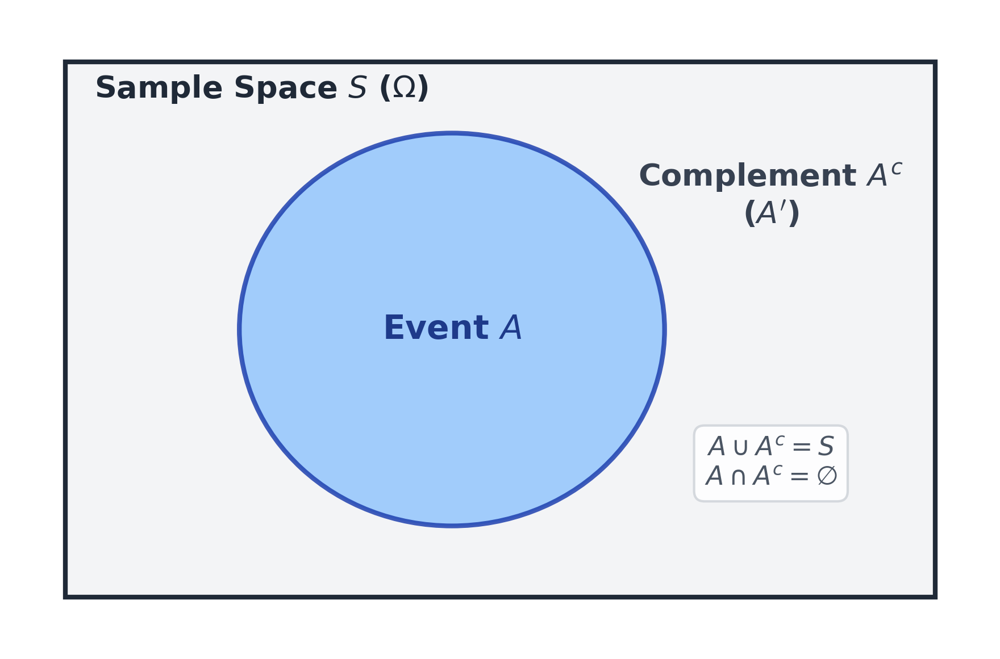
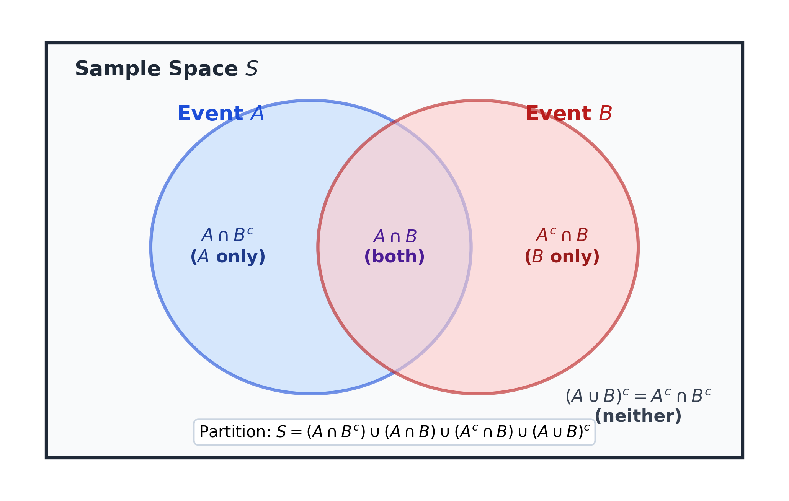
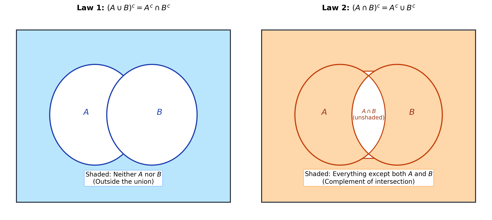
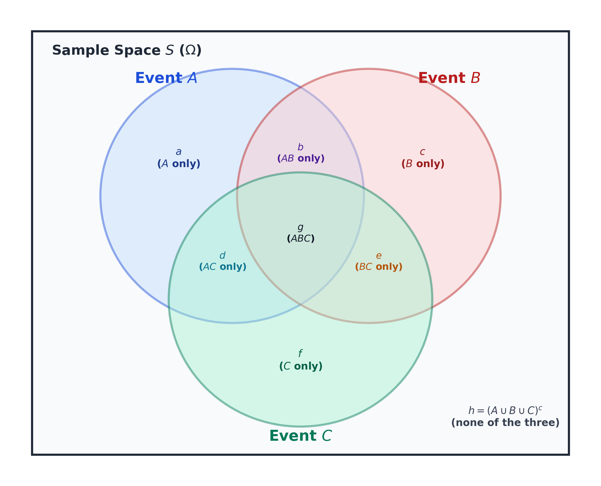
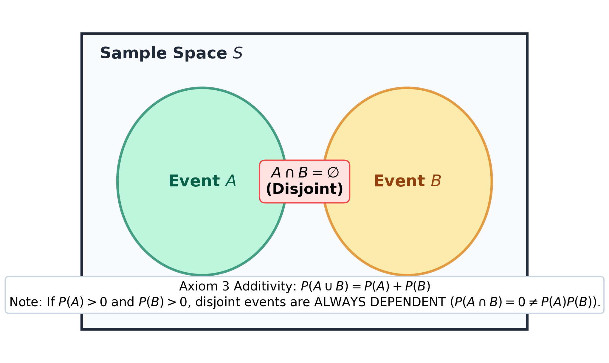
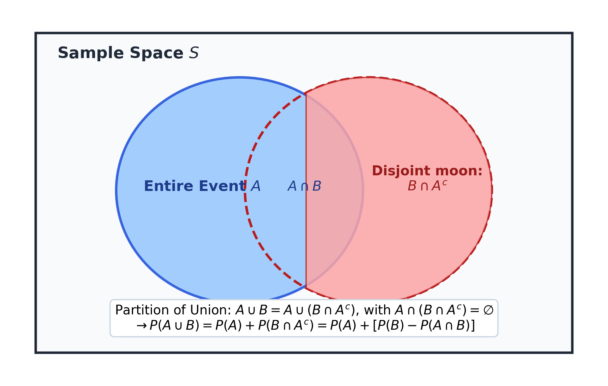
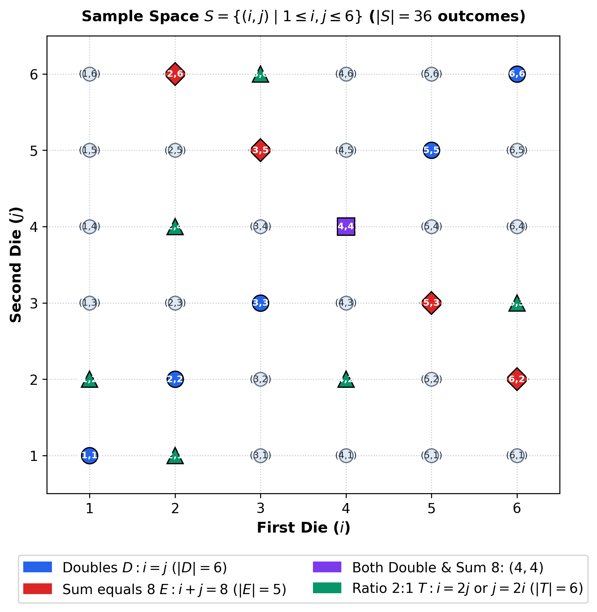

# STA237 Week 1: Introduction to Probability — Comprehensive Study Notes

---

### Table of Contents
- [1. Foundational Concepts of Probability](#1-foundational-concepts-of-probability)
  - [1.1 Random Experiments and Realizations](#11-random-experiments-and-realizations)
  - [1.2 Sample Spaces: Definition and Types](#12-sample-spaces-definition-and-types)
  - [1.3 Events: Simple, Compound, and Special Subsets](#13-events-simple-compound-and-special-subsets)
- [2. Event Operations and Set Algebra](#2-event-operations-and-set-algebra)
  - [2.1 Complements, Unions, Intersections, and Differences](#21-complements-unions-intersections-and-differences)
  - [2.2 Fundamental Laws of Set Algebra](#22-fundamental-laws-of-set-algebra)
  - [2.3 Visualizing Events via Venn Diagrams](#23-visualizing-events-via-venn-diagrams)
- [3. Meaning and Interpretations of Probability](#3-meaning-and-interpretations-of-probability)
  - [3.1 Classical (Equally Likely Outcomes) Interpretation](#31-classical-equally-likely-outcomes-interpretation)
  - [3.2 Empirical (Relative Frequency) Interpretation](#32-empirical-relative-frequency-interpretation)
  - [3.3 Subjective (Personal Degree of Belief) Interpretation](#33-subjective-personal-degree-of-belief-interpretation)
- [4. Probability Models and the Kolmogorov Axioms](#4-probability-models-and-the-kolmogorov-axioms)
  - [4.1 Formal Specification of a Probability Model](#41-formal-specification-of-a-probability-model)
  - [4.2 The Three Kolmogorov Axioms](#42-the-three-kolmogorov-axioms)
  - [4.3 Model Validation and Normalization](#43-model-validation-and-normalization)
- [5. Key Probability Identities and Axiomatic Proofs](#5-key-probability-identities-and-axiomatic-proofs)
  - [5.1 The Null Event Theorem](#51-the-null-event-theorem)
  - [5.2 The Complement Rule](#52-the-complement-rule)
  - [5.3 Monotonicity and Event Differences](#53-monotonicity-and-event-differences)
  - [5.4 The Addition Rule and Inclusion-Exclusion Principle (Two Events)](#54-the-addition-rule-and-inclusion-exclusion-principle-two-events)
  - [5.5 Extension to Three Events and Bonferroni's Inequality](#55-extension-to-three-events-and-bonferronis-inequality)
- [6. Event Relationships: Disjointness, Dependence, and Independence](#6-event-relationships-disjointness-dependence-and-independence)
  - [6.1 Mutually Exclusive (Disjoint) Events](#61-mutually-exclusive-disjoint-events)
  - [6.2 Independent vs. Dependent Events](#62-independent-vs-dependent-events)
  - [6.3 The Fundamental Contrast: Disjointness vs. Independence](#63-the-fundamental-contrast-disjointness-vs-independence)
- [7. Classical Probability with Equally Likely Outcomes](#7-classical-probability-with-equally-likely-outcomes)
  - [7.1 Uniform Discrete Probability Measures](#71-uniform-discrete-probability-measures)
  - [7.2 Systematic Outcome Enumeration and Lattices](#72-systematic-outcome-enumeration-and-lattices)
- [8. Computational Simulation in R: Monte Carlo Foundations](#8-computational-simulation-in-r-monte-carlo-foundations)
  - [8.1 The `sample()` and `replicate()` Functions](#81-the-sample-and-replicate-functions)
  - [8.2 Law of Large Numbers Intuition](#82-law-of-large-numbers-intuition)
- [9. Standardized Problem Types (PT Framework)](#9-standardized-problem-types-pt-framework)
  - [Problem Type PT-01: Specifying Random Experiments, Sample Spaces, and Events](#problem-type-pt-01-specifying-random-experiments-sample-spaces-and-events)
  - [Problem Type PT-02: Event Operations and Set Algebra](#problem-type-pt-02-event-operations-and-set-algebra)
  - [Problem Type PT-03: Classifying Event Relations: Independence vs. Mutual Exclusivity](#problem-type-pt-03-classifying-event-relations-independence-vs-mutual-exclusivity)
  - [Problem Type PT-04: Probability Models, Kolmogorov Axioms, and Model Validation](#problem-type-pt-04-probability-models-kolmogorov-axioms-and-model-validation)
  - [Problem Type PT-05: Axiomatic Proofs and Probability Identities](#problem-type-pt-05-axiomatic-proofs-and-probability-identities)
  - [Problem Type PT-06: Venn Diagrams and Regional Decompositions](#problem-type-pt-06-venn-diagrams-and-regional-decompositions)
  - [Problem Type PT-07: Classical Probability with Equally Likely Outcomes](#problem-type-pt-07-classical-probability-with-equally-likely-outcomes)
  - [Problem Type PT-08: Monte Carlo Simulation and Empirical Probability in R](#problem-type-pt-08-monte-carlo-simulation-and-empirical-probability-in-r)

---

## 1. Foundational Concepts of Probability

Probability is the mathematical language of uncertainty. It enables us to model, analyze, and make decisions under unpredictable phenomena. In this section, we define the foundational components of any probabilistic setting: the experiment, its possible results, and the subsets of interest.

#### Material Classification
- **Random Experiments, Sample Spaces, Events**: Core weekly material (Lecture slides 21–25; MMSA §2.1; PAR §1.1).

---

### 1.1 Random Experiments and Realizations

#### Definition
A **random experiment** (often simply called an *experiment*) is any process, action, or observational activity that satisfies two essential criteria:
1. **Uncertainty of Outcome**: The exact outcome of any single trial cannot be predicted with certainty prior to execution, even if conducted under seemingly identical physical conditions.
2. **Known Potential**: The totality of all possible outcomes can be specified in advance.

#### Observations and Realizations
- Each repetition of an experiment is called a **trial**.
- The specific outcome observed when a trial is completed is called a **realization** or **observation**.
- The physical or data-generating mechanism governing the experiment dictates the relative likelihood of observing each possible outcome. For example, tossing an unbiased coin ensures that "Heads" and "Tails" each have an equal $50\%$ chance of occurring.

---

### 1.2 Sample Spaces: Definition and Types

#### Definition
The **sample space** of a random experiment is the set of **all possible outcomes**.

#### Notation Across Textbooks
- In **MMSA** (Devore et al.) and standard mathematical statistics, the sample space is denoted by the capital letter **$S$**.
- In **PAR** (Wagaman) and advanced probability texts, the sample space is denoted by the uppercase Greek letter **$\Omega$** ("Omega"). Individual outcomes are denoted by lowercase Greek letters **$\omega \in \Omega$** ("little omega").
- In these study notes, both notations $S$ and $\Omega$ are used interchangeably to maintain consistency across course sources.

#### Dependence on the Outcome of Interest
The mathematical formulation of the sample space depends directly on what attribute of the experiment is being recorded:
- **Rolling a pair of dice**:
  - If the outcome of interest is the **ordered pair of faces**, the sample space is discrete and consists of $36$ ordered pairs:
    $$S = \{(i, j) \mid i, j \in \{1, 2, 3, 4, 5, 6\}\}$$
  - If the outcome of interest is the **sum of the faces**, the sample space is:
    $$S = \{2, 3, 4, 5, 6, 7, 8, 9, 10, 11, 12\}$$
- **Tossing a coin**:
  - If recording which face lands up: $S = \{H, T\}$.
  - If measuring the exact time $t$ the coin spends in the air before landing: $S = \{t \in \mathbb{R} \mid t \ge 0\}$ (a continuous sample space).

#### Structural Classification of Sample Spaces
Sample spaces are categorized based on their cardinality:

| Sample Space Category | Definition | Cardinality | Canonical Examples |
| :--- | :--- | :--- | :--- |
| **Finite Discrete** | Outcomes can be completely listed; set is finite | Finite integer $N$ | Single die roll: $\{1, 2, 3, 4, 5, 6\}$; Coin toss: $\{H, T\}$ |
| **Countably Infinite Discrete** | Outcomes can be placed in 1-to-1 correspondence with positive integers $\mathbb{N}$ | Infinite ($\aleph_0$) | Number of tosses until first head occurs: $\{1, 2, 3, \dots\}$ |
| **Continuous** | Outcomes form an unbroken interval or region in $\mathbb{R}^n$ | Uncountably infinite ($\mathfrak{c}$) | Lifespan of an electronic component: $[0, \infty)$; Battery voltage: $[1.2, 1.6]$ |

---

### 1.3 Events: Simple, Compound, and Special Subsets

#### Definition: Event
An **event** is any subset of the sample space $S$ (i.e., $A \subseteq S$). We say that event $A$ **occurs** on a particular trial if the realized outcome $\omega$ satisfies $\omega \in A$.

#### Categories of Events
- **Simple Event (Elementary Event)**: An event containing exactly **one** outcome, represented as a singleton set:
  $$E = \{\omega\}$$
  *Example*: In a die roll, $E = \{4\}$.
  > [!NOTE]
  > Rigorous mathematical notation distinguishes between the outcome $\omega$ (an element) and the simple event $\{\omega\}$ (a set containing the element).
- **Compound Event**: An event containing **more than one** outcome.
  *Example*: Rolling an even number on a die, $A = \{2, 4, 6\}$.
- **Certain Event (Universal Event)**: The entire sample space $S$ (or $\Omega$). Because every trial must produce an outcome in $S$, $S$ always occurs.
- **Impossible Event (Null Event)**: The empty set $\emptyset = \{\}$. It contains no outcomes, so it can never occur.

---

## 2. Event Operations and Set Algebra

Because events are formal mathematical sets, operations combining or modifying events follow the rigorous algebra of set theory.

#### Material Classification
- **Event Operations, De Morgan's Laws, Venn Diagrams**: Core weekly material (Lecture slides 26–28, 35–36; MMSA §2.1; PAR §1.1).

---

### 2.1 Complements, Unions, Intersections, and Differences

Let $A$ and $B$ be events defined on the sample space $S$.

#### 1. Complement
- **Definition**: The complement of $A$ is the set of all outcomes in the sample space $S$ that do **not** belong to $A$.
  $$A^c = \{\omega \in S \mid \omega \notin A\}$$
- **Notation Warning (From Lecture)**:
  > [!WARNING]
  > In STA237, complements are denoted by $A^c$ or $A^\prime$. The overline notation $\bar{A}$ is **strictly avoided** because in statistics, $\bar{A}$ universally denotes the sample mean.
- **Partition Property**: For any event $A$, $A$ and $A^c$ form an exhaustive and mutually exclusive partition of the sample space:
  $$A \cup A^c = S \quad \text{and} \quad A \cap A^c = \emptyset$$



#### 2. Union
- **Definition**: The union of $A$ and $B$, denoted $A \cup B$ (read "$A$ union $B$" or "$A$ or $B$"), consists of all outcomes that belong to $A$, to $B$, or to both:
  $$A \cup B = \{\omega \in S \mid \omega \in A \text{ or } \omega \in B\}$$
- **Interpretation**: Occurrence of **at least one** of the events $A$ or $B$.

#### 3. Intersection
- **Definition**: The intersection of $A$ and $B$, denoted $A \cap B$ or shorthand $AB$ (read "$A$ intersect $B$" or "$A$ and $B$"), consists of all outcomes that belong to **both** $A$ and $B$:
  $$A \cap B = \{\omega \in S \mid \omega \in A \text{ and } \omega \in B\}$$
- **Interpretation**: Simultaneous occurrence of both $A$ and $B$.

#### 4. Event Difference (Relative Complement)
- **Definition**: The set difference $A \setminus B$ (or $A - B$), read "$A$ without $B$", consists of outcomes that belong to $A$ but do not belong to $B$:
  $$A \setminus B = A \cap B^c = \{\omega \in S \mid \omega \in A \text{ and } \omega \notin B\}$$
- **Interpretation**: Occurrence of **$A$ only** (i.e., $A$ occurs while $B$ does not).

#### 5. Fundamental Partition Decomposition
Any event $A$ can be expressed as the union of two disjoint components relative to any arbitrary event $B$:
$$A = (A \cap B) \cup (A \cap B^c)$$
where $(A \cap B) \cap (A \cap B^c) = \emptyset$. This decomposition is the backbone of axiomatic probability proofs.



---

### 2.2 Fundamental Laws of Set Algebra

Event operations satisfy algebraic identities analogous to arithmetic properties:

#### 1. Commutative Laws
The order in which events are combined does not affect the resulting set:
$$A \cup B = B \cup A \quad \text{and} \quad A \cap B = B \cap A$$

#### 2. Associative Laws
Grouping does not alter operations of the same type:
$$(A \cup B) \cup C = A \cup (B \cup C) \quad \text{and} \quad (A \cap B) \cap C = A \cap (B \cap C)$$

#### 3. Distributive Laws
Intersection distributes over union, and union distributes over intersection:
$$A \cap (B \cup C) = (A \cap B) \cup (A \cap C)$$
$$A \cup (B \cap C) = (A \cup B) \cap (A \cup C)$$

#### 4. De Morgan's Laws
De Morgan's laws establish how negation (complement) interacts with conjunction (intersection) and disjunction (union):
- **First Law (Complement of Union)**: The complement of the union of two events equals the intersection of their individual complements:
  $$(A \cup B)^c = A^c \cap B^c$$
  *Verbal translation*: "Not ($A$ or $B$)" is mathematically equivalent to "Neither $A$ nor $B$" (i.e., "Not $A$ AND Not $B$").
- **Second Law (Complement of Intersection)**: The complement of the intersection of two events equals the union of their individual complements:
  $$(A \cap B)^c = A^c \cup B^c$$
  *Verbal translation*: "Not ($A$ and $B$)" is mathematically equivalent to "Not both" (i.e., "Not $A$ OR Not $B$").
- **Generalization to $n$ Events**:
  $$\left(\bigcup_{i=1}^n A_i\right)^c = \bigcap_{i=1}^n A_i^c \quad \text{and} \quad \left(\bigcap_{i=1}^n A_i\right)^c = \bigcup_{i=1}^n A_i^c$$



---

### 2.3 Visualizing Events via Venn Diagrams

A **Venn diagram** represents the sample space $S$ as a bounding rectangle and events as closed geometric figures (typically circles or ellipses) inside $S$.

#### Regional Partition Systems
- **Two Events ($A$ and $B$)**: Decomposes the sample space into **$4$ mutually exclusive regions**:
  1. $R_1 = A \cap B^c$ ($A$ only)
  2. $R_2 = A^c \cap B$ ($B$ only)
  3. $R_3 = A \cap B$ (Both $A$ and $B$)
  4. $R_4 = (A \cup B)^c = A^c \cap B^c$ (Neither $A$ nor $B$)
  The sample space is partitioned as:
  $$S = (A \cap B^c) \cup (A \cap B) \cup (A^c \cap B) \cup (A \cup B)^c$$

- **Three Events ($A$, $B$, and $C$)**: Decomposes the sample space into **$8$ mutually exclusive regions**:
  1. $R_1 = A \cap B^c \cap C^c$ ($A$ only)
  2. $R_2 = A^c \cap B \cap C^c$ ($B$ only)
  3. $R_3 = A^c \cap B^c \cap C$ ($C$ only)
  4. $R_4 = A \cap B \cap C^c$ ($A$ and $B$ only, not $C$)
  5. $R_5 = A \cap B^c \cap C$ ($A$ and $C$ only, not $B$)
  6. $R_6 = A^c \cap B \cap C$ ($B$ and $C$ only, not $A$)
  7. $R_7 = A \cap B \cap C$ (All three events)
  8. $R_8 = (A \cup B \cup C)^c = A^c \cap B^c \cap C^c$ (None of the three events)



> [!CAUTION]
> **Venn Diagram Interpretive Caution**:
> 1. In a standard Venn diagram, the geometric area of a drawn region does **not** represent probability unless the diagram has been explicitly scaled as a probability mass map.
> 2. **Never** draw two non-overlapping circles to represent independent events. Non-overlapping circles represent *mutually exclusive* events, which (if both have non-zero probability) are *never independent*.

---

## 3. Meaning and Interpretations of Probability

What does a probability statement such as $P(A) = 0.30$ actually mean? Modern probability theory accommodates three primary interpretations:

#### Material Classification
- **Interpretations of Probability**: Core weekly material (Lecture slides 22–23; MMSA §2.2; PAR §1.2).

---

### 3.1 Classical (Equally Likely Outcomes) Interpretation

#### Conceptual Basis
Originated by Pierre-Simon Laplace in the study of games of chance. If a random experiment has a finite sample space of $N$ possible outcomes that are symmetric and equally likely by design, the probability of an event $A$ containing $N(A)$ outcomes is defined as:
$$P(A) = \frac{N(A)}{N} = \frac{|A|}{|S|}$$

#### Critical Assumptions and Boundaries
> [!IMPORTANT]
> The classical formula $P(A) = |A| / |S|$ requires two strict assumptions:
> 1. The sample space $S$ must be **finite**.
> 2. Every individual elementary outcome $\omega \in S$ must have the **exact same probability** of occurring.
> 
> If outcomes are not equally likely (e.g., loaded dice, biased coins, or irregular physical components), the formula $P(A) = |A| / |S|$ fails completely.

---

### 3.2 Empirical (Relative Frequency) Interpretation

#### Conceptual Basis
In real-world physical, biological, and engineering systems, outcomes are rarely equally likely. The empirical interpretation views probability as the **limiting relative frequency** of an event in an infinitely repeatable sequence of independent trials under identical conditions.

Let $n$ be the total number of experimental trials conducted, and let $n(A)$ be the number of trials on which event $A$ occurs. The relative frequency is:
$$f_n(A) = \frac{n(A)}{n}$$
The objective probability of event $A$ is defined as the mathematical limit as $n$ approaches infinity:
$$P(A) = \lim_{n \to \infty} \frac{n(A)}{n}$$

#### Empirical Convergence
For finite $n$, $f_n(A)$ fluctuates due to random variation. As $n$ grows large, the fluctuations damp out, and $f_n(A)$ stabilizes around a single limiting value $P(A)$. This empirical stability forms the conceptual basis for Monte Carlo simulation.

---

### 3.3 Subjective (Personal Degree of Belief) Interpretation

#### Conceptual Basis
Many events of vital interest cannot be repeated under identical conditions (e.g., "What is the probability that candidate $X$ wins the upcoming election?", "What is the probability that a new tech startup succeeds?"). 
In the subjective interpretation, $P(A)$ represents an individual's **quantified degree of personal belief** or certainty that event $A$ will occur, given the information available at that moment.

#### Rationality Constraint
Even though subjective probabilities reflect personal belief, they are not arbitrary: to avoid internal contradictions (such as guaranteed betting losses, known as "Dutch books"), subjective assessments must still strictly obey the **Kolmogorov probability axioms**.

---

## 4. Probability Models and the Kolmogorov Axioms

To place probability on a rigorous mathematical foundation free from philosophical debates over interpretation, Russian mathematician Andrey Kolmogorov established the **axiomatic system** in 1933.

#### Material Classification
- **Kolmogorov Axioms and Probability Functions**: Core weekly material (Lecture slides 37–38; MMSA §2.2; PAR §1.3).

---

### 4.1 Formal Specification of a Probability Model

A complete mathematical **probability model** for a random experiment consists of two components:
1. A **sample space** $S$ (or $\Omega$) containing all possible outcomes.
2. A **probability function** (or *probability measure*) $P$ that assigns a real number $P(A)$ to every event $A \subseteq S$, satisfying the Kolmogorov axioms.

---

### 4.2 The Three Kolmogorov Axioms

Let $S$ be the sample space of a random experiment. A valid probability measure $P$ must satisfy the following three axioms:

#### Axiom 1 (Non-negativity)
For every event $A \subseteq S$, the assigned probability is a non-negative real number:
$$P(A) \ge 0$$
*(No event can have negative probability).*

#### Axiom 2 (Total Probability / Normalization)
The probability of the entire sample space (the certain event) is equal to $1$:
$$P(S) = 1 \quad (\text{or } P(\Omega) = 1)$$
*(The sum of probabilities across all possible outcomes must equal 1).*

#### Axiom 3 (Additivity for Disjoint Events)
- **Finite Additivity**: If $A$ and $B$ are mutually exclusive (disjoint) events (i.e., $A \cap B = \emptyset$), then:
  $$P(A \cup B) = P(A) + P(B)$$
- **Countable Additivity**: If $A_1, A_2, A_3, \dots$ is a sequence of pairwise disjoint events (i.e., $A_i \cap A_j = \emptyset$ for all $i \ne j$), then:
  $$P\left(\bigcup_{i=1}^\infty A_i\right) = \sum_{i=1}^\infty P(A_i)$$



---

### 4.3 Model Validation and Normalization

When proposed with a discrete probability function $P(\omega_i) = p_i$ for outcomes $\omega_i \in S$, verifying validity requires checking two conditions:
1. **Non-negativity**: $p_i \ge 0$ for all $i$.
2. **Normalization**: $\sum_{\omega_i \in S} p_i = 1$.

#### Determining Normalization Constants
If outcome probabilities are specified up to an unknown proportionality constant $c$ (e.g., $P(\omega_i) = c \cdot w_i$), the constant $c$ is uniquely solved using Axiom 2:
$$\sum_{\omega_i \in S} c \cdot w_i = 1 \implies c = \frac{1}{\sum_{\omega_i \in S} w_i}$$

---

## 5. Key Probability Identities and Axiomatic Proofs

Every theorem, rule, and formula in probability theory can be derived using only the three Kolmogorov axioms and the laws of set algebra. In STA237, constructing step-by-step proofs from the axioms is a required test-level skill.

#### Material Classification
- **Axiomatic Proofs and Identities**: Core and Test Level material (Lecture slides 38, 40; MMSA §2.2; PAR §1.4).

---

### 5.1 The Null Event Theorem

#### Theorem
The probability of the impossible (empty) event $\emptyset$ is zero:
$$P(\emptyset) = 0$$

#### Formal Axiomatic Proof
1. Consider the sample space $S$ and the empty set $\emptyset$. By definition of the null set, $S \cup \emptyset = S$.
2. Furthermore, $S$ and $\emptyset$ are disjoint: $S \cap \emptyset = \emptyset$.
3. Apply Axiom 3 (Additivity for disjoint events) to the union $S \cup \emptyset$:
   $$P(S \cup \emptyset) = P(S) + P(\emptyset)$$
4. Substitute $P(S \cup \emptyset) = P(S)$:
   $$P(S) = P(S) + P(\emptyset)$$
5. Subtract $P(S)$ from both sides:
   $$P(\emptyset) = 0 \quad \blacksquare$$

---

### 5.2 The Complement Rule

#### Theorem
For any event $A \subseteq S$, the probability that $A$ does not occur is:
$$P(A^c) = 1 - P(A)$$

#### Formal Axiomatic Proof
1. By set theory, any event $A$ and its complement $A^c$ satisfy:
   $$A \cup A^c = S \quad \text{and} \quad A \cap A^c = \emptyset$$
2. Take the probability of both sides of the union identity:
   $$P(A \cup A^c) = P(S)$$
3. By Axiom 2 (Normalization), $P(S) = 1$.
4. By Axiom 3 (Additivity), since $A \cap A^c = \emptyset$:
   $$P(A \cup A^c) = P(A) + P(A^c)$$
5. Equating the expressions:
   $$P(A) + P(A^c) = 1$$
6. Rearranging yields:
   $$P(A^c) = 1 - P(A) \quad \blacksquare$$

#### Practical Significance
Whenever a problem asks for the probability of "**at least one**", computing the complement ("**none**") is almost always mathematically simpler:
$$P(\text{at least one}) = 1 - P(\text{none})$$

---

### 5.3 Monotonicity and Event Differences

#### Theorem: Difference Rule
For any two events $A$ and $B$ defined on $S$:
$$P(B \setminus A) = P(B \cap A^c) = P(B) - P(A \cap B)$$

#### Theorem: Monotonicity Property
If event $A$ is a subset of event $B$ (i.e., $A \subseteq B$), then:
$$P(A) \le P(B)$$
and
$$P(B \setminus A) = P(B) - P(A)$$

#### Formal Axiomatic Proof of Monotonicity
1. Suppose $A \subseteq B$. Then $A \cap B = A$.
2. Decompose $B$ into two disjoint sets:
   $$B = A \cup (B \setminus A) = A \cup (B \cap A^c)$$
   where $A \cap (B \cap A^c) = \emptyset$.
3. Apply Axiom 3:
   $$P(B) = P(A) + P(B \cap A^c)$$
4. Rearranging gives the difference formula:
   $$P(B \cap A^c) = P(B) - P(A)$$
5. By Axiom 1 (Non-negativity), $P(B \cap A^c) \ge 0$.
6. Therefore:
   $$P(B) - P(A) \ge 0 \implies P(A) \le P(B) \quad \blacksquare$$

#### Corollary: Bounds on Any Probability
Since $\emptyset \subseteq A \subseteq S$ for all events $A$, monotonicity implies:
$$P(\emptyset) \le P(A) \le P(S) \implies 0 \le P(A) \le 1$$

---

### 5.4 The Addition Rule and Inclusion-Exclusion Principle (Two Events)

#### Theorem: General Addition Rule
For **any** two events $A$ and $B$ (disjoint or non-disjoint):
$$P(A \cup B) = P(A) + P(B) - P(A \cap B)$$



#### Formal Axiomatic Proof
1. Express the union $A \cup B$ as the union of two **disjoint** events:
   $$A \cup B = A \cup (B \cap A^c)$$
   *Verification of disjointness*: Any element $x \in B \cap A^c$ satisfies $x \in A^c \implies x \notin A$. Thus $A \cap (B \cap A^c) = \emptyset$.
2. Apply Axiom 3 to this disjoint decomposition:
   $$P(A \cup B) = P(A) + P(B \cap A^c) \quad \text{--- (Equation 1)}$$
3. Now decompose event $B$ into two disjoint events with respect to $A$:
   $$B = (A \cap B) \cup (B \cap A^c)$$
   where $(A \cap B) \cap (B \cap A^c) = \emptyset$.
4. Apply Axiom 3 to event $B$:
   $$P(B) = P(A \cap B) + P(B \cap A^c)$$
5. Isolate $P(B \cap A^c)$:
   $$P(B \cap A^c) = P(B) - P(A \cap B) \quad \text{--- (Equation 2)}$$
6. Substitute Equation 2 into Equation 1:
   $$P(A \cup B) = P(A) + [P(B) - P(A \cap B)] = P(A) + P(B) - P(A \cap B) \quad \blacksquare$$

> [!NOTE]
> When $A$ and $B$ are mutually exclusive, $A \cap B = \emptyset$, so $P(A \cap B) = 0$. The formula simplifies to Axiom 3: $P(A \cup B) = P(A) + P(B)$.

---

### 5.5 Extension to Three Events and Bonferroni's Inequality

#### Inclusion-Exclusion for Three Events
For any three events A, B, and C:
```text
P(A ∪ B ∪ C) = P(A) + P(B) + P(C)
               - [P(A ∩ B) + P(A ∩ C) + P(B ∩ C)]
               + P(A ∩ B ∩ C)
```

#### Axiomatic Derivation Strategy
Let D = A ∪ B. Then A ∪ B ∪ C = D ∪ C. 
Applying the two-event addition rule twice and distributing intersection over union yields the exact 7-term expansion.

#### Generalization to n Events (General Inclusion-Exclusion Principle)
For any collection of n events A1, A2, ..., An:

```text
P(A1 ∪ A2 ∪ ... ∪ An) =
    ∑ P(Ai)                                [All single events: C(n, 1) terms]
  - ∑ P(Ai ∩ Aj)                           [All pairs: C(n, 2) terms, 1 <= i < j <= n]
  + ∑ P(Ai ∩ Aj ∩ Ak)                      [All triplets: C(n, 3) terms, 1 <= i < j < k <= n]
  - ...
  + (-1)^(n - 1) * P(A1 ∩ A2 ∩ ... ∩ An)   [All n events intersection: C(n, n) = 1 term]
```

#### Understanding the Combination Notation C(n, k) and C(m, 2)
- **Combination Definition**: C(n, k) (also read as "n choose k") is the number of ways to pick k items from a set of n distinct items without regard to order:
  `C(n, k) = n! / (k! * (n - k)!)`
- **Meaning of C(m, 2)**: 
  Selecting 2 items from m items:
  `C(m, 2) = m * (m - 1) / 2`
  *Example*: If an outcome belongs to m = 3 events {A, B, C}, the number of distinct two-event pairs is `C(3, 2) = (3 * 2) / 2 = 3` (which are A ∩ B, A ∩ C, and B ∩ C).
- **Total Term Count**: Expanding the union of n events produces:
  `Total terms = 2^n - 1`

#### Rule and Intuition: "Odd-Plus, Even-Minus" (奇加偶减)
- **Sign rule**: Intersections of an **odd** number of events (1, 3, 5, ...) have a **positive (+)** sign; intersections of an **even** number of events (2, 4, 6, ...) have a **negative (-)** sign.
- **Why every outcome in the union is counted exactly once**:
  Suppose a sample outcome belongs to exactly m of the events (1 <= m <= n). In the expanded formula, it is counted:
  - + C(m, 1) times in the single-event terms,
  - - C(m, 2) times in the pair-intersection terms,
  - + C(m, 3) times in the triple-intersection terms,
  - and so forth.
  
  The net calculation count is:
  `Net Count = C(m, 1) - C(m, 2) + C(m, 3) - ... + (-1)^(m-1) * C(m, m) = 1 - (1 - 1)^m = 1`
  Every outcome belonging to at least one event is therefore counted with a net weight of exactly 1.

#### Bonferroni's Inequality (Boole's Inequality)
1. **Boole's Inequality (Union Bound)**:
   ```text
   P(A ∪ B) <= P(A) + P(B)
   ```
   More generally, for any n events:
   ```text
   P(A1 ∪ A2 ∪ ... ∪ An) <= ∑ P(Ai)
   ```
2. **Bonferroni's Inequality for Intersection**:
   From the addition rule, since P(A ∪ B) <= 1:
   ```text
   P(A ∩ B) = P(A) + P(B) - P(A ∪ B) >= P(A) + P(B) - 1
   ```
   This provides a lower bound on simultaneous occurrence without requiring independence.

---

## 6. Event Relationships: Disjointness, Dependence, and Independence

One of the most persistent confusions in introductory probability is conflating *mutually exclusive events* with *independent events*. In STA237, distinguishing these concepts operationally and conceptually is paramount.

#### Material Classification
- **Event Relationships**: Core weekly material (Lecture slides 32–34; MMSA §2.1–2.2; PAR §1.1).

---

### 6.1 Mutually Exclusive (Disjoint) Events

#### Definition
Two events $A$ and $B$ are **mutually exclusive** (or **disjoint**) if they cannot occur simultaneously. In set notation:
$$A \cap B = \emptyset$$
Consequently, by the Null Event theorem:
$$P(A \cap B) = P(\emptyset) = 0$$

#### Operational Meaning
If $P(A)>0$, conditioning on $A$ gives
$$P(B \mid A) = 0$$

---

### 6.2 Independent vs. Dependent Events

#### Definition: Independent Events
Two events $A$ and $B$ are **independent** if
$$P(A \cap B) = P(A)P(B).$$
When $P(A)>0$, this is equivalent to $P(B\mid A)=P(B)$; when $P(B)>0$, it is also equivalent to $P(A\mid B)=P(A)$. The product condition remains valid when an event has probability zero.

#### Definition: Dependent Events
Two events $A$ and $B$ are **dependent** when
$$P(A \cap B) \ne P(A)P(B).$$
When the conditioning event has positive probability, dependence can equivalently be detected by a changed conditional probability.

---

### 6.3 The Fundamental Contrast: Disjointness vs. Independence

The following comparative table summarizes the operational differences:

| Property | Mutually Exclusive (Disjoint) | Independent |
| :--- | :--- | :--- |
| **Formal Condition** | $A \cap B = \emptyset \implies P(A \cap B) = 0$ | $P(A \cap B) = P(A) \cdot P(B)$ |
| **Conditional check** | If $P(A)>0$, then $P(B\mid A)=0$ | If $P(A)>0$, then $P(B\mid A)=P(B)$ |
| **Complement check** | Must be calculated from the model | Independence also implies independence of complements |
| **Venn Diagram Appearance** | Completely separate circles with **zero overlap** | Geometry alone does not establish independence |
| **Interpretation** | The events cannot occur together | The joint probability factors as $P(A)P(B)$ |

#### The Incompatibility Theorem
> [!IMPORTANT]
> **Can two events be simultaneously mutually exclusive and independent?**
> 
> Suppose $A$ and $B$ are mutually exclusive. Then $P(A \cap B) = 0$.
> For $A$ and $B$ to be independent, we must also have $P(A \cap B) = P(A)P(B)$.
> Equating the two requires:
> $$P(A) \cdot P(B) = 0 \implies P(A) = 0 \quad \text{or} \quad P(B) = 0$$
> 
> **Conclusion**:
> If two events are **mutually exclusive** and each has positive probability, they cannot be independent. Both the disjointness condition and the positive-probability condition are necessary for this conclusion.

---

## 7. Classical Probability with Equally Likely Outcomes

When an experiment is symmetric, outcomes possess identical likelihood.

#### Material Classification
- **Equally Likely Outcomes**: Core weekly material (Lecture slides 28–30; MMSA §2.2).

---

### 7.1 Uniform Discrete Probability Measures

If $|S| = N < \infty$ and each outcome $\omega_i$ satisfies $P(\omega_i) = 1/N$, then for any event $A$:
$$P(A) = \sum_{\omega \in A} \frac{1}{N} = \frac{|A|}{N} = \frac{\text{Number of favorable outcomes}}{\text{Total number of possible outcomes}}$$

#### Key Requirements Checklist
Before applying $P(A) = |A| / |S|$, you must verify:
1. Is the sample space **finite**?
2. Are all individual outcomes **mutually exclusive**?
3. Are all individual outcomes **equally likely**?

---

### 7.2 Systematic Outcome Enumeration and Lattices

For multi-stage experiments (such as rolling two dice or tossing coins), constructing an explicit outcome lattice prevents double-counting and ensures correct probability assignment.



#### Ordering Nuances (From Lecture)
- **Order Matters in Cartesian Products**: When rolling a pair of dice (e.g., Die 1 and Die 2), outcome $(2, 6)$ is distinct from $(6, 2)$. If outcomes were treated as unordered sets $\{2, 6\}$, the resulting 21 unordered combinations would **not** be equally likely!
- **Set Uniqueness**: A double roll like $(4, 4)$ is a single unique outcome in $S = \{(i, j)\}$. It is counted once.

---

## 8. Computational Simulation in R: Monte Carlo Foundations

Modern statistics relies extensively on computational simulation to approximate probabilities, examine empirical distributions, and verify theoretical models.

#### Material Classification
- **R Simulation Foundations**: Supplementary / Preview material (Lecture slide 3; PAR §1.9).

---

### 8.1 The `sample()` and `replicate()` Functions

In R, random experiments are simulated using core base-R functions:

#### 1. `sample()`
Draws random elements from a specified vector.
- Syntax: `sample(x, size, replace = FALSE, prob = NULL)`
- To simulate rolling a fair 6-sided die 10 times:
  ```r
  rolls <- sample(1:6, size = 10, replace = TRUE)
  ```
  *(Sampling with replacement `replace = TRUE` models independent repeated trials).*

#### 2. `replicate()`
Repeats an entire expression or function $N$ times.
- Simulating the sum of two rolled dice across $N = 100,000$ trials:
  ```r
  sim_dice <- replicate(100000, {
    d1 <- sample(1:6, 1)
    d2 <- sample(1:6, 1)
    d1 + d2
  })
  ```

#### 3. Estimating Probabilities via Boolean Mean
In R, a logical condition returns a vector of `TRUE` (treated as 1) and `FALSE` (treated as 0). The arithmetic mean `mean()` calculates the empirical relative frequency:
```r
## Estimate P(Sum >= 8)
mean(sim_dice >= 8)
```

---

### 8.2 Law of Large Numbers Intuition

As the number of simulation replications $N \to \infty$, the Monte Carlo estimate $\hat{p}_N = \frac{1}{N}\sum_{k=1}^N I(A_k)$ converges almost surely to the true theoretical probability $P(A)$. Simulation serves as a powerful verification tool for analytical derivations.

---

## 9. Standardized Problem Types (PT Framework)

This section presents the 8 standardized Problem Types for STA237 Week 1. Each Problem Type provides the structural anatomy, general solution methodology, original teaching example question, answer checklist, and common pitfalls. 

*(In accordance with study note design standards, worked solutions and final numerical answers are withheld from this file and appear exclusively in [Answers-and-Practice.md](Answers-and-Practice.md)).*

---

### Problem Type PT-01: Specifying Random Experiments, Sample Spaces, and Events

**Classification:** Core weekly material

#### Meaning and recognition
- **Meaning**: Translating a real-world scenario or observational study into the formal mathematical language of probability. Involves identifying the random experiment, determining what attribute is being recorded (the outcome of interest), defining the sample space $S$ (or $\Omega$), and expressing specific events using set-builder notation or roster form.
- **Recognition cues**: Look for phrasing such as:
  - *"Identify the random experiment, sample space, and event of interest."*
  - *"List the outcomes in the sample space."*
  - *"Define the event that [condition holds] in set notation."*

#### General method
1. **Identify the random experiment**: State the action, process, or observation whose outcome is uncertain before execution.
2. **Determine the outcome of interest**: Decide whether the experiment records an ordered sequence (tuples $(x_1, \dots, x_k)$), a simple count, a qualitative category, or a continuous measurement.
3. **Specify the sample space $S$**:
   - For small discrete spaces: List all elements in roster form $S = \{\omega_1, \omega_2, \dots, \omega_N\}$.
   - For large or continuous spaces: Use set-builder notation $S = \{x \mid \text{conditions}\}$.
   - State the total cardinality $|S|$ if finite.
4. **Formulate the event of interest**: Translate verbal conditions into a mathematical inequality or membership rule (e.g., $E = \{(i, j) \in S \mid i + j \ge 8\}$).

#### Teaching example — source-based or adapted question
*(Source: STA237 Lecture Slide 24–25; PAR Example 1.3)*

Yolanda and Zach are running for president of the student association. Exactly 1000 students will be voting, and each voter will pick one of the two candidates (no abstentions or spoiled ballots).
- **Part (a)**: Identify the sample space $S$ if the outcome of interest is the **exact vote breakdown** between Yolanda and Zach.
- **Part (b)**: Identify the sample space $S$ if the outcome of interest is simply **who wins the election**.
- **Part (c)**: Using the sample space from Part (a), express the event $Y$ that **Yolanda beats Zach by at least 100 votes** in set-builder notation and determine the range of votes Yolanda must receive.

#### A complete answer must include
- [ ] Explicit specification of the random variable/index used for vote counts.
- [ ] Set-builder representation defining valid integer bounds for Part (a).
- [ ] Discrete set listing all possible political outcomes (including ties) for Part (b).
- [ ] Mathematical inequality translating "beats by at least 100 votes": $\text{Votes}_Y - \text{Votes}_Z \ge 100$.
- [ ] Exact threshold calculation showing the minimum integer vote total Yolanda needs to satisfy the condition.

#### Common mistakes
- Omitting the tie outcome when listing qualitative election outcomes.
- Forgetting that the vote counts are constrained by a sum of 1000 (i.e., $\text{Votes}_Z = 1000 - \text{Votes}_Y$).
- Confusing strict inequality ($>$) with inclusive inequality ($\ge$) when interpreting "at least 100 votes".

---

### Problem Type PT-02: Event Operations and Set Algebra

**Classification:** Core weekly material

#### Meaning and recognition
- **Meaning**: Constructing new events from existing events using set operations ($\cup, \cap, \setminus, ^c$) and applying set-theoretic identities (De Morgan's laws, distributive laws) to simplify event descriptions.
- **Recognition cues**: Look for terms such as *"both", "either", "neither", "at least one", "not both", "only"* or explicit set expressions like $(A \cup B)^c$.

#### General method
1. **Translate verbal phrases into formal set operations**:
   - "$A$ and $B$" $\implies A \cap B$
   - "$A$ or $B$" (inclusive) $\implies A \cup B$
   - "Neither $A$ nor $B$" $\implies (A \cup B)^c = A^c \cap B^c$
   - "$A$ occurs but $B$ does not" $\implies A \setminus B = A \cap B^c$
   - "At most one of $A$ or $B$" $\implies (A \cap B)^c = A^c \cup B^c$
2. **Apply set identities**:
   - Use De Morgan's laws to push complements inside parentheses.
   - Use distributive laws to factor or expand compound expressions.
3. **Partition events**:
   - Express unions as disjoint components: $A \cup B = A \cup (B \cap A^c)$.

#### Teaching example — source-based or adapted question
*(Source: STA237 Lecture Slide 29; "Try for Yourself")*

Suppose you roll a fair, six-sided die twice and record the pairs of outcomes as $(\text{first roll}, \text{second roll})$.
- **Part (a)**: Formulate the sample space $\Omega$ in set-builder notation and determine the total number of outcomes $|\Omega|$.
- **Part (b)**: Define and list the outcomes belonging to event $D$: **doubles were rolled**.
- **Part (c)**: Define and list the outcomes belonging to event $E$: **the sum of the two dice equals 8**.
- **Part (d)**: In-class conceptual check:
  - (i) Are the outcomes $(2, 6)$ and $(6, 2)$ distinct elements in $\Omega$? Explain why or why not.
  - (ii) Does the outcome $(4, 4)$ belong to both $D$ and $E$? How many times is $(4, 4)$ counted in the union $D \cup E$?
- **Part (e)**: Define and list the outcomes belonging to event $T$: **one die has twice the face value of the other**.

#### A complete answer must include
- [ ] Explicit ordered pair notation $(i, j)$ with $1 \le i, j \le 6$.
- [ ] Correct enumeration of sets $D$, $E$, and $T$ in roster form.
- [ ] Clear justification regarding why order matters for pairs of dice.
- [ ] Explanation of set idempotence (elements are counted exactly once in unions).

#### Common mistakes
- Treating $(2, 6)$ and $(6, 2)$ as the same outcome.
- Duplicating $(4, 4)$ when listing elements of $D \cup E$.
- Misinterpreting "one die is twice the other" as only $i = 2j$, forgetting that $j = 2i$ is also possible.

---

### Problem Type PT-03: Classifying Event Relations: Independence vs. Mutual Exclusivity

**Classification:** Core weekly material

#### Meaning and recognition
- **Meaning**: Evaluating pairs or collections of events to determine whether they are mutually exclusive (disjoint), independent, or dependent.
- **Recognition cues**: Questions asking:
  - *"Are events $A$ and $B$ mutually exclusive? Justify using set notation."*
  - *"Are events $A$ and $B$ independent? Explain intuitively or verify mathematically."*
  - *"Can two disjoint events with positive probability be independent?"*

#### General method
1. **Test for Mutual Exclusivity (Disjointness)**:
   - Check if $A$ and $B$ can occur simultaneously: Can $A \cap B \ne \emptyset$?
   - If $A \cap B = \emptyset$, they are mutually exclusive. If $A \cap B \ne \emptyset$, they are **not** mutually exclusive.
2. **Test for Independence**:
   - Check if information about $A$ alters the likelihood of $B$: Does $P(B \mid A) = P(B)$?
   - Or test the product rule: Does $P(A \cap B) = P(A)P(B)$?
3. **Apply the Incompatibility Theorem**:
   - If $A \cap B = \emptyset$ and both $P(A) > 0$ and $P(B) > 0$, the events are **dependent**. They can never be independent.

#### Teaching example — source-based or adapted question
*(Source: STA237 Lecture Slide 34; Example 3)*

Classify each of the following pairs of events as mutually exclusive, independent, or dependent (or a combination thereof), providing mathematical justification for each:
- **Scenario 1**: A student at the University of Toronto is randomly selected and surveyed about their timetable. Let $A = \{\text{Student is enrolled in a 100-level course}\}$ and $B = \{\text{Student is enrolled in a 300-level course}\}$.
- **Scenario 2**: A standard card is drawn at random from a well-shuffled 52-card deck. Let $A = \{\text{The drawn card is black}\}$ and $B = \{\text{The drawn card is the Ace of Spades}\}$.
- **Scenario 3**: You and your friend each flip a fair coin twice and record the outcomes. Let $A = \{\text{You land } HH\}$ and $B = \{\text{Your friend lands } TT\}$.

#### A complete answer must include
- [ ] Set intersection analysis ($A \cap B = \emptyset$ vs. $A \cap B \ne \emptyset$) for all three scenarios.
- [ ] Recognition that Scenario 1 does not provide enough numerical information to decide independence.
- [ ] Exact probability calculation of $P(B)$, $P(B \mid A)$, and $P(B \mid A^c)$ for Scenario 2.
- [ ] Clear argument regarding physically independent random mechanisms for Scenario 3.

#### Common mistakes
- Claiming that events are mutually exclusive just because they feel unrelated.
- Assuming that independent events must have equal probabilities.
- Asserting that disjoint events are independent.

---

### Problem Type PT-04: Probability Models, Kolmogorov Axioms, and Model Validation

**Classification:** Core weekly material

#### Meaning and recognition
- **Meaning**: Evaluating a proposed probability function to confirm whether it constitutes a mathematically valid probability model, or finding an unknown normalization constant $c$ that makes it valid.
- **Recognition cues**: Look for problems presenting a function $P(x)$ and asking:
  - *"Verify whether $P$ satisfies the Kolmogorov axioms."*
  - *"Find the constant $c$ such that $P$ is a legitimate probability distribution."*
  - *"Prove that a weighted mixture of two probability measures is a valid probability measure."*

#### General method
1. **Check Axiom 1 (Non-negativity)**:
   - Prove that $P(A) \ge 0$ for all events $A$ in the sample space.
2. **Check Axiom 2 (Total Probability / Normalization)**:
   - Prove that the total probability over the entire sample space equals 1:
     $$\sum_{\omega \in S} P(\omega) = 1 \quad \text{or} \quad P(S) = 1$$
   - If solving for $c$, equate the sum to 1 and solve for $c$.
3. **Check Axiom 3 (Additivity for Disjoint Events)**:
   - Verify that for any two disjoint events $A$ and $B$ ($A \cap B = \emptyset$), $P(A \cup B) = P(A) + P(B)$.

#### Teaching example — source-based or adapted question
*(Source: PAR Section 1.3, Exercise 1.13)*

Suppose $P_1$ and $P_2$ are two legitimate probability functions defined on the same discrete sample space $\Omega$. Let $\alpha$ be a fixed real constant such that $0 \le \alpha \le 1$. Define a new function $P$ on events $A \subseteq \Omega$ by:
$$P(A) = \alpha P_1(A) + (1 - \alpha) P_2(A)$$
Using the three Kolmogorov axioms, prove that $P$ is a mathematically valid probability function on $\Omega$.

#### A complete answer must include
- [ ] Formal proof that $P(A) \ge 0$ for all $A$, explicitly stating how $0 \le \alpha \le 1$ preserves non-negativity.
- [ ] Formal verification that $P(\Omega) = 1$ using $P_1(\Omega) = 1$ and $P_2(\Omega) = 1$.
- [ ] Step-by-step verification of Axiom 3 for arbitrary disjoint events $A \cap B = \emptyset$, factoring $\alpha$ and $(1 - \alpha)$.

#### Common mistakes
- Checking only normalization while forgetting to verify non-negativity.
- Neglecting to state where the condition $0 \le \alpha \le 1$ is required in the proof.

---

### Problem Type PT-05: Axiomatic Proofs and Probability Identities

**Classification:** Core / Test Level material

#### Meaning and recognition
- **Meaning**: Constructing formal mathematical proofs for probability identities starting strictly from the three Kolmogorov axioms and standard set definitions, without relying on geometric intuition or informal Venn diagram sketches.
- **Recognition cues**: Phrasing such as:
  - *"Starting from the Kolmogorov axioms, prove that..."*
  - *"Prove the general addition rule for two events."*
  - *"Prove that if $A \subseteq B$, then $P(A) \le P(B)$."*

#### General method
1. **Express the target event as a union of disjoint sets**:
   - For complements: $S = A \cup A^c$ where $A \cap A^c = \emptyset$.
   - For event differences: $B = (A \cap B) \cup (B \cap A^c)$ where $(A \cap B) \cap (B \cap A^c) = \emptyset$.
   - For unions: $A \cup B = A \cup (B \cap A^c)$ where $A \cap (B \cap A^c) = \emptyset$.
2. **Apply Axiom 3 (Additivity for Disjoint Events)**:
   - Convert set unions into sums of probabilities.
3. **Apply Axiom 2 (Normalization)** or **Axiom 1 (Non-negativity)** where applicable.
4. **Algebraically rearrange terms** to obtain the target equation.

#### Teaching example — source-based or adapted question
*(Source: MMSA Section 2.2, Exercise 26 & Lecture Slide 38)*

- **Part (a)**: Use the Kolmogorov axioms to prove the **Monotonicity Property**: If $A \subseteq B$, then $P(A) \le P(B)$.
- **Part (b)**: Use the result of Part (a) to prove that for any arbitrary event $E \subseteq S$, $P(E) \le 1$.
- **Part (c)**: Starting from the disjoint decomposition $A \cup B = A \cup (B \cap A^c)$, provide a complete step-by-step axiomatic proof of the **Inclusion-Exclusion Principle (Addition Rule)** for any two events $A$ and $B$:
  $$P(A \cup B) = P(A) + P(B) - P(A \cap B)$$

#### A complete answer must include
- [ ] Explicit identification of the disjoint sets being combined.
- [ ] Explicit citation of Axiom 3 when converting $P(X \cup Y)$ to $P(X) + P(Y)$.
- [ ] Explicit citation of Axiom 1 ($P(\cdot) \ge 0$) to justify the inequality in the monotonicity proof.
- [ ] Rigorous verification that $A \cap (B \cap A^c) = \emptyset$.

#### Common mistakes
- Stating $P(A \cup B) = P(A) + P(B) - P(A \cap B)$ as an axiom rather than proving it.
- Skipping the decomposition of $B = (A \cap B) \cup (B \cap A^c)$ in the addition rule proof.
- Claiming that $A$ and $B$ are disjoint when proving the general addition rule.

---

### Problem Type PT-06: Venn Diagrams and Regional Decompositions

**Classification:** Core weekly material

#### Meaning and recognition
- **Meaning**: Solving word problems involving counts or probabilities across overlapping categories by decomposing the sample space into distinct, non-overlapping regions (4 regions for two events, 8 regions for three events).
- **Recognition cues**: Problems presenting group survey data (e.g., student course enrollments, customer purchases, shared traits) with phrases such as:
  - *"How many surveyed individuals experienced both...?"*
  - *"Determine the probability that a randomly chosen person has neither trait."*
  - *"Find the probability of exactly one event occurring."*

#### General method
1. **Define event letters clearly** and identify the total count $N$ (or total probability 1).
2. **List given quantities**:
   - Marginal counts: $n(A), n(B)$
   - Joint count: $n(A \cap B)$
   - Exterior count: $n((A \cup B)^c)$
3. **Use the Complement and Addition Rules**:
   - $n(A \cup B) = N - n((A \cup B)^c)$
   - $n(A \cap B) = n(A) + n(B) - n(A \cup B)$
4. **Compute individual mutually exclusive regions**:
   - $A$ only: $n(A \cap B^c) = n(A) - n(A \cap B)$
   - $B$ only: $n(A^c \cap B) = n(B) - n(A \cap B)$
5. **Verify that the regional sum equals $N$**:
   $$n(A \cap B^c) + n(A \cap B) + n(A^c \cap B) + n((A \cup B)^c) = N$$

#### Teaching example — source-based or adapted question
*(Source: STA237 Lecture Slides 39 & 41)*

- **Scenario 1 (Movie Survey)**: In a group of 20 friends, 8 had watched *The Odyssey* in theatres, 9 had watched *Spider-Man: Brand New Day* in theatres, and 5 had watched neither movie.
  - Represent this survey data in a Venn diagram.
  - Determine how many friends watched **both** movies.
  - Determine how many friends watched **only** *Spider-Man*.
- **Scenario 2 (Tongue Rolling and Earlobes)**: Among a group of 60 students, 28 can roll their tongue ($T$) and 15 have attached earlobes ($E$). Exactly 8 students can both roll their tongue and have attached earlobes. A student is selected at random.
  - Express the following events in formal notation and compute their probabilities:
    - (i) The student cannot roll their tongue.
    - (ii) The student can neither roll their tongue nor has attached earlobes.
    - (iii) The student has exactly one of the two traits.

#### A complete answer must include
- [ ] Complete regional breakdown with counts for all 4 mutually exclusive regions for Scenario 1.
- [ ] Step-by-step application of $n(A \cup B) = N - n((A \cup B)^c)$ and the inclusion-exclusion formula.
- [ ] Correct event notation: $T^c$, $(T \cup E)^c$ (or $T^c \cap E^c$), and $(T \cap E^c) \cup (T^c \cap E)$.
- [ ] Exact fractions and simplified probabilities for all subparts of Scenario 2.

#### Common mistakes
- Subtracting the intersection from the sample space total directly instead of from the marginal totals.
- Confusing "neither $A$ nor $B$" with "not both $A$ and $B$".

---

### Problem Type PT-07: Classical Probability with Equally Likely Outcomes

**Classification:** Core weekly material

#### Meaning and recognition
- **Meaning**: Calculating probabilities in combinatorial or finite symmetric settings (dice, coins, cards, system component arrangements) by enumerating favorable outcomes and dividing by total outcomes.
- **Recognition cues**: Problems stating *"fair die", "fair coin", "randomly selected", "equally likely"*, or describing series/parallel engineering systems with independent operational states.

#### General method
1. **Verify the finite, uniform assumptions**: Ensure all outcomes in $S$ are equally likely.
2. **Determine the total number of outcomes $|S|$**:
   - For single-stage: count elements.
   - For multi-stage experiments: use the Fundamental Counting Rule ($|S| = n_1 \times n_2 \times \dots$).
3. **Enumerate or calculate favorable outcomes $|A|$**:
   - List outcomes systematically or use complementary counting ($|A| = |S| - |A^c|$).
4. **Compute $P(A) = |A| / |S|$** and simplify the fraction.

#### Teaching example — source-based or adapted question
*(Source: MMSA Section 2.1, Exercise 5)*

A system contains two components, $C_1$ and $C_2$. The state of each component is recorded as either $S$ (successful operation) or $F$ (failure). The system works if at least one component operates successfully.
- **Part (a)**: List all outcomes in the sample space $S$.
- **Part (b)**: Define and list the outcomes comprising the event $W$ that the system works.
- **Part (c)**: Define and list the outcomes comprising the event $E$ that component $C_1$ works.
- **Part (d)**: Assuming all 4 outcomes in $S$ are equally likely, compute $P(W)$, $P(E)$, and $P(W \cap E)$.
- **Part (e)**: How does the formulation change if the components are arranged in **series** (system works only if *both* components succeed)?

#### A complete answer must include
- [ ] A systematic listing of every component-state outcome.
- [ ] A clear event definition for “at least one component works.”
- [ ] A clear event definition for “component 1 works.”
- [ ] Exact classical probability calculations under the equal-likelihood assumption.
- [ ] Clear structural comparison between parallel (at least one) and series (both) systems.

#### Common mistakes
- Assuming parallel and series systems have the same operational conditions.
- Forgetting that equal likelihood is an explicit assumption that must be stated before dividing by $|S| = 4$.

---

### Problem Type PT-08: Monte Carlo Simulation and Empirical Probability in R

**Classification:** Supplementary / Preview material

#### Meaning and recognition
- **Meaning**: Modeling a random experiment in the R programming language using random number generators (`sample()`), repeating the process thousands of times (`replicate()`), and calculating the empirical relative frequency of an event as a Monte Carlo estimate of its theoretical probability.
- **Recognition cues**: Problems asking for R code, simulation scripts, or comparing empirical simulation results to exact analytical probabilities.

#### General method
1. **Model a single experimental trial**:
   - Use `sample()` to generate outcomes.
   - Example: `d1 <- sample(1:6, 1); d2 <- sample(1:6, 1)`.
2. **Define the trial outcome of interest**:
   - Combine values (e.g., `sum_val <- d1 + d2`).
3. **Replicate the experiment $N$ times**:
   - Use `replicate(N, { ... })` with $N \ge 10,000$.
4. **Compute the empirical probability**:
   - Use `mean(results >= threshold)` to evaluate the relative frequency of the event.
5. **Compare with theoretical probability**:
   - Explain that finite simulations vary from run to run and that larger simulation sizes generally produce more stable estimates. Quantifying uncertainty belongs to later-course inference material.

#### Teaching example — source-based or adapted question
*(Source: PAR Section 1.9)*

Consider rolling two fair six-sided dice and observing their sum.
- **Part (a)**: Write a self-contained R script that simulates rolling two fair dice $N = 100,000$ times and calculates the empirical probability that the sum is **at least 8**.
- **Part (b)**: Calculate the exact analytical probability $P(\text{Sum} \ge 8)$ using the classical probability formula on the $36$-outcome sample space.
- **Part (c)**: Explain conceptually why the simulated result differs slightly from the exact theoretical value, and what mathematical theorem guarantees that the simulation converges to the exact value as $N \to \infty$.

#### A complete answer must include
- [ ] Valid, executable R code utilizing `sample()` and `replicate()` (or vectorized `sample()`).
- [ ] Exact analytical calculation by counting the outcomes whose sum is at least 8 and dividing by the total number of equally likely outcomes.
- [ ] Explanation of Monte Carlo variation / random sampling error.
- [ ] Explicit reference to the **Law of Large Numbers (LLN)**.

#### Common mistakes
- Forgetting `replace = TRUE` if drawing multiple dice via a single `sample(1:6, 2)` call.
- Confusing the simulated frequency with an exact theoretical proof.
