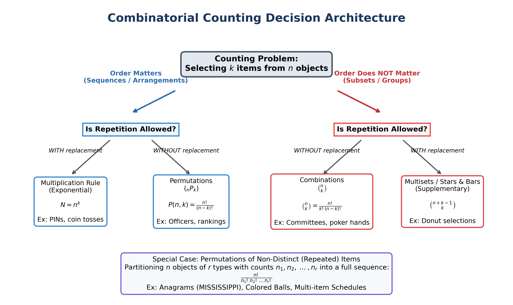
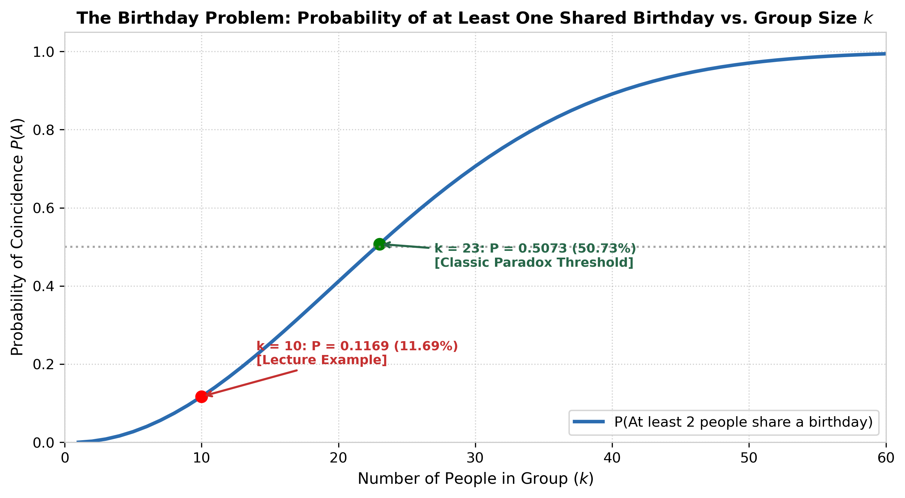
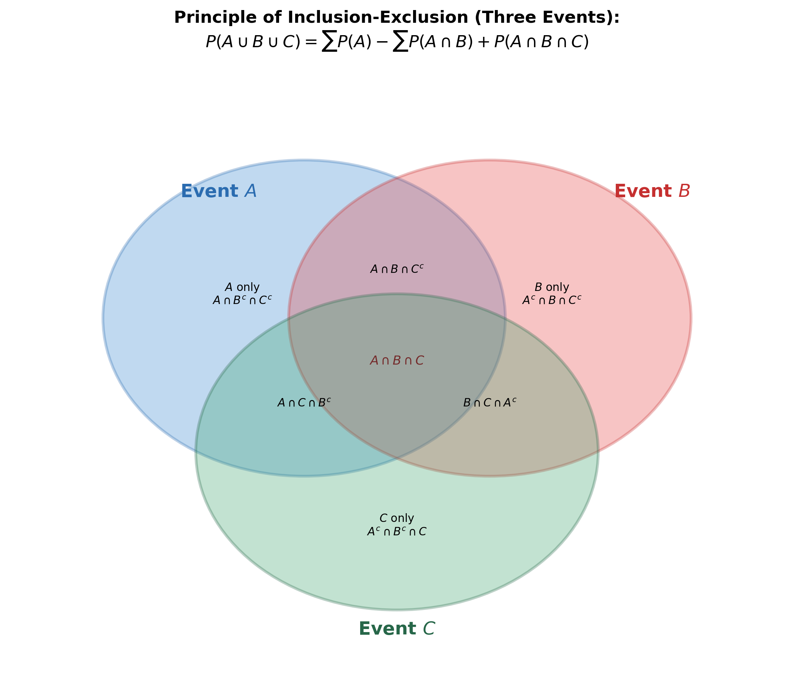
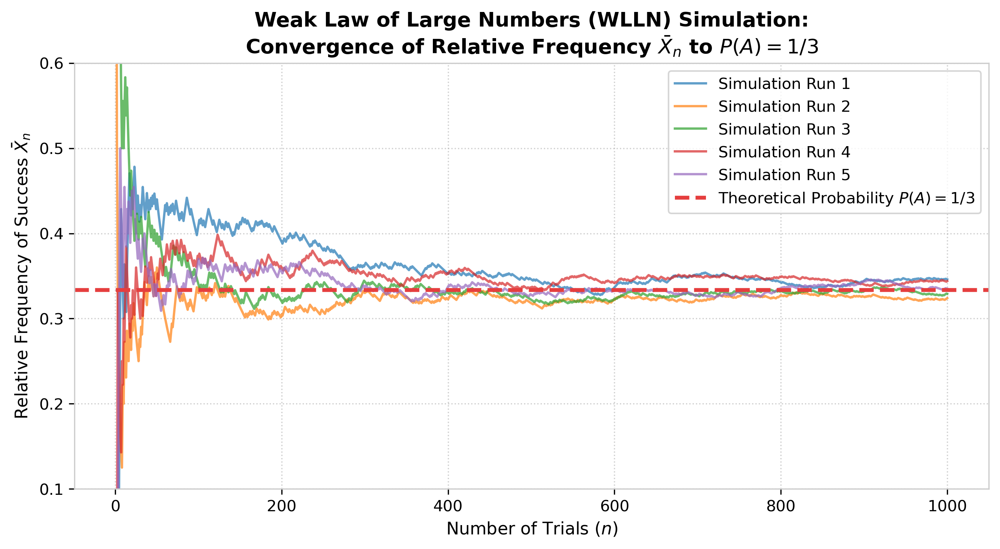

# STA237 Week 2: Counting Methods and Probability — Comprehensive Study Notes

---

### Table of Contents
- [1. Introduction: The Role of Counting in Probability](#1-introduction-the-role-of-counting-in-probability)
- [2. Foundations: The Multiplication and Addition Principles](#2-foundations-the-multiplication-and-addition-principles)
  - [2.1 The Fundamental Principle of Counting (Multiplication Rule)](#21-the-fundamental-principle-of-counting-multiplication-rule)
  - [2.2 Tree Diagrams and Sequential Choice Models](#22-tree-diagrams-and-sequential-choice-models)
  - [2.3 The Addition Principle and Disjoint Case Decomposition](#23-the-addition-principle-and-disjoint-case-decomposition)
- [3. The Four Core Sampling Paradigms](#3-the-four-core-sampling-paradigms)
  - [3.1 Ordered Sampling with Replacement](#31-ordered-sampling-with-replacement)
  - [3.2 Ordered Sampling without Replacement (Permutations)](#32-ordered-sampling-without-replacement-permutations)
  - [3.3 Unordered Sampling without Replacement (Combinations)](#33-unordered-sampling-without-replacement-combinations)
  - [3.4 Unordered Sampling with Replacement (Multisets / Stars and Bars)](#34-unordered-sampling-with-replacement-multisets-stars-and-bars)
  - [3.5 Master Method-Selection Table](#35-master-method-selection-table)
- [4. Advanced Permutations: Indistinguishable Objects and Partitions](#4-advanced-permutations-indistinguishable-objects-and-partitions)
  - [4.1 Permutations with Repetition (Multinomial Coefficients)](#41-permutations-with-repetition-multinomial-coefficients)
  - [4.2 Partitioning Sets into Labeled and Unlabeled Groups](#42-partitioning-sets-into-labeled-and-unlabeled-groups)
  - [4.3 Constrained Arrangements: The Block / "Tie-Together" Method and Gaps](#43-constrained-arrangements-the-block-tie-together-method-and-gaps)
- [5. Combinations and Combinatorial Reasoning](#5-combinations-and-combinatorial-reasoning)
  - [5.1 Binomial Coefficients and the Symmetry Identity](#51-binomial-coefficients-and-the-symmetry-identity)
  - [5.2 Combinatorial vs. Algebraic Proofs](#52-combinatorial-vs-algebraic-proofs)
  - [5.3 Multivariate Hypergeometric Distributions (Multi-Category Sampling)](#53-multivariate-hypergeometric-distributions-multi-category-sampling)
- [6. Avoiding Overcounting, Undercounting, and Asymmetry Traps](#6-avoiding-overcounting-undercounting-and-asymmetry-traps)
  - [6.1 The Division Principle (Quotient Rule) for Overcounting](#61-the-division-principle-quotient-rule-for-overcounting)
  - [6.2 Order Asymmetry in Multi-Stage Selection (Poker and Bridge Hands)](#62-order-asymmetry-in-multi-stage-selection-poker-and-bridge-hands)
  - [6.3 Ensuring Equal Likelihood in the Sample Space](#63-ensuring-equal-likelihood-in-the-sample-space)
- [7. Complementary Counting and Inclusion-Exclusion](#7-complementary-counting-and-inclusion-exclusion)
  - [7.1 The Complement Rule in Counting ("At Least One")](#71-the-complement-rule-in-counting-at-least-one)
  - [7.2 The Birthday Problem and Collision Probabilities](#72-the-birthday-problem-and-collision-probabilities)
  - [7.3 Generalized Principle of Inclusion-Exclusion (PIE)](#73-generalized-principle-of-inclusion-exclusion-pie)
- [8. Empirical Probability, Simulation, and the Weak Law of Large Numbers](#8-empirical-probability-simulation-and-the-weak-law-of-large-numbers)
  - [8.1 Long-Run Relative Frequency and WLLN](#81-long-run-relative-frequency-and-wlln)
  - [8.2 Monte Carlo Simulation Foundations in R](#82-monte-carlo-simulation-foundations-in-r)
  - [8.3 Margin of Error and Standard Error of Simulation Estimates](#83-margin-of-error-and-standard-error-of-simulation-estimates)
- [9. Standardized Problem Types (PT Framework)](#9-standardized-problem-types-pt-framework)
  - [Problem Type PT-01: Multi-Stage Sequential Selection via FPC](#problem-type-pt-01-multi-stage-sequential-selection-via-fpc)
  - [Problem Type PT-02: Ordered Permutations of Distinct Objects under Positional Constraints](#problem-type-pt-02-ordered-permutations-of-distinct-objects-under-positional-constraints)
  - [Problem Type PT-03: Permutations with Indistinguishable Objects and Digit Formation](#problem-type-pt-03-permutations-with-indistinguishable-objects-and-digit-formation)
  - [Problem Type PT-04: Unordered Combinations and Combinatorial Identity Proofs](#problem-type-pt-04-unordered-combinations-and-combinatorial-identity-proofs)
  - [Problem Type PT-05: Multi-Category Hypergeometric Sampling](#problem-type-pt-05-multi-category-hypergeometric-sampling)
  - [Problem Type PT-06: Symmetry, Subgroup Partitioning, and Card Hand Derivations](#problem-type-pt-06-symmetry-subgroup-partitioning-and-card-hand-derivations)
  - [Problem Type PT-07: Complementary Counting and Collision Problems (Birthday Paradox)](#problem-type-pt-07-complementary-counting-and-collision-problems-birthday-paradox)
  - [Problem Type PT-08: Generalized Principle of Inclusion-Exclusion ($n \ge 3$ Events)](#problem-type-pt-08-generalized-principle-of-inclusion-exclusion-n-ge-3-events)
  - [Problem Type PT-09: Empirical Relative Frequency and Monte Carlo Estimation in R](#problem-type-pt-09-empirical-relative-frequency-and-monte-carlo-estimation-in-r)

---

## 1. Introduction: The Role of Counting in Probability

In Week 1, we established the axiomatic definition of a probability space $(\Omega, \mathcal{F}, P)$, where $\Omega$ is the sample space, $\mathcal{F}$ is the event space, and $P$ is a probability measure satisfying the three Kolmogorov Axioms:
1. Non-negativity: $P(A) \ge 0$ for all $A \in \mathcal{F}$.
2. Normalization: $P(\Omega) = 1$.
3. Countable Additivity: For pairwise disjoint events $E_1, E_2, \dots$,
   $$P\left(\bigcup_{i=1}^\infty E_i\right) = \sum_{i=1}^\infty P(E_i)$$

When the sample space $\Omega$ is **finite** and all elementary outcomes $\omega \in \Omega$ are **equally likely** (meaning $P(\{\omega\}) = 1/|\Omega|$ for every $\omega \in \Omega$), computing the probability of any event $A \subseteq \Omega$ reduces strictly to a ratio of cardinalities:
$$P(A) = \sum_{\omega \in A} P(\{\omega\}) = \sum_{\omega \in A} \frac{1}{|\Omega|} = \frac{|A|}{|\Omega|} = \frac{n(A)}{n(\Omega)}$$
where $n(A) = |A|$ is the number of outcomes favorable to $A$, and $n(\Omega) = |\Omega|$ is the total number of possible outcomes in the universe of the experiment.

While conceptually elementary, calculating $n(A)$ and $n(\Omega)$ by exhaustive listing is impossible for complex systems where outcome counts reach millions or billions. **Combinatorics**—the mathematics of systematic counting—provides the exact analytical tools necessary to count vast configuration spaces without listing individual outcomes.

> [!IMPORTANT]
> **Foundational Requirement for $P(A) = n(A)/n(\Omega)$:**
> This formula holds **if and only if**:
> 1. The sample space $\Omega$ is finite.
> 2. Every elementary outcome in $\Omega$ has identical probability (the *equally likely* assumption).
>
> If you define a sample space where outcomes are not equally likely (e.g., recording only the sum of two rolled dice as $\Omega = \{2, 3, \dots, 12\}$), you **cannot** compute $P(\text{Sum} = 7)$ as $1/11$. You must define $\Omega$ as the set of 36 ordered pairs $(d_1, d_2)$, each having probability $1/36$.

---

## 2. Foundations: The Multiplication and Addition Principles

Every advanced counting technique in probability traces back to two fundamental rules: the **Multiplication Principle** (combining sequential or compound stages) and the **Addition Principle** (combining disjoint alternative cases).

### 2.1 The Fundamental Principle of Counting (Multiplication Rule)

#### Mathematical Statement
Let an experiment or procedure consist of $k$ ordered stages (steps). Suppose:
- Stage 1 can be performed in $n_1$ distinct ways;
- For *each* specific choice made in Stage 1, Stage 2 can be performed in $n_2$ distinct ways;
- For *each* sequence of choices made in Stages $1, 2, \dots, i-1$, Stage $i$ can be performed in $n_i$ distinct ways;
- $\dots$
- For *each* sequence of choices made in Stages $1, 2, \dots, k-1$, Stage $k$ can be performed in $n_k$ distinct ways.

Then, the total number of distinct ordered sequences $(x_1, x_2, \dots, x_k)$ of outcomes for the entire procedure is:
$$N = n_1 \times n_2 \times \cdots \times n_k = \prod_{i=1}^k n_i$$

#### Essential Theoretical Nuance: Choice Counts vs. Specific Identity
A frequent point of conceptual confusion is whether the available choices at Stage $i$ can depend on prior stages.
- **Valid:** The *identities* of the available choices at Stage $i$ frequently depend on which elements were chosen previously. For example, when dealing cards without replacement, the specific card drawn at Step 2 depends on Step 1.
- **Required Invariant:** The *number* of choices ($n_i$) must be invariant across all paths taken up to that point. If Step 1 removes 1 card from a 52-card deck, exactly $n_2 = 51$ choices remain, regardless of *which* specific card was removed.
- **When FPC Fails Directly:** If the number of choices at Stage $i$ fluctuates based on the specific qualitative identity chosen earlier (e.g., "if a King is chosen in step 1, 3 Kings remain; if an Ace is chosen, 4 Kings remain"), the single product rule cannot be applied directly. One must partition the problem into mutually exclusive cases and apply the Addition Principle.

> [!NOTE]
> **Counting Multiplication vs. Probabilistic Independence:**
> The Fundamental Principle of Counting does **not** assume or require probabilistic independence. It is a purely algebraic rule describing the cardinality of Cartesian products or filtered trees of choices. We routinely use FPC to count samples drawn *without replacement* (where physical draws are statistically dependent events).

---

### 2.2 Tree Diagrams and Sequential Choice Models

A tree diagram provides the canonical topological visualization of the Fundamental Principle of Counting.
- The **root** represents the initial state before any decisions are made.
- **Branches** emanating from a node represent the mutually exclusive options available at that decision stage.
- The **depth** of the tree equals the number of stages $k$.
- Each unique **path** from root to leaf represents exactly one elementary outcome in the sample space.
- The total number of terminal leaves equals $\prod_{i=1}^k n_i$.

When every node at depth $i-1$ branches into exactly $n_i$ children, the tree is uniform, and multiplication yields the total leaf count.

---

### 2.3 The Addition Principle and Disjoint Case Decomposition

#### Mathematical Statement
Suppose a set of outcomes $S$ can be partitioned into $m$ mutually exclusive (disjoint) subsets $A_1, A_2, \dots, A_m$ such that:
$$A_i \cap A_j = \emptyset \quad \forall i \neq j, \quad \text{and} \quad S = \bigcup_{i=1}^m A_i$$
Then the total number of outcomes in $S$ is the sum of the counts of each case:
$$|S| = |A_1| + |A_2| + \dots + |A_m| = \sum_{i=1}^m |A_i|$$

#### Strategic Workflow for Counting Problems
When faced with complex constraints (such as "at least", "at most", or asymmetric restrictions):
1. **Partition** the universe of favorable configurations into mutually exclusive cases based on a defining structural feature (e.g., case by length of string, case by number of specific items chosen, case by starting/ending character).
2. Use the **Multiplication Principle** to calculate the size of each disjoint case.
3. Apply the **Addition Principle** to sum the results across all cases.

---

## 3. The Four Core Sampling Paradigms

A fundamental class of combinatorial problems involves selecting $k$ objects from an available pool of $n$ distinct objects. The choice of counting formula depends entirely on two binary criteria:
1. **Does order matter?** (Ordered sequences vs. Unordered subsets).
2. **Is replacement/repetition allowed?** (Can the same object be selected more than once?).

This yields a $2 \times 2$ matrix of classical counting paradigms.



---

### 3.1 Ordered Sampling with Replacement

- **Mechanism:** Select an object from $n$ available items, record its identity, return it to the pool, and repeat for a total of $k$ selections.
- **Mathematical Form:** A sequence or tuple $(x_1, x_2, \dots, x_k)$ where each $x_i \in \{1, 2, \dots, n\}$.
- **Formula:** By the Multiplication Principle, each of the $k$ slots has $n$ independent possibilities:
  $$N = \underbrace{n \times n \times \dots \times n}_{k \text{ factors}} = n^k$$
- **Domain of Application:** $k$ can be any positive integer (no restriction $k \le n$).
- **Examples:**
  - Generating $k$-digit PIN codes using digits $0$--$9$ ($10^k$).
  - Sequences of $k$ coin flips ($2^k$) or $k$ die rolls ($6^k$).
  - Total number of subsets of an $n$-element set (each element has 2 choices: include or exclude $\implies 2^n$).

---

### 3.2 Ordered Sampling without Replacement (Permutations)

- **Mechanism:** Select an object from $n$ available items, record its identity, set it aside, and select the next item from the remaining $(n-1)$ items, repeating for $k$ draws.
- **Mathematical Form:** A tuple $(x_1, x_2, \dots, x_k)$ where all coordinates are distinct ($x_i \neq x_j$ for $i \neq j$).
- **Formula:**
  $${}_n P_k = P(n, k) = n \times (n-1) \times (n-2) \times \dots \times (n - k + 1) = \frac{n!}{(n-k)!}$$
  where $0! \equiv 1$ by mathematical convention.
- **Domain of Application:** Requires $0 \le k \le n$. If $k > n$, $P(n, k) = 0$.
- **Full Permutations ($k = n$):**
  When all $n$ distinct objects are arranged in a line, $P(n, n) = \frac{n!}{0!} = n!$.
- **Combinatorial Justification:**
  There are $n!$ ways to arrange all $n$ items. If we only observe the first $k$ items, there are $(n-k)$ unobserved items at the tail of the sequence. These $(n-k)$ items can be permuted in $(n-k)!$ ways without altering the prefix of length $k$. By the Division Principle (Quotient Rule), the number of distinct prefixes is $n! / (n-k)!$.

---

### 3.3 Unordered Sampling without Replacement (Combinations)

- **Mechanism:** Select $k$ objects from $n$ distinct objects simultaneously (or sequentially where the order of selection is ignored).
- **Mathematical Form:** A subset $\{x_1, x_2, \dots, x_k\} \subseteq \{1, 2, \dots, n\}$.
- **Formula:**
  $${}_n C_k = \binom{n}{k} = \frac{P(n, k)}{k!} = \frac{n!}{k!(n-k)!}$$
- **Domain of Application:** $0 \le k \le n$. $\binom{n}{k} = 0$ for $k > n$ or $k < 0$.
- **Combinatorial Justification:**
  Any specific subset of $k$ distinct elements can be written in $k!$ different ordered sequences. Since order is disregarded, each unordered subset has been counted exactly $k!$ times in the permutation count $P(n, k)$. Dividing by $k!$ corrects this exact, uniform overcount.

---

### 3.4 Unordered Sampling with Replacement (Multisets / Stars and Bars)

- **Classification:** Supplementary material (Found in PAR §1.7 / advanced extensions).
- **Mechanism:** Select $k$ items from $n$ distinct categories, where items from the same category are indistinguishable, and each category can be chosen multiple times (with replacement).
- **Mathematical Form:** Finding the number of non-negative integer solutions to:
  $$x_1 + x_2 + \dots + x_n = k$$
  where each $x_i \ge 0$ denotes the count of items selected from category $i$.
- **Formula:**
  $$\binom{n + k - 1}{k} = \binom{n + k - 1}{n - 1} = \frac{(n + k - 1)!}{k! \, (n - 1)!}$$

- **Combinatorial Justification (Stars and Bars):**
  1. Represent the $k$ chosen items as $k$ identical stars ($\star$).
  2. Represent the boundaries separating the $n$ distinct categories as $n - 1$ identical divider bars ($|$).
  3. Any sequence of $k$ stars and $n - 1$ bars corresponds uniquely to one multiset selection.
  4. The total number of symbols in the sequence is $k + (n - 1) = n + k - 1$.
  5. By the repeated-items permutation rule (equivalent to choosing $k$ positions out of $n+k-1$ for the stars):
     $$\frac{(n + k - 1)!}{k! \, (n - 1)!} = \binom{n + k - 1}{k}$$

- **Concrete Illustration (The Bakery Donut Problem):**
  Suppose a bakery offers $n = 3$ types of donuts (Glazed, Chocolate, Jelly) and you buy $k = 5$ donuts:
  - You need $k = 5$ stars ($\star$) and $n - 1 = 3 - 1 = 2$ divider bars ($|$).
  - Total symbols to arrange: $5 + 2 = 7$ symbols.
  - For example, the arrangement:
    $$\star \; \star \mid \star \mid \star \; \star$$
    represents $2$ Glazed, $1$ Chocolate, and $2$ Jelly.
  - The arrangement:
    $$\star \; \star \; \star \; \star \; \star \mid \mid$$
    represents $5$ Glazed, $0$ Chocolate, and $0$ Jelly.
  - By the identical items / anagram formula, the total number of distinct orders is:
    $$\frac{7!}{5! \, 2!} = \binom{7}{5} = \frac{7 \times 6}{2 \times 1} = 21$$

> [!CAUTION]
> **Common Fallacy: Why is it NOT $n^k / k!$?**
> It is tempting to assume that since unordered sampling without replacement is $P(n, k) / k!$, sampling with replacement should simply be $n^k / k!$. 
> 
> This is **incorrect** because dividing by $k!$ requires that *every* unordered outcome was counted exactly $k!$ times in the ordered list. In sampling with replacement:
> - Outcomes with all distinct items (e.g., $(1, 2)$) appear $2! = 2$ times.
> - Outcomes with repeated items (e.g., $(1, 1)$) appear **only 1 time**.
> 
> Dividing the grand total $n^k$ by $k!$ would divide repeated outcomes into fractions (e.g., $1/2$), which severely undercounts them. Because overcounting is non-uniform, we cannot divide by a single factor $k!$; we must use Stars and Bars.

---

### 3.5 Master Method-Selection Table

The following table synthesizes the four fundamental regimes:

| Sampling Type | Order Matters? | Replacement Allowed? | Formula | Domain / Constraints | Canonical Contexts |
| :--- | :---: | :---: | :---: | :---: | :--- |
| **Ordered with Replacement** | **Yes** | **Yes** | $n^k$ | Any $k \ge 0$ | Passwords, PINs, dice rolls, coin flips |
| **Permutation** | **Yes** | **No** | $P(n, k) = \frac{n!}{(n-k)!}$ | $0 \le k \le n$ | Officer elections (Pres/VP/Treas), race finishes |
| **Combination** | **No** | **No** | $\binom{n}{k} = \frac{n!}{k!(n-k)!}$ | $0 \le k \le n$ | Committee selection, lottery tickets, poker hands |
| **Multiset (Stars & Bars)** | **No** | **Yes** | $\binom{n+k-1}{k}$ | Any $k \ge 0$ | Distributing identical candies, ordering donuts |

---

## 4. Advanced Permutations: Indistinguishable Objects and Partitions

### 4.1 Permutations with Repetition (Multinomial Coefficients)

#### Problem Definition
Consider a collection of $n$ objects that are not all distinct. Specifically, suppose there are $r$ distinct types of objects, with:
- $n_1$ identical objects of Type 1,
- $n_2$ identical objects of Type 2,
- $\dots$
- $n_r$ identical objects of Type $r$,
such that $n_1 + n_2 + \dots + n_r = n$. How many distinct linear arrangements of all $n$ objects can be formed?

#### Formula
$$\binom{n}{n_1, n_2, \dots, n_r} = \frac{n!}{n_1! \, n_2! \dots n_r!}$$

#### Derivation
1. **Hypothetical Labeling:** Temporarily assign unique subscripts to identical items (e.g., $A_1, A_2, A_3$). All $n$ items are now distinct, yielding $n!$ total permutations.
2. **Symmetry & Overcounting:** In any specific linear arrangement, permuting the $n_1$ items of Type 1 among their assigned positions produces $n_1!$ identical-looking arrangements. Similarly, permuting the $n_2$ items of Type 2 produces $n_2!$ arrangements.
3. By the Multiplication Principle, each physically distinguishable layout is repeated exactly $n_1! \times n_2! \times \dots \times n_r!$ times in the $n!$ count.
4. Dividing $n!$ by $\prod_{i=1}^r n_i!$ yields the exact number of distinct sequences.

---

### 4.2 Partitioning Sets into Labeled and Unlabeled Groups

#### Labeled Groups (Pre-assigned Identifiers)
Suppose $n$ distinct people are partitioned into $r$ labeled teams: Team 1 of size $n_1$, Team 2 of size $n_2$, $\dots$, Team $r$ of size $n_r$, where $\sum_{i=1}^r n_i = n$.
- Choose $n_1$ members for Team 1: $\binom{n}{n_1}$ ways.
- Choose $n_2$ members for Team 2 from the remaining $n - n_1$: $\binom{n - n_1}{n_2}$ ways.
- Continuing sequentially:
  $$N = \binom{n}{n_1} \binom{n - n_1}{n_2} \cdots \binom{n_r}{n_r} = \frac{n!}{n_1!(n-n_1)!} \frac{(n-n_1)!}{n_2!(n-n_1-n_2)!} \cdots \frac{n_r!}{n_r!0!} = \frac{n!}{n_1! \, n_2! \dots n_r!}$$
Notice that this is mathematically identical to the multinomial arrangement formula!

#### Unlabeled Groups (Equal-Sized Indistinguishable Groups)
If $m$ of the groups have the same size $s$ and have **no names or roles** distinguishing them (e.g., dividing 12 students into 3 unlabelled study pairs and 2 triads):
- Swapping the entire membership of two identical-sized unlabelled groups does not create a new partition.
- **Rule:** Divide the labeled count by $m!$ for each cluster of $m$ groups that share the same size and lack distinct labels.

---

### 4.3 Constrained Arrangements: The Block / "Tie-Together" Method and Gaps

In many permutation problems, specific elements must either appear together or must be strictly separated.

#### 1. The Block ("Tie-Together") Method: Items Must Be Adjacent
- **Problem:** Arrange $n$ objects in a row such that a specified subset of $m$ objects must always be contiguous.
- **Technique:**
  1. Treat the $m$ specified objects as a single composite super-object ("block").
  2. The effective number of objects to arrange is now $(n - m + 1)$ (the $(n-m)$ unconstrained objects plus the 1 super-object).
  3. Arrange the $(n - m + 1)$ objects in $(n - m + 1)!$ ways.
  4. Internally permute the $m$ objects within the block in $m!$ ways.
  5. By FPC, total arrangements = $(n - m + 1)! \times m!$.

#### 2. The Gap / Insertion Method: Items Must NOT Be Adjacent
- **Problem:** Arrange $n$ objects such that $k$ specific "forbidden" objects are never adjacent to each other.
- **Technique:**
  1. First arrange the $(n - k)$ unconstrained items in a line: $(n - k)!$ ways.
  2. This arrangement creates $(n - k + 1)$ available "gaps" (including the two ends before the first item and after the last item).
  3. To ensure no two forbidden items are adjacent, place at most one forbidden item per gap.
  4. Choose $k$ of the $(n - k + 1)$ gaps: $\binom{n - k + 1}{k}$ ways (or $P(n-k+1, k)$ if the items are distinct and placed in order).

---

## 5. Combinations and Combinatorial Reasoning

### 5.1 Binomial Coefficients and the Symmetry Identity

The binomial coefficient $\binom{n}{k}$ exhibits fundamental algebraic and combinatorial symmetries:

$$\binom{n}{k} = \binom{n}{n-k} \quad \text{for } 0 \le k \le n$$

#### Pascal's Recurrence Identity
$$\binom{n}{k} = \binom{n-1}{k-1} + \binom{n-1}{k}$$
*Interpretation:* To select $k$ items from $n$, focus on a specific item $x$. A committee either contains $x$ (leaving $k-1$ to choose from the remaining $n-1$) or does not contain $x$ (leaving $k$ to choose from $n-1$).

---

### 5.2 Combinatorial vs. Algebraic Proofs

In modern probability and statistics, mathematical statements often have two rigorous validation paths:

```
                      ┌─────────────────────────────────────────┐
                      │            Binomial Identity            │
                      │      (n choose k) = (n choose n-k)      │
                      └────────────────────┬────────────────────┘
                                           │
                   ┌───────────────────────┴───────────────────────┐
                   ▼                                               ▼
       ┌───────────────────────┐                       ┌───────────────────────┐
       │    Algebraic Proof    │                       │  Combinatorial Proof  │
       │  Manipulates raw      │                       │  Establishes bijection│
       │  factorial formulas   │                       │  between two sets     │
       └───────────────────────┘                       └───────────────────────┘
```

1. **Algebraic Proof:**
   $$\binom{n}{n-k} = \frac{n!}{(n-k)!(n - (n-k))!} = \frac{n!}{(n-k)!k!} = \frac{n!}{k!(n-k)!} = \binom{n}{k}$$
2. **Combinatorial Proof (Bijective Correspondence):**
   - Let $S$ be a set of size $n$. Let $\mathcal{A}$ be the collection of all subsets of $S$ containing $k$ elements, so $|\mathcal{A}| = \binom{n}{k}$.
   - Let $\mathcal{B}$ be the collection of all subsets of $S$ containing $n-k$ elements, so $|\mathcal{B}| = \binom{n}{n-k}$.
   - Define the complement mapping $f: \mathcal{A} \to \mathcal{B}$ by $f(A) = S \setminus A$ for every $A \in \mathcal{A}$.
   - For every $A \in \mathcal{A}$, $|S \setminus A| = |S| - |A| = n - k$, so $f(A) \in \mathcal{B}$.
   - If $A_1 \neq A_2$, then $S \setminus A_1 \neq S \setminus A_2$ (injective).
   - For any $B \in \mathcal{B}$, the set $A = S \setminus B$ has size $n - (n-k) = k$, so $A \in \mathcal{A}$ and $f(A) = B$ (surjective).
   - Because $f$ is a rigorous bijection, $|\mathcal{A}| = |\mathcal{B}|$, proving $\binom{n}{k} = \binom{n}{n-k}$.

---

### 5.3 Multivariate Hypergeometric Distributions (Multi-Category Sampling)

A central application of combination counting in probability is sampling without replacement from a stratified finite population.

#### Univariate Case (Two Categories: Success / Failure)
A lot of $N$ items contains $M$ successes and $N - M$ failures. A random sample of size $n$ is drawn without replacement. The probability of obtaining exactly $k$ successes is:
$$P(X = k) = \frac{\binom{M}{k}\binom{N - M}{n - k}}{\binom{N}{n}}$$
where $\max(0, n - (N - M)) \le k \le \min(n, M)$.

#### Multivariate Case ($c$ Categories)
Suppose the population of $N$ items is partitioned into $c$ mutually exclusive categories of sizes $M_1, M_2, \dots, M_c$ where $\sum_{i=1}^c M_i = N$. If a random sample of size $n$ is selected without replacement, the probability of obtaining exactly $k_1$ items from Category 1, $k_2$ from Category 2, $\dots$, $k_c$ from Category $c$ (with $\sum_{i=1}^c k_i = n$) is:
$$P(X_1 = k_1, \dots, X_c = k_c) = \frac{\prod_{i=1}^c \binom{M_i}{k_i}}{\binom{N}{n}}$$

---

## 6. Avoiding Overcounting, Undercounting, and Asymmetry Traps

Advanced probability evaluations often collapse due to subtle counting fallacies. Mastering the following principles is essential for test-level problem solving.

### 6.1 The Division Principle (Quotient Rule) for Overcounting

> [!CAUTION]
> **The Principle of Division:**
> You may divide your count $M$ by $d$ if and only if **every single target outcome has been generated exactly $d$ times**. If some outcomes are generated 2 times and others 4 times, dividing by a single constant is mathematically invalid and leads to erroneous probabilities.

### 6.2 Order Asymmetry in Multi-Stage Selection (Poker and Bridge Hands)

A classic pedagogical example presented in lecture (Slide 34) demonstrates how misjudging symmetry creates severe undercounts or overcounts.

#### The Full House Dilemma
In a 5-card poker hand, a Full House consists of three cards of one rank and two cards of another rank (e.g., $K K K 7 7$).
- **Common Error 1 (Overcounting via Sequential Dealing):**
  A student reasons:
  1. Pick card 1: 52 choices.
  2. Pick card 2 of same rank: 3 choices.
  3. Pick card 3 of same rank: 2 choices.
  4. Pick card 4 of different rank: 48 choices.
  5. Pick card 5 of that second rank: 3 choices.
  Product $= 52 \times 3 \times 2 \times 48 \times 3 = 44,928$.
  *Why this fails:* The 3 cards in the triple were chosen in a specific sequence ($3! = 6$ ways) and the 2 cards in the pair were chosen in a sequence ($2! = 2$ ways). The hand is an unordered set! The student counted each hand $3! \times 2! = 12$ times. Correcting: $44,928 / 12 = 3,744$.

- **Common Error 2 (Undercounting via Unordered Rank Selection):**
  A student reasons:
  1. Pick the 2 ranks involved from 13 available ranks: $\binom{13}{2} = 78$.
  2. Choose 3 suits for the first rank: $\binom{4}{3} = 4$.
  3. Choose 2 suits for the second rank: $\binom{4}{2} = 6$.
  Product $= 78 \times 4 \times 6 = 1,872$.
  *Why this fails:* The roles of the two ranks are **asymmetric**. Three Kings and two 7s ($KKK77$) is a completely different poker hand from three 7s and two Kings ($777KK$). By choosing an unordered pair of ranks $\{K, 7\}$, the student failed to decide *which* rank receives the 3 cards and *which* receives the 2 cards!
  *Correction:* Ranks must be selected as an **ordered pair** (or multiplied by 2):
  $$P(13, 2) \times \binom{4}{3} \times \binom{4}{2} = (13 \times 12) \times 4 \times 6 = 156 \times 24 = 3,744$$

- **Contrast with Two Pair:**
  In a Two Pair hand (e.g., $K K 7 7 4$), the two pair ranks each have size 2 (symmetric).
  Selecting $\{K, 7\}$ does not have asymmetric roles: King pair + 7 pair is identical to 7 pair + King pair.
  Therefore, we **must** use $\binom{13}{2}$, NOT $13 \times 12$:
  $$\text{Two Pair} = \binom{13}{2} \times \binom{4}{2} \times \binom{4}{2} \times \binom{11}{1} \times \binom{4}{1} = 78 \times 6 \times 6 \times 11 \times 4 = 123,552$$

### 6.3 Ensuring Equal Likelihood in the Sample Space

To apply $P(A) = n(A)/n(\Omega)$:
- **Consistency is Mandatory:** If $\Omega$ is defined as an ordered sample space (sequences), $n(A)$ must count ordered sequences. If $\Omega$ is defined as unordered subsets, $n(A)$ must count unordered subsets.
- **Why We Default to Ordered in Many Multi-Stage Games:**
  Consider rolling two fair 6-sided dice.
  - If we consider unordered pairs $\{d_1, d_2\}$, there are 21 pairs: 6 doubles $\{i, i\}$ and 15 mixed pairs $\{i, j\}$ ($i \neq j$).
  - However, mixed pairs occur twice as often as doubles! $P(\{1, 2\}) = 2/36 \neq P(\{1, 1\}) = 1/36$.
  - Treating the 21 unordered pairs as equally likely is a fatal error. Imposing order (Die 1, Die 2) restores uniform probability ($1/36$ for all 36 outcomes).

---

## 7. Complementary Counting and Inclusion-Exclusion

### 7.1 The Complement Rule in Counting ("At Least One")

When an event condition contains phrases like **"at least one"**, **"at most one"**, or **"no two adjacent"**, direct evaluation often requires enumerating many disjoint cases.
By Kolmogorov's Second Axiom and Complementarity:
$$P(A) = 1 - P(A^c) \iff n(A) = n(\Omega) - n(A^c)$$
Whenever $A^c$ has a simpler, single-case representation than $A$, complementary counting is the preferred method.

---

### 7.2 The Birthday Problem and Collision Probabilities

The classic Birthday Problem (Lecture Slide 23) illustrates the exponential power of complementary counting.



#### Problem Setup
In a gathering of $k$ individuals, what is the probability $P(A)$ that at least two people share a birthday?
- **Assumptions:**
  1. Year has 365 days (ignoring leap years).
  2. Birthdays are uniformly distributed across all 365 days.
  3. Individuals' birthdays are mutually independent.

#### Derivation
- **Step 1: Size of the Sample Space $\Omega$:**
  Each person can have their birthday on any of the 365 days. By FPC (ordered with replacement):
  $$n(\Omega) = 365^k$$
- **Step 2: Complement Event $A^c$:**
  $A^c$ is the event that *all $k$ individuals have distinct birthdays*.
  By FPC (ordered without replacement):
  $$n(A^c) = P(365, k) = 365 \times 364 \times 363 \times \dots \times (365 - k + 1)$$
- **Step 3: Exact Probability:**
  $$P(A^c) = \frac{P(365, k)}{365^k} = \prod_{i=0}^{k-1} \left(1 - \frac{i}{365}\right)$$
  $$P(A) = 1 - P(A^c) = 1 - \frac{P(365, k)}{365^k}$$

#### Values and Intuitive Paradox
- For $k = 10$ (Lecture Example 4):
  $$P(A^c) = \frac{365 \times 364 \times \dots \times 356}{365^{10}} \approx 0.8831 \implies P(A) = 1 - 0.8831 = \mathbf{0.1169 \text{ (11.69\%)}}$$
- For $k = 23$: $P(A) \approx 0.5073$ ($50.7\%$). In a room of just 23 people, it is more likely than not that at least two share a birthday.
- **Mathematical Explanation of the Paradox:** We are not comparing 22 people to *one specific person*. We are comparing all $\binom{k}{2}$ possible pairs of people. When $k = 23$, there are $\binom{23}{2} = 253$ distinct pairs of people tested for a match!

---

### 7.3 Generalized Principle of Inclusion-Exclusion (PIE)

When events are not mutually exclusive, simply adding their individual probabilities double-counts their intersections. The Principle of Inclusion-Exclusion systematically corrects for multiple overlaps.



#### Formal Theorem for $n$ Events (Lecture Slides 3–5)
Let $A_1, A_2, \dots, A_n$ be arbitrary events in a probability space. The probability of their union is:
$$\begin{aligned}
P\left(\bigcup_{i=1}^n A_i\right) &= \sum_{i=1}^n P(A_i) - \sum_{1 \le i < j \le n} P(A_i \cap A_j) + \sum_{1 \le i < j < k \le n} P(A_i \cap A_j \cap A_k) \\
&\quad - \dots + (-1)^{n+1} P\left(\bigcap_{i=1}^n A_i\right)
\end{aligned}$$
In compact summation notation:
$$P\left(\bigcup_{i=1}^n A_i\right) = \sum_{r=1}^n (-1)^{r+1} \sum_{1 \le i_1 < i_2 < \dots < i_r \le n} P(A_{i_1} \cap A_{i_2} \cap \dots \cap A_{i_r})$$

#### Combinatorial Proof of PIE
Consider any elementary outcome $\omega \in \Omega$.
1. If $\omega \notin \bigcup_{i=1}^n A_i$, it belongs to 0 events. It contributes 0 to the left side and 0 to every term on the right side.
2. If $\omega \in \bigcup_{i=1}^n A_i$, suppose $\omega$ belongs to exactly $m$ of the events ($1 \le m \le n$).
   - In the first sum ($r=1$), $\omega$ is counted $\binom{m}{1}$ times.
   - In the second sum ($r=2$), $\omega$ is counted $\binom{m}{2}$ times.
   - In the $r$-th sum, $\omega$ is counted $\binom{m}{r}$ times.
   - Total weight assigned to $\omega$ on the right side is:
     $$\sum_{r=1}^m (-1)^{r+1} \binom{m}{r} = \binom{m}{1} - \binom{m}{2} + \binom{m}{3} - \dots + (-1)^{m+1}\binom{m}{m}$$
   - Recall the binomial theorem: $(1 - 1)^m = \sum_{r=0}^m \binom{m}{r} (-1)^r = 1 - \sum_{r=1}^m (-1)^{r+1} \binom{m}{r} = 0$.
   - Therefore:
     $$\sum_{r=1}^m (-1)^{r+1} \binom{m}{r} = 1$$
   - Every element in the union is counted **exactly once**!

---

## 8. Empirical Probability, Simulation, and the Weak Law of Large Numbers

### 8.1 Long-Run Relative Frequency and WLLN

#### Theoretical Definition
Let an experiment be repeated $n$ times under identical and independent conditions. Let $N_n(A)$ denote the number of times event $A$ occurs in the first $n$ trials.
The **relative frequency** of $A$ is:
$$\hat{p}_n = \frac{N_n(A)}{n} = \frac{1}{n} \sum_{i=1}^n I_A^{(i)}$$
where $I_A^{(i)}$ is the indicator variable taking value $1$ if $A$ occurs on trial $i$ and $0$ otherwise.

#### The Weak Law of Large Numbers (WLLN)
The Weak Law of Large Numbers guarantees that for any small tolerance $\epsilon > 0$:
$$\lim_{n \to \infty} P\left(|\hat{p}_n - P(A)| \ge \epsilon\right) = 0$$
That is, the empirical relative frequency converges in probability to the true underlying probability $P(A)$.



> [!WARNING]
> **The Gambler's Fallacy:**
> WLLN describes **swamping**, not compensation! If a fair coin lands Heads 10 times in a row, the next toss is still exactly $P(H) = 0.5$. The excess of Heads is diluted over thousands of subsequent tosses, not "balanced out" by extra Tails.

---

### 8.2 Monte Carlo Simulation Foundations in R

Computing complex probabilities analytically can be prohibitive. Monte Carlo methods simulate the random experiment repeatedly to approximate $P(A)$.

#### Core R Syntax
1. **Sampling:** `sample(x, size, replace = FALSE, prob = NULL)`
   - `x`: Vector of elements to draw from.
   - `size`: Number of items to choose.
   - `replace = TRUE`: Sampling with replacement ($n^k$).
   - `replace = FALSE`: Sampling without replacement ($P(n, k)$ or $\binom{n}{k}$).
2. **Replication:** `replicate(n, expr)`
   - Repeats an expression $n$ times and collates the outcomes into a vector or matrix.
3. **Estimation:**
   ```r
   sim_results <- replicate(100000, {
     draw <- sample(c("R", "R", "G", "G", "G", "B"), size = 3, replace = FALSE)
     sum(draw == "G") == 2 # condition of interest
   })
   estimated_prob <- mean(sim_results)
   ```

---

### 8.3 Margin of Error and Standard Error of Simulation Estimates

When estimating $P(A) = p$ with $\hat{p}$ from $N$ simulation trials:
- **Standard Error:**
  $$\text{SE}(\hat{p}) = \sqrt{\frac{p(1-p)}{N}} \approx \sqrt{\frac{\hat{p}(1-\hat{p})}{N}}$$
- **Worst-Case Bound ($p = 0.5$):**
  Since $p(1-p) \le 0.25$, $\text{SE}(\hat{p}) \le \frac{1}{2\sqrt{N}}$.
- **Sample Size Determination:**
  To guarantee a 95% confidence margin of error $E = 1.96 \times \text{SE} \le \text{tol}$:
  $$N \approx \frac{1}{\text{tol}^2}$$
  For example, achieving accuracy within $\pm 0.01$ with 95% confidence requires $N \approx 10,000$ iterations.

---

## 9. Standardized Problem Types (PT Framework)

This section establishes the 9 standardized Problem Types covering the entirety of the Week 2 curriculum. Each Problem Type provides the mathematical anatomy, general solution methodology, a complete original teaching example, an answer checklist, and common pitfalls. 

*(In strict adherence to course study guidelines, worked solutions and final answers for these teaching examples are withheld here and presented in [Answers-and-Practice.md](Answers-and-Practice.md#section-a-problem-type-teaching-example-solutions)).*

---

### Problem Type PT-01: Multi-Stage Sequential Selection via FPC

**Classification:** Core weekly material (Lecture Slides 13–16; MMSA §2.3; PAR §1.6)

#### Meaning and recognition
- **Meaning:** Determining the total number of distinct outcomes or system configurations when an overall outcome is formed through a sequence of successive, independent choices or stages.
- **Recognition cues:** Look for:
  - System assembly from components across multiple independent suppliers.
  - Alphanumeric codes, serial numbers, passwords, or telephone numbers with position-specific rules.
  - Multi-stage experimental trials (e.g., rolling dice, flipping coins, choosing routes).

#### General method
1. **Deconstruct the process into sequential stages:** Clearly define Stage 1, Stage 2, ..., Stage $k$.
2. **Determine the number of valid options $n_i$ for each stage:**
   - Apply any given restrictions to the most constrained stage first (e.g., first digit cannot be zero, must end in an odd number).
   - Verify that the count $n_i$ remains constant regardless of the particular option chosen in earlier stages.
3. **Compute the total count:** Apply the product rule $N = \prod_{i=1}^k n_i$.
4. **If constraints cause $n_i$ to vary conditionally:** Split the scenario into mutually exclusive cases, apply FPC within each case, and sum the case counts.

#### Teaching example — original question
A biometric cybersecurity system generates secure recovery tokens consisting of a sequence of 6 characters selected from uppercase English letters ($\text{A–Z}$, 26 options) and numerical digits ($0\text{–}9$, 10 options).
- **Part (a):** How many valid tokens can be created if characters can be repeated without restriction, except that the token must begin with a letter and end with an even digit ($0, 2, 4, 6, 8$)?
- **Part (b):** How many valid tokens can be created if **no character may be repeated**, the token must begin with a vowel ($\text{A, E, I, O, U}$), and the token must contain exactly 3 letters and 3 digits alternating (Letter, Digit, Letter, Digit, Letter, Digit)?
- **Part (c):** If a token is generated uniformly at random from all possible 6-character alphanumeric tokens (allowing repetition), what is the probability that it consists entirely of distinct digits?

#### A complete answer must include
- [ ] Identification of the number of slots and the restricted candidate set for each slot.
- [ ] Application of FPC showing product terms for each position in Part (a).
- [ ] Explicit tracking of decreasing candidate pools due to non-replacement and alternating type restrictions in Part (b).
- [ ] Explicit specification of the total unconstrained sample space size for Part (c).
- [ ] Exact rational probability and scientific/decimal notation for Part (c).

#### Common mistakes
- Failing to prioritize the most constrained slots (e.g., filling middle slots before resolving end-slot constraints).
- Treating '0' as non-even or forgetting that 0 is one of the 5 even single-digit numbers.
- Forgetting to reduce the pool size for subsequent slots when sampling is without replacement.

---

### Problem Type PT-02: Ordered Permutations of Distinct Objects under Positional Constraints

**Classification:** Core weekly material (Lecture Slides 18–21; MMSA §2.3; PAR §1.6)

#### Meaning and recognition
- **Meaning:** Arranging $n$ distinct physical items into ordered linear positions subject to specific proximity conditions (e.g., certain items must be adjacent, or certain items must be separated).
- **Recognition cues:** Look for:
  - "Seated in a row", "arranged on a shelf", "batting order", "queue".
  - Proximity requirements: "must sit together", "cannot be adjacent", "between two others".

#### General method
1. **Adjacency ("Must be together"):**
   - Glue the constrained items into a single composite entity ("block").
   - Count the total units: $(n - m + 1)$ where $m$ is the block size.
   - Total arrangements = $(n - m + 1)! \times m!$ (multiplying by the internal permutations of the block).
2. **Mutual Separation ("Must NOT be together"):**
   - Place and permute the unconstrained items first: $(n - k)!$.
   - Identify the $(n - k + 1)$ available spaces/gaps created between and around them.
   - Choose and arrange the $k$ separated items into these distinct gaps: $P(n - k + 1, k)$.
3. **Probability Evaluation:** If items are placed in a random order, divide the favorable permutations by the total unrestricted permutations ($n!$).

#### Teaching example — original question
Seven students—three graduate students ($G_1, G_2, G_3$) and four undergraduate students ($U_1, U_2, U_3, U_4$)—are to be seated in a row of seven chairs at a symposium.
- **Part (a):** In how many ways can the students be seated if all three graduate students must sit together in a contiguous block?
- **Part (b):** In how many ways can they be seated if no two graduate students may sit next to each other?
- **Part (c):** If the seating arrangement is assigned uniformly at random, what is the probability that graduate student $G_1$ is seated at one of the ends of the row and the other two graduate students ($G_2$ and $G_3$) sit adjacent to each other?

#### A complete answer must include
- [ ] Application of the block method with explicit internal and external permutation factors for Part (a).
- [ ] Application of the gap insertion method with clear diagramming/reasoning for Part (b).
- [ ] Application of end-position placement and the block method for the remaining graduate students in Part (c).
- [ ] Rigorous probability calculation comparing favorable permutations to $7! = 5,040$.

#### Common mistakes
- Forgetting to multiply by $m!$ for the internal arrangement of the block.
- Forgetting that the ends of the row count as valid gaps in the insertion method.
- Subtracting the block count from total arrangements to compute "no two adjacent" (this only computes "not all $m$ together", which still permits two of them to be adjacent).

---

### Problem Type PT-03: Permutations with Indistinguishable Objects and Digit Formation

**Classification:** Core weekly material (Lecture Slides 24–26; MMSA §2.3; PAR §1.6)

#### Meaning and recognition
- **Meaning:** Arranging a multiset of elements containing repeated identical items, or constructing numerical values with digit-magnitude or parity constraints.
- **Recognition cues:** Look for:
  - Letters in words with duplicate letters (e.g., "STATISTICS", "ABRACADABRA").
  - Digits with given frequencies (e.g., $\{1, 2, 2, 3, 3, 3\}$).
  - Conditions like "number is greater than 500,000" or "number is even".

#### General method
1. **Unconstrained Multinomial Base:**
   $$N_{\text{total}} = \frac{n!}{n_1! \, n_2! \dots n_r!}$$
2. **Handling Boundary / Value Constraints:**
   - The leading digit cannot be 0 (if valid $n$-digit numbers are required).
   - If the number must be less than (or greater than) a threshold $V$, partition by the allowed leading digits.
   - For each allowed leading digit, deduct 1 from its count, and evaluate the multinomial coefficient for the remaining $(n-1)$ positions.
3. **Handling Parity Constraints (Even / Odd):**
   - An integer's parity is determined exclusively by its terminal digit.
   - Partition into cases based on which even digit is placed in the final position.
   - If both the first and last digits are constrained, create a two-dimensional grid of cases $(d_{\text{first}}, d_{\text{last}})$ to handle resource contention of duplicate digits.

#### Teaching example — original question
Consider the multiset of eight digits $\mathcal{D} = \{2, 2, 2, 4, 4, 5, 7, 9\}$.
- **Part (a):** How many distinct 8-digit integers can be formed using all eight digits?
- **Part (b):** How many of these 8-digit integers are strictly greater than $40,000,000$?
- **Part (c):** How many of these 8-digit integers are both strictly greater than $40,000,000$ and divisible by 2?

#### A complete answer must include
- [ ] Multinomial formula setup accounting for the three 2s, two 4s, one 5, one 7, and one 9.
- [ ] Case breakdown by leading digit for Part (b).
- [ ] Simultaneous consideration of initial and terminal digits, accounting for the shared use of digit '4' as both a leading candidate and an even ending candidate in Part (c).
- [ ] Complete summation of disjoint subcases.

#### Common mistakes
- Overcounting identical arrangements because duplicate digits were treated as distinct.
- Failing to adjust the pool of available digits after fixing the first or last digit (especially when the chosen digit is one of the repeated elements).

---

### Problem Type PT-04: Unordered Combinations and Combinatorial Identity Proofs

**Classification:** Core weekly material (Lecture Slides 28–30; MMSA §2.3; PAR §1.7)

#### Meaning and recognition
- **Meaning:** Selecting subsets of size $k$ from $n$ distinct elements where the order of selection is irrelevant, and establishing algebraic identities between combination terms using combinatorial arguments.
- **Recognition cues:** Look for:
  - "Choose a subset", "form a delegation", "unordered sample".
  - "Prove combinatorially (without using factorials)", "explain by counting a set in two ways".

#### General method
1. **Basic Subset Counting:**
   - Identify the total pool size $n$ and the subset size $k$.
   - Calculate $\binom{n}{k} = \frac{n!}{k!(n-k)!}$.
2. **Combinatorial Proof Framework:**
   - **Method of Double Counting:** State a concrete question ("In how many ways can we choose a team with a captain from $n$ people?").
   - *RHS derivation:* Show that one side of the identity counts this set of outcomes.
   - *LHS derivation:* Show that the other side counts the exact same set using a different sequence of choices or a partition.
   - *Conclusion:* Since both expressions count the identical set of outcomes, they must be equal.
   - **Method of Bijection:** Explicitly define an invertible map $f: A \to B$ between two sets and prove $f$ is one-to-one and onto.

#### Teaching example — original question
Let $n$ and $k$ be integers with $1 \le k \le n$.
- **Part (a):** A software team of $n = 12$ developers needs to select a code review committee of $k = 4$ members. In how many ways can this committee be formed?
- **Part (b):** Prove the identity $k \binom{n}{k} = n \binom{n-1}{k-1}$ algebraically using factorial definitions.
- **Part (c):** Provide a rigorous combinatorial proof of the same identity ($k \binom{n}{k} = n \binom{n-1}{k-1}$) by counting the number of ways to select a committee of $k$ members from $n$ people with one designated committee leader in two different ways.

#### A complete answer must include
- [ ] Direct evaluation of $\binom{12}{4}$ with arithmetic reduction.
- [ ] Algebraic manipulation of factorials showing step-by-step equivalence.
- [ ] Explicit definition of the counting problem (choosing a committee and a leader) for the combinatorial proof.
- [ ] First counting perspective: choose committee first, then choose leader from the committee.
- [ ] Second counting perspective: choose leader from the entire group first, then select remaining members.
- [ ] Formal concluding statement equating the two counting expressions.

#### Common mistakes
- Using algebraic factorial expansions in a problem that explicitly demands a combinatorial proof.
- Forgetting that the leader must be a member of the committee.

---

### Problem Type PT-05: Multi-Category Hypergeometric Sampling

**Classification:** Core weekly material (Lecture Slides 31–33; MMSA §2.3; PAR §1.7)

#### Meaning and recognition
- **Meaning:** Selecting a sample without replacement from a finite population composed of two or more distinct subpopulations (e.g., men/women, defective/non-defective, different card suits or phone types).
- **Recognition cues:** Look for:
  - "Drawn at random without replacement".
  - A population partitioned into known categories: $N = M_1 + M_2 + \dots + M_c$.
  - "Find the probability of obtaining exactly $k_1$ of type 1 and $k_2$ of type 2".

#### General method
1. **Define the Sample Space Size:**
   If $n$ total items are drawn from $N$ items without replacement,
   $$|\Omega| = \binom{N}{n}$$
2. **Define the Favorable Event Count:**
   Using the Multiplication Principle, choose the required number of items from each category:
   $$|A| = \binom{M_1}{k_1} \times \binom{M_2}{k_2} \times \dots \times \binom{M_c}{k_c}$$
   Verify that $\sum k_i = n$ and $\sum M_i = N$.
3. **Calculate the Probability:**
   $$P(A) = \frac{|A|}{|\Omega|} = \frac{\prod_{i=1}^c \binom{M_i}{k_i}}{\binom{N}{n}}$$
4. **Range / Support Check:** Ensure $0 \le k_i \le M_i$ for all $i$.

#### Teaching example — original question
A quality assurance engineer inspects a shipment of 30 aerospace microchips. The shipment contains 15 Class-A (high-precision) chips, 10 Class-B (standard) chips, and 5 Class-C (substandard) chips. A random test sample of 6 chips is selected without replacement.
- **Part (a):** What is the total number of distinct 6-chip samples that can be selected?
- **Part (b):** What is the probability that the sample contains exactly 3 Class-A chips, 2 Class-B chips, and 1 Class-C chip?
- **Part (c):** What is the probability that the sample contains no Class-C chips?
- **Part (d):** What is the probability that at least two of the three chip classes are represented in the sample?

#### A complete answer must include
- [ ] Evaluation of the total sample space $\binom{30}{6}$.
- [ ] Multivariate hypergeometric formulation for Part (b).
- [ ] Aggregation of categories (Class-A + Class-B = 25 non-C chips) for Part (c).
- [ ] Clear complementary strategy or case decomposition for "at least two classes represented" in Part (d).
- [ ] Both simplified fractional answers and 4-decimal approximations.

#### Common mistakes
- Attempting to count with replacement ($p^k$) when sampling is explicitly without replacement.
- Forgetting that the sum of chosen items $\sum k_i$ must equal the sample size $n$.
- Neglecting the possibility that a sample could contain chips from only 1 class when evaluating Part (d).

---

### Problem Type PT-06: Symmetry, Subgroup Partitioning, and Card Hand Derivations

**Classification:** Core weekly material (Lecture Slides 33–34; PAR §1.7; MMSA §2.3)

#### Meaning and recognition
- **Meaning:** Complex combinatorial counting where items are chosen from structured categories (e.g., standard 52-card deck with 13 ranks and 4 suits), requiring careful distinction between symmetric and asymmetric group assignments.
- **Recognition cues:** Look for:
  - Poker hands (Full House, Two Pair, Three of a Kind, Flush, Straight).
  - Bridge hand suit distributions (e.g., 4-4-3-2 vs. 4-3-3-3).
  - Grouping problems where groups have equal or unequal sizes.

#### General method
1. **Identify the structural signature of the configuration:**
   Break down the configuration into: (Number of distinct categories chosen) $\times$ (Internal configurations within each category).
2. **Test for Symmetry across Groups:**
   - If two or more groups have **identical sizes** and **identical roles** (e.g., two pairs in a poker hand, or suits with pattern 4-4 in bridge), choose their categories using **combinations** $\binom{\text{available}}{m}$.
   - If groups have **different sizes** (e.g., 3 of a kind and a pair in a Full House), assign categories using **permutations** $P(\text{available}, m)$ or ordered sequence of choices ($13 \times 12$).
3. **Select internal attributes:** Multiply by the ways to choose suits/varieties for each group (e.g., $\binom{4}{3}$, $\binom{4}{2}$).
4. **Prevent accidental higher-order hands:** Explicitly subtract any overlaps with stronger hands (e.g., subtracting straight flushes from flushes and straights).

#### Teaching example — original question
In a standard 52-card deck, each card has one of 13 ranks ($\text{A, 2, 3, \dots, 10, J, Q, K}$) and one of 4 suits ($\spadesuit, \heartsuit, \diamondsuit, \clubsuit$). A 5-card hand is dealt at random without replacement.
- **Part (a):** Calculate the number of "Three of a Kind" hands (exactly 3 cards of one rank, and 2 additional cards of two distinct other ranks).
- **Part (b):** Explain why the calculation $\binom{13}{1}\binom{4}{3} \times \binom{49}{2}$ is an overcount for Three of a Kind, and identify exactly what extra hands it includes.
- **Part (c):** Calculate the probability of being dealt a "Two Pair" hand versus a "Full House" hand, and explain why the rank selection for Two Pair uses $\binom{13}{2}$ while Full House uses $13 \times 12$.

#### A complete answer must include
- [ ] Step-by-step construction of Three of a Kind: rank of triple, suits of triple, two distinct kicker ranks, suits of kickers.
- [ ] Detailed diagnosis of the flawed expression $\binom{13}{1}\binom{4}{3} \times \binom{49}{2}$, explaining how it generates Full Houses and replicates Four of a Kinds.
- [ ] Mathematical comparison of Two Pair vs. Full House counts and probabilities.
- [ ] Rigorous explanation of the symmetry between the two pairs in Two Pair versus the asymmetry between the triple and the pair in Full House.

#### Common mistakes
- Selecting kickers as $\binom{48}{2}$ or $\binom{49}{2}$, which allows the kickers to pair up and accidentally creates a Full House or Four of a Kind.
- Using $13 \times 12$ for Two Pair, resulting in a $2\times$ overcount.
- Using $\binom{13}{2}$ for Full House, resulting in a $2\times$ undercount.

---

### Problem Type PT-07: Complementary Counting and Collision Problems (Birthday Paradox)

**Classification:** Core weekly material (Lecture Slide 23; PAR §1.6–1.7; MMSA §2.3)

#### Meaning and recognition
- **Meaning:** Computing the probability of at least one collision, coincidence, or shared attribute among $k$ independent entities placed into $N$ available bins/categories.
- **Recognition cues:** Look for:
  - "At least two people have the same...", "at least one duplicate".
  - "Hash collisions in computer science", "shared birthdays", "matching lottery numbers".

#### General method
1. **Model the total assignment space:**
   With $k$ distinct entities and $N$ equally likely categories, each entity has $N$ choices:
   $$|\Omega| = N^k$$
2. **Formulate the Complement Event (Zero Collisions / All Distinct):**
   The first entity has $N$ options, the second has $N-1$, ..., the $k$-th has $N - k + 1$:
   $$|A^c| = P(N, k) = \frac{N!}{(N-k)!}$$
3. **Compute Complementary Probability:**
   $$P(A^c) = \frac{P(N, k)}{N^k} = \prod_{j=0}^{k-1} \left(1 - \frac{j}{N}\right)$$
4. **Take the Complement:**
   $$P(A) = 1 - P(A^c)$$
5. **Taylor / Exponential Approximation:**
   Using $1 - x \approx e^{-x}$ for small $x$:
   $$P(A^c) \approx \prod_{j=0}^{k-1} e^{-j/N} = e^{-\sum_{j=0}^{k-1} j / N} = e^{-k(k-1)/(2N)}$$
   $$P(A) \approx 1 - e^{-\frac{k(k-1)}{2N}}$$

#### Teaching example — original question
A secure distributed server uses a 128-slot hash table ($N = 128$). Incoming web requests are assigned to one of the 128 server slots uniformly at random.
- **Part (a):** If $k = 8$ independent requests arrive, what is the exact probability that all 8 requests are assigned to completely different server slots?
- **Part (b):** What is the exact probability that at least two requests collide (are assigned to the same server slot)?
- **Part (c):** Use the exponential approximation formula $P(\text{collision}) \approx 1 - e^{-k(k-1)/(2N)}$ to approximate the probability from Part (b), and compare the approximation to the exact value.
- **Part (d):** Determine the minimum number of incoming requests $k^*$ required such that the probability of at least one collision exceeds $50\%$.

#### A complete answer must include
- [ ] Formulation of $|\Omega| = 128^8$ and $|A^c| = P(128, 8)$.
- [ ] Step-by-step product calculation for exact $P(A^c)$ and $P(A)$.
- [ ] Application of the Taylor series approximation $e^{-k(k-1)/(2N)}$ with $k=8, N=128$.
- [ ] Percentage error comparison between exact and approximate values.
- [ ] Analytical or numerical determination of the $50\%$ threshold $k^*$.

#### Common mistakes
- Confusing $N^k$ with $k^N$ in the denominator.
- Attempting to compute $P(\text{collision})$ directly by adding probabilities of 2-way, 3-way, 4-way collisions, which becomes hopelessly tangled due to non-disjointness.
- Forgetting that the exponent in the approximation is $\frac{k(k-1)}{2N}$ because there are $\binom{k}{2} = \frac{k(k-1)}{2}$ potential pairs.

---

### Problem Type PT-08: Generalized Principle of Inclusion-Exclusion ($n \ge 3$ Events)

**Classification:** Core weekly material (Lecture Slides 3–6; MMSA §2.2, §2.3; PAR §1.8, Ch. 1 #49)

#### Meaning and recognition
- **Meaning:** Computing the probability of the union of three, four, or more overlapping events, or finding the probability that a random entity satisfies at least one of several divisibility or system-success criteria.
- **Recognition cues:** Look for:
  - "Divisible by $a$, $b$, or $c$", "awarded at least one contract".
  - Given individual, pairwise, and triple intersection probabilities.
  - "Find the probability of exactly one / at least two / none of the events".

#### General method
1. **Identify Individual Events:** Define $A_1, A_2, \dots, A_n$.
2. **Compute Marginals, Pairwise, and Higher-Order Intersections:**
   - In number theory / divisibility problems on $\{1, 2, \dots, M\}$:
     $$|A_d| = \lfloor M / d \rfloor, \quad |A_{d_1} \cap A_{d_2}| = \lfloor M / \text{lcm}(d_1, d_2) \rfloor$$
3. **Apply the Alternating Sign Formula:**
   $$P\left(\bigcup_{i=1}^n A_i\right) = S_1 - S_2 + S_3 - S_4 + \dots + (-1)^{n+1} S_n$$
   where $S_r = \sum_{1 \le i_1 < \dots < i_r \le n} P(A_{i_1} \cap \dots \cap A_{i_r})$.
4. **Decomposing Specific Regional Probabilities (Axiom 3 Partitioning):**
   - **None:** $P(A_1^c \cap \dots \cap A_n^c) = 1 - P(\bigcup_{i=1}^n A_i)$.
   - **Exactly one:** $\sum_{i=1}^n P(A_i) - 2 \sum_{i<j} P(A_i \cap A_j) + 3 \sum_{i<j<k} P(A_i \cap A_j \cap A_k) - \dots$
   - **At least two:** $S_2 - 2S_3 + 3S_4 - \dots$

#### Teaching example — original question
An integer is selected uniformly at random from the set $\mathcal{S} = \{1, 2, 3, \dots, 3000\}$. Let:
- $A$ be the event that the integer is divisible by 6,
- $B$ be the event that the integer is divisible by 10,
- $C$ be the event that the integer is divisible by 15.
- **Part (a):** Determine the number of integers in $\mathcal{S}$ belonging to each of the events $A$, $B$, and $C$, and to each pairwise and triple intersection.
- **Part (b):** Using the Principle of Inclusion-Exclusion, calculate the probability that the chosen integer is divisible by at least one of 6, 10, or 15.
- **Part (c):** Calculate the probability that the integer is divisible by **exactly one** of the three numbers.
- **Part (d):** Calculate the probability that the integer is divisible by **none** of the three numbers.

#### A complete answer must include
- [ ] Least Common Multiple (LCM) calculations for all pairwise intersections ($\text{lcm}(6, 10)$, $\text{lcm}(6, 15)$, $\text{lcm}(10, 15)$) and the triple intersection ($\text{lcm}(6, 10, 15)$).
- [ ] Integer floor division $\lfloor 3000 / m \rfloor$ for all 7 component subsets.
- [ ] Explicit substitution into the 3-event PIE formula for Part (b).
- [ ] Regional Venn diagram decomposition to isolate "exactly one" in Part (c).
- [ ] Complement rule application for Part (d).

#### Common mistakes
- Multiplying divisors directly instead of computing the Least Common Multiple (e.g., setting $|A \cap B| = \lfloor 3000 / (6 \times 10) \rfloor = 50$ instead of $\lfloor 3000 / \text{lcm}(6, 10) \rfloor = \lfloor 3000 / 30 \rfloor = 100$), which undercounts the intersection size and consequently overcounts the union in PIE.
- Forgetting the index ordering condition $1 \le i_1 < i_2 < \dots < i_r \le n$ when summing over intersections, which leads to duplicate counting of identical intersection events (e.g., counting both $A_1 \cap A_2$ and $A_2 \cap A_1$).
- Mishandling alternating signs in PIE (e.g., subtracting rather than adding back the triple intersection in $S_1 - S_2 + S_3$).
- Conflating "at least one" (the full union $\bigcup A_i$) with regional partitions such as "exactly one" or "at least two", which require explicit regional decompositions.

---

### Problem Type PT-09: Empirical Relative Frequency and Monte Carlo Estimation in R

**Classification:** Core / Supplementary material (Lecture Slides 8–12; MMSA §2.6; PAR §1.9)

#### Meaning and recognition
- **Meaning:** Translating a theoretical probability model into an executable R computational simulation, running $N$ Monte Carlo iterations, computing the empirical estimate $\hat{p}_N$, and determining sample size / confidence precision.
- **Recognition cues:** Look for:
  - "Simulate in R", "Monte Carlo estimation", "`sample()`", "`replicate()`".
  - "Weak Law of Large Numbers", "Standard error of estimate", "Margin of error".

#### General method
1. **Design a Single-Trial Function in R:**
   - Define the sampling pool vector `x`.
   - Sample with or without replacement using `sample()`.
   - Evaluate the logical condition for event $A$ (returns `TRUE` or `FALSE`).
2. **Replicate $N$ Times:**
   - Run `replicate(N, { ... })` and store the boolean outcomes.
3. **Calculate Empirical Probability:**
   - $\hat{p}_N = \text{mean}(\text{results})$.
4. **Quantify Uncertainty:**
   - Calculate estimated standard error: $\widehat{\text{SE}} = \sqrt{\frac{\hat{p}_N (1 - \hat{p}_N)}{N}}$.
   - Construct approximate 95% Confidence Interval: $[\hat{p}_N - 1.96\,\widehat{\text{SE}}, \;\hat{p}_N + 1.96\,\widehat{\text{SE}}]$.
5. **Sample Size for Desired Margin of Error:**
   - $N \ge \frac{1.96^2 \cdot 0.25}{E^2} = \frac{0.9604}{E^2} \approx \frac{1}{E^2}$.

#### Teaching example — original question
A quality testing process draws 5 light bulbs at random without replacement from a carton of 25 bulbs containing 5 defective bulbs and 20 non-defective bulbs. We wish to estimate the probability $P(A)$ that the sample contains at least 2 defective bulbs.
- **Part (a):** Write a self-contained R script using `sample()`, `replicate()`, and `mean()` to simulate $N = 50,000$ trials of this experiment and output the estimated probability $\hat{p}$.
- **Part (b):** If the simulation yields $\hat{p} = 0.2525$, calculate the estimated standard error $\widehat{\text{SE}}(\hat{p})$ and provide an approximate 95% confidence interval for $p$.
- **Part (c):** What sample size $N$ would be required to ensure that the margin of error of the Monte Carlo estimate is no larger than $\pm 0.002$ with 95% confidence (using conservative $p = 0.5$)?
- **Part (d):** Derive the exact theoretical probability using the hypergeometric distribution to verify the simulation's target value.

#### A complete answer must include
- [ ] Valid, executable R code demonstrating proper vector definition, `sample(..., replace = FALSE)`, boolean evaluation, and vector mean.
- [ ] Standard error calculation using $\sqrt{\hat{p}(1-\hat{p})/N}$.
- [ ] 95% Confidence Interval formula $[\hat{p} \pm 1.96 \cdot \text{SE}]$ with numerical bounds.
- [ ] Sample size determination formula $N = (1.96/E)^2 \times 0.25$ evaluated at $E = 0.002$.
- [ ] Analytical hypergeometric formula and exact decimal calculation.

#### Common mistakes
- Setting `replace = TRUE` in `sample()` when the physical experiment is sampling without replacement.
- Forgetting that `mean()` of a boolean vector computes the proportion of `TRUE` values.
- Using $\sqrt{p(1-p)/N}$ without dividing by $N$ or forgetting the square root.
