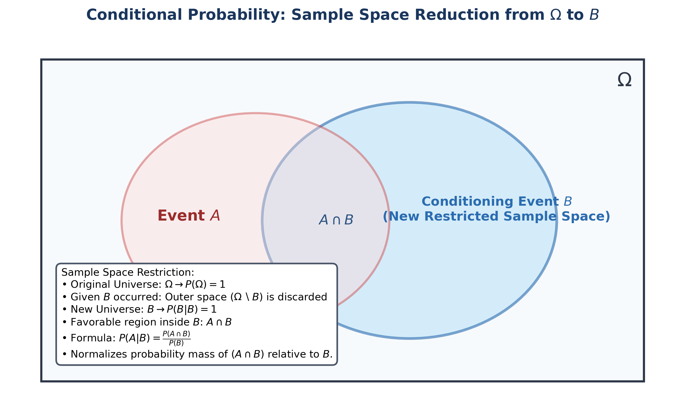
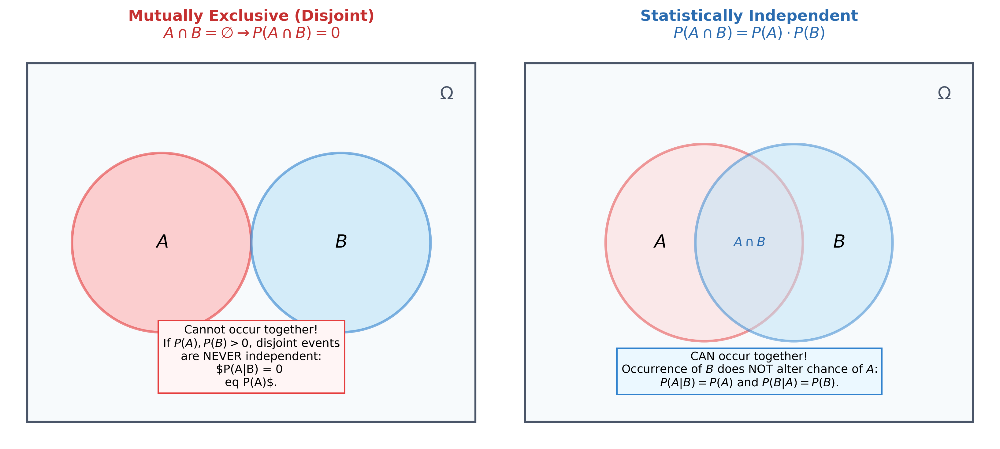
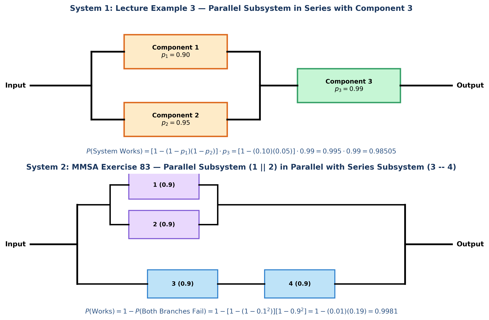
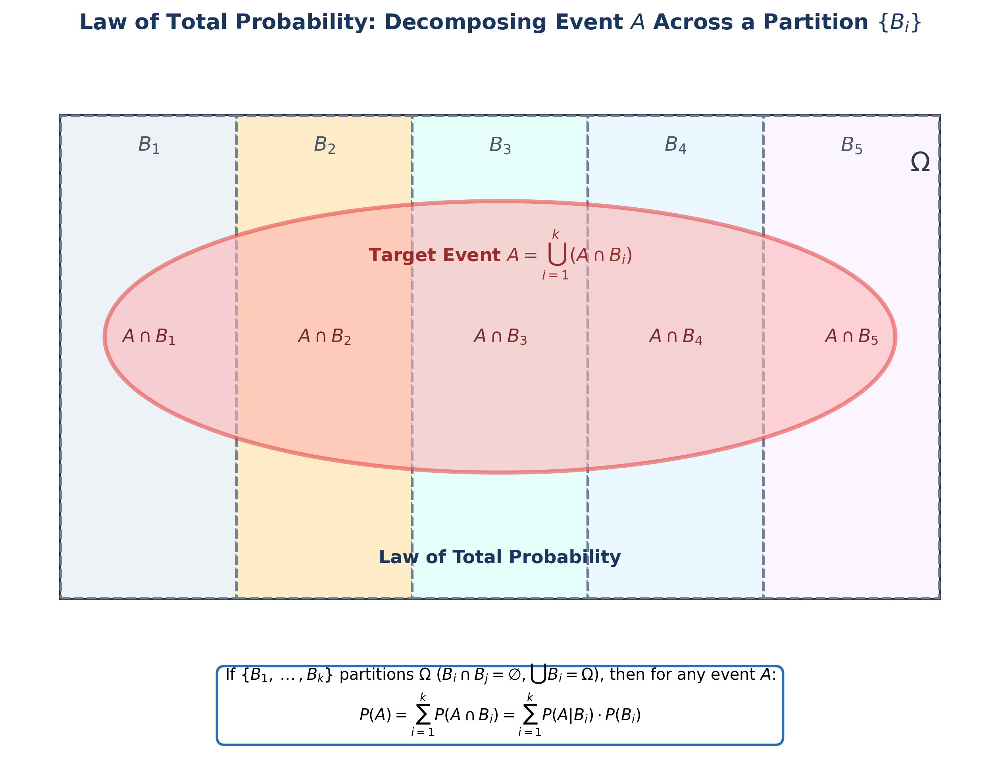
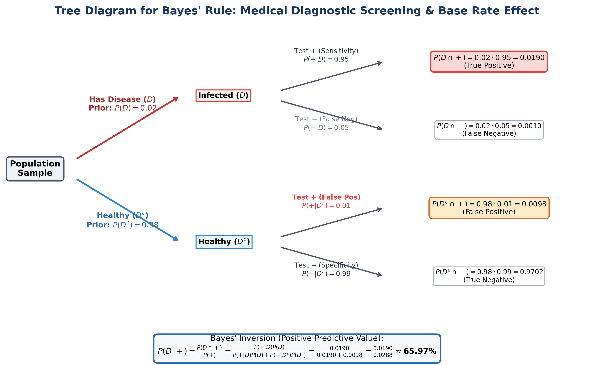
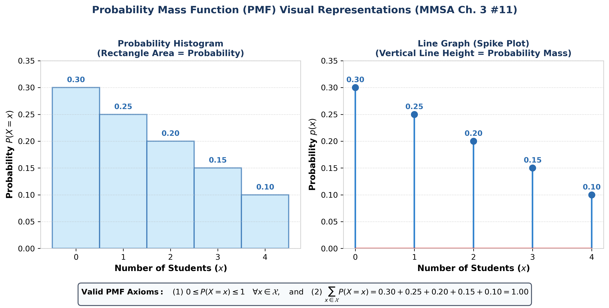

# STA237 Week 3 Study Notes: Conditional Probability, Independence, Bayes' Rule, and Discrete Random Variables

## Contents

- [Scope, notation, and method selection](#scope-notation-and-method-selection)
  - [Source Scope and Reading Status](#source-scope-and-reading-status)
  - [Notation Conventions](#notation-conventions)
  - [Essential Prerequisite Reminders](#essential-prerequisite-reminders)
  - [Compact Method-Selection Guide](#compact-method-selection-guide)
- [Concept C-01: Conditional Probability and Sample Space Reduction](#concept-c-01-conditional-probability-and-sample-space-reduction)
  - [Problem Type PT-01: Direct Conditional Probability Computation and Sample Space Restriction](#problem-type-pt-01-direct-conditional-probability-computation-and-sample-space-restriction)
  - [Problem Type PT-02: Multi-Stage Sequential Intersection via the General Multiplication / Chain Rule](#problem-type-pt-02-multi-stage-sequential-intersection-via-the-general-multiplication--chain-rule)
- [Concept C-02: Statistical Independence, Mutual Exclusivity, and Reliability Networks](#concept-c-02-statistical-independence-mutual-exclusivity-and-reliability-networks)
  - [Problem Type PT-03: Independence Verification and Independence vs. Disjointness Diagnostics](#problem-type-pt-03-independence-verification-and-independence-vs-disjointness-diagnostics)
  - [Problem Type PT-04: System Reliability and Network Flow Modeling with Independent Components](#problem-type-pt-04-system-reliability-and-network-flow-modeling-with-independent-components)
- [Concept C-03: The Law of Total Probability (LTP)](#concept-c-03-the-law-of-total-probability-ltp)
  - [Problem Type PT-05: Total Probability Computation via Partition Decompositions and Tree Diagrams](#problem-type-pt-05-total-probability-computation-via-partition-decompositions-and-tree-diagrams)
  - [Problem Type PT-06: First-Step Analysis and Recursive Conditioning](#problem-type-pt-06-first-step-analysis-and-recursive-conditioning)
- [Concept C-04: Bayes' Rule and Diagnostic Screening](#concept-c-04-bayes-rule-and-diagnostic-screening)
  - [Problem Type PT-07: Posterior Probability Inversion via Bayes' Rule](#problem-type-pt-07-posterior-probability-inversion-via-bayes-rule)
  - [Problem Type PT-08: Diagnostic Screening Evaluation and Base-Rate Fallacy Analysis](#problem-type-pt-08-diagnostic-screening-evaluation-and-base-rate-fallacy-analysis)
- [Concept C-05: Discrete Random Variables and Probability Mass Functions (PMFs)](#concept-c-05-discrete-random-variables-and-probability-mass-functions-pmfs)
  - [Problem Type PT-09: Random Variable Definition and Event-to-Variable Mapping](#problem-type-pt-09-random-variable-definition-and-event-to-variable-mapping)
  - [Problem Type PT-10: PMF Normalization, Parameter Determination, and Validation](#problem-type-pt-10-pmf-normalization-parameter-determination-and-validation)

---

## Scope, notation, and method selection

### Source Scope and Reading Status

This study note synthesizes the theoretical curriculum, problem-solving methods, and practice requirements for **STA237 (Probability, Statistics, and Data Analysis I) Week 3**. The instructional scope is established by:
1. **Primary Lecture Source:** `W3/Week 3.pdf` (Karen H. Wong, University of Toronto), establishing the core learning outcomes:
   - Defining conditional probability and distinguishing conditional probabilities from joint and union probabilities;
   - Determining through computation whether events are dependent, independent, or mutually exclusive;
   - Decomposing events across disjoint partitions to compute unconditional probabilities via the Law of Total Probability (LTP);
   - Applying conditional probability in conjunction with LTP to invert conditioning via Bayes' Rule;
   - Defining the concept of a random variable (RV) as a mapping from sample space outcomes to the real line;
   - Specifying, interpreting, and verifying the axiomatic conditions of Probability Mass Functions (PMFs) for discrete random variables.
2. **Supporting Textbook References:**
   - *Modern Mathematical Statistics with Applications* (3rd ed., 2021) by Devore, Berk, and Carlton (MMSA): Chapters 2.4–2.5 and 3.1.
   - *Probability with Applications and R* (2nd ed., 2021) by Wagaman and Dobrow (PAR): Chapters 2.1–2.6 and 3.1.
   - *Course Syllabus:* `STA237-20269-Syllabus [FINAL].pdf`.
3. **Reading Status Labeling:**
   - **Supporting / Suggested Reading:** Chapters MMSA 2.4–2.5, 3.1 and PAR 2.1–2.6, 3.1 are listed as weekly supplemental references and problem sources. As clarified by the syllabus, weekly problems are suggested practice rather than submitted homework.
   - **Course Platform Access Gap:** Discussion board titles (`Week 3 - (MMSA) Conditional Probability Practice Problems`, `Week 3 - (PAR) Conditional Probability Practice Problems`, and `Weeks 1-3 General Q&A`) are recorded from course platform screenshots; because external discussion forum threads are not accessible via available API endpoints, no external thread URLs or posts have been assumed or invented.

---

### Notation Conventions

| Notation | Meaning / Definition | Formal Domain / Axiomatic Context |
| :--- | :--- | :--- |
| $\Omega$ | Universal sample space | Set of all possible elementary outcomes $\omega$ |
| $\mathcal{F}$ | Event space ($\sigma$-algebra) | Set of admissible subsets of $\Omega$ satisfying Kolmogorov axioms |
| $P(A)$ | Unconditional probability of event $A$ | Real measure $P: \mathcal{F} \to [0, 1]$ with $P(\Omega) = 1$ |
| $P(A \cap B)$ or $P(AB)$ | Joint probability (intersection) | Probability that *both* event $A$ and event $B$ occur simultaneously |
| $P(A \cup B)$ | Disjunctive probability (union) | Probability that *at least one* of $A$ or $B$ occurs |
| $P(A \mid B)$ | Conditional probability of $A$ given $B$ | Fraction of probability mass of $B$ occupied by $A$: $P(A \mid B) = \frac{P(A \cap B)}{P(B)}$ for $P(B) > 0$ |
| $A \perp B$ | Statistical independence of $A$ and $B$ | $P(A \cap B) = P(A)P(B)$, or equivalently $P(A \mid B) = P(A)$ |
| $A \cap B = \emptyset$ | Mutually exclusive (disjoint) events | Events cannot co-occur; $P(A \cap B) = 0$ |
| $\{B_1, \dots, B_k\}$ | Partition of $\Omega$ | Pairwise disjoint ($B_i \cap B_j = \emptyset, \forall i \neq j$) and exhaustive ($\bigcup_{i=1}^k B_i = \Omega$) |
| $X$ | Random Variable | Measurable function mapping outcomes to real numbers: $X: \Omega \to \mathbb{R}$ |
| $\mathcal{X}$ or $\operatorname{Supp}(X)$ | Support / Range of random variable $X$ | Set of realizable values: $\{x \in \mathbb{R} : P(X = x) > 0\}$ |
| $p_X(x)$ or $P(X = x)$ | Probability Mass Function (PMF) | Function $p: \mathbb{R} \to [0, 1]$ assigning point masses to discrete realizations |
| $\{a \le X \le b\}$ | Pre-image event in $\Omega$ | $\{\omega \in \Omega : a \le X(\omega) \le b\} \in \mathcal{F}$ |

---

### Essential Prerequisite Reminders

1. **Kolmogorov Axioms on $(\Omega, \mathcal{F}, P)$:**
   - Axiom 1 (Non-negativity): $P(E) \ge 0$ for all $E \in \mathcal{F}$.
   - Axiom 2 (Normalization): $P(\Omega) = 1$.
   - Axiom 3 (Countable Additivity): For pairwise disjoint events $E_1, E_2, \dots$,
     $$P\left(\bigcup_{i=1}^\infty E_i\right) = \sum_{i=1}^\infty P(E_i)$$
2. **Complement and Inclusion-Exclusion Rules:**
   - $P(A^c) = 1 - P(A)$.
   - $P(A \cup B) = P(A) + P(B) - P(A \cap B)$.
   - Difference rule: $P(A \cap B^c) = P(A) - P(A \cap B)$.
3. **Equally Likely Finite Outcomes (Classical Probability):**
   - If $|\Omega| < \infty$ and all elementary outcomes are equally likely, $P(A) = \frac{|A|}{|\Omega|}$.
   - Slide 2 recap: Permutations of $n$ items with repeated groups of sizes $n_1, \dots, n_r$ equal $\frac{n!}{n_1! \cdots n_r!}$.

---

### Compact Method-Selection Guide

When confronted with a probability problem in Week 3, identify the directional flow of information using this decision framework:

```
                                  [Problem Statement]
                                           │
      ┌────────────────────────────────────┼────────────────────────────────────┐
      ▼                                    ▼                                    ▼
[Conditional Evaluation]          [System / Compound Events]             [Random Quantities]
      │                                    │                                    │
Does conditioning reduce           Are components connected            Is an outcome mapped
the sample space directly?         in series or parallel?              to a numerical value?
      │                                    │                                    │
  ┌───┴───┐                            ┌───┴───┐                            ┌───┴───┐
  ▼       ▼                            ▼       ▼                            ▼       ▼
Direct  Inverse                     Series   Parallel                   Discrete Continuous
Ratio   (Bayes)                     Rule     Complement                   PMF       PDF
  │       │                            │       │                            │     (Future)
PT-01   PT-07                        PT-04   PT-04                        PT-09
PT-02   PT-08                                                             PT-10
```

| Situation / Question Feature | Primary Formal Tool | Applicable Problem Types |
| :--- | :--- | :--- |
| Table of counts or joint probabilities given; ask for $P(A \mid B)$ | Definition: $P(A \mid B) = \frac{P(A \cap B)}{P(B)}$ or $\frac{n(A \cap B)}{n(B)}$ | [PT-01](#problem-type-pt-01-direct-conditional-probability-computation-and-sample-space-restriction) |
| Multi-stage experiment without replacement; draw sequence probabilities | General Multiplication / Chain Rule: $P(A \cap B) = P(B \mid A)P(A)$ | [PT-02](#problem-type-pt-02-multi-stage-sequential-intersection-via-the-general-multiplication--chain-rule) |
| Test whether two events influence each other or are mutually exclusive | Compare $P(A \cap B)$ to $P(A)P(B)$; check $A \cap B = \emptyset$ | [PT-03](#problem-type-pt-03-independence-verification-and-independence-vs-disjointness-diagnostics) |
| Reliability of components in series, parallel, or hybrid arrangements | Product of survival probabilities (series) vs. complement of failure (parallel) | [PT-04](#problem-type-pt-04-system-reliability-and-network-flow-modeling-with-independent-components) |
| Target event depends on an unobserved category, stage, or population sub-group | Law of Total Probability: $P(A) = \sum_{i=1}^k P(A \mid B_i)P(B_i)$ | [PT-05](#problem-type-pt-05-total-probability-computation-via-partition-decompositions-and-tree-diagrams) |
| Sequential game or coin tossing until a stopping pattern is reached | First-Step Conditioning / Recursive Expectation | [PT-06](#problem-type-pt-06-first-step-analysis-and-recursive-conditioning) |
| Observed evidence $A$; ask for probability of underlying cause $B_i$ | Bayes' Rule: $P(B_i \mid A) = \frac{P(A \mid B_i)P(B_i)}{\sum_j P(A \mid B_j)P(B_j)}$ | [PT-07](#problem-type-pt-07-posterior-probability-inversion-via-bayes-rule) |
| Medical screening / diagnostic tests (sensitivity, specificity, prevalence) | 2-State Bayes Model; Base-rate fallacy analysis | [PT-08](#problem-type-pt-08-diagnostic-screening-evaluation-and-base-rate-fallacy-analysis) |
| Formulate physical process into quantitative variable and event intervals | Define $X: \Omega \to \mathbb{R}$; express events as $\{X \in S\}$ | [PT-09](#problem-type-pt-09-random-variable-definition-and-event-to-variable-mapping) |
| Check validity of a discrete formula $p(x)$ or solve for constant $k$ | Axioms: $p(x) \ge 0$ and $\sum_{x \in \mathcal{X}} p(x) = 1$ | [PT-10](#problem-type-pt-10-pmf-normalization-parameter-determination-and-validation) |

---

## Concept C-01: Conditional Probability and Sample Space Reduction

**Classification:** Core

### 1. Mathematical Definition and Axiomatic Foundations

Let $(\Omega, \mathcal{F}, P)$ be a probability space. Let $B \in \mathcal{F}$ be an event with non-zero probability ($P(B) > 0$). The **conditional probability of event $A$ given that event $B$ has occurred**, denoted $P(A \mid B)$, is defined as:

$$P(A \mid B) = \frac{P(A \cap B)}{P(B)}$$

If $P(B) = 0$, the conditional probability $P(A \mid B)$ is undefined in standard Kolmogorov probability theory.



### 2. Intuitive and Geometric Meaning: Sample Space Restriction

Unconditional probability $P(A)$ measures the likelihood of $A$ against the entire universe $\Omega$, where the total reference mass is $P(\Omega) = 1$. When we receive partial information establishing that $B$ has occurred:
1. Every outcome outside of $B$ (the set $\Omega \setminus B = B^c$) is rendered **physically impossible**. Its probability collapses to 0.
2. The event $B$ becomes the **new, restricted sample space** (the "new universe").
3. The only portion of event $A$ that can still occur is the subset of $A$ lying within $B$, which is the intersection $A \cap B$.
4. To ensure that the new universal event has total probability 1 (i.e., $P(B \mid B) = 1$), we must scale (normalize) all remaining probability masses by dividing by $P(B)$.

> [!IMPORTANT]
> **Conditional Probability as a Legitimate Probability Measure:**
> For any fixed conditioning event $B$ with $P(B) > 0$, the conditional assignment $P_B(\cdot) = P(\cdot \mid B)$ is a mathematically valid probability measure on $(\Omega, \mathcal{F})$ satisfying all three Kolmogorov Axioms:
> 1. **Non-negativity:** For any $A \in \mathcal{F}$, since $P(A \cap B) \ge 0$ and $P(B) > 0$,
>    $$P(A \mid B) = \frac{P(A \cap B)}{P(B)} \ge 0$$
> 2. **Normalization:**
>    $$P(\Omega \mid B) = \frac{P(\Omega \cap B)}{P(B)} = \frac{P(B)}{P(B)} = 1, \quad \text{and} \quad P(B \mid B) = \frac{P(B \cap B)}{P(B)} = 1$$
> 3. **Countable Additivity:** If $A_1, A_2, \dots$ are pairwise disjoint events ($A_i \cap A_j = \emptyset$ for $i \neq j$), then $(A_1 \cap B), (A_2 \cap B), \dots$ are also pairwise disjoint. Thus:
>    $$P\left(\bigcup_{i=1}^\infty A_i \;\middle|\; B\right) = \frac{P\left(\left(\bigcup_{i=1}^\infty A_i\right) \cap B\right)}{P(B)} = \frac{P\left(\bigcup_{i=1}^\infty (A_i \cap B)\right)}{P(B)} = \frac{\sum_{i=1}^\infty P(A_i \cap B)}{P(B)} = \sum_{i=1}^\infty P(A_i \mid B)$$

Because $P(\cdot \mid B)$ is a legitimate probability measure, **all theorem-level properties of ordinary probability apply unconditionally within the conditioned space**, including:
- **Complement Rule:** $P(A^c \mid B) = 1 - P(A \mid B)$.
- **Addition Rule:** $P(A_1 \cup A_2 \mid B) = P(A_1 \mid B) + P(A_2 \mid B) - P(A_1 \cap A_2 \mid B)$.
- **Monotonicity:** If $A_1 \subseteq A_2$, then $P(A_1 \mid B) \le P(A_2 \mid B)$.
- **Null Event:** $P(\emptyset \mid B) = 0$.

> [!WARNING]
> **Asymmetry of Arguments:**
> The function $P(A \mid B)$ is a probability measure with respect to its **first argument** ($A$). It is **not** an additive measure with respect to its second argument ($B$):
> $$P(A \mid B_1 \cup B_2) \neq P(A \mid B_1) + P(A \mid B_2)$$
> Furthermore, as proven in PAR Exercise 2.11:
> $$P(A \mid B) + P(A \mid B^c) \neq 1 \quad \text{(in general)}$$
> whereas $P(A \mid B) + P(A^c \mid B) = 1$ is always true.

---

### 3. The General Multiplication Rule and the Chain Rule

By rearranging the definition of conditional probability, we obtain the fundamental device for calculating intersection probabilities:

$$P(A \cap B) = P(A \mid B) \cdot P(B) = P(B \mid A) \cdot P(A)$$

This algebraic identity states: *The joint probability that both $A$ and $B$ occur equals the unconditional probability of the conditioning event multiplied by the likelihood of the second event occurring given the first.*

#### The Chain Rule (Multiplication Rule for $n$ Events)
For any collection of events $A_1, A_2, \dots, A_n$ such that $P(A_1 \cap A_2 \cap \cdots \cap A_{n-1}) > 0$:

$$P(A_1 \cap A_2 \cap \cdots \cap A_n) = P(A_1) \cdot P(A_2 \mid A_1) \cdot P(A_3 \mid A_1 \cap A_2) \cdots P(A_n \mid A_1 \cap \dots \cap A_{n-1})$$

*Proof by Induction:*
For $n=2$, $P(A_1 \cap A_2) = P(A_1)P(A_2 \mid A_1)$ by definition. Assume true for $n-1$. Let $E = A_1 \cap \cdots \cap A_{n-1}$. Then $P(E \cap A_n) = P(E) \cdot P(A_n \mid E)$. Substituting the induction hypothesis for $P(E)$ completes the proof. $\blacksquare$

---

### Problem Type PT-01: Direct Conditional Probability Computation and Sample Space Restriction

**Recognition cues.**  
The problem provides joint outcome data in a contingency table, two-way cross-classification counts, a joint probability grid, or explicit set probabilities ($P(A), P(B), P(A \cap B)$). It asks for the probability of one characteristic given another (phrased as "given that...", "knowing that...", "among those who...", or "conditional on...").

**General method.**  
1. **Identify and name events:** Clearly define the target event $A$ and the conditioning event $B$.
2. **Locate or compute $P(B)$:** Find the marginal total of the conditioning event $B$. Verify $P(B) > 0$.
3. **Locate or compute $P(A \cap B)$:** Find the joint probability or cell count where both $A$ and $B$ hold.
4. **Compute ratio:** Apply $P(A \mid B) = \frac{P(A \cap B)}{P(B)}$ or, in count data, $P(A \mid B) = \frac{n(A \cap B)}{n(B)}$.
5. **Apply Complement within Condition:** If the problem asks for the non-occurrence of $A$ under condition $B$, use $P(A^c \mid B) = 1 - P(A \mid B)$.
6. **Check boundaries:** Verify $0 \le P(A \mid B) \le 1$. If $A \subseteq B$, $P(A \mid B) = P(A)/P(B)$. If $B \subseteq A$, $P(A \mid B) = 1$. If $A \cap B = \emptyset$, $P(A \mid B) = 0$.

**Teaching example — original question.**  
A university data science program surveys 400 enrolled undergraduate students regarding their primary programming language (Python vs. R) and whether they have completed a linear algebra course. The results are summarized below:

| Background | Python ($L_1$) | R ($L_2$) | Row Total |
| :--- | :---: | :---: | :---: |
| Completed Linear Algebra ($A$) | 180 | 60 | 240 |
| No Linear Algebra ($A^c$) | 100 | 60 | 160 |
| **Column Total** | **280** | **120** | **400** |

A student is selected uniformly at random.
- (a) What is the probability that the student has completed linear algebra given that their primary language is R?
- (b) What is the probability that the student's primary language is Python given that they have not completed linear algebra?
- (c) Compute the probability that a student who has completed linear algebra does *not* use Python as their primary language.

*(Full worked solution in [Answers-and-Practice.md: Problem Type PT-01](Answers-and-Practice.md#problem-type-pt-01-direct-conditional-probability-computation-and-sample-space-restriction))*

**A complete answer must include.**  
- Clear assignment of event symbols to categories ($A, A^c, L_1, L_2$);
- Identification of the restricted denominator subset representing the condition;
- Selection of the favorable joint cell count in the intersection;
- Application of the ratio formula;
- Correct evaluation of the complement within the conditioned subset;
- Final fractional and decimal representations with contextual interpretations.

**Common mistakes.**  
- *Inverting the condition:* Calculating $P(B \mid A)$ instead of $P(A \mid B)$ (e.g., dividing by the grand total or by the wrong marginal margin).
- *Confusing intersection with conditional probability:* Reporting $P(A \cap B) = n(A \cap B)/N$ when $P(A \mid B) = n(A \cap B)/n(B)$ is requested.
- *Failing to restrict the denominator:* Forgetting to isolate the conditioned row or column sum.

---

### Problem Type PT-02: Multi-Stage Sequential Intersection via the General Multiplication / Chain Rule

**Recognition cues.**  
The problem describes a process occurring in chronological stages, such as drawing cards, marbles, or components sequentially *without replacement*, or multi-stage engineering decisions where the probabilities at stage $k$ depend on the outcomes of stages $1, \dots, k-1$.

**General method.**  
1. **Define ordered stage events:** Let $E_k$ be the event that the desired outcome occurs at step $k$.
2. **Compute initial stage probability:** Calculate unconditional $P(E_1)$ from the starting composition.
3. **Update state composition:** Deduct chosen elements to find the conditional probabilities $P(E_2 \mid E_1), P(E_3 \mid E_1 \cap E_2), \dots$
4. **Multiply via Chain Rule:**
   $$P(E_1 \cap E_2 \cap \dots \cap E_n) = P(E_1) \prod_{k=2}^n P(E_k \mid E_1 \cap \dots \cap E_{k-1})$$
5. **Partition multiple paths:** If the target event can occur via several distinct sequences of draws, calculate the chain product for each path and sum them using the Addition Principle.

**Teaching example — original question.**  
A quality assurance bin contains 15 integrated circuits, of which 4 are defective and 11 are non-defective. A test technician extracts 3 circuits sequentially at random without replacement.
- (a) What is the probability that all 3 selected circuits are defective?
- (b) What is the probability that the first 2 selected circuits are non-defective and the 3rd circuit is defective?
- (c) What is the probability that exactly 1 defective circuit is obtained across the 3 draws?

*(Full worked solution in [Answers-and-Practice.md: Problem Type PT-02](Answers-and-Practice.md#problem-type-pt-02-multi-stage-sequential-intersection-via-the-general-multiplication--chain-rule))*

**A complete answer must include.**  
- Definition of stage events $D_i$ (defective on draw $i$) and $N_i$ (non-defective on draw $i$);
- Step-by-step updating of the urn population size and defect count;
- Application of the Chain Rule product for each sequential branch;
- Enumeration of all mutually exclusive sequences for unordered target events;
- Summation across valid sequences to yield the total probability.

**Common mistakes.**  
- *Treating sampling without replacement as independent:* Keeping the denominator constant (e.g., using $15^3$ instead of $15 \times 14 \times 13$).
- *Omitting sequence permutations:* In part (c), calculating only $P(D_1 \cap N_2 \cap N_3)$ and forgetting the valid paths $N_1 \cap D_2 \cap N_3$ and $N_1 \cap N_2 \cap D_3$.

---

## Concept C-02: Statistical Independence, Mutual Exclusivity, and Reliability Networks

**Classification:** Core

### 1. Mathematical Definition of Independence

Two events $A$ and $B$ defined on the same probability space $(\Omega, \mathcal{F}, P)$ are **statistically independent** (denoted $A \perp B$) if and only if:

$$P(A \cap B) = P(A) \cdot P(B)$$

#### Equivalent Conditional Definitions
When $P(B) > 0$, dividing by $P(B)$ demonstrates that:

$$A \perp B \iff P(A \mid B) = P(A)$$

Similarly, when $P(A) > 0$:

$$A \perp B \iff P(B \mid A) = P(B)$$

#### Conceptual Interpretation
Independence means that the occurrence or non-occurrence of event $B$ provides **zero informational value** regarding whether event $A$ occurs. The conditional probability $P(A \mid B)$ remains identical to the prior baseline $P(A)$.



---

### 2. Independence vs. Mutual Exclusivity (Disjointness)

A persistent point of confusion among introductory students is conflating *mutually exclusive events* with *independent events*. They are fundamentally opposite:

| Criterion | Mutually Exclusive (Disjoint) Events | Statistically Independent Events |
| :--- | :--- | :--- |
| **Set-Theoretic Definition** | $A \cap B = \emptyset$ (no shared outcomes) | $A \cap B \neq \emptyset$ (must overlap if $P(A), P(B) > 0$) |
| **Joint Probability** | $P(A \cap B) = 0$ | $P(A \cap B) = P(A) \cdot P(B)$ |
| **Conditional Behavior** | $P(A \mid B) = 0$ (occurrence of $B$ forbids $A$) | $P(A \mid B) = P(A)$ (occurrence of $B$ does not alter $A$) |
| **Venn Diagram Representation** | Non-overlapping separated circles | Overlapping circles with proportional intersection area |
| **Informational Relationship** | **Maximally Dependent:** knowing $B$ occurred gives complete certainty that $A$ did not occur! | **Completely Uninformative:** knowing $B$ occurred gives no information about $A$. |

> [!CAUTION]
> **Can Two Events Be Both Mutually Exclusive and Independent?**
> Suppose $A$ and $B$ are mutually exclusive ($P(A \cap B) = 0$) and independent ($P(A \cap B) = P(A)P(B)$). Then:
> $$P(A) \cdot P(B) = 0 \implies P(A) = 0 \quad \text{or} \quad P(B) = 0$$
> **Theorem:** Two events with strictly positive probabilities ($P(A) > 0$ and $P(B) > 0$) **can NEVER be simultaneously mutually exclusive and independent**.

---

### 3. Independence of Complements Theorem

A vital structural property of statistical independence is that independence extends invariant across set complements.

**Theorem:** If events $A$ and $B$ are independent, then:
1. $A^c$ and $B$ are independent.
2. $A$ and $B^c$ are independent.
3. $A^c$ and $B^c$ are independent.

*Complete Analytical Proof:*
1. **Proof that $A^c \perp B$:**
   Notice that $B$ can be partitioned into two disjoint subsets: $B = (A \cap B) \cup (A^c \cap B)$.
   By Axiom 3 (countable additivity):
   $$P(B) = P(A \cap B) + P(A^c \cap B)$$
   Subtracting $P(A \cap B)$ from both sides:
   $$P(A^c \cap B) = P(B) - P(A \cap B)$$
   Since $A$ and $B$ are independent, substitute $P(A \cap B) = P(A)P(B)$:
   $$P(A^c \cap B) = P(B) - P(A)P(B) = P(B)[1 - P(A)] = P(B)P(A^c) = P(A^c)P(B)$$
   Thus, $A^c$ and $B$ are independent. $\blacksquare$
2. **Proof that $A \perp B^c$:**
   Symmetric to (1), interchanging the roles of $A$ and $B$. $\blacksquare$
3. **Proof that $A^c \perp B^c$:**
   Applying De Morgan's Law and the complement rule:
   $$P(A^c \cap B^c) = P((A \cup B)^c) = 1 - P(A \cup B)$$
   Applying the general addition rule:
   $$P(A^c \cap B^c) = 1 - [P(A) + P(B) - P(A \cap B)]$$
   Substituting $P(A \cap B) = P(A)P(B)$:
   $$P(A^c \cap B^c) = 1 - P(A) - P(B) + P(A)P(B) = (1 - P(A))(1 - P(B)) = P(A^c)P(B^c)$$
   Thus, $A^c$ and $B^c$ are independent. $\blacksquare$

---

### 4. Mutual Independence of More Than Two Events

For $n \ge 3$ events, independence requires significantly more than pairwise independence.

#### Formal Definition: Mutual Independence
A collection of events $A_1, A_2, \dots, A_n$ is **mutually independent** (or simply **independent**) if for *every* integer $k$ ($2 \le k \le n$) and *every* chosen subset of $k$ distinct indices $\{i_1, i_2, \dots, i_k\} \subseteq \{1, \dots, n\}$:

$$P(A_{i_1} \cap A_{i_2} \cap \cdots \cap A_{i_k}) = P(A_{i_1}) \cdot P(A_{i_2}) \cdots P(A_{i_k})$$

To verify mutual independence for $n$ events, one must verify:
$$\sum_{k=2}^n \binom{n}{k} = 2^n - n - 1 \quad \text{equations!}$$
For $n=3$ events ($A, B, C$), this requires checking **4 equations**:
1. $P(A \cap B) = P(A)P(B)$
2. $P(A \cap C) = P(A)P(C)$
3. $P(B \cap C) = P(B)P(C)$
4. $P(A \cap B \cap C) = P(A)P(B)P(C)$

> [!IMPORTANT]
> **Pairwise Independence Does NOT Imply Mutual Independence:**
> It is entirely possible for three events to satisfy conditions 1, 2, and 3 (pairwise independence) while completely violating condition 4 (mutual product rule), or conversely to satisfy condition 4 while failing pairwise independence (as demonstrated in PAR Exercise 2.36).

---

### 5. System Reliability and Network Modeling

In engineering reliability, complex systems are modeled as networks of functioning components that operate independently.



#### Series Configuration
A series subsystem works if and only if **all** of its components function. Let $C_1, \dots, C_m$ be independent components with survival probabilities $p_i = P(C_i)$.
$$P(\text{Series Works}) = P\left(\bigcap_{i=1}^m C_i\right) = \prod_{i=1}^m P(C_i) = \prod_{i=1}^m p_i$$

#### Parallel Configuration
A parallel subsystem works if **at least one** component functions. By De Morgan's Law and complement independence, the parallel subsystem fails if and only if **all** components fail:
$$P(\text{Parallel Fails}) = P\left(\bigcap_{i=1}^m C_i^c\right) = \prod_{i=1}^m P(C_i^c) = \prod_{i=1}^m (1 - p_i)$$
$$P(\text{Parallel Works}) = 1 - P(\text{Parallel Fails}) = 1 - \prod_{i=1}^m (1 - p_i)$$

#### Bridge / Hybrid Architectures
Complex networks combine series and parallel blocks:
- **Direct Approach:** Express system functioning as unions and intersections of paths, applying inclusion-exclusion.
- **Indirect (Complement) Approach:** Identify minimal cut sets (combinations of failures that block flow) and compute $P(\text{Blocked}) = 1 - P(\text{Works})$.

---

### Problem Type PT-03: Independence Verification and Independence vs. Disjointness Diagnostics

**Recognition cues.**  
The problem provides numerical probabilities for individual events and their union or intersection, or describes a probabilistic setup and asks: "Are events $A$ and $B$ independent? Justify your answer." Or: "Explain whether events $A$ and $B$ are mutually exclusive." A multi-event version gives pairwise and higher-order intersection probabilities and asks whether three or more events are mutually independent.

**General method.**  
1. **To test independence of two events:**
   - Step 1: Compute the numerical product $P(A) \times P(B)$.
   - Step 2: Determine $P(A \cap B)$. If not given directly, compute via $P(A \cap B) = P(A) + P(B) - P(A \cup B)$ or via conditional probability $P(A \mid B)P(B)$.
   - Step 3: Compare $P(A \cap B)$ with $P(A)P(B)$.
     - If $P(A \cap B) = P(A)P(B)$, conclude **independent**.
     - If $P(A \cap B) \neq P(A)P(B)$, conclude **dependent**.
   - Step 4: Alternatively, compare $P(A \mid B)$ with $P(A)$.
2. **To test mutual exclusivity:**
   - Check if $P(A \cap B) = 0$ (or $A \cap B = \emptyset$).
     - If $P(A \cap B) = 0$, conclude **mutually exclusive**.
     - If $P(A \cap B) > 0$, conclude **not mutually exclusive**.
3. **Diagnose relationship between the two concepts:**
   - If both events have positive probability ($P(A) > 0, P(B) > 0$) and are mutually exclusive, explicitly state that they **cannot** be independent because $P(A \cap B) = 0 \neq P(A)P(B)$.
4. **To test mutual independence of three events $A_1,A_2,A_3$:** verify all four conditions: each of the three pairwise intersections factors, and the triple intersection satisfies
   $$P(A_1 \cap A_2 \cap A_3) = P(A_1)P(A_2)P(A_3).$$
   Pairwise independence alone is not sufficient. More generally, a collection is mutually independent when every subset $I$ with at least two indices satisfies
   $$P\left(\bigcap_{i \in I} A_i\right) = \prod_{i \in I} P(A_i).$$

**Teaching example — original question.**  
A regional transit authority analyzes delays on its commuter rail system. Let $M$ be the event that a morning train departs late, with $P(M) = 0.20$. Let $E$ be the event that the evening return train departs late, with $P(E) = 0.15$. The probability that at least one of these two trains departs late is $0.29$.
- (a) Determine whether events $M$ and $E$ are mutually exclusive.
- (b) Determine numerically whether events $M$ and $E$ are statistically independent.
- (c) Compute $P(M \mid E)$ and explain conceptually how this conditional probability confirms your finding in part (b).

*(Full worked solution in [Answers-and-Practice.md: Problem Type PT-03](Answers-and-Practice.md#problem-type-pt-03-independence-verification-and-independence-vs-disjointness-diagnostics))*

**A complete answer must include.**  
- Computation of $P(M \cap E)$ using the addition rule;
- Comparison of $P(M \cap E)$ to zero to evaluate mutual exclusivity;
- Calculation of the theoretical independent product $P(M) \times P(E)$;
- Explicit comparison of $P(M \cap E)$ to $P(M)P(E)$ with formal conclusion;
- Calculation of conditional probability $P(M \mid E)$ and comparison to the unconditional base rate $P(M)$.

**Common mistakes.**  
- *Assuming non-mutually exclusive means independent:* Believing that if $A \cap B \neq \emptyset$, they must be independent.
- *Confusing $P(A \cap B)$ with $P(A \cup B)$:* Substituting the union probability into the independence product equation.
- *Circular reasoning:* Stating "$M$ and $E$ are independent because the trains run at different times" rather than evaluating the mathematical condition.

---

### Problem Type PT-04: System Reliability and Network Flow Modeling with Independent Components

**Recognition cues.**  
The problem displays an engineering block diagram or describes a network where components operate independently with given operational probabilities. It asks for the probability that the system functions (a signal passes from input to output) or that the system fails / is blocked.

**General method.**  
1. **Identify modular subsystem blocks:** Break the circuit into hierarchical series and parallel sub-blocks.
2. **Evaluate parallel modules:** For components $1, \dots, m$ in parallel:
   $$P(\text{Parallel Works}) = 1 - \prod_{i=1}^m (1 - p_i)$$
3. **Evaluate series modules:** For components $1, \dots, k$ in series:
   $$P(\text{Series Works}) = \prod_{i=1}^k p_i$$
4. **Combine hierarchically:** Substitute the aggregated operational probabilities of sub-blocks into the higher-level architecture.
5. **Indirect method for blockage:** When asked for failure or blockage:
   $$P(\text{Blocked}) = 1 - P(\text{Works})$$
   Alternatively, apply cut-set analysis by identifying minimal failure pathways.

**Teaching example — original question.**  
A telecommunications relay station transmits data packets through the network depicted below. Subsystem $\alpha$ consists of two independent transceivers $T_1$ and $T_2$ connected in parallel, with operational probabilities $P(T_1) = 0.85$ and $P(T_2) = 0.80$. Subsystem $\beta$ consists of two independent processors $C_1$ and $C_2$ connected in series, each having operational probability $0.90$. 

The entire system is designed such that data successfully traverses the relay if **either** Subsystem $\alpha$ works **or** Subsystem $\beta$ works (i.e., Subsystem $\alpha$ and Subsystem $\beta$ form parallel paths across the station). Assuming all components operate independently:
- (a) Calculate the probability that Subsystem $\alpha$ functions.
- (b) Calculate the probability that Subsystem $\beta$ functions.
- (c) Calculate the overall probability that data transmission is blocked (the system fails).

*(Full worked solution in [Answers-and-Practice.md: Problem Type PT-04](Answers-and-Practice.md#problem-type-pt-04-system-reliability-and-network-flow-modeling-with-independent-components))*

**A complete answer must include.**  
- Application of the parallel complement rule for Subsystem $\alpha$;
- Application of the series product rule for Subsystem $\beta$;
- Integration of the two subsystems into the overall top-level parallel network;
- Application of the complement rule to evaluate the probability of system blockage;
- Clear arithmetic working and intermediate probability values.

**Common mistakes.**  
- *Adding probabilities of parallel components:* Calculating $P(T_1 \cup T_2)$ as $P(T_1) + P(T_2)$ instead of accounting for the intersection or using $1 - (1-p_1)(1-p_2)$.
- *Treating series components as additive:* Adding series failure rates rather than multiplying survival probabilities.
- *Confusing blockage with operation:* Reporting $P(\text{Works})$ when $P(\text{Blocked}) = 1 - P(\text{Works})$ is explicitly requested.

---

## Concept C-03: The Law of Total Probability (LTP)

**Classification:** Core

### 1. Mathematical Definition and Partition of Sample Space

Let $(\Omega, \mathcal{F}, P)$ be a probability space. A collection of events $\{B_1, B_2, \dots, B_k\}$ is defined as a **finite partition of the sample space $\Omega$** if:
1. **Pairwise Disjoint (Mutually Exclusive):**
   $$B_i \cap B_j = \emptyset \quad \forall i \neq j$$
2. **Exhaustive:**
   $$\bigcup_{i=1}^k B_i = \Omega$$
3. **Non-trivial:**
   $$P(B_i) > 0 \quad \forall i \in \{1, \dots, k\}$$



### 2. Theorem: The Law of Total Probability

If $\{B_1, B_2, \dots, B_k\}$ forms a partition of $\Omega$, then for any arbitrary event $A \in \mathcal{F}$:

$$P(A) = \sum_{i=1}^k P(A \cap B_i) = \sum_{i=1}^k P(A \mid B_i) \cdot P(B_i)$$

#### Formal Derivation from Kolmogorov Axioms
1. Since $\{B_1, \dots, B_k\}$ partitions $\Omega$, the event $A$ can be decomposed using the identity $A = A \cap \Omega$:
   $$A = A \cap \left(\bigcup_{i=1}^k B_i\right) = \bigcup_{i=1}^k (A \cap B_i)$$
2. Because the sets $B_i$ are pairwise disjoint, the subsets $(A \cap B_i)$ are also mutually exclusive:
   $$(A \cap B_i) \cap (A \cap B_j) = A \cap (B_i \cap B_j) = A \cap \emptyset = \emptyset \quad \forall i \neq j$$
3. Applying Axiom 3 (finite additivity of probability):
   $$P(A) = P\left(\bigcup_{i=1}^k (A \cap B_i)\right) = \sum_{i=1}^k P(A \cap B_i)$$
4. Applying the multiplication rule $P(A \cap B_i) = P(A \mid B_i)P(B_i)$ to each term:
   $$P(A) = \sum_{i=1}^k P(A \mid B_i) \cdot P(B_i)$$
   $\blacksquare$

#### The Binary Partition Special Case
The most common application is a binary partition generated by an event $B$ and its complement $B^c$:
$$P(A) = P(A \mid B)P(B) + P(A \mid B^c)P(B^c)$$

#### Conceptual Philosophy: "Divide and Conquer"
The Law of Total Probability is the fundamental mathematical technique for computing the probability of a complex event $A$ whose likelihood cannot be assessed directly. By conditioning on a latent or intermediate variable (e.g., manufacturing origin, demographic group, first-round coin toss), we calculate $P(A)$ as a **weighted average** of the conditional probabilities $P(A \mid B_i)$, weighted by the prior probabilities $P(B_i)$ of each scenario.

---

### 3. First-Step Analysis and Recursive Conditioning

An advanced application of LTP occurs in dynamic stochastic processes and sequential trials, where an experiment continues until a stopping condition is reached (e.g., flipping coins until pattern $HH$ appears vs. $HT$, as in PAR Exercise 2.26).

By conditioning on the outcome of the **very first transition or step**, one establishes a system of linear equations relating the ultimate absorbing probabilities.
- Let $u$ be the probability that target pattern $\mathcal{T}_1$ occurs before pattern $\mathcal{T}_2$.
- Condition on the first trial $X_1 \in \{S_1, S_2, \dots\}$:
  $$u = \sum_j P(\mathcal{T}_1 \text{ before } \mathcal{T}_2 \mid X_1 = s_j) P(X_1 = s_j)$$
- If a path resets the state, the conditional probability returns to $u$. Solving the linear equation yields the exact absorption probability without summing infinite series.

---

### Problem Type PT-05: Total Probability Computation via Partition Decompositions and Tree Diagrams

**Recognition cues.**  
The problem describes an item, patient, or product originating from one of several distinct sources, factories, or categories. Each category has a known market share or prior probability, and a known conditional rate of a target attribute (e.g., defective rate, accident rate, disease symptom). The problem asks for the overall, unconditional probability of the target attribute.

**General method.**  
1. **Define the partition:** Let $B_1, \dots, B_k$ represent the mutually exclusive and exhaustive origins. Verify $\sum P(B_i) = 1$.
2. **Define the target event:** Let $A$ be the target characteristic whose unconditional probability $P(A)$ is sought.
3. **Extract conditional likelihoods:** Identify $P(A \mid B_i)$ for each branch $i=1, \dots, k$.
4. **Construct or visualize the tree diagram:** Trace branches from root to leaves, multiplying branch probabilities to find joint probabilities $P(A \cap B_i) = P(A \mid B_i)P(B_i)$.
5. **Sum across partition:** Sum all joint path probabilities:
   $$P(A) = \sum_{i=1}^k P(A \mid B_i)P(B_i)$$
6. **Check weighted average property:** Verify that $\min_i P(A \mid B_i) \le P(A) \le \max_i P(A \mid B_i)$.

**Teaching example — original question.**  
An electric vehicle manufacturer procures lithium-ion battery cells from three suppliers: Supplier $S_1$ provides 50% of the cells, Supplier $S_2$ provides 30%, and Supplier $S_3$ provides the remaining 20%. Extensive testing demonstrates that 1.5% of cells from Supplier $S_1$ have internal micro-defects, 2.0% of cells from Supplier $S_2$ have internal micro-defects, and 4.0% of cells from Supplier $S_3$ have internal micro-defects.
- (a) What is the probability that a randomly chosen battery cell installed in a vehicle has internal micro-defects?
- (b) What is the probability that a randomly chosen battery cell is defect-free and originated from Supplier $S_2$?

*(Full worked solution in [Answers-and-Practice.md: Problem Type PT-05](Answers-and-Practice.md#problem-type-pt-05-total-probability-computation-via-partition-decompositions-and-tree-diagrams))*

**A complete answer must include.**  
- Explicit specification of the partition $\{S_1, S_2, S_3\}$ and verification that prior probabilities sum to 1;
- Identification of conditional defect rates $P(D \mid S_i)$;
- Formulation of the LTP equation;
- Execution of the weighted sum;
- Identification of the joint defect-free intersection $P(D^c \cap S_2) = P(D^c \mid S_2)P(S_2)$;
- Intermediate arithmetic and final numerical values.

**Common mistakes.**  
- *Simple unweighted averaging:* Averaging $(1.5\% + 2.0\% + 4.0\%)/3 = 2.5\%$, ignoring unequal supplier volumes.
- *Failing to account for all suppliers:* Omitting the residual supplier share ($S_3 = 1 - 0.50 - 0.30 = 0.20$).

---

### Problem Type PT-06: First-Step Analysis and Recursive Conditioning

**Recognition cues.**  
The problem involves a sequential experiment of indefinite length, such as tossing a coin repeatedly until one of two sequences appears (e.g., $HT$ before $HH$, or two consecutive successes), or playing a game until a winning score is reached. It asks for the probability that a specific pattern or player wins.

**General method.**  
1. **Define the unknown target parameter:** Let $p$ be the probability of the target absorption event.
2. **Identify the first-stage partition:** Condition on the outcome of the first trial (e.g., $X_1 = H$ vs. $X_1 = T$).
3. **Evaluate conditional branch transitions:**
   - If an outcome moves the system toward a state where the target is guaranteed or prevented on the next step, evaluate subsequent branches directly.
   - If an outcome completely resets the experiment to its initial state, set the conditional probability equal to $p$.
4. **Formulate the Law of Total Probability equation:** Express $p$ as a linear combination involving $p$:
   $$p = c_0 + c_1 p$$
5. **Solve for $p$:** Algebraically isolate $p = \frac{c_0}{1 - c_1}$.
6. **Sanity check:** Ensure $0 \le p \le 1$.

**Teaching example — original question.**  
A fair six-sided die is rolled repeatedly until either an outcome of 6 or an outcome of 1 appears. Let $E$ be the event that a 6 appears before a 1.
- (a) By conditioning on the outcome of the very first roll of the die, set up a linear equation for $P(E)$.
- (b) Solve the equation to determine $P(E)$.
- (c) Suppose the die is biased such that $P(6) = 0.25$, $P(1) = 0.15$, and all other faces $\{2, 3, 4, 5\}$ each have probability $0.15$. Recompute the probability that a 6 appears before a 1.

*(Full worked solution in [Answers-and-Practice.md: Problem Type PT-06](Answers-and-Practice.md#problem-type-pt-06-first-step-analysis-and-recursive-conditioning))*

**A complete answer must include.**  
- Definition of the partition across the possible outcomes of the first roll;
- Analysis of absorbing vs. resetting states on the first roll;
- Formulation of the Law of Total Probability balance equation;
- Algebraic solution isolating the unknown probability;
- Generalization to unequal/biased transition probabilities.

**Common mistakes.**  
- *Attempting infinite geometric series summation without recognizing recursive renewal:* While summing $\sum (4/6)^k (1/6)$ works, it is prone to algebraic errors compared to first-step conditioning.
- *Misidentifying resetting states:* Believing that rolling a 2, 3, 4, or 5 alters the future probability of rolling a 6 versus a 1.

---

## Concept C-04: Bayes' Rule and Diagnostic Screening

**Classification:** Core

### 1. Mathematical Formulation and Derivation of Bayes' Rule

While the Law of Total Probability computes the forward, marginal probability $P(A)$, scientific inference and engineering diagnosis frequently require **inverting the conditional probability**: given that evidence $A$ has been observed, what is the posterior probability that cause $B_i$ was responsible?

#### Theorem: Bayes' Rule (Bayes' Theorem)
Let $\{B_1, B_2, \dots, B_k\}$ be a partition of $\Omega$ with $P(B_i) > 0$, and let $A$ be an observable event with $P(A) > 0$. Then for each $i \in \{1, \dots, k\}$:

$$P(B_i \mid A) = \frac{P(A \cap B_i)}{P(A)} = \frac{P(A \mid B_i) \cdot P(B_i)}{\sum_{j=1}^k P(A \mid B_j) \cdot P(B_j)}$$

#### Nomenclature
- **Prior Probability $P(B_i)$:** The baseline probability of hypothesis $B_i$ before observing evidence $A$.
- **Likelihood $P(A \mid B_i)$:** The probability that evidence $A$ occurs given hypothesis $B_i$.
- **Marginal / Normalizing Evidence $P(A)$:** The total probability of observing evidence $A$ across all possible causes, computed via LTP.
- **Posterior Probability $P(B_i \mid A)$:** The updated probability of hypothesis $B_i$ after taking into account evidence $A$.



---

### 2. Medical Diagnostic Screening and the Base Rate Fallacy

A paramount real-world application of Bayes' Rule is medical screening and diagnostic testing (such as HIV testing in Lecture Slide 26 and mammography in PAR Exercise 2.28).

#### Key Terminology in Clinical Testing
Let $D$ denote the event of having the target disease, and $+$ denote a positive test result:
- **Prevalence (Prior):** $P(D)$, the proportion of the population that has the disease.
- **Sensitivity (True Positive Rate):** $P(+ \mid D)$, the probability that an infected person tests positive.
- **Specificity (True Negative Rate):** $P(- \mid D^c)$, the probability that a healthy person tests negative.
- **False Positive Rate (FPR):** $P(+ \mid D^c) = 1 - \text{Specificity}$, the probability that a healthy person tests positive.
- **False Negative Rate (FNR):** $P(- \mid D) = 1 - \text{Sensitivity}$, the probability that an infected person tests negative.
- **Positive Predictive Value (PPV):** $P(D \mid +)$, the posterior probability that a person who tested positive actually has the disease.

#### Derivation of Positive Predictive Value
Applying Bayes' Rule with binary partition $\{D, D^c\}$:

$$P(D \mid +) = \frac{P(+ \mid D)P(D)}{P(+ \mid D)P(D) + P(+ \mid D^c)P(D^c)}$$

$$\text{PPV} = \frac{\text{Sensitivity} \times \text{Prevalence}}{(\text{Sensitivity} \times \text{Prevalence}) + ((1 - \text{Specificity}) \times (1 - \text{Prevalence}))}$$

#### The Base Rate Fallacy
When a disease is rare in the general population ($\text{Prevalence} \ll 1$, e.g., $1\%$ or $0.1\%$), the vast majority of the population is healthy ($D^c \approx 99\%$). Even if a test has excellent specificity (e.g., $95\%$ or $99\%$), the pool of healthy people is so immense that the absolute number of false positives ($P(+ \mid D^c)P(D^c)$) frequently dwarfs the absolute number of true positives ($P(+ \mid D)P(D)$).

As a result, **$P(D \mid +)$ can be surprisingly low (often below 50%)**, leading to severe misdiagnoses if clinicians ignore the base rate.

---

### 3. The Monty Hall Problem

The famous Monty Hall problem (Slide 28) is a striking demonstration of conditional probability and Bayes' Rule:
- A prize (car) is behind one of 3 closed doors ($C_1, C_2, C_3$ with $P(C_i) = 1/3$).
- The contestant chooses Door 1.
- Host Monty Hall (who knows where the car is) opens Door 3, revealing a goat (event $M_3$). Monty never opens the contestant's door or the door with the car.
- Should the contestant switch to Door 2?

Applying Bayes' Rule to Door 1 vs. Door 2 given Monty opened Door 3:
- Likelihoods:
  - If car is behind Door 1 ($C_1$), Monty can open Door 2 or 3 at random $\implies P(M_3 \mid C_1) = 1/2$.
  - If car is behind Door 2 ($C_2$), Monty is *forced* to open Door 3 $\implies P(M_3 \mid C_2) = 1$.
  - If car is behind Door 3 ($C_3$), Monty cannot open Door 3 $\implies P(M_3 \mid C_3) = 0$.
- Marginal probability of Monty opening Door 3 (via LTP):
  $$P(M_3) = \left(\frac{1}{2}\right)\left(\frac{1}{3}\right) + (1)\left(\frac{1}{3}\right) + (0)\left(\frac{1}{3}\right) = \frac{1}{6} + \frac{1}{3} = \frac{1}{2}$$
- Posterior probabilities:
  $$P(C_1 \mid M_3) = \frac{(1/2)(1/3)}{1/2} = \frac{1}{3} \quad \text{(Staying)}$$
  $$P(C_2 \mid M_3) = \frac{(1)(1/3)}{1/2} = \frac{2}{3} \quad \text{(Switching)}$$
Switching **doubles** the probability of winning from $1/3$ to $2/3$.

---

### Problem Type PT-07: Posterior Probability Inversion via Bayes' Rule

**Recognition cues.**  
The problem provides prior probabilities for several categories or hypotheses $B_1, \dots, B_k$ and forward conditional probabilities of observing evidence $A$. An outcome $A$ is observed, and the problem asks: "What is the probability that it came from category $B_i$?" or "Find the posterior probability of $B_i$ given $A$."

**General method.**  
1. **Define the partition of causes:** Identify the exhaustive set of hypotheses $B_1, \dots, B_k$. Verify $\sum P(B_i) = 1$.
2. **Define the evidence event:** Identify the observed outcome $A$.
3. **List likelihoods:** Record $P(A \mid B_i)$ for all $i$.
4. **Compute joint probabilities:** Calculate $P(A \cap B_i) = P(A \mid B_i)P(B_i)$ for all $i$.
5. **Compute marginal evidence:** Sum the joint probabilities to find $P(A) = \sum_{j=1}^k P(A \cap B_j)$.
6. **Invert via Bayes' Rule:** For the specific cause $B_i$ of interest:
   $$P(B_i \mid A) = \frac{P(A \cap B_i)}{P(A)}$$
7. **Verification:** Verify that the sum of posterior probabilities over all causes equals 1: $\sum_{i=1}^k P(B_i \mid A) = 1$.

**Teaching example — original question.**  
A cyber-security operations center classifies incoming network traffic into three categories: Routine ($H_1$), Bulk Backup ($H_2$), and External Query ($H_3$). Routine traffic constitutes 70% of network packets, Bulk Backup constitutes 20%, and External Query constitutes 10%. 

An automated intrusion detection system flags anomalous packet headers. The flag is triggered on 1% of Routine packets, 3% of Bulk Backup packets, and 15% of External Query packets.
- (a) What is the overall probability that a randomly captured packet triggers an anomalous header flag ($A$)?
- (b) If a packet is flagged as anomalous, what is the posterior probability that it is an External Query packet?
- (c) Which traffic category is most likely responsible for a flagged packet?

*(Full worked solution in [Answers-and-Practice.md: Problem Type PT-07](Answers-and-Practice.md#problem-type-pt-07-posterior-probability-inversion-via-bayes-rule))*

**A complete answer must include.**  
- Specification of priors $P(H_i)$ and likelihoods $P(A \mid H_i)$;
- Computation of joint probabilities $P(A \cap H_i)$;
- Evaluation of total evidence probability $P(A)$;
- Application of Bayes' formula for $P(H_3 \mid A)$;
- Comparative calculation of posterior probabilities across all three hypotheses to identify the most probable source.

**Common mistakes.**  
- *Confusing $P(H_3 \mid A)$ with $P(A \mid H_3)$:* Reporting the test sensitivity/flag rate (0.15) rather than the posterior probability.
- *Omitting the prior weighting:* Dividing $P(A \mid H_3)$ by the sum of conditional rates rather than the weighted joint sum.

---

### Problem Type PT-08: Diagnostic Screening Evaluation and Base-Rate Fallacy Analysis

**Recognition cues.**  
The problem describes a medical test, lie detector (polygraph), spam filter, or defect screening mechanism. It provides test sensitivity (true positive rate), specificity (true negative rate), and the prior incidence / prevalence rate. It asks for the probability that a positive test indicates true infection, or the reliability threshold required to achieve a target posterior confidence.

**General method.**  
1. **Define binary state and test events:**
   - State: Disease / Condition Present ($D$) vs. Absent ($D^c$).
   - Test: Positive ($+$) vs. Negative ($-$).
2. **Translate clinical parameters into probability notation:**
   - Prevalence: $P(D) = p_0 \implies P(D^c) = 1 - p_0$.
   - Sensitivity: $P(+ \mid D) \implies P(- \mid D) = 1 - P(+ \mid D)$.
   - Specificity: $P(- \mid D^c) \implies \text{FPR} = P(+ \mid D^c) = 1 - P(- \mid D^c)$.
3. **Calculate total positive probability (marginal):**
   $$P(+) = P(+ \mid D)P(D) + P(+ \mid D^c)P(D^c)$$
4. **Compute Positive Predictive Value (PPV):**
   $$P(D \mid +) = \frac{P(+ \mid D)P(D)}{P(+)}$$
5. **Solve for required reliability parameter:** If the problem asks for the reliability $r$ needed to achieve $P(D \mid +) \ge \tau$:
   - Set up the inequality $\frac{p_0 r}{p_0 r + (1 - p_0)(1 - r)} \ge \tau$ and solve for $r$.

**Teaching example — original question.**  
A biometric airport screening system tests passengers for identity fraud. Approximately 0.2% (0.002) of passengers carry fraudulent documents ($F$). The scanner has a 96% sensitivity ($P(+ \mid F) = 0.96$) and a 98% specificity ($P(- \mid F^c) = 0.98$).
- (a) If a passenger is flagged by the scanner as carrying fraudulent documents, what is the probability that they are actually carrying fraudulent documents?
- (b) What proportion of flagged passengers are false alarms?
- (c) How high must the scanner's specificity be (assuming sensitivity remains 96%) in order for a flagged passenger to have at least a 50% probability of truly carrying fraudulent documents?

*(Full worked solution in [Answers-and-Practice.md: Problem Type PT-08](Answers-and-Practice.md#problem-type-pt-08-diagnostic-screening-evaluation-and-base-rate-fallacy-analysis))*

**A complete answer must include.**  
- Translation of sensitivity, specificity, and prevalence into formal probability events;
- Derivation of the false positive rate $P(+ \mid F^c)$;
- Application of the Law of Total Probability to find the total positive rate $P(+)$;
- Evaluation of the Positive Predictive Value $P(F \mid +)$;
- Calculation of the false alarm proportion $P(F^c \mid +) = 1 - P(F \mid +)$;
- Setup and algebraic solution of the parameter threshold inequality.

**Common mistakes.**  
- *Intuitive overestimate:* Assuming that because the test is 96% sensitive and 98% specific, a flagged person is ~96% likely to be fraudulent, ignoring the overwhelming non-fraudulent population base rate.
- *Algebraic inversion errors:* Mishandling the terms $(1-r)$ and $r$ when solving for required specificity.

---

## Concept C-05: Discrete Random Variables and Probability Mass Functions (PMFs)

**Classification:** Core

### 1. Mathematical Definition of a Random Variable

Up to this point in probability theory, elementary outcomes $\omega \in \Omega$ have often been qualitative descriptions (e.g., "heads", "red marble", "defective chip"). To perform rigorous mathematical analysis, calculus, expectation, and data modeling, we must transition to numerical values.

#### Formal Definition: Random Variable
Let $(\Omega, \mathcal{F}, P)$ be a probability space. A **random variable** $X$ is a function that maps every elementary outcome in the sample space to a real number:

$$X: \Omega \to \mathbb{R}$$

For each outcome $\omega \in \Omega$, the evaluation $X(\omega) = x \in \mathbb{R}$ represents the observed numerical value of the random variable.

> [!NOTE]
> **Random Variables are Neither "Random" Nor "Variables":**
> In mathematical terms, a random variable is a **deterministic function** whose domain is the sample space $\Omega$ and whose codomain is the real line $\mathbb{R}$. The randomness resides entirely in the underlying experiment that selects outcome $\omega$ according to probability measure $P$.

#### Events Defined by Random Variables
When we write $P(X = x)$ or $P(a \le X \le b)$, these are compact shorthands for the probability of the **pre-image event** in the original sample space $\Omega$:

$$\{X = x\} \equiv \{\omega \in \Omega : X(\omega) = x\} \in \mathcal{F}$$

$$\{a \le X \le b\} \equiv \{\omega \in \Omega : a \le X(\omega) \le b\} \in \mathcal{F}$$

---

### 2. Discrete vs. Continuous Random Variables

Random variables are classified by the cardinality and topological structure of their range (support):

| Property | Discrete Random Variable | Continuous Random Variable (Preview) |
| :--- | :--- | :--- |
| **Range / Support $\mathcal{X}$** | **Finite** or **Countably Infinite** subset of $\mathbb{R}$ | **Uncountable interval(s)** of real numbers (e.g., $[a, b]$ or $\mathbb{R}$) |
| **Typical Contexts** | Counts, integers, rankings, binary indicators, discrete categories | Measurements: time, distance, mass, temperature, voltage |
| **Probability Assignment** | Point masses on individual values: $P(X = x)$ | Densities over continuum; individual points have probability zero: $P(X = x) = 0$ |
| **Primary Mathematical Tool** | **Probability Mass Function (PMF)** $p_X(x)$ | **Probability Density Function (PDF)** $f_X(x)$ |
| **Aggregation Tool** | Summations: $\sum_{x \in A} p_X(x)$ | Integrals: $\int_A f_X(x) \, dx$ |

#### Examples of Discrete Supports:
1. **Finite Support:** Number of defectives in a sample of size $n$: $\mathcal{X} = \{0, 1, 2, \dots, n\}$.
2. **Countably Infinite Support:** Number of coin tosses required until the first head appears: $\mathcal{X} = \{1, 2, 3, \dots\} = \mathbb{N}$.

---

### 3. Probability Mass Function (PMF)

The probability distribution of a discrete random variable $X$ is completely determined by its **Probability Mass Function (PMF)**, denoted $p_X(x)$ or simply $p(x)$:

$$p_X(x) = P(X = x) = P(\{\omega \in \Omega : X(\omega) = x\})$$

#### The Fundamental Axioms of a Valid PMF
A function $p: \mathbb{R} \to \mathbb{R}$ is a valid Probability Mass Function for a discrete random variable with support $\mathcal{X}$ if and only if it satisfies two conditions:
1. **Non-negativity (and Boundedness):**
   $$0 \le p_X(x) \le 1 \quad \forall x \in \mathcal{X}, \quad \text{and} \quad p_X(x) = 0 \quad \forall x \notin \mathcal{X}$$
2. **Total Probability Normalization:**
   $$\sum_{x \in \mathcal{X}} p_X(x) = 1$$



#### Calculating Event Probabilities from a PMF
For any subset of real numbers $A \subseteq \mathbb{R}$, the probability that $X$ takes a value in $A$ is obtained by summing the probability masses of all support points lying in $A$:

$$P(X \in A) = \sum_{x \in A \cap \mathcal{X}} p_X(x)$$

Specifically, for an interval $[a, b]$:
$$P(a \le X \le b) = \sum_{x \in \mathcal{X} : a \le x \le b} p_X(x)$$

---

### Problem Type PT-09: Random Variable Definition and Event-to-Variable Mapping

**Recognition cues.**  
The problem describes an applied physical experiment (e.g., rolling dice, testing components, inspecting agricultural products, playing video games). It asks to define an appropriate random variable representing a feature of interest, express qualitative events in terms of $X$, and state the support (possible values) of the variable.

**General method.**  
1. **Define the random variable verbally and symbolically:** State clearly: "Let $X$ denote the [measurable quantity of interest]."
2. **Specify the support $\mathcal{X}$:** Determine whether the range is finite or countably infinite, and list the possible numerical values $\mathcal{X} = \{x_1, x_2, \dots\}$.
3. **Map verbal statements to set inequalities:**
   - "At least $k$": $\{X \ge k\}$
   - "At most $k$": $\{X \le k\}$
   - "Strictly between $a$ and $b$": $\{a < X < b\}$
   - "Inclusive between $a$ and $b$": $\{a \le X \le b\}$
   - "No more than $k$": $\{X \le k\}$
   - "None / zero": $\{X = 0\}$
4. **Identify set operations on events:** When multiple conditions occur, translate them into unions, intersections, and complements of intervals of $X$.

**Teaching example — original question.**  
A computer server handles incoming user connection requests. In any 1-minute window, the server can experience up to 5 failed connection attempts before triggering a firewall lockout. Let an experiment consist of observing the server over a 1-minute window.
- (a) Define a discrete random variable $N$ representing the number of failed connection attempts, and state its support $\mathcal{N}$.
- (b) Express the following operational events in terms of algebraic inequalities involving $N$:
  - $E_1$: The server experiences at least 2 failed attempts.
  - $E_2$: The server experiences fewer than 4 failed attempts.
  - $E_3$: The server experiences between 1 and 3 failed attempts (inclusive).
- (c) Explicitly describe the compound events (i) $E_1 \cap E_2$, (ii) $E_1 \cup E_2$, and (iii) $E_1^c$ as sets of support values of $N$.

*(Full worked solution in [Answers-and-Practice.md: Problem Type PT-09](Answers-and-Practice.md#problem-type-pt-09-random-variable-definition-and-event-to-variable-mapping))*

**A complete answer must include.**  
- Precise definition of the random variable mapping outcomes to numbers;
- Explicit listing of the support set;
- Correct mathematical inequality representation for each verbal condition;
- Evaluation of set intersections, unions, and complements across the discrete support.

**Common mistakes.**  
- *Confusing strict and non-strict inequalities:* Writing $X > k$ when "at least $k$" means $X \ge k$.
- *Omitting 0 from count supports:* Forgetting that a count can be zero (e.g., stating support is $\{1, 2, 3, 4, 5\}$ instead of $\{0, 1, 2, 3, 4, 5\}$).

---

### Problem Type PT-10: PMF Normalization, Parameter Determination, and Validation

**Recognition cues.**  
The problem specifies a functional form for a probability mass function $P(X = x) = f(x; k)$ containing an unknown constant $k$, defined over a given finite or countably infinite support. It asks to determine the value of $k$ that makes $p(x)$ a valid PMF, verify non-negativity, and compute probabilities of specific intervals or events. A related task gives a discrete random variable $U$ and a transformation $W=g(U)$ and asks for the PMF of $W$.

**General method.**  
1. **Set up the normalization condition:** Use Axiom 2 of a PMF:
   $$\sum_{x \in \mathcal{X}} p_X(x) = 1$$
2. **Evaluate the sum:** Sum the terms algebraically across all $x \in \mathcal{X}$. Factor out the unknown parameter $k$:
   $$\sum_{x \in \mathcal{X}} f(x; k) = k \cdot S_1 + S_2 = 1$$
3. **Solve for $k$:** Algebraically isolate $k = \frac{1 - S_2}{S_1}$.
4. **Verify non-negativity (Axiom 1):** Substitute the solved value of $k$ back into $p_X(x)$ for every $x \in \mathcal{X}$. Confirm that $0 \le p_X(x) \le 1$ for all support points. If any $p_X(x) < 0$ or $p_X(x) > 1$, no valid PMF exists.
5. **Compute event probabilities:** To find $P(a \le X \le b)$, sum $p_X(x)$ over all $x \in \mathcal{X} \cap [a, b]$.
6. **For a transformed random variable $W=g(U)$:** for each possible value $w$, sum the probabilities of all source values in its pre-image:
   $$p_W(w) = \sum_{u:g(u)=w} p_U(u).$$
   Identify the attainable values of $w$, then verify the resulting probabilities are nonnegative and sum to $1$.

**Teaching example — original question.**  
A discrete random variable $X$ has support $\mathcal{X} = \{1, 2, 3, 4\}$. Its proposed probability mass function is given by:

$$p_X(x) = c \cdot (5 - x)^2, \quad x \in \{1, 2, 3, 4\}$$

- (a) Determine the exact constant $c$ such that $p_X(x)$ is a valid Probability Mass Function.
- (b) Verify that the resulting function satisfies all PMF axioms.
- (c) Calculate $P(X \ge 2)$.
- (d) Calculate $P(X \text{ is odd} \mid X \ge 2)$.

*(Full worked solution in [Answers-and-Practice.md: Problem Type PT-10](Answers-and-Practice.md#problem-type-pt-10-pmf-normalization-parameter-determination-and-validation))*

**A complete answer must include.**  
- Setting up the summation $\sum_{x=1}^4 p(x) = 1$;
- Explicit calculation of $(5-x)^2$ for each $x \in \{1, 2, 3, 4\}$;
- Exact algebraic solution for normalizing constant $c$;
- Explicit check confirming $p(x) \ge 0$ for all $x \in \mathcal{X}$;
- Summation of point probabilities to evaluate the event probability;
- Application of conditional probability formula within the discrete distribution.

**Common mistakes.**  
- *Failing to verify non-negativity:* Finding a mathematical root $k$ from the summation that inadvertently produces negative probabilities for some support points.
- *Arithmetic errors in polynomial expansion:* Miscalculating squares of differences.
- *Misapplying conditional probability to PMFs:* Calculating $P(X \text{ is odd} \cap X \ge 2)$ and forgetting to divide by $P(X \ge 2)$.
