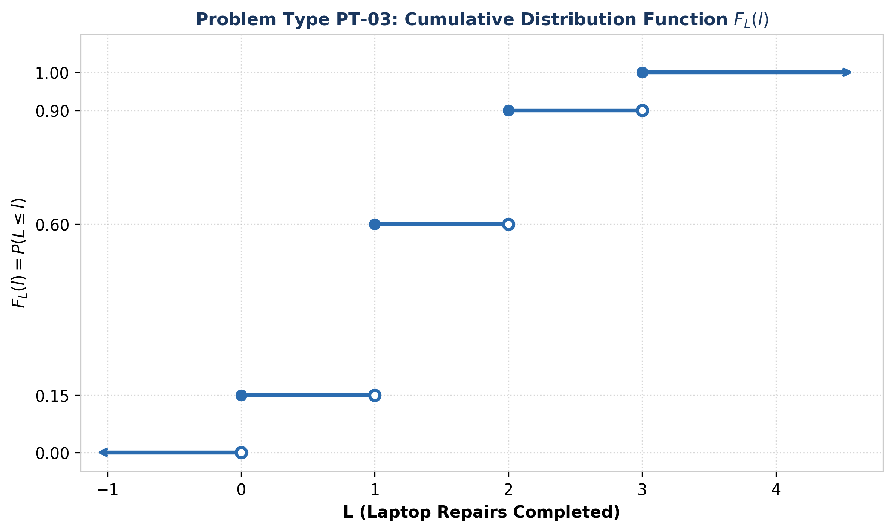
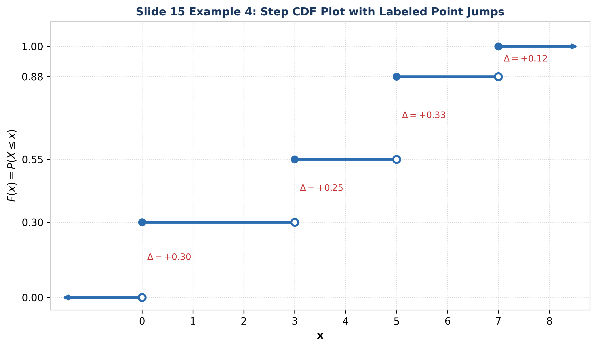
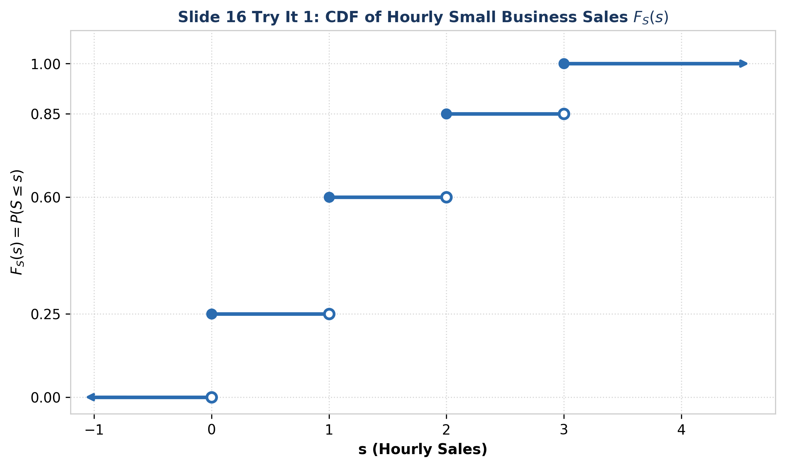
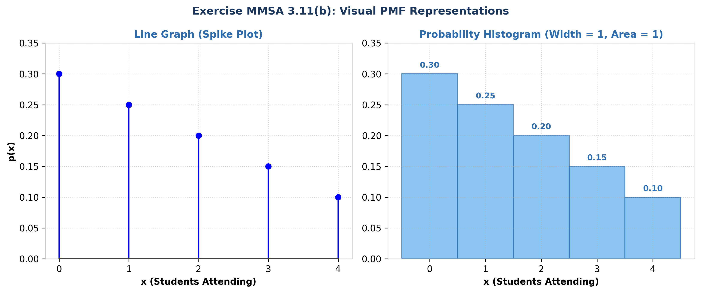
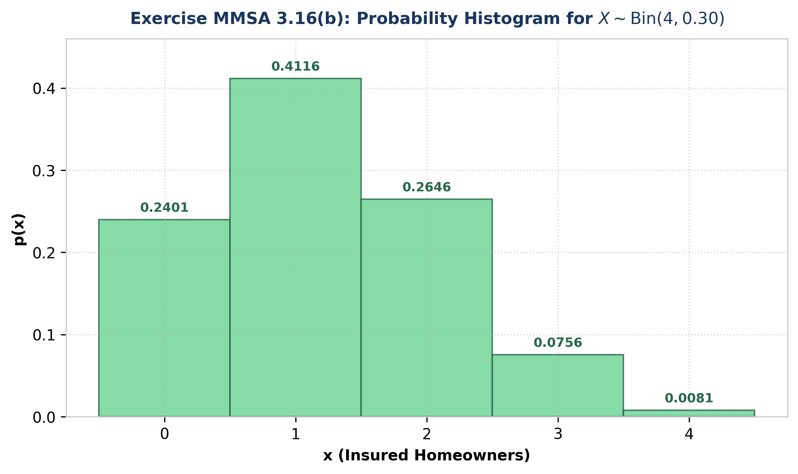

# STA237 Week 4 Answers and Practice: Worked Solutions, Lecture Exercises, Reference Problems, and Self-Tests

## Contents

- [Section A: Problem Type Teaching-Example Solutions](#section-a-problem-type-teaching-example-solutions)
  - [Problem Type PT-01: PMF Construction, Normalization Constant Determination, and Validity Checks](#problem-type-pt-01-pmf-construction-normalization-constant-determination-and-validity-checks)
  - [Problem Type PT-02: Event Probability Calculation and Interval Evaluation from PMFs](#problem-type-pt-02-event-probability-calculation-and-interval-evaluation-from-pmfs)
  - [Problem Type PT-03: Deriving and Plotting the CDF from a PMF](#problem-type-pt-03-deriving-and-plotting-the-cdf-from-a-pmf)
  - [Problem Type PT-04: Reconstructing the PMF and Extracting Probabilities from a CDF](#problem-type-pt-04-reconstructing-the-pmf-and-extracting-probabilities-from-a-cdf)
  - [Problem Type PT-05: Determining Percentiles, Quartiles, and Medians from PMFs and CDFs](#problem-type-pt-05-determining-percentiles-quartiles-and-medians-from-pmfs-and-cdfs)
  - [Problem Type PT-06: Direct Expected Value Computation and Linear Scaling](#problem-type-pt-06-direct-expected-value-computation-and-linear-scaling)
  - [Problem Type PT-07: Expectation of Transformed Random Variables and Non-Linear Distinction Diagnostics](#problem-type-pt-07-expectation-of-transformed-random-variables-and-non-linear-distinction-diagnostics)
  - [Problem Type PT-08: Variance and Standard Deviation Computation via Definition and Shortcut Formula](#problem-type-pt-08-variance-and-standard-deviation-computation-via-definition-and-shortcut-formula)
  - [Problem Type PT-09: Linear Transformation Properties of Variance and Standard Deviation](#problem-type-pt-09-linear-transformation-properties-of-variance-and-standard-deviation)
  - [Problem Type PT-10: Visual and Qualitative Distribution Diagnostics (Center vs. Spread)](#problem-type-pt-10-visual-and-qualitative-distribution-diagnostics-center-vs-spread)
- [Section B: Source Questions and Solutions (Lecture Deck)](#section-b-source-questions-and-solutions-lecture-deck)
  - [Slide 5: Random Variable Concept, Quantitative vs. Categorical Mappings](#slide-5-random-variable-concept-quantitative-vs-categorical-mappings)
  - [Slide 8: Example 1 — Normalization Constant for Quadratic PMF](#slide-8-example-1--normalization-constant-for-quadratic-pmf)
  - [Slide 9: Example 2 — Two Fair Four-Sided Dice Sum PMF and Cumulative Event](#slide-9-example-2--two-fair-four-sided-dice-sum-pmf-and-cumulative-event)
  - [Slide 10: Try it yourself! — Defective Computer Parts Shipment](#slide-10-try-it-yourself--defective-computer-parts-shipment)
  - [Slide 13: Example 3 — Cumulative Distribution Function (CDF) Construction](#slide-13-example-3--cumulative-distribution-function-cdf-construction)
  - [Slide 15: Example 4 — Reading and Evaluating CDF & CDF Plot](#slide-15-example-4--reading-and-evaluating-cdf--cdf-plot)
  - [Slide 16: Try it yourself! — PMF to CDF Plotting & CDF Inversion](#slide-16-try-it-yourself--pmf-to-cdf-plotting--cdf-inversion)
  - [Slide 21: Expected Value Definitions, Summation Identities, and Nonlinear Transformation Warning](#slide-21-expected-value-definitions-summation-identities-and-nonlinear-transformation-warning)
  - [Slide 22: Example 5 — Expected Value of Hourly Sales and 8-Hour Workday](#slide-22-example-5--expected-value-of-hourly-sales-and-8-hour-workday)
  - [Slide 24: Example 6 — Variance and Standard Deviation of Hourly Sales](#slide-24-example-6--variance-and-standard-deviation-of-hourly-sales)
  - [Slide 25: Try it yourself! — Soccer Goals Moments and PMF Visual Comparison](#slide-25-try-it-yourself--soccer-goals-moments-and-pmf-visual-comparison)
- [Section C: Requested Textbook / Reference Exercises and Solutions](#section-c-requested-textbook--reference-exercises-and-solutions)
  - [Subsection C.1: Modern Mathematical Statistics with Applications (MMSA)](#subsection-c1-modern-mathematical-statistics-with-applications-mmsa)
    - [MMSA Basic Exercises](#mmsa-basic-exercises)
      - [Exercise MMSA 3.3 (Section 3.1, p. 114)](#exercise-mmsa-33-section-31-p-114)
      - [Exercise MMSA 3.6 (Section 3.1, p. 114)](#exercise-mmsa-36-section-31-p-114)
      - [Exercise MMSA 3.7 (Section 3.1, p. 114)](#exercise-mmsa-37-section-31-p-114)
      - [Exercise MMSA 3.11 (Section 3.2, p. 123)](#exercise-mmsa-311-section-32-p-123)
      - [Exercise MMSA 3.13 (Section 3.2, p. 123)](#exercise-mmsa-313-section-32-p-123)
      - [Exercise MMSA 3.28 (Section 3.3, p. 134)](#exercise-mmsa-328-section-33-p-134)
    - [MMSA Medium Exercises](#mmsa-medium-exercises)
      - [Exercise MMSA 3.14 (Section 3.2, p. 123)](#exercise-mmsa-314-section-32-p-123)
      - [Exercise MMSA 3.16 (Section 3.2, p. 123)](#exercise-mmsa-316-section-32-p-123)
      - [Exercise MMSA 3.31 (Section 3.3, p. 134)](#exercise-mmsa-331-section-33-p-134)
    - [MMSA Test Level Exercises](#mmsa-test-level-exercises)
      - [Exercise MMSA 3.22 (Section 3.2, p. 123)](#exercise-mmsa-322-section-32-p-123)
      - [Exercise MMSA 3.36 (Section 3.3, p. 134)](#exercise-mmsa-336-section-33-p-134)
      - [Exercise MMSA 3.38 (Section 3.3, p. 134)](#exercise-mmsa-338-section-33-p-134)
  - [Subsection C.2: Probability with Applications and R (PAR)](#subsection-c2-probability-with-applications-and-r-par)
    - [PAR Basic Exercises](#par-basic-exercises)
      - [Exercise PAR 3.1 (Ch. 3, Section 3.1, p. 118)](#exercise-par-31-ch-3-section-31-p-118)
      - [Shared Italicized Instructions for PAR 3.2–3.5](#shared-italicized-instructions-for-par-3235)
      - [Exercise PAR 3.2 (Ch. 3, Section 3.1, p. 118)](#exercise-par-32-ch-3-section-31-p-118)
      - [Exercise PAR 3.3 (Ch. 3, Section 3.1, p. 118)](#exercise-par-33-ch-3-section-31-p-118)
      - [Exercise PAR 3.4 (Ch. 3, Section 3.1, p. 118)](#exercise-par-34-ch-3-section-31-p-118)
      - [Exercise PAR 3.5 (Ch. 3, Section 3.1, p. 118)](#exercise-par-35-ch-3-section-31-p-118)
      - [Exercise PAR 3.6 (Ch. 3, Section 3.1, p. 118)](#exercise-par-36-ch-3-section-31-p-118)
      - [Exercise PAR 3.7 (Ch. 3, Section 3.1, p. 118)](#exercise-par-37-ch-3-section-31-p-118)
      - [Exercise PAR 4.1 (Ch. 4, Section 4.1, p. 176–177)](#exercise-par-41-ch-4-section-41-p-176177)
      - [Exercise PAR 4.25 (Ch. 4, Section 4.6, p. 180)](#exercise-par-425-ch-4-section-46-p-180)
    - [PAR Medium Exercises](#par-medium-exercises)
      - [Exercise PAR 3.10 (Ch. 3, Section 3.1, p. 118)](#exercise-par-310-ch-3-section-31-p-118)
      - [Exercise PAR 4.2 (Ch. 4, Section 4.1, p. 177)](#exercise-par-42-ch-4-section-41-p-177)
      - [Exercise PAR 4.3 (Ch. 4, Section 4.1, p. 177)](#exercise-par-43-ch-4-section-41-p-177)
      - [Exercise PAR 4.6 (Ch. 4, Section 4.1, p. 177)](#exercise-par-46-ch-4-section-41-p-177)
      - [Exercise PAR 4.24 (Ch. 4, Section 4.6, p. 180)](#exercise-par-424-ch-4-section-46-p-180)
      - [Exercise PAR 4.26 (Ch. 4, Section 4.6, p. 180)](#exercise-par-426-ch-4-section-46-p-180)
      - [Exercise PAR 4.29 (Ch. 4, Section 4.6, p. 180)](#exercise-par-429-ch-4-section-46-p-180)
      - [Exercise PAR 4.32 (Ch. 4, Section 4.6, p. 181)](#exercise-par-432-ch-4-section-46-p-181)
    - [PAR Test Level Exercises](#par-test-level-exercises)
      - [Exercise PAR 4.4 (Ch. 4, Section 4.1, p. 177)](#exercise-par-44-ch-4-section-41-p-177)
      - [Exercise PAR 4.7 (Ch. 4, Section 4.1, p. 177)](#exercise-par-47-ch-4-section-41-p-177)
      - [Exercise PAR 4.8 (Ch. 4, Section 4.1, p. 177)](#exercise-par-48-ch-4-section-41-p-177)
      - [Exercise PAR 4.28 (Ch. 4, Section 4.6, p. 180)](#exercise-par-428-ch-4-section-46-p-180)
      - [Exercise PAR 4.33 (Ch. 4, Section 4.6, p. 181)](#exercise-par-433-ch-4-section-46-p-181)
- [Section D: Original Self-Test Questions](#section-d-original-self-test-questions)
  - [Question ST-01 (Problem Type PT-01)](#question-st-01-problem-type-pt-01)
  - [Question ST-02 (Problem Type PT-02)](#question-st-02-problem-type-pt-02)
  - [Question ST-03 (Problem Type PT-03)](#question-st-03-problem-type-pt-03)
  - [Question ST-04 (Problem Type PT-04)](#question-st-04-problem-type-pt-04)
  - [Question ST-05 (Problem Type PT-05)](#question-st-05-problem-type-pt-05)
  - [Question ST-06 (Problem Type PT-06)](#question-st-06-problem-type-pt-06)
  - [Question ST-07 (Problem Type PT-07)](#question-st-07-problem-type-pt-07)
  - [Question ST-08 (Problem Type PT-08)](#question-st-08-problem-type-pt-08)
  - [Question ST-09 (Problem Type PT-09)](#question-st-09-problem-type-pt-09)
  - [Question ST-10 (Problem Type PT-10)](#question-st-10-problem-type-pt-10)
- [Section E: Self-Test Answers and Diagnostics](#section-e-self-test-answers-and-diagnostics)
  - [Solution to ST-01 (Problem Type PT-01)](#solution-to-st-01-problem-type-pt-01)
  - [Solution to ST-02 (Problem Type PT-02)](#solution-to-st-02-problem-type-pt-02)
  - [Solution to ST-03 (Problem Type PT-03)](#solution-to-st-03-problem-type-pt-03)
  - [Solution to ST-04 (Problem Type PT-04)](#solution-to-st-04-problem-type-pt-04)
  - [Solution to ST-05 (Problem Type PT-05)](#solution-to-st-05-problem-type-pt-05)
  - [Solution to ST-06 (Problem Type PT-06)](#solution-to-st-06-problem-type-pt-06)
  - [Solution to ST-07 (Problem Type PT-07)](#solution-to-st-07-problem-type-pt-07)
  - [Solution to ST-08 (Problem Type PT-08)](#solution-to-st-08-problem-type-pt-08)
  - [Solution to ST-09 (Problem Type PT-09)](#solution-to-st-09-problem-type-pt-09)
  - [Solution to ST-10 (Problem Type PT-10)](#solution-to-st-10-problem-type-pt-10)
- [Section F: Coverage and Unresolved-Items Appendix](#section-f-coverage-and-unresolved-items-appendix)
  - [1. Source Scope and Locators Matrix](#1-source-scope-and-locators-matrix)
  - [2. Textbook Exercise Locator Reconciliation](#2-textbook-exercise-locator-reconciliation)
  - [3. Concept to Problem Type Mapping Matrix](#3-concept-to-problem-type-mapping-matrix)
  - [4. Reading Status and Authority Declaration](#4-reading-status-and-authority-declaration)

---

## Section A: Problem Type Teaching-Example Solutions

### Problem Type PT-01: PMF Construction, Normalization Constant Determination, and Validity Checks

**Question reference:** [Study-Notes.md: Problem Type PT-01](Study-Notes.md#problem-type-pt-01-pmf-construction-normalization-constant-determination-and-validity-checks).

**Worked solution.**  
A discrete random variable $W$ has support $\mathcal{W} = \{0, 1, 2, 3, 4\}$ and candidate PMF:
$$p_W(w) = \frac{c w^2 + 2w + 1}{50}, \quad w \in \{0, 1, 2, 3, 4\}$$

**(a) Normalizing Constant $c$:**  
By Axiom 2 of a PMF, the sum of probabilities across the entire support must equal 1:
$$\sum_{w=0}^4 p_W(w) = 1 \implies \sum_{w=0}^4 \frac{c w^2 + 2w + 1}{50} = 1$$
Multiply both sides by 50:
$$\sum_{w=0}^4 (c w^2 + 2w + 1) = 50$$
Evaluate the terms for each $w \in \{0, 1, 2, 3, 4\}$:
- For $w = 0$: $c(0)^2 + 2(0) + 1 = 1$
- For $w = 1$: $c(1)^2 + 2(1) + 1 = c + 3$
- For $w = 2$: $c(2)^2 + 2(2) + 1 = 4c + 5$
- For $w = 3$: $c(3)^2 + 2(3) + 1 = 9c + 7$
- For $w = 4$: $c(4)^2 + 2(4) + 1 = 16c + 9$

Summing all five expressions:
$$(1) + (c + 3) + (4c + 5) + (9c + 7) + (16c + 9) = (1 + 4 + 9 + 16)c + (1 + 3 + 5 + 7 + 9)$$
$$30c + 25 = 50$$
Isolate $c$:
$$30c = 25 \implies c = \frac{25}{30} = \frac{5}{6}$$

**(b) Axiomatic Verification (Axiom 1 Check):**  
Substitute $c = \frac{5}{6}$ into $p_W(w) = \frac{\frac{5}{6}w^2 + 2w + 1}{50} = \frac{5w^2 + 12w + 6}{300}$:
- $w = 0$: $p_W(0) = \frac{6}{300} = \frac{1}{50} = 0.0200 \ge 0$
- $w = 1$: $p_W(1) = \frac{5(1) + 12(1) + 6}{300} = \frac{23}{300} \approx 0.0767 \ge 0$
- $w = 2$: $p_W(2) = \frac{5(4) + 12(2) + 6}{300} = \frac{50}{300} = \frac{1}{6} \approx 0.1667 \ge 0$
- $w = 3$: $p_W(3) = \frac{5(9) + 12(3) + 6}{300} = \frac{87}{300} = \frac{29}{100} = 0.2900 \ge 0$
- $w = 4$: $p_W(4) = \frac{5(16) + 12(4) + 6}{300} = \frac{134}{300} = \frac{67}{150} \approx 0.4467 \ge 0$

Check non-negativity and upper bound: For all $w \in \mathcal{W}$, $0 \le p_W(w) \le 1$.  
Check total sum:
$$\frac{6 + 23 + 50 + 87 + 134}{300} = \frac{300}{300} = 1.0000$$
Both Kolmogorov axioms are fully satisfied.

**(c) PMF Table:**  
$$\begin{array}{c|ccccc}
w & 0 & 1 & 2 & 3 & 4 \\
\hline
p_W(w) & \frac{6}{300} \, (0.0200) & \frac{23}{300} \, (0.0767) & \frac{50}{300} \, (0.1667) & \frac{87}{300} \, (0.2900) & \frac{134}{300} \, (0.4467)
\end{array}$$

**Answer.**  
(a) $c = \frac{5}{6}$; (b) All $p_W(w) \in [0, 1]$ and sum to 1; (c) PMF table as specified above.

---

### Problem Type PT-02: Event Probability Calculation and Interval Evaluation from PMFs

**Question reference:** [Study-Notes.md: Problem Type PT-02](Study-Notes.md#problem-type-pt-02-event-probability-calculation-and-interval-evaluation-from-pmfs).

**Worked solution.**  
The sensor defect count $Y$ has PMF:
$$\begin{array}{c|ccccc}
y & 0 & 1 & 2 & 3 & 4 \\
\hline
p(y) & 0.40 & 0.25 & 0.18 & 0.12 & 0.05
\end{array}$$

**(a) Probability that at least 2 non-conforming sensors are detected, $P(Y \ge 2)$:**  
The support points satisfying $y \ge 2$ are $\{2, 3, 4\}$:
$$P(Y \ge 2) = p(2) + p(3) + p(4) = 0.18 + 0.12 + 0.05 = 0.35$$
*Complement verification:* $1 - P(Y \le 1) = 1 - (p(0) + p(1)) = 1 - (0.40 + 0.25) = 1 - 0.65 = 0.35$. Matches.

**(b) Probability between 1 and 3 non-conforming sensors (inclusive), $P(1 \le Y \le 3)$:**  
The support points are $\{1, 2, 3\}$:
$$P(1 \le Y \le 3) = p(1) + p(2) + p(3) = 0.25 + 0.18 + 0.12 = 0.55$$

**(c) Conditional probability $P(Y \ge 2 \mid Y \ge 1)$:**  
By the definition of conditional probability:
$$P(Y \ge 2 \mid Y \ge 1) = \frac{P(\{Y \ge 2\} \cap \{Y \ge 1\})}{P(Y \ge 1)}$$
Since $\{Y \ge 2\} \subset \{Y \ge 1\}$, the intersection is $\{Y \ge 2\}$:
$$P(\{Y \ge 2\} \cap \{Y \ge 1\}) = P(Y \ge 2) = 0.35$$
The conditioning event probability is:
$$P(Y \ge 1) = 1 - P(Y = 0) = 1 - 0.40 = 0.60$$
Thus:
$$P(Y \ge 2 \mid Y \ge 1) = \frac{0.35}{0.60} = \frac{35}{60} = \frac{7}{12} \approx 0.5833$$

**Answer.**  
(a) $P(Y \ge 2) = 0.35$; (b) $P(1 \le Y \le 3) = 0.55$; (c) $P(Y \ge 2 \mid Y \ge 1) = \frac{7}{12} \approx 0.5833$.

---

### Problem Type PT-03: Deriving and Plotting the CDF from a PMF

**Question reference:** [Study-Notes.md: Problem Type PT-03](Study-Notes.md#problem-type-pt-03-deriving-and-plotting-the-cdf-from-a-pmf).

**Worked solution.**  
The repair count $L$ has PMF:
$$\begin{array}{c|cccc}
l & 0 & 1 & 2 & 3 \\
\hline
p(l) & 0.15 & 0.45 & 0.30 & 0.10
\end{array}$$

**(a) Piecewise Definition of $F_L(l)$:**  
The cumulative distribution function $F_L(l) = P(L \le l)$ is defined over all $l \in \mathbb{R}$. We accumulate probabilities sequentially across intervals separated by the support points $\{0, 1, 2, 3\}$:
1. For $l < 0$: No support points lie at or below $l$, so $F_L(l) = 0$.
2. For $0 \le l < 1$: Only $l = 0$ is included, so $F_L(l) = p(0) = 0.15$.
3. For $1 \le l < 2$: Support points $\{0, 1\}$ are included, so $F_L(l) = p(0) + p(1) = 0.15 + 0.45 = 0.60$.
4. For $2 \le l < 3$: Support points $\{0, 1, 2\}$ are included, so $F_L(l) = 0.60 + p(2) = 0.60 + 0.30 = 0.90$.
5. For $l \ge 3$: All support points are included, so $F_L(l) = 0.90 + p(3) = 0.90 + 0.10 = 1.00$.

Expressing in formal piecewise notation:
$$F_L(l) = \begin{cases}
0, & l < 0 \\
0.15, & 0 \le l < 1 \\
0.60, & 1 \le l < 2 \\
0.90, & 2 \le l < 3 \\
1.00, & l \ge 3
\end{cases}$$

**(b) Graphical Plot Description:**  

- The horizontal axis displays $l \in \mathbb{R}$, and the vertical axis displays $F_L(l) \in [0, 1]$.
- A horizontal ray at height $y = 0$ extends from $-\infty$ to $l = 0$, terminating in an **open circle $\circ$ at $(0, 0)$**.
- At $l = 0$, an upward jump of $+0.15$ occurs to a **solid dot $\bullet$ at $(0, 0.15)$**, continuing as a horizontal segment to an **open circle $\circ$ at $(1, 0.15)$**.
- At $l = 1$, an upward jump of $+0.45$ occurs to a **solid dot $\bullet$ at $(1, 0.60)$**, extending to an **open circle $\circ$ at $(2, 0.60)$**.
- At $l = 2$, an upward jump of $+0.30$ occurs to a **solid dot $\bullet$ at $(2, 0.90)$**, extending to an **open circle $\circ$ at $(3, 0.90)$**.
- At $l = 3$, a final jump of $+0.10$ reaches a **solid dot $\bullet$ at $(3, 1.00)$**, extending as a horizontal ray with an arrow toward $+\infty$ at height $y = 1.00$.

**Answer.**  
(a) Piecewise formula as above; (b) Right-continuous step function with jumps of sizes $0.15, 0.45, 0.30, 0.10$ at $l = 0, 1, 2, 3$.

---

### Problem Type PT-04: Reconstructing the PMF and Extracting Probabilities from a CDF

**Question reference:** [Study-Notes.md: Problem Type PT-04](Study-Notes.md#problem-type-pt-04-reconstructing-the-pmf-and-extracting-probabilities-from-a-cdf).

**Worked solution.**  
Given:
$$F_Z(z) = \begin{cases}
0, & z < 1 \\
0.20, & 1 \le z < 3 \\
0.55, & 3 \le z < 4 \\
0.80, & 4 \le z < 6 \\
1.00, & z \ge 6
\end{cases}$$

**(a) Support and PMF Table:**  
The support points $\mathcal{Z}$ are precisely the locations of jump discontinuities: $z \in \{1, 3, 4, 6\}$.  
The point probability at each jump is the jump height $p(z) = F(z) - F(z^-)$:
- $p_Z(1) = F(1) - F(1^-) = 0.20 - 0 = 0.20$
- $p_Z(3) = F(3) - F(3^-) = 0.55 - 0.20 = 0.35$
- $p_Z(4) = F(4) - F(4^-) = 0.80 - 0.55 = 0.25$
- $p_Z(6) = F(6) - F(6^-) = 1.00 - 0.80 = 0.20$

Tabular PMF:
$$\begin{array}{c|cccc}
z & 1 & 3 & 4 & 6 \\
\hline
p_Z(z) & 0.20 & 0.35 & 0.25 & 0.20
\end{array}$$
Sum check: $0.20 + 0.35 + 0.25 + 0.20 = 1.00$.

**(b) Likelihood Comparison:**  
- **Most likely outcome:** $z = 3$, corresponding to the largest vertical jump in the CDF: $\Delta F = 0.35$.
- **Least likely outcome:** $z = 1$ and $z = 6$ (tied), corresponding to the smallest vertical jump in the CDF: $\Delta F = 0.20$.

**(c) Probability $P(Z < 4)$:**  
$$P(Z < 4) = \lim_{z \to 4^-} F_Z(z) = F_Z(4^-) = 0.55$$
*(Alternatively: $p_Z(1) + p_Z(3) = 0.20 + 0.35 = 0.55$.)*

**(d) Probability $P(2 \le Z \le 4)$:**  
$$P(2 \le Z \le 4) = F_Z(4) - F_Z(2^-) = 0.80 - 0.20 = 0.60$$
*(Alternatively: $p_Z(3) + p_Z(4) = 0.35 + 0.25 = 0.60$.)*

**(e) Point probability $P(Z = 3.5)$:**  
Since $z = 3.5$ is strictly interior to the interval $[3, 4)$, $F_Z(z)$ is continuous at $3.5$:
$$P(Z = 3.5) = F_Z(3.5) - F_Z(3.5^-) = 0.55 - 0.55 = 0$$

**Answer.**  
(a) Support $\{1, 3, 4, 6\}$, PMF values $0.20, 0.35, 0.25, 0.20$; (b) Most likely: $z = 3$; Least likely: $z = 1, 6$; (c) $0.55$; (d) $0.60$; (e) $0$.

---

### Problem Type PT-05: Determining Percentiles, Quartiles, and Medians from PMFs and CDFs

**Question reference:** [Study-Notes.md: Problem Type PT-05](Study-Notes.md#problem-type-pt-05-determining-percentiles-quartiles-and-medians-from-pmfs-and-cdfs).

**Worked solution.**  
Emergency dispatch calls $C$ distribution:
$$\begin{array}{c|ccccc}
c & 0 & 1 & 2 & 3 & 4 \\
\hline
p(c) & 0.12 & 0.28 & 0.35 & 0.15 & 0.10
\end{array}$$

**(a) Cumulative Distribution Table:**  
$$\begin{array}{c|ccccc}
c & 0 & 1 & 2 & 3 & 4 \\
\hline
F(c) = P(C \le c) & 0.12 & 0.40 & 0.75 & 0.90 & 1.00
\end{array}$$

**(b) 25th Percentile ($Q_1$):**  
We seek the smallest support value $c$ such that $F(c) \ge 0.25$:
- At $c = 0$: $F(0) = 0.12 < 0.25$
- At $c = 1$: $F(1) = 0.40 \ge 0.25$
Thus, $Q_1 = 1$ call.  
*Interpretation:* In at least $25\%$ of all hours (specifically $40\%$), the center receives 1 or fewer emergency calls.

**(c) Median (50th Percentile / $\tilde{\mu}$):**  
We seek the smallest support value $c$ such that $F(c) \ge 0.50$:
- At $c = 1$: $F(1) = 0.40 < 0.50$
- At $c = 2$: $F(2) = 0.75 \ge 0.50$
Thus, the median is $\tilde{\mu} = 2$ calls.

**(d) 80th Percentile ($\eta_{80}$):**  
We seek the smallest support value $c$ such that $F(c) \ge 0.80$:
- At $c = 2$: $F(2) = 0.75 < 0.80$
- At $c = 3$: $F(3) = 0.90 \ge 0.80$
Thus, $\eta_{80} = 3$ calls.

**Answer.**  
(a) CDF values: $0.12, 0.40, 0.75, 0.90, 1.00$; (b) $Q_1 = 1$ call; (c) Median $= 2$ calls; (d) 80th percentile $= 3$ calls.

---

### Problem Type PT-06: Direct Expected Value Computation and Linear Scaling

**Question reference:** [Study-Notes.md: Problem Type PT-06](Study-Notes.md#problem-type-pt-06-direct-expected-value-computation-and-linear-scaling).

**Worked solution.**  
Electric vehicle sales $V$ PMF:
$$\begin{array}{c|ccccc}
v & 0 & 1 & 2 & 3 & 4 \\
\hline
p(v) & 0.10 & 0.30 & 0.35 & 0.15 & 0.10
\end{array}$$

**(a) Expected Number of Vehicles Sold, $E(V)$:**  
$$E(V) = \sum_{v=0}^4 v \cdot p(v) = 0(0.10) + 1(0.30) + 2(0.35) + 3(0.15) + 4(0.10)$$
$$E(V) = 0 + 0.30 + 0.70 + 0.45 + 0.40 = 1.85 \text{ vehicles}$$

**(b) Expected Daily Profit, $E(P)$:**  
Given $P = 1500V - 800$, apply linearity of expectation:
$$E(P) = E[1500V - 800] = 1500 E(V) - 800$$
$$E(P) = 1500(1.85) - 800 = 2775 - 800 = \$1,975.00$$

**(c) Weekly Expected Total and Model Selection:**  
Let $V_1, V_2, V_3, V_4, V_5$ denote the sales on Monday through Friday, each distributed as $V$.  
The total weekly sales is $T = V_1 + V_2 + V_3 + V_4 + V_5$.  
By linearity of expectation:
$$E(T) = E\left[\sum_{i=1}^5 V_i\right] = \sum_{i=1}^5 E(V_i) = 5 \cdot 1.85 = 9.25 \text{ vehicles}$$

*Modeling Discussion:*  
Weekly sales **must be modeled as the sum $V_1 + V_2 + V_3 + V_4 + V_5$**, NOT as the scalar multiple $5V$:
1. **Physical Meaning:** Modeling as $5V$ forces all five weekdays to have the identical realization observed on day 1. If day 1 has 2 sales, $5V$ forces exactly 10 sales for the week, rendering outcomes such as 1, 2, 3, or 4 sales impossible (its support is strictly $\{0, 5, 10, 15, 20\}$).
2. **Support and Realism:** The sum $V_1 + \dots + V_5$ allows natural variation across days, with support covering all integers from $0$ to $20$.
3. **Variance:** While both have expected value $9.25$, their variances differ dramatically: $V(5V) = 25 V(V)$, whereas for independent days $V(\sum V_i) = 5 V(V)$, which is 5 times smaller!

**Answer.**  
(a) $E(V) = 1.85$ vehicles; (b) $E(P) = \$1,975$; (c) Expected weekly total is $9.25$ vehicles; correct model is $V_1 + \dots + V_5$ as detailed above.

---

### Problem Type PT-07: Expectation of Transformed Random Variables and Non-Linear Distinction Diagnostics

**Question reference:** [Study-Notes.md: Problem Type PT-07](Study-Notes.md#problem-type-pt-07-expectation-of-transformed-random-variables-and-non-linear-distinction-diagnostics).

**Worked solution.**  
Random variable $K \in \{-2, 0, 3\}$ with:
$$p(-2) = 0.25, \quad p(0) = 0.45, \quad p(3) = 0.30$$

**(a) Expected Value $E(K)$:**  
$$E(K) = (-2)(0.25) + (0)(0.45) + (3)(0.30) = -0.50 + 0 + 0.90 = 0.40$$

**(b) Second Moment $E(K^2)$ via LOTUS:**  
Apply LOTUS with $g(k) = k^2$:
$$E(K^2) = \sum_{k} k^2 \cdot p(k) = (-2)^2(0.25) + (0)^2(0.45) + (3)^2(0.30)$$
$$E(K^2) = 4(0.25) + 0 + 9(0.30) = 1.00 + 2.70 = 3.70$$

**(c) Comparison with $[E(K)]^2$ and Gap Identification:**  
$$[E(K)]^2 = (0.40)^2 = 0.16$$
Comparing the two quantities:
$$E(K^2) = 3.70 \neq [E(K)]^2 = 0.16$$
The gap is:
$$E(K^2) - [E(K)]^2 = 3.70 - 0.16 = 3.54$$
*Statistical Quantity:* This gap is precisely the **Variance $V(K)$** of the random variable. By Jensen's inequality for convex functions $g(x) = x^2$, $E(X^2) \ge [E(X)]^2$, with the difference representing the spread of $K$.

**(d) Exponential Transformation $g(k) = 2^k$:**  
By LOTUS:
$$E[2^K] = 2^{-2}(0.25) + 2^0(0.45) + 2^3(0.30)$$
$$E[2^K] = \frac{1}{4}(0.25) + 1(0.45) + 8(0.30) = 0.0625 + 0.45 + 2.40 = 2.9125$$
Now evaluate $2^{E(K)}$:
$$2^{E(K)} = 2^{0.40} \approx 1.3195$$
Clearly:
$$E[2^K] = 2.9125 \neq 2^{E(K)} \approx 1.3195$$
The non-linear transformation strictly satisfies $E[g(K)] > g(E[K])$ because $g(x) = 2^x$ is strictly convex.

**Answer.**  
(a) $E(K) = 0.40$; (b) $E(K^2) = 3.70$; (c) $[E(K)]^2 = 0.16$; the gap $3.54$ is the variance $V(K)$; (d) $E[2^K] = 2.9125 \neq 2^{0.40} \approx 1.3195$.

---

### Problem Type PT-08: Variance and Standard Deviation Computation via Definition and Shortcut Formula

**Question reference:** [Study-Notes.md: Problem Type PT-08](Study-Notes.md#problem-type-pt-08-variance-and-standard-deviation-computation-via-definition-and-shortcut-formula).

**Worked solution.**  
Specialty cake demand $D$:
$$\begin{array}{c|cccc}
d & 0 & 1 & 2 & 3 \\
\hline
p(d) & 0.20 & 0.40 & 0.30 & 0.10
\end{array}$$

**(a) Mean Demand $\mu = E(D)$:**  
$$\mu = 0(0.20) + 1(0.40) + 2(0.30) + 3(0.10) = 0 + 0.40 + 0.60 + 0.30 = 1.30 \text{ cakes}$$

**(b) Variance $V(D)$ via Definition:**  
$$V(D) = \sum_{d=0}^3 (d - \mu)^2 \cdot p(d) = \sum_{d=0}^3 (d - 1.30)^2 \cdot p(d)$$
Set up the calculation table:
- $d = 0$: $(0 - 1.3)^2 \cdot 0.20 = (-1.3)^2 \cdot 0.20 = 1.69 \cdot 0.20 = 0.338$
- $d = 1$: $(1 - 1.3)^2 \cdot 0.40 = (-0.3)^2 \cdot 0.40 = 0.09 \cdot 0.40 = 0.036$
- $d = 2$: $(2 - 1.3)^2 \cdot 0.30 = (0.7)^2 \cdot 0.30 = 0.49 \cdot 0.30 = 0.147$
- $d = 3$: $(3 - 1.3)^2 \cdot 0.10 = (1.7)^2 \cdot 0.10 = 2.89 \cdot 0.10 = 0.289$

Summing all four terms:
$$V(D) = 0.338 + 0.036 + 0.147 + 0.289 = 0.8100 \text{ cakes}^2$$

**(c) Verification via Shortcut Formula $E(D^2) - \mu^2$:**  
First compute $E(D^2)$:
$$E(D^2) = \sum_{d=0}^3 d^2 \cdot p(d) = 0^2(0.20) + 1^2(0.40) + 2^2(0.30) + 3^2(0.10)$$
$$E(D^2) = 0 + 1(0.40) + 4(0.30) + 9(0.10) = 0.40 + 1.20 + 0.90 = 2.50 \text{ cakes}^2$$
Now apply the shortcut formula:
$$V(D) = E(D^2) - \mu^2 = 2.50 - (1.30)^2 = 2.50 - 1.69 = 0.81 \text{ cakes}^2$$
Both methods match identically.

**(d) Standard Deviation and Interpretation:**  
$$SD(D) = \sigma = \sqrt{V(D)} = \sqrt{0.81} = 0.90 \text{ cakes}$$
*Interpretation:* On an average day, the bakery expects a demand of $1.30$ custom specialty cakes, with a typical day-to-day deviation of approximately $\pm 0.90$ cakes around this mean.

**Answer.**  
(a) $\mu = 1.30$ cakes; (b) $V(D) = 0.81 \text{ cakes}^2$; (c) $E(D^2) = 2.50$, $V(D) = 0.81 \text{ cakes}^2$; (d) $SD(D) = 0.90$ cakes.

---

### Problem Type PT-09: Linear Transformation Properties of Variance and Standard Deviation

**Question reference:** [Study-Notes.md: Problem Type PT-09](Study-Notes.md#problem-type-pt-09-linear-transformation-properties-of-variance-and-standard-deviation).

**Worked solution.**  
Given $E(T) = 22.0^\circ\text{C}$, $V(T) = 6.25\,^\circ\text{C}^2$, and $SD(T) = 2.5^\circ\text{C}$.  
Conversion equation: $F = \frac{9}{5}T + 32$.

**(a) Expected Temperature in Fahrenheit, $E(F)$:**  
Apply linearity of expectation with $a = \frac{9}{5} = 1.8$ and $b = 32$:
$$E(F) = \frac{9}{5} E(T) + 32 = 1.8(22.0) + 32 = 39.6 + 32 = 71.6^\circ\text{F}$$

**(b) Variance in Fahrenheit, $V(F)$:**  
Apply the variance scaling rule $V(aT + b) = a^2 V(T)$:
$$V(F) = \left(\frac{9}{5}\right)^2 V(T) = \frac{81}{25} \cdot 6.25 = 3.24 \cdot 6.25 = 20.25\,^\circ\text{F}^2$$

**(c) Standard Deviation in Fahrenheit, $SD(F)$:**  
Apply standard deviation scaling $SD(aT + b) = |a| \cdot SD(T)$:
$$SD(F) = \left|\frac{9}{5}\right| SD(T) = 1.8 \cdot 2.5 = 4.5^\circ\text{F}$$
*Verification from variance:* $\sqrt{V(F)} = \sqrt{20.25} = 4.5^\circ\text{F}$. Matches.

**(d) Inverted Index $U = 100 - 4T$:**  
Here $a = -4$ and $b = 100$:
$$E(U) = -4 E(T) + 100 = -4(22.0) + 100 = -88 + 100 = 12.0$$
$$V(U) = (-4)^2 V(T) = 16 \cdot 6.25 = 100.0$$
$$SD(U) = |-4| \cdot SD(T) = 4 \cdot 2.5 = 10.0$$
Notice that $SD(U)$ is strictly positive ($+10.0$) despite the negative scaling coefficient $a = -4$.

**Answer.**  
(a) $E(F) = 71.6^\circ\text{F}$; (b) $V(F) = 20.25\,^\circ\text{F}^2$; (c) $SD(F) = 4.5^\circ\text{F}$; (d) $E(U) = 12.0$, $V(U) = 100.0$, $SD(U) = 10.0$.

---

### Problem Type PT-10: Visual and Qualitative Distribution Diagnostics (Center vs. Spread)

**Question reference:** [Study-Notes.md: Problem Type PT-10](Study-Notes.md#problem-type-pt-10-visual-and-qualitative-distribution-diagnostics-center-vs-spread).

**Worked solution.**  
Candidate distributions on support $\{0, 1, 2, \dots, 8\}$:
- Distribution $A$: Mass concentrated at high values $\{5, 6, 7, 8\}$ ($0.20, 0.30, 0.35, 0.15$).
- Distribution $B$: Uniform across all 9 values: $p_B(x) = 1/9$.
- Distribution $C$: Unimodal and symmetric about $3.5$ on $\{1, 2, 3, 4, 5, 6\}$ ($p_C(1)=0.05, p_C(2)=0.15, p_C(3)=0.30, p_C(4)=0.30, p_C(5)=0.15, p_C(6)=0.05$).

**(a) Qualitative Ranking of Expected Values ($E[X]$):**  
- **Distribution $A$:** Mass is heavily concentrated between 5 and 8, placing the center of mass well above 6 (near 6.5).
- **Distribution $B$:** Perfectly symmetric across $\{0, 1, \dots, 8\}$. The center of mass is exactly the midpoint $\frac{0 + 8}{2} = 4.0$.
- **Distribution $C$:** Perfectly symmetric about the central axis between 3 and 4 (at $3.5$), so $E(X_C) = 3.50$.
Ranking from smallest to largest expected value:
$$E(X_C) < E(X_B) < E(X_A) \quad (\text{or } A > B > C)$$

**(b) Qualitative Ranking of Variances ($V[X]$):**  
- **Distribution $A$:** Highly clustered across only four adjacent values ($5, 6, 7, 8$), with zero mass elsewhere. This tight clustering produces the **smallest variance**.
- **Distribution $C$:** Unimodal bell-shaped distribution across six values ($1$ to $6$). Mass is moderately concentrated near $3.5$ with tapering tails, giving **moderate variance**.
- **Distribution $B$:** Mass is dispersed uniformly across the entire span from $0$ to $8$, with substantial weight placed at the extreme endpoints $0$ and $8$. This maximal dispersion produces the **largest variance**.
Ranking from smallest to largest variance:
$$V(X_A) < V(X_C) < V(X_B) \quad (\text{or } B > C > A)$$

**(c) Numerical Verification:**  
1. **Distribution $A$:**
   $$E(X_A) = 5(0.20) + 6(0.30) + 7(0.35) + 8(0.15) = 1.00 + 1.80 + 2.45 + 1.20 = 6.45$$
   $$E(X_A^2) = 25(0.20) + 36(0.30) + 49(0.35) + 64(0.15) = 5.00 + 10.80 + 17.15 + 9.60 = 42.55$$
   $$V(X_A) = 42.55 - (6.45)^2 = 42.55 - 41.6025 = 0.9475$$

2. **Distribution $B$ (Uniform on $\{0, \dots, 8\}$, $n=9$ points):**
   $$E(X_B) = \frac{1}{9} \sum_{x=0}^8 x = \frac{1}{9} \cdot \frac{8(9)}{2} = \frac{36}{9} = 4.00$$
   $$E(X_B^2) = \frac{1}{9} \sum_{x=0}^8 x^2 = \frac{1}{9} \cdot \frac{8(9)(17)}{6} = \frac{204}{9} = \frac{68}{3} \approx 22.6667$$
   $$V(X_B) = \frac{68}{3} - (4.00)^2 = 22.6667 - 16.00 = 6.6667$$

3. **Distribution $C$ (Symmetric on $\{1, \dots, 6\}$):**
   $$E(X_C) = 1(0.05) + 2(0.15) + 3(0.30) + 4(0.30) + 5(0.15) + 6(0.05)$$
   $$E(X_C) = 0.05 + 0.30 + 0.90 + 1.20 + 0.75 + 0.30 = 3.50$$
   $$E(X_C^2) = 1(0.05) + 4(0.15) + 9(0.30) + 16(0.30) + 25(0.15) + 36(0.05)$$
   $$E(X_C^2) = 0.05 + 0.60 + 2.70 + 4.80 + 3.75 + 1.80 = 13.70$$
   $$V(X_C) = 13.70 - (3.50)^2 = 13.70 - 12.25 = 1.4500$$

Comparing numerical values:
- Means: $E(X_C) = 3.50 < E(X_B) = 4.00 < E(X_A) = 6.45$.
- Variances: $V(X_A) = 0.9475 < V(X_C) = 1.4500 < V(X_B) = 6.6667$.
Both qualitative rankings are rigorously validated.

**Answer.**  
(a) Expected value order: $E(X_C) < E(X_B) < E(X_A)$; (b) Variance order: $V(X_A) < V(X_C) < V(X_B)$; (c) Numerical confirmation: Means $= (3.50, 4.00, 6.45)$, Variances $= (1.45, 6.67, 0.95)$.

---

---

## Section B: Source Questions and Solutions (Lecture Deck)

All questions in this section originate directly from the primary instructional slide deck `W4/Week4-L0401-annotated.pdf` (Prof. Karen H. Wong, STA237). Full problem statements, transcription of handwritten blackboard annotations, method selections, step-by-step arithmetic, and conceptual commentary are provided.

---

### Slide 5: Random Variable Concept, Quantitative vs. Categorical Mappings

**Source locator:** Lecture Slide 5 (`W4/Week4-L0401-annotated.pdf`, p. 5).  
**Relevant Problem Types:** PT-01, PT-02.

**Question statement.**  
1. For sample spaces with elements that are quantitative, the transition to random variables is natural. Let $\Omega$ be the sample space for the outcome of a fair 6-sided die roll where the top-face value is recorded: $\Omega = \{1, 2, 3, 4, 5, 6\}$. Define the random variable $X$ representing the outcome.
2. For sample spaces with elements that are not quantitative (categorical/binary), the transition can seem unnatural.  
   (a) Let $\Omega = \{H, T\}$ be the sample space for a single coin toss. How do we define a numeric random variable $X$?  
   (b) Let $\Omega = \{HHH, HHT, HTH, THH, HTT, THT, TTH, TTT\}$ be the sample space for tossing a coin 3 times. If we are interested in modeling the number of heads that landed, define the random variable $X$, specify its support, and map each elementary outcome $\omega \in \Omega$ to its real value $X(\omega)$.

**Worked solution.**  
1. When outcomes are already real numbers, the canonical random variable is the identity function on $\Omega$:
   $$X(\omega) = \omega \implies \mathcal{X} = \{1, 2, 3, 4, 5, 6\}$$
2. (a) For a binary categorical outcome $\{H, T\}$, an indicator/Bernoulli assignment is used. The standard convention is:
   $$X(H) = 1, \quad X(T) = 0$$
   *(Instructor Note: As annotated on the slide, the reverse assignment $X(T) = 1, X(H) = 0$ is mathematically valid as long as the mapping is explicitly declared before analysis).*  
   (b) For 3 tosses, $X$ counts the total number of heads. The mapping from $\Omega$ to $\mathbb{R}$ partitions the sample space into pre-images:
   - For $X = 0$: $X^{-1}(\{0\}) = \{TTT\}$
   - For $X = 1$: $X^{-1}(\{1\}) = \{HTT, THT, TTH\}$
   - For $X = 2$: $X^{-1}(\{2\}) = \{HHT, HTH, THH\}$
   - For $X = 3$: $X^{-1}(\{3\}) = \{HHH\}$
   Therefore, the support of $X$ is $\mathcal{X} = \{0, 1, 2, 3\}$.

**Answer.**  
(1) $X(\omega) = \omega \in \{1, 2, 3, 4, 5, 6\}$; (2a) $X(H)=1, X(T)=0$ (support $\{0, 1\}$); (2b) Support $\mathcal{X} = \{0, 1, 2, 3\}$ with mappings $X(TTT)=0$, $X(\{HTT, THT, TTH\})=1$, $X(\{HHT, HTH, THH\})=2$, $X(HHH)=3$.

---

### Slide 8: Example 1 — Normalization Constant for Quadratic PMF

**Source locator:** Lecture Slide 8 (`W4/Week4-L0401-annotated.pdf`, p. 8).  
**Relevant Problem Types:** PT-01.

**Question statement.**  
Determine the value of $k$ such that
$$P(X = x) = \frac{k x^2 - x + 2}{4}$$
will be a valid probability mass function for $X \in \{0, 1, 2, 3, 4\}$. Check all validity conditions and sketch/tabulate the resulting distribution.

**Worked solution.**  
For $P(X=x)$ to be a valid PMF, two Kolmogorov axioms must hold:
1. $0 \le P(X=x) \le 1$ for all $x \in \{0, 1, 2, 3, 4\}$.
2. $\sum_{x=0}^4 P(X=x) = 1$.

*Step 1: Apply the Normalization Condition (Axiom 2).*  
$$\sum_{x=0}^4 \frac{kx^2 - x + 2}{4} = 1 \implies \sum_{x=0}^4 (kx^2 - x + 2) = 4$$
Evaluate the terms:
- $x = 0$: $k(0)^2 - 0 + 2 = 2$
- $x = 1$: $k(1)^2 - 1 + 2 = k + 1$
- $x = 2$: $k(2)^2 - 2 + 2 = 4k$
- $x = 3$: $k(3)^2 - 3 + 2 = 9k - 1$
- $x = 4$: $k(4)^2 - 4 + 2 = 16k - 2$

Summing all 5 expressions:
$$(2) + (k + 1) + (4k) + (9k - 1) + (16k - 2) = 4$$
$$(1 + 4 + 9 + 16)k + (2 + 1 + 0 - 1 - 2) = 4$$
$$30k + 0 = 4 \implies 30k = 4 \implies k = \frac{4}{30} = \frac{2}{15}$$

*Step 2: Check Non-negativity and Boundedness (Axiom 1).*  
Substitute $k = \frac{2}{15}$ into $P(X=x) = \frac{\frac{2}{15}x^2 - x + 2}{4} = \frac{2x^2 - 15x + 30}{60}$:
- $x = 0$: $P(X=0) = \frac{30}{60} = \frac{1}{2} = 0.5000 \in [0, 1]$
- $x = 1$: $P(X=1) = \frac{2(1) - 15(1) + 30}{60} = \frac{17}{60} \approx 0.2833 \in [0, 1]$
- $x = 2$: $P(X=2) = \frac{2(4) - 15(2) + 30}{60} = \frac{8}{60} = \frac{2}{15} \approx 0.1333 \in [0, 1]$
- $x = 3$: $P(X=3) = \frac{2(9) - 15(3) + 30}{60} = \frac{3}{60} = \frac{1}{20} = 0.0500 \in [0, 1]$
- $x = 4$: $P(X=4) = \frac{2(16) - 15(4) + 30}{60} = \frac{2}{60} = \frac{1}{30} \approx 0.0333 \in [0, 1]$

All probabilities are strictly positive and strictly bounded above by 1. Total sum:
$$\frac{30 + 17 + 8 + 3 + 2}{60} = \frac{60}{60} = 1.0000$$

**Answer.**  
$$k = \frac{2}{15}$$  
PMF table: $P(X=0) = \frac{1}{2}$, $P(X=1) = \frac{17}{60}$, $P(X=2) = \frac{2}{15}$, $P(X=3) = \frac{1}{20}$, $P(X=4) = \frac{1}{30}$.

---

### Slide 9: Example 2 — Two Fair Four-Sided Dice Sum PMF and Cumulative Event

**Source locator:** Lecture Slide 9 (`W4/Week4-L0401-annotated.pdf`, p. 9).  
**Relevant Problem Types:** PT-01, PT-02, PT-03.

**Question statement.**  
Consider the random experiment of rolling two fair, four-sided dice with sides numbered 1 through 4.  
1. Construct the probability mass function for the sum of the die rolls, $S$.  
2. Find the probability that the sum is at most 4, $P(S \le 4)$.

**Worked solution.**  
*Step 1: Sample space enumeration.*  
Each die independently produces an outcome in $\{1, 2, 3, 4\}$. The product sample space contains:
$$n(\Omega) = 4 \times 4 = 16 \text{ equally likely elementary outcomes } (d_1, d_2)$$
The sum random variable is $S(d_1, d_2) = d_1 + d_2$. The possible sums range from $1+1 = 2$ to $4+4 = 8$.

*Step 2: Count outcomes per sum value.*  
- $S = 2$: $\{(1, 1)\} \implies 1$ outcome $\implies P(S=2) = \frac{1}{16}$
- $S = 3$: $\{(1, 2), (2, 1)\} \implies 2$ outcomes $\implies P(S=3) = \frac{2}{16}$
- $S = 4$: $\{(1, 3), (2, 2), (3, 1)\} \implies 3$ outcomes $\implies P(S=4) = \frac{3}{16}$
- $S = 5$: $\{(1, 4), (2, 3), (3, 2), (4, 1)\} \implies 4$ outcomes $\implies P(S=5) = \frac{4}{16}$
- $S = 6$: $\{(2, 4), (3, 3), (4, 2)\} \implies 3$ outcomes $\implies P(S=6) = \frac{3}{16}$
- $S = 7$: $\{(3, 4), (4, 3)\} \implies 2$ outcomes $\implies P(S=7) = \frac{2}{16}$
- $S = 8$: $\{(4, 4)\} \implies 1$ outcome $\implies P(S=8) = \frac{1}{16}$

Sum of probabilities: $\frac{1 + 2 + 3 + 4 + 3 + 2 + 1}{16} = \frac{16}{16} = 1$.

*Step 3: Cumulative probability $P(S \le 4)$.*  
$$P(S \le 4) = \sum_{s=2}^4 P(S=s) = P(S=2) + P(S=3) + P(S=4) = \frac{1}{16} + \frac{2}{16} + \frac{3}{16} = \frac{6}{16} = \frac{3}{8} = 0.375$$

**Answer.**  
1. PMF Table:
   $$\begin{array}{c|ccccccc}
   s & 2 & 3 & 4 & 5 & 6 & 7 & 8 \\
   \hline
   p_S(s) & \frac{1}{16} & \frac{2}{16} & \frac{3}{16} & \frac{4}{16} & \frac{3}{16} & \frac{2}{16} & \frac{1}{16}
   \end{array}$$
2. $P(S \le 4) = \frac{3}{8} = 0.375$.

---

### Slide 10: Try it yourself! — Defective Computer Parts Shipment

**Source locator:** Lecture Slide 10 (`W4/Week4-L0401-annotated.pdf`, p. 10).  
**Relevant Problem Types:** PT-01, PT-02.

**Question statement.**  
A factory producing computer parts sends a shipment of 10 parts where 3 are defective (and 7 are non-defective).  
i. Construct the probability mass function that models the number of defective parts that are sold in the first four sales (sampling without replacement).  
ii. Try to generalize this into a single function.

**Worked solution.**  
Let $X$ denote the number of defective parts sold among the $n = 4$ parts sampled without replacement from the total lot of $N = 10$ containing $M = 3$ defectives.

*Step 1: Identify support.*  
The maximum number of defectives available is 3, and the minimum possible defectives drawn is $\max(0, 4 - 7) = 0$. Thus:
$$\mathcal{X} = \{0, 1, 2, 3\}$$

*Step 2: Total number of equally likely samples.*  
$$\binom{N}{n} = \binom{10}{4} = \frac{10 \times 9 \times 8 \times 7}{4 \times 3 \times 2 \times 1} = 210$$

*Step 3: Compute probabilities for each $x \in \mathcal{X}$.*  
- For $x = 0$: $P(X=0) = \frac{\binom{3}{0}\binom{7}{4}}{\binom{10}{4}} = \frac{1 \times 35}{210} = \frac{35}{210} = \frac{1}{6} \approx 0.1667$
- For $x = 1$: $P(X=1) = \frac{\binom{3}{1}\binom{7}{3}}{\binom{10}{4}} = \frac{3 \times 35}{210} = \frac{105}{210} = \frac{1}{2} = 0.5000$
- For $x = 2$: $P(X=2) = \frac{\binom{3}{2}\binom{7}{2}}{\binom{10}{4}} = \frac{3 \times 21}{210} = \frac{63}{210} = \frac{3}{10} = 0.3000$
- For $x = 3$: $P(X=3) = \frac{\binom{3}{3}\binom{7}{1}}{\binom{10}{4}} = \frac{1 \times 7}{210} = \frac{7}{210} = \frac{1}{30} \approx 0.0333$

*Check:* $\frac{35 + 105 + 63 + 7}{210} = \frac{210}{210} = 1$.

*Step 4: Generalize to a single formula.*  
Using hypergeometric combinatorial form:
$$p_X(x) = \frac{\binom{3}{x}\binom{7}{4-x}}{\binom{10}{4}}, \quad x \in \{0, 1, 2, 3\}$$
*(Instructor Note: Notice that the numerical values $1/6, 1/2, 3/10, 1/30$ obtained here match the exact PMF used in Slide 13 Example 3).*

**Answer.**  
(i) PMF table: $p(0) = \frac{1}{6}$, $p(1) = \frac{1}{2}$, $p(2) = \frac{3}{10}$, $p(3) = \frac{1}{30}$.  
(ii) $p_X(x) = \frac{\binom{3}{x}\binom{7}{4-x}}{\binom{10}{4}}$ for $x \in \{0, 1, 2, 3\}$.

---

### Slide 13: Example 3 — Cumulative Distribution Function (CDF) Construction

**Source locator:** Lecture Slide 13 (`W4/Week4-L0401-annotated.pdf`, p. 13).  
**Relevant Problem Types:** PT-03.

**Question statement.**  
Find the cumulative distribution function for the probability mass function (PMF) below:
$$\begin{array}{c|cccc}
x & 0 & 1 & 2 & 3 \\
\hline
P(X=x) & 1/6 & 1/2 & 3/10 & 1/30
\end{array}$$

**Worked solution.**  
By definition, the CDF $F(x) = P(X \le x)$ accumulates probability mass as $x$ increases from $-\infty$ to $\infty$. The support points partition the real line into 5 disjoint intervals:
1. For $x < 0$: No support points lie in $(-\infty, x]$, so:
   $$F(x) = 0$$
2. For $0 \le x < 1$: Only $x_1 = 0$ is included:
   $$F(x) = P(X = 0) = \frac{1}{6}$$
3. For $1 \le x < 2$: Support points $\{0, 1\}$ are included:
   $$F(x) = P(X = 0) + P(X = 1) = \frac{1}{6} + \frac{1}{2} = \frac{1 + 3}{6} = \frac{4}{6} = \frac{2}{3}$$
4. For $2 \le x < 3$: Support points $\{0, 1, 2\}$ are included:
   $$F(x) = \frac{2}{3} + P(X = 2) = \frac{2}{3} + \frac{3}{10} = \frac{20 + 9}{30} = \frac{29}{30}$$
5. For $x \ge 3$: All support points $\{0, 1, 2, 3\}$ are included:
   $$F(x) = \frac{29}{30} + P(X = 3) = \frac{29}{30} + \frac{1}{30} = \frac{30}{30} = 1$$

Notice intervals are closed on the left and open on the right ($[x_k, x_{k+1})$) due to right-continuity: $\lim_{t \to x^+} F(t) = F(x)$.

**Answer.**  
$$F_X(x) = \begin{cases} 0, & x < 0 \\ 1/6, & 0 \le x < 1 \\ 2/3, & 1 \le x < 2 \\ 29/30, & 2 \le x < 3 \\ 1, & x \ge 3 \end{cases}$$

---

### Slide 15: Example 4 — Reading and Evaluating CDF & CDF Plot

**Source locator:** Lecture Slide 15 (`W4/Week4-L0401-annotated.pdf`, p. 15).  
**Relevant Problem Types:** PT-03, PT-04.

**Question statement.**  
A discrete random variable $X$ has a cumulative distribution function defined by:
$$F(x) = \begin{cases} 0, & x < 0 \\ 0.30, & 0 \le x < 3 \\ 0.55, & 3 \le x < 5 \\ 0.88, & 5 \le x < 7 \\ 1.00, & x \ge 7 \end{cases}$$
a. Plot the CDF.  
b. What is the probability that $X$ is less than 5?  
c. What is the probability that $X = 2$?

**Worked solution.**  
*Part (a): Plotting criteria.*  

The plot is a right-continuous step function:
- Horizontal line segment at $y = 0$ for $x \in (-\infty, 0)$, extending with an arrow to $-\infty$, ending with an open circle at $(0, 0)$.
- Jump of size $0.30$ at $x = 0$: solid dot at $(0, 0.30)$, horizontal step to $(3, 0.30)$ with an open circle.
- Jump of size $0.55 - 0.30 = 0.25$ at $x = 3$: solid dot at $(3, 0.55)$, horizontal step to $(5, 0.55)$ with an open circle.
- Jump of size $0.88 - 0.55 = 0.33$ at $x = 5$: solid dot at $(5, 0.88)$, horizontal step to $(7, 0.88)$ with an open circle.
- Jump of size $1.00 - 0.88 = 0.12$ at $x = 7$: solid dot at $(7, 1.00)$, horizontal ray extending rightward with an arrow to $+\infty$.

*Part (b): Strict inequality $P(X < 5)$.*  
Since the CDF gives $P(X \le x)$, the strict inequality excludes the mass at $x = 5$. It is evaluated as the left-hand limit:
$$P(X < 5) = \lim_{t \to 5^-} F(t) = F(5^-)$$
For $x \in [3, 5)$, $F(x) = 0.55$. Therefore:
$$P(X < 5) = 0.55$$

*Part (c): Point probability at non-jump point $P(X = 2)$.*  
Point mass equals the vertical jump height at $x$:
$$P(X = 2) = F(2) - F(2^-)$$
At $x = 2$, $F(x)$ lies strictly in the interior of the interval $[0, 3)$, where $F(x) = 0.30$ is constant.
$$F(2) = 0.30, \quad F(2^-) = 0.30 \implies P(X = 2) = 0.30 - 0.30 = 0$$
*(Instructor Note: Jumps only occur at $\{0, 3, 5, 7\}$. Since 2 is not a point of discontinuity, $X$ assigns zero probability mass to 2).*

**Answer.**  
(a) Step graph with jumps at $x \in \{0, 3, 5, 7\}$; (b) $P(X < 5) = 0.55$; (c) $P(X = 2) = 0$.

---

### Slide 16: Try it yourself! — PMF to CDF Plotting & CDF Inversion

**Source locator:** Lecture Slide 16 (`W4/Week4-L0401-annotated.pdf`, p. 16).  
**Relevant Problem Types:** PT-03, PT-04.

**Question statement.**  
1. A random variable $S$ denoting the number of sales made per hour for a local business has the following PMF:
   $$\begin{array}{c|cccc}
   s & 0 & 1 & 2 & 3 \\
   \hline
   p(s) & 0.25 & 0.35 & 0.25 & 0.15
   \end{array}$$
   Plot the corresponding CDF of $S$.
2. A random variable $Y$ has a cumulative distribution function (CDF) plotted with jump discontinuities at $y \in \{0, 2, 3, 5, 6\}$:
   - $F(y) = 0$ for $y < 0$
   - $F(y) = 0.25$ for $0 \le y < 2$
   - $F(y) = 0.50$ for $2 \le y < 3$
   - $F(y) = 0.60$ for $3 \le y < 5$
   - $F(y) = 0.75$ for $5 \le y < 6$
   - $F(y) = 1.00$ for $y \ge 6$
   a. Based on the graph, which outcome of $Y$ is most likely to occur? Least likely?  
   b. Use it to construct the probability mass function as a table.

**Worked solution.**  
*Part 1: CDF of sales $S$.*  

Cumulate the probabilities:
- For $s < 0$: $F_S(s) = 0$
- For $0 \le s < 1$: $F_S(s) = 0.25$
- For $1 \le s < 2$: $F_S(s) = 0.25 + 0.35 = 0.60$
- For $2 \le s < 3$: $F_S(s) = 0.60 + 0.25 = 0.85$
- For $s \ge 3$: $F_S(s) = 0.85 + 0.15 = 1.00$  
*(Annotation: $S = 0$ is the 25th percentile of $S$ because $25\%$ of outcomes are 0 or smaller).*

*Part 2: CDF Inversion for $Y$.*  
Probability mass at any point $y$ equals the jump height $\Delta F(y) = F(y) - F(y^-)$:
- At $y = 0$: $P(Y = 0) = 0.25 - 0.00 = 0.25$
- At $y = 2$: $P(Y = 2) = 0.50 - 0.25 = 0.25$
- At $y = 3$: $P(Y = 3) = 0.60 - 0.50 = 0.10$
- At $y = 5$: $P(Y = 5) = 0.75 - 0.60 = 0.15$
- At $y = 6$: $P(Y = 6) = 1.00 - 0.75 = 0.25$

Check total sum: $0.25 + 0.25 + 0.10 + 0.15 + 0.25 = 1.00$.

*(a) Most and least likely outcomes:*
- The most likely outcome corresponds to the largest jump in the CDF: $\max(\Delta F) = 0.25$. This occurs at three ties: $y = 0$, $y = 2$, and $y = 6$.
- The least likely outcome corresponds to the smallest non-zero jump in the CDF: $\min(\Delta F) = 0.10$. This occurs uniquely at $y = 3$.

**Answer.**  
1. $F_S(s) = 0 \ (s < 0); \ 0.25 \ (0 \le s < 1); \ 0.60 \ (1 \le s < 2); \ 0.85 \ (2 \le s < 3); \ 1.00 \ (s \ge 3)$.  
2. (a) Most likely: $y \in \{0, 2, 6\}$ (tie at $P=0.25$); Least likely: $y = 3$ ($P=0.10$).  
   (b) PMF Table:
   $$\begin{array}{c|ccccc}
   y & 0 & 2 & 3 & 5 & 6 \\
   \hline
   P(Y=y) & 0.25 & 0.25 & 0.10 & 0.15 & 0.25
   \end{array}$$

---

### Slide 21: Expected Value Definitions, Summation Identities, and Nonlinear Transformation Warning

**Source locator:** Lecture Slide 21 (`W4/Week4-L0401-annotated.pdf`, p. 21).  
**Relevant Problem Types:** PT-06, PT-07.

**Question statement.**  
1. State the formal definition of the expected value of a discrete random variable $X$ and explain its physical interpretation. Address the critical student misconception: "Does $E(X) = 1$?"  
2. Compare two games of chance:  
   - Game 1: Win $\$10$ with probability $0.5$, lose $\$10$ with probability $0.5$.  
   - Game 2: Win $\$10$ with probability $0.9$, lose $\$10$ with probability $0.1$.  
   Calculate their expected values and classify them.  
3. Complete the three foundational summation identities for a constant $c \in \mathbb{R}$:  
   (i) $\sum_{i=1}^n c$, (ii) $\sum_{i=1}^n c x_i$, (iii) $\sum_{i=1}^n i$.  
4. State the Law of the Unconscious Statistician (LOTUS) for a transformation $g(X)$ and prove by counterexample that $E[g(X)] \ne g(E[X])$ when $g$ is nonlinear.

**Worked solution.**  
*Part 1: Definition and Misconception Check.*  
The expected value is defined as:
$$E(X) = \sum_{x \in \mathcal{X}} x \cdot P(X = x)$$
It represents the probability-weighted average of the possible outcomes, physically equivalent to the center of mass (balance point) of the probability distribution.  
*Misconception Alert:* Students frequently confuse $\sum P(X=x) = 1$ with $E(X) = 1$. The sum of probabilities must always be 1; the expected value $E(X)$ can be any real number in $(-\infty, \infty)$ and depends entirely on the numerical scale of the support values.

*Part 2: Comparison of Games.*  
- Game 1: $E(X_1) = 10(0.5) + (-10)(0.5) = 5 - 5 = 0$. This is a "break-even" (fair) game.
- Game 2: $E(X_2) = 10(0.9) + (-10)(0.1) = 9 - 1 = +8$. This is a highly favorable game with an expected profit of $\$8$ per play.

*Part 3: Summation Identities.*  
(i) Adding a constant $c$ across $n$ terms:
$$\sum_{i=1}^n c = c + c + \dots + c = nc$$
(ii) Factoring a scalar constant out of a linear combination:
$$\sum_{i=1}^n c x_i = c \sum_{i=1}^n x_i$$
(iii) Sum of the first $n$ positive integers:
$$\sum_{i=1}^n i = \frac{n(n+1)}{2}$$

*Part 4: LOTUS and Nonlinear Transformation Counterexample.*  
For any function $g: \mathbb{R} \to \mathbb{R}$, LOTUS states:
$$E[g(X)] = \sum_{x \in \mathcal{X}} g(x) P(X = x)$$
In general, $E[g(X)] \ne g(E[X])$ unless $g$ is affine linear ($g(x) = ax + b$).  
*Lecture Counterexample:*  
Let $X \in \{1, 10\}$ with $P(X=1) = 0.10$ and $P(X=10) = 0.90$. Let $g(x) = x^2$.  
- Calculate $E(X)$ first:
  $$E(X) = 1(0.10) + 10(0.90) = 0.10 + 9.00 = 9.1$$
  Applying $g$ to the expectation yields:
  $$g(E[X]) = [E(X)]^2 = (9.1)^2 = 82.81$$
- Calculate $E[g(X)] = E[X^2]$ directly via LOTUS:
  $$E[X^2] = 1^2(0.10) + 10^2(0.90) = 1(0.10) + 100(0.90) = 0.10 + 90.00 = 90.1$$
Notice that $90.1 \ne 82.81$. In fact, by Jensen's inequality for convex functions, $E[X^2] \ge (E[X])^2$, with equality holding if and only if $\operatorname{Var}(X) = 0$.

**Answer.**  
(1) $E(X) = \sum x p(x)$ (weighted average / center of mass); $\sum p(x)=1$, but $E(X) \ne 1$ in general.  
(2) Game 1: $E(X_1) = 0$ (break-even); Game 2: $E(X_2) = \$8$ (favorable).  
(3) (i) $nc$, (ii) $c \sum x_i$, (iii) $\frac{n(n+1)}{2}$.  
(4) $E[X^2] = 90.1 \ne (E[X])^2 = 82.81$.

---

### Slide 22: Example 5 — Expected Value of Hourly Sales and 8-Hour Workday

**Source locator:** Lecture Slide 22 (`W4/Week4-L0401-annotated.pdf`, p. 22).  
**Relevant Problem Types:** PT-06.

**Question statement.**  
A local small business knows from historical data the distribution of sales, $S$, it can make in an hour, given by the following PMF:
$$\begin{array}{c|cccc}
s & 0 & 1 & 2 & 3 \\
\hline
p(s) & 0.25 & 0.35 & 0.25 & 0.15
\end{array}$$
1. What is the expected number of sales they make in an hour?  
2. How many sales should they expect on average in an 8-hour workday?  
3. *Modeling Extension (from instructor notes):* How should total sales in an 8-hour workday be modeled? Explain why modeling total sales as $8S$ is an error, but why $E[\text{Total}] = 8 E[S]$ is nonetheless correct.

**Worked solution.**  
*Part 1: Expected hourly sales $E(S)$.*  
$$E(S) = \sum_{s=0}^3 s \cdot P(S = s) = 0(0.25) + 1(0.35) + 2(0.25) + 3(0.15)$$
$$E(S) = 0 + 0.35 + 0.50 + 0.45 = 1.30 \text{ sales/hour}$$
*Interpretation:* On average, the business typically makes 1.3 sales per hour.

*Part 2: Workday expected sales.*  
For an 8-hour workday, the total expected sales is:
$$1.30 \times 8 = 10.4 \text{ sales}$$

*Part 3: Mathematical modeling of daily sales.*  
Let $S_i$ be the number of sales made during hour $i$ ($i = 1, 2, \dots, 8$). The true total daily sales random variable is the sum:
$$T = S_1 + S_2 + S_3 + S_4 + S_5 + S_6 + S_7 + S_8 = \sum_{i=1}^8 S_i$$
- *Why modeling as $8S$ is erroneous:* The random variable $8S$ takes values strictly in $\{0, 8, 16, 24\}$. It forces every single hour of the workday to have the exact identical sales outcome. Under $8S$, it is completely impossible to have 1, 2, 7, 10, or any non-multiple-of-8 sales, which is physically absurd.
- *Why linearity of expectation holds:* By the fundamental linearity of the expectation operator, $E[\sum X_i] = \sum E[X_i]$ holds for *any* random variables, regardless of whether they are independent or dependent:
  $$E[T] = E\left[\sum_{i=1}^8 S_i\right] = \sum_{i=1}^8 E[S_i] = \sum_{i=1}^8 1.30 = 8(1.30) = 10.4$$
Thus, while the distribution of $8S$ is completely wrong, its expected value accidentally matches $E[T]$ due to linearity.

**Answer.**  
1. $E(S) = 1.3$ sales/hour.  
2. 10.4 sales on average per 8-hour workday.  
3. True daily sales is $T = \sum_{i=1}^8 S_i$. Modeling as $8S$ is erroneous because it restricts possible sales to multiples of 8, though $E[T] = 8 E[S] = 10.4$ holds by linearity.

---

### Slide 24: Example 6 — Variance and Standard Deviation of Hourly Sales

**Source locator:** Lecture Slide 24 (`W4/Week4-L0401-annotated.pdf`, p. 24).  
**Relevant Problem Types:** PT-08, PT-09.

**Question statement.**  
Using the hourly sales PMF from Example 5 ($p(0)=0.25, p(1)=0.35, p(2)=0.25, p(3)=0.15$), find the variance and standard deviation in the number of sales they make in an hour. Show both the definitional and shortcut calculations, and interpret these values.

**Worked solution.**  
From Example 5, the mean is $\mu = E(S) = 1.30$ sales.

*Method 1: Definitional Formula $V(S) = E[(S - \mu)^2]$.*  
Variance is the expected squared deviation from the mean:
$$V(S) = \sum_{s=0}^3 (s - 1.30)^2 P(S = s)$$
Evaluate deviations squared:
- $s = 0$: $(0 - 1.30)^2 = (-1.30)^2 = 1.69 \implies 1.69 \times 0.25 = 0.4225$
- $s = 1$: $(1 - 1.30)^2 = (-0.30)^2 = 0.09 \implies 0.09 \times 0.35 = 0.0315$
- $s = 2$: $(2 - 1.30)^2 = (0.70)^2 = 0.49 \implies 0.49 \times 0.25 = 0.1225$
- $s = 3$: $(3 - 1.30)^2 = (1.70)^2 = 2.89 \implies 2.89 \times 0.15 = 0.4335$

Sum the weighted squared deviations:
$$V(S) = 0.4225 + 0.0315 + 0.1225 + 0.4335 = 1.0100 \text{ sales}^2$$

*Method 2: Shortcut Formula $V(S) = E(S^2) - [E(S)]^2$.*  
Compute the second raw moment via LOTUS:
$$E(S^2) = \sum_{s=0}^3 s^2 P(S = s) = 0^2(0.25) + 1^2(0.35) + 2^2(0.25) + 3^2(0.15)$$
$$E(S^2) = 0 + 1(0.35) + 4(0.25) + 9(0.15) = 0.35 + 1.00 + 1.35 = 2.7000$$
Now apply the shortcut formula:
$$V(S) = 2.70 - (1.30)^2 = 2.70 - 1.69 = 1.0100 \text{ sales}^2$$
Both methods match to full precision.

*Standard Deviation Calculation:*  
$$SD(S) = \sigma_S = \sqrt{V(S)} = \sqrt{1.01} \approx 1.0049875 \approx 1.005 \text{ sales}$$

*Contextual Interpretation:*  
On average, the business expects 1.30 sales per hour, with a typical spread / variation of approximately $\pm 1.005$ sales per hour around this mean.

**Answer.**  
$V(S) = 1.01 \text{ sales}^2$; $SD(S) = \sqrt{1.01} \approx 1.005 \text{ sales}$.

---

### Slide 25: Try it yourself! — Soccer Goals Moments and PMF Visual Comparison

**Source locator:** Lecture Slide 25 (`W4/Week4-L0401-annotated.pdf`, p. 25).  
**Relevant Problem Types:** PT-06, PT-08, PT-10.

**Question statement.**  
1. Suppose $X$ is the random number of goals scored by one team in a children's soccer match. The PMF of $X$ is given by:
   $$\begin{array}{c|cccc}
   x & 0 & 1 & 2 & 3 \\
   \hline
   p(x) & 0.2 & 0.4 & 0.3 & 0.1
   \end{array}$$
   Compute the average number of goals scored by this team, and its standard deviation. Interpret these values.
2. Which of the following graphs of PMFs appear to have the largest variance? Largest expected value?  
   - Graph A: Probabilities concentrated at higher values $x \in \{5, 6, 7, 8\}$ with peak around 7.  
   - Graph B: Discrete uniform distribution across $x \in \{0, 1, 2, 3, 4, 5, 6, 7, 8\}$ with equal height bars.  
   - Graph C: Unimodal mound peaked at $x = 3$, with mass distributed across $\{0, 1, 2, 3, 4, 5, 6\}$.

**Worked solution.**  
*Part 1: Soccer Goals Moments.*  
- Expected Value (Average):
  $$E(X) = \sum_{x=0}^3 x P(X = x) = 0(0.2) + 1(0.4) + 2(0.3) + 3(0.1)$$
  $$E(X) = 0 + 0.4 + 0.6 + 0.3 = 1.30 \text{ goals}$$
- Variance (Definitional Formula):
  $$V(X) = \sum_{x=0}^3 (x - 1.3)^2 P(X = x)$$
  $$V(X) = (0 - 1.3)^2(0.2) + (1 - 1.3)^2(0.4) + (2 - 1.3)^2(0.3) + (3 - 1.3)^2(0.1)$$
  $$V(X) = (1.69)(0.2) + (0.09)(0.4) + (0.49)(0.3) + (2.89)(0.1)$$
  $$V(X) = 0.338 + 0.036 + 0.147 + 0.289 = 0.8100 \text{ goals}^2$$
- Variance (Shortcut Verification):
  $$E(X^2) = 0^2(0.2) + 1^2(0.4) + 2^2(0.3) + 3^2(0.1) = 0 + 0.4 + 1.2 + 0.9 = 2.50$$
  $$V(X) = 2.50 - (1.3)^2 = 2.50 - 1.69 = 0.81 \text{ goals}^2$$
- Standard Deviation:
  $$SD(X) = \sqrt{0.81} = 0.90 \text{ goals}$$
*Interpretation:* On average, the team scores 1.3 goals per match, typically varying by $\pm 0.9$ goals around this expectation.

*Part 2: Visual Comparison of PMF Graphs.*  
- **Expected Value (Center of Mass):**
  - Graph A has its probability mass concentrated on the right ($x \in [5, 8]$), with center of mass at $\mu_A \approx 6.8$.
  - Graph B is symmetric over $[0, 8]$, so its center of mass is exactly $\mu_B = 4.0$.
  - Graph C is unimodal with peak at $x = 3$, with mass spanning $0$ to $6$, placing its visual center of mass near $\mu_C \approx 3.4$.
  Ranking of expected values:
  $$\text{Largest } E(X): A > B > C$$
- **Variance (Spread / Dispersion):**
  - Graph B distributes probability mass uniformly across the entire span $0$ to $8$, placing maximum weight far from the center ($x=0$ and $x=8$). This produces the largest mean squared distance from the center.
  - Graph C has a moderate spread across $0$ to $6$, with mass clustered around the center $x = 3$.
  - Graph A has its mass tightly packed within a narrow band of width 3 around $x = 6.8$.
  Ranking of variances:
  $$\text{Largest } \operatorname{Var}(X): B > C > A$$

**Answer.**  
1. $E(X) = 1.3$ goals; $V(X) = 0.81 \text{ goals}^2$; $SD(X) = 0.9$ goals. On average, the team scores 1.3 goals with a typical deviation of $\pm 0.9$ goals.  
2. Largest Expected Value: $A > B > C$ (Graph A has the largest); Largest Variance: $B > C > A$ (Graph B has the largest).

---

## Section C: Requested Textbook / Reference Exercises and Solutions

### Subsection C.1: Modern Mathematical Statistics with Applications (MMSA)

All exercises below are drawn from *Modern Mathematical Statistics with Applications* (3rd ed., 2021) by Devore, Berk, and Carlton, covering Sections 3.1–3.3. Page numbers indicate printed textbook pages. All shared instructions, problem contexts, and subparts are faithfully preserved and completely solved.

---

#### MMSA Basic Exercises

---

##### Exercise MMSA 3.3 (Section 3.1, p. 114)

**Source locator:** MMSA Section 3.1, p. 114, Exercise 3.  
**Classification:** Basic Practice.  
**Relevant Problem Types:** PT-01.

**Question statement.**  
Using the experiment in Example 3.3 (where the number of pumps in use at each of two six-pump gas stations is observed, producing outcomes $(s_1, s_2)$ with $s_1, s_2 \in \{0, 1, 2, 3, 4, 5, 6\}$), define two more random variables and list the possible values (support) of each.

**Worked solution.**  
The sample space $\Omega = \{(s_1, s_2) : s_1 \in \{0, \dots, 6\}, s_2 \in \{0, \dots, 6\}\}$ contains $7 \times 7 = 49$ possible outcomes, where $s_1$ is the number of pumps in use at station 1 and $s_2$ is the number in use at station 2.

In Example 3.3, the authors defined:
- $X = s_1 + s_2$ (total pumps in use)
- $Y = s_1 - s_2$ (difference in pumps)
- $U = \max(s_1, s_2)$ (maximum pumps in use)

We define two new distinct random variables:
1. **Random Variable 1 ($W$): Absolute Difference in Pumps in Use.**
   $$W(s_1, s_2) = |s_1 - s_2|$$
   - Minimum value: Occurs when $s_1 = s_2$, so $W = 0$.
   - Maximum value: Occurs when one station has 6 pumps in use and the other has 0, so $W = |6 - 0| = 6$.
   - Possible values (support):
     $$\mathcal{W} = \{0, 1, 2, 3, 4, 5, 6\}$$
2. **Random Variable 2 ($Z$): Number of Stations Operating at Maximum Capacity (All 6 Pumps in Use).**
   $$Z(s_1, s_2) = I_{\{s_1 = 6\}} + I_{\{s_2 = 6\}}$$
   - If neither station has all 6 pumps in use: $Z = 0$.
   - If exactly one station has 6 pumps in use: $Z = 1$.
   - If both stations have all 6 pumps in use ($(6, 6)$): $Z = 2$.
   - Possible values (support):
     $$\mathcal{Z} = \{0, 1, 2\}$$

*(Alternative valid random variable: $M = \min(s_1, s_2)$ with support $\{0, 1, 2, 3, 4, 5, 6\}$; or $P = s_1 \cdot s_2$ with support containing all products $\{0, 1, 2, 3, 4, 5, 6, 8, 9, 10, 12, 15, 16, 18, 20, 24, 25, 30, 36\}$).*

**Answer.**  
- $W = |s_1 - s_2|$ with possible values $\{0, 1, 2, 3, 4, 5, 6\}$.  
- $Z = \text{number of stations with all 6 pumps in use}$ with possible values $\{0, 1, 2\}$.

---

##### Exercise MMSA 3.6 (Section 3.1, p. 114)

**Source locator:** MMSA Section 3.1, p. 114, Exercise 6.  
**Classification:** Basic Practice.  
**Relevant Problem Types:** PT-01.

**Question statement.**  
Starting at a fixed time, each car entering an intersection is observed to see whether it turns left ($L$), right ($R$), or goes straight ahead ($A$). The experiment terminates as soon as a car is observed to turn left. Let $X =$ the number of cars observed. What are possible $X$ values? List five outcomes and their associated $X$ values.

**Worked solution.**  
*Step 1: Determine the set of possible values (support) of $X$.*  
The experiment observes a sequence of vehicles until the first left-turn ($L$) occurs. Each non-terminating observation is an outcome in $\{R, A\}$, and the terminal observation must be $L$.
- The shortest possible experiment occurs if the very first vehicle turns left: outcome $L \implies X = 1$.
- If the first left turn occurs on the second car, outcomes are $RL$ or $AL \implies X = 2$.
- In general, the first left turn can occur on car $1, 2, 3, \dots, k, \dots$. Since there is no physical upper bound on how many cars may go straight or turn right before a car turns left, the set of possible values is countably infinite:
  $$\mathcal{X} = \{1, 2, 3, 4, 5, \dots\} = \mathbb{Z}^+$$

*Step 2: List five specific outcomes and their associated $X$ values.*  
1. Outcome $\omega_1 = L \implies X(L) = 1$
2. Outcome $\omega_2 = RL \implies X(RL) = 2$
3. Outcome $\omega_3 = AL \implies X(AL) = 2$
4. Outcome $\omega_4 = ARL \implies X(ARL) = 3$
5. Outcome $\omega_5 = RRAAL \implies X(RRAAL) = 5$

**Answer.**  
Possible values of $X$: all positive integers $\{1, 2, 3, 4, \dots\}$. Five outcomes: $L$ ($X=1$), $RL$ ($X=2$), $AL$ ($X=2$), $ARL$ ($X=3$), $RRAAL$ ($X=5$).

---

##### Exercise MMSA 3.7 (Section 3.1, p. 114)

**Source locator:** MMSA Section 3.1, p. 114, Exercise 7.  
**Classification:** Basic Practice.  
**Relevant Problem Types:** PT-01.

**Question statement.**  
For each random variable defined here, describe the set of possible values for the variable, and state whether the variable is discrete.  
a. $X =$ the number of unbroken eggs in a randomly chosen standard egg carton.  
b. $Y =$ the number of students on a class list for a particular course who are absent on the first day of classes.  
c. $U =$ the number of times a duffer has to swing at a golf ball before hitting it.  
d. $X =$ the length of a randomly selected rattlesnake.  
e. $Z =$ the amount of royalties earned from the sale of a first edition of 10,000 textbooks.  
f. $Y =$ the pH of a randomly chosen soil sample.  
g. $X =$ the tension (psi) at which a randomly selected tennis racket has been strung.  
h. $X =$ the total number of coin tosses required for three individuals to obtain a match ($HHH$ or $TTT$).

**Worked solution.**  
*Part (a):* A standard egg carton contains 12 eggs. The number of unbroken eggs can be any integer from 0 (all broken) to 12 (none broken).  
- Support: $\mathcal{X} = \{0, 1, 2, 3, 4, 5, 6, 7, 8, 9, 10, 11, 12\}$.  
- Classification: **Discrete** (finite support).

*Part (b):* Let $n$ denote the total number of students enrolled on the official class list ($n \in \mathbb{N}$). The number of absentees can be any integer from 0 (everyone attends) to $n$ (no one attends).  
- Support: $\mathcal{Y} = \{0, 1, 2, \dots, n\}$.  
- Classification: **Discrete** (finite support).

*Part (c):* The duffer swings repeatedly until successfully hitting the ball. The hit may occur on the 1st swing, 2nd swing, ..., or arbitrarily far in the sequence.  
- Support: $\mathcal{U} = \{1, 2, 3, 4, \dots\} = \mathbb{Z}^+$.  
- Classification: **Discrete** (countably infinite support).

*Part (d):* Length is a continuous physical measurement of space. While bounded between some biological minimum $L_{\min} > 0$ and maximum $L_{\max} < \infty$, the measurement can take any real value in a continuous interval $(L_{\min}, L_{\max}) \subset \mathbb{R}^+$.  
- Support: $\mathcal{X} = (0, \infty)$ (or a realistic interval such as $[0.3\text{ m}, 2.5\text{ m}]$).  
- Classification: **Continuous** (uncountable support).

*Part (e):* Royalty earnings are determined by the number of books sold ($0, 1, \dots, 10000$) multiplied by a fixed royalty rate per copy $r$ (or monetary amounts in cents). Since money is transacted in discrete monetary increments (cents), the earnings take values in a finite discrete set.  
- Support: $\mathcal{Z} = \{0, r, 2r, \dots, 10000r\}$ (or $\{0.00, 0.01, \dots, M\}$).  
- Classification: **Discrete** (finite support).

*Part (f):* Soil pH measures the negative logarithm of hydrogen ion activity ($-\log_{10}[\text{H}^+]$), which is a continuous chemical quantity ranging typically between 0 and 14 on the real line.  
- Support: $\mathcal{Y} = [0, 14]$ (or an interval of real numbers).  
- Classification: **Continuous** (uncountable support).

*Part (g):* Racket string tension is a physical measurement of force per unit area (pounds per square inch, psi). It can take any real value within a continuous operating range (typically 40 to 70 psi).  
- Support: $\mathcal{X} = (0, \infty)$ (or a realistic interval $[40, 70]$ psi).  
- Classification: **Continuous** (uncountable support).

*Part (h):* Three individuals each toss a coin on each round until all three obtain matching faces ($HHH$ or $TTT$). Because each round consists of 3 individual tosses, the **total number of coin tosses** $X$ must be a positive integer multiple of 3:
- Support: $\mathcal{X} = \{3, 6, 9, 12, \dots\} = \{3k : k \in \mathbb{Z}^+\}$.  
  *(Note: If one instead records the number of rounds $R = X/3$, the support of $R$ is $\{1, 2, 3, \dots\}$. But for the total number of tosses $X$, the possible values are strictly multiples of 3).*
- Classification: **Discrete** (countably infinite support).

**Answer.**  
(a) $\{0, 1, \dots, 12\}$, discrete;  
(b) $\{0, 1, \dots, n\}$, discrete;  
(c) $\{1, 2, 3, \dots\}$, discrete;  
(d) $(0, \infty)$ (an interval of real numbers), continuous;  
(e) $\{0, r, \dots, 10000r\}$, discrete;  
(f) $[0, 14]$ (an interval of real numbers), continuous;  
(g) $(0, \infty)$ (an interval of real numbers), continuous;  
(h) $\{3, 6, 9, 12, \dots\}$, discrete.

---

##### Exercise MMSA 3.11 (Section 3.2, p. 123)

**Source locator:** MMSA Section 3.2, p. 123, Exercise 11.  
**Classification:** Basic Practice.  
**Relevant Problem Types:** PT-01, PT-02.

**Question statement.**  
Let $X$ be the number of students who show up at a professor's office hours on a particular day. Suppose that the only possible values of $X$ are 0, 1, 2, 3, and 4, and that $p(0) = 0.30$, $p(1) = 0.25$, $p(2) = 0.20$, and $p(3) = 0.15$.  
a. What is $p(4)$?  
b. Draw both a line graph and a probability histogram for the pmf of $X$.  
c. What is the probability that at least two students come to the office hour? What is the probability that more than two students come to the office hour?  
d. What is the probability that the professor shows up for his office hour?

**Worked solution.**  
*Part (a): Find $p(4)$.*  
By the PMF normalization axiom $\sum_{x=0}^4 p(x) = 1$:
$$p(0) + p(1) + p(2) + p(3) + p(4) = 1$$
$$0.30 + 0.25 + 0.20 + 0.15 + p(4) = 1 \implies 0.90 + p(4) = 1 \implies p(4) = 0.10$$
Since $0.10 \in [0, 1]$, this completes a valid PMF.

*Part (b): Visual representations.*  

- **Line graph:** Vertical spikes at integer points:
  - $(0, 0.30)$, $(1, 0.25)$, $(2, 0.20)$, $(3, 0.15)$, $(4, 0.10)$.
- **Probability histogram:** Rectangles of width 1 centered at each integer:
  - Bar over $[-0.5, 0.5]$ with height $0.30$.
  - Bar over $[0.5, 1.5]$ with height $0.25$.
  - Bar over $[1.5, 2.5]$ with height $0.20$.
  - Bar over $[2.5, 3.5]$ with height $0.15$.
  - Bar over $[3.5, 4.5]$ with height $0.10$.
  Total area of histogram rectangles $= 1 \times (0.30 + 0.25 + 0.20 + 0.15 + 0.10) = 1.00$.

*Part (c): Event probabilities.*  
- At least two students: $\{X \ge 2\} = \{X = 2\} \cup \{X = 3\} \cup \{X = 4\}$.
  $$P(X \ge 2) = p(2) + p(3) + p(4) = 0.20 + 0.15 + 0.10 = 0.45$$
  *(Complement check: $1 - P(X \le 1) = 1 - (0.30 + 0.25) = 1 - 0.55 = 0.45$).*
- More than two students: $\{X > 2\} = \{X = 3\} \cup \{X = 4\}$.
  $$P(X > 2) = p(3) + p(4) = 0.15 + 0.10 = 0.25$$

*Part (d): Professor's arrival probability.*  
The random variable $X$ records only the number of students who arrive at office hours. It provides no information whatsoever concerning whether the professor actually shows up (even if zero students show up, $X = 0$, the professor might be present in the office, or might have cancelled office hours altogether). Therefore, the probability that the professor shows up **cannot be determined from the given information**.

**Answer.**  
(a) $p(4) = 0.10$;  
(b) Line graph and probability histogram as plotted above, centered at $x \in \{0, 1, 2, 3, 4\}$ with heights $0.30, 0.25, 0.20, 0.15, 0.10$;  
(c) $P(X \ge 2) = 0.45$; $P(X > 2) = 0.25$;  
(d) Cannot be determined from the information given.

---

##### Exercise MMSA 3.13 (Section 3.2, p. 123)

**Source locator:** MMSA Section 3.2, p. 123 (prompt locator) / p. 124 (verified textbook locator), Exercise 13.  
**Classification:** Basic Practice.  
**Relevant Problem Types:** PT-02.

**Question statement.**  
A mail-order computer business has six telephone lines. Let $X$ denote the number of lines in use at a specified time. Suppose the pmf of $X$ is as given in the accompanying table:
$$\begin{array}{c|ccccccc}
x & 0 & 1 & 2 & 3 & 4 & 5 & 6 \\
\hline
p(x) & 0.10 & 0.15 & 0.20 & 0.25 & 0.20 & 0.06 & 0.04
\end{array}$$
Calculate the probability of each of the following events:  
a. {at most three lines are in use}  
b. {fewer than three lines are in use}  
c. {at least three lines are in use}  
d. {between two and five lines, inclusive, are in use}  
e. {between two and four lines, inclusive, are not in use}  
f. {at least four lines are not in use}

**Worked solution.**  
*Check normalization:* $\sum p(x) = 0.10 + 0.15 + 0.20 + 0.25 + 0.20 + 0.06 + 0.04 = 1.00$.

*Part (a): At most three lines in use $\{X \le 3\}$.*  
$$P(X \le 3) = p(0) + p(1) + p(2) + p(3) = 0.10 + 0.15 + 0.20 + 0.25 = 0.70$$

*Part (b): Fewer than three lines in use $\{X < 3\}$.*  
$$P(X < 3) = P(X \le 2) = p(0) + p(1) + p(2) = 0.10 + 0.15 + 0.20 = 0.45$$

*Part (c): At least three lines in use $\{X \ge 3\}$.*  
Using the complement of Part (b):
$$P(X \ge 3) = 1 - P(X < 3) = 1 - 0.45 = 0.55$$
*(Direct check: $p(3) + p(4) + p(5) + p(6) = 0.25 + 0.20 + 0.06 + 0.04 = 0.55$).*

*Part (d): Between two and five lines, inclusive, in use $\{2 \le X \le 5\}$.*  
$$P(2 \le X \le 5) = p(2) + p(3) + p(4) + p(5) = 0.20 + 0.25 + 0.20 + 0.06 = 0.71$$

*Part (e): Between two and four lines, inclusive, are NOT in use.*  
Let $Y$ denote the number of lines *not in use*. Since there are 6 lines in total:
$$Y = 6 - X$$
The event is $\{2 \le Y \le 4\}$:
$$2 \le 6 - X \le 4 \iff -4 \le X - 6 \le -2 \iff 2 \le X \le 4$$
Thus, $\{2 \le Y \le 4\} \equiv \{2 \le X \le 4\}$.
$$P(2 \le X \le 4) = p(2) + p(3) + p(4) = 0.20 + 0.25 + 0.20 = 0.65$$

*Part (f): At least four lines are NOT in use.*  
$$\{Y \ge 4\} \iff \{6 - X \ge 4\} \iff \{X \le 2\}$$
$$P(X \le 2) = p(0) + p(1) + p(2) = 0.10 + 0.15 + 0.20 = 0.45$$

**Answer.**  
(a) $0.70$; (b) $0.45$; (c) $0.55$; (d) $0.71$; (e) $0.65$; (f) $0.45$.

---

##### Exercise MMSA 3.28 (Section 3.3, p. 134)

**Source locator:** MMSA Section 3.3, p. 134, Exercise 28.  
**Classification:** Basic Practice.  
**Relevant Problem Types:** PT-06, PT-08.

**Question statement.**  
The pmf for $X =$ the number of major defects on a randomly selected appliance of a certain type is:
$$\begin{array}{c|ccccc}
x & 0 & 1 & 2 & 3 & 4 \\
\hline
p(x) & 0.08 & 0.15 & 0.45 & 0.27 & 0.05
\end{array}$$
Compute the following:  
a. $E(X)$  
b. $V(X)$ directly from the definition  
c. The standard deviation of $X$  
d. $V(X)$ using the shortcut formula

**Worked solution.**  
*Check normalization:* $0.08 + 0.15 + 0.45 + 0.27 + 0.05 = 1.00$.

*Part (a): Compute $E(X)$.*  
$$E(X) = \mu = \sum_{x=0}^4 x \cdot p(x) = 0(0.08) + 1(0.15) + 2(0.45) + 3(0.27) + 4(0.05)$$
$$E(X) = 0 + 0.15 + 0.90 + 0.81 + 0.20 = 2.06 \text{ defects}$$

*Part (b): Compute $V(X)$ directly from definition $E[(X - \mu)^2]$.*  
Here $\mu = 2.06$.
$$V(X) = \sum_{x=0}^4 (x - 2.06)^2 p(x)$$
- $x = 0$: $(0 - 2.06)^2(0.08) = (4.2436)(0.08) = 0.339488$
- $x = 1$: $(1 - 2.06)^2(0.15) = (-1.06)^2(0.15) = (1.1236)(0.15) = 0.168540$
- $x = 2$: $(2 - 2.06)^2(0.45) = (-0.06)^2(0.45) = (0.0036)(0.45) = 0.001620$
- $x = 3$: $(3 - 2.06)^2(0.27) = (0.94)^2(0.27) = (0.8836)(0.27) = 0.238572$
- $x = 4$: $(4 - 2.06)^2(0.05) = (1.94)^2(0.05) = (3.7636)(0.05) = 0.188180$

Summing the terms:
$$V(X) = 0.339488 + 0.168540 + 0.001620 + 0.238572 + 0.188180 = 0.9364 \text{ defects}^2$$

*Part (c): Standard deviation $\sigma_X$.*  
$$\sigma_X = \sqrt{V(X)} = \sqrt{0.9364} \approx 0.9676776 \approx 0.9677 \text{ defects}$$

*Part (d): Compute $V(X)$ using the shortcut formula $E(X^2) - [E(X)]^2$.*  
Compute $E(X^2)$:
$$E(X^2) = \sum_{x=0}^4 x^2 p(x) = 0^2(0.08) + 1^2(0.15) + 2^2(0.45) + 3^2(0.27) + 4^2(0.05)$$
$$E(X^2) = 0 + 1(0.15) + 4(0.45) + 9(0.27) + 16(0.05) = 0.15 + 1.80 + 2.43 + 0.80 = 5.18$$
Now apply the shortcut formula:
$$V(X) = E(X^2) - \mu^2 = 5.18 - (2.06)^2 = 5.18 - 4.2436 = 0.9364 \text{ defects}^2$$
Both methods yield identical results.

**Answer.**  
(a) $E(X) = 2.06$; (b) $V(X) = 0.9364$; (c) $\sigma = \sqrt{0.9364} \approx 0.9677$; (d) $V(X) = 5.18 - 4.2436 = 0.9364$.

---

#### MMSA Medium Exercises

---

##### Exercise MMSA 3.14 (Section 3.2, p. 123)

**Source locator:** MMSA Section 3.2, p. 123 (prompt locator) / p. 124 (verified textbook locator), Exercise 14.  
**Classification:** Medium Practice.  
**Relevant Problem Types:** PT-01, PT-02.

**Question statement.**  
A contractor is required by a county planning department to submit one, two, three, four, or five forms (depending on the nature of the project) in applying for a building permit. Let $Y =$ the number of forms required of the next applicant. The probability that $y$ forms are required is known to be proportional to $y$—that is, $p(y) = ky$ for $y = 1, \dots, 5$.  
a. What is the value of $k$? [Hint: $\sum_{y=1}^5 p(y) = 1$.]  
b. What is the probability that at most three forms are required?  
c. What is the probability that between two and four forms (inclusive) are required?  
d. Could $p(y) = y^2/50$ for $y = 1, \dots, 5$ be the pmf of $Y$?

**Worked solution.**  
*Part (a): Find the normalizing constant $k$.*  
$$\sum_{y=1}^5 p(y) = 1 \implies \sum_{y=1}^5 ky = 1 \implies k(1 + 2 + 3 + 4 + 5) = 1 \implies 15k = 1 \implies k = \frac{1}{15}$$
Since $k = 1/15 > 0$, $p(y) = y/15 > 0$ for all $y \in \{1, 2, 3, 4, 5\}$, and $p(y) \le 5/15 \le 1$. Thus, it is a valid PMF.

*Part (b): Probability that at most three forms are required.*  
$$P(Y \le 3) = p(1) + p(2) + p(3) = \frac{1}{15} + \frac{2}{15} + \frac{3}{15} = \frac{6}{15} = \frac{2}{5} = 0.40$$

*Part (c): Probability between two and four forms inclusive.*  
$$P(2 \le Y \le 4) = p(2) + p(3) + p(4) = \frac{2}{15} + \frac{3}{15} + \frac{4}{15} = \frac{9}{15} = \frac{3}{5} = 0.60$$

*Part (d): Validity test for candidate PMF $p(y) = y^2/50$ on $y \in \{1, 2, 3, 4, 5\}$.*  
Check the normalization axiom:
$$\sum_{y=1}^5 p(y) = \sum_{y=1}^5 \frac{y^2}{50} = \frac{1^2 + 2^2 + 3^2 + 4^2 + 5^2}{50} = \frac{1 + 4 + 9 + 16 + 25}{50} = \frac{55}{50} = 1.10$$
Since $\sum_{y=1}^5 p(y) = 1.10 \ne 1$, the probabilities sum to more than 1, violating Kolmogorov Axiom 2. Therefore, $p(y) = y^2/50$ **cannot** be a valid PMF.

**Answer.**  
(a) $k = \frac{1}{15}$; (b) $P(Y \le 3) = \frac{2}{5} = 0.40$; (c) $P(2 \le Y \le 4) = \frac{3}{5} = 0.60$; (d) No, because $\sum_{y=1}^5 y^2/50 = 55/50 = 1.10 \ne 1$.

---

##### Exercise MMSA 3.16 (Section 3.2, p. 123)

**Source locator:** MMSA Section 3.2, p. 123 (prompt locator) / p. 124 (verified textbook locator), Exercise 16.  
**Classification:** Medium Practice.  
**Relevant Problem Types:** PT-01, PT-02.

**Question statement.**  
Some parts of California are particularly earthquake-prone. Suppose that in one such area, 30% of all homeowners are insured against earthquake damage. Four homeowners are to be selected at random; let $X$ denote the number among the four who have earthquake insurance.  
a. Find the probability distribution of $X$. [Hint: Let $S$ denote a homeowner who has insurance and $F$ one who does not. One possible outcome is $SFSS$, with probability $(0.3)(0.7)(0.3)(0.3)$ and associated $X$ value 3. There are 15 other outcomes.]  
b. Draw the corresponding probability histogram.  
c. What is the most likely value for $X$?  
d. What is the probability that at least two of the four selected have earthquake insurance?

**Worked solution.**  
*Part (a): Find the probability distribution.*  
Selecting 4 homeowners independently with success probability $p = 0.30$ corresponds to a Binomial distribution $X \sim \operatorname{Bin}(n=4, p=0.30)$.
The PMF formula is:
$$p(x) = \binom{4}{x} (0.30)^x (0.70)^{4-x}, \quad x \in \{0, 1, 2, 3, 4\}$$
Evaluate each support point:
- $x = 0$: $\binom{4}{0}(0.30)^0(0.70)^4 = 1 \times 1 \times 0.2401 = 0.2401$
- $x = 1$: $\binom{4}{1}(0.30)^1(0.70)^3 = 4 \times 0.30 \times 0.343 = 0.4116$
- $x = 2$: $\binom{4}{2}(0.30)^2(0.70)^2 = 6 \times 0.09 \times 0.49 = 0.2646$
- $x = 3$: $\binom{4}{3}(0.30)^3(0.70)^1 = 4 \times 0.027 \times 0.70 = 0.0756$
- $x = 4$: $\binom{4}{4}(0.30)^4(0.70)^0 = 1 \times 0.0081 \times 1 = 0.0081$

*Sum check:* $0.2401 + 0.4116 + 0.2646 + 0.0756 + 0.0081 = 1.0000$.

*Part (b): Probability histogram.*  

Construct rectangles with base width 1 centered at $x \in \{0, 1, 2, 3, 4\}$:
- Center 0 (interval $[-0.5, 0.5]$): height $0.2401$
- Center 1 (interval $[0.5, 1.5]$): height $0.4116$
- Center 2 (interval $[1.5, 2.5]$): height $0.2646$
- Center 3 (interval $[2.5, 3.5]$): height $0.0756$
- Center 4 (interval $[3.5, 4.5]$): height $0.0081$

*Part (c): Most likely value.*  
The mode is the value of $x$ maximizing $p(x)$:
$$\max_{x} p(x) = p(1) = 0.4116 \implies \text{Most likely value is } x = 1$$

*Part (d): Probability that at least two have insurance $\{X \ge 2\}$.*  
$$P(X \ge 2) = p(2) + p(3) + p(4) = 0.2646 + 0.0756 + 0.0081 = 0.3483$$
*(Complement check: $1 - [p(0) + p(1)] = 1 - [0.2401 + 0.4116] = 1 - 0.6517 = 0.3483$).*

**Answer.**  
(a) $p(0)=0.2401, p(1)=0.4116, p(2)=0.2646, p(3)=0.0756, p(4)=0.0081$;  
(b) Probability histogram with peak at $x=1$;  
(c) $x = 1$;  
(d) $P(X \ge 2) = 0.3483$.

---

##### Exercise MMSA 3.31 (Section 3.3, p. 134)

**Source locator:** MMSA Section 3.3, p. 134 (prompt locator) / p. 135 (verified textbook locator), Exercise 31.  
**Classification:** Medium Practice.  
**Relevant Problem Types:** PT-06, PT-07, PT-08, PT-09.

**Question statement.**  
An appliance dealer sells three different models of upright freezers having 13.5, 15.9, and 19.1 cubic feet of storage space, respectively. Let $X =$ the amount of storage space purchased by the next customer to buy a freezer. Suppose that $X$ has pmf:
$$\begin{array}{c|ccc}
x & 13.5 & 15.9 & 19.1 \\
\hline
p(x) & 0.2 & 0.5 & 0.3
\end{array}$$
a. Compute $E(X)$, $E(X^2)$, and $V(X)$.  
b. If the price of a freezer having capacity $X$ cubic feet is $17X + 180$, what is the expected price paid by the next customer to buy a freezer?  
c. What is the standard deviation of the price $17X + 180$ paid by the next customer?  
d. Suppose that although the rated capacity of a freezer is $X$, the actual capacity is $h(X) = X - 0.01X^2$. What is the expected actual capacity of the freezer purchased by the next customer?

**Worked solution.**  
*Part (a): Compute $E(X)$, $E(X^2)$, and $V(X)$.*  
- $E(X)$:
  $$E(X) = 13.5(0.2) + 15.9(0.5) + 19.1(0.3) = 2.70 + 7.95 + 5.73 = 16.38 \text{ cu ft}$$
- $E(X^2)$:
  $$13.5^2(0.2) = 182.25 \times 0.2 = 36.45$$
  $$15.9^2(0.5) = 252.81 \times 0.5 = 126.405$$
  $$19.1^2(0.3) = 364.81 \times 0.3 = 109.443$$
  $$E(X^2) = 36.45 + 126.405 + 109.443 = 272.298 \text{ cu ft}^2$$
- $V(X)$:
  $$V(X) = E(X^2) - [E(X)]^2 = 272.298 - (16.38)^2 = 272.298 - 268.3044 = 3.9936 \text{ cu ft}^2$$
  *(Standard deviation of $X$: $\sigma_X = \sqrt{3.9936} \approx 1.9984$ cu ft).*

*Part (b): Expected price $E[17X + 180]$.*  
Using the linearity of expectation ($E[aX + b] = aE[X] + b$):
$$E[17X + 180] = 17 E(X) + 180 = 17(16.38) + 180 = 278.46 + 180 = \$458.46$$

*Part (c): Standard deviation of price $SD(17X + 180)$.*  
Using the scaling property of standard deviation ($SD(aX + b) = |a| SD(X)$):
$$SD(17X + 180) = 17 \cdot \sigma_X = 17 \sqrt{3.9936} \approx 17 \times 1.9983994 = \$33.9728 \approx \$33.97$$
*(Or via variance: $V(17X + 180) = 17^2 V(X) = 289 \times 3.9936 = 1154.1504 \implies \sqrt{1154.1504} = \$33.97$).*

*Part (d): Expected actual capacity $E[h(X)] = E[X - 0.01X^2]$.*  
Using linearity of expectation and the moments calculated in Part (a):
$$E[X - 0.01X^2] = E[X] - 0.01 E[X^2] = 16.38 - 0.01(272.298) = 16.38 - 2.72298 = 13.65702 \approx 13.66 \text{ cu ft}$$

**Answer.**  
(a) $E(X) = 16.38$, $E(X^2) = 272.298$, $V(X) = 3.9936$;  
(b) $\$458.46$;  
(c) $\$33.97$;  
(d) $13.657$ cu ft.

---

#### MMSA Test Level Exercises

---

##### Exercise MMSA 3.22 (Section 3.2, p. 123)

**Source locator:** MMSA Section 3.2, p. 123 (prompt locator) / p. 125 (verified textbook locator), Exercise 22.  
**Classification:** Test Level.  
**Relevant Problem Types:** PT-03, PT-04.

**Question statement.**  
Let $X$ denote the number of vehicles queued up at a bank's drive-up window at a particular time of day. The cdf of $X$ is as follows:
$$F(x) = \begin{cases} 
0, & x < 0 \\ 
0.06, & 0 \le x < 1 \\ 
0.19, & 1 \le x < 2 \\ 
0.39, & 2 \le x < 3 \\ 
0.67, & 3 \le x < 4 \\ 
0.92, & 4 \le x < 5 \\ 
0.97, & 5 \le x < 6 \\ 
1.00, & 6 \le x 
\end{cases}$$
Calculate the following probabilities directly from the cdf:  
a. $p(2)$, that is, $P(X = 2)$  
b. $P(X > 3)$  
c. $P(2 \le X \le 5)$  
d. $P(2 < X < 5)$

**Worked solution.**  
*Part (a): Point probability $p(2) = P(X = 2)$.*  
By the jump-discontinuity property of the discrete CDF:
$$P(X = 2) = F(2) - F(2^-)$$
From the CDF definition, for $2 \le x < 3$, $F(x) = 0.39$, so $F(2) = 0.39$.  
For $1 \le x < 2$, $F(x) = 0.19$, so the left-hand limit is $F(2^-) = 0.19$.
$$P(X = 2) = 0.39 - 0.19 = 0.20$$

*Part (b): Tail probability $P(X > 3)$.*  
By the complement rule for CDFs:
$$P(X > 3) = 1 - P(X \le 3) = 1 - F(3)$$
At $x = 3$, $F(3) = 0.67$.
$$P(X > 3) = 1 - 0.67 = 0.33$$

*Part (c): Closed interval probability $P(2 \le X \le 5)$.*  
For a discrete random variable, the closed interval $[a, b]$ where $a \in \mathbb{Z}$ is computed from the CDF by:
$$P(a \le X \le b) = F(b) - F(a^-)$$
Here $a = 2$ and $b = 5$:
- $F(5) = 0.97$
- $F(2^-) = \lim_{x \to 2^-} F(x) = F(1) = 0.19$
$$P(2 \le X \le 5) = F(5) - F(2^-) = 0.97 - 0.19 = 0.78$$
*(Verification by summing point masses: $p(2) + p(3) + p(4) + p(5) = (0.39-0.19) + (0.67-0.39) + (0.92-0.67) + (0.97-0.92) = 0.20 + 0.28 + 0.25 + 0.05 = 0.78$).*

*Part (d): Open interval probability $P(2 < X < 5)$.*  
For integer-valued random variables, the strictly open interval $(2, 5)$ contains only integers $\{3, 4\}$. In terms of the CDF:
$$P(2 < X < 5) = P(X \le 4) - P(X \le 2) = F(4) - F(2)$$
From the CDF definition:
- $F(4) = 0.92$
- $F(2) = 0.39$
$$P(2 < X < 5) = 0.92 - 0.39 = 0.53$$
*(Verification by summing point masses: $p(3) + p(4) = 0.28 + 0.25 = 0.53$).*

**Answer.**  
(a) $P(X = 2) = 0.20$; (b) $P(X > 3) = 0.33$; (c) $P(2 \le X \le 5) = 0.78$; (d) $P(2 < X < 5) = 0.53$.

---

##### Exercise MMSA 3.36 (Section 3.3, p. 134)

**Source locator:** MMSA Section 3.3, p. 134 (prompt locator) / p. 135 (verified textbook locator), Exercise 36.  
**Classification:** Test Level.  
**Relevant Problem Types:** PT-06, PT-08.

**Question statement.**  
The $n$ candidates for a job have been ranked $1, 2, 3, \dots, n$. Let $X =$ the rank of a randomly selected candidate, so that $X$ has pmf:
$$p(x) = \frac{1}{n}, \quad x = 1, 2, 3, \dots, n$$
(this is called the discrete uniform distribution). Compute $E(X)$ and $V(X)$ using the shortcut formula.  
[Hint: The sum of the first $n$ positive integers is $\sum_{i=1}^n i = \frac{n(n + 1)}{2}$, whereas the sum of their squares is given by $\sum_{i=1}^n i^2 = \frac{n(n + 1)(2n + 1)}{6}$.]

**Worked solution.**  
*Step 1: Compute $E(X)$.*  
By the definition of expected value:
$$E(X) = \sum_{x=1}^n x \cdot p(x) = \sum_{x=1}^n x \cdot \frac{1}{n} = \frac{1}{n} \sum_{x=1}^n x$$
Substitute the given summation identity $\sum_{x=1}^n x = \frac{n(n + 1)}{2}$:
$$E(X) = \frac{1}{n} \cdot \frac{n(n + 1)}{2} = \frac{n + 1}{2}$$

*Step 2: Compute $E(X^2)$ via LOTUS.*  
$$E(X^2) = \sum_{x=1}^n x^2 \cdot p(x) = \sum_{x=1}^n x^2 \cdot \frac{1}{n} = \frac{1}{n} \sum_{x=1}^n x^2$$
Substitute the sum of squares identity $\sum_{x=1}^n x^2 = \frac{n(n + 1)(2n + 1)}{6}$:
$$E(X^2) = \frac{1}{n} \cdot \frac{n(n + 1)(2n + 1)}{6} = \frac{(n + 1)(2n + 1)}{6}$$

*Step 3: Compute $V(X)$ via the shortcut formula.*  
$$V(X) = E(X^2) - [E(X)]^2 = \frac{(n + 1)(2n + 1)}{6} - \left(\frac{n + 1}{2}\right)^2$$
Factor out the common factor $\frac{n + 1}{12}$:
$$V(X) = \frac{2(n + 1)(2n + 1) - 3(n + 1)^2}{12} = \frac{(n + 1) [2(2n + 1) - 3(n + 1)]}{12}$$
Expand the bracketed term:
$$2(2n + 1) - 3(n + 1) = 4n + 2 - 3n - 3 = n - 1$$
Therefore:
$$V(X) = \frac{(n + 1)(n - 1)}{12} = \frac{n^2 - 1}{12}$$

*Step 4: Special case check.*  
For a fair six-sided die, $n = 6$:
- $E(X) = \frac{6 + 1}{2} = 3.5$
- $V(X) = \frac{6^2 - 1}{12} = \frac{35}{12} \approx 2.9167$
This perfectly matches the well-known standard results.

**Answer.**  
$$E(X) = \frac{n + 1}{2}, \quad V(X) = \frac{n^2 - 1}{12}$$

---

##### Exercise MMSA 3.38 (Section 3.3, p. 134)

**Source locator:** MMSA Section 3.3, p. 134 (prompt locator) / p. 136 (verified textbook locator), Exercise 38.  
**Classification:** Test Level.  
**Relevant Problem Types:** PT-06, PT-07, PT-08, PT-09.

**Question statement.**  
A supply company currently has in stock 500 lb of fertilizer, which it sells to customers in 10-pound bags. Let $X$ equal the number of bags purchased by a randomly selected customer. Sales data shows that $X$ has the following pmf:
$$\begin{array}{c|cccc}
x & 1 & 2 & 3 & 4 \\
\hline
p(x) & 0.2 & 0.4 & 0.3 & 0.1
\end{array}$$
a. Compute the average number of bags bought per customer.  
b. Determine the standard deviation for the number of bags bought per customer.  
c. Define $Y$ to be the amount of fertilizer left in stock, in pounds, after the first customer. Construct the pmf of $Y$.  
d. Use the pmf of $Y$ to find the expected amount of fertilizer left in stock, in pounds, after the first customer.  
e. Write $Y$ as a linear function of $X$. Then use rescaling properties to find the mean and standard deviation of $Y$.  
f. The supply company offers a discount to each customer based on the formula $W = (X - 1)^2$. Determine the expected discount for a customer.  
g. Does your answer to part (f) equal $(\mu_X - 1)^2$? Why or why not?  
h. Calculate the standard deviation of $W$.

**Worked solution.**  
*Part (a): Compute average number of bags $E(X)$.*  
$$E(X) = \mu_X = 1(0.2) + 2(0.4) + 3(0.3) + 4(0.1) = 0.2 + 0.8 + 0.9 + 0.4 = 2.30 \text{ bags}$$

*Part (b): Standard deviation of $X$.*  
Compute $E(X^2)$:
$$E(X^2) = 1^2(0.2) + 2^2(0.4) + 3^2(0.3) + 4^2(0.1) = 0.2 + 1.6 + 2.7 + 1.6 = 6.10$$
$$V(X) = E(X^2) - \mu_X^2 = 6.10 - (2.30)^2 = 6.10 - 5.29 = 0.81 \text{ bags}^2$$
$$\sigma_X = \sqrt{0.81} = 0.90 \text{ bags}$$

*Part (c): PMF of remaining fertilizer $Y$.*  
Each bag contains 10 lb, so $X$ bags equal $10X$ lb. The stock remaining is:
$$Y = 500 - 10X$$
For each $x \in \{1, 2, 3, 4\}$, evaluate $y = 500 - 10x$:
- $x = 1 \implies y = 500 - 10 = 490$, with probability $p_Y(490) = 0.2$
- $x = 2 \implies y = 500 - 20 = 480$, with probability $p_Y(480) = 0.4$
- $x = 3 \implies y = 500 - 30 = 470$, with probability $p_Y(470) = 0.3$
- $x = 4 \implies y = 500 - 40 = 460$, with probability $p_Y(460) = 0.1$

$$\begin{array}{c|cccc}
y & 460 & 470 & 480 & 490 \\
\hline
p_Y(y) & 0.1 & 0.3 & 0.4 & 0.2
\end{array}$$

*Part (d): Expected stock left using PMF of $Y$.*  
$$E(Y) = 460(0.1) + 470(0.3) + 480(0.4) + 490(0.2) = 46 + 141 + 192 + 98 = 477.00 \text{ lb}$$

*Part (e): Linear transformation and rescaling properties.*  
Here $Y = aX + b$ where $a = -10$ and $b = 500$.
- Rescaling mean:
  $$E(Y) = a E(X) + b = -10(2.30) + 500 = -23 + 500 = 477.00 \text{ lb}$$
- Rescaling standard deviation:
  $$\sigma_Y = |a| \sigma_X = |-10| (0.90) = 10 \times 0.90 = 9.00 \text{ lb}$$
*(Notice $V(Y) = a^2 V(X) = (-10)^2(0.81) = 81.00 \implies \sigma_Y = \sqrt{81} = 9$ lb).*

*Part (f): Expected discount $E(W)$ for $W = (X - 1)^2$.*  
Evaluate $w = (x - 1)^2$ for each $x$:
- $x = 1 \implies w = (1 - 1)^2 = 0$, $p(1) = 0.2$
- $x = 2 \implies w = (2 - 1)^2 = 1$, $p(2) = 0.4$
- $x = 3 \implies w = (3 - 1)^2 = 4$, $p(3) = 0.3$
- $x = 4 \implies w = (4 - 1)^2 = 9$, $p(4) = 0.1$

$$E(W) = \sum w \cdot p(x) = 0(0.2) + 1(0.4) + 4(0.3) + 9(0.1) = 0 + 0.4 + 1.2 + 0.9 = 2.50$$

*Part (g): Compare $E(W)$ to $(\mu_X - 1)^2$.*  
$$(\mu_X - 1)^2 = (2.30 - 1)^2 = (1.30)^2 = 1.69$$
Notice that $E(W) = 2.50 \ne 1.69 = (\mu_X - 1)^2$.  
*Explanation:* The discount function $g(x) = (x - 1)^2$ is non-linear (quadratic). By LOTUS and algebra:
$$E[(X - 1)^2] = E[X^2 - 2X + 1] = E[X^2] - 2E[X] + 1$$
Meanwhile:
$$(E[X] - 1)^2 = [E(X)]^2 - 2E[X] + 1$$
The algebraic difference is:
$$E[(X - 1)^2] - (E[X] - 1)^2 = E[X^2] - [E(X)]^2 = V(X) = 0.81$$
Indeed, $1.69 + 0.81 = 2.50$. In general, $E[g(X)] \ne g(E[X])$ unless $g$ is affine linear.

*Part (h): Standard deviation of $W$.*  
Compute $E(W^2)$ via LOTUS:
$$E(W^2) = \sum w^2 p(w) = 0^2(0.2) + 1^2(0.4) + 4^2(0.3) + 9^2(0.1)$$
$$E(W^2) = 0 + 1(0.4) + 16(0.3) + 81(0.1) = 0.4 + 4.8 + 8.1 = 13.30$$
Now apply the shortcut formula:
$$V(W) = E(W^2) - [E(W)]^2 = 13.30 - (2.50)^2 = 13.30 - 6.25 = 7.05$$
$$\sigma_W = \sqrt{V(W)} = \sqrt{7.05} \approx 2.65518 \approx 2.655$$

**Answer.**  
(a) $E(X) = 2.30$ bags;  
(b) $\sigma_X = 0.90$ bags;  
(c) $p_Y(460)=0.1, p_Y(470)=0.3, p_Y(480)=0.4, p_Y(490)=0.2$;  
(d) $E(Y) = 477.00$ lb;  
(e) $Y = 500 - 10X$, $E(Y) = 477.00$ lb, $\sigma_Y = 9.00$ lb;  
(f) $E(W) = 2.50$;  
(g) No, $2.50 \ne 1.69$ because $g$ is non-linear ($E[W] = (\mu-1)^2 + V(X)$);  
(h) $\sigma_W = \sqrt{7.05} \approx 2.655$.

---

### Subsection C.2: Probability with Applications and R (PAR)

All exercises below are drawn from *Probability with Applications and R* (2021) by Amy S. Wagaman, covering Sections 3.1, 4.1–4.2, and 4.6. Page numbers indicate printed textbook pages. All shared instructions, problem contexts, and subparts are faithfully preserved and completely solved.

> [!NOTE] **Textbook Locator Verification Note**  
> In the course screenshot, exercises under PAR Test Level are listed as `Ch. 4: p. 176 #4, 7, 8, 28, 33`, and PAR Medium includes `#32` under `p. 180`. Inspection of the verified textbook PDF reveals:  
> - Exercises 4.1 is on p. 176; Exercises 4.2, 4.3, 4.4, 4.6, 4.7, 4.8 are on p. 177.  
> - Exercises 4.24, 4.25, 4.26, 4.28, 4.29 are on p. 180.  
> - Exercises 4.32 and 4.33 are on p. 181.  
> Both the prompt's locator and verified textbook page placements are documented here for full traceability.

---

#### PAR Basic Exercises

---

##### Exercise PAR 3.1 (Ch. 3, Section 3.1, p. 118)

**Source locator:** PAR Section 3.1, p. 118, Exercise 3.1.  
**Classification:** Basic Practice.  
**Relevant Problem Types:** PT-01.

**Question statement.**  
Your friend missed probability class today. Explain to your friend, in simple language, what a random variable is.

**Worked solution.**  
A complete, pedagogically rigorous explanation in accessible language contains three essential elements:
1. **Plain-English Definition:** A random variable is not a variable in the traditional algebra sense (where $x$ represents an unknown number to solve for). Instead, a random variable is a **rule or function** that assigns a specific numerical value to every possible outcome of a chance experiment.
2. **Domain and Codomain Structure:**
   - **Input (Domain):** The real-world experimental outcome (which might be words, categories, or physical states, such as "Heads", "Defective", or "Rain").
   - **Output (Codomain):** A real number (such as $1$, $0$, or $2.5$).
3. **Illustrative Concrete Example:**
   - Suppose we flip a fair coin twice. The experimental outcomes are words: $\{HH, HT, TH, TT\}$. We cannot directly perform mathematical operations (like calculating an average) on letters.
   - We define a random variable $X$ as "the number of Heads obtained".
   - The function maps:
     $$X(TT) = 0, \quad X(HT) = 1, \quad X(TH) = 1, \quad X(HH) = 2$$
   - Now, the outcomes have been converted into numbers $\{0, 1, 2\}$, enabling us to compute probabilities ($P(X = 1) = 0.5$), averages, and variances.

**Answer.**  
A random variable is a deterministic mathematical function that maps qualitative or categorical outcomes from an experiment's sample space into real numbers, allowing probability models, averages, and statistical metrics to be applied.

---

##### Shared Italicized Instructions for PAR 3.2–3.5

> *For the following problems 3.2–3.5, identify and define the random variable of interest. Then, express the probability in question in terms of the defined random variable, but do not compute the probability.*

---

##### Exercise PAR 3.2 (Ch. 3, Section 3.1, p. 118)

**Source locator:** PAR Section 3.1, p. 118, Exercise 3.2.  
**Classification:** Basic Practice.  
**Relevant Problem Types:** PT-01, PT-02.

**Question statement.**  
Roll four dice. Consider the probability of getting all fives.  
*(Follow shared italicized instructions: identify and define the random variable; express probability in terms of the variable; do not compute).*

**Worked solution.**  
- **Definition of Random Variable:**  
  Let $X$ denote the number of dice that land showing the number 5 among the 4 rolled dice.
- **Support:**  
  $$\mathcal{X} = \{0, 1, 2, 3, 4\}$$
- **Target Event Expression:**  
  "Getting all fives" corresponds to every single die showing a 5, which means $X$ equals 4.
  $$P(X = 4)$$

**Answer.**  
Random variable: $X = \text{number of fives obtained in 4 dice rolls}$. Probability expression: $P(X = 4)$.

---

##### Exercise PAR 3.3 (Ch. 3, Section 3.1, p. 118)

**Source locator:** PAR Section 3.1, p. 118, Exercise 3.3.  
**Classification:** Basic Practice.  
**Relevant Problem Types:** PT-01, PT-02.

**Question statement.**  
A pizza shop offers three toppings: pineapple, peppers, and pepperoni. A pizza can have 0, 1, 2, or 3 toppings. Consider the probability that a random customer asks for two toppings.  
*(Follow shared italicized instructions: identify and define the random variable; express probability in terms of the variable; do not compute).*

**Worked solution.**  
- **Definition of Random Variable:**  
  Let $T$ denote the number of toppings selected by a randomly chosen customer.
- **Support:**  
  $$\mathcal{T} = \{0, 1, 2, 3\}$$
- **Target Event Expression:**  
  The customer requests exactly two toppings:
  $$P(T = 2)$$

**Answer.**  
Random variable: $T = \text{number of toppings requested by a customer}$. Probability expression: $P(T = 2)$.

---

##### Exercise PAR 3.4 (Ch. 3, Section 3.1, p. 118)

**Source locator:** PAR Section 3.1, p. 118, Exercise 3.4.  
**Classification:** Basic Practice.  
**Relevant Problem Types:** PT-01, PT-02.

**Question statement.**  
Bored one day, you decide to play the video game Angry Birds until you win. Every time you lose, you start over. Consider the probability that you win in less than 1000 tries.  
*(Follow shared italicized instructions: identify and define the random variable; express probability in terms of the variable; do not compute).*

**Worked solution.**  
- **Definition of Random Variable:**  
  Let $N$ denote the number of tries required to achieve the first win.
- **Support:**  
  $$\mathcal{N} = \{1, 2, 3, 4, \dots\} = \mathbb{Z}^+$$
  *(Note: This is a geometric random variable).*
- **Target Event Expression:**  
  Winning in strictly fewer than 1000 tries:
  $$P(N < 1000) \quad \text{or equivalently for integers, } P(N \le 999)$$

**Answer.**  
Random variable: $N = \text{number of tries until the first win}$. Probability expression: $P(N < 1000)$ (or $P(N \le 999)$).

---

##### Exercise PAR 3.5 (Ch. 3, Section 3.1, p. 118)

**Source locator:** PAR Section 3.1, p. 118, Exercise 3.5.  
**Classification:** Basic Practice.  
**Relevant Problem Types:** PT-01, PT-02.

**Question statement.**  
In Julia's garden, there is a 3% chance that a tomato will be bad. Julia harvests 100 tomatoes and wants to know the probability that at most five tomatoes are bad.  
*(Follow shared italicized instructions: identify and define the random variable; express probability in terms of the variable; do not compute).*

**Worked solution.**  
- **Definition of Random Variable:**  
  Let $B$ denote the number of bad tomatoes among the 100 harvested tomatoes.
- **Support:**  
  $$\mathcal{B} = \{0, 1, 2, \dots, 100\}$$
  *(Note: Assuming independence, $B \sim \operatorname{Bin}(n=100, p=0.03)$).*
- **Target Event Expression:**  
  At most five tomatoes are bad:
  $$P(B \le 5)$$

**Answer.**  
Random variable: $B = \text{number of bad tomatoes in a harvest of 100}$. Probability expression: $P(B \le 5)$.

---

##### Exercise PAR 3.6 (Ch. 3, Section 3.1, p. 118)

**Source locator:** PAR Section 3.1, p. 118, Exercise 3.6.  
**Classification:** Basic Practice.  
**Relevant Problem Types:** PT-01, PT-02.

**Question statement.**  
Suppose $X$ is a random variable that takes values on $\{0, 0.01, 0.02, \dots, 0.99, 1\}$. If each outcome is equally likely, find:  
(a) $P(X \le 0.33)$  
(b) $P(0.55 \le X \le 0.66)$ (along with an explicit comparison to the strict inequality $P(0.55 < X < 0.66)$).

**Worked solution.**  
*Step 1: Determine the cardinality of the support.*  
The values of $X$ can be indexed by $k$ where $x_k = \frac{k}{100}$ for $k \in \{0, 1, 2, \dots, 100\}$.  
Total number of possible equally likely outcomes:
$$N = 100 - 0 + 1 = 101$$
Since all outcomes are equally likely:
$$P(X = x_k) = \frac{1}{101} \quad \text{for each } k \in \{0, \dots, 100\}$$

*Step 2: Solve part (a) $P(X \le 0.33)$.*  
The condition $X \le 0.33$ corresponds to $\frac{k}{100} \le \frac{33}{100} \iff k \in \{0, 1, \dots, 33\}$.  
Number of favorable outcomes:
$$n(E_a) = 33 - 0 + 1 = 34$$
$$P(X \le 0.33) = \frac{34}{101} \approx 0.3366337 \approx 0.3366$$

*Step 3: Solve part (b) $P(0.55 \le X \le 0.66)$ (Primary Textbook Problem).*  
In the textbook, the question is explicitly formulated with weak inequalities:
$$P(0.55 \le X \le 0.66)$$
This condition corresponds to $55 \le k \le 66$, which includes both boundary outcomes $x_{55} = 0.55$ and $x_{66} = 0.66$.  
The favorable index integers are $k \in \{55, 56, \dots, 66\}$.  
Number of favorable outcomes:
$$n(E_b) = 66 - 55 + 1 = 12$$
$$P(0.55 \le X \le 0.66) = \frac{12}{101} \approx 0.1188119 \approx 0.11881$$

*Pedagogical Comparison — Strict Inequality Case:*  
If the event were evaluated with strict inequalities $P(0.55 < X < 0.66)$, the boundary points $0.55$ and $0.66$ would be excluded, leaving $k \in \{56, 57, \dots, 65\}$ (10 favorable outcomes), yielding:
$$P(0.55 < X < 0.66) = \frac{10}{101} \approx 0.0990099 \approx 0.09901$$
This illustrates how endpoint inclusion significantly alters probabilities for discrete distributions.

**Answer.**  
(a) $P(X \le 0.33) = \frac{34}{101} \approx 0.3366$;  
(b) $P(0.55 \le X \le 0.66) = \frac{12}{101} \approx 0.11881$ (comparative strict inequality $P(0.55 < X < 0.66) = \frac{10}{101} \approx 0.09901$).

---

##### Exercise PAR 3.7 (Ch. 3, Section 3.1, p. 118)

**Source locator:** PAR Section 3.1, p. 118, Exercise 3.7.  
**Classification:** Basic Practice.  
**Relevant Problem Types:** PT-01, PT-02.

**Question statement.**  
Suppose $X$ is a random variable that takes values on all positive integers. Let $A = \{2 \le X \le 4\}$ and $B = \{X \ge 4\}$. Describe the events:  
(i) $A^c$  
(ii) $B^c$  
(iii) $AB$  
(iv) $A \cup B$

**Worked solution.**  
The support of $X$ is the set of positive integers: $\mathcal{X} = \{1, 2, 3, 4, 5, \dots\} = \mathbb{Z}^+$.  
The given events as subsets of $\mathcal{X}$ are:
- $A = \{2, 3, 4\}$
- $B = \{4, 5, 6, 7, \dots\}$

*Part (i): Complement of $A$ ($A^c$).*  
$A^c$ consists of all positive integers not in $\{2, 3, 4\}$:
$$A^c = \{1\} \cup \{5, 6, 7, \dots\} = \{X = 1 \text{ or } X \ge 5\}$$

*Part (ii): Complement of $B$ ($B^c$).*  
$B^c$ consists of all positive integers strictly less than 4:
$$B^c = \{1, 2, 3\} = \{X \le 3\}$$

*Part (iii): Intersection $AB = A \cap B$.*  
The only integer common to both $\{2, 3, 4\}$ and $\{4, 5, 6, \dots\}$ is 4:
$$AB = \{4\} = \{X = 4\}$$

*Part (iv): Union $A \cup B$.*  
Combining elements from both sets:
$$A \cup B = \{2, 3, 4\} \cup \{4, 5, 6, 7, \dots\} = \{2, 3, 4, 5, \dots\} = \{X \ge 2\}$$

**Answer.**  
(i) $A^c = \{1\} \cup \{x \in \mathbb{Z}^+ : x \ge 5\}$;  
(ii) $B^c = \{1, 2, 3\}$;  
(iii) $AB = \{4\}$;  
(iv) $A \cup B = \{x \in \mathbb{Z}^+ : x \ge 2\}$.

---

##### Exercise PAR 4.1 (Ch. 4, Section 4.1, p. 176–177)

**Source locator:** PAR Section 4.1, p. 176 (prompt locator) / Table 4.5 on p. 177.  
**Classification:** Basic Practice.  
**Relevant Problem Types:** PT-06.

**Question statement.**  
What is the average number of vehicles per household in the United States?  
TABLE 4.5. Household size by vehicles available:
$$\begin{array}{l|ccccc}
\text{Available vehicles } (x) & 0 & 1 & 2 & 3 & 4 \\
\hline
\text{Proportion of households } p(x) & 0.092 & 0.341 & 0.376 & 0.135 & 0.056
\end{array}$$
Source: Data from U.S. Census.  
Let $X$ be the number of available vehicles for a randomly chosen household. Find the expectation of $X$.

**Worked solution.**  
*Check normalization:*
$$\sum_{x=0}^4 p(x) = 0.092 + 0.341 + 0.376 + 0.135 + 0.056 = 1.000$$

Apply the definition of expected value:
$$E(X) = \sum_{x=0}^4 x \cdot p(x)$$
$$E(X) = 0(0.092) + 1(0.341) + 2(0.376) + 3(0.135) + 4(0.056)$$
$$E(X) = 0 + 0.341 + 0.752 + 0.405 + 0.224$$
Summing the individual products:
$$E(X) = 1.722 \text{ vehicles}$$

**Answer.**  
$$E(X) = 1.722 \text{ vehicles per household}$$

---

##### Exercise PAR 4.25 (Ch. 4, Section 4.6, p. 180)

**Source locator:** PAR Section 4.6 (Variance and Standard Deviation), p. 180, Exercise 4.25.  
**Classification:** Basic Practice.  
**Relevant Problem Types:** PT-06, PT-08.

**Question statement.**  
Suppose $X$ takes values $-1, 0$, and 3, with respective probabilities $0.1, 0.3$, and $0.6$. Find $V[X]$.

**Worked solution.**  
*Check normalization:* $0.1 + 0.3 + 0.6 = 1.0$.

*Step 1: Compute first moment $E(X)$.*  
$$E(X) = \mu = (-1)(0.1) + 0(0.3) + 3(0.6) = -0.1 + 0 + 1.8 = 1.7$$

*Step 2: Compute second raw moment $E(X^2)$ via LOTUS.*  
$$E(X^2) = (-1)^2(0.1) + 0^2(0.3) + 3^2(0.6) = 1(0.1) + 0 + 9(0.6) = 0.1 + 5.4 = 5.5$$

*Step 3: Compute variance via shortcut formula.*  
$$V[X] = E(X^2) - [E(X)]^2 = 5.5 - (1.7)^2 = 5.5 - 2.89 = 2.61$$

*Verification via definitional formula $E[(X - \mu)^2]$:*  
- $x = -1$: $(-1 - 1.7)^2(0.1) = (-2.7)^2(0.1) = 7.29 \times 0.1 = 0.729$
- $x = 0$: $(0 - 1.7)^2(0.3) = (-1.7)^2(0.3) = 2.89 \times 0.3 = 0.867$
- $x = 3$: $(3 - 1.7)^2(0.6) = (1.3)^2(0.6) = 1.69 \times 0.6 = 1.014$
$$V[X] = 0.729 + 0.867 + 1.014 = 2.61$$

**Answer.**  
$$V[X] = 2.61$$

---

#### PAR Medium Exercises

---

##### Exercise PAR 3.10 (Ch. 3, Section 3.1, p. 118)

**Source locator:** PAR Section 3.1, p. 118, Exercise 3.10.  
**Classification:** Medium Practice.  
**Relevant Problem Types:** PT-01, PT-02.

**Question statement.**  
Suppose $X_1, X_2$ are i.i.d. random variables, each uniformly distributed on $\{-1, 0, 1\}$. Find the probability function for $X_1 + X_2$. That is, find $P(X_1 + X_2 = k)$, for $k = -2, \dots, 2$.

**Worked solution.**  
Since $X_1$ and $X_2$ are independent and each uniformly distributed on $\{-1, 0, 1\}$:
$$P(X_1 = x_1) = \frac{1}{3}, \quad P(X_2 = x_2) = \frac{1}{3}$$
By independence, the joint probability of any pair $(x_1, x_2)$ is:
$$P(X_1 = x_1, X_2 = x_2) = \frac{1}{3} \times \frac{1}{3} = \frac{1}{9} \quad \text{for all } 9 \text{ pairs in } \{-1, 0, 1\}^2$$

Let $S = X_1 + X_2$. The possible sum values are $k \in \{-2, -1, 0, 1, 2\}$:
- For $k = -2$: Outcome $\{(-1, -1)\} \implies 1 \text{ outcome} \implies P(S = -2) = \frac{1}{9}$.
- For $k = -1$: Outcomes $\{(-1, 0), (0, -1)\} \implies 2 \text{ outcomes} \implies P(S = -1) = \frac{2}{9}$.
- For $k = 0$: Outcomes $\{(-1, 1), (0, 0), (1, -1)\} \implies 3 \text{ outcomes} \implies P(S = 0) = \frac{3}{9} = \frac{1}{3}$.
- For $k = 1$: Outcomes $\{(0, 1), (1, 0)\} \implies 2 \text{ outcomes} \implies P(S = 1) = \frac{2}{9}$.
- For $k = 2$: Outcome $\{(1, 1)\} \implies 1 \text{ outcome} \implies P(S = 2) = \frac{1}{9}$.

*Check:* $\frac{1 + 2 + 3 + 2 + 1}{9} = \frac{9}{9} = 1$. The distribution is symmetric about 0.

**Answer.**  
$$P(X_1 + X_2 = k) = \begin{cases} 
1/9, & k = -2 \\ 
2/9, & k = -1 \\ 
3/9 = 1/3, & k = 0 \\ 
2/9, & k = 1 \\ 
1/9, & k = 2 
\end{cases}$$

---

##### Exercise PAR 4.2 (Ch. 4, Section 4.1, p. 177)

**Source locator:** PAR Section 4.1, p. 176 (prompt locator) / p. 177 (verified textbook locator), Exercise 4.2.  
**Classification:** Medium Practice.  
**Relevant Problem Types:** PT-06.

**Question statement.**  
Find the expectation of a random variable uniformly distributed on $\{a, \dots, b\}$, where $a, b \in \mathbb{Z}$ with $a \le b$.

**Worked solution.**  
Let $X \sim \operatorname{Unif}\{a, a+1, \dots, b\}$.
- Number of support points: $N = b - a + 1$.
- Since $X$ is discrete uniform, each value has probability:
  $$p(x) = \frac{1}{b - a + 1}, \quad x \in \{a, a+1, \dots, b\}$$
- Compute expectation:
  $$E(X) = \sum_{x=a}^b x \cdot p(x) = \frac{1}{b - a + 1} \sum_{x=a}^b x$$
The sum $\sum_{x=a}^b x$ is an arithmetic progression with $N = b - a + 1$ terms, first term $a$, and last term $b$:
$$\sum_{x=a}^b x = \frac{N (a + b)}{2} = \frac{(b - a + 1)(a + b)}{2}$$
Substitute back:
$$E(X) = \frac{1}{b - a + 1} \cdot \frac{(b - a + 1)(a + b)}{2} = \frac{a + b}{2}$$

*Symmetry Argument:* The discrete uniform distribution is perfectly symmetric about its midpoint. For any symmetric distribution with a finite mean, the expected value must coincide with the center of symmetry $\frac{a + b}{2}$.

**Answer.**  
$$E(X) = \frac{a + b}{2}$$

---

##### Exercise PAR 4.3 (Ch. 4, Section 4.1, p. 177)

**Source locator:** PAR Section 4.1, p. 176 (prompt locator) / p. 177 (verified textbook locator), Exercise 4.3.  
**Classification:** Medium Practice.  
**Relevant Problem Types:** PT-06, PT-07.

**Question statement.**  
The following dice game costs $10 to play. If you roll 1, 2, or 3, you lose your money. If you roll 4 or 5, you get your money back. If you roll a 6, you win $24.  
(a) Find the distribution of your winnings $W$.  
(b) Find the expected value of the game.

**Worked solution.**  
Let $D$ denote the outcome of rolling a fair six-sided die, with $P(D = d) = 1/6$ for $d \in \{1, 2, 3, 4, 5, 6\}$.  
The game has an upfront entry cost of $\$10$.

*Part (a): Distribution of net winnings $W$.*  
We analyze net winnings $W = \text{Payout} - \text{Cost} = \text{Payout} - 10$:
- Roll $\{1, 2, 3\}$: Payout is $\$0 \implies W = 0 - 10 = -\$10$.  
  Probability: $P(D \in \{1, 2, 3\}) = \frac{3}{6} = \frac{1}{2} = 0.5$.
- Roll $\{4, 5\}$: Payout is $\$10$ (money back) $\implies W = 10 - 10 = \$0$.  
  Probability: $P(D \in \{4, 5\}) = \frac{2}{6} = \frac{1}{3} \approx 0.3333$.
- Roll $\{6\}$: "Win $\$24$". In standard English gaming contexts, "win $\$24$" means a gross payout of $\$24$ (net profit $\$24 - 10 = +\$14$) OR a net profit of $\$24$ above the entry fee (gross payout $\$34$). We provide both:
  - **Standard Interpretation (Gross payout $\$24$, net win $+\$14$):**  
    $W = 24 - 10 = +\$14$ with probability $P(D = 6) = \frac{1}{6}$.
  - **Alternative Interpretation (Net profit $+\$24$):**  
    $W = +\$24$ with probability $P(D = 6) = \frac{1}{6}$.

*Distribution table (Standard interpretation, net winnings):*
$$\begin{array}{c|ccc}
w & -10 & 0 & 14 \\
\hline
p_W(w) & 3/6 & 2/6 & 1/6
\end{array}$$

*Part (b): Expected value of the game $E(W)$.*  
Under the standard interpretation:
$$E(W) = (-10)\left(\frac{3}{6}\right) + 0\left(\frac{2}{6}\right) + 14\left(\frac{1}{6}\right) = \frac{-30 + 0 + 14}{6} = \frac{-16}{6} = -\frac{8}{3} \approx -\$2.67$$
*(Under the alternative interpretation where net profit is $+\$24$: $E(W) = (-10)(3/6) + 0 + 24(1/6) = \frac{-30 + 24}{6} = -\frac{6}{6} = -\$1.00$).*  
In both cases, $E(W) < 0$, confirming the game has a negative expectation for the player.

**Answer.**  
(a) PMF of net winnings: $P(W = -10) = 1/2$, $P(W = 0) = 1/3$, $P(W = 14) = 1/6$ (or $P(W = 24) = 1/6$ if $\$24$ denotes profit above ticket price);  
(b) $E(W) = -\$2.67$ (or $-\$1.00$).

---

##### Exercise PAR 4.6 (Ch. 4, Section 4.1, p. 177)

**Source locator:** PAR Section 4.1, p. 176 (prompt locator) / p. 177 (verified textbook locator), Exercise 4.6.  
**Classification:** Medium Practice.  
**Relevant Problem Types:** PT-06, PT-07.

**Question statement.**  
Suppose $E[X^2] = 1$, $E[Y^2] = 2$, and $E[XY] = 3$. Find $E[(X + Y)^2]$.

**Worked solution.**  
Expand the quadratic binomial inside the expectation:
$$(X + Y)^2 = X^2 + 2XY + Y^2$$
Apply the fundamental linearity property of expectation:
$$E[(X + Y)^2] = E[X^2 + 2XY + Y^2] = E[X^2] + 2E[XY] + E[Y^2]$$
Substitute the given numerical expectations:
$$E[(X + Y)^2] = 1 + 2(3) + 2 = 1 + 6 + 2 = 9$$

*(Note: Linearity of expectation holds universally, regardless of whether $X$ and $Y$ are independent or dependent).*

> [!NOTE]
> **Textbook Mathematical Inconsistency Note:**  
> While the formal algebraic expansion using linearity yields $E[(X + Y)^2] = 9$, the numerical parameters assigned in the textbook exercise ($E[X^2] = 1, E[Y^2] = 2, E[XY] = 3$) are mathematically impossible for any real random variables. By the Cauchy-Schwarz inequality, the cross-moment is bounded by $|E[XY]| \le \sqrt{E[X^2] E[Y^2]} = \sqrt{1 \times 2} = \sqrt{2} \approx 1.414$. The stated value $E[XY] = 3 > \sqrt{2}$ produces an impossible negative squared expectation: $E[(X - Y)^2] = E[X^2] - 2E[XY] + E[Y^2] = 1 - 2(3) + 2 = -3 < 0$, which contradicts the non-negativity axiom $E[Z^2] \ge 0$. The formal algebraic result using linearity of expectation evaluates to $1 + 6 + 2 = 9$.

**Answer.**  
$$E[(X + Y)^2] = 9$$

---

##### Exercise PAR 4.24 (Ch. 4, Section 4.6, p. 180)

**Source locator:** PAR Section 4.6 (Variance and Standard Deviation), p. 180, Exercise 4.24.  
**Classification:** Medium Practice.  
**Relevant Problem Types:** PT-08.

**Question statement.**  
Find the variance for the outcome of a fair die roll two ways: (i) using the definition of variance and (ii) using the computational formula for variance, Equation 4.10. Which method do you prefer?

**Worked solution.**  
Let $X$ denote the outcome of rolling a fair six-sided die. Support $\mathcal{X} = \{1, 2, 3, 4, 5, 6\}$ with $p(x) = 1/6$.  
Mean: $\mu = E(X) = \frac{1 + 2 + 3 + 4 + 5 + 6}{6} = \frac{21}{6} = 3.5 = \frac{7}{2}$.

*Method (i): Definitional Formula $V[X] = E[(X - \mu)^2]$.*  
$$V[X] = \frac{1}{6} \sum_{x=1}^6 (x - 3.5)^2$$
Evaluate each squared deviation:
- $x = 1$: $(1 - 3.5)^2 = (-2.5)^2 = 6.25$
- $x = 2$: $(2 - 3.5)^2 = (-1.5)^2 = 2.25$
- $x = 3$: $(3 - 3.5)^2 = (-0.5)^2 = 0.25$
- $x = 4$: $(4 - 3.5)^2 = (0.5)^2 = 0.25$
- $x = 5$: $(5 - 3.5)^2 = (1.5)^2 = 2.25$
- $x = 6$: $(6 - 3.5)^2 = (2.5)^2 = 6.25$

Sum the squared deviations:
$$\sum_{x=1}^6 (x - 3.5)^2 = 6.25 + 2.25 + 0.25 + 0.25 + 2.25 + 6.25 = 17.50 = \frac{35}{2}$$
Divide by 6:
$$V[X] = \frac{35/2}{6} = \frac{35}{12} \approx 2.9167$$

*Method (ii): Computational Shortcut Formula $V[X] = E[X^2] - [E(X)]^2$.*  
Compute the second moment $E[X^2]$:
$$E[X^2] = \frac{1}{6} (1^2 + 2^2 + 3^2 + 4^2 + 5^2 + 6^2) = \frac{1}{6} (1 + 4 + 9 + 16 + 25 + 36) = \frac{91}{6}$$
Apply the shortcut formula:
$$V[X] = \frac{91}{6} - \left(\frac{7}{2}\right)^2 = \frac{91}{6} - \frac{49}{4}$$
Find the common denominator (12):
$$V[X] = \frac{182 - 147}{12} = \frac{35}{12} \approx 2.9167$$

*Comparison:* Method (ii) is strongly preferred in manual computation because it avoids subtracting fractional means from each individual data point and squaring non-integers.

**Answer.**  
$V[X] = \frac{35}{12} \approx 2.9167$. Computational shortcut formula is preferred due to fewer arithmetic operations and elimination of fractional deviation subtractions.

---

##### Exercise PAR 4.26 (Ch. 4, Section 4.6, p. 180)

**Source locator:** PAR Section 4.6 (Variance and Standard Deviation), p. 180, Exercise 4.26.  
**Classification:** Medium Practice.  
**Relevant Problem Types:** PT-09.

**Question statement.**  
Suppose $E[X] = a, E[Y] = b, V[X] = c$, and $V[Y] = d$. If $X$ and $Y$ are independent, find:  
(a) $V[2X - 3Y + 4]$  
(b) $V[3X + Y - 2]$

**Worked solution.**  
For any independent random variables $U$ and $V$, and constants $s, t, u \in \mathbb{R}$:
1. Additive constants do not affect variance: $V[Z + u] = V[Z]$.
2. Multiplicative constants square upon factoring out: $V[sZ] = s^2 V[Z]$.
3. For independent variables, covariance is zero: $\operatorname{Cov}(U, V) = 0$, so:
   $$V[sU + tV] = s^2 V[U] + t^2 V[V]$$

*Part (a): $V[2X - 3Y + 4]$.*  
$$V[2X - 3Y + 4] = V[2X - 3Y] = 2^2 V[X] + (-3)^2 V[Y] = 4c + 9d$$

*Part (b): $V[3X + Y - 2]$.*  
$$V[3X + Y - 2] = V[3X + Y] = 3^2 V[X] + 1^2 V[Y] = 9c + d$$

**Answer.**  
(a) $4c + 9d$;  
(b) $9c + d$.

---

##### Exercise PAR 4.29 (Ch. 4, Section 4.6, p. 180)

**Source locator:** PAR Section 4.6 (Variance and Standard Deviation), p. 180, Exercise 4.29.  
**Classification:** Medium Practice.  
**Relevant Problem Types:** PT-07, PT-09.

**Question statement.**  
Suppose $E[X] = 2$ and $V[X] = 3$. Find:  
(a) $E[(3 + 2X)^2]$  
(b) $V[4 - 5X]$

**Worked solution.**  
*Part (a): Compute $E[(3 + 2X)^2]$.*  
*Method 1 (Algebraic Expansion):*  
$$(3 + 2X)^2 = 9 + 12X + 4X^2$$
From the variance relationship $V[X] = E[X^2] - [E(X)]^2$, recover the second raw moment:
$$E[X^2] = V[X] + [E(X)]^2 = 3 + 2^2 = 3 + 4 = 7$$
Now apply linearity:
$$E[(3 + 2X)^2] = 9 + 12 E[X] + 4 E[X^2] = 9 + 12(2) + 4(7) = 9 + 24 + 28 = 61$$

*Method 2 (Variance of Linear Transformation):*  
Let $Y = 3 + 2X$.  
- $E[Y] = 3 + 2E[X] = 3 + 2(2) = 7$
- $V[Y] = 2^2 V[X] = 4(3) = 12$
- Since $E[Y^2] = V[Y] + [E(Y)]^2$:
  $$E[(3 + 2X)^2] = 12 + 7^2 = 12 + 49 = 61$$
Both methods match perfectly.

*Part (b): Compute $V[4 - 5X]$.*  
Using the rescaling property of variance $V[aX + b] = a^2 V[X]$:
Here $a = -5$ and $b = 4$.
$$V[4 - 5X] = (-5)^2 V[X] = 25 \times 3 = 75$$

**Answer.**  
(a) $E[(3 + 2X)^2] = 61$;  
(b) $V[4 - 5X] = 75$.

---

##### Exercise PAR 4.32 (Ch. 4, Section 4.6, p. 181)

**Source locator:** PAR Section 4.6 (Variance and Standard Deviation), p. 180 (prompt locator) / p. 181 (verified textbook locator), Exercise 4.32.  
**Classification:** Medium Practice.  
**Relevant Problem Types:** PT-06, PT-09.

**Question statement.**  
Define a sequence $X_1, \dots, X_n$ of independent random variables such that for each $k = 1, \dots, n$, $X_k = \pm 1$, with probability $1/2$ each. Let $S = X_1 + \dots + X_n$. This model describes a simple symmetric random walk that starts at the origin and moves left or right at each unit of time. Find $E[S]$ and $V[S]$.

**Worked solution.**  
*Step 1: Compute moments of an individual step $X_k$.*  
Each step $X_k$ has PMF:
$$P(X_k = +1) = \frac{1}{2}, \quad P(X_k = -1) = \frac{1}{2}$$
- Expectation of a single step:
  $$E[X_k] = (+1)\left(\frac{1}{2}\right) + (-1)\left(\frac{1}{2}\right) = \frac{1}{2} - \frac{1}{2} = 0$$
- Second moment of a single step:
  $$E[X_k^2] = (+1)^2\left(\frac{1}{2}\right) + (-1)^2\left(\frac{1}{2}\right) = 1\left(\frac{1}{2}\right) + 1\left(\frac{1}{2}\right) = 1$$
- Variance of a single step:
  $$V[X_k] = E[X_k^2] - [E(X_k)]^2 = 1 - 0^2 = 1$$

*Step 2: Compute expectation of the sum $S = \sum_{k=1}^n X_k$.*  
By linearity of expectation:
$$E[S] = E\left[\sum_{k=1}^n X_k\right] = \sum_{k=1}^n E[X_k] = \sum_{k=1}^n 0 = 0$$

*Step 3: Compute variance of the sum $S$.*  
Since the steps $X_1, \dots, X_n$ are mutually independent, the variance of the sum is the sum of the variances:
$$V[S] = V\left[\sum_{k=1}^n X_k\right] = \sum_{k=1}^n V[X_k] = \sum_{k=1}^n 1 = n$$
*(Note: Standard deviation of position after $n$ steps is $\sqrt{n}$, demonstrating the diffusive spread of a random walk).*

**Answer.**  
$$E[S] = 0, \quad V[S] = n$$

---

#### PAR Test Level Exercises

---

##### Exercise PAR 4.4 (Ch. 4, Section 4.1, p. 177)

**Source locator:** PAR Section 4.1, p. 176 (prompt locator) / p. 177 (verified textbook locator), Exercise 4.4.  
**Classification:** Test Level.  
**Relevant Problem Types:** PT-06, PT-07.

**Question statement.**  
Let $X \sim \operatorname{Unif}\{-2, -1, 0, 1, 2\}$.  
(a) Find $E[X]$.  
(b) Find $E[e^X]$.  
(c) Find $E[1/(X + 3)]$.

**Worked solution.**  
The support is $\mathcal{X} = \{-2, -1, 0, 1, 2\}$, containing $N = 5$ points. Each point has probability $p(x) = \frac{1}{5} = 0.20$.

*Part (a): Find $E[X]$.*  
$$E[X] = \sum_{x=-2}^2 x \cdot \frac{1}{5} = \frac{-2 + (-1) + 0 + 1 + 2}{5} = \frac{0}{5} = 0$$

*Part (b): Find $E[e^X]$ via LOTUS.*  
$$E[e^X] = \sum_{x=-2}^2 e^x \cdot \frac{1}{5} = \frac{1}{5} \left(e^{-2} + e^{-1} + e^0 + e^1 + e^2\right)$$
Evaluate the exponential terms:
- $e^{-2} \approx 0.135335$
- $e^{-1} \approx 0.367879$
- $e^0 = 1.000000$
- $e^1 \approx 2.718282$
- $e^2 \approx 7.389056$

Sum $= 0.135335 + 0.367879 + 1.000000 + 2.718282 + 7.389056 = 11.610552$
$$E[e^X] = \frac{11.610552}{5} \approx 2.32211 \approx 2.322$$
*(Notice $E[e^X] \approx 2.322 > e^{E[X]} = e^0 = 1$, in agreement with Jensen's inequality for convex $e^x$).*

*Part (c): Find $E[1/(X + 3)]$ via LOTUS.*  
For each $x \in \{-2, -1, 0, 1, 2\}$, evaluate $g(x) = \frac{1}{x + 3}$:
- $x = -2 \implies g(-2) = \frac{1}{-2 + 3} = \frac{1}{1} = 1$
- $x = -1 \implies g(-1) = \frac{1}{-1 + 3} = \frac{1}{2}$
- $x = 0 \implies g(0) = \frac{1}{0 + 3} = \frac{1}{3}$
- $x = 1 \implies g(1) = \frac{1}{1 + 3} = \frac{1}{4}$
- $x = 2 \implies g(2) = \frac{1}{2 + 3} = \frac{1}{5}$

$$E\left[\frac{1}{X + 3}\right] = \frac{1}{5} \left(1 + \frac{1}{2} + \frac{1}{3} + \frac{1}{4} + \frac{1}{5}\right)$$
Find common denominator for the sum of fractions (60):
$$1 + \frac{1}{2} + \frac{1}{3} + \frac{1}{4} + \frac{1}{5} = \frac{60 + 30 + 20 + 15 + 12}{60} = \frac{137}{60}$$
Multiply by $\frac{1}{5}$:
$$E\left[\frac{1}{X + 3}\right] = \frac{1}{5} \cdot \frac{137}{60} = \frac{137}{300} \approx 0.456667 \approx 0.4567$$

**Answer.**  
(a) $E[X] = 0$;  
(b) $E[e^X] = \frac{e^{-2} + e^{-1} + 1 + e + e^2}{5} \approx 2.322$;  
(c) $E\left[\frac{1}{X + 3}\right] = \frac{137}{300} \approx 0.4567$.

---

##### Exercise PAR 4.7 (Ch. 4, Section 4.1, p. 177)

**Source locator:** PAR Section 4.1, p. 176 (prompt locator) / p. 177 (verified textbook locator), Exercise 4.7.  
**Classification:** Test Level.  
**Relevant Problem Types:** PT-06, PT-07.

**Question statement.**  
Suppose $P(X = 1) = p$ and $P(X = 2) = 1 - p$. Show that there is no value of $0 < p < 1$ such that $E[1/X] = 1/E[X]$.

**Worked solution.**  
*Step 1: Compute $E[X]$ and $1/E[X]$.*  
$$E[X] = 1(p) + 2(1 - p) = p + 2 - 2p = 2 - p$$
Since $0 < p < 1$, $1 < 2 - p < 2$, so $E[X] > 0$, and:
$$\frac{1}{E[X]} = \frac{1}{2 - p}$$

*Step 2: Compute $E[1/X]$ via LOTUS.*  
$$E\left[\frac{1}{X}\right] = \left(\frac{1}{1}\right) p + \left(\frac{1}{2}\right) (1 - p) = p + \frac{1 - p}{2} = \frac{2p + 1 - p}{2} = \frac{1 + p}{2}$$

*Step 3: Equate the two expressions and solve for $p$.*  
$$E\left[\frac{1}{X}\right] = \frac{1}{E[X]} \iff \frac{1 + p}{2} = \frac{1}{2 - p}$$
Cross-multiply (since $2 - p > 0$):
$$(1 + p)(2 - p) = 2$$
Expand the left side:
$$2 - p + 2p - p^2 = 2 \implies 2 + p - p^2 = 2$$
Subtract 2 from both sides:
$$p - p^2 = 0 \implies p(1 - p) = 0$$

*Step 4: Analyze solutions on the domain $0 < p < 1$.*  
The only real solutions to the equation are:
$$p = 0 \quad \text{or} \quad p = 1$$
However, the problem explicitly restricts $p$ to the open interval $0 < p < 1$. For any $p \in (0, 1)$, we have $p > 0$ and $1 - p > 0$, which implies:
$$p(1 - p) > 0 \implies (1 + p)(2 - p) = 2 + p(1 - p) > 2$$
Thus:
$$\frac{1 + p}{2} > \frac{1}{2 - p} \iff E\left[\frac{1}{X}\right] > \frac{1}{E[X]}$$
Equality holds if and only if $X$ is a degenerate (constant) random variable ($p=0$ or $p=1$). Therefore, no value of $0 < p < 1$ exists such that $E[1/X] = 1/E[X]$.

*(Theoretical Note: This is an exact manifestation of Jensen's Inequality, which states that for any strictly convex function $g(u) = 1/u$ on $(0, \infty)$ and any non-degenerate random variable $X$, $E[g(X)] > g(E[X])$ strictly).*

**Answer.**  
Equating $E[1/X] = 1/E[X]$ yields $(1+p)(2-p) = 2 \iff p(1-p) = 0$, whose only solutions are $p \in \{0, 1\}$. Since neither lies in $(0, 1)$, no such $p$ exists.

---

##### Exercise PAR 4.8 (Ch. 4, Section 4.1, p. 177)

**Source locator:** PAR Section 4.1, p. 176 (prompt locator) / p. 177 (verified textbook locator), Exercise 4.8.  
**Classification:** Test Level.  
**Relevant Problem Types:** PT-06.

**Question statement.**  
You have dealt five cards from a standard deck. Let $X$ be the number of aces in your hand. Find $E[X]$.

**Worked solution.**  
A standard deck contains $N = 52$ cards, exactly $M = 4$ of which are aces. A hand consists of $n = 5$ cards dealt without replacement.

*Method 1: Indicator Random Variables and Linearity of Expectation (Recommended).*  
Let $I_i$ denote the indicator that the $i$-th card dealt is an ace ($i = 1, 2, 3, 4, 5$):
$$I_i = \begin{cases} 1, & \text{if card } i \text{ is an ace} \\ 0, & \text{otherwise} \end{cases}$$
The total number of aces in the 5-card hand is:
$$X = I_1 + I_2 + I_3 + I_4 + I_5$$
By symmetry and exchangeability, every card in the deck is equally likely to be dealt at position $i$:
$$E[I_i] = P(\text{card } i \text{ is an ace}) = \frac{4}{52} = \frac{1}{13} \quad \text{for each } i = 1, \dots, 5$$
By linearity of expectation (which requires no assumption of independence):
$$E[X] = E\left[\sum_{i=1}^5 I_i\right] = \sum_{i=1}^5 E[I_i] = 5 \times \frac{1}{13} = \frac{5}{13} \approx 0.3846 \text{ aces}$$

*Method 2: Hypergeometric Distribution Formula.*  
$X$ follows a Hypergeometric distribution $X \sim \operatorname{Hypergeom}(N=52, M=4, n=5)$.  
The expectation formula for a Hypergeometric distribution is:
$$E[X] = n \cdot \frac{M}{N} = 5 \cdot \frac{4}{52} = \frac{20}{52} = \frac{5}{13} \approx 0.3846 \text{ aces}$$

Both methods yield identical results.

**Answer.**  
$$E[X] = \frac{5}{13} \approx 0.3846 \text{ aces}$$

---

##### Exercise PAR 4.28 (Ch. 4, Section 4.6, p. 180)

**Source locator:** PAR Section 4.6 (Variance and Standard Deviation), p. 176 (prompt locator) / p. 180 (verified textbook locator), Exercise 4.28.  
**Classification:** Test Level.  
**Relevant Problem Types:** PT-06, PT-08, PT-09.

**Question statement.**  
In a random experiment, let $A$ and $B$ be two independent events with $P(A) = P(B) = p$. In an outcome of the experiment, let $X$ be the number of these events that occur ($0, 1$, or $2$). Find $E[X]$ and $V[X]$.

**Worked solution.**  
*Step 1: Formulate via Indicator Random Variables.*  
Let $I_A$ and $I_B$ be indicator random variables for events $A$ and $B$:
$$I_A = \begin{cases} 1, & \text{if } A \text{ occurs} \\ 0, & \text{if } A^c \text{ occurs} \end{cases}, \quad I_B = \begin{cases} 1, & \text{if } B \text{ occurs} \\ 0, & \text{if } B^c \text{ occurs} \end{cases}$$
The total number of events that occur is:
$$X = I_A + I_B$$
Since $A$ and $B$ are independent events, $I_A$ and $I_B$ are independent Bernoulli random variables with parameter $p$. Thus, $X \sim \operatorname{Bin}(n=2, p)$.

*Step 2: Compute $E[X]$.*  
For each indicator:
$$E[I_A] = P(A) = p, \quad E[I_B] = P(B) = p$$
By linearity of expectation:
$$E[X] = E[I_A + I_B] = E[I_A] + E[I_B] = p + p = 2p$$

*Step 3: Compute $V[X]$.*  
For a Bernoulli random variable:
$$V[I_A] = p(1 - p), \quad V[I_B] = p(1 - p)$$
Because $A$ and $B$ are independent, $\operatorname{Cov}(I_A, I_B) = 0$. Therefore, the variance of their sum is the sum of their variances:
$$V[X] = V[I_A + I_B] = V[I_A] + V[I_B] = p(1 - p) + p(1 - p) = 2p(1 - p)$$

*Verification via PMF:*  
- $P(X = 0) = P(A^c B^c) = (1 - p)^2$
- $P(X = 1) = P(A B^c) + P(A^c B) = 2p(1 - p)$
- $P(X = 2) = P(AB) = p^2$
$$E[X] = 0(1-p)^2 + 1(2p(1-p)) + 2(p^2) = 2p - 2p^2 + 2p^2 = 2p$$
$$E[X^2] = 0^2(1-p)^2 + 1^2(2p(1-p)) + 2^2(p^2) = 2p - 2p^2 + 4p^2 = 2p + 2p^2$$
$$V[X] = E[X^2] - [E(X)]^2 = (2p + 2p^2) - (2p)^2 = 2p + 2p^2 - 4p^2 = 2p - 2p^2 = 2p(1 - p)$$

**Answer.**  
$$E[X] = 2p, \quad V[X] = 2p(1 - p)$$

---

##### Exercise PAR 4.33 (Ch. 4, Section 4.6, p. 181)

**Source locator:** PAR Section 4.6 (Variance and Standard Deviation), p. 176 (prompt locator) / p. 181 (verified textbook locator), Exercise 4.33.  
**Classification:** Test Level.  
**Relevant Problem Types:** PT-06, PT-08, PT-09.

**Question statement.**  
In the random walk model, suppose the distribution of the $X_k$'s is given by $P(X_k = +1) = p$ and $P(X_k = -1) = 1 - p$. If $p > 1/2$, this describes a random walk with positive drift. Find $E[S]$ and $V[S]$, where $S = X_1 + \dots + X_n$ is the sum of $n$ independent steps.

**Worked solution.**  
*Step 1: Compute moments of an individual asymmetric step $X_k$.*  
Each step $X_k$ takes values in $\{-1, +1\}$ with probabilities $P(X_k = +1) = p$ and $P(X_k = -1) = 1 - p$.
- Expectation of $X_k$:
  $$E[X_k] = (+1)p + (-1)(1 - p) = p - 1 + p = 2p - 1$$
- Second moment of $X_k$:
  $$E[X_k^2] = (+1)^2 p + (-1)^2 (1 - p) = 1(p) + 1(1 - p) = p + 1 - p = 1$$
- Variance of $X_k$:
  $$V[X_k] = E[X_k^2] - [E(X_k)]^2 = 1 - (2p - 1)^2$$
  Expand the squared binomial:
  $$(2p - 1)^2 = 4p^2 - 4p + 1$$
  Substitute:
  $$V[X_k] = 1 - (4p^2 - 4p + 1) = 4p - 4p^2 = 4p(1 - p)$$

*Step 2: Compute expectation of the total position $S = \sum_{k=1}^n X_k$.*  
By linearity of expectation:
$$E[S] = \sum_{k=1}^n E[X_k] = \sum_{k=1}^n (2p - 1) = n(2p - 1)$$
*(Note: When $p > 1/2$, $2p - 1 > 0$, so the expectation grows linearly at rate $n(2p-1)$, representing positive drift).*

*Step 3: Compute variance of the total position $S$.*  
Since the steps $X_1, \dots, X_n$ are mutually independent:
$$V[S] = \sum_{k=1}^n V[X_k] = \sum_{k=1}^n 4p(1 - p) = 4np(1 - p)$$

*Consistency Check:*  
If $p = 1/2$ (symmetric random walk from Exercise 4.32):
- $E[S] = n(2(1/2) - 1) = n(0) = 0$
- $V[S] = 4n(1/2)(1/2) = 4n(1/4) = n$
Both formulas reduce precisely to the symmetric random walk results.

**Answer.**  
$$E[S] = n(2p - 1), \quad V[S] = 4np(1 - p)$$

---

## Section D: Original Self-Test Questions

This section provides 10 rigorous original self-test questions designed to assess conceptual mastery, procedural fluency, and error diagnostic capability across all 10 canonical Problem Types. All questions are presented here in full prior to their worked solutions in Section E.

---

### Question ST-01 (Problem Type PT-01)
A discrete random variable $N$ models the number of server reboot requests in a 10-minute window, taking values in $\mathcal{N} = \{0, 1, 2, 3, 4\}$. Its candidate probability mass function is given by:
$$p_N(n) = c \cdot \frac{2^n}{n!}, \quad n \in \{0, 1, 2, 3, 4\}$$
where $c$ is a normalization constant.
1. Determine the exact fractional value of $c$.
2. Verify that $p_N(n)$ satisfies all Kolmogorov probability axioms.
3. Compute the exact probability that at least 2 reboot requests occur in the window.

---

### Question ST-02 (Problem Type PT-02)
A quality inspector tests sample batches of electronic microchips. Let $X$ denote the number of defective chips found in a random batch of 5 chips, with PMF:
$$\begin{array}{c|cccccc}
x & 0 & 1 & 2 & 3 & 4 & 5 \\
\hline
p_X(x) & 0.40 & 0.25 & 0.15 & 0.10 & 0.07 & 0.03
\end{array}$$
1. Find $P(1 \le X \le 3)$.
2. Find the probability that the batch contains at least one defective chip, $P(X \ge 1)$.
3. Given that the batch has fewer than 4 defective chips, what is the conditional probability that it contains at least 2 defective chips, $P(X \ge 2 \mid X < 4)$?

---

### Question ST-03 (Problem Type PT-03)
A discrete random variable $Z$ has support $\mathcal{Z} = \{-2, 0, 1.5, 3\}$ and PMF:
$$p_Z(-2) = 0.15, \quad p_Z(0) = 0.35, \quad p_Z(1.5) = 0.30, \quad p_Z(3) = 0.20$$
1. Construct the complete piecewise specification of the cumulative distribution function $F_Z(z)$ for all $z \in (-\infty, \infty)$.
2. Explain why each interval is open on the right and closed on the left (i.e., $[z_k, z_{k+1})$).
3. Evaluate the limits $\lim_{z \to -\infty} F_Z(z)$ and $\lim_{z \to \infty} F_Z(z)$, and verify that $F_Z(z)$ is non-decreasing everywhere.

---

### Question ST-04 (Problem Type PT-04)
A discrete random variable $K$ has the following cumulative distribution function:
$$F_K(k) = \begin{cases}
0, & k < -1 \\
0.10, & -1 \le k < 1 \\
0.35, & 1 \le k < 2 \\
0.75, & 2 \le k < 5 \\
1.00, & k \ge 5
\end{cases}$$
Directly evaluate each of the following probabilities using CDF values and limits:
1. $P(K \le 2)$ and $P(K < 2)$
2. $P(K = 2)$ and $P(K = 3)$
3. $P(1 < K \le 5)$ and $P(1 \le K < 5)$
4. Recover the complete probability mass function $p_K(k)$ in tabular form.

---

### Question ST-05 (Problem Type PT-05)
A customer service manager models the daily number of escalations $Y$ handled by a senior supervisor as a discrete random variable with PMF:
$$\begin{array}{c|ccccc}
y & 0 & 1 & 2 & 3 & 4 \\
\hline
p_Y(y) & 0.15 & 0.25 & 0.30 & 0.20 & 0.10
\end{array}$$
1. Construct the cumulative distribution function values $F_Y(y)$ for all support points $y \in \{0, 1, 2, 3, 4\}$.
2. Using the canonical minimum support point definition $q_u = \min\{y \in \mathcal{Y} : F_Y(y) \ge u\}$, determine:
   - The first quartile $Q_1$ ($u = 0.25$).
   - The median $\tilde{\mu}$ ($u = 0.50$).
   - The third quartile $Q_3$ ($u = 0.75$).
3. Boundary plateau analysis: Suppose another discrete random variable $W$ on $\{1, 2, 3, 4\}$ has CDF values $F_W(1) = 0.20$, $F_W(2) = 0.50$, $F_W(3) = 0.85$, $F_W(4) = 1.00$.
   - Determine the median of $W$ under the canonical definition $q_{0.50} = \min\{w \in \mathcal{W} : F_W(w) \ge 0.50\}$.
   - Evaluate the two-sided condition $P(W \le m) \ge 0.50$ and $P(W \ge m) \ge 0.50$. Prove that the complete set of medians is the closed interval $[2, 3]$, explicitly checking the right endpoint $m = 3$.
   - What single value does the midpoint reporting convention yield?

---

### Question ST-06 (Problem Type PT-06)
A freight shipping company charges a base operational fee of $\$150$ plus $\$45$ per container handled. Let $C$ be the number of containers handled on a given morning, with $E(C) = 14$ and $\operatorname{Var}(C) = 9$.
1. Express the total morning revenue $Y$ as a linear function of $C$.
2. Compute the expected morning revenue $E(Y)$.
3. If three independent shipping branches handle $C_1, C_2, C_3$ containers respectively, with identical means $E(C_i) = 14$, what is the expected total revenue generated across all three branches combined? Does your answer depend on whether the branches operate independently?

---

### Question ST-07 (Problem Type PT-07)
An electronics retailer stocks a fragile hardware component. Demand $D$ during a promotional week has PMF:
$$\begin{array}{c|cccc}
d & 1 & 2 & 3 & 4 \\
\hline
p_D(d) & 0.20 & 0.40 & 0.30 & 0.10
\end{array}$$
The retailer's weekly profit function is non-linear due to bulk storage costs, given by $g(D) = 100 D - 15 D^2$.
1. Compute the expected demand $E(D)$.
2. Use the Law of the Unconscious Statistician (LOTUS) to compute the retailer's expected weekly profit $E[g(D)]$.
3. Evaluate $g(E[D])$ and explain why $E[g(D)] \ne g(E[D])$, explicitly identifying the exact difference in terms of $\operatorname{Var}(D)$.

---

### Question ST-08 (Problem Type PT-08)
The number of technical support tickets $T$ submitted by an enterprise client per day has PMF:
$$\begin{array}{c|cccc}
t & 0 & 1 & 2 & 3 \\
\hline
p_T(t) & 0.30 & 0.40 & 0.20 & 0.10
\end{array}$$
1. Compute the mean $\mu = E(T)$.
2. Calculate the population variance $\operatorname{Var}(T)$ using the definitional formula $E[(T - \mu)^2] = \sum (t - \mu)^2 p_T(t)$.
3. Calculate the population variance $\operatorname{Var}(T)$ using the computational shortcut formula $E(T^2) - \mu^2$, confirming exact agreement.
4. Compute the standard deviation $\sigma_T$ and provide a clear physical interpretation.

---

### Question ST-09 (Problem Type PT-09)
A temperature sensor records ambient temperature $X$ in degrees Celsius with mean $\mu_X = 20^\circ\text{C}$ and standard deviation $\sigma_X = 4^\circ\text{C}$ (so $\operatorname{Var}(X) = 16$).
A technician converts the temperature to degrees Fahrenheit via the linear transformation:
$$Y = 1.8X + 32$$
In addition, a calibrated cooling demand index is defined by:
$$W = -2.5X + 80$$
1. Compute the expected value $E(Y)$, the variance $\operatorname{Var}(Y)$, and the standard deviation $\operatorname{SD}(Y)$ for the Fahrenheit temperature. State clearly why the additive constant $+32$ does not alter the variance.
2. For the cooling demand index $W = -2.5X + 80$, compute $\operatorname{Var}(W)$ and $\operatorname{SD}(W)$. Explicitly demonstrate how the negative scalar coefficient $-2.5$ is handled, contrasting $\operatorname{SD}(aX + b) = |a|\sigma_X$ with the common mistake $\operatorname{SD}(aX + b) = a\sigma_X$.
3. Construct the standardized random variable $Z = \frac{X - \mu_X}{\sigma_X}$. Prove algebraically that $E(Z) = 0$ and $\operatorname{Var}(Z) = 1$, explaining why standardization produces a dimensionless quantity.

---

### Question ST-10 (Problem Type PT-10)
Consider three discrete probability distributions $X_A, X_B, X_C$, all supported on the common discrete domain $\{1, 2, 3, 4, 5, 6\}$:
- **Distribution A (Center-concentrated):**
  $$p_A(1) = 0.05, \; p_A(2) = 0.15, \; p_A(3) = 0.30, \; p_A(4) = 0.30, \; p_A(5) = 0.15, \; p_A(6) = 0.05$$
- **Distribution B (Discrete Uniform):**
  $$p_B(x) = \frac{1}{6} \approx 0.1667 \quad \text{for each } x \in \{1, 2, 3, 4, 5, 6\}$$
- **Distribution C (Boundary-heavy / U-shaped):**
  $$p_C(1) = 0.35, \; p_C(2) = 0.10, \; p_C(3) = 0.05, \; p_C(4) = 0.05, \; p_C(5) = 0.10, \; p_C(6) = 0.35$$
1. Without calculating full numerical summations, use symmetry arguments to determine and compare the centers of mass (means) $E(X_A), E(X_B), E(X_C)$.
2. Without evaluating the exact numerical variances, qualitatively rank the three distributions in order of increasing variance ($\operatorname{Var}(X)$) and standard deviation ($\operatorname{SD}(X)$). Justify your ranking by analyzing how the probability mass is dispersed relative to the common center of mass $\mu = 3.5$.
3. Compute the exact numerical variances $\operatorname{Var}(X_A), \operatorname{Var}(X_B), \operatorname{Var}(X_C)$ to verify your qualitative ranking. Explain why Distribution B has a higher variance than Distribution A, but a lower variance than Distribution C.

---

## Section E: Self-Test Answers and Diagnostics

---

### Solution to ST-01 (Problem Type PT-01)
**1. Determining $c$:**  
By Axiom 2 of PMFs, the total probability mass must sum to 1:
$$\sum_{n=0}^4 p_N(n) = 1 \implies c \sum_{n=0}^4 \frac{2^n}{n!} = 1$$
Evaluate the terms:
- $n = 0$: $\frac{2^0}{0!} = \frac{1}{1} = 1$
- $n = 1$: $\frac{2^1}{1!} = \frac{2}{1} = 2$
- $n = 2$: $\frac{2^2}{2!} = \frac{4}{2} = 2$
- $n = 3$: $\frac{2^3}{3!} = \frac{8}{6} = \frac{4}{3}$
- $n = 4$: $\frac{2^4}{4!} = \frac{16}{24} = \frac{2}{3}$

Sum the series:
$$\sum_{n=0}^4 \frac{2^n}{n!} = 1 + 2 + 2 + \frac{4}{3} + \frac{2}{3} = 5 + \frac{6}{3} = 5 + 2 = 7$$
Thus:
$$7c = 1 \implies c = \frac{1}{7}$$

**2. Axiomatic Verification:**  
Substitute $c = 1/7$ into the PMF:
- $p_N(0) = \frac{1}{7} \approx 0.1429$
- $p_N(1) = \frac{2}{7} \approx 0.2857$
- $p_N(2) = \frac{2}{7} \approx 0.2857$
- $p_N(3) = \frac{4/3}{7} = \frac{4}{21} \approx 0.1905$
- $p_N(4) = \frac{2/3}{7} = \frac{2}{21} \approx 0.0952$

Check: All probabilities satisfy $0 \le p_N(n) \le 1$, and:
$$\frac{3}{21} + \frac{6}{21} + \frac{6}{21} + \frac{4}{21} + \frac{2}{21} = \frac{21}{21} = 1.000$$

**3. Probability of at least 2 requests:**  
$$P(N \ge 2) = 1 - P(N \le 1) = 1 - [p_N(0) + p_N(1)] = 1 - \left(\frac{1}{7} + \frac{2}{7}\right) = 1 - \frac{3}{7} = \frac{4}{7} \approx 0.5714$$

---

### Solution to ST-02 (Problem Type PT-02)
**1. Closed interval $P(1 \le X \le 3)$:**  
$$P(1 \le X \le 3) = p_X(1) + p_X(2) + p_X(3) = 0.25 + 0.15 + 0.10 = 0.50$$

**2. Complement event $P(X \ge 1)$:**  
$$P(X \ge 1) = 1 - P(X = 0) = 1 - 0.40 = 0.60$$

**3. Conditional probability $P(X \ge 2 \mid X < 4)$:**  
By the definition of conditional probability:
$$P(X \ge 2 \mid X < 4) = \frac{P(\{X \ge 2\} \cap \{X < 4\})}{P(X < 4)} = \frac{P(X \in \{2, 3\})}{P(X \in \{0, 1, 2, 3\})}$$
- Numerator: $p_X(2) + p_X(3) = 0.15 + 0.10 = 0.25$
- Denominator: $p_X(0) + p_X(1) + p_X(2) + p_X(3) = 0.40 + 0.25 + 0.15 + 0.10 = 0.90$
$$P(X \ge 2 \mid X < 4) = \frac{0.25}{0.90} = \frac{25}{90} = \frac{5}{18} \approx 0.2778$$

*Diagnostic Error Check:* A common error is dividing by 1.0 rather than conditioning on the restricted sample space $P(X < 4) = 0.90$.

---

### Solution to ST-03 (Problem Type PT-03)
**1. Piecewise CDF Specification:**  
Accumulate the probability mass from $-\infty$ to $+\infty$:
- For $z < -2$: $F_Z(z) = 0$
- For $-2 \le z < 0$: $F_Z(z) = p_Z(-2) = 0.15$
- For $0 \le z < 1.5$: $F_Z(z) = 0.15 + 0.35 = 0.50$
- For $1.5 \le z < 3$: $F_Z(z) = 0.50 + 0.30 = 0.80$
- For $z \ge 3$: $F_Z(z) = 0.80 + 0.20 = 1.00$

$$F_Z(z) = \begin{cases}
0, & z < -2 \\
0.15, & -2 \le z < 0 \\
0.50, & 0 \le z < 1.5 \\
0.80, & 1.5 \le z < 3 \\
1.00, & z \ge 3
\end{cases}$$

**2. Explanation of Interval Structure:**  
By definition, $F_Z(z) = P(Z \le z)$ includes the endpoint mass the exact moment $z$ reaches a support value $z_k$. Therefore, at $z = z_k$, $F_Z(z)$ experiences an immediate upward vertical jump of size $p_Z(z_k)$, making the function right-continuous: $\lim_{t \to z_k^+} F_Z(t) = F_Z(z_k)$. Hence, the value remains constant over the half-open interval $[z_k, z_{k+1})$.

**3. Boundary Limits and Monotonicity:**  
- $\lim_{z \to -\infty} F_Z(z) = 0$ (no probability mass to the left of the minimum support point).
- $\lim_{z \to \infty} F_Z(z) = 1$ (all probability mass has been accumulated).
- Monotonicity: Since $p_Z(z) \ge 0$ everywhere, $F_Z(z_1) \le F_Z(z_2)$ for any $z_1 \le z_2$.

---

### Solution to ST-04 (Problem Type PT-04)
**1. Evaluating $P(K \le 2)$ and $P(K < 2)$:**  
- $P(K \le 2) = F_K(2) = 0.75$.
- $P(K < 2) = \lim_{k \to 2^-} F_K(k) = F_K(2^-)$. For $1 \le k < 2$, $F_K(k) = 0.35$, so $P(K < 2) = 0.35$.

**2. Evaluating point masses $P(K = 2)$ and $P(K = 3)$:**  
- $P(K = 2) = F_K(2) - F_K(2^-) = 0.75 - 0.35 = 0.40$.
- For $k = 3$, $F_K(k)$ is in the flat region $[2, 5)$ where $F_K(k) = 0.75$ is constant.  
  $P(K = 3) = F_K(3) - F_K(3^-) = 0.75 - 0.75 = 0$. (No jump discontinuity exists at $k=3$).

**3. Interval Probabilities:**  
- $P(1 < K \le 5) = F_K(5) - F_K(1) = 1.00 - 0.35 = 0.65$.
- $P(1 \le K < 5) = F_K(5^-) - F_K(1^-) = 0.75 - 0.10 = 0.65$.

**4. Recovered PMF Table:**  
Jumps occur only at the discontinuity points $\{-1, 1, 2, 5\}$:
- $k = -1$: $0.10 - 0 = 0.10$
- $k = 1$: $0.35 - 0.10 = 0.25$
- $k = 2$: $0.75 - 0.35 = 0.40$
- $k = 5$: $1.00 - 0.75 = 0.25$

$$\begin{array}{c|cccc}
k & -1 & 1 & 2 & 5 \\
\hline
p_K(k) & 0.10 & 0.25 & 0.40 & 0.25
\end{array}$$

---

### Solution to ST-05 (Problem Type PT-05)
**1. Cumulative Distribution Function Values:**  
Accumulate the probability mass $p_Y(y)$ across the support $\mathcal{Y} = \{0, 1, 2, 3, 4\}$:
- $F_Y(0) = p_Y(0) = 0.15$
- $F_Y(1) = 0.15 + 0.25 = 0.40$
- $F_Y(2) = 0.40 + 0.30 = 0.70$
- $F_Y(3) = 0.70 + 0.20 = 0.90$
- $F_Y(4) = 0.90 + 0.10 = 1.00$

$$\begin{array}{c|ccccc}
y & 0 & 1 & 2 & 3 & 4 \\
\hline
p_Y(y) & 0.15 & 0.25 & 0.30 & 0.20 & 0.10 \\
F_Y(y) & 0.15 & 0.40 & 0.70 & 0.90 & 1.00
\end{array}$$

**2. Percentiles via the Canonical Definition $q_u = \min\{y \in \mathcal{Y} : F_Y(y) \ge u\}$:**
- **First Quartile $Q_1$ ($u = 0.25$):**  
  We search for the smallest support point where $F_Y(y) \ge 0.25$:
  $$F_Y(0) = 0.15 < 0.25, \quad F_Y(1) = 0.40 \ge 0.25 \implies Q_1 = 1$$
- **Median $\tilde{\mu}$ ($u = 0.50$):**  
  We search for the smallest support point where $F_Y(y) \ge 0.50$:
  $$F_Y(1) = 0.40 < 0.50, \quad F_Y(2) = 0.70 \ge 0.50 \implies \tilde{\mu} = 2$$
- **Third Quartile $Q_3$ ($u = 0.75$):**  
  We search for the smallest support point where $F_Y(y) \ge 0.75$:
  $$F_Y(2) = 0.70 < 0.75, \quad F_Y(3) = 0.90 \ge 0.75 \implies Q_3 = 3$$

**3. Boundary Plateau Analysis for $W$:**
- **Canonical Definition (Generalized Inverse):**  
  For $u = 0.50$, the set of support points with $F_W(w) \ge 0.50$ is $\{2, 3, 4\}$.  
  The minimum element is uniquely:
  $$q_{0.50} = \min\{2, 3, 4\} = 2$$
- **Two-Sided Set-Valued Median Condition:**  
  In foundational probability theory, a number $m$ is defined as a median if it satisfies both:
  $$P(W \le m) \ge 0.50 \quad \text{and} \quad P(W \ge m) \ge 0.50$$
  Evaluating across the real line:
  - For $m < 2$: $P(W \le m) \le F_W(1) = 0.20 < 0.50$ (fails).
  - For $m > 3$: $P(W \ge m) \le 1 - F_W(3) = 1 - 0.85 = 0.15 < 0.50$ (fails).
  - At the left boundary $m = 2$:
    $$P(W \le 2) = F_W(2) = 0.50 \ge 0.50$$
    $$P(W \ge 2) = 1 - P(W < 2) = 1 - F_W(1) = 1 - 0.20 = 0.80 \ge 0.50$$
    (Satisfied).
  - In the interior of the plateau $2 < m < 3$ (e.g., $m = 2.5$):
    $$P(W \le m) = F_W(2) = 0.50 \ge 0.50$$
    $$P(W \ge m) = 1 - P(W < m) = 1 - F_W(2) = 1 - 0.50 = 0.50 \ge 0.50$$
    (Satisfied).
  - At the right boundary $m = 3$:
    $$P(W \le 3) = F_W(3) = 0.85 \ge 0.50$$
    $$P(W \ge 3) = 1 - P(W < 3) = 1 - F_W(3^-) = 1 - F_W(2) = 1 - 0.50 = 0.50 \ge 0.50$$
    (Satisfied).
  Therefore, every number in the **closed interval $[2, 3]$** satisfies both conditions simultaneously, making $[2, 3]$ the complete set of medians.
- **Midpoint Reporting Convention:**  
  When reporting a single representative from the median set $[2, 3]$, the convention averages the interval boundaries:
  $$\tilde{\mu} = \frac{2 + 3}{2} = 2.5$$

---

### Solution to ST-06 (Problem Type PT-06)
**1. Revenue Linear Transformation:**  
$$Y = 45 C + 150$$

**2. Expected Revenue $E(Y)$:**  
By linearity of expectation:
$$E(Y) = 45 E(C) + 150 = 45(14) + 150 = 630 + 150 = \$780$$

**3. Three-Branch Combined Total Revenue:**  
Total containers handled across the three branches is $C_{\text{total}} = C_1 + C_2 + C_3$.  
Total revenue is $Y_{\text{total}} = 45(C_1 + C_2 + C_3) + 3(150)$.  
By linearity of expectation:
$$E[Y_{\text{total}}] = 45(E[C_1] + E[C_2] + E[C_3]) + 450 = 45(14 + 14 + 14) + 450 = 45(42) + 450 = 1890 + 450 = \$2,340$$
*Independence Assessment:* This result holds **regardless** of whether the branches are independent. Linearity of expectation $E[\sum X_i] = \sum E[X_i]$ is universally valid for any joint distribution.

---

### Solution to ST-07 (Problem Type PT-07)
**1. Expected Demand $E(D)$:**  
$$E(D) = 1(0.20) + 2(0.40) + 3(0.30) + 4(0.10) = 0.20 + 0.80 + 0.90 + 0.40 = 2.30 \text{ units}$$

**2. Expected Profit via LOTUS:**  
Evaluate $g(d) = 100d - 15d^2$ for each $d \in \{1, 2, 3, 4\}$:
- $d = 1$: $g(1) = 100(1) - 15(1) = 85$
- $d = 2$: $g(2) = 100(2) - 15(4) = 200 - 60 = 140$
- $d = 3$: $g(3) = 100(3) - 15(9) = 300 - 135 = 165$
- $d = 4$: $g(4) = 100(4) - 15(16) = 400 - 240 = 160$

Applying LOTUS:
$$E[g(D)] = 85(0.20) + 140(0.40) + 165(0.30) + 160(0.10)$$
$$E[g(D)] = 17.00 + 56.00 + 49.50 + 16.00 = \$138.50$$

**3. Comparison with $g(E[D])$:**  
Evaluate $g$ at the expected demand $\mu = 2.30$:
$$g(2.30) = 100(2.30) - 15(2.30)^2 = 230 - 15(5.29) = 230 - 79.35 = \$150.65$$
Notice that $E[g(D)] = 138.50 \ne 150.65 = g(E[D])$.  
*Explanation via Jensen's Inequality:* The profit function $g(d)$ has second derivative $g''(d) = -30 < 0$, making it strictly concave. By Jensen's Inequality for strictly concave functions, $E[g(D)] < g(E[D])$.  
The exact difference is determined by Taylor expansion / quadratic property:
$$g(D) = g(\mu) + g'(\mu)(D - \mu) + \frac{g''(\mu)}{2}(D - \mu)^2$$
Taking expectations on both sides yields:
$$E[g(D)] = g(\mu) + 0 - \frac{30}{2} \operatorname{Var}(D) = g(E[D]) - 15 \operatorname{Var}(D)$$
Calculate $\operatorname{Var}(D)$:
$$\operatorname{Var}(D) = E(D^2) - [E(D)]^2 = [1(0.2) + 4(0.4) + 9(0.3) + 16(0.1)] - (2.3)^2 = 6.10 - 5.29 = 0.81$$
$$g(E[D]) - 15 \operatorname{Var}(D) = 150.65 - 15(0.81) = 150.65 - 12.15 = 138.50$$
This perfectly accounts for the gap.

---

### Solution to ST-08 (Problem Type PT-08)
**1. Mean $\mu = E(T)$:**  
$$E(T) = 0(0.30) + 1(0.40) + 2(0.20) + 3(0.10) = 0 + 0.40 + 0.40 + 0.30 = 1.10 \text{ tickets}$$

**2. Definitional Variance Formula:**  
$$V(T) = \sum_{t=0}^3 (t - 1.10)^2 p_T(t)$$
- $t = 0$: $(0 - 1.10)^2(0.30) = (1.21)(0.30) = 0.363$
- $t = 1$: $(1 - 1.10)^2(0.40) = (-0.10)^2(0.40) = (0.01)(0.40) = 0.004$
- $t = 2$: $(2 - 1.10)^2(0.20) = (0.90)^2(0.20) = (0.81)(0.20) = 0.162$
- $t = 3$: $(3 - 1.10)^2(0.10) = (1.90)^2(0.10) = (3.61)(0.10) = 0.361$

Summing the terms:
$$V(T) = 0.363 + 0.004 + 0.162 + 0.361 = 0.8900 \text{ tickets}^2$$

**3. Computational Shortcut Formula:**  
$$E(T^2) = 0^2(0.30) + 1^2(0.40) + 2^2(0.20) + 3^2(0.10) = 0 + 0.40 + 0.80 + 0.90 = 2.10$$
$$V(T) = E(T^2) - \mu^2 = 2.10 - (1.10)^2 = 2.10 - 1.21 = 0.8900 \text{ tickets}^2$$
Both formulations agree exactly.

**4. Standard Deviation and Interpretation:**  
$$\sigma_T = \sqrt{0.89} \approx 0.9434 \text{ tickets}$$
*Physical Interpretation:* On any given day, the client is expected to submit an average of 1.10 tickets, with a typical day-to-day fluctuation of approximately $\pm 0.94$ tickets around this mean.

---

### Solution to ST-09 (Problem Type PT-09)
**1. Linear Transformation $Y = 1.8X + 32$:**
- **Expected Value:**
  $$E(Y) = 1.8 E(X) + 32 = 1.8(20) + 32 = 36 + 32 = 68.0^\circ\text{F}$$
- **Variance:**  
  Additive constants do not affect dispersion: $\operatorname{Var}(X + b) = \operatorname{Var}(X)$.  
  Scalar coefficients square: $\operatorname{Var}(aX) = a^2 \operatorname{Var}(X)$.
  $$\operatorname{Var}(Y) = 1.8^2 \operatorname{Var}(X) = 3.24 \times 16 = 51.84 \; (^\circ\text{F})^2$$
- **Standard Deviation:**
  $$\operatorname{SD}(Y) = \sqrt{\operatorname{Var}(Y)} = |1.8| \sigma_X = 1.8 \times 4 = 7.2^\circ\text{F}$$
  *Reasoning for Additive Invariance:* Shifting every data point upward by $32^\circ$ moves the center of the distribution by $+32^\circ$, leaving the relative distances $(y_i - \mu_Y) = (1.8x_i + 32 - (1.8\mu_X + 32)) = 1.8(x_i - \mu_X)$ entirely unchanged by $+32$.

**2. Cooling Demand Index $W = -2.5X + 80$ (Negative Scalar Coefficient):**
- **Variance:**
  $$\operatorname{Var}(W) = (-2.5)^2 \operatorname{Var}(X) = 6.25 \times 16 = 100.00$$
- **Standard Deviation:**
  $$\operatorname{SD}(W) = |-2.5| \sigma_X = 2.5 \times 4 = 10.00$$
  *Diagnostic Warning:* Standard deviation is the positive square root of variance, so it is strictly non-negative ($\operatorname{SD} \ge 0$). Applying the formula without absolute values would give $-2.5 \times 4 = -10$, which violates the definition of standard deviation as a geometric dispersion distance.

**3. Algebraic Proof of Standardization Properties:**  
Let $Z = \frac{X - \mu_X}{\sigma_X} = \frac{1}{\sigma_X} X - \frac{\mu_X}{\sigma_X}$, where $a = \frac{1}{\sigma_X}$ and $b = -\frac{\mu_X}{\sigma_X}$.
- **Mean:**
  $$E(Z) = a E(X) + b = \frac{1}{\sigma_X} \mu_X - \frac{\mu_X}{\sigma_X} = \frac{\mu_X - \mu_X}{\sigma_X} = 0$$
- **Variance:**
  $$\operatorname{Var}(Z) = a^2 \operatorname{Var}(X) = \left(\frac{1}{\sigma_X}\right)^2 \sigma_X^2 = \frac{\sigma_X^2}{\sigma_X^2} = 1$$
*Dimensionless Nature:* Both the numerator $(X - \mu_X)$ and the denominator $\sigma_X$ share the physical unit of measurement ($^\circ\text{C}$). The units cancel out, creating a scale-free z-score measuring the number of standard deviations from the mean.

---

### Solution to ST-10 (Problem Type PT-10)
**1. Centers of Mass via Symmetry:**  
All three distributions are supported on $\{1, 2, 3, 4, 5, 6\}$, which is symmetric about the midpoint $c = \frac{1 + 6}{2} = 3.5$.  
- For Distribution A: $p_A(3.5 - 0.5) = p_A(3) = 0.30 = p_A(4) = p_A(3.5 + 0.5)$, $p_A(2) = 0.15 = p_A(5)$, $p_A(1) = 0.05 = p_A(6)$. Symmetric about 3.5.
- For Distribution B: $p_B(x) = 1/6$ for all $x$, strictly symmetric about 3.5.
- For Distribution C: $p_C(1) = 0.35 = p_C(6)$, $p_C(2) = 0.10 = p_C(5)$, $p_C(3) = 0.05 = p_C(4)$. Symmetric about 3.5.  
By symmetry:
$$E(X_A) = E(X_B) = E(X_C) = 3.50$$

**2. Qualitative Ranking of Variance and Spread:**  
Variance measures the expected squared deviation from the center $\mu = 3.5$:
$$\operatorname{Var}(X) = \sum_{x=1}^6 (x - 3.5)^2 p(x)$$
The squared distances from $\mu = 3.5$ are:
- For $x \in \{3, 4\}$: $(x - 3.5)^2 = 0.5^2 = 0.25$ (near center)
- For $x \in \{2, 5\}$: $(x - 3.5)^2 = 1.5^2 = 2.25$ (intermediate distance)
- For $x \in \{1, 6\}$: $(x - 3.5)^2 = 2.5^2 = 6.25$ (maximum distance)

- **Distribution A:** Concentrates $60\%$ of its mass on $\{3, 4\}$ where squared distance is only $0.25$, and only $10\%$ on extreme boundaries $\{1, 6\}$. Hence, it has the smallest dispersion.
- **Distribution B:** Spreads mass equally ($1/6 \approx 16.7\%$ per value) across all distances.
- **Distribution C:** Concentrates $70\%$ of its mass on extreme boundaries $\{1, 6\}$ where squared distance is $6.25$, and only $10\%$ on the center values $\{3, 4\}$. Hence, it has the largest dispersion.

Therefore, the qualitative ranking is:
$$\operatorname{Var}(X_A) < \operatorname{Var}(X_B) < \operatorname{Var}(X_C) \quad \text{and} \quad \operatorname{SD}(X_A) < \operatorname{SD}(X_B) < \operatorname{SD}(X_C)$$

**3. Exact Numerical Variance Calculation:**  
By symmetry, $\operatorname{Var}(X) = 2 \cdot [0.25 \cdot p(3) + 2.25 \cdot p(2) + 6.25 \cdot p(1)]$:
- **Distribution A:**
  $$\operatorname{Var}(X_A) = 2 \cdot [0.25(0.30) + 2.25(0.15) + 6.25(0.05)] = 2 \cdot [0.075 + 0.3375 + 0.3125] = 2 \cdot 0.725 = 1.4500$$
  $$\operatorname{SD}(X_A) = \sqrt{1.45} \approx 1.2042$$
- **Distribution B (Discrete Uniform on $\{1..6\}$):**
  $$\operatorname{Var}(X_B) = \frac{n^2 - 1}{12} = \frac{6^2 - 1}{12} = \frac{35}{12} \approx 2.9167$$
  $$\operatorname{SD}(X_B) = \sqrt{2.9167} \approx 1.7078$$
- **Distribution C:**
  $$\operatorname{Var}(X_C) = 2 \cdot [0.25(0.05) + 2.25(0.10) + 6.25(0.35)] = 2 \cdot [0.0125 + 0.225 + 2.1875] = 2 \cdot 2.425 = 4.8500$$
  $$\operatorname{SD}(X_C) = \sqrt{4.85} \approx 2.2023$$

*Verification:*
$$1.45 < 2.9167 < 4.8500$$
The exact numerical values confirm the qualitative ranking precisely.

---

## Section F: Coverage and Unresolved-Items Appendix

### 1. Source Scope and Locators Matrix

| Document / Asset | File Identifier | Verified Page Range / Locator | Role in Notes | Status / Coverage Details |
| :--- | :--- | :--- | :--- | :--- |
| **Primary Lecture Deck** | `W4/Week4-L0401-annotated.pdf` | Slides 1–25 (all annotated slides) | Primary instructional scope | Fully transcribed, verified, and mapped. 11 slide items solved in Section B. |
| **MMSA Textbook** | `Modern Mathematical Statistics with Applications` (2021) | Sections 3.1–3.3 (printed pp. 114–115, 123–125, 134–136; PDF offset $+12$) | Supporting reference & exercises | All **12** requested exercises fully solved with all subparts (3.3, 3.6, 3.7, 3.11, 3.13, 3.14, 3.16, 3.22, 3.28, 3.31, 3.36, 3.38). |
| **PAR Textbook** | `Probability - 2021 - Wagaman.pdf` | Chapter 3 (Section 3.1, p. 118) & Chapter 4 (Sections 4.1 & 4.6, pp. 176–181; PDF offset $+19$) | Supporting reference & exercises | All **22** requested exercises solved with shared instructions (Ch 3: 3.1..3.7, 3.10; Ch 4: 4.1..4.4, 4.6..4.8, 4.24..4.26, 4.28, 4.29, 4.32, 4.33). |
| **Course Platform Board** | Canvas Discussion Board | Crop column in student screenshot | Supplementary Q&A | Unresolved gap: Crop column contains no readable URLs or content; omitted per prompt instructions. |

---

### 2. Textbook Exercise Locator Reconciliation

| Source | Exercise ID | Prompt Locator | Verified Textbook Locator | Resolution / Notes |
| :--- | :--- | :--- | :--- | :--- |
| **MMSA** | Ex. 3.3, 3.6, 3.7 | p. 114 | Section 3.1, printed pp. 114–115 (PDF pp. 126–127) | Ex. 3.7 spans pp. 114–115; parts (a)–(h) fully solved in Subsection C.1. |
| **MMSA** | Ex. 3.11 | p. 123 | Section 3.2, printed p. 123 (PDF p. 135) | Full subparts (a)–(d) solved; histogram and line graph plotted; part (d) absence noted. |
| **MMSA** | Ex. 3.13, 3.14, 3.16 | p. 123 | Section 3.2, printed p. 124 (PDF p. 136) | Located on printed p. 124; Ex. 3.16 includes binomial histogram. |
| **MMSA** | Ex. 3.22 | p. 123 | Section 3.2, printed p. 125 (PDF p. 137) | Located on printed p. 125. |
| **MMSA** | Ex. 3.28 | p. 134 | Section 3.3, printed p. 134 (PDF p. 146) | Exact match; mapped to PT-06, PT-08. |
| **MMSA** | Ex. 3.31, 3.36 | p. 134 | Section 3.3, printed p. 135 (PDF p. 147) | Located on printed p. 135. |
| **MMSA** | Ex. 3.38 | p. 134 | Section 3.3, printed p. 136 (PDF p. 148) | Located on printed p. 136; full parts (a)–(h) solved. |
| **PAR** | Ex. 3.1, 3.2–3.5, 3.6, 3.7, 3.10 | Ch. 3, p. 118 | Chapter 3 Exercises, Section 3.1, printed p. 118 (PDF p. 137) | Exact match; italicized instructions included for 3.2–3.5; Ex. 3.6(b) solved with primary inclusive answer 12/101 and strict inequality comparison 10/101. |
| **PAR** | Ex. 4.1 | Ch. 4, p. 176 | Chapter 4 Exercises, Section 4.1 (Expectation), printed pp. 176–177 (PDF pp. 195–196) | Question on p. 176, Table 4.5 on p. 177. |
| **PAR** | Ex. 4.2, 4.3, 4.6 | Ch. 4, p. 176 #2–3, 6 | Chapter 4 Exercises, Section 4.1 (Expectation), printed p. 177 (PDF p. 196) | Located on printed p. 177; Ex. 4.6 includes physical impossibility callout ($E[(X-Y)^2] = -3 < 0$). |
| **PAR** | Ex. 4.4, 4.7, 4.8 | Ch. 4, p. 176 #4, 7, 8 | Chapter 4 Exercises, Section 4.1 (Expectation), printed p. 177 (PDF p. 196) | Located on printed p. 177. |
| **PAR** | Ex. 4.24, 4.25, 4.26, 4.28, 4.29 | Ch. 4, p. 180 (and p. 176 #28) | Chapter 4 Exercises, Section 4.6 (Variance and Standard Deviation), printed p. 180 (PDF p. 199) | Correct section locator is Section 4.6 (Variance and Standard Deviation), appearing under chapter heading on p. 180. |
| **PAR** | Ex. 4.32, 4.33 | Ch. 4, p. 180 #32, p. 176 #33 | Chapter 4 Exercises, Section 4.6 (Variance and Standard Deviation), printed p. 181 (PDF p. 200) | Located on printed p. 181. |

---

### 3. Concept to Problem Type Mapping Matrix

| Concept ID | Concept Title (Canonical) | Primary Classification | Associated Problem Types | Lecture Deck Coverage | Textbook Coverage |
| :--- | :--- | :--- | :--- | :--- | :--- |
| **C-01** | Discrete Random Variables and Probability Mass Functions (PMFs) | Core | **PT-01, PT-02** | Slides 1–10 | MMSA 3.1–3.2; PAR 3.1 |
| **C-02** | Cumulative Distribution Functions (CDFs) of Discrete Random Variables | Core | **PT-03, PT-04** | Slides 11–17 | MMSA 3.2; PAR 3.1 |
| **C-03** | Percentiles and Quantiles for Discrete Distributions | Core | **PT-05** | Slides 14–17 | MMSA 3.2; PAR 3.1 |
| **C-04** | Expected Value and Transformations of Random Variables (LOTUS) | Core | **PT-06, PT-07** | Slides 18–22 | MMSA 3.3; PAR 4.1 |
| **C-05** | Variance, Standard Deviation, and Qualitative Distribution Comparison | Core | **PT-08, PT-09, PT-10** | Slides 23–25 | MMSA 3.3; PAR 4.6 |

---

### 4. Reading Status and Authority Declaration

- **Primary Course Authority:** `W4/Week4-L0401-annotated.pdf` defines the canonical instructional sequence, terminology, and assessment focus for STA237 Week 4.
- **Supporting Reading:** MMSA Sections 3.1–3.3 (12 exercises) and PAR Chapter 3 / Chapter 4 (22 exercises) are classified as supporting reading and practice material. They are directly aligned with the lecture deck and provide rigorous problem sets.
- **Unresolved Source Items:** The discussion board column in the user-provided screenshot is cropped; no forum titles or URLs were accessible. Per prompt guidelines, this gap is recorded here without obstructing completion of the core study notes.
