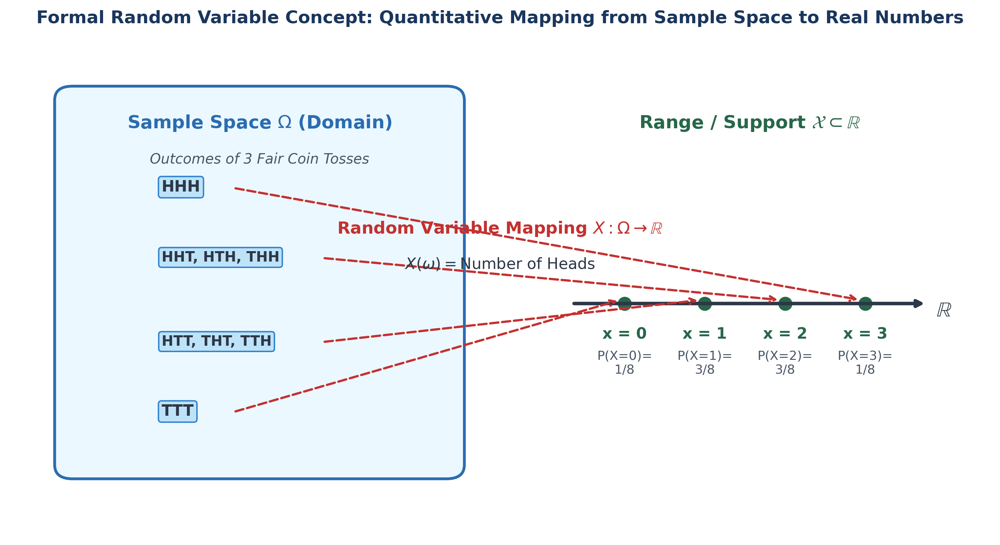
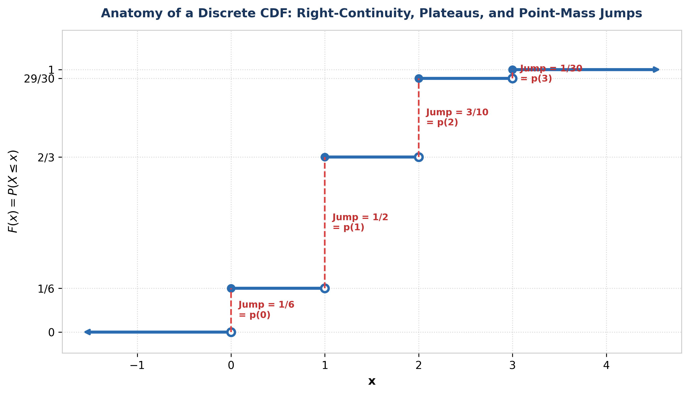
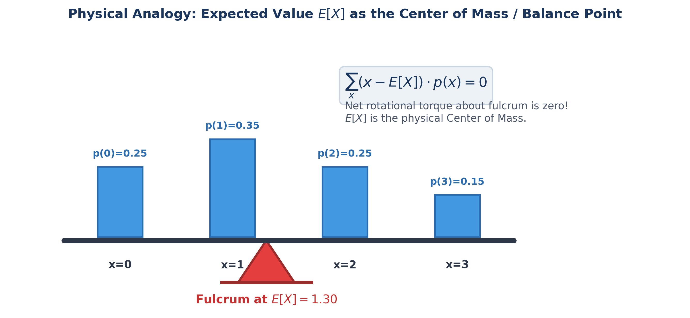
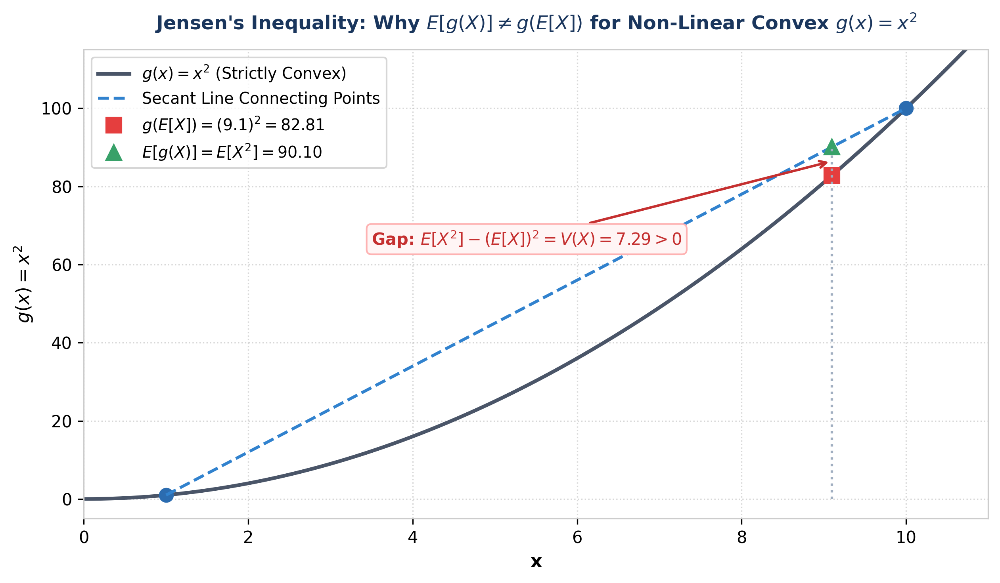
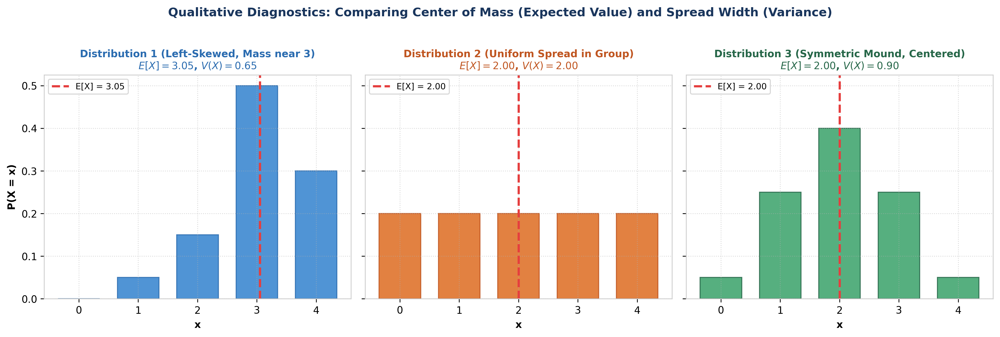

# STA237 Week 4 Study Notes: Discrete Random Variables, Cumulative Distribution Functions, Expectation, and Variance

## Contents

- [Scope, notation, and method selection](#scope-notation-and-method-selection)
  - [Source Scope and Reading Status](#source-scope-and-reading-status)
  - [Notation Conventions](#notation-conventions)
  - [Essential Prerequisite Reminders](#essential-prerequisite-reminders)
  - [Compact Method-Selection Guide](#compact-method-selection-guide)
- [Concept C-01: Discrete Random Variables and Probability Mass Functions (PMFs)](#concept-c-01-discrete-random-variables-and-probability-mass-functions-pmfs)
  - [Problem Type PT-01: PMF Construction, Normalization Constant Determination, and Validity Checks](#problem-type-pt-01-pmf-construction-normalization-constant-determination-and-validity-checks)
  - [Problem Type PT-02: Event Probability Calculation and Interval Evaluation from PMFs](#problem-type-pt-02-event-probability-calculation-and-interval-evaluation-from-pmfs)
- [Concept C-02: Cumulative Distribution Functions (CDFs) of Discrete Random Variables](#concept-c-02-cumulative-distribution-functions-cdfs-of-discrete-random-variables)
  - [Problem Type PT-03: Deriving and Plotting the CDF from a PMF](#problem-type-pt-03-deriving-and-plotting-the-cdf-from-a-pmf)
  - [Problem Type PT-04: Reconstructing the PMF and Extracting Probabilities from a CDF](#problem-type-pt-04-reconstructing-the-pmf-and-extracting-probabilities-from-a-cdf)
- [Concept C-03: Percentiles and Quantiles for Discrete Distributions](#concept-c-03-percentiles-and-quantiles-for-discrete-distributions)
  - [Problem Type PT-05: Determining Percentiles, Quartiles, and Medians from PMFs and CDFs](#problem-type-pt-05-determining-percentiles-quartiles-and-medians-from-pmfs-and-cdfs)
- [Concept C-04: Expected Value and Transformations of Random Variables (LOTUS)](#concept-c-04-expected-value-and-transformations-of-random-variables-lotus)
  - [Problem Type PT-06: Direct Expected Value Computation and Linear Scaling](#problem-type-pt-06-direct-expected-value-computation-and-linear-scaling)
  - [Problem Type PT-07: Expectation of Transformed Random Variables and Non-Linear Distinction Diagnostics](#problem-type-pt-07-expectation-of-transformed-random-variables-and-non-linear-distinction-diagnostics)
- [Concept C-05: Variance, Standard Deviation, and Qualitative Distribution Comparison](#concept-c-05-variance-standard-deviation-and-qualitative-distribution-comparison)
  - [Problem Type PT-08: Variance and Standard Deviation Computation via Definition and Shortcut Formula](#problem-type-pt-08-variance-and-standard-deviation-computation-via-definition-and-shortcut-formula)
  - [Problem Type PT-09: Linear Transformation Properties of Variance and Standard Deviation](#problem-type-pt-09-linear-transformation-properties-of-variance-and-standard-deviation)
  - [Problem Type PT-10: Visual and Qualitative Distribution Diagnostics (Center vs. Spread)](#problem-type-pt-10-visual-and-qualitative-distribution-diagnostics-center-vs-spread)

---

## Scope, notation, and method selection

### Source Scope and Reading Status

This study note synthesizes the theoretical curriculum, problem-solving methods, and practice requirements for **STA237 (Probability, Statistics, and Data Analysis I) Week 4: Discrete Distributions**. The instructional scope is established by:
1. **Primary Lecture Source:** `W4/Week4-L0401-annotated.pdf` (Prof. Karen H. Wong, University of Toronto), establishing the core learning outcomes:
   - Defining a random variable (RV) as a deterministic mathematical function mapping outcomes from a random experiment sample space $\Omega$ to the real numbers $\mathbb{R}$;
   - Distinguishing discrete random variables (finite or countably infinite support) from continuous random variables (uncountable intervals);
   - Defining and verifying the Kolmogorov axiomatic properties of Probability Mass Functions (PMFs);
   - Defining Cumulative Distribution Functions (CDFs), establishing their four canonical properties, deriving CDFs from PMFs, and reconstructing PMFs from CDF jump discontinuities;
   - Defining and interpreting percentiles, quartiles, and medians for discrete distributions;
   - Computing and interpreting the Expected Value $E(X) = \mu$ as the long-run average / center of mass;
   - Applying the Law of the Unconscious Statistician (LOTUS) for transformations $E[g(X)]$;
   - Emphasizing the fundamental non-linear inequality $E[g(X)] \neq g(E[X])$;
   - Computing and interpreting Variance $V(X) = \sigma^2$ and Standard Deviation $SD(X) = \sigma$ as measures of dispersion relative to the center;
   - Evaluating linear transformations: $E(aX + b) = aE(X) + b$, $V(aX + b) = a^2 V(X)$, and $SD(aX + b) = |a| SD(X)$;
   - Conducting qualitative diagnostics comparing distribution center and spread across PMF histograms.
2. **Supporting Textbook References:**
   - **MMSA:** *Modern Mathematical Statistics with Applications* (3rd ed., 2021) by Devore, Berk, Carlton — Sections **3.1–3.3**.
     - *Reading Status:* Supporting reading. Labeled as "Relevant Chapters" on Quercus for weekly practice and conceptual reinforcement.
   - **PAR:** *Probability and Statistics with Applications: A Problem Solving Text / Probability* (2021) by Wagaman and Dobrow — Sections **3.1, 4.1–4.2, and 4.6**.
     - *Reading Status:* Supporting reading. Strictly bounded to the requested sections.

### Notation Conventions

| Symbol / Notation | Formal Meaning | Domain / Values | Course Notes & Usage |
| :--- | :--- | :--- | :--- |
| $\Omega$ or $S$ | Sample space of the random experiment | Set of elementary outcomes $\omega$ | Input domain of random variable $X$ |
| $X, Y, S, W$ | Random variables (uppercase letters) | Function $X: \Omega \to \mathbb{R}$ | Represents a numerical characteristic of an uncertain outcome |
| $x, y, s, w$ | Realization / observed value (lowercase) | Specific value $x \in \mathbb{R}$ | Argument of PMF $p(x)$ or CDF $F(x)$ |
| $\mathcal{X} = \text{Supp}(X)$ | Support of random variable $X$ | Subset of $\mathbb{R}$ where $p(x) > 0$ | Finite or countably infinite for discrete RVs |
| $p(x)$ or $p_X(x)$ | Probability Mass Function (PMF) | $p(x) = P(X = x) \in [0, 1]$ | Point mass probability; $\sum_{x \in \mathcal{X}} p(x) = 1$ |
| $F(x)$ or $F_X(x)$ | Cumulative Distribution Function (CDF) | $F(x) = P(X \le x) \in [0, 1]$ | Right-continuous non-decreasing step function on $\mathbb{R}$ |
| $F(x^-)$ | Left-hand limit of CDF at $x$ | $\lim_{t \to x^-} F(t) = P(X < x)$ | Used to determine point probability jump: $p(x) = F(x) - F(x^-)$ |
| $E(X)$ or $\mu$ or $\mu_X$ | Expected value (population mean) | $\sum_{x \in \mathcal{X}} x p(x)$ | Theoretical center of mass / long-run average (may be non-integer) |
| $E[g(X)]$ | Expectation of transformation $g(X)$ | $\sum_{x \in \mathcal{X}} g(x) p(x)$ | Law of the Unconscious Statistician (LOTUS) |
| $V(X)$ or $\text{Var}(X)$ or $\sigma^2$ | Variance of random variable $X$ | $E[(X - \mu)^2] = E(X^2) - [E(X)]^2$ | Dispersion in squared units: $(\text{units})^2$; strictly $\ge 0$ |
| $SD(X)$ or $\sigma$ or $\sigma_X$ | Standard deviation of $X$ | $\sqrt{V(X)}$ | Dispersion in original units; strictly $\ge 0$ |
| $\eta_p$ or $q_p$ | $p$-th percentile / quantile | Smallest $x$ such that $F(x) \ge p/100$ | Median is the 50th percentile $\eta_{50}$ (or $\tilde{\mu}$) |
| $I_A$ | Indicator random variable for event $A$ | $1$ if $\omega \in A$, $0$ if $\omega \notin A$ | $E(I_A) = P(A)$, $V(I_A) = P(A)(1 - P(A))$ |

### Essential Prerequisite Reminders

- **Counting and Classical Probability (Weeks 1 & 2):**  
  For experiments with equally likely elementary outcomes:
  $$P(X = x) = \frac{|\{\omega \in \Omega : X(\omega) = x\}|}{|\Omega|}$$
  Permutations ($P(n, r) = \frac{n!}{(n-r)!}$), combinations ($\binom{n}{r} = \frac{n!}{r!(n-r)!}$), and hypergeometric decompositions remain the primary tools for counting pre-images.
- **Summation Algebra Identities:**  
  1. Constant sum: $\sum_{i=1}^n c = n \cdot c$.
  2. Factoring constant: $\sum_{i=1}^n c \cdot x_i = c \sum_{i=1}^n x_i$.
  3. First $n$ integers: $\sum_{i=1}^n i = \frac{n(n+1)}{2}$.
  4. Sum of first $n$ squares: $\sum_{i=1}^n i^2 = \frac{n(n+1)(2n+1)}{6}$.
  5. Geometric series: $\sum_{k=0}^\infty a r^k = \frac{a}{1 - r}$ for $|r| < 1$.

### Compact Method-Selection Guide

| Objective / Query | Given Inputs | Prescribed Method / Formula | Critical Checks & Edge Cases |
| :--- | :--- | :--- | :--- |
| **Find Normalizing Constant / Verify PMF** | PMF formula $p(x; c)$ or tabular values with unknown $c$ | Solve $\sum_{x \in \mathcal{X}} p(x) = 1$ for $c$ | Confirm $0 \le p(x) \le 1$ for **all** support points; check boundary $x=0$. |
| **Compute Event / Interval from PMF** | PMF $p(x)$ and event $A$ (e.g., $a \le X \le b$) | Direct point summation: $P(A) = \sum_{x \in A} p(x)$ | Respect strict ($<$) vs. weak ($\le$) inequalities on discrete integers. |
| **Compute Event / Interval from CDF** | Piecewise step CDF $F(x)$ | Use boundary limits: • $P(X = c) = F(c) - F(c^-)$ • $P(a < X \le b) = F(b) - F(a)$ • $P(a \le X \le b) = F(b) - F(a^-)$ | Left endpoint inclusion requires subtracting the left-hand limit $F(a^-)$. |
| **Derive CDF from PMF** | PMF $p(x)$ on support $x_1 < x_2 < \dots < x_k$ | Accumulate cumulative sums: $F(x) = \sum_{t \le x} p(t)$ on $[x_i, x_{i+1})$ | Explicitly define $F(x) = 0$ on $(-\infty, x_1)$ and $F(x) = 1$ on $[x_k, \infty)$. |
| **Find Percentiles / Quantiles / Medians** | PMF or CDF, percentile target $p\%$ ($u = p/100$) | Step-function inversion: $q_u = \min\{x \in \mathcal{X} : F(x) \ge u\}$ | Percentile is a support value $x$, not the probability $u$; no interpolation. |
| **Compute Expected Value (Center of Mass)** | PMF $p(x)$ | $E(X) = \sum_{x \in \mathcal{X}} x p(x)$ | $E(X) \ne 1$; fulcrum need not be an integer or an attainable outcome. |
| **Compute Transformed Expectation (LOTUS)** | PMF $p(x)$ and transformation $g(X)$ | Direct evaluation: $E[g(X)] = \sum_{x \in \mathcal{X}} g(x) p(x)$ | In general $E[g(X)] \ne g(E[X])$ unless $g$ is linear ($g(x) = ax + b$). |
| **Compute Variance & Standard Deviation** | PMF $p(x)$ and mean $\mu$ | Shortcut formula: $V(X) = E(X^2) - \mu^2$, where $E(X^2) = \sum x^2 p(x)$ | $V(X) \ge 0$ in $(\text{units})^2$; $SD(X) = \sqrt{V(X)}$ in original units. |
| **Linear Rescaling of Moments** | Parameters $E(X), V(X)$ and linear transform $Y = aX + b$ | • $E(aX + b) = a E(X) + b$ • $V(aX + b) = a^2 V(X)$ • $SD(aX + b) = |a| SD(X)$ | Constant shift $b$ drops out of variance; scale $|a| \ge 0$ keeps $SD \ge 0$. |
| **Visual Diagnostics (Center vs. Spread)** | Visual histograms or PMF bar graphs | • Center: identify visual fulcrum / balance point • Spread: assess mass clustering vs. dispersion | High central concentration $\implies$ small variance; uniform spread $\implies$ large variance. |

---

## Concept C-01: Discrete Random Variables and Probability Mass Functions (PMFs)

**Classification:** Core

### 1. Mathematical Definition of a Random Variable
In rigorous probability theory, a **random variable** $X$ is neither a variable nor random in the algebraic sense: it is a **deterministic function** whose domain is the sample space $\Omega$ of a random experiment and whose codomain is the set of real numbers $\mathbb{R}$:
$$X: \Omega \to \mathbb{R}, \quad \omega \mapsto X(\omega) = x$$

- **Domain:** The sample space $\Omega$, representing all possible elementary outcomes $\omega$.
- **Codomain:** The real line $\mathbb{R}$.
- **Range / Support $\mathcal{X}$:** The set of attainable numerical values:
  $$\mathcal{X} = \{x \in \mathbb{R} : X(\omega) = x \text{ for some } \omega \in \Omega\}$$
- **Event Pre-Image:** An expression such as "$\{X = x\}$" is shorthand for the pre-image event:
  $$\{\omega \in \Omega : X(\omega) = x\} \subseteq \Omega$$
  Likewise, "$\{a \le X \le b\}$" denotes the subset $\{\omega \in \Omega : a \le X(\omega) \le b\}$.

### 2. Discrete vs. Continuous Random Variables
- **Discrete Random Variable:** The range / support $\mathcal{X}$ is **countable** (either finite, such as $\{0, 1, \dots, n\}$, or countably infinite, such as the natural numbers $\mathbb{N} = \{0, 1, 2, \dots\}$).
  - *Lecture examples:* Number of defective parts in 4 sales; sum of two 4-sided dice; number of customer sales in an hour.
  - *Qualitative-to-quantitative mapping:* Non-numerical outcomes are mapped to numerical indicators (e.g., coin toss: Tails $\mapsto 0$, Heads $\mapsto 1$).
- **Continuous Random Variable:** The range / support $\mathcal{X}$ is an **uncountable interval** of real numbers (e.g., $[0, \infty)$ or $[a, b]$). The probability of any single exact point is zero ($P(X = c) = 0$).
  - *Lecture examples:* Height of an individual, response time of medication, game completion time.

### 3. Axiomatic Foundations of the Probability Mass Function (PMF)
The **Probability Mass Function (PMF)** of a discrete random variable $X$, denoted $p(x)$ or $p_X(x)$, gives the probability that $X$ takes the specific value $x$:
$$p(x) = P(X = x) = P(\{\omega \in \Omega : X(\omega) = x\})$$

A function $p: \mathbb{R} \to [0, 1]$ is a mathematically valid PMF if and only if it satisfies the two Kolmogorov discrete axioms:
1. **Non-negativity (and Boundedness):**
   $$0 \le p(x) \le 1 \quad \forall x \in \mathcal{X}, \quad \text{and} \quad p(x) = 0 \quad \forall x \notin \mathcal{X}$$
2. **Total Normalization:**
   $$\sum_{x \in \mathcal{X}} p(x) = 1$$

### 4. Canonical Representations of a PMF
In course assessments, PMFs are represented in three standard forms:
1. **Analytical Formula:** A mathematical expression with support restrictions, e.g.:
   $$p(x) = \frac{2x^2 - x + 2}{60}, \quad x \in \{0, 1, 2, 3, 4\}$$
2. **Tabular Representation:** A two-row table listing all support points and their corresponding probabilities.
3. **Graphical Spike / Impulse Plot:** A Cartesian plot with vertical spikes at each support point $x_k$ of height $p(x_k)$.

---

### Problem Type PT-01: PMF Construction, Normalization Constant Determination, and Validity Checks

**Recognition cues.**  
The problem provides a candidate PMF formula containing an unknown parameter $k$ or $c$ (e.g., $p(x) = c \cdot g(x)$) over a specified discrete support $\mathcal{X}$. The question asks to:
- Find the value of the parameter that makes $p(x)$ a valid PMF;
- Explicitly verify all PMF axioms;
- Construct a full PMF table from a verbal description of an experiment (such as rolling dice or sampling without replacement).

**General method.**  
1. **Set up the normalization constraint:** Sum the candidate expression across all support points and equate to 1:
   $$\sum_{x \in \mathcal{X}} p(x; k) = 1$$
2. **Factor out the parameter:** Separate $k$ from the numerical summation:
   $$k \sum_{x \in \mathcal{X}} g_1(x) + \sum_{x \in \mathcal{X}} g_2(x) = 1 \implies k = \frac{1 - \sum g_2(x)}{\sum g_1(x)}$$
3. **Verify non-negativity (Axiom 1 check):** Substitute the solved parameter value back into $p(x)$ for every $x \in \mathcal{X}$. Confirm that $p(x) \ge 0$ for every support point. If any $p(x) < 0$ or $p(x) > 1$, no valid PMF exists.
4. **For physical experiments:** Enumerate the underlying sample space outcomes $\omega \in \Omega$, group outcomes by their mapped value $X(\omega) = x$, compute $P(X = x) = \sum_{\omega: X(\omega)=x} P(\omega)$, and confirm the resulting probabilities sum to 1.

**Teaching example — original question.**  
A discrete random variable $W$ models the number of server reboot attempts required before successful reconnection, with support $\mathcal{W} = \{0, 1, 2, 3, 4\}$. Its proposed probability mass function is given by:
$$p_W(w) = \frac{c w^2 + 2w + 1}{50}, \quad w \in \{0, 1, 2, 3, 4\}$$
- (a) Determine the exact normalizing constant $c$ such that $p_W(w)$ is a mathematically valid PMF.
- (b) Verify that the candidate function satisfies all Kolmogorov discrete axioms for this value of $c$.
- (c) Display the distribution as an exact PMF table.

*(Worked solution in [Answers-and-Practice.md: Problem Type PT-01](Answers-and-Practice.md#problem-type-pt-01-pmf-construction-normalization-constant-determination-and-validity-checks))*

**A complete answer must include.**  
- Setting up the normalization condition $\sum_{x \in \mathcal{X}} p(x) = 1$;
- Explicit term-by-term summation across all points in the support;
- Algebraic isolation of the unknown parameter $c$;
- Explicit non-negativity verification confirming that $0 \le p(x) \le 1$ for all support points;
- Presentation of the completed distribution table.

**Common mistakes.**  
- *Omitting the non-negativity check:* Solving $\sum p(x) = 1$ can yield algebraic solutions for $c$ that produce negative probabilities for certain $x$. Both axioms must be verified.
- *Support truncation:* Forgetting boundary support points (such as $x = 0$).
- *Fraction arithmetic slips:* Errors when summing polynomial or rational coefficients.

---

### Problem Type PT-02: Event Probability Calculation and Interval Evaluation from PMFs

**Recognition cues.**  
Given a discrete PMF (as a formula, table, or graph), the problem asks to compute probabilities of compound events, such as:
- Upper/lower tail bounds: $P(X \le b)$, $P(X < b)$, $P(X \ge a)$, $P(X > a)$;
- Closed, open, or half-open intervals: $P(a \le X \le b)$, $P(a < X < b)$;
- Parity or conditional events: $P(X \text{ is even})$, $P(X \ge 2 \mid X \le 4)$.

**General method.**  
1. **Identify the favorable support subset:** Determine all discrete points $x \in \mathcal{X}$ satisfying the event condition $E$:
   $$\mathcal{X}_E = \{x \in \mathcal{X} : x \text{ satisfies condition } E\}$$
2. **Sum point probabilities:** By countable additivity:
   $$P(E) = \sum_{x \in \mathcal{X}_E} p(x)$$
3. **Apply the Complement Rule when efficient:**
   $$P(X \ge 1) = 1 - P(X = 0)$$
   $$P(X \le b) = 1 - P(X > b)$$
4. **Conditional Probabilities:** Apply the definition of conditional probability:
   $$P(A \mid B) = \frac{P(A \cap B)}{P(B)} = \frac{\sum_{x \in \mathcal{X}_A \cap \mathcal{X}_B} p(x)}{\sum_{x \in \mathcal{X}_B} p(x)}$$

**Teaching example — original question.**  
A quality assurance inspector tests batches of industrial sensors. The number of non-conforming sensors $Y$ in a batch has the PMF:
$$\begin{array}{c|ccccc}
y & 0 & 1 & 2 & 3 & 4 \\
\hline
p(y) & 0.40 & 0.25 & 0.18 & 0.12 & 0.05
\end{array}$$
- (a) Compute the probability that at least 2 non-conforming sensors are detected: $P(Y \ge 2)$.
- (b) Compute the probability that between 1 and 3 non-conforming sensors (inclusive) are detected: $P(1 \le Y \le 3)$.
- (c) Compute the conditional probability $P(Y \ge 2 \mid Y \ge 1)$.

*(Worked solution in [Answers-and-Practice.md: Problem Type PT-02](Answers-and-Practice.md#problem-type-pt-02-event-probability-calculation-and-interval-evaluation-from-pmfs))*

**A complete answer must include.**  
- Explicit identification of support values satisfying each inequality;
- Direct summation of PMF entries;
- Correct setup and calculation of the conditional probability fraction;
- Clear arithmetic reduction to exact decimals or simplified fractions.

**Common mistakes.**  
- *Strict vs. weak inequality confusion:* Conflating $X > k$ with $X \ge k$ (in discrete integer distributions, $P(X \ge k) = p(k) + p(k+1) + \dots$, whereas $P(X > k) = p(k+1) + \dots$).
- *Conditional denominator omission:* Calculating $P(A \cap B)$ but failing to divide by $P(B)$.

---

## Concept C-02: Cumulative Distribution Functions (CDFs) of Discrete Random Variables

**Classification:** Core

### 1. Definition and Universal Domain
The **Cumulative Distribution Function (CDF)** of a random variable $X$, denoted $F(x)$ or $F_X(x)$, returns the cumulative (left-tail) probability that $X$ takes a value less than or equal to $x$:
$$F(x) = P(X \le x) = \sum_{t \in \mathcal{X}, t \le x} p(t)$$

> [!IMPORTANT]
> **Universal Domain:** The CDF $F(x)$ is defined for **all real numbers** $x \in \mathbb{R} = (-\infty, \infty)$, NOT just for the support points $\mathcal{X}$. For any real number $x$, $F(x)$ outputs the probability of the interval $(-\infty, x]$.

### 2. Four Fundamental Mathematical Properties of a CDF
For any discrete random variable $X$, its CDF $F(x)$ satisfies:
1. **Non-Decreasing Monotonicity:** If $a < b$, then $(-\infty, a] \subseteq (-\infty, b]$, which implies:
   $$F(a) \le F(b) \quad \forall a < b$$
2. **Right-Continuity:** The CDF is continuous from the right at every point $c \in \mathbb{R}$:
   $$\lim_{x \to c^+} F(x) = F(c)$$
   On a graph, every horizontal plateau has a **solid dot $\bullet$ on its left endpoint** and an **open circle $\circ$ on its right endpoint**.
3. **Left Limit at Negative Infinity:**
   $$\lim_{x \to -\infty} F(x) = 0$$
4. **Right Limit at Positive Infinity:**
   $$\lim_{x \to +\infty} F(x) = 1$$

### 3. Step-Function Structure and Jump Discontinuities
For a discrete random variable with ordered support points $x_1 < x_2 < x_3 < \dots$:
- $F(x) = 0$ for all $x < x_1$.
- $F(x)$ is constant on each half-open interval $[x_k, x_{k+1})$.
- At each support point $x_k$, $F(x)$ experiences an upward **jump discontinuity**.
- **The jump size equals the point probability:**
  $$P(X = x_k) = F(x_k) - F(x_k^-) = F(x_k) - \lim_{x \to x_k^-} F(x)$$
- At any non-support point $c \notin \mathcal{X}$, $F(x)$ is continuous, so $P(X = c) = F(c) - F(c^-) = 0$.

### 4. Master Table of Interval Probabilities via the CDF
Because discrete distributions assign positive mass to single points, whether inequality endpoints are open or closed drastically alters the result:

| Event Probability | Expression in Terms of CDF $F(x)$ | Intuition / Derivation |
| :--- | :--- | :--- |
| **$P(X \le b)$** | $F(b)$ | Direct definition of CDF |
| **$P(X < b)$** | $F(b^-) = \lim_{x \to b^-} F(x)$ | Left-hand limit immediately before $b$ |
| **$P(X > a)$** | $1 - F(a)$ | Complement rule: $1 - P(X \le a)$ |
| **$P(X \ge a)$** | $1 - F(a^-) = 1 - \lim_{x \to a^-} F(x)$ | Complement rule: $1 - P(X < a)$ |
| **$P(X = c)$** | $F(c) - F(c^-)$ | Jump height at $c$ |
| **$P(a < X \le b)$** | $F(b) - F(a)$ | Standard fundamental theorem of CDFs |
| **$P(a \le X \le b)$** | $F(b) - F(a^-)$ | Includes point probability at $a$ |
| **$P(a < X < b)$** | $F(b^-) - F(a)$ | Excludes point probability at $b$ |
| **$P(a \le X < b)$** | $F(b^-) - F(a^-)$ | Includes $a$, excludes $b$ |

---

### Problem Type PT-03: Deriving and Plotting the CDF from a PMF

**Recognition cues.**  
Given a PMF in tabular or functional form, the question asks to:
- State the Cumulative Distribution Function $F(x)$ in piecewise mathematical notation for all $x \in \mathbb{R}$;
- Construct a plot of the CDF, showing steps, open/closed interval markers, and asymptotic horizontal rays.

**General method.**  
1. **Sort the support points:** Arrange $\mathcal{X} = \{x_1, x_2, \dots, x_k\}$ in strictly ascending order: $x_1 < x_2 < \dots < x_k$.
2. **Compute cumulative sums:**
   $$F_0 = 0$$
   $$F_1 = p(x_1)$$
   $$F_2 = p(x_1) + p(x_2)$$
   $$\dots$$
   $$F_k = \sum_{i=1}^k p(x_i) = 1$$
3. **Write the piecewise definition:** Explicitly write $F(x)$ over all intervals of the real line:
   $$F(x) = \begin{cases}
   0, & x < x_1 \\
   F_1, & x_1 \le x < x_2 \\
   F_2, & x_2 \le x < x_3 \\
   \vdots & \\
   F_{k-1}, & x_{k-1} \le x < x_k \\
   1, & x \ge x_k
   \end{cases}$$
4. **Plotting standards:**
   - Draw horizontal segments on each interval;
   - Place a **solid dot $\bullet$** at $(x_i, F_i)$ (left endpoint);
   - Place an **open circle $\circ$** at $(x_{i+1}, F_i)$ (right endpoint);
   - Add horizontal rays with arrows extending to $-\infty$ at $y = 0$ and to $+\infty$ at $y = 1$.

**Teaching example — original question.**  
A local electronics repair shop tracks the number of laptop repairs $L$ completed in a 2-hour shift. The PMF of $L$ is given by:
$$\begin{array}{c|cccc}
l & 0 & 1 & 2 & 3 \\
\hline
p(l) & 0.15 & 0.45 & 0.30 & 0.10
\end{array}$$
- (a) Write the formal piecewise specification of the CDF $F_L(l)$ for all $l \in \mathbb{R}$.
- (b) Sketch the graph of $F_L(l)$, clearly labeling all jump discontinuities, endpoints, and horizontal plateaus.

*(Worked solution in [Answers-and-Practice.md: Problem Type PT-03](Answers-and-Practice.md#problem-type-pt-03-deriving-and-plotting-the-cdf-from-a-pmf))*

**A complete answer must include.**  
- Partitioning the real line into $k+1$ disjoint intervals covering $(-\infty, \infty)$;
- Correct cumulative probability values on every plateau;
- Piecewise presentation specifying weak inequalities on the left and strict inequalities on the right: $[x_i, x_{i+1})$;
- Accurate graph description or plot with solid left endpoints and open right circles.

**Common mistakes.**  
- *Omitting the domain $(-\infty, x_1)$:* Defining the CDF only on $[0, 3]$ rather than the entire real line $\mathbb{R}$.
- *Reversing interval bracket open/closed conventions:* Writing $(x_i, x_{i+1}]$ instead of $[x_i, x_{i+1})$. Right-continuity requires the solid dot on the left.
- *Forgetting asymptotic plateaus:* Leaving off $F(x) = 0$ for $x < x_1$ and $F(x) = 1$ for $x \ge x_k$.

---

### Problem Type PT-04: Reconstructing the PMF and Extracting Probabilities from a CDF

**Recognition cues.**  
The problem provides a discrete CDF $F(x)$ either as a piecewise algebraic function or as a step-function graph. It asks to:
- Identify the most likely or least likely outcome;
- Reconstruct the complete PMF table;
- Evaluate single point probabilities $P(X = c)$ and open/closed interval probabilities such as $P(X < b)$ or $P(a \le X \le b)$ directly from the CDF.

**General method.**  
1. **Identify support points:** Look for the location of jump discontinuities (points where the graph steps up). These are the support values $x_k$.
2. **Calculate point probabilities from jump heights:**
   $$p(x_k) = P(X = x_k) = F(x_k) - F(x_k^-)$$
3. **Verify non-jump points:** For any point $c$ with no jump, $P(X = c) = 0$.
4. **Compare jump heights for likelihood:**
   - **Most likely outcome:** The support point with the **largest vertical jump** in $F(x)$.
   - **Least likely outcome:** The support point with the **smallest vertical jump** in $F(x)$.
5. **Evaluate intervals using boundary limits:** Apply the formulas from the Master Table in Concept C-02.

**Teaching example — original question.**  
A discrete random variable $Z$ has the cumulative distribution function:
$$F_Z(z) = \begin{cases}
0, & z < 1 \\
0.20, & 1 \le z < 3 \\
0.55, & 3 \le z < 4 \\
0.80, & 4 \le z < 6 \\
1.00, & z \ge 6
\end{cases}$$
- (a) Determine the support of $Z$ and reconstruct its probability mass function $p_Z(z)$ as a table.
- (b) Identify which outcome of $Z$ is most likely to occur, and which is least likely.
- (c) Calculate $P(Z < 4)$ directly from the CDF.
- (d) Calculate $P(2 \le Z \le 4)$ directly from the CDF.
- (e) Calculate $P(Z = 3.5)$.

*(Worked solution in [Answers-and-Practice.md: Problem Type PT-04](Answers-and-Practice.md#problem-type-pt-04-reconstructing-the-pmf-and-extracting-probabilities-from-a-cdf))*

**A complete answer must include.**  
- Complete identification of all jump discontinuity locations from the piecewise intervals;
- Systematic jump difference calculations $p(z_k) = F(z_k) - F(z_k^-)$ for every support point;
- Comparative evaluation of jump sizes to identify the most and least likely outcomes;
- Application of boundary limit definitions for open and closed interval probabilities;
- Demonstration that point probabilities at non-jump coordinates evaluate to zero due to continuity.

**Common mistakes.**  
- *Confusing $P(X \le b)$ and $P(X < b)$:* Evaluating $P(X < b)$ as the upper step level $F(b)$ instead of the left-hand limit $F(b^-)$.
- *Subtracting wrong plateau levels:* In $P(a \le X \le b)$, forgetting that the lower boundary $a$ is included in the event, requiring subtraction of $F(a^-)$ rather than $F(a)$.

---

## Concept C-03: Percentiles and Quantiles for Discrete Distributions

**Classification:** Core

### 1. Definition of Percentiles and Quantiles
In probability and mathematical statistics, the canonical definition of the **$u$-quantile** ($p$-th percentile where $u = p/100 \in (0, 1)$), denoted $q_u$ or $\eta_p$, is the **generalized inverse** of the cumulative distribution function:
$$q_u = \inf\{x \in \mathbb{R} : F(x) \ge u\}$$
- **Discrete Distributions with Finite or Integer Support:** In discrete distributions with finite support or integer coordinates (covering all examples and exercises in STA237), the infimum is attained as a minimum at the first support point satisfying the threshold:
  $$q_u = \min\{x \in \mathcal{X} : F(x) \ge u\}$$
  Under this canonical generalized inverse definition, $q_u$ is always uniquely defined.
- **Median (50th Percentile / $\tilde{\mu}$):** The central value $q_{0.50} = \inf\{x \in \mathbb{R} : F(x) \ge 0.50\}$. For finite support, $q_{0.50} = \min\{x \in \mathcal{X} : F(x) \ge 0.50\}$.
- **First Quartile ($Q_1$ / 25th Percentile):** $q_{0.25} = \inf\{x \in \mathbb{R} : F(x) \ge 0.25\}$. For finite support, $q_{0.25} = \min\{x \in \mathcal{X} : F(x) \ge 0.25\}$.
- **Third Quartile ($Q_3$ / 75th Percentile):** $q_{0.75} = \inf\{x \in \mathbb{R} : F(x) \ge 0.75\}$. For finite support, $q_{0.75} = \min\{x \in \mathcal{X} : F(x) \ge 0.75\}$.

### 2. Step-Function Inversion vs. Set-Valued Median Conventions
Because discrete CDFs are right-continuous step functions with horizontal plateaus, two distinct situations arise:
- **Case 1 (A jump discontinuity crosses $u$ strictly):**  
  There is no $x$ where $F(x) = u$ exactly; $F(x)$ steps from below $u$ to above $u$ at support point $x_k$. Both the canonical definition and set-valued conditions agree uniquely:
  $$q_u = x_k$$
- **Case 2 (A horizontal plateau lands exactly at $u$):**  
  Suppose $F(x_k) = u$ exactly, so $F(x) = u$ remains constant across the half-open plateau $[x_k, x_{k+1})$.
  1. **Canonical Generalized Inverse (Primary Standard):**  
     By definition, the infimum of $\{x : F(x) \ge u\}$ is uniquely the left jump boundary:
     $$q_u = x_k$$
  2. **Two-Sided Set-Valued Median Condition (Alternative Convention):**  
     In foundational probability theory, a number $m$ is defined as a median if it satisfies both:
     $$P(X \le m) \ge 0.50 \quad \text{and} \quad P(X \ge m) \ge 0.50$$
     When $F(x_k) = 0.50$, **every number in the closed interval $[x_k, x_{k+1}]$** satisfies both inequalities simultaneously:
     - At the left boundary $m = x_k$: $P(X \le x_k) = F(x_k) = 0.50 \ge 0.50$, and $P(X \ge x_k) = 1 - P(X < x_k) = 1 - F(x_k^-) \ge 1 - 0.50 = 0.50 \ge 0.50$.
     - In the interior of the plateau $x_k < m < x_{k+1}$: $P(X \le m) = F(x_k) = 0.50 \ge 0.50$, and $P(X \ge m) = 1 - P(X < m) = 1 - F(x_k) = 1 - 0.50 = 0.50 \ge 0.50$.
     - At the right endpoint $m = x_{k+1}$: $P(X \le x_{k+1}) = F(x_{k+1}) > 0.50$, and $P(X \ge x_{k+1}) = 1 - P(X < x_{k+1}) = 1 - F(x_{k+1}^-) = 1 - F(x_k) = 1 - 0.50 = 0.50 \ge 0.50$.  
     Therefore, every number in the closed interval $[x_k, x_{k+1}]$ satisfies both conditions simultaneously, making $[x_k, x_{k+1}]$ the complete median set. In practical reporting, some textbooks and software report the midpoint $\frac{x_k + x_{k+1}}{2}$ as a single representative value.
---

### Problem Type PT-05: Determining Percentiles, Quartiles, and Medians from PMFs and CDFs

**Recognition cues.**  
The problem provides a discrete PMF or CDF and asks to determine the 25th percentile ($Q_1$), the median ($\tilde{\mu}$ / 50th percentile), or another specific percentile (e.g., 80th percentile), interpreting the result in the physical problem context.

**General method.**  
1. **Construct or inspect the CDF $F(x)$:** Identify the cumulative probability values $F(x_k)$ at each support point.
2. **Apply the quantile threshold condition:** For a given percentage $p$ ($u = p/100$), find the smallest support point satisfying:
   $$q_u = \min \{x \in \mathcal{X} : F(x) \ge u\}$$
3. **If $F(x_{k-1}) < u$ and $F(x_k) > u$:** The $u$-quantile (or $p$-th percentile) is uniquely the discrete coordinate $x_k$.
4. **If $F(x_k) = u$ exactly:** Under the primary canonical generalized inverse definition adopted in these notes, the $u$-quantile is uniquely the first support coordinate reaching the threshold: $q_u = x_k$. Only if a problem specifically requests the *two-sided set-valued median* (at $u = 0.50$), evaluate the dual conditions $P(X \le m) \ge 0.50$ and $P(X \ge m) \ge 0.50$ to report the full closed interval $[x_k, x_{k+1}]$; if a single midpoint reporting convention is requested, report $\frac{x_k + x_{k+1}}{2}$. Do not default arbitrary percentiles to intervals or midpoints.
5. **Contextual interpretation:** State: "At least $p\%$ of the observed outcomes are less than or equal to $q_u$."

**Teaching example — original question.**  
The number of emergency calls $C$ received by a dispatch center per hour has the following distribution:
$$\begin{array}{c|ccccc}
c & 0 & 1 & 2 & 3 & 4 \\
\hline
p(c) & 0.12 & 0.28 & 0.35 & 0.15 & 0.10
\end{array}$$
- (a) Derive the CDF table for $C$.
- (b) Determine the 25th percentile ($Q_1$) of $C$ and interpret its meaning.
- (c) Determine the median (50th percentile) of $C$.
- (d) Determine the 80th percentile of $C$.

*(Worked solution in [Answers-and-Practice.md: Problem Type PT-05](Answers-and-Practice.md#problem-type-pt-05-determining-percentiles-quartiles-and-medians-from-pmfs-and-cdfs))*

**A complete answer must include.**  
- Complete tabulation of cumulative probabilities $F(x)$ across all support points;
- Explicit comparison of cumulative values against specified quantile thresholds $u = p/100$;
- Precise identification of the first support value satisfying $F(x) \ge u$;
- Clear contextual verbal interpretation relating the percentile value to the applied problem setting.

**Common mistakes.**  
- *Confusing the probability with the random variable value:* Reporting cumulative probability value $F(x)$ as the percentile rather than the actual support coordinate $x$.
- *Interpolating continuous quantiles:* Attempting linear interpolation between discrete points when discrete random variables take integer support values.

---

## Concept C-04: Expected Value and Transformations of Random Variables (LOTUS)

**Classification:** Core

### 1. Definition and Physical Meaning of Expected Value
The **Expected Value** (also called the **expectation**, **population mean**, or **first moment**) of a discrete random variable $X$, denoted $E(X)$ or $\mu$ or $\mu_X$, is the probability-weighted average of all possible values of $X$:
$$E(X) = \sum_{x \in \mathcal{X}} x \cdot P(X = x) = \sum_{x \in \mathcal{X}} x \cdot p(x)$$

- **Physical Analogy (Center of Mass):** If weights equal to $p(x)$ are placed along an infinitely thin seesaw at coordinates $x$, the expected value $E(X)$ is the exact **balance point (fulcrum)**. The net rotational torque around $\mu$ is zero:
  $$\sum_{x \in \mathcal{X}} (x - \mu) p(x) = \sum x p(x) - \mu \sum p(x) = \mu - \mu(1) = 0$$
- **Frequentist Interpretation (Law of Large Numbers):** If the experiment is repeated independently $n$ times and outcomes $X_1, X_2, \dots, X_n$ are recorded, the sample mean converges to $E(X)$ as $n \to \infty$:
  $$\bar{X}_n = \frac{1}{n} \sum_{i=1}^n X_i \xrightarrow{P} E(X)$$
- **Existence and Integrability Condition:** For a discrete random variable with countably infinite support, the expectation $E(X) = \sum_{x \in \mathcal{X}} x p(x)$ exists and is finite if and only if the series converges absolutely:
  $$\sum_{x \in \mathcal{X}} |x| p(x) < \infty$$
  If $\sum |x| p(x) = \infty$, a finite expectation cannot be obtained (the series may diverge to $\pm\infty$, or remain indeterminate / undefined). For any random variable with finite support, $E(X)$ always exists and is finite.
- **Crucial Diagnostic Warning (Slide 21):**
  > [!WARNING]
  > **Expected Value is NOT 1!**  
  > The most common beginner error is writing $E(X) = 1$. **Probabilities sum to 1** ($\sum p(x) = 1$), but the **expected value $\sum x p(x)$ can be any real number**, positive, negative, or zero! Furthermore, $E(X)$ is usually **not an integer** and does not need to be a possible outcome in the support $\mathcal{X}$ (e.g., rolling a fair 6-sided die yields $E(X) = 3.5$, which cannot occur on any single roll).

### 2. Expected Value of a Transformed Random Variable (LOTUS)
Let $g: \mathbb{R} \to \mathbb{R}$ be a real-valued function. The transformed quantity $Y = g(X)$ is itself a random variable.
By the **Law of the Unconscious Statistician (LOTUS)**, one does NOT need to derive the PMF of $Y$ first; one can compute $E[g(X)]$ directly using the PMF of $X$:
$$E[g(X)] = \sum_{x \in \mathcal{X}} g(x) \cdot p(x)$$
- **Existence and Absolute Convergence Condition:** For a discrete random variable with countably infinite support, the expected value $E[g(X)]$ exists and is finite if and only if the series converges absolutely:
  $$E|g(X)| = \sum_{x \in \mathcal{X}} |g(x)| p(x) < \infty$$
  If $\sum |g(x)| p(x) = \infty$, a finite expectation does not exist (it may diverge to $\pm\infty$ or remain undefined). For any finite support, $E[g(X)]$ is always finite.

### 3. Linearity of Expectation
Expectation is a **linear operator**:
$$E(aX + b) = \sum_{x} (ax + b) p(x) = a \sum x p(x) + b \sum p(x) = a E(X) + b$$
More generally, for any functions $g_1, g_2$ and constants $a, b$:
$$E[a g_1(X) + b g_2(X)] = a E[g_1(X)] + b E[g_2(X)]$$

### 4. The Fundamental Non-Linear Distinction: $E[g(X)] \neq g(E[X])$
> [!CAUTION]
> **Non-Linear Functions Do Not Commute with Expectation:**  
> In general, for non-linear $g$, one **cannot** pass the expectation operator inside the function:
> $$E[g(X)] \neq g(E(X))$$
> One must compute $E[g(X)]$ directly via LOTUS: $\sum g(x) p(x)$.

- **Convex Functions and Jensen's Inequality:** If $g$ is strictly convex on an interval containing the support $\mathcal{X}$ (such as $g(x) = x^2$, $g(x) = 1/x$ for $x > 0$, or $g(x) = e^x$), then **Jensen's Inequality** guarantees:
  $$E[g(X)] \ge g(E(X))$$
  with equality if and only if $X$ is a degenerate constant random variable ($P(X = c) = 1$, so $V(X) = 0$).
- **Quadratic Transformation ($g(x) = x^2$):**
  $$E(X^2) \ge [E(X)]^2$$
  Indeed, by the variance definition, $E(X^2) - [E(X)]^2 = V(X) \ge 0$, with equality if and only if $V(X) = 0$.
- **Reciprocal Transformation ($g(x) = 1/x$ for $X > 0$, PAR 4.7):**
  $$E\left[\frac{1}{X}\right] > \frac{1}{E(X)} \quad (\text{for non-degenerate } X > 0)$$
- **Exponential Transformation:**
  $$E(e^X) > e^{E(X)} \quad (\text{for non-degenerate } X)$$
- **General Non-Linear Functions:** For general non-linear functions that are neither convex nor concave (e.g., $g(x) = x^3$), equality $E[g(X)] = g(E[X])$ may occur accidentally for specific symmetric distributions (e.g., $X \in \{-1, 1\}$ equally likely gives $E(X^3) = 0 = (E[X])^3$ even though $X$ is non-degenerate), but operationally, $E[g(X)] \neq g(E[X])$ must never be assumed.

### 5. Multi-Period Modeling: Sum of Independent Trials vs. Direct Scaling
In Lecture Slide 22, the instructor highlights a critical modeling distinction:
- If a store makes an average of $E(S) = 1.3$ sales per hour, how should we model total sales over an 8-hour workday?
  - **Incorrect Model:** $8S$. This implies every hour has the *exact same realization* as the first hour. For example, $8S$ can only take values $\{0, 8, 16, 24\}$, making a total of 1 sale impossible!
  - **Correct Model:** $T = S_1 + S_2 + \dots + S_8$, where $S_i$ is the sales count in hour $i$.
  - While both models have the same expected value by linearity ($E[8S] = 8E(S) = 10.4$ and $E[S_1 + \dots + S_8] = 8E(S) = 10.4$), their probability distributions, support, and variances differ substantially!

---

### Problem Type PT-06: Direct Expected Value Computation and Linear Scaling

**Recognition cues.**  
The problem specifies a discrete PMF (as a formula or table) and asks to compute the expected value $E(X)$, the long-run average, or the expected total over $n$ periods / scaled units ($aX + b$).

**General method.**  
1. **List all support points and probabilities:** Form pairs $(x_k, p(x_k))$.
2. **Compute products:** Multiply each outcome by its probability: $x_k \cdot p(x_k)$.
3. **Sum all products:**
   $$E(X) = \sum_{k} x_k \cdot p(x_k)$$
4. **Linear Scaling:** To find $E(aX + b)$, use linearity:
   $$E(aX + b) = a E(X) + b$$
5. **Sum of $n$ identically distributed periods:**
   $$E\left[\sum_{i=1}^n X_i\right] = \sum_{i=1}^n E(X_i) = n E(X)$$

**Teaching example — original question.**  
A car dealership records the number of electric vehicles $V$ sold on a weekday:
$$\begin{array}{c|ccccc}
v & 0 & 1 & 2 & 3 & 4 \\
\hline
p(v) & 0.10 & 0.30 & 0.35 & 0.15 & 0.10
\end{array}$$
- (a) Compute the expected number of electric vehicles sold on a single weekday: $E(V)$.
- (b) If each vehicle sale generates a net profit of \$1,500 and daily dealership overhead costs are \$800, let $P = 1500V - 800$ be daily profit. Compute the expected daily profit $E(P)$.
- (c) Assuming sales across 5 independent weekdays in a week follow the same distribution, what is the expected total number of vehicles sold in a 5-day week? Explain whether the weekly sales variable should be modeled as $5V$ or $V_1 + V_2 + V_3 + V_4 + V_5$.

*(Worked solution in [Answers-and-Practice.md: Problem Type PT-06](Answers-and-Practice.md#problem-type-pt-06-direct-expected-value-computation-and-linear-scaling))*

**A complete answer must include.**  
- Tabular computation showing the weighted product $x \cdot p(x)$ for each support point;
- Exact algebraic summation yielding the expected value $E(X)$;
- Linear transformation application $E(aX + b) = aE(X) + b$;
- Rigorous explanation of multi-period modeling distinguishing identical realizations from sums of independent identically distributed variables.

**Common mistakes.**  
- *Arithmetic slip with 0:* Omitting $0 \cdot p(0)$ in thought, but miscounting the remaining terms.
- *Forgetting units:* Giving $E(X)$ without stating the problem units (e.g., dollars, items, counts).
- *Claiming $n X$ is identical to $\sum_{i=1}^n X_i$:* Stating they are the same distribution (they share the mean, but have different variances and support).

---

### Problem Type PT-07: Expectation of Transformed Random Variables and Non-Linear Distinction Diagnostics

**Recognition cues.**  
The problem provides a discrete RV $X$ and asks for $E[g(X)]$ where $g$ is non-linear (e.g., $g(X) = X^2$, $g(X) = 1/X$, $g(X) = e^X$, or a polynomial cost/payoff function). It may also ask to prove or verify whether $E[g(X)] = g(E[X])$.

**General method.**  
1. **Apply LOTUS:** Evaluate $g(x_k)$ for each support point $x_k \in \mathcal{X}$.
2. **Compute the weighted sum:**
   $$E[g(X)] = \sum_{x_k \in \mathcal{X}} g(x_k) \cdot p(x_k)$$
3. **To evaluate the non-linear distinction:**
   - Step A: Compute $E(X) = \sum x_k p(x_k)$.
   - Step B: Plug this scalar into $g$: evaluate $g(E[X])$.
   - Step C: Compare $E[g(X)]$ with $g(E[X])$. Compute the difference / discrepancy:
     $$\Delta = E[g(X)] - g(E[X])$$
   - Conclude whether equality holds. Note that while equality holds identically for affine linear transformations ($g(x) = ax + b$), for strictly convex transformations $g$, Jensen's Inequality establishes $E[g(X)] \ge g(E[X])$, with strict inequality unless $X$ is constant.

**Teaching example — original question.**  
A discrete random variable $K$ takes values in $\{-2, 0, 3\}$ with probabilities:
$$p(-2) = 0.25, \quad p(0) = 0.45, \quad p(3) = 0.30$$
- (a) Compute $E(K)$.
- (b) Compute $E(K^2)$ using LOTUS.
- (c) Compute $[E(K)]^2$ and evaluate the gap $E(K^2) - [E(K)]^2$. What statistical quantity does this gap represent?
- (d) For $g(k) = 2^k$, compute $E[2^K]$ and compare it to $2^{E(K)}$.

*(Worked solution in [Answers-and-Practice.md: Problem Type PT-07](Answers-and-Practice.md#problem-type-pt-07-expectation-of-transformed-random-variables-and-non-linear-distinction-diagnostics))*

**A complete answer must include.**  
- Tabular application of LOTUS: listing support coordinates $x$, probabilities $p(x)$, transformed values $g(x)$, and products $g(x)p(x)$;
- Computation of $E(X)$ and subsequent evaluation of $g(E[X])$;
- Explicit comparison showing the discrepancy $E[g(X)] \neq g(E[X])$;
- Rigorous interpretation and contextual explanation of the statistical meaning of the gap $E(K^2) - [E(K)]^2$ based on moment definitions.

**Common mistakes.**  
- *Evaluating $g(E[X])$ and calling it $E[g(X)]$:* Calculating $E(X^2)$ as $(E[X])^2$.
- *Transforming probabilities instead of values:* Squaring $p(x)$ instead of $x$.

---

## Concept C-05: Variance, Standard Deviation, and Qualitative Distribution Comparison

**Classification:** Core

### 1. Definition and Physical Meaning of Variance
While the expected value $\mu = E(X)$ identifies the **center of mass**, it provides no information about how widely outcomes fluctuate around that center.
The **Variance** of a random variable $X$, denoted $V(X)$ or $\text{Var}(X)$ or $\sigma^2$ or $\sigma_X^2$, is defined as the expected squared deviation from the mean:
$$V(X) = E\left[(X - \mu)^2\right] = \sum_{x \in \mathcal{X}} (x - \mu)^2 \cdot p(x)$$

- **Strict Non-Negativity:** Because $(x - \mu)^2 \ge 0$ and $p(x) \ge 0$, variance is always non-negative:
  $$V(X) \ge 0$$
  $V(X) = 0$ if and only if $P(X = c) = 1$ (a degenerate, constant random variable).
- **Units of Variance:** Because deviations are squared, variance is measured in **squared units of $X$** (e.g., if $X$ is sales, $V(X)$ is in $\text{sales}^2$; if $X$ is meters, $V(X)$ is in $\text{m}^2$).
- **Existence and Finite Variance Condition:** The variance $V(X) = E[(X - \mu)^2]$ and standard deviation $SD(X)$ exist and are finite if and only if $X$ has a finite second raw moment:
  $$E(X^2) = \sum_{x \in \mathcal{X}} x^2 p(x) < \infty$$
  By the Cauchy-Schwarz inequality (or Jensen's inequality $[E|X|]^2 \le E(X^2)$), $E(X^2) < \infty$ automatically guarantees that the mean is finite ($E|X| < \infty$, so $\mu$ is well-defined and finite).
  - If $E|X| < \infty$ but $E(X^2) = \infty$, the variance diverges to infinity: $V(X) = \infty$.
  - If the mean $\mu = E(X)$ does not exist or is not finite (e.g., $E(X) = \infty$), the standard definitional formula $E[(X - \mu)^2]$ cannot be directly applied (as it involves undefined operations).
  - For any random variable with finite support, the variance is always finite.

### 2. Standard Deviation
The **Standard Deviation** $\sigma = SD(X)$ is the positive square root of variance:
$$SD(X) = \sigma = +\sqrt{V(X)}$$
- **Interpretability:** Standard deviation is measured in the **exact same units as $X$**.
- **Practical Interpretation:** $\sigma$ represents the **typical distance / average spread** that an observed value of $X$ deviates from the theoretical mean $\mu$.

### 3. The Computational Shortcut Formula for Variance
Evaluating $\sum (x - \mu)^2 p(x)$ directly requires subtracting $\mu$ from every support point, which often introduces messy decimals or fractions.
Expanding the square algebraically yields the standard **shortcut formula**:
$$V(X) = E\left[(X - \mu)^2\right] = E\left[X^2 - 2\mu X + \mu^2\right] = E(X^2) - 2\mu E(X) + \mu^2$$
Since $E(X) = \mu$:
$$V(X) = E(X^2) - [E(X)]^2$$

### 4. Variance and Standard Deviation under Linear Transformations and Independent Sums
- **Univariate Linear Transformation:** For any constants $a$ and $b$:
  $$V(aX + b) = a^2 V(X)$$
  $$SD(aX + b) = \sqrt{a^2 V(X)} = |a| \cdot SD(X)$$
  - *Intuition for shift $b$:* Adding a constant $b$ shifts the entire distribution along the number line without altering its width or shape. Thus, adding a constant does not change the variance ($V(X + b) = V(X)$).
  - *Intuition for scale $a$:* Multiplying by $a$ stretches or compresses the distance between outcomes by a factor of $|a|$, so squared deviations scale by $a^2$.
- **Linear Combinations of Independent Random Variables:**
  If $X_1, X_2, \dots, X_n$ are **independent** random variables with finite variances, variances add with squared scalar coefficients:
  $$\operatorname{Var}\left(\sum_{i=1}^n a_i X_i + b\right) = \sum_{i=1}^n a_i^2 \operatorname{Var}(X_i)$$
  In particular, for two independent random variables $X$ and $Y$:
  $$\operatorname{Var}(aX + bY + c) = a^2 \operatorname{Var}(X) + b^2 \operatorname{Var}(Y)$$
  Notice that for a difference of independent variables, variances add:
  $$\operatorname{Var}(X - Y) = 1^2 \operatorname{Var}(X) + (-1)^2 \operatorname{Var}(Y) = \operatorname{Var}(X) + \operatorname{Var}(Y)$$
- **General Dependent Variables:** If random variables are dependent, covariance terms must be included:
  $$\operatorname{Var}\left(\sum_{i=1}^n a_i X_i\right) = \sum_{i=1}^n a_i^2 \operatorname{Var}(X_i) + 2 \sum_{1 \le i < j \le n} a_i a_j \operatorname{Cov}(X_i, X_j)$$
### 5. Visual and Qualitative Diagnostics: Center vs. Spread
In Lecture Slides 20 and 25, the course tests the ability to diagnose distribution parameters directly from graphical PMF histograms without calculations:

1. **Assessing Expected Value (Center of Mass):**
   - Look for the balance point along the horizontal axis.
   - Distributions shifted to the right have larger expected values ($E[X]$).
2. **Assessing Variance (Spread Width):**
   - **Low Variance:** Probability mass is tightly clustered around the center (tall peak, thin tails).
   - **Moderate Variance:** Probability mass displays a standard bell-like taper.
   - **High Variance:** Probability mass is spread broadly across the entire support (e.g., discrete uniform distribution) or concentrated at extreme opposing endpoints (bimodal).

---

### Problem Type PT-08: Variance and Standard Deviation Computation via Definition and Shortcut Formula

**Recognition cues.**  
The problem provides a discrete PMF and asks to:
- Compute $V(X)$ using the definition: $\sum (x - \mu)^2 p(x)$;
- Compute $V(X)$ using the shortcut formula: $E(X^2) - [E(X)]^2$;
- Compute $SD(X)$ and interpret the numerical result with appropriate physical units.

**General method.**  
1. **Compute $\mu = E(X)$:**
   $$\mu = \sum_{x} x p(x)$$
2. **Method 1 (Definition):**
   - Compute deviations $(x_k - \mu)$;
   - Square deviations: $(x_k - \mu)^2$;
   - Weight by probability and sum: $V(X) = \sum (x_k - \mu)^2 p(x_k)$.
3. **Method 2 (Shortcut Formula):**
   - Compute second moment via LOTUS: $E(X^2) = \sum x_k^2 p(x_k)$;
   - Square the mean: $\mu^2$;
   - Subtract: $V(X) = E(X^2) - \mu^2$.
4. **Standard Deviation:**
   $$SD(X) = \sqrt{V(X)}$$
5. **Contextual Interpretation:**
   "On average, outcomes will typically deviate by approximately $\pm \sigma$ [units] from the mean of $\mu$ [units]."

**Teaching example — original question.**  
A small bakery tracks the daily demand for custom specialty cakes $D$:
$$\begin{array}{c|cccc}
d & 0 & 1 & 2 & 3 \\
\hline
p(d) & 0.20 & 0.40 & 0.30 & 0.10
\end{array}$$
- (a) Compute the mean daily demand $\mu = E(D)$.
- (b) Compute the variance $V(D)$ directly using the definition $\sum (d - \mu)^2 p(d)$.
- (c) Compute $E(D^2)$ and verify $V(D)$ using the shortcut formula $E(D^2) - \mu^2$.
- (d) Compute the standard deviation $SD(D)$ and provide a complete physical interpretation including units.

*(Worked solution in [Answers-and-Practice.md: Problem Type PT-08](Answers-and-Practice.md#problem-type-pt-08-variance-and-standard-deviation-computation-via-definition-and-shortcut-formula))*

**A complete answer must include.**  
- Computation of the population mean $\mu = E(X)$;
- Table of squared deviations $(x - \mu)^2 p(x)$ for the definitional method;
- Computation of $E(X^2)$ for the computational shortcut formula;
- Verification that both formulations yield identical numerical variance;
- Square root calculation for $SD(X)$ with correct units ($\text{units}^2$ vs $\text{units}$);
- Full contextual verbal interpretation of dispersion relative to the center.

**Common mistakes.**  
- *Negative variance result:* If $E(X^2) - \mu^2 < 0$, an arithmetic error has occurred. Variance can NEVER be negative!
- *Unit confusion:* Reporting variance in original units rather than $\text{units}^2$, or omitting units on standard deviation.
- *Rounding intermediate mean:* Rounding $\mu$ before squaring causes substantial drift in shortcut variance calculations.

---

### Problem Type PT-09: Linear Transformation Properties of Variance and Standard Deviation

**Recognition cues.**  
The problem provides $E(X)$ and $V(X)$ (or $SD(X)$) for a random variable $X$. A linear transformation $Y = aX + b$ is defined (e.g., cost, temperature conversion, net score). The question asks for $E(Y)$, $V(Y)$, and $SD(Y)$.

**General method.**  
1. **Identify parameters $a$ and $b$:** Express $Y = aX + b$.
2. **Transform Expected Value:**
   $$E(Y) = a E(X) + b$$
3. **Transform Variance:**
   $$V(Y) = V(aX + b) = a^2 V(X)$$
   Notice that $+b$ completely vanishes because constant shifts do not alter spread.
4. **Transform Standard Deviation:**
   $$SD(Y) = |a| \cdot SD(X)$$
   Always use the absolute value $|a|$; standard deviation is never negative even if $a < 0$.

**Teaching example — original question.**  
A temperature control device in a chemistry laboratory records temperature fluctuations $T$ in Celsius, with $E(T) = 22.0^\circ\text{C}$ and $SD(T) = 2.5^\circ\text{C}$ ($V(T) = 6.25\,^\circ\text{C}^2$).
To report data to an American collaborator, the readings are converted to Fahrenheit using:
$$F = \frac{9}{5}T + 32$$
- (a) Find the expected temperature in Fahrenheit, $E(F)$.
- (b) Find the variance in Fahrenheit, $V(F)$.
- (c) Find the standard deviation in Fahrenheit, $SD(F)$.
- (d) Now define an inverted error index $U = 100 - 4T$. Compute $E(U)$, $V(U)$, and $SD(U)$.

*(Worked solution in [Answers-and-Practice.md: Problem Type PT-09](Answers-and-Practice.md#problem-type-pt-09-linear-transformation-properties-of-variance-and-standard-deviation))*

**A complete answer must include.**  
- Explicit identification of slope $a$ and intercept $b$ in the linear transformation $Y = aX + b$;
- Linear scaling of expectation: $E(Y) = aE(X) + b$;
- Quadratic scaling of variance: $V(Y) = a^2 V(X)$, demonstrating that constant shift $b$ drops out;
- Absolute-value scaling of standard deviation: $SD(Y) = |a| SD(X)$;
- Specific verification that standard deviation remains non-negative ($SD(Y) \ge 0$) even when the slope coefficient is negative ($a < 0$).

**Common mistakes.**  
- *Scaling variance linearly:* Writing $V(aX + b) = a V(X)$ instead of $a^2 V(X)$.
- *Adding intercept to variance:* Writing $V(aX + b) = a^2 V(X) + b$.
- *Negative standard deviation:* Writing $SD(aX + b) = a SD(X)$ when $a < 0$, which yields an invalid negative spread instead of $|a| SD(X) \ge 0$.

---

### Problem Type PT-10: Visual and Qualitative Distribution Diagnostics (Center vs. Spread)

**Recognition cues.**  
The problem displays two or three histograms / bar plots of PMFs on a common horizontal axis. It asks to:
- Rank or compare the distributions by expected value ($E[X]$);
- Rank or compare the distributions by variance ($V[X]$);
- Justify the rankings using physical principles of balance points and dispersion.

**General method.**  
1. **Evaluate Expected Value (Fulcrum Location):**
   - Visually locate where each distribution would balance on a fulcrum.
   - For symmetric distributions, $E(X)$ is exactly at the axis of symmetry.
   - For skewed distributions, $E(X)$ is pulled away from the mode in the direction of the heavier tail.
   - Rank expected values according to their position on the horizontal axis: higher coordinates $\implies$ larger $E(X)$.
2. **Evaluate Variance (Dispersion Width):**
   - Examine how tightly mass clusters around that center of mass.
   - Mass clustered tightly around the mean $\implies$ **small variance**.
   - Mass spread uniformly across many categories $\implies$ **large variance**.
   - Mass pushed to extreme opposing boundaries $\implies$ **maximal variance**.
   - Rank variances from smallest to largest.

**Teaching example — original question.**  
Three candidate discrete distributions $X_A, X_B, X_C$ are defined on the common integer support $\{0, 1, 2, 3, 4, 5, 6, 7, 8\}$:
- Distribution $A$ has probabilities concentrated at high values: $p_A(5)=0.20, p_A(6)=0.30, p_A(7)=0.35, p_A(8)=0.15$.
- Distribution $B$ is discrete uniform across all nine points: $p_B(x) = 1/9$ for $x \in \{0, 1, \dots, 8\}$.
- Distribution $C$ is symmetric and unimodal around 3.5: $p_C(1)=0.05, p_C(2)=0.15, p_C(3)=0.30, p_C(4)=0.30, p_C(5)=0.15, p_C(6)=0.05$.
- (a) Without calculating exact sums, rank the three distributions from smallest to largest expected value, and justify your ranking.
- (b) Rank the three distributions from smallest to largest variance, and justify your ranking using spread width.
- (c) Verify your conclusions by computing the exact numerical means and variances of all three distributions.

*(Worked solution in [Answers-and-Practice.md: Problem Type PT-10](Answers-and-Practice.md#problem-type-pt-10-visual-and-qualitative-distribution-diagnostics-center-vs-spread))*

**A complete answer must include.**  
- Center of mass reasoning identifying visual fulcrums / balance points on the coordinate axis;
- Qualitative ranking of expected values based on center locations;
- Dispersion reasoning comparing clustering near the mean versus uniform or boundary spread;
- Qualitative ranking of variances based on spread width;
- Explicit numerical calculations of means and variances confirming the qualitative ranking.

**Common mistakes.**  
- *Confusing the peak height with variance:* Assuming a taller peak means larger variance (in reality, a tall concentrated peak means lower variance).
- *Assuming symmetric distributions have zero variance:* Symmetries have mean at the center, but variance measures the spread around that center and is strictly positive for non-degenerate distributions.

---
