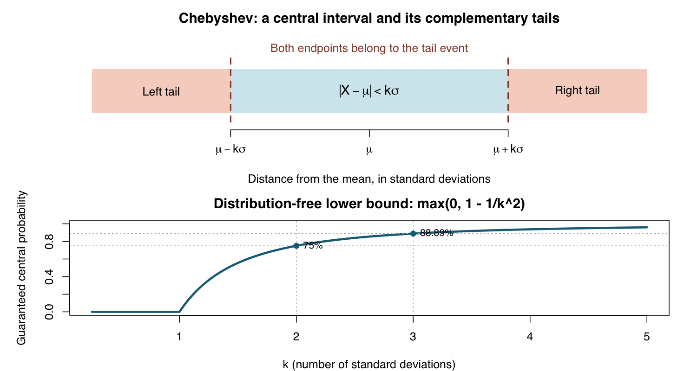
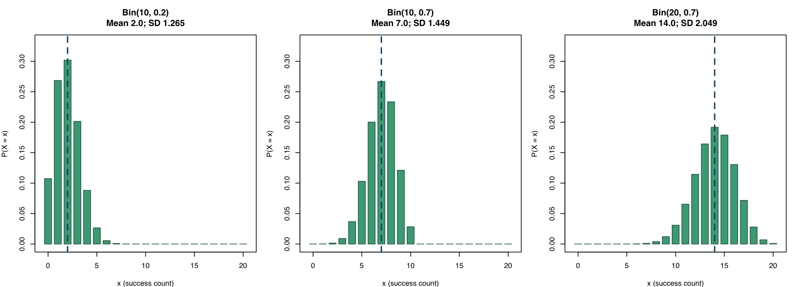

# STA237 Week 5 Study Notes: Probability Bounds and Discrete Models

## Contents

- [Scope, notation, and method selection](#scope-notation-and-method-selection)
- [Concept C-01: Moments and transformations](#concept-c-01-moments-and-transformations)
- [Concept C-02: Markov inequality](#concept-c-02-markov-inequality)
- [Concept C-03: Chebyshev inequality](#concept-c-03-chebyshev-inequality)
- [Concept C-04: Bernoulli variables and indicators](#concept-c-04-bernoulli-variables-and-indicators)
- [Concept C-05: Binomial distributions](#concept-c-05-binomial-distributions)
- [Concept C-06: Conditional models and mixtures](#concept-c-06-conditional-models-and-mixtures)
- [Concept C-07: Geometric waiting times](#concept-c-07-geometric-waiting-times)
- [Concept C-08: Negative binomial waiting times](#concept-c-08-negative-binomial-waiting-times)
- [Concept C-09: Hypergeometric sampling](#concept-c-09-hypergeometric-sampling)
- [Formula and practice index](#formula-and-practice-index)

Teaching-example answers, lecture solutions, all 20 requested textbook exercises, and self-tests are in [Answers and Practice](Answers-and-Practice.md).

## Scope, notation, and method selection

**Primary source:** `W5/Week5-L0401-annotated.pdf`, Week of October 5, 2026. It has 22 PDF pages, labelled slides 1–21 and 23. The lecture teaches transformations, Markov and Chebyshev bounds, Bernoulli/indicator variables, binomial models, parameters, and R probability commands.

**Screenshot-defined supporting reading:** MMSA (*Modern Mathematical Statistics with Applications*, 3rd ed.), §§3.3 and 3.5; PAR (*Probability: With Applications and R*, 2nd ed., Wagaman and Dobrow, 2021), §§3.3–3.4, 5.1, 5.3–5.4. “Relevant Chapters” identifies relevant reading, not verified mandatory assigned reading. Geometric, negative binomial, and hypergeometric models are covered as textbook supplements; they are not explicitly developed in this lecture deck. Necessary MMSA §3.7 formulas support the specifically requested #108 and #112(a)–(c).

**Learning goals:** choose and justify a probability model; distinguish one success indicator from a count; calculate exact probabilities and moments; use moments to bound probabilities when the full distribution is unknown; derive the named distributions from their experiments. The [coverage appendix](Answers-and-Practice.md#f-coverage-and-unresolved-items) records source discrepancies and the only inaccessible source item.

| Notation | Meaning and conditions |
| --- | --- |
| $X:\Omega\to\mathbb R$ | A random variable maps an experimental outcome to a number. |
| $p_X(x)=P(X=x)$ | PMF, zero off the support; masses are nonnegative and sum to 1. |
| $F_X(t)=P(X\le t)$ | CDF; for integer $X$, $P(a\le X\le b)=F_X(b)-F_X(a-1)$. |
| $\mu=E(X)$, $\sigma^2=V(X)$, $\sigma=SD(X)$ | Mean, variance, standard deviation; moments assumed finite when used. |
| $p$, $q=1-p$ | Success and failure probabilities; a “success” is the event being counted, even if undesirable. |
| $n$, $r$, $N$, $K$ | Fixed trial count, target number of successes, population size, population success count. |
| $b(x;n,p)$, $B(x;n,p)$ | MMSA binomial PMF and CDF, respectively. Capital $B$ is cumulative. |
| $T_r$, $F_r=T_r-r$ | Trials through the $r$th success; failures before the $r$th success. |

**Prerequisites only:** $\binom nk$ counts unordered $k$-element selections; independence gives products of trial probabilities; conditioning gives $P(A\cap B)=P(A\mid B)P(B)$ and $P(A)=\sum_jP(A\mid H_j)P(H_j)$ for a partition. A count is integer-valued even if its mean is not.

| What is random? | Model or method | First check |
| --- | --- | --- |
| A nonlinear cost based on a known PMF | LOTUS and second moments, PT-01 | Transform every support value; do not transform just the mean. |
| Nonnegative magnitude, known mean only | Markov, PT-02 | $X\ge0$ and threshold $a>0$. |
| Deviation from the mean, known finite variance | Chebyshev, PT-03–04 | Center the interval and use the actual standard deviation. |
| One binary event | Bernoulli, PT-05 | State which event is encoded as 1. |
| A complicated count | Indicators, PT-06 | Mean needs no independence; variance needs covariance terms unless they vanish. |
| Successes among fixed $n$ i.i.d. trials | Binomial, PT-07–10 | Fixed $n$, binary outcome, independence, common $p$. |
| One randomly chosen environment governing all trials | Mixture, PT-11 | Condition first; trials may be dependent unconditionally. |
| Trials or failures until first success | Geometric, PT-12 | Specify support starting at 1 or 0. |
| Trials or failures until $r$ successes | Negative binomial, PT-13 | The final trial must be a success. |
| Successes in a fixed-size sample without replacement | Hypergeometric, PT-14 | Specify $N,K,n$ and feasible support. |

## Concept C-01: Moments and transformations

**Classification:** Core (concise prerequisite review applied directly in slides 3–7).

For a discrete variable with support $\mathcal X$,

$$
E[g(X)]=\sum_{x\in\mathcal X}g(x)p_X(x).
$$

This is LOTUS: evaluate the numerical quantity of interest at each possible $x$, then weight by probability. A finite mean requires $\sum |x|p_X(x)<\infty$; a finite variance requires a finite second moment. For a finite PMF these conditions are automatic.

$$
V(X)=E[(X-\mu)^2]=E(X^2)-\mu^2,\qquad SD(X)=\sqrt{V(X)}.
$$

The shortcut follows by expanding $X^2-2\mu X+\mu^2$ and using linearity. Variance measures average squared distance from the center; SD returns to the original units. A mean is a balance point, not necessarily a possible observation; SD is not a maximum possible deviation.

Linearity gives $E(aX+b)=aE(X)+b$, even if $a<0$. Centering gives

$$
V(aX+b)=E[(aX+b-a\mu-b)^2]=a^2V(X),\qquad SD(aX+b)=|a|SD(X).
$$

A constant has zero variance, a shift changes no spread, and a negative scale reverses the axis without making SD negative. When $a=0$, the transformed variable is constant.

For nonlinear $g$, there is **no general identity** $E[g(X)]=g(E[X])$. Equality can still happen in particular cases; the slide's $\ne$ should be read as “not equal in general.” In particular, $E(X^2)=E(X)^2+V(X)$. Therefore $E(X^2)\ge E(X)^2$, with equality exactly when $X$ is constant almost surely. For a quadratic cost $C=aX^2+b$, use $V(C)=a^2\{E(X^4)-E(X^2)^2\}$, not $a^2V(X)$.

### Problem Type PT-01: Moments of a transformed variable

**Recognition cues.** A PMF is supplied, and the requested cost, score, or measurement is $g(X)$ rather than $X$.

**General method.** Construct columns $x,p_X(x),g(x),g(x)^2$. Calculate $E[g(X)]$ and $E[g(X)^2]$ separately, subtract the squared mean, and take the square root for SD. Verify the PMF sum, nonnegative variance, and units. For affine $g$, the scaling rules are sufficient.

**Teaching example — original question.** A device has defect count $X\in\{0,1,2\}$ with probabilities $0.2,0.5,0.3$. Its repair cost is $C=5X^2+2$ dollars. Find (a) $E(X)$ and $V(X)$, (b) $E(C)$ and $SD(C)$, and (c) whether calculating $5E(X)^2+2$ would be valid.

**A complete answer must include.** A valid probability table; the required raw moments; the transformed mean and variance calculation; the SD with correct units; justification for the proposed shortcut.

**Common mistakes.** Squaring $E(X)$ instead of computing $E(X^2)$; scaling a variance as though a quadratic transformation were affine; reporting variance in dollars instead of dollars squared.

## Concept C-02: Markov inequality

**Classification:** Core (slide 8; foundational proof for Chebyshev).

If $Y\ge0$ almost surely, $E(Y)<\infty$, and $a>0$, then

$$
P(Y\ge a)\le \min\left(1,\frac{E(Y)}a\right).
$$

Pointwise, $Y\ge aI_{\{Y\ge a\}}$; taking expectations proves the inequality. The mean budget limits how much probability can sit at high values. This does not assume a particular distribution or independence. Markov yields an **upper bound**, not an exact probability. If $E(Y)=0$, nonnegativity forces $Y=0$ almost surely. For a signed $Y$, the pointwise argument fails: use a nonnegative transform if its mean is known.

### Problem Type PT-02: Bounding a nonnegative tail

**Recognition cues.** Only the mean of a nonnegative amount is known; the question asks how often it can exceed a positive threshold.

**General method.** State nonnegativity, identify $a$, apply $E(Y)/a$, and cap the result at 1. Use a complement for a lower bound below the threshold. Do not infer an exact frequency.

**Teaching example — original question.** Daily processing time $Y$ is nonnegative with mean 12 minutes. Without assuming a distribution, bound (a) $P(Y\ge40)$ and (b) $P(Y<40)$. Explain whether the same calculation applies to a signed measurement with mean 12.

**A complete answer must include.** The applicability conditions; an upper tail bound; a complementary lower bound with correct endpoints; a reasoned applicability decision for the signed variable.

**Common mistakes.** Applying Markov to signed values; reversing the inequality; using $\le$ for the complement of $\ge$.

## Concept C-03: Chebyshev inequality

**Classification:** Core (slides 9–11; MMSA #45 and #85).

For finite mean $\mu$, finite variance $\sigma^2$, and any distance $t>0$,

$$
P(|X-\mu|\ge t)\le\min\left(1,\frac{\sigma^2}{t^2}\right),\qquad
P(|X-\mu|<t)\ge\max\left(0,1-\frac{\sigma^2}{t^2}\right).
$$

Apply Markov to $Y=(X-\mu)^2$, whose mean is $\sigma^2$, at threshold $t^2$. When $\sigma>0$, write $t=k\sigma$ to obtain upper bound $1/k^2$ and central lower bound $1-1/k^2$.

*Schematic: the two tails include the interval endpoints; the central event uses strict inequalities. The curve shows the guaranteed central probability, not the actual coverage of any particular distribution.*

**When can it be used?** For any distribution with finite variance; $X$ may be negative, asymmetric, discrete, or continuous. For $\sigma=0$, $X=\mu$ almost surely and any positive-width interval has probability 1; do not divide by $\sigma$. The standardized event with width $k\sigma=0$ is degenerate, so the usual standardized display presumes $\sigma>0$.

**When should it be used?** When the distribution is unknown, or a distribution-free guarantee is requested. If the PMF is available, compute the exact probability and use Chebyshev only for comparison. For $k\le1$, its central lower bound is 0 and gives no positive guarantee. At $k=2$ and $k=3$, the guarantees are 75% and $8/9$, not a normal-distribution “95% and 99.7%” rule.

**Intervals and integer support.** For a centered inclusive interval $[\mu-d,\mu+d]$, the open central interval of radius $d$ is a subset, giving a valid lower bound. If $X$ is integer-valued, list the excluded support values: the smallest excluded distance $t_*$ can yield a stronger valid bound. For an asymmetric interval $[a,b]$ containing $\mu$, a conservative centered radius is $\min(\mu-a,b-\mu)$; support information may improve it. Chebyshev does not determine individual point probabilities or the exact distribution.

### Problem Type PT-03: Chebyshev event bounds with support checks

**Recognition cues.** A mean and SD are supplied, and an interval or deviation event is requested; the support may be integer-valued or the PMF may be available for comparison.

**General method.** Translate the event into distances from $\mu$. Identify strict versus inclusive endpoints. If using integer support, find the closest excluded support value. Apply $\sigma^2/t^2$ to the tail, or its complement to the central event. If the full PMF is supplied, sum the exact tail separately.

**Teaching example — original question.** Daily requests $X$ are integer-valued with mean 50 and SD 4; no PMF is supplied. Give a valid lower bound for $P(42\le X\le58)$, and explain how the integer support improves the ordinary radius-8 bound. Can the exact probability be determined?

**A complete answer must include.** The complement event on integer support; its smallest deviation; a valid bound and interpretation; an explanation of what moments do and do not determine.

**Common mistakes.** Treating a bound as equality; using variance as SD; omitting endpoint values from a discrete tail; rounding a deviation threshold before finding the integer event.

### Problem Type PT-04: Designing a guaranteed central interval

**Recognition cues.** A minimum coverage level is requested without an assumed distribution.

**General method.** For target $0<c<1$, solve $1-1/k^2\ge c$, giving $k\ge1/\sqrt{1-c}$. Choose $t=k\sigma$ and a centered interval. Convert the event to integer support carefully; distinguish a sufficient interval from a shortest interval under an unknown distribution.

**Teaching example — original question.** A measurement has mean 30 and SD 2. Construct a centered interval guaranteed to contain at least 96% of outcomes. State the endpoints and whether this proves that exactly 96% lie there.

**A complete answer must include.** The coverage inequality; the required width; an interval with endpoint conventions; a guarantee interpretation.

**Common mistakes.** Solving for $1-c$ as though it were $c$; claiming a unique shortest interval or exact coverage; using a normal quantile without a normal-model assumption.

## Concept C-04: Bernoulli variables and indicators

**Classification:** Core (slides 13–17); indicator count applications are Supplementary (PAR #4.23 and §5.1).

An event $A$ has indicator $I_A=1$ when $A$ happens, and 0 otherwise. If $p=P(A)$, then $I_A\sim\operatorname{Bern}(p)$:

$$
P(I_A=0)=1-p,\quad P(I_A=1)=p,\quad
E(I_A)=p,\quad V(I_A)=p(1-p).
$$

The compact PMF $p^x(1-p)^{1-x}$ applies on $\{0,1\}$ for $0<p<1$; use the explicit two masses at $p=0$ or 1 to avoid $0^0$ conventions. “Bernoulli” describes the distribution; “indicator” emphasizes encoding an event. A Bernoulli variable has one trial, a binomial variable counts successes across several trials.

Since $I_A^m=I_A$ for every positive integer $m$, all positive raw moments equal $p$. Thus the variance follows from $E(I_A^2)-E(I_A)^2$. Variance is zero at $p=0,1$ and largest, $1/4$, at $p=1/2$.

If $X=\sum_{i=1}^m I_{A_i}$ counts events,

$$
E(X)=\sum_{i=1}^mP(A_i)
$$

without requiring independent events. For variance, the full identity is

$$
V(X)=\sum_iV(I_{A_i})+2\sum_{i<j}\operatorname{Cov}(I_{A_i},I_{A_j}),
\quad \operatorname{Cov}(I_A,I_B)=P(A\cap B)-P(A)P(B).
$$

Independence is sufficient for covariance zero; it is not necessary in general. Overlapping events can be dependent even if underlying trials are independent: two consecutive-success indicators share a trial. Likewise $E(XY)=E(X)E(Y)$ holds under independence, but equality alone does not prove independence.

**Supplement: occupancy and coupon collection.** With $m$ equally likely types and $t$ independent draws with replacement, the indicator that type $j$ has appeared has mean $1-(1-1/m)^t$. The expected number of distinct types is $m[1-(1-1/m)^t]$. This is a count mean, not a binomial claim. In PAR's tiger application, setting observed distinct count $d$ approximately equal to this mean provides a model-based estimate of population size; unequal detection probabilities change the model.

To count types appearing **at least twice**, use $J_j=I_{\{N_j\ge2\}}$, where the count for a fixed type is $N_j\sim\operatorname{Bin}(t,1/m)$. For $t\ge1$ and $m\ge2$, subtract the probabilities of zero and exactly one occurrence:

$$
E\left(\sum_{j=1}^mJ_j\right)
=m\left[1-\left(1-\frac1m\right)^t
-\frac tm\left(1-\frac1m\right)^{t-1}\right].
$$

Each qualifying type contributes one, regardless of how many occurrences it has. This differs from counting pairs of matching draws. The indicators need not be independent. PAR #4.23 applies this method to birth months.

### Problem Type PT-05: Bernoulli moments and powers

**Recognition cues.** The variable takes values 0 and 1, or is explicitly an event indicator; powers or mean/variance are requested.

**General method.** State the success event and probability. Use the two masses and the identity $X^m=X$ for positive integer $m$. For affine payoffs, apply C-01's transformation identities.

**Teaching example — original question.** A delivery is late with probability 0.15, and $I=1$ denotes lateness. Find (a) its PMF, (b) $E(I)$, $E(I^8)$, and $V(I)$, and (c) the mean and SD of a fee $D=12I+1$ dollars.

**A complete answer must include.** A definition of the indicator; both masses; the power argument; the variance and transformed quantities with units.

**Common mistakes.** Calling $I$ the number of late deliveries in an unspecified sample; raising $p$ to the power when calculating $E(I^m)$; assuming that “success” must be beneficial.

### Problem Type PT-06: Expected counts using indicators

**Recognition cues.** The question asks for the expected number of events, patterns, occupied locations, or observed types; obtaining the full count distribution would be cumbersome.

**General method.** Identify the objects being counted. Create one indicator per object, express the count as their sum, calculate each event probability, and use linearity. For a pattern, count its possible starting positions. State why variance or a binomial classification would require additional dependence analysis.

**Teaching example — original question.** Six independent trials each succeed with probability 0.4. Let $Z$ count adjacent pairs of successes, including overlapping pairs. Find $E(Z)$. Are the pair indicators independent? Is a binomial model automatically justified?

**A complete answer must include.** A precise set of indicators and count identity; the number of candidate pairs; their probabilities; a dependence check and a justified model conclusion.

**Common mistakes.** Counting disjoint pairs only; using six instead of the number of starting positions; imposing independence just to use linearity of expectation.

## Concept C-05: Binomial distributions

**Classification:** Core (slides 15–21; MMSA §3.5; PAR §§3.3–3.4).

A **Bernoulli sequence** is an i.i.d. sequence $I_1,I_2,\ldots$ of Bernoulli variables with common success probability $p$. For fixed $n$, let $X=I_1+\cdots+I_n$. Then $X\sim\operatorname{Bin}(n,p)$, where $n$ is a nonnegative integer and $0\le p\le1$.

For $0<p<1$,

$$
b(x;n,p)=P(X=x)=\binom nxp^x(1-p)^{n-x},\qquad x=0,1,\ldots,n.
$$

One specific success/failure sequence with $x$ successes has probability $p^xq^{n-x}$. There are $\binom nx$ such sequences. They are disjoint, so their probabilities add. All $2^n$ binary sequences are equally likely only when $p=1/2$. The binomial theorem proves normalization: $\sum_x\binom nxp^xq^{n-x}=(p+q)^n=1$.

**Four model conditions:** fixed number of trials; each trial reduced to success/failure; independent trials; common $p$. Physical outcomes may have more than two categories if success is defined as a binary event, such as “roll a 4.” Without replacement, identical marginal success probabilities do **not** imply independence. For a random sample from a large finite population, a binomial model may be an approximation; MMSA's practical rule is sample fraction $n/N\le0.05$. Label it as an approximation, and use hypergeometric for the exact finite-population model.

**Moments from indicators:** $E(X)=np$ by linearity and $V(X)=npq$ by independence. Thus $SD(X)=\sqrt{npq}$. For $n=1$, this is Bernoulli; for $p=0$, $X=0$; for $p=1$, $X=n$; for $n=0$, $X=0$. $n$ and $p$ are fixed parameters of a chosen distribution, while $x$ is its possible observation. Varying parameters gives a family.

*Reconstructed comparison from slide 19. Dashed lines mark the means. Changing $p$ shifts the center and changes spread; changing $n$ changes support and moments. The horizontal axes use the same scale.*

**Shape:** $p=1/2$ gives a symmetric PMF; small $p$ tends to produce a longer right tail, large $p$ a longer left tail. Reflection gives $n-X\sim\operatorname{Bin}(n,1-p)$. The modes are $\lfloor(n+1)p\rfloor$ when $(n+1)p$ is noninteger, and the two adjacent values $(n+1)p-1$ and $(n+1)p$ when it is an integer (restrict to feasible support).

**CDF and R commands.** Let $B(k;n,p)=\sum_{x=0}^k b(x;n,p)$, extended by 0 for $k<0$ and 1 for $k\ge n$. For integer endpoints,

$$
P(X\ge a)=1-B(a-1;n,p),\quad
P(a\le X\le b)=B(b;n,p)-B(a-1;n,p).
$$

| Task | R expression |
| --- | --- |
| $P(X=x)$ | `dbinom(x, size=n, prob=p)` |
| $P(X\le k)$ | `pbinom(k, size=n, prob=p)` |
| $P(X\ge a)$ | `pbinom(a-1, size=n, prob=p, lower.tail=FALSE)` |
| $P(a\le X\le b)$ | `pbinom(b,n,p)-pbinom(a-1,n,p)` |
| Smallest count with CDF at least $u$ | `qbinom(u, size=n, prob=p)` |
| Simulate $m$ independent counts | `rbinom(m, size=n, prob=p)` |

R's upper tail is $P(X>k)$, so “at least $a$” uses $a-1$. For noninteger inequalities, determine the integer support values before using a CDF. Software calculates a specified model; it does not justify the model.

**Supplement from PAR §3.4: combining counts and random graphs.** For independent binomial counts with the same $p$, adding their underlying independent Bernoulli trials gives another binomial with trial count $n_1+n_2$. For independent $X,Y$, an event such as matching counts has probability $P(X=Y)=\sum_xP(X=x)P(Y=x)$, with the sum over common support. Equal probabilities do not justify this multiplication if the counts are dependent. A random graph on $v$ labelled vertices, with an edge independently present at each distinct pair with probability $p$, has a binomial edge count with $n=\binom v2$ and a binomial degree at one vertex with $n=v-1$. Binary edge events illustrate the model; no unrequested graph exercises are added.

**Supplement from MMSA pp.150–151: proportions and generating functions.** For independent repeated runs, $\widehat p=X/n$ has mean $p$, variance $p(1-p)/n$, and standard error $\sqrt{p(1-p)/n}$. Replacing $p$ by $\widehat p$ estimates this SE; the SE describes precision, not an exact confidence guarantee. A moment generating function is $M_X(t)=E(e^{tX})$. Binomial expansion gives $M_X(t)=(1-p+pe^t)^n$, with $M'_X(0)=E(X)=np$ and $M''_X(0)=E(X^2)=n(n-1)p^2+np$, recovering $np(1-p)$ for variance. These textbook verification tools were not taught as a separate lecture topic; no unrelated MMSA §3.4 exercises are imported.

### Problem Type PT-07: Checking a binomial model

**Recognition cues.** A narrative proposes a count, sometimes with sampling without replacement, unequal success probabilities, or a stopping rule.

**General method.** Define success and the counted variable, check all four conditions, then state $n$ and $p$ if justified. Identify exactly which condition fails otherwise. Distinguish an exact model from a large-population approximation and from a model conditional on extra information.

**Teaching example — original question.** Classify each variable and identify any justified parameters: (a) the number of red outcomes in ten independent spins, each red with probability 0.3; (b) reds among ten balls sampled without replacement from 30 red and 20 blue balls; (c) spins needed to obtain three reds; (d) total correct answers on twelve independently guessed questions, six with four choices and six with two choices.

**A complete answer must include.** A success definition; the trial/stopping and dependence checks; parameters where valid; the violated condition and a suitable alternative description where needed.

**Common mistakes.** Treating every integer count as binomial; replacing unequal probabilities with their average; claiming independent draws from a finite population without replacement.

### Problem Type PT-08: Exact binomial event probabilities

**Recognition cues.** A justified binomial count asks for exactly, at most, at least, or between; a success probability may first require a conditional probability calculation.

**General method.** Calculate the probability of the actual event counted, define $X\sim\operatorname{Bin}(n,p)$, translate wording into an integer event, and use PMF/CDF/complement as appropriate. Show the sum or CDF expression before numerical evaluation.

**Teaching example — original question.** Independently for each of eight products, 25% are returned; among returned products, 80% receive a refund. Let $X$ count refunded products. Find (a) the success probability, (b) $P(X=2)$, and (c) $P(2\le X\le4)$. Assume refunds occur only for returns and that the described product outcomes are independent.

**A complete answer must include.** A conditional-to-joint probability calculation; the count model; the event translations; exact probability expressions and numerical answers.

**Common mistakes.** Using the conditional refund probability alone; dropping $\binom nx$; subtracting $F(a)$ rather than $F(a-1)$ for an inclusive interval.

### Problem Type PT-09: Binomial moments and standard-deviation events

**Recognition cues.** A binomial model asks for its mean/SD, an affine revenue, or the probability of being within a stated number of SDs of the mean.

**General method.** Calculate $np$ and $np(1-p)$; apply C-01 for affine outputs. Solve the SD inequality for real bounds, then intersect with integer support and sum the PMF. Compare a Chebyshev bound separately if requested.

**Teaching example — original question.** Of twelve independent visitors, each buys a ticket with probability 0.3. Find (a) the expected number of buyers and its SD, (b) the probability that the count differs from its mean by at most one SD, and (c) the expected revenue if every visitor pays 2 dollars for entry and a buyer pays an additional 5 dollars.

**A complete answer must include.** Moments; real SD bounds; the resulting set of integer counts; a probability calculation; the correct affine revenue expression.

**Common mistakes.** Rounding the mean first; using $np(1-p)$ as SD; interpreting “within one SD” as a universal fixed percentage.

### Problem Type PT-10: Capacity and probability-based decisions

**Recognition cues.** Demand must fit two inventories, or two plans require different minimum numbers of successful deliveries.

**General method.** Express each acceptable outcome as a count inequality. For two categories with total demand $n$, use both $X\le s$ and $n-X\le t$. For each plan, use its own trial count and event. Compare success probabilities under the same stated assumptions; expectations alone do not determine the best choice.

**Teaching example — original question.** Eight independent buyers choose version A with probability 0.55 and B otherwise. A shop holds five of each version. What is the probability that every buyer receives their preferred version? Explain why checking only A's inventory would be incomplete.

**A complete answer must include.** Both inventory constraints; their joint feasible integer event; the correct count model and probability; interpretation of the decision criterion.

**Common mistakes.** Ignoring the complementary demand; comparing mean demand instead of probability of satisfying all requests; silently switching trial counts between plans.

## Concept C-06: Conditional models and mixtures

**Classification:** Supplementary (required by PAR #3.22).

A binomial model may hold **conditional on a common environment** $H$, such as a die selected once before all rolls. If $X\mid H=h\sim\operatorname{Bin}(n,p_h)$ and $P(H=h)=w_h$, then

$$
P(X=x)=\sum_hw_h\binom nx p_h^x(1-p_h)^{n-x}.
$$

Selecting one environment for all trials is different from independently selecting a new environment on every trial. In the former, observing successes gives information about the common environment and can increase the probability of future successes; unconditional trials can be dependent. A weighted average success probability alone does not usually give the count's distribution.

For fixed $n$, let $P$ be the random common success probability. Conditional moments imply

$$
E(X)=nE(P),\qquad V(X)=n\overline p(1-\overline p)+n(n-1)V(P),\quad \overline p=E(P).
$$

The extra variance distinguishes the mixture from $\operatorname{Bin}(n,\overline p)$ when $n>1$ and $V(P)>0$. A single Bernoulli trial ($n=1$) is still Bernoulli with marginal probability $\overline p$.

### Problem Type PT-11: Mixture probabilities and model diagnosis

**Recognition cues.** A coin, machine, or die is randomly chosen once, after which all trials use that choice.

**General method.** Define the partition of environments and their weights, identify each conditional count distribution, and apply total probability. Test any unconditional binomial claim using dependence, mean/variance, or multiple PMF values.

**Teaching example — original question.** A fair coin selects one of two machines. Machine A fails independently with probability 0.1 and B with probability 0.5. The chosen machine makes four items. Find the probability of exactly two failures and determine whether the unconditional count is binomial.

**A complete answer must include.** Both conditional distributions; mixture weights; a total-probability calculation; a justified diagnosis of the unconditional distribution.

**Common mistakes.** Applying one binomial PMF with averaged $p$; treating one common machine choice as four independent choices; claiming a mixture can never be binomial without considering degenerate cases.

## Concept C-07: Geometric waiting times

**Classification:** Supplementary (PAR §5.1; MMSA #112(a)–(c)).

In i.i.d. Bernoulli trials with $0<p\le1$, let $T$ be the trial on which the first success occurs. Then

$$
P(T=t)=q^{t-1}p,\quad t=1,2,\ldots;\qquad
P(T>m)=q^m,\quad P(T\le m)=1-q^m.
$$

There must be $t-1$ failures followed by one success. A geometric series proves normalization. $p=1$ forces $T=1$; $p=0$ produces no finite success and is outside this model of an almost surely finite waiting time.

For failures $F=T-1$, $P(F=f)=q^fp$, $f=0,1,\ldots$. PAR's default geometric variable counts **trials**; R's `dgeom` and `pgeom` count **failures**. Thus $P(T=t)$ uses `dgeom(t-1,p)` and $P(T\le t)$ uses `pgeom(t-1,p)`.

Using the tail-sum identity for positive integer-valued variables,

$$
E(T)=\sum_{m=0}^{\infty}P(T>m)=\frac1p.
$$

Differentiating the geometric series gives $E(T^2)=(2-p)/p^2$, so $V(T)=q/p^2$. For $F$, the mean is $q/p$ and variance remains $q/p^2$.

More explicitly, $\sum_{t\ge1}tq^{t-1}=1/(1-q)^2$ and $\sum_{t\ge1}t(t-1)q^{t-1}=2q/(1-q)^3$. Since $t^2=t(t-1)+t$, multiplying the combined series by $p$ gives $E(T^2)=2q/p^2+1/p=(2-p)/p^2$, justifying the second-moment formula.

**Memorylessness:** for nonnegative integer $s,t$ and a positive-probability conditioning event,

$$
P(T>s+t\mid T>s)=\frac{q^{s+t}}{q^s}=q^t=P(T>t).
$$

Past failures do not change the remaining waiting-time distribution. The “law of averages” does not make a success due. The condition that $s,t$ are integers matters for discrete waiting times; the identity is not a real-time formula for arbitrary noninteger shifts.

**Supplement: coupon collector (PAR §5.1.2).** If $m$ types are equally likely on independent draws with replacement, after $j$ types are collected the next new type has probability $(m-j)/m$. Its additional waiting time has mean $m/(m-j)$. The expected time to collect all types is $mH_m=m\sum_{k=1}^m1/k$, not the mean of one geometric variable with a fixed success probability. The corresponding waits are independent by restarting the independent draw sequence; variance is $\sum_{k=1}^m m(m-k)/k^2$. This illustrates using sums of geometric waits when stage probabilities change.

### Problem Type PT-12: First-success waiting times and memorylessness

**Recognition cues.** An experiment stops at the first success, and asks for exact waiting time, a tail, a failure count, or further waiting after failures.

**General method.** Define trials $T$ or failures $F$ and state support. Express the terminal pattern; use the geometric PMF or tail. Translate between $T$ and $F$ before using R. For conditional remaining time, verify i.i.d. assumptions and a positive-probability conditioning event.

**Teaching example — original question.** Independent inspections detect an issue with probability 0.25. Stop at the first detection. Find (a) the probability of exactly three nondetections before stopping, (b) the probability of stopping by inspection 4, (c) the expected number of inspections, and (d) the probability of needing more than two additional inspections given three nondetections already occurred.

**A complete answer must include.** The waiting-time convention; the terminal pattern and event translations; probabilities and mean; a conditional-tail argument.

**Common mistakes.** Shifting the exponent by one; describing a positive-integer waiting time as R's failure count; believing earlier failures increase the next success probability.

## Concept C-08: Negative binomial waiting times

**Classification:** Supplementary (PAR §5.3; supports MMSA #66(c)).

Let $T_r$ count trials through the $r$th success in i.i.d. Bernoulli trials, with integer $r\ge1$ and $0<p\le1$. To stop at $t$, the last trial must succeed and the preceding $t-1$ trials must contain exactly $r-1$ successes:

$$
P(T_r=t)=\binom{t-1}{r-1}p^rq^{t-r},\qquad t=r,r+1,\ldots.
$$

For failures $F_r=T_r-r$,

$$
P(F_r=f)=\binom{f+r-1}{r-1}p^rq^f,\qquad f=0,1,\ldots.
$$

PAR counts trials by default; MMSA and R's `dnbinom`/`pnbinom` use failures before $r$ successes. Record the convention explicitly. In R, $P(T_r=t)$ is `dnbinom(t-r,size=r,prob=p)`.

Between successive successes, the independent sequence restarts. Thus $T_r$ is a sum of $r$ independent geometric waiting times, giving

$$
E(T_r)=\frac rp,\quad V(T_r)=\frac{rq}{p^2},\qquad
E(F_r)=\frac{rq}p,\quad V(F_r)=\frac{rq}{p^2}.
$$

For $r=1$ the model is geometric; $p=1$ forces $T_r=r$. For $r>1$, the total waiting time is not memoryless: knowing only that the process has not yet finished does not determine how many successes remain.

**Fixed horizon / stopping-time connection:**

$$
P(T_r\le m)=P\{\operatorname{Bin}(m,p)\ge r\}.
$$

Both events mean that the first $m$ trials contain at least $r$ successes. This avoids a long waiting-time sum. A contest that stops when **either** player reaches a target is not simply the unrestricted waiting time for one player's target. In an interrupted contest where A needs $a$ wins and B needs $b$, A's eventual win probability is $P(T_a\le a+b-1)$; an expected-value division of stakes follows this probability (PAR's problem of points).

### Problem Type PT-13: Waiting for a target number of successes

**Recognition cues.** Sampling continues until $r$ acceptable items are found; the number of trials is random.

**General method.** Define success and the waiting-time convention; use the last-trial restriction for an exact PMF. For a horizon $m$, switch to a binomial tail. Calculate moments using the sum of geometric waits and verify support $t\ge r$.

**Teaching example — original question.** Independent applicants qualify with probability 0.4. Interviews continue until three qualified applicants have been found. Find (a) the probability of finishing on interview 5, (b) the probability of finishing by interview 8, and (c) the mean and variance of interviews and of unsuccessful interviews.

**A complete answer must include.** A random-variable convention; the final-trial restriction; a binomial-horizon equivalence; moments and their shift relationship.

**Common mistakes.** Using $\binom tr$ when the last trial is fixed as a success; treating the stopping time as a binomial count; forgetting R counts failures.

## Concept C-09: Hypergeometric sampling

**Classification:** Supplementary (PAR §5.4; MMSA #108 and PAR #3.19(c)).

A finite population contains $N$ objects, $K$ labelled successes and $N-K$ failures. Select $n$ objects uniformly without replacement, and let $X$ count successes. Then

$$
P(X=x)=\frac{\binom Kx\binom{N-K}{n-x}}{\binom Nn},\quad
\max(0,n-(N-K))\le x\le\min(n,K).
$$

The denominator counts all equally likely unordered samples; the numerator chooses successes and failures. The feasible-support inequalities guarantee enough of each category. Summing the numerator over feasible $x$ gives $\binom Nn$ by partitioning all samples.

Write $p=K/N$. Each draw indicator has marginal mean $p$, so $E(X)=np$. For distinct draws,

$$
P(I_i=1,I_j=1)=\frac K N\frac{K-1}{N-1},\qquad
\operatorname{Cov}(I_i,I_j)=-\frac{p(1-p)}{N-1}.
$$

For $N>1$, summing variances and covariances gives

$$
V(X)=np(1-p)\frac{N-n}{N-1}.
$$

The finite-population correction reduces spread relative to a binomial model. For $n=N$, the count is exactly $K$; for $K=0$ or $N$, it is constant. If $N=1$, calculate directly instead of using the $0/0$ variance expression. For a small sampling fraction, the correction is near 1 and binomial approximation is often practical, but independence is still not exact.

R uses the **two population category counts**, rather than population total as the second argument: `dhyper(x, K, N-K, n)` and `phyper(x, K, N-K, n)`.

**Supplement: population estimation (PAR pp.203–206).** If $K$ is unknown and a sample yields $x$ successes, the hypergeometric likelihood is the PMF viewed as a function of feasible integer $K$. Maximizing it estimates $K$; it does not change the PMF's sample-space meaning. In capture–recapture, marking $K$ population members and finding $x$ marked members among a later sample of $n$ gives $x/n\approx K/N$ and $\widehat N\approx nK/x$. This approximation requires a closed, well-mixed population, retained marks, and comparable capture probabilities; it is undefined at $x=0$.

### Problem Type PT-14: Sampling without replacement

**Recognition cues.** A fixed-size random sample comes from a known finite population and selected objects are not replaced.

**General method.** State $N,K,n$ and feasible support; use the hypergeometric PMF for one category count and sum it for events. For requirements involving several colors, count category selections directly over $\binom Nn$. Use the finite-population correction for variance. Label any binomial substitute as an approximation.

**Teaching example — original question.** A box contains five blue and seven red tokens. Four distinct tokens are selected uniformly without replacement. Let $X$ count blue tokens. Find (a) its support and PMF, (b) $P(X=2)$, and (c) its mean and SD. Compare its variance with the with-replacement model.

**A complete answer must include.** All population/sample parameters; feasible support; numerator and denominator counts; the requested event and moments; a justified variance comparison.

**Common mistakes.** Using independent-trial products; assuming support always reaches $n$; omitting the finite-population correction; interchanging $K$ and $N$ in R.

## Formula and practice index

| Model | What it counts | Support | Mean | Variance |
| --- | --- | --- | --- | --- |
| Bernoulli$(p)$ | One success indicator | $0,1$ | $p$ | $p(1-p)$ |
| Binomial$(n,p)$ | Successes in fixed trials | $0,\ldots,n$ | $np$ | $np(1-p)$ |
| Geometric, trials | Trials through first success | $1,2,\ldots$ | $1/p$ | $(1-p)/p^2$ |
| Negative binomial, trials | Trials through $r$th success | $r,r+1,\ldots$ | $r/p$ | $r(1-p)/p^2$ |
| Hypergeometric$(N,K,n)$ | Successes without replacement | Feasible finite integer interval | $nK/N$ | $n(K/N)(1-K/N)(N-n)/(N-1)$ |

Subtract 1 or $r$ to convert geometric/negative binomial trial counts to failure counts; variance is unchanged. Inequalities supply guarantees from limited moments, while a justified PMF supplies exact model probabilities.

| Skill | Practice in the answer file |
| --- | --- |
| PT-01 | L-02; MMSA #78 applies its affine specialization |
| PT-02 | L-05; ST-02 |
| PT-03–04 | L-06–07; MMSA #45,85 |
| PT-05–06 | L-08; MMSA #32; PAR #4.23 |
| PT-07–10 | L-09–10; MMSA #62,64,66–68,70,78–79; PAR #3.14–17 |
| PT-11 | PAR #3.22 |
| PT-12–13 | MMSA #112(a)–(c),66(c) |
| PT-14 | MMSA #108; PAR #3.19(c) |

Use [all self-test questions](Answers-and-Practice.md#d-original-self-test-questions) before opening their answers. The retained [figure-generation script](scripts/generate_graphs.R) reproduces the diagrams with base R.
