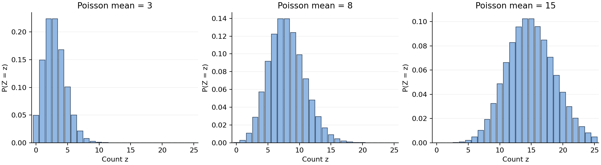

# STA237 Week 6 Study Notes: Named Discrete Distributions

These notes follow the professor's Week 6 slides. Each concept is taught before its source-grounded Problem Types. All teaching-example solutions are in [Answers and Practice](Answers-and-Practice.md).

**Suggested learning sequence:** Read one Concept first and identify what the random variable counts, which quantities are fixed, and why the model applies. Then attempt its source questions. Open the matching solution afterward to check your model, event boundaries, and calculations. Use the [source-question review index](Answers-and-Practice.md#self-test) to practise again. Supplementary material is labelled separately and can be read when you reach the exercise that needs it.

## Contents

- [Scope, notation, and method selection](#scope)
- [Concept C-01: Bernoulli and Binomial Review](#c01)
- [Concept C-02: Geometric Distribution](#c02)
- [Concept C-03: Negative Binomial Distribution](#c03)
- [Concept C-04: Hypergeometric Distribution](#c04)
- [Concept C-05: Poisson Distribution](#c05)
- [Problem Type index](#pt-index)

## Scope, notation, and method selection

**Primary source:** [Week6-L0401-annotated.pdf](../Week6-L0401-annotated.pdf). Here, `slide s` means the printed slide number at the bottom right; `PDF p` means the viewer's page number, starting at 1. The PDF has 28 pages: a handwritten derivation is inserted after slide 4, so slides 5–26 correspond to PDF pp6–27. The final page is printed as slide 29 and is PDF p28.

**Reading status:** MMSA §§3.6–3.7. The screenshot lists PAR §3.5 Poisson, §5.1 Geometric, §5.2 NB, and §5.3 Hypergeometric. In the supplied PAR second-edition PDF, the corresponding sections are actually **§3.5, §5.1, §5.3, and §5.4**; §5.2 covers MGFs and is outside this week's scope. Topics and exercise identities are matched explicitly rather than silently retaining the mismatched section numbers. These are relevant/supporting readings, not verified mandatory assigned readings. Only material needed for the lecture and specified exercises is included.

**Classification:** `Core` means material explicitly discussed, written, or asked about in the slides. `Core — Review` identifies review material in this week's deck. Substantive knowledge or methods absent from the slides are labelled at the point of use as **Supplementary — not explicitly covered in Week 6 slides**. A Supplementary label does not establish an assessment requirement.

**PT boundaries:** The 11 PTs are derived only from actual slide questions and the six Basic exercises: MMSA #91; PAR #3.26, #5.2, #5.4, #5.20, and #5.34. All requested Medium/Test Level exercises are solved, but they cannot establish additional PTs. Page discrepancies, missing source subparts, and checks of source formulas are recorded in the [coverage appendix](Answers-and-Practice.md#coverage).

### Define the random variable before choosing a distribution

| Problem structure | What is counted | Model and parameters | Key conditions |
| --- | --- | --- | --- |
| One binary trial | Success indicator | $I\sim\operatorname{Ber}(p)$ | Two outcomes, coded 1/0 |
| Fixed $n$ trials | Number of successes | $B\sim\operatorname{Bin}(n,p)$ | Independence and the same success probability on each trial |
| Continue until the first success | Failures $F$ or total trials $T$ | Geometric | Independence, fixed $p$, and one required success |
| Continue until the $r$th success | Total trials $T$ or failures $F$ | Negative binomial | Independence, fixed $p$, and $r$ required successes |
| Draw a fixed sample of $n$ from a finite population | Number in the target category | Hypergeometric $(N,K,n)$ | Simple random sampling without replacement |
| Observe a fixed time interval or area | Number of events | $Z\sim\operatorname{Pois}(\mu)$ | Stable intensity, independent counts in disjoint regions, and the other modeling assumptions |

Sources: slides 3–4, 8–18, and 20–26. This table compares the lecture models; it does not establish a separate PT for an invented comprehensive model-selection question. Distinguish **fixed trials, counting successes** from **fixed successes, counting trials**.

### Notation and discrete events

$p$ is the success probability on one Bernoulli trial, and $q=1-p$ is the failure probability. Also, $\mathbb Z_{\ge0}=\{0,1,2,\ldots\}$. The support is the set of possible values of a random variable. The PMF gives a single-value probability $P(X=x)$; the CDF gives the cumulative probability $F_X(k)=P(X\le k)$. For an integer-valued variable and integer endpoints $a\le b$ and $k$,

$$
P(X\ge k)=1-F_X(k-1),\qquad
P(a\le X\le b)=F_X(b)-F_X(a-1).
$$

This is the same reasoning as slide 6: "at least 3 = 1 − at most 2." For a standard-deviation interval, first calculate the real-valued endpoints, then retain the integers inside the interval. Do not substitute noninteger counts into a discrete PMF.

### R convention quick reference

| Variable definition | PMF / CDF in R | Important convention |
| --- | --- | --- |
| $B$: successes in $n$ trials | `dbinom(k,n,p)` / `pbinom(k,n,p)` | The CDF includes $k$ |
| $F$: failures before the first success | `dgeom(f,p)` / `pgeom(f,p)` | R counts failures, starting at 0 |
| $T=F+1$: total trials through the first success | `dgeom(t-1,p)` / `pgeom(t-1,p)` | Main Geom convention in PAR and the supplied MMSA third edition |
| $F$: failures before the $r$th success | `dnbinom(f,size=r,prob=p)` / `pnbinom(f,size=r,prob=p)` | R again counts failures |
| $T=F+r$: total trials through the $r$th success | `dnbinom(t-r,r,p)` / `pnbinom(t-r,r,p)` | Main NB convention in slide 14, PAR, and the supplied MMSA third edition |

Slide 6 explains the binomial `d/p` distinction. **Supplementary — not explicitly covered in Week 6 slides:** The specific geometric/NB functions and input conversions are needed for PAR Basic #5.4 and #5.20 and were checked against the software discussion in MMSA §3.7. They are included to complete those exercises.

## Concept C-01: Bernoulli and Binomial Review

**Classification:** Core — Review. **Lecture evidence:** slides 3–7, PDF pp3–8, including the extra handwritten page at PDF p5.

### One trial and a fixed number of trials

A Bernoulli random variable $I$ codes success on one trial as 1 and failure as 0:

$$
P(I=i)=p^i(1-p)^{1-i},\quad i=0,1;\qquad
E(I)=p,\quad \operatorname{Var}(I)=p(1-p).
$$

If $I_1,\ldots,I_n$ are independent and identically distributed, their total number of successes $B=\sum_{i=1}^n I_i$ is Binomial:

$$
P(B=b)=\binom nb p^bq^{n-b},\quad b=0,\ldots,n;
\qquad E(B)=np,\quad \operatorname{Var}(B)=npq.
$$

One specified success/failure sequence has probability $p^bq^{n-b}$; $\binom nb$ counts all sequences containing $b$ successes. In a stopping-rule problem where the final trial must be a success, you cannot freely arrange successes across all $n$ positions.

**Having the same distribution does not mean being the same random variable.** Each $I_i$ has the same success probability, but the indicators may take different values in one experiment (slide 4 annotation). Independence allows variances to be added directly; linearity of expectation itself does not require independence.

When $p=0$ or $p=1$, the Binomial variable is constant and has variance 0. Otherwise, $0<p<1$; $n$ must be a nonnegative integer. Equal marginal success probabilities alone do not establish independence.

### Basic tools for moments

The expectation $E(X)$ describes the long-run average across repeated experiments. Variance describes fluctuation around the mean; the standard deviation is its square root and has the same units as $X$. The first moment is $E(X)$ and the second moment is $E(X^2)$: square each value before taking its weighted average. This is different from squaring the mean.

The lecture's "show this" tasks use:

$$
E(X)=\sum_x xP(X=x),\qquad
E(X^2)=\sum_x x^2P(X=x),\qquad
\operatorname{Var}(X)=E(X^2)-[E(X)]^2.
$$

For the constant shifts in slides 10 and 14, $E(X+b)=E(X)+b$ and $\operatorname{Var}(X+b)=\operatorname{Var}(X)$. Use $\operatorname{Var}(\sum X_i)=\sum\operatorname{Var}(X_i)$ only when independence is established.

**Supplementary — not explicitly covered in Week 6 slides:** MMSA #118 converts paired rounds into individual die rolls using $E(aX)=aE(X)$ and $\operatorname{Var}(aX)=a^2\operatorname{Var}(X)$. These scaling rules are retained for that exercise.

### Problem Type PT-01: Fixed-Trial Success Counts

**Classification:** Core — Review. Based on the review questions in this week's slides.

**Source basis.** Slides 5–6 (the telephone question, identified in class as MMSA #71) and slide 11(a–b) (10 boxes). The shared task is counting successes in fixed trials and calculating point, cumulative/tail probabilities, and the expectation requested in the lecture question.

**Recognition cues.** The number of trials is fixed; outcomes are binary, independent, and have a constant success probability. The question asks how many successes occur, rather than when a target success causes stopping.

**General method.** Define success and the random variable. Determine the single-trial success probability, check independence, and write the Binomial parameters and event. Use the PMF, a finite sum, or a complement. If a single success involves multiple stages, first determine its probability using the multiplication rule.

**Teaching example — selected source question.** Slides 5–6, faithful paraphrase: Of a particular type of telephone, 20% are submitted for service under warranty. Of those, 60% can be repaired and 40% must be replaced. A company buys 10 telephones. Find the probabilities that exactly 2, at most 2, and at least 3 need replacement, and the expected number needing replacement. Treat the telephone outcomes as independent, as in the lecture model.

[Check the solution after attempting the question](Answers-and-Practice.md#a01).

**A complete answer must include.** A definition of success; the source of its probability; the random variable and parameters; expressions and calculations for all three events; an interpretation of the expectation; and a complement check.

**Common mistakes.** Confusing service with replacement; using the wrong CDF endpoint for "at least"; overlooking independence as a model condition; expecting a mean to be an integer.

### Problem Type PT-02: Minimum Trials for At Least One Success

**Classification:** Core — Review. Based on the review questions in this week's slides.

**Source basis.** Slide 7, the backup-generator question. The task is to find the minimum number of trials/devices giving a specified probability of at least one success.

**Recognition cues.** Devices fail independently, at least one working device is sufficient, and the unknown is an integer $n$.

**General method.** If each device independently fails with probability $q$, write $P(\text{at least one success})=1-q^n$ and solve the target inequality. Since $\log q<0$, division reverses the inequality. Round up, then verify that the preceding integer is insufficient.

**Teaching example — selected source question.** Slide 7, faithful paraphrase: A hospital installs identical, independent backup generators. Each has a 30% probability of failing when used. At least one must work for the system to function. What is the minimum number needed to make the probability of system operation during an outage at least 99.5%?

[Check the solution after attempting the question](Answers-and-Practice.md#a02).

**A complete answer must include.** The success event and its complement; the probability inequality; the direction of the logarithmic inequality; the minimum integer; and checks of that integer and its predecessor.

**Common mistakes.** Adding individual working probabilities; rounding down; forgetting the reversal when dividing by a negative logarithm.

### Problem Type PT-03: Derive Stated Means and Variances

**Classification:** Core. Bernoulli/Binomial are review; geometric/NB are this week's material. Tools absent from the slides, such as differentiating series, are labelled Supplementary where used.

**Source basis.** The handwritten "show" task on slide 3; the Binomial mean derivation at PDF p5; and the explicit "show this" tasks on slides 10 and 14. This PT covers the moments of the distributions actually specified in class, not arbitrary additional distributions.

**Recognition cues.** The question explicitly asks you to prove a stated lecture mean or variance using the definition or a decomposition into independent variables.

**General method.** Use the discrete definitions to find first and second moments. For a sum of independent variables, use linearity of expectation and add variances. A constant shift does not change variance. Check convergence when infinite series appear rather than quoting the result without justification.

**Teaching example — selected source question.** Handwritten task on slide 3, faithful paraphrase: A Bernoulli variable is 1 on success and 0 on failure, with success probability $p$. Prove the expectation and variance stated on the slide.

[Check the solution after attempting the question](Answers-and-Practice.md#a03).

**A complete answer must include.** The two-point PMF; the moment calculations from the definition; application of the variance identity; and boundary-parameter checks.

**Common mistakes.** Replacing $E(X^2)$ with $[E(X)]^2$; assuming independence for draws without replacement; omitting the square in the variance identity.

## Concept C-02: Geometric Distribution

**Classification:** Core. **Lecture evidence:** slides 8–10, PDF p9–11.

### Understanding the PMF through the stopping rule

Independent Bernoulli trials each have fixed success probability $p$. Stop at the first success. The lecture's main variable $F$ counts the failures before that success:

$$
P(F=f)=q^fp,\quad f\in\mathbb Z_{\ge0};\qquad
E(F)=\frac q p,\quad \operatorname{Var}(F)=\frac q{p^2}.
$$

For $F=f$, the entire sequence is fixed: $f$ failures followed by one success. Therefore no combination factor is needed. $F=0$ means success on the first trial, not that no trial was performed.

If the total number of trials is $T=F+1$, then

$$
P(T=t)=q^{t-1}p,\quad t=1,2,\ldots;\qquad
E(T)=\frac1p,\quad \operatorname{Var}(T)=\frac q{p^2}.
$$

This is slide 10's alternative variable and PAR's Geom convention. Before writing `Geo(p)`, specify what is being counted. Total trials and failures are random; the number of successes is fixed at 1.

The first $m$ trials must all fail for $T>m$, so $P(T>m)=q^m$. Consequently, $P(T\ge k)=q^{k-1}$ and $P(F\ge k)=q^k$. These follow by translating events or summing the basic PMF and apply to the tails in PAR Basic #5.4.

A finite waiting-time model requires $0<p\le1$. If $p=1$, then $F=0,T=1$. If $p=0$, success never occurs, so no finite integer-valued geometric waiting time exists. The model does not apply when sampling without replacement changes the success probability.

**Supplementary — not explicitly covered in Week 6 slides:** The geometric-series identity $\sum_{j=0}^{\infty}a^j=1/(1-a)$ for $|a|<1$, from PAR §5.1, is needed for Basic #5.2. The differentiated-series calculations for slide 10's moments are in [L06](Answers-and-Practice.md#l06). This does not introduce MGFs or other additional topics.

### Problem Type PT-04: First-Success Waiting and Counting Conventions

**Classification:** Core. The waiting-count task is supported by slide questions; the specific R functions needed by the Basic exercise are labelled Supplementary where used.

**Source basis.** The first-HG Labubu questions on slides 8–10 and PAR Basic #5.4(a–c), printed p218. Tasks include first-success point, interval, and tail probabilities, plus conversion between trials and failures.

**Recognition cues.** Sampling stops at the first success, or a Geom distribution is given and the textbook/R variable convention must be identified.

**General method.** Specify $T$ or $F$. Express each event in a consistent variable before using the PMF/CDF. For PAR's total-trials variable $T$, use `T-1` in R. Convert strict inequalities to the correct integer endpoints.

**Teaching example — selected source question.** PAR #5.4, faithful paraphrase: $X\sim\operatorname{Geom}(0.3)$, where the textbook defines $X$ as total trials through the first success. Give suitable R commands and calculate (a) $P(X=3)$, (b) $P(2\le X<9)$, and (c) $P(X\ge4)$. Pay attention to R's geometric convention.

[Check the solution after attempting the question](Answers-and-Practice.md#a04).

**A complete answer must include.** The textbook variable and support; its relationship to R's failure count; event-endpoint conversions; R commands; mathematical expressions; and numerical results.

**Common mistakes.** Passing total trials directly to `dgeom`; interpreting $X<9$ as $X\le9$; using $X\le4$ as the complement of $X\ge4$.

### Problem Type PT-05: Sum Even First-Success Waiting Times

**Classification:** Supplementary — not explicitly covered in Week 6 slides. This task is established only by the specified Basic exercise PAR #5.2; it is included to solve that exercise and is not represented as a lecture-taught PT.

**Source basis.** PAR Basic #5.2, printed p218. The task comes directly from the original question about an even number of rolls until the first 4; it is not extended to other waiting-time properties.

**Recognition cues.** The event covers every even first-success time, rather than a finite interval.

**General method.** List the mutually exclusive events $T=2,4,6,\ldots$, sum their PMF values, and express the result as a geometric series. Identify its first term, common ratio, and convergence condition.

**Teaching example — selected source question.** PAR #5.2, faithful paraphrase: Roll a fair six-sided die repeatedly until the first 4 appears. What is the probability that an even number of rolls is needed?

[Check the solution after attempting the question](Answers-and-Practice.md#a05).

**A complete answer must include.** The waiting variable and success probability; a sum over mutually exclusive even times; the first term and common ratio; simplification; and a probability-range check.

**Common mistakes.** Assuming even and odd times are equally likely; replacing first success at an even time with at least one success in an even number of trials; omitting the final success factor.

## Concept C-03: Negative Binomial Distribution

**Classification:** Core. **Lecture evidence:** slides 11–14, PDF p12–15.

### Fix the success target and count total trials

For independent Bernoulli trials with fixed success probability $p$, let $T_r$ be the total trials needed for the $r$th success, where $r=1,2,\ldots$. The event $T_r=t$ requires success on trial $t$ and exactly $r-1$ successes in the first $t-1$ trials. Therefore,

$$
P(T_r=t)=\binom{t-1}{r-1}p^rq^{t-r},\quad t=r,r+1,\ldots.
$$

The combination factor is not $\binom tr$: the stopping rule fixes the final success position. Earlier successes can still occur in different orders, unlike the unique sequence for a geometric waiting time.

If $F_r=T_r-r$ counts failures, then

$$
P(F_r=f)=\binom{f+r-1}{r-1}p^rq^f,\quad f=0,1,\ldots.
$$

The moments under the two conventions are

$$
E(T_r)=\frac rp,\quad E(F_r)=\frac{rq}{p},\qquad
\operatorname{Var}(T_r)=\operatorname{Var}(F_r)=\frac{rq}{p^2}.
$$

Slide 14's annotation explains that total waiting time is the sum of $r$ independent first-success waiting times, so its moments follow from geometric moments. Setting $r=1$ gives the geometric case; if $p=1$, then $T_r=r,F_r=0$. With $p=0$, no finite waiting-time model results.

**Do not infer the counting convention from the distribution name.** Slide 14, PAR §5.3, and the supplied **MMSA third edition §3.7 (from printed p167)** all define their main NB variable as the **total trials** needed for the $r$th success. R's `dnbinom` / `pnbinom` count **failures before that success**. MMSA subsequently describes failures as an alternative definition, not the main definition in this edition. Always use $T_r=F_r+r$: total trials start at $r$, while failures start at 0. Subtract $r$ before passing a textbook total-trials value to R; the variable definition in each question remains authoritative.

**Supplementary — not explicitly covered in Week 6 slides:** Requested exercises such as PAR #5.25 can use the event equivalence

$$
\{T_r\le n\}=\{B_n\ge r\},\quad B_n\sim\operatorname{Bin}(n,p),
$$

"The $r$th success has occurred by trial $n$" is equivalent to "the first $n$ trials contain at least $r$ successes." This relationship appears in the supplied PAR PDF §5.3. The slides construct the PMF by fixing the final success; this CDF identity is not presented here as a property explicitly covered in class.

### Problem Type PT-06: Waiting for the rth Success

**Classification:** Core. The waiting-count task is supported by slide questions; the specific R functions needed by the Basic exercise are labelled Supplementary where used.

**Source basis.** The third-HG and handwritten fifth-HG questions on slides 12–14, plus PAR Basic #5.20(a–c), actual printed p220. Tasks include PMF, interval/tail probabilities, and conversion between total trials and failures.

**Recognition cues.** Stop at the fixed $r$th success; total trials are not fixed in advance.

**General method.** Define total trials or failures and fix the last trial as a success. Arrange the remaining successes among earlier positions. Sum over the valid support for cumulative probabilities. R uses the failure count $T_r-r$; convert strict endpoints to integers first.

**Teaching example — selected source question.** PAR #5.20, faithful paraphrase: $X\sim\operatorname{NegBin}(3,0.4)$, where the textbook counts total trials through the third success. Give R commands and calculate (a) $P(X=6)$, (b) $P(5\le X<11)$, and (c) $P(X\ge8)$. Pay attention to R's NB counting convention.

[Check the solution after attempting the question](Answers-and-Practice.md#a06).

**A complete answer must include.** The success target, probability, and support; conversion between textbook and R variables; expressions and values for the three events; and cumulative-endpoint checks.

**Common mistakes.** Treating total trials as failures; using $\binom tr$ when the last success is fixed; treating "three more HGs after already owning one" as a requirement for four new HGs.

## Concept C-04: Hypergeometric Distribution

**Classification:** Core. **Lecture evidence:** slides 15–18, PDF p16–19.

### Counts in a finite sample without replacement

A population contains $N$ objects: $K$ are in the target category and $N-K$ are not. Draw an equally likely sample of $n$ objects without replacement, and let $H$ count target objects in the sample:

$$
P(H=h)=\frac{\binom Kh\binom{N-K}{n-h}}{\binom Nn},
\quad \max(0,n-(N-K))\le h\le\min(n,K),\quad h\in\mathbb Z.
$$

The numerator selects target and nontarget objects separately; the denominator counts all equally likely unordered samples. Both categories must supply enough objects, so the support is not always $0,\ldots,n$. For example, slide 18 has $N=20,K=8,n=15$, giving only $3\le H\le8$.

The slides state

$$
E(H)=n\frac KN,\qquad
\operatorname{Var}(H)=n\frac KN\left(1-\frac KN\right)\frac{N-n}{N-1},\quad N>1.
$$

Without replacement, the next conditional success probability changes with previous outcomes, so the draws are dependent. The mean is still sample size times population proportion, but the variance is smaller than for a Binomial with the same $n,p$. The factor $\frac{N-n}{N-1}$ is the finite-population correction. If $n=N$, then $H=K$ is constant with variance 0. Handle $N=1$ directly as a constant case rather than substituting into a formula containing $N-1$.

### Binomial approximation

When the sample is small relative to the population and both categories, removing a few objects barely changes their proportions. Then $\operatorname{Bin}(n,K/N)$ can approximate the count (slides 16–18). This does not make the actual draws independent. The lecture gives no fixed percentage cutoff, so no mandatory 5%/10% rule is added here.

### Problem Type PT-07: Without-Replacement Sample Counts

**Classification:** Core. Supported by the slide tasks listed under Source basis.

**Source basis.** Slides 16–17 Case 1 and PAR Basic #5.34(a–c), actual printed p223. The task is to calculate target-count probabilities and the mean for a sample without replacement.

**Recognition cues.** A finite population, two categories, and a fixed sample drawn without replacement; the variable counts one category in the sample.

**General method.** Identify $N,K,n$, determine valid support, and write the combination-based PMF. Use a finite sum or complement for cumulative/tail probabilities. If an expectation is requested, apply the lecture formula and check its size against the support.

**Teaching example — selected source question.** PAR #5.34, faithful paraphrase: Candice has 8 marigolds and 15 impatiens. One garden area has room for 6 plants, which she selects randomly from those available. Let $X$ count marigolds in that area. Find (a) $P(X=3)$, (b) $P(X\le2)$, and (c) $E(X)$.

[Check the solution after attempting the question](Answers-and-Practice.md#a07).

**A complete answer must include.** Population/category counts and sample size; sampling without replacement; support; combination expressions for point and cumulative probabilities; the mean and its interpretation.

**Common mistakes.** Confusing the target-population count with sample size; failing to select nontarget objects as well; treating a Binomial calculation as exact; ignoring the support.

### Problem Type PT-08: Compare Exact Sampling with a Binomial Approximation

**Classification:** Core. Supported by the slide tasks listed under Source basis.

**Source basis.** The two warehouse cases on slides 16–17, including slide 16's handwritten question about whether 10 sampled objects substantially change subsequent probabilities and slide 17's approximation. This PT has an actual question and lecture-method basis.

**Recognition cues.** The population is much larger than the sample; the source task compares exact sampling without replacement with a fixed-probability approximation at the same target proportion.

**General method.** Write the exact Hypergeometric parameters and event first. Construct the Binomial approximation using the same sample size and population proportion. Keep event boundaries identical, calculate both, and distinguish equality from approximation.

**Teaching example — selected source question.** Slides 16–17, Case 2 and annotations, faithful paraphrase: A warehouse has 5000 products, 10% known to be defective. Select 10 randomly without replacement. Find the probability of at least 3 defectives. Using the lecture's question about whether drawing 10 changes subsequent probabilities substantially, explain and compare the corresponding Binomial approximation.

[Check the solution after attempting the question](Answers-and-Practice.md#a08).

**A complete answer must include.** Exact model and parameters; justification and parameters for the approximation; two expressions for the same event; the numerical difference; and an explanation that the sampling mechanism remains unchanged.

**Common mistakes.** Using population size as Binomial $n$; marking an approximation as exact; assuming equal defect proportions imply equal exact probabilities for different population sizes.

## Concept C-05: Poisson Distribution

**Classification:** Core. **Lecture evidence:** slides 20–26, PDF p21–27.

### Event counts in a fixed interval

A Binomial model starts with a fixed number of discrete trials. A Poisson model counts events in a fixed time interval, area, or volume. The interval size can vary continuously, but the count remains discrete. If the mean for this particular interval is $\mu>0$, then

$$
Z\sim\operatorname{Pois}(\mu),\qquad
P(Z=z)=e^{-\mu}\frac{\mu^z}{z!},\quad z=0,1,2,\ldots,
\qquad E(Z)=\operatorname{Var}(Z)=\mu.
$$

Slide 24's annotation emphasizes that the distribution parameter is the **mean parameter for the selected interval**. If intensity is $\rho$ events per unit and the interval size is $a$ such units, first calculate $\mu=\rho a$. A mean per 100 square metres cannot be used unchanged for 300 square metres. When $\mu=0$, the count is constantly 0, a degenerate distribution.

### Modeling assumptions and limitations

Slides 21 and 24 assume stable average intensity, independence in disjoint intervals, and no multiple coincident events at one instant/location. This does not limit an entire day to one dog or an entire forest to one tree. A mean alone does not establish these assumptions: clustering, repulsion, or changing intensity may make a Poisson model unsuitable. Slide 26(a) asks you to discuss these conditions.

**Supplementary — not explicitly covered in Week 6 slides:** The small-interval conditions in MMSA §3.6 clarify the approximation: multiple events are not impossible in a short interval of positive length. As intervals shrink, their probability becomes negligible relative to that of one event. Slide 21's 0/1 setup is a discrete approximation used to construct a limiting model, not a restriction on every finite interval's count.

### From Binomial to Poisson

The following expands the lecture derivation on slides 21–23. The goal is to understand how the Binomial construction for counts in a fixed interval leads to the Poisson PMF.

**Step 1: Hold the mean fixed, rather than each subinterval's success probability.** Divide a unit interval into $n$ subintervals and let $D_n$ count those recording an event. Under the lecture's independent, equal-probability 0/1 model, $D_n\sim\operatorname{Bin}(n,p_n)$. If the full interval's mean is fixed at $\mu>0$, then

$$
np_n=\mu,\qquad p_n=\frac{\mu}{n}.
$$

Finer divisions give more subintervals, each with a smaller event probability. Take integers $n>\mu$ so that $0<p_n<1$. For a fixed nonnegative integer $z$, also require $n\ge z$. Then

$$
P(D_n=z)=\binom nz\left(\frac\mu n\right)^z
\left(1-\frac\mu n\right)^{n-z}.
$$

**Step 2: Expand the combination factor to expose the powers of $n$.** For $z\ge1$, the ratio $n!/(n-z)!$ leaves exactly $z$ factors:

$$
\begin{aligned}
\binom nz\left(\frac\mu n\right)^z
&=\frac{n(n-1)\cdots(n-z+1)}{z!}\frac{\mu^z}{n^z}\\
&=\frac{\mu^z}{z!}\frac n n\frac{n-1}{n}\cdots\frac{n-z+1}{n}\\
&=\frac{\mu^z}{z!}\prod_{j=0}^{z-1}\left(1-\frac jn\right).
\end{aligned}
$$

The notation $\prod$ means multiply the listed factors, just as $\sum$ means add them. When $z=0$, no factors remain; the empty product is defined as 1, consistent with $\binom n0=1$.

**Step 3: Split the power into two factors with separate limits.** Since $a^{n-z}=a^na^{-z}$,

$$
P(D_n=z)=\frac{\mu^z}{z!}
\left[\prod_{j=0}^{z-1}\left(1-\frac jn\right)\right]
\left(1-\frac\mu n\right)^n
\left(1-\frac\mu n\right)^{-z}.
$$

**Step 4: Take each limit.** Hold $\mu$ and $z$ fixed while $n\to\infty$:

- The bracket contains only a fixed number $z$ of factors. Each $1-j/n\to1$, so their finite product tends to 1.
- Slide 23 supplies $\lim_{n\to\infty}(1+c/n)^n=e^c$. With $c=-\mu$, the middle factor tends to $e^{-\mu}$. Its growing exponent $n$ cannot be ignored merely because the base tends to 1.
- The final exponent $-z$ is fixed, so $(1-\mu/n)^{-z}\to1$.

Combining the factors gives

$$
\lim_{n\to\infty}P(D_n=z)=\frac{\mu^z}{z!}\cdot1\cdot e^{-\mu}\cdot1
=e^{-\mu}\frac{\mu^z}{z!},\quad z=0,1,2,\ldots.
$$

This is the Poisson PMF. Keep $np_n=\mu$ fixed: merely saying "large $n$, small $p$" while allowing the mean to change arbitrarily is not this limit argument. See [L11–L12](Answers-and-Practice.md#l11) for the Shiba source question and its solution.

For finite but large $n$ and small $p$, slide 24 gives the approximation

$$
B\sim\operatorname{Bin}(n,p)\quad\Rightarrow\quad
P(B\in A)\approx P(Z\in A),\quad Z\sim\operatorname{Pois}(np).
$$

This is a Core lecture method, but no eligible Basic/slide numerical question establishes a separate numerical-approximation PT. Its applications in the requested Medium exercises remain in their original solutions.

### The shape of the PMF

*Reconstructed using slide 25's three parameters. The horizontal axis is count $z$ and the vertical axis is $P(Z=z)$. Only $z=0,\ldots,25$ is displayed, not the full support. The panels have different vertical scales. Smaller means show more right skew; as the mean increases, the shape becomes more symmetric while spreading out on the count axis.*

The lecture formula $\operatorname{Var}(Z)=\mu$ gives standard deviation $\sqrt\mu$. Thus **absolute variation increases** with the mean; counts do not become packed into a narrower absolute range around it.

**Supplementary — not explicitly covered in Week 6 slides:** To distinguish symmetry from reduced variability, compare standard deviation with mean: $\sqrt\mu/\mu=1/\sqrt\mu$. This ratio decreases as $\mu$ increases, describing smaller relative fluctuations. It interprets the lecture's mean/variance formulas and slide 25's plots without establishing another PT.

**Supplementary — not explicitly covered in Week 6 slides:** Slide 24 says "unimodal." When the mean is a positive integer, the adjacent counts $\mu-1,\mu$ tie for the maximum. This clarification follows from $P(Z=z+1)/P(Z=z)=\mu/(z+1)$. No broader topic on modes is added.

### Problem Type PT-09: Poisson Interval Count Probabilities

**Classification:** Core. Supported by the slide tasks listed under Source basis.

**Source basis.** MMSA Basic #91(a–d), actual printed p162; PAR Basic #3.26, actual printed p122; slide 26(b–c). Tasks include Poisson point, interval, and tail probabilities, scaling the mean to an interval, and determining integer bounds from standard deviations when requested.

**Recognition cues.** A Poisson model is given or already adopted, and the question asks about the event count in a specified interval.

**General method.** Define the interval, variable, and interval mean; check units. Translate the event into valid integer values. Use the PMF, a finite sum, the CDF, or a complement. Standard deviation is $\sqrt\mu$; convert standard-deviation intervals to integer bounds first.

**Teaching example — selected source question.** MMSA #91, faithful paraphrase: The number of drivers travelling between a particular origin and destination during a designated period is Poisson with mean 20. Find (a) the probability of at most 10 drivers; (b) more than 20; (c) between 10 and 20 inclusive, and strictly between them; (d) within 2 standard deviations of the mean.

[Check the solution after attempting the question](Answers-and-Practice.md#a09).

**A complete answer must include.** The variable, mean, and standard deviation; exact integer bounds for every event; sums or CDF expressions and values; and checks of strict/inclusive boundaries.

**Common mistakes.** Confusing variance with standard deviation; using the wrong endpoint for "more than"; retaining the old mean after changing interval size; assuming Poisson applies only to time rather than area.

### Problem Type PT-10: Assess a Poisson Count Model

**Classification:** Core. Supported by the slide tasks listed under Source basis.

**Source basis.** Slide 20's Shiba/Binomial comparison and slide 26(a)'s discussion of forest assumptions. Both ask for an explanation of model applicability, not just a distribution name.

**Recognition cues.** The question asks whether Poisson is reasonable in context or why a fixed-trial Binomial model cannot be used directly.

**General method.** Define the observation interval/region. Discuss stable intensity, independence across disjoint regions, and coincident-event assumptions. Identify realistic mechanisms that could violate them. Distinguish a potentially useful approximation from a model established by data.

**Teaching example — selected source question.** Slide 26(a), faithful paraphrase: A forest area averages 6 trees per 100 square metres. Do the assumptions of a Poisson model seem reasonable for the spatial distribution of trees?

[Check the solution after attempting the question](Answers-and-Practice.md#a10).

**A complete answer must include.** The region and count variable; the meaning of each Poisson assumption for the forest; conditions not established by the mean alone; and a qualified conclusion.

**Common mistakes.** Treating a stated average as proof of the model; confusing a discrete count with a continuous observation interval; ignoring clustering or competition for space.

### Problem Type PT-11: Obtain the Poisson PMF from a Binomial Limit

**Classification:** Core. Supported by the slide tasks listed under Source basis.

**Source basis.** The Shiba construction, blanks, and explicit limiting-PMF goal on slides 21–23. This is a lecture derivation task, not a PT established from a Medium exercise.

**Recognition cues.** A fixed interval is divided increasingly finely; the mean must stay fixed while taking a limit of the Binomial PMF.

**General method.** Hold $np=\mu$ fixed, so $p=\mu/n$. Combine the combination factor with $n^{-z}$ into a finite product. Treat the finite product, exponential limit, and fixed powers separately.

**Teaching example — selected source question.** Slides 21–23, faithful paraphrase: Divide a day into $n$ independent subintervals, each recording 0 or 1 Shiba sighting with event probability $p$. The daily mean is fixed at $\lambda$. Complete the count model, mean, and relationship between $p$ and $n$; describe how $p$ changes as $n$ grows; and derive the limiting count PMF for a fixed integer $d\ge0$.

[Check the solution after attempting the question](Answers-and-Practice.md#a11).

**A complete answer must include.** The distinction between subinterval indicators and the daily count; the fixed-mean constraint; the finite-$n$ PMF; each limiting factor and its conditions; and the resulting support.

**Common mistakes.** Using one symbol interchangeably for daily counts and subinterval 0/1 indicators; increasing $n$ while holding $p$ fixed; letting $d$ vary with $n$ while applying the same fixed-$d$ argument.

## Problem Type index

| PT | Owner | Source of the single teaching example | Solution |
| --- | --- | --- | --- |
| PT-01 | C-01 | slides 5–6 phones | [A01](Answers-and-Practice.md#a01) |
| PT-02 | C-01 | slide 7 generators | [A02](Answers-and-Practice.md#a02) |
| PT-03 | C-01 | slide 3 Bernoulli show task | [A03](Answers-and-Practice.md#a03) |
| PT-04 | C-02 | PAR #5.4 Basic | [A04](Answers-and-Practice.md#a04) |
| PT-05 (Supplementary) | C-02 | PAR #5.2 Basic | [A05](Answers-and-Practice.md#a05) |
| PT-06 | C-03 | PAR #5.20 Basic | [A06](Answers-and-Practice.md#a06) |
| PT-07 | C-04 | PAR #5.34 Basic | [A07](Answers-and-Practice.md#a07) |
| PT-08 | C-04 | slides 16–17 warehouse Case 2 | [A08](Answers-and-Practice.md#a08) |
| PT-09 | C-05 | MMSA #91 Basic | [A09](Answers-and-Practice.md#a09) |
| PT-10 | C-05 | slide 26(a) forest | [A10](Answers-and-Practice.md#a10) |
| PT-11 | C-05 | slides 21–23 Shiba construction | [A11](Answers-and-Practice.md#a11) |

All teaching questions come from these sources. The [source-question review index in Part D](Answers-and-Practice.md#self-test) links to their statements and unique solutions without adding invented exercises. The answers file covers 13 lecture-task groups, 25 textbook exercises, and supplementary labels. PT-05 is Supplementary; the remaining PTs identify their lecture tasks and label additional methods locally.
