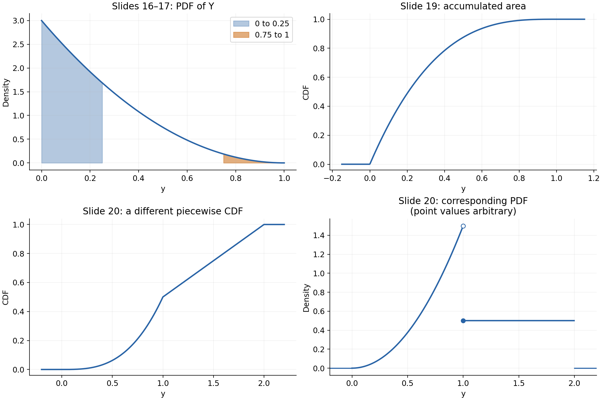
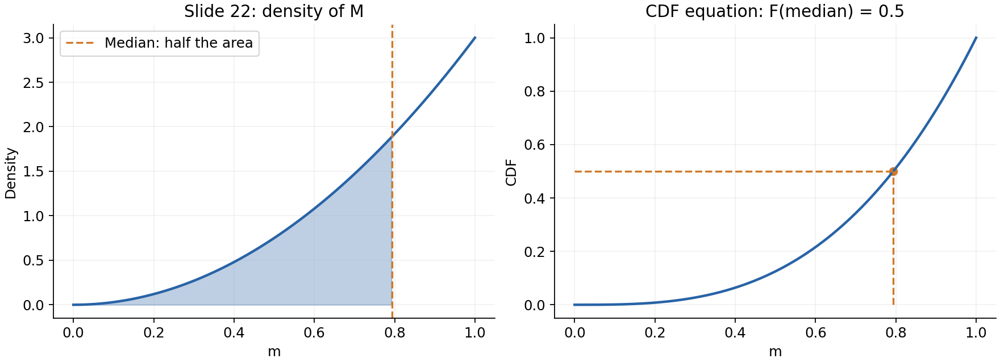
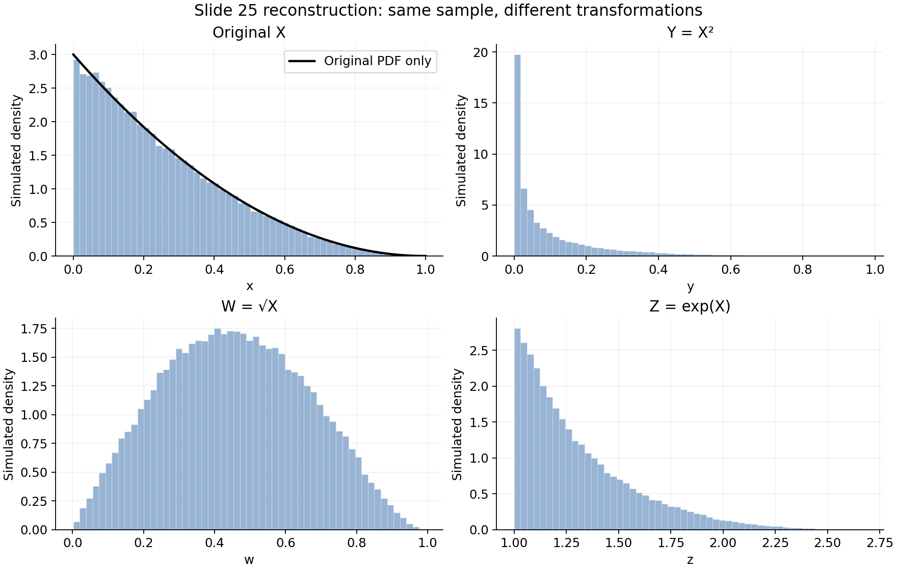
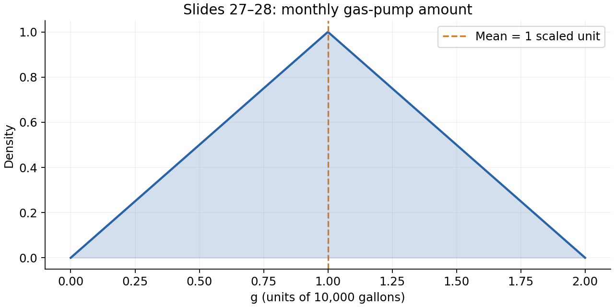

# STA237 Week 7 Study Notes: From Discrete Counts to Continuous Distributions

These notes follow Professor Karen Huynh Wong's annotated Week 7 lecture. Read a concept first, attempt its representative **source question**, and then follow the solution link. The [source-based revision index](Answers-and-Practice.md#revision) provides a second pass through existing questions; no questions have been invented.

## Contents

- [Scope, notation, and method selection](#scope)
- [C-01: Discrete models, support, and stopping rules](#c01)
- [C-02: Discrete expectations, transformations, and probability intervals](#c02)
- [C-03: Continuous variables and probability density](#c03)
- [C-04: Cumulative distribution functions](#c04)
- [C-05: Percentiles, quartiles, and the median](#c05)
- [C-06: Expectations, functions of a variable, and variance](#c06)
- [Problem type index](#pt-index)

## Scope, notation, and method selection

**Primary source:** [Week7-L0401-annotated.pdf](../Week7-L0401-annotated.pdf). Printed slide numbers equal one-based PDF page numbers throughout its 29 pages. The lecture reviews discrete models before introducing continuous densities, CDFs, percentiles, and moments.

**References:** MMSA means the supplied third edition of *Modern Mathematical Statistics with Applications*; PAR means the supplied *Probability* by Wagaman and Dobrow. MMSA §§4.1–4.2 and PAR §§6.1–6.3 are relevant/supporting reading, not verified mandatory reading. Only the specified exercises and necessary shared definitions are imported. No previous generated notes are treated as evidence.

**Classification:** Core means explicitly present in these Week 7 slides, including annotations. Core — Review identifies repeated discrete material. **Supplementary** marks substantive additions absent from the slides, locally where needed. A Basic textbook question can establish a legitimate PT without making its additional model lecture Core. Slide 26 is marked “To finish in Week 8”; its stated definitions and explicit task are included, without claiming they were completed in class.

**Boundaries:** Slide 25 compares transformed distributions but explicitly postpones methods for deriving their densities. We explain why $E[g(X)]$ can be computed from the distribution of $X$; we do not introduce Jacobians, general transformation-density rules, or moment generating functions. Named models appearing only in assigned exercises are identified locally as Supplementary.

**Prerequisite reminders.** An RV $X$ assigns a real number to an experimental outcome. For a discrete distribution, the **support** consists of values where $p_X(x)=P(X=x)>0$. For this week's density models, the slides identify the region where $f_X(x)>0$, often written as an interval with its endpoints included for convenience. Including or omitting isolated boundary points does not change continuous probabilities. A function's **domain** instead describes where its expression is defined. The CDF is always $F_X(x)=P(X\le x)$. A continuous PDF $f_X(x)$ is a density, not the probability of one point. $E(X)$ is the mean, $\operatorname{Var}(X)$ the variance, and $\operatorname{SD}(X)=\sqrt{\operatorname{Var}(X)}$. Set $q=1-p$ when $p$ is a Bernoulli success probability.

| Given structure / requested task | First decision | Method |
| --- | --- | --- |
| Counts over a specified time | What is the interval's mean? | Poisson PMF, CDF, or complement |
| A fixed number of independent trials | What counts as one success? | Binomial |
| Stop at a specified success | Count trials or failures? Any competing stopping rule? | Geometric/NB only if the experiment fits |
| Select a fixed sample from a finite collection | Are objects replaced? | Hypergeometric without replacement; Binomial for independent replacement |
| Continuous density and an event | Where does the event overlap the support? | Integrate density over that overlap |
| CDF given | Which branches contain the endpoints? | CDF differences; differentiate valid branches for the PDF |
| Percentile requested | What cumulative probability should lie to its left? | Solve $F(x_p)=p$ in the appropriate branch |
| A mean, variance, or expected charge/area | What function of the original observation is needed? | Integrate $g(x)f_X(x)$; use the original density |

For integer-valued $N$, $P(N\ge k)=1-F_N(k-1)$. For density models, single-point probabilities vanish, so including an endpoint does not change an interval probability. Do not transfer that continuous shortcut to discrete counts.

## Concept C-01: Discrete models, support, and stopping rules

**Classification:** Core — Review. **Evidence:** slides 3, 7–11.

A distribution is selected from an experiment's structure, not from its story's nouns. Identify what is fixed, what is random, and what ends the experiment.

### Counts in a time interval

If a count has stable rate $\rho$ per hour, its mean over $t$ hours is $\lambda=\rho t$. For $\lambda>0$, a Poisson count $N$ has

$$
P(N=n)=e^{-\lambda}\frac{\lambda^n}{n!},\quad n=0,1,\ldots,
\qquad E(N)=\operatorname{Var}(N)=\lambda.
$$

The count is discrete even though time is continuous. The model assumes appropriate independence of counts in nonoverlapping intervals and a stable rate; a given average alone does not establish these assumptions. For a six-hour window, first express that window in the same units as the supplied rate (slide 9).

### Fixed trials versus waiting

For $n$ independent trials with common success probability $p$, the success count $B$ satisfies

$$
P(B=b)=\binom nb p^bq^{n-b},\quad b=0,\ldots,n;
\qquad E(B)=np,\quad\operatorname{Var}(B)=npq.
$$

Here $\binom nb=n!/[b!(n-b)!]$ counts the success positions. With a first-success stopping rule, the order is already determined: failures followed by one success. If $F$ counts failures and $T=F+1$ counts all trials,

$$
P(F=f)=q^fp,\quad f=0,1,\ldots;
\qquad P(T=t)=q^{t-1}p,\quad t=1,2,\ldots.
$$

For the $r$th success, $F_r$ counts failures and $T_r=F_r+r$ counts trials:

$$
P(F_r=f)=\binom{f+r-1}{r-1}p^rq^f,
\qquad
P(T_r=t)=\binom{t-1}{r-1}p^rq^{t-r}.
$$

For $0<p<1$, the supports are respectively $f=0,1,\ldots$ and $t=r,r+1,\ldots$. The last trial must be a success; only the earlier positions may be rearranged. Assume integer $r\ge1$ and $0<p\le1$; $p=0$ gives no finite success waiting time. At $p=1$, the waiting variables are constants. Slide 8 uses **failures**, whereas the local textbooks usually define geometric/NB variables by **total trials**. Always read the question's definition.

Slide 7's geometric PMF lives on nonnegative integers. Extending the algebraic curve $q^xp$ to real $x$ does not turn those real inputs into possible geometric observations, or turn the expression into a PDF.

### Sampling and competing stops

Without replacement, a finite population of $N\ge1$ objects with $K$ target objects gives the fixed-sample count below. Here $N,K,n$ are integers, $0\le K\le N$, and the sample size satisfies $0\le n\le N$:

$$
P(H=h)=\frac{\binom Kh\binom{N-K}{n-h}}{\binom Nn},\quad
\max(0,n-(N-K))\le h\le\min(n,K).
$$

Each sample is equally likely, and draws are dependent. With replacement and independent draws, the fixed-sample target count is instead Binomial$(n,K/N)$. Slide 10's book question requires checking which mechanism applies; the [source discrepancy](Answers-and-Practice.md#discrepancies) is retained explicitly.

A best-of-seven series stops when **either** team obtains four wins. Its length is between four and seven. A one-team NB waiting time can continue past seven and therefore does not describe the actual experiment by itself. Condition the last game's winner and count only sequences in which that winner has three earlier wins.

### Problem Type PT-01: Poisson Counts in a Specified Interval

**Classification:** Core — Review. **Source basis:** slide 3(a) and slide 9 question 2. Both ask interval-count probabilities after choosing the correct mean.

**Recognition cues.** A count over time has a plausible Poisson model and a specified rate or mean.

**General method.** Define the interval count, scale the mean, translate the event into integer outcomes, then sum PMFs or use a complement/CDF. State the model's assumptions.

**Representative source question — faithful paraphrase.** Slide 9 question 2: Monarch butterflies visit a garden at 12 per day. What is the probability of at least two visits between noon and 6 PM? Use the stable-rate Poisson model discussed in the annotations.

**A complete answer must include.** Time conversion, count and parameter, event and complement, calculation, and interpretation.

**Common mistakes.** Using the full-day mean for a shorter window; subtracting the wrong integer endpoint; treating a rate as proof of the model.

[Worked solution](Answers-and-Practice.md#a01).

### Problem Type PT-02: Fixed-Trial Success Counts

**Classification:** Core — Review. **Source basis:** slide 10 question 3. The task is a fixed count, not a stopping time.

**Recognition cues.** A predetermined number of independent, identical binary trials is performed.

**General method.** Define success, verify the common probability and independence assumption, specify the Binomial count, and use the complement for “at least one.”

**Representative source question — faithful paraphrase.** A scratch card wins something with probability 10%. Model the number of winners in five cards and compute the probability of at least one winner, under the lecture's independent-card model.

**A complete answer must include.** Variable, assumptions, parameters, event, calculation, and check.

**Common mistakes.** Using a waiting model when all five trials are performed; treating equal marginal success rates as sufficient for independence.

[Worked solution](Answers-and-Practice.md#a02).

### Problem Type PT-03: First-Success Waiting and Counting Conventions

**Classification:** Core — Review. **Source basis:** slide 7's PMF/support blanks and slide 10 question 4. These tasks share a first-success stopping rule and require a precise counting convention.

**General method and recognition cues.** For independent replacement trials with fixed $p$, distinguish failures before success from total tries through $T=F+1$. Give the corresponding PMF and support.

**Representative source question — faithful paraphrase.** Slide 10 question 4: A mini-library has four romance novels, two textbooks, three sci-fi novels, and one non-fiction novel. Pick a book, replace it, and repeat until the non-fiction book is selected. What distribution models the number of tries?

**A complete answer must include.** What is counted, the replacement mechanism, success probability, model, support, and relation to the failures convention.

**Common mistakes.** Starting total tries at zero; copying a failures PMF into a trials question; overlooking replacement.

[Worked solution](Answers-and-Practice.md#a03).

### Problem Type PT-04: Finite-Population Sample Counts

**Classification:** Core — Review. **Source basis:** slide 10 question 5 and its explicit without-replacement annotation. This is a fixed sample, unlike question 4's waiting experiment.

**General method and recognition cues.** Identify population and target-category sizes, sample size, and replacement. For sampling without replacement, use the Hypergeometric count and verify the support.

**Representative source question — faithful paraphrase.** Using that ten-book collection, randomly select three books. Model the number of sci-fi books and find the probability that exactly one is sci-fi. Use the annotation's without-replacement interpretation, and flag the typed question's ambiguity.

**A complete answer must include.** Sampling interpretation, parameters, combinatorial numerator and denominator, event, result, and qualification of the ambiguity.

**Common mistakes.** Inheriting replacement from question 4 without checking the new question; choosing three sci-fi books when the event requests one.

[Worked solution](Answers-and-Practice.md#a04).

### Problem Type PT-05: A Best-of-Seven Series with Competing Stops

**Classification:** Core — Review. **Source basis:** slide 9 question 1. Its two-sided stopping rule is materially different from ordinary NB waiting.

**General method.** Let $p$ be the Jays' independent game-win probability. For a specified series length, separate a final Jays win from a final opponent win; each winner has exactly three wins before the final game. Add the disjoint cases.

**Representative source question — faithful paraphrase.** In a best-of-seven series, independent game outcomes have constant Jays win probability $p$. What model describes the number of games played, and what is the probability of exactly five games?

**A complete answer must include.** Correct stopping rule and support, both possible series winners, allowed earlier sequences, probability expression, and a model check.

**Common mistakes.** Allowing the series to continue after either team has won four games; using a single unbounded NB count as the series length.

[Worked solution](Answers-and-Practice.md#a05).

## Concept C-02: Discrete expectations, transformations, and probability intervals

**Classification:** Core. **Evidence:** slides 3–8; discrete features summarized on slide 11.

### Derive moments by turning a sum into a PMF sum

For a real-valued function $g$ of a discrete variable $X$, $E[g(X)]=\sum_x g(x)p_X(x)$ whenever the expectation is finite. Do not replace this by $g(E(X))$ unless a valid property, such as linearity, justifies it. In particular,

$$
E(X^2)=\operatorname{Var}(X)+[E(X)]^2.
$$

The useful strategy in slide 6 is to cancel factors and shift the index until the remaining sum is a known PMF, whose total is one. For $X\sim\operatorname{Pois}(\lambda)$,

$$
\begin{aligned}
E(X)&=\sum_{x=1}^{\infty}x\frac{e^{-\lambda}\lambda^x}{x!}
=\lambda\sum_{x=1}^{\infty}\frac{e^{-\lambda}\lambda^{x-1}}{(x-1)!}\\
&=\lambda\sum_{j=0}^{\infty}\frac{e^{-\lambda}\lambda^j}{j!}=\lambda.
\end{aligned}
$$

The $x=0$ term vanishes; cancelling $x$ from $x!$ leaves $(x-1)!$. For the second moment, cancelling $x(x-1)$ is easier than cancelling $x^2$:

$$
\begin{aligned}
E[X(X-1)]
&=\sum_{x=2}^{\infty}x(x-1)\frac{e^{-\lambda}\lambda^x}{x!}\\
&=\lambda^2\sum_{x=2}^{\infty}\frac{e^{-\lambda}\lambda^{x-2}}{(x-2)!}\\
&=\lambda^2\sum_{j=0}^{\infty}\frac{e^{-\lambda}\lambda^j}{j!}=\lambda^2.
\end{aligned}
$$

Since $X^2=X(X-1)+X$, $E(X^2)=\lambda^2+\lambda$, hence $\operatorname{Var}(X)=\lambda$. This completes the variance route explicitly suggested, but not fully written out, on slide 6.

### Geometric and NB expectations in the failures convention

Slide 8 uses geometric-series reasoning. For $F$ with PMF $pq^f$, let $S=q+2q^2+3q^3+\cdots$. Then

$$
S-qS=q+q^2+q^3+\cdots=\frac{q}{1-q},
\quad S=\frac{q}{(1-q)^2},
\quad E(F)=pS=\frac qp.
$$

Here $0\le q<1$, so the sums converge. The shift removes one copy of every power; this is why subtracting $qS$ simplifies the coefficients. Equivalently, the triangular array in the slide adds the geometric tails $q+q^2+\cdots$.

The failures before the $r$th success split into $r$ independent first-success failure counts. Thus $E(F_r)=rq/p$, and adding the fixed successes gives $E(T_r)=r/p$. The variance features listed on slide 11 are

$$
\operatorname{Var}(F)=\operatorname{Var}(T)=q/p^2,
\qquad\operatorname{Var}(F_r)=\operatorname{Var}(T_r)=rq/p^2.
$$

These equalities do not mean $F_r$ and $T_r$ have the same mean or support. Independence is needed for the simple variance sum; linearity of expectation itself does not require independence.

### Transform an observation before averaging

If revenue is $Y=aR^2-bt$ and $t$ is fixed, a particular count $r$ gives revenue $ar^2-bt$, while

$$
E(Y)=aE(R^2)-bt=a\{\operatorname{Var}(R)+[E(R)]^2\}-bt.
$$

The quadratic transformation acts on the observed count. It does not preserve a Poisson distribution. Also, a discrete count produces discrete revenue values: a displayed revenue range need not contain every real number between its endpoints. This distinction is part of slides 3–4, not a general transformed-density method.

### “At least 75%” can mean a guarantee or an exact-model interval

Chebyshev's inequality gives, for positive, finite variance,

$$
P(|X-\mu|<k\sigma)\ge1-\frac1{k^2},\quad k>1.
$$

Choosing $k=2$ guarantees at least 75% for any such distribution. When a particular PMF is known, the actual coverage can be much higher. Translate real endpoints into included integers before summing.

Slide 5 also uses Poisson quantiles. A discrete $p$-quantile is the smallest integer $q_p$ with $F(q_p)\ge p$; unlike a strictly increasing continuous CDF, it can overshoot $p$. Thus a nominal central-75% pair of quantiles need not enclose exactly 75%. Check coverage using $F(U)-F(L-1)$ for an inclusive integer interval. Chebyshev and quantile calculations answer related but different questions.

### Problem Type PT-06: Derive Poisson Mean and Variance

**Classification:** Core. **Source basis:** slide 6, Example 2, including the factorial-second-moment hint.

**Recognition cues and general method.** A derivation is requested, not numerical substitution. Start from the PMF; cancel factorial factors, shift the summation index, recognize a normalized PMF, and recover variance from $E[X(X-1)]$.

**Representative source question — faithful paraphrase.** Prove that a Poisson variable with mean/rate parameter $\lambda$ has both expectation and variance equal to $\lambda$.

**A complete answer must include.** Relevant sums and their starting indices, cancellation, index change, PMF normalization, conversion to $E(X^2)$, and variance.

**Common mistakes.** Replacing $x^2/x!$ by $1/(x-2)!$; confusing a second moment with variance.

[Worked solution](Answers-and-Practice.md#a06).

### Problem Type PT-07: Derive Failure-Count Waiting Means

**Classification:** Core. **Source basis:** slide 8's explicit geometric and NB expectation tasks.

**Recognition cues and general method.** The variable counts failures before one or $r$ successes. Sum $fpq^f$ using the geometric series, then express the NB failure count as a sum of first-success failure counts.

**Representative source question — faithful paraphrase.** Derive the mean number of failures before the first success and use it to derive the mean number of failures before the $r$th success in independent Bernoulli trials with success probability $p$.

**A complete answer must include.** Counting convention and support, convergence condition, geometric-series steps, decomposition, and the resulting means.

**Common mistakes.** Using a total-trials mean for failures; counting the success itself as another failure; losing a factor of $p$.

[Worked solution](Answers-and-Practice.md#a07).

### Problem Type PT-08: Revenue from a Count and Its Expected Value

**Classification:** Core. **Source basis:** slides 3(b) and 4(c). Both use the source's specified quadratic revenue function; they do not establish general transformation-density tasks.

**General method.** For possible observations, apply the given function to each count. For expected revenue, average the transformed value using the original count distribution, and obtain a second moment through variance plus squared mean.

**Representative source question — faithful paraphrase.** For mechanic repair count $R\sim\operatorname{Pois}(2t)$, with $t$ operating hours and source revenue function $Y=85R^2-60t$, (b) give the revenues corresponding to 18–20 repairs in a ten-hour day; (c) find expected revenue for an eight-hour day. The source's revenue wording is discussed in the appendix.

**A complete answer must include.** Fixed time for each part, transformed count values, the correct second moment, expected amount, and units.

**Common mistakes.** Squaring the mean instead of finding the mean square; using the ten-hour parameter for the eight-hour question.

[Worked solution](Answers-and-Practice.md#a08).

### Problem Type PT-09: Repair-Count Intervals with at Least 75% Coverage

**Classification:** Core. **Source basis:** slides 4(d)–5, including the two R interval calculations.

**General method.** Identify mean and SD, derive a Chebyshev interval, integerize its endpoints, and compute actual coverage from the PMF. Separately explain quantile-based endpoints and their discrete coverage.

**Representative source question — faithful paraphrase.** With $R\sim\operatorname{Pois}(20)$ for a ten-hour day, give an interval of repair counts expected at least 75% of the time. Explain the lecture's Chebyshev and Poisson-quantile intervals.

**A complete answer must include.** Guarantee, real endpoints, included integers, actual coverage, and the distinction between a nominal quantile interval and exact coverage.

**Common mistakes.** Calling the Chebyshev lower bound exact; rounding outward and claiming unchanged coverage; excluding the lower integer endpoint accidentally.

[Worked solution](Answers-and-Practice.md#a09).

## Concept C-03: Continuous variables and probability density

**Classification:** Core. **Evidence:** slides 14–17.

For a continuous measurement, such as mass or elapsed time, probabilities are assigned through **areas over intervals**. In the density models used this week,

$$
f_X(x)\ge0,\qquad \int_{-\infty}^{\infty}f_X(x)\,dx=1,
\qquad P(X\in A)=\int_A f_X(x)\,dx.
$$

Here $A$ is the set of values describing the event; for an interval question it is that interval, or its overlap with the support.

A height is not an area. A density can exceed one; what must equal one is the total area. A single point has zero width, so $P(X=c)=\int_c^c f_X(x)\,dx=0$. This makes strict and inclusive endpoints interchangeable here. It does not make a possible observation impossible; an interval of measurement precision has positive width and may have positive probability.

To evaluate $P(a\le X\le b)$, integrate only the intersection of $[a,b]$ with the support. If the PDF has different branches, split the integral at their breakpoints. State zero density elsewhere. Values assigned to a density at isolated endpoints do not change any probability.

**Normalization** solves an unknown constant by total area one, but nonnegativity must also be checked. A function integrating to one can still fail to be a PDF if it is negative somewhere. If the density is $kh(x)$ on a set $S$, solve $k\int_S h(x)\,dx=1$ and then check the sign on $S$.

*Reconstructed from slides 16–20. The upper PDF shades the two actual intervals from slide 17. The lower pair represents the separate piecewise-CDF example on slide 20. These are two different distributions.*

**Support and the density graph.** Slide 16's $3(y-1)^2$ decreases on $[0,1]$: equally wide intervals near zero contain more area than intervals near one. A graph offers a prediction; the integral verifies it. Mode refers to the tallest part of a density, median to half the area, and mean to the weighted-average balance point; they need not coincide (slide 17 annotations).

### Supplementary: the uniform model used in Basic MMSA #7

The named uniform distribution is not taught explicitly in these slides, but is needed for the specified Basic question. For $X\sim\operatorname{Unif}(a,b)$, $a<b$, equal-length subintervals inside $[a,b]$ have equal probability. Constant height $c$ must satisfy $c(b-a)=1$, so

$$
f_X(x)=\begin{cases}1/(b-a),&a\le x\le b,\\0,&\text{otherwise},\end{cases}
\qquad P(X\in A)=\frac{\operatorname{length}(A\cap[a,b])}{b-a}.
$$

The flat shape, not merely the existence of lower and upper bounds, justifies equal probabilities per unit length. The probability formula follows by integrating a rectangle. Relevant source: MMSA §4.1 and #7; other uniform applications remain labelled in their solutions.

### Problem Type PT-10: Check and Normalize a Density

**Classification:** Core. **Source basis:** slide 16(a), Basic MMSA #5(a), and PAR #6.1(a). They require nonnegativity and unit area, including an unknown scale where present.

**General method.** State the full piecewise density, check its sign on the support, integrate over all nonzero pieces, and determine any scale constant. Verify the resulting integral equals one.

**Representative source question — faithful paraphrase.** MMSA #5(a): A professor finishes between zero and two minutes after the hour. If the elapsed time has PDF $f(x)=kx^2$ for $0\le x\le2$ and zero elsewhere, find $k$.

**A complete answer must include.** Support, sign restriction, normalization integral and antiderivative, constant, and verification.

**Common mistakes.** Integrating over the event from a later subpart instead of the whole support; forgetting to check nonnegativity.

[Worked solution](Answers-and-Practice.md#a10).

### Problem Type PT-11: Compare and Compute Density Areas

**Classification:** Core. **Source basis:** slide 17(b), Basic MMSA #3(b–d), #5(b–d), and PAR #6.1(b). The shared task is to translate an event into an area, not a density height.

**General method.** Sketch or inspect the actual density, translate the event, intersect with the support, split disjoint regions if needed, and evaluate the integral. A point event has zero area.

**Representative source question — faithful paraphrase.** Slide 17: For $f_Y(y)=3(y-1)^2$ on $[0,1]$ and zero elsewhere, predict whether $[0,0.25]$ or $[0.75,1]$ is more likely, and compute both probabilities to check.

**A complete answer must include.** Graph-based prediction, both event integrals, antiderivative and endpoint substitutions, comparison, and probability checks.

**Common mistakes.** Multiplying one endpoint's height by the width as if the density were constant; assuming equal widths imply equal probabilities.

[Worked solution](Answers-and-Practice.md#a11).

### Problem Type PT-12: Uniform Interval Probabilities

**Classification:** Supplementary — not explicitly taught in Week 7 slides. **Source basis:** Basic MMSA #7, specifically (b) and (d) for the representative question. Equal density makes these length-ratio calculations distinct from integrating a varying density.

**General method.** Confirm the uniform assumption, locate the support, determine the event's overlap length, and divide by the entire support length.

**Representative source question — faithful paraphrase.** MMSA #7(b,d): Laboratory preparation time $X$ is uniform from 25 to 35 minutes. Find (b) $P(X>33)$; (d) the probability of a preparation time between $a$ and $a+2$, where $25

## Concept C-04: Cumulative distribution functions

**Classification:** Core. **Evidence:** slides 18–20 and the annotated CDF task on slide 22.

Every real-valued RV has a CDF: $F_X(x)=P(X\le x)$ for every real $x$. The phrase “if it exists” on slide 18 must not be read as saying some RVs have no CDF. This week's continuous density models satisfy

$$
F_X(x)=\int_{-\infty}^{x}f_X(u)\,du.
$$

Here $u$ is the integration variable; $x$ is the moving upper endpoint. As $x$ moves right, accumulated area cannot decrease. Therefore $0\le F_X(x)\le1$, the CDF is nondecreasing, and its limits at minus and plus infinity are zero and one. These density-model CDFs are continuous.

### Build all branches, not just an antiderivative

For a PDF supported on $[a,b]$, the CDF is zero before $a$, accumulates $\int_a^x f_X(u)du$ within the support, and equals one after $b$. With a second density branch, add all the area already accumulated from earlier branches. An arbitrary antiderivative plus an unexplained constant is not a complete CDF.

Conversely, differentiate a given CDF on intervals where its formula is differentiable: $f_X(x)=F_X'(x)$ there. At a corner, a derivative need not exist; choosing a density's value at that isolated point does not affect probabilities. A jump in a general CDF would carry point mass, but the slide 20 example is continuous at its branch joins. We do not turn it into a mixed distribution.

For these continuous models,

$$
P(a<X\le b)=F_X(b)-F_X(a),\qquad P(X>b)=1-F_X(b).
$$

Using the same left endpoint in the subtraction is correct because $P(X=a)=0$. Check each endpoint's CDF branch separately. Outside the support, keep the zero/one branches rather than extending an interior polynomial.

### Problem Type PT-13: PDF–CDF Conversion and CDF Probabilities

**Classification:** Core. **Source basis:** slides 19–20, Basic MMSA #11(a–c,e), and PAR #6.4. These questions combine accumulated area, CDF differences, and differentiation of the appropriate branches.

**General method.** From a PDF, integrate with the correct starting area on every branch; from a CDF, differentiate each interior branch. State outside-support pieces, check joins and limiting values, and use CDF differences for interval events.

**Representative source question — faithful paraphrase.** Slide 19: For $f_Y(y)=3(y-1)^2$ on $[0,1]$ and zero elsewhere, (a) derive the complete CDF, (b) find $P(0.1\le Y\le0.4)$, and (c) compute $P(Y=0.6)$.

**A complete answer must include.** Full CDF branches and boundary checks, the two appropriate CDF evaluations, and reasoning for the point probability.

**Common mistakes.** Dropping the lower-endpoint constant; differentiating a PDF when asked for a CDF; forgetting that a CDF is defined outside the density's support.

[Worked solution](Answers-and-Practice.md#a13).

## Concept C-05: Percentiles, quartiles, and the median

**Classification:** Core. **Evidence:** slides 21–22; discrete quantile contrast on slide 5.

A continuous $p$-quantile $x_p$ locates cumulative probability $p$ to its left:

$$
P(X\le x_p)=p,\qquad F_X(x_p)=p,\quad0<p<1.
$$

Write percentages as probabilities: the 25th percentile uses $p=0.25$. The median uses $p=0.5$; the first and third quartiles are $Q_1=x_{0.25}$ and $Q_3=x_{0.75}$, and the interquartile range is $Q_3-Q_1$. For a continuous, strictly increasing CDF on the relevant support, solving the equation gives a unique answer. Do not assume every CDF has a global ordinary inverse; a flat CDF segment needs a stated quantile convention.

*Slide 22's actual density $3m^2$ is shown with the area to the median shaded; the CDF panel shows the matching cumulative height. The figure illustrates the definition, not a new practice question.*

Before solving a piecewise CDF equation, evaluate the CDF at its breakpoints. This tells you which branch can reach the requested probability. Reject an algebraic root outside that branch. A median divides probability in half; it is not automatically the midpoint of the numerical support, or the mean.

### Problem Type PT-14: Solve a Percentile Equation

**Classification:** Core. **Source basis:** slide 22's median/CDF task and Basic MMSA #11(d). Both specify a cumulative probability and ask for its location.

**General method.** Define the percentile as a probability statement, find or use the complete CDF, choose the relevant branch, solve within its domain, and substitute back. State units.

**Representative source question — faithful paraphrase.** Slide 22: $M$ has PDF $f_M(m)=3m^2$ for $0\le m<1$ and zero otherwise. Derive its complete CDF as requested in the annotation, and use the percentile definition to find its median.

**A complete answer must include.** CDF derivation and branches, the median equation, a supported root, and a cumulative-probability check.

**Common mistakes.** Setting the PDF equal to one half; using the support midpoint without checking area; keeping an unsupported root.

[Worked solution](Answers-and-Practice.md#a14).

## Concept C-06: Expectations, functions of a variable, and variance

**Classification:** Core. **Evidence:** slides 24–28; variance completion is annotated as deferred to Week 8.

### The integral is a weighted average

A small interval near $x$ carries approximate probability $f_X(x)\,dx$. Multiplying that weight by the observation $x$ and accumulating gives

$$
E(X)=\int_{-\infty}^{\infty}x f_X(x)\,dx,
\qquad E[g(X)]=\int_{-\infty}^{\infty}g(x)f_X(x)\,dx,
$$

when the relevant expectation is finite. The second formula averages the value assigned to each original observation. It uses **the density of $X$**, not a guessed density obtained by replacing $x$ with $g(x)$. An integrand $x^2f_X(x)$ computes a mean square; squaring a mean after integration generally gives a different number.

Slide 25 compares $X$, $X^2$, $\sqrt X$, and $e^X$. These are different measurements of the same random outcome, with different ranges and different distributions. Finding one expected value does not determine an entire distribution.

*Reconstructed demonstration: the same seeded sample from the slide's density is transformed three ways. Histograms approximate the respective densities; only the original panel overlays $f_X$. Their shapes are not interchangeable. No transformation-density formula is required to use the expectation rule.*

### Variance and the second-moment shortcut

Variance averages squared distance from the mean $\mu$:

$$
\operatorname{Var}(X)=\int (x-\mu)^2 f_X(x)\,dx
=E(X^2)-[E(X)]^2.
$$

The shortcut follows by expanding the square, integrating term by term, and using $\int f_X=1$ and $\int xf_X=\mu$. The [explicit slide task solution](Answers-and-Practice.md#l12) carries out those steps. Variance cannot be negative; a negative computed value signals an error or excessive rounding. Keep exact expressions until the final step.

### Piecewise integration and units

If the PDF changes at $c$, compute $\int_a^c g(x)f_1(x)dx+\int_c^b g(x)f_2(x)dx$. The function being averaged and the density are separate factors. In the gas-pump question, $G$ is measured in units of 10,000 gallons, so actual gallons are $A=10000G$. Hence

$$
E(A)=10000E(G),\qquad
\operatorname{Var}(A)=10000^2\operatorname{Var}(G),\qquad
\operatorname{SD}(A)=10000\operatorname{SD}(G).
$$

The factor is squared for variance because its definition uses squared deviations. Variance has squared units; SD has the original units. Slide 27's mean is not already a number of gallons until this conversion is made.

*The triangular density in slides 27–28 has two branches. The dashed center locates the mean in units of 10,000 gallons; the axis is not measured in single gallons.*

### Supplementary: improper integrals and finite moments in assigned exercises

MMSA #28 and PAR #6.2/#6.6 require unbounded-support integrals; the lecture's displayed continuous examples have bounded support. For these exercises, interpret $\int_a^{\infty}h(x)dx$ as $\lim_{b\to\infty}\int_a^b h(x)dx$. A density can normalize while a mean or variance diverges. For power tails, $\int_a^{\infty}x^r dx$ converges exactly when $r<-1$; at $r=-1$ its antiderivative is $\log x$ and diverges. These exercise-specific convergence facts are used locally, without adding a new PT. The source references are MMSA #28 and PAR #6.6.

### Supplementary: integration by parts for PAR #6.2, #6.5, and #6.7

These assigned exercises require a calculus technique not taught in the Week 7 slides. Their probability setup still comes from normalization or $E(X)=\int xf_X(x)dx$; integration by parts evaluates the resulting product integral.

The product rule says $d(uv)=u\,dv+v\,du$. Integrate and rearrange to obtain

$$
\int u\,dv=uv-\int v\,du,
\qquad
\int_a^b u(x)v'(x)dx=[u(x)v(x)]_a^b-\int_a^b v(x)u'(x)dx.
$$

Here $u$ is the factor to differentiate, $du=u'(x)dx$, $dv=v'(x)dx$ is the factor to integrate, and $v$ is its antiderivative. Choose them so that the remaining integral is simpler. In these three exercises, differentiating the polynomial factor lowers its degree, while the exponential or cosine factor has a straightforward antiderivative:

| Source calculation | Choose $u$ | Choose $dv$ | Then $du$ | Then $v$ |
| --- | --- | --- | --- | --- |
| PAR #6.2(a): normalization | $x$ | $e^{-x/2}dx$ | $dx$ | $-2e^{-x/2}$ |
| PAR #6.2(b): mean | $x^2$ | $e^{-x/2}dx$ | $2x\,dx$ | $-2e^{-x/2}$ |
| PAR #6.5(c): mean | $x$ | $e^x dx$ | $dx$ | $e^x$ |
| PAR #6.7(c): mean | $x$ | $\cos x\,dx$ | $dx$ | $\sin x$ |

Keep constant density factors outside the integral. Write both the boundary term and the remaining integral, including the minus sign. For an infinite upper endpoint, first use a finite bound $b$ and then take $b\to\infty$; do not treat infinity as an ordinary number to substitute. In #6.2(b), the remaining integral is exactly the normalization integral already evaluated in part (a). The [worked solution](Answers-and-Practice.md#p602) shows this reduction explicitly.

### Problem Type PT-15: Moments and Expected Functions from a Density

**Classification:** Core. **Source basis:** Basic MMSA #18(a–c), PAR #6.1(c), and slides 27–28. They require averaging an observation or function against the original density and calculating variance/SD where requested.

**General method.** Identify the variable, units, density, and function being averaged. Integrate on the support, find $E(X^2)$ when needed, subtract the squared mean for variance, and take a square root for SD. Convert physical units after identifying the actual variable.

**Representative source question — faithful paraphrase.** MMSA #18, using the checkout duration from #1/#11: $X$ is in hours with $f_X(x)=x/2$ on $[0,2]$, zero otherwise. Find (a) $E(X)$; (b) $\operatorname{Var}(X)$ and $\sigma_X$; (c) the expected charge if checkout duration $x$ is charged $h(x)=x^2$.

**A complete answer must include.** Mean and second-moment integrals with limits, antiderivatives, variance, SD, the expected-charge calculation, and correct units.

**Common mistakes.** Using $[E(X)]^2$ for the expected squared charge; integrating $g(x)$ without density; scaling variance like a mean.

[Worked solution](Answers-and-Practice.md#a15).

## Problem type index

| PT | Owner | Representative source | Solution |
| --- | --- | --- | --- |
| PT-01 | C-01 | slide 9 question 2 | [A01](Answers-and-Practice.md#a01) |
| PT-02 | C-01 | slide 10 question 3 | [A02](Answers-and-Practice.md#a02) |
| PT-03 | C-01 | slide 10 question 4 | [A03](Answers-and-Practice.md#a03) |
| PT-04 | C-01 | slide 10 question 5 | [A04](Answers-and-Practice.md#a04) |
| PT-05 | C-01 | slide 9 question 1 | [A05](Answers-and-Practice.md#a05) |
| PT-06 | C-02 | slide 6 | [A06](Answers-and-Practice.md#a06) |
| PT-07 | C-02 | slide 8 | [A07](Answers-and-Practice.md#a07) |
| PT-08 | C-02 | slides 3(b), 4(c) | [A08](Answers-and-Practice.md#a08) |
| PT-09 | C-02 | slides 4(d)–5 | [A09](Answers-and-Practice.md#a09) |
| PT-10 | C-03 | MMSA Basic #5(a) | [A10](Answers-and-Practice.md#a10) |
| PT-11 | C-03 | slide 17(b) | [A11](Answers-and-Practice.md#a11) |
| PT-12 — Supplementary | C-03 | MMSA Basic #7(b,d) | [A12](Answers-and-Practice.md#a12) |
| PT-13 | C-04 | slide 19(a–c) | [A13](Answers-and-Practice.md#a13) |
| PT-14 | C-05 | slide 22 and its annotation | [A14](Answers-and-Practice.md#a14) |
| PT-15 | C-06 | MMSA Basic #18(a–c) | [A15](Answers-and-Practice.md#a15) |

All PTs have actual eligible source evidence. No Medium/Test exercise establishes an additional PT. The [coverage appendix](Answers-and-Practice.md#coverage) identifies every assigned exercise, source discrepancy, and substantive supplement.
