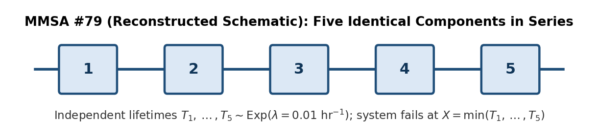

# STA237 Week 8 Answers and Practice

## Contents

- [A. Representative Problem-Type Solutions Index (`PT-01` to `PT-11`)](#a-representative-problem-type-solutions-index-pt-01-to-pt-11)
- [B. Complete Inventory of Week 8 Slide Tasks and Solutions (`SQ-01` to `SQ-12`)](#b-complete-inventory-of-week-8-slide-tasks-and-solutions-sq-01-to-sq-12)
- [C. Requested Textbook Exercises and Solutions (24 Exercises: 10 MMSA + 14 PAR)](#c-requested-textbook-exercises-and-solutions-24-exercises-10-mmsa--14-par)
  - [MMSA Section 4.2 & 4.4 Exercises (10 Exercises)](#mmsa-section-42--44-exercises-10-exercises)
  - [PAR Section 6.5 & 7.2 Exercises (14 Exercises)](#par-section-65--72-exercises-14-exercises)
- [D. Structured Revision Route Using Existing Source Questions](#d-structured-revision-route-using-existing-source-questions)
- [E. Coverage and Unresolved-Items Appendix](#e-coverage-and-unresolved-items-appendix)

> **Single-Canonical-Solution Rule:** Every problem or subpart in this guide has **one canonical worked solution**—in **Section B** for the 12 Week 8 slide tasks (`SQ-01`–`SQ-12`) and in **Section C** for the 24 assigned textbook exercises (`MMSA` and `PAR`). Section A indexes every Problem Type (`PT-01`–`PT-11`), links back to its concept in [Study-Notes.md](Study-Notes.md), states its exact representative source, and links directly to its single canonical solution below.

---

## A. Representative Problem-Type Solutions Index (`PT-01` to `PT-11`)

### Problem Type PT-01: Computing Expected Value, Variance, and Standard Deviation from a Piecewise Continuous PDF (and Functions $g(X)$)

- **Owning concept:** [Concept C-01](Study-Notes.md#concept-c-01-density-cumulative-probability-moments-and-chebyshevs-inequality) (`Core`)
- **Question reference:** [PT-01 in Study-Notes.md](Study-Notes.md#problem-type-pt-01-computing-expected-value-variance-and-standard-deviation-from-a-piecewise-continuous-pdf-and-functions-gx) (Paraphrase of Slide Example 1a–b, `W8/week8-L0401-full.pdf`, PDF pp. 6, 8)
- **Canonical worked solutions:** [`SQ-01` (Example 1a: Mean)](#sq-01-example-1a--gas-station-pump-expected-value) and [`SQ-03` (Example 1b: Variance & SD)](#sq-03-example-1b--gas-station-pump-variance-and-standard-deviation)
- **Summary of result:** $E(G) = 1\text{ }(10{,}000\text{ gal}) = 10{,}000\text{ gal/month}$; $E(G^2) = 7/6\text{ }(10{,}000\text{ gal})^2$; $V(G) = 1/6\text{ }(10{,}000\text{ gal})^2$; $SD(G) = \sqrt{1/6}\text{ }(10{,}000\text{ gal}) \approx 4{,}082.48\text{ gal}$.

### Problem Type PT-02: Deriving a Piecewise CDF and Finding Exact Probability Intervals or Percentiles

- **Owning concept:** [Concept C-01](Study-Notes.md#concept-c-01-density-cumulative-probability-moments-and-chebyshevs-inequality) (`Core`)
- **Question reference:** [PT-02 in Study-Notes.md](Study-Notes.md#problem-type-pt-02-deriving-a-piecewise-cdf-and-finding-exact-probability-intervals-or-percentiles) (Paraphrase of Slide Example 1c CDF & central 80% interval, `W8/week8-L0401-full.pdf`, PDF pp. 9–10)
- **Canonical worked solution:** [`SQ-04` (Parts 1 & 4)](#sq-04-example-1c--handwritten-roadmap--gas-pump-cdf-chebyshev-interval-actual-coverage-and-central-80-interval)
- **Summary of result:** Four-branch piecewise CDF $F(g)$, with exact central 80% interval $[\sqrt{0.2},\, 2-\sqrt{0.2}] \approx [0.4472, 1.5528]\text{ }(10{,}000\text{ gal})$, or $(4{,}472,\, 15{,}528)\text{ gal}$ (rounded on PDF p. 10 to $(4{,}500,\, 15{,}500)\text{ gal}$).

### Problem Type PT-03: Constructing or Evaluating a Chebyshev Probability Bound and Comparing It with Exact Coverage

- **Owning concept:** [Concept C-01](Study-Notes.md#concept-c-01-density-cumulative-probability-moments-and-chebyshevs-inequality) (`Core`)
- **Question reference:** [PT-03 in Study-Notes.md](Study-Notes.md#problem-type-pt-03-constructing-or-evaluating-a-chebyshev-probability-bound-and-comparing-it-with-exact-coverage) (Paraphrase of Slide Example 1c Chebyshev parts, `W8/week8-L0401-full.pdf`, PDF pp. 9–10)
- **Canonical worked solution:** [`SQ-04` (Parts 2 & 3)](#sq-04-example-1c--handwritten-roadmap--gas-pump-cdf-chebyshev-interval-actual-coverage-and-central-80-interval)
- **Summary of result:** Chebyshev $\ge 80\%$ interval ($k = \sqrt{5}$) is $(1 - \sqrt{5/6},\, 1 + \sqrt{5/6}) \approx (0.0871, 1.9129)$, rounded on slide to $(0.09, 1.91)\text{ }(10{,}000\text{ gal})$, whose actual probability under $f(g)$ is $F(1.91) - F(0.09) = 0.9919$ ($99.24\%$ with unrounded endpoints).

### Problem Type PT-04: Modeling with a Continuous Uniform Distribution, Computing Moments of $X$ and $g(X)$, and Finding Exact Event Probabilities by Domain Mapping

- **Owning concept:** [Concept C-02](Study-Notes.md#concept-c-02-the-continuous-uniform-distribution) (`Core`)
- **Question reference:** [PT-04 in Study-Notes.md](Study-Notes.md#problem-type-pt-04-modeling-with-a-continuous-uniform-distribution-computing-moments-of-x-and-gx-and-finding-exact-event-probabilities-by-domain-mapping) (Paraphrase of Slide Test Practice: 30 cm Ruler, parts a–e, `W8/week8-L0401-full.pdf`, PDF p. 13)
- **Canonical worked solution:** [`SQ-06` (Parts a–e)](#sq-06-test-practice--30-cm-ruler-and-cube-surface-area-parts-ae)
- **Summary of result:** $X \sim \text{Unif}(0, 30)$; $E(X)=15\text{ cm}$; $V(X)=75\text{ cm}^2$; $E(A)=1{,}800\text{ cm}^2$; $V(A)=2{,}592{,}000\text{ cm}^4$; Chebyshev bound $-3.05$ (trivial); exact mapped probability $0.2636$.

### Problem Type PT-05: Computing Event Probabilities by Translating Between Poisson Counts and Exponential Waiting Times (with Unit Conversion)

- **Owning concept:** [Concept C-03](Study-Notes.md#concept-c-03-counts-vs-waiting-times--the-exponential-distribution) (`Core`)
- **Question reference:** [PT-05 in Study-Notes.md](Study-Notes.md#problem-type-pt-05-computing-event-probabilities-by-translating-between-poisson-counts-and-exponential-waiting-times-with-unit-conversion) (Paraphrase of Slide Example 2a, `W8/week8-L0401-full.pdf`, PDF p. 20)
- **Canonical worked solution:** [`SQ-09(a)`](#sq-09-example-2--shiba-arrivals-at-the-dog-park-parts-ab)
- **Summary of result:** $P(T \le 6\text{ hr}) = P(S \ge 1) = 1 - e^{-5/4} \approx 0.7135$.

### Problem Type PT-06: Finding an Exponential Parameter ($\theta$ or $\lambda$) from a Specified Event Probability

- **Owning concept:** [Concept C-03](Study-Notes.md#concept-c-03-counts-vs-waiting-times--the-exponential-distribution) (`Core`)
- **Question reference:** [PT-06 in Study-Notes.md](Study-Notes.md#problem-type-pt-06-finding-an-exponential-parameter-theta-or-lambda-from-a-specified-event-probability) (Paraphrase of Slide Try it Yourself! #2, `W8/week8-L0401-full.pdf`, PDF p. 21)
- **Canonical worked solution:** [`SQ-11`](#sq-11-try-it-yourself-2--inverse-exponential-parameter-problem)
- **Summary of result:** $\theta = -\dfrac{1}{\ln(0.95)} \approx 19.4957$ (and rate $\lambda = -\ln(0.95) \approx 0.05129$).

### Problem Type PT-07: Computing Exponential Probabilities in R Using Rate Parameterization (`pexp`)

- **Owning concept & classification:** [Concept C-03](Study-Notes.md#concept-c-03-counts-vs-waiting-times--the-exponential-distribution) (**`Core`** for Exponential CDF probability math; **`Supplementary`** for the R `pexp` command, since the slides show `rexp` and `dexp` rather than `pexp`)
- **Question reference:** [PT-07 in Study-Notes.md](Study-Notes.md#problem-type-pt-07-computing-exponential-probabilities-in-r-using-rate-parameterization-pexp) (Paraphrase of PAR #6.20a–c, printed p. 269, PDF p. 287)
- **Canonical worked solution:** [PAR #6.20](#par-620-basic--section-65-printed-p-269-pdf-p-287)
- **Summary of result:** (a) `pexp(18, rate = 1/20)` $= 0.5934303$; (b) `pexp(23, rate = 1/20) - pexp(15, rate = 1/20)` $= 0.1557298$; (c) `1 - pexp(26, rate = 1/20)` $= 0.2725318$.

### Problem Type PT-08: Evaluating Conditional Waiting-Time Probabilities and Verifying the Memoryless Property

- **Owning concept:** [Concept C-04](Study-Notes.md#concept-c-04-memorylessness-and-model-assumptions) (`Core`)
- **Question reference:** [PT-08 in Study-Notes.md](Study-Notes.md#problem-type-pt-08-evaluating-conditional-waiting-time-probabilities-and-verifying-the-memoryless-property) (Paraphrase of Slide Example 2b, `W8/week8-L0401-full.pdf`, PDF p. 20)
- **Canonical worked solution:** [`SQ-09(b)`](#sq-09-example-2--shiba-arrivals-at-the-dog-park-parts-ab)
- **Summary of result:** $P(T \ge 8 \mid T \ge 3) = P(T \ge 5) = e^{-25/24} \approx 0.3529$.

### Problem Type PT-09: Identifying and Simulating the Distribution of a Sum of Independent, Common-Rate Exponential Waiting Times

- **Owning concept:** [Concept C-05](Study-Notes.md#concept-c-05-several-arrivals-and-the-gamma-distribution) (`Core`)
- **Question reference:** [PT-09 in Study-Notes.md](Study-Notes.md#problem-type-pt-09-identifying-and-simulating-the-distribution-of-a-sum-of-independent-common-rate-exponential-waiting-times) (Paraphrase of Slide Sums of Exponential RVs & Simulation, `W8/week8-L0401-full.pdf`, PDF pp. 23–26)
- **Canonical worked solution:** [`SQ-12`](#sq-12-sums-of-exponential-rvs--elapsed-time-between-1st-and-5th-shiba-arrival--simulation)
- **Summary of result:** $4$ independent interarrival gaps summing to $\text{Gamma}(\text{shape}=4, \text{scale}=0.2\text{ days})$ (equivalently $\text{rate}=5\text{ day}^{-1}$), not Exponential.

### Problem Type PT-10: Computing Gamma Event Probabilities Using the Incomplete Gamma CDF or R (`pgamma`)

- **Owning concept:** [Concept C-05](Study-Notes.md#concept-c-05-several-arrivals-and-the-gamma-distribution) (**`Supplementary`**)
- **Question reference:** [PT-10 in Study-Notes.md](Study-Notes.md#problem-type-pt-10-computing-gamma-event-probabilities-using-the-incomplete-gamma-cdf-or-r-pgamma) (Paraphrase of MMSA #72a–f, printed p. 237, PDF p. 249)
- **Canonical worked solution:** [MMSA #72](#mmsa-72-basic--section-44-printed-p-237-pdf-p-249)
- **Summary of result:** (a–b) $0.238$ ($0.237817$); (c) $0.313$ ($0.313374$); (d–e) $0.653$ ($0.653117$); (f) $0.717$ ($0.716977$).

### Problem Type PT-11: Recovering Gamma Shape and Scale/Rate Parameters from Mean and Variance to Compute Event Probabilities

- **Owning concept:** [Concept C-05](Study-Notes.md#concept-c-05-several-arrivals-and-the-gamma-distribution) (**`Supplementary`**)
- **Question reference:** [PT-11 in Study-Notes.md](Study-Notes.md#problem-type-pt-11-recovering-gamma-shape-and-scalerate-parameters-from-mean-and-variance-to-compute-event-probabilities) (Paraphrase of MMSA #73a–c, printed p. 237, PDF p. 249)
- **Canonical worked solution:** [MMSA #73](#mmsa-73-basic--section-44-printed-p-237-pdf-p-249)
- **Summary of result:** (a) $\alpha = 5, \beta = 4\text{ min}$; (b) $0.715$ ($0.714943$); (c) $0.411$ ($0.411241$).

---

## B. Complete Inventory of Week 8 Slide Tasks and Solutions (`SQ-01` to `SQ-12`)

### SQ-01: Example 1(a) — Gas Station Pump Expected Value

- **Locator:** `W8/week8-L0401-full.pdf`, PDF p. 6 (printed Slide 6)
- **Classification & PT:** `Core` | `PT-01`
- **Problem statement (paraphrase):** A gas station operates a pump that can pump up to $20{,}000$ gallons of gas per month. Let $G$ be the total monthly gas pumped, measured in units of $10{,}000$ gallons, with PDF
  $$f(g) = \begin{cases} g, & 0 < g < 1, \\ 2 - g, & 1 \le g < 2, \\ 0, & \text{otherwise.} \end{cases}$$
  Find the expected number of gallons of gas pumped per month.
- **Setup:** $G$ has support $(0, 2)$ in units of $10{,}000\text{ gal}$. Split $\int_{-\infty}^\infty g f(g)\,dg$ at $0, 1, 2$.
- **Working:**
  $$E(G) = \int_{-\infty}^0 g\cdot 0\,dg + \int_0^1 g \cdot g\,dg + \int_1^2 g(2 - g)\,dg + \int_2^\infty g\cdot 0\,dg$$
  $$= \left[\frac{g^3}{3}\right]_0^1 + \left[g^2 - \frac{g^3}{3}\right]_1^2 = \frac{1}{3} + \left(4 - \frac{8}{3}\right) - \left(1 - \frac{1}{3}\right) = \frac{1}{3} + \frac{4}{3} - \frac{2}{3} = 1.$$
- **Answer:** $E(G) = 1\text{ }(10{,}000\text{ gallons})$, i.e., **$10{,}000$ gallons per month** on average.
- **Check:** The PDF $f(g)$ is symmetric around $g = 1$ (since $f(1 - u) = 1 - u = f(1 + u)$ for $0 \le u \le 1$), so the mean must equal the symmetry center $1$.

### SQ-02: Variance Shortcut Derivation

- **Locator:** `W8/week8-L0401-full.pdf`, PDF p. 7 (printed Slide 7, prompt: *"The derivation for this is the same in both the continuous and discrete case. Try to show it again on your own!"*)
- **Classification & PT:** `Core` | `PT-01`
- **Problem statement (paraphrase):** Starting from the definition $V(X) = E[(X - \mu)^2]$ for a continuous random variable $X$ with PDF $f(x)$ and finite mean $\mu = E(X)$ (and finite $E(X^2)$), derive the computational formula $V(X) = E(X^2) - [E(X)]^2$.
- **Working:**
  $$V(X) = \int_{-\infty}^{\infty} (x - \mu)^2 f(x)\,dx = \int_{-\infty}^{\infty} (x^2 - 2\mu x + \mu^2) f(x)\,dx$$
  $$= \int_{-\infty}^{\infty} x^2 f(x)\,dx - 2\mu \int_{-\infty}^{\infty} x f(x)\,dx + \mu^2 \int_{-\infty}^{\infty} f(x)\,dx.$$
  Using $\int_{-\infty}^\infty x^2 f(x)\,dx = E(X^2)$, $\int_{-\infty}^\infty x f(x)\,dx = E(X) = \mu$, and $\int_{-\infty}^\infty f(x)\,dx = 1$:
  $$V(X) = E(X^2) - 2\mu(\mu) + \mu^2(1) = E(X^2) - \mu^2 = E(X^2) - [E(X)]^2.$$
- **Answer:** $V(X) = E(X^2) - [E(X)]^2$.
- **Check:** For a constant random variable $X = c$, $E(X^2) = c^2$ and $[E(X)]^2 = c^2$, yielding $V(c) = 0$ as required.

### SQ-03: Example 1(b) — Gas Station Pump Variance and Standard Deviation

- **Locator:** `W8/week8-L0401-full.pdf`, PDF p. 8 (printed Slide 8)
- **Classification & PT:** `Core` | `PT-01`
- **Problem statement (paraphrase):** Using the gas station pump PDF from Example 1 (with $G$ measured in $10{,}000$ gallons), find the variance in the number of gallons of gas pumped per month, and interpret the spread using the standard deviation.
- **Setup:** Use $V(G) = E(G^2) - [E(G)]^2$ with $E(G) = 1$ from [`SQ-01`](#sq-01-example-1a--gas-station-pump-expected-value).
- **Working:**
  $$E(G^2) = \int_{-\infty}^{\infty} g^2 f(g)\,dg = \int_0^1 g^2(g)\,dg + \int_1^2 g^2(2 - g)\,dg = \int_0^1 g^3\,dg + \int_1^2 (2g^2 - g^3)\,dg$$
  $$= \left[\frac{g^4}{4}\right]_0^1 + \left[\frac{2}{3}g^3 - \frac{1}{4}g^4\right]_1^2 = \frac{1}{4} + \left(\frac{16}{3} - \frac{16}{4}\right) - \left(\frac{2}{3} - \frac{1}{4}\right) = \frac{14}{3} - \frac{14}{4} = \frac{14}{3} - \frac{7}{2} = \frac{7}{6}.$$
  Therefore:
  $$V(G) = E(G^2) - [E(G)]^2 = \frac{7}{6} - 1^2 = \frac{1}{6}\ (10{,}000\text{ gal})^2 = \frac{10^8}{6}\ \text{gal}^2 \approx 16{,}666{,}666.67\ \text{gal}^2.$$
  Taking the square root gives the standard deviation:
  $$SD(G) = \sqrt{\frac{1}{6}} \approx 0.408248\ (10{,}000\text{ gal}) \approx 4{,}082.48\text{ gallons}.$$
- **Answer:** $V(G) = \frac{1}{6}\ (10{,}000\text{ gal})^2$ ($= 16{,}666{,}666.67\text{ gal}^2$); $SD(G) = \sqrt{1/6}\ (10{,}000\text{ gal}) \approx 4{,}082\text{ gal}$. A typical month's sales vary by about $4{,}082$ gallons around the mean of $10{,}000$ gallons.
- **Check:** Shifting $Y = G - 1$ gives symmetric triangular PDF $1 - |y|$ on $(-1, 1)$, so $V(G) = E(Y^2) = 2\int_0^1 y^2(1 - y)\,dy = 2\left(\frac{1}{3} - \frac{1}{4}\right) = \frac{1}{6}$.

### SQ-04: Example 1(c) & Handwritten Roadmap — Gas Pump CDF, Chebyshev Interval, Actual Coverage, and Central 80% Interval

- **Locator:** `W8/week8-L0401-full.pdf`, PDF pp. 9–10 (printed Slide 9 + inserted unnumbered handwritten page)
- **Classification & PT:** `Core` | `PT-02`, `PT-03`
- **Problem statement (paraphrase):** For the gas station pump distribution in Example 1:
  1. Derive the full piecewise CDF $F(g)$ for all $g \in \mathbb{R}$.
  2. Use Chebyshev's inequality to construct an interval guaranteeing at least $80\%$ probability.
  3. Compute the actual probability of that Chebyshev interval under the PDF/CDF of $G$.
  4. Use the CDF $F(g)$ to find the exact central (narrowest symmetric) interval of monthly gas pumped $80\%$ of the time, and compare all three quantities.
- **Setup:** $f(g)$ has support $(0, 2)$ with breakpoint at $g = 1$; $\mu = 1$ and $\sigma = \sqrt{1/6}$ in $10{,}000$-gallon units.
- **Working:**
  1. **Piecewise CDF $F(g) = \int_{-\infty}^g f(x)\,dx$:**
     - If $g < 0$: $F(g) = \int_{-\infty}^g 0\,dx = 0$.
     - If $0 \le g < 1$: $F(g) = \int_0^g x\,dx = \left[\frac{x^2}{2}\right]_0^g = \frac{1}{2}g^2$.
     - If $1 \le g < 2$:
       $$F(g) = \int_0^1 x\,dx + \int_1^g (2 - x)\,dx = \frac{1}{2} + \left[2x - \frac{x^2}{2}\right]_1^g = \frac{1}{2} + 2g - \frac{1}{2}g^2 - 2 + \frac{1}{2} = -\frac{1}{2}(g^2 - 4g + 2) = 1 - \frac{(2-g)^2}{2}.$$
     - If $g \ge 2$: $F(g) = \int_0^1 x\,dx + \int_1^2 (2-x)\,dx = 1$.
     Thus:
     $$F(g) = \begin{cases} 0, & g < 0, \\ \frac{1}{2}g^2, & 0 \le g < 1, \\ -\frac{1}{2}(g^2 - 4g + 2), & 1 \le g < 2, \\ 1, & g \ge 2. \end{cases}$$
  2. **Chebyshev interval guaranteeing at least $80\%$ probability:**
     Set $1 - \frac{1}{k^2} = 0.80 \implies \frac{1}{k^2} = 0.20 \implies k^2 = 5 \implies k = \sqrt{5} \approx 2.236068$.
     With $\mu = 1$ and $\sigma = \sqrt{1/6}$:
     $$\left(\mu - k\sigma,\, \mu + k\sigma\right) = \left(1 - \sqrt{\frac{5}{6}},\, 1 + \sqrt{\frac{5}{6}}\right) \approx (0.087129,\, 1.912871) \quad (\text{slide rounds to } (0.09, 1.91)).$$
     In gallons: $(871,\, 19{,}129)\text{ gal}$ (or $(900,\, 19{,}100)\text{ gal}$ from $(0.09, 1.91)$).
  3. **Actual probability of the Chebyshev interval under $f(g)$:**
     Using the rounded endpoints $(0.09, 1.91)$ shown on PDF pp. 9–10:
     $$P(0.09 < G < 1.91) = F(1.91) - F(0.09) = -\frac{1}{2}(1.91^2 - 4(1.91) + 2) - \frac{1}{2}(0.09^2) = 0.99595 - 0.00405 = 0.9919.$$
     *(Using unrounded exact endpoints $1 \pm \sqrt{5/6}$ gives $1 - (1 - \sqrt{5/6})^2 = 0.992409$.)*
  4. **Exact central $80\%$ interval (10th and 90th percentiles, PDF p. 10):**
     Because $f(g)$ is symmetric and unimodal around $g = 1$, the narrowest interval containing $80\%$ probability leaves $10\%$ in each tail:
     - **10th percentile $g_{0.10}$** (lies in $[0, 1)$ since $F(1) = 0.5$):
       $$\frac{1}{2}g_{0.10}^2 = 0.10 \implies g_{0.10}^2 = 0.20 \implies g_{0.10} = \sqrt{0.2} \approx 0.447214\ (\text{slide: } 0.45).$$
     - **90th percentile $g_{0.90}$** (lies in $[1, 2)$ since $F(1) = 0.5 < 0.90 < 1$):
       $$-\frac{1}{2}(g_{0.90}^2 - 4g_{0.90} + 2) = 0.90 \implies g_{0.90}^2 - 4g_{0.90} + 3.8 = 0.$$
       By the quadratic formula, $g_{0.90} = \frac{4 \pm \sqrt{16 - 15.2}}{2} = 2 \pm \sqrt{0.2}$. Discarding $2 + \sqrt{0.2} \approx 2.4472 > 2$ leaves $g_{0.90} = 2 - \sqrt{0.2} \approx 1.552786$ (slide: $1.55$).
     Exact central $80\%$ interval: $(\sqrt{0.2},\, 2 - \sqrt{0.2}) \approx (0.4472, 1.5528)$, i.e., **$(4{,}472,\, 15{,}528)$ gallons** (slide writes $(4{,}500,\, 15{,}500)\text{ gal}$).
- **Answer:** See piecewise $F(g)$ above; Chebyshev $\ge 80\%$ interval is $(0.0871, 1.9129)$ [$(0.09, 1.91)$ on slide], which actually captures **$99.19\%$** ($99.24\%$ unrounded); the exact central $80\%$ interval is **$(0.4472, 1.5528)$**, i.e. $(4{,}472,\, 15{,}528)\text{ gal}$ (slide: $(4{,}500,\, 15{,}500)\text{ gal}$).
- **Check:** $F(1^-) = 0.5 = F(1^+)$, $F'(g) = f(g)$ on $(0,1)$ and $(1,2)$, and by symmetry $g_{0.10} + g_{0.90} = \sqrt{0.2} + (2 - \sqrt{0.2}) = 2$ (centered at $1$).

### SQ-05: Uniform Distribution Moments Derivation ("Finish it!")

- **Locator:** `W8/week8-L0401-full.pdf`, PDF p. 12 (printed Slide 11)
- **Classification & PT:** `Core` | `PT-04`
- **Problem statement (paraphrase):** Let $X \sim \text{Unif}[a, b]$ ($a < b$) with PDF $f(x) = \frac{1}{b - a}$ for $a \le x \le b$ and $0$ otherwise. Verify the PDF integrates to $1$ and derive $E(X)$, $E(X^2)$, and $V(X)$.
- **Working:**
  - **Normalization:** $\int_a^b \frac{1}{b-a}\,dx = \frac{b-a}{b-a} = 1$.
  - **Mean:**
    $$E(X) = \int_a^b x \cdot \frac{1}{b - a}\,dx = \frac{1}{b - a}\left[\frac{x^2}{2}\right]_a^b = \frac{b^2 - a^2}{2(b - a)} = \frac{(b - a)(b + a)}{2(b - a)} = \frac{a + b}{2}.$$
  - **Second moment:**
    $$E(X^2) = \int_a^b x^2 \cdot \frac{1}{b - a}\,dx = \frac{1}{b - a}\left[\frac{x^3}{3}\right]_a^b = \frac{b^3 - a^3}{3(b - a)} = \frac{(b - a)(b^2 + ab + a^2)}{3(b - a)} = \frac{b^2 + ab + a^2}{3}.$$
  - **Variance:**
    $$V(X) = E(X^2) - [E(X)]^2 = \frac{b^2 + ab + a^2}{3} - \frac{a^2 + 2ab + b^2}{4} = \frac{4b^2 + 4ab + 4a^2 - 3a^2 - 6ab - 3b^2}{12} = \frac{b^2 - 2ab + a^2}{12} = \frac{(b - a)^2}{12}.$$
- **Answer:** $E(X) = \dfrac{a+b}{2}$ and $V(X) = \dfrac{(b-a)^2}{12}$.
- **Check:** Specializing to $[0, 1]$ gives $E(X) = 1/2$, $E(X^2) = 1/3$, and $V(X) = 1/3 - 1/4 = 1/12$.

### SQ-06: Test Practice — 30 cm Ruler and Cube Surface Area (parts a–e)

- **Locator:** `W8/week8-L0401-full.pdf`, PDF p. 13 (printed Slide 12)
- **Classification & PT:** `Core` | `PT-04`, `PT-01`, `PT-03`
- **Problem statement (paraphrase):** Consider selecting a measurement at random from a $30\text{ cm}$ ruler, meaning you are equally likely to select any number in any $1\text{ cm}$ interval.
  - (a) Sketch a reasonable density function modeling how a measurement is generated and find its PDF.
  - (b) Intuitively the average measurement should be $15\text{ cm}$; show this with your PDF in (a).
  - (c) Find the variance in measurements that are randomly selected.
  - (d) Suppose the measurement represents the side length of a cube. Find the average and variance of the random surface area that arises from this selection.
  - (e) According to Chebyshev's inequality, what are the chances of ending up with a cube with surface area between $1000\text{ cm}^2$ and $2600\text{ cm}^2$? Find this probability using another method without Chebyshev's inequality.
- **Setup:** Let $X$ be the random ruler measurement in $\text{cm}$. Equal probability on equal-width intervals on $[0, 30]$ gives $X \sim \text{Unif}(0, 30)$. Let $A = 6X^2$ be the surface area of the cube in $\text{cm}^2$.
- **Working:**
  - **(a)** $f(x) = \begin{cases} \dfrac{1}{30}, & 0 \le x \le 30, \\ 0, & \text{otherwise.} \end{cases}$ The density graph is a flat rectangle of height $1/30\text{ cm}^{-1}$ over $[0, 30]\text{ cm}$ (shown in [Figure 2](Study-Notes.md#concept-c-02-the-continuous-uniform-distribution)).
  - **(b)** $E(X) = \int_0^{30} x \cdot \frac{1}{30}\,dx = \frac{1}{30}\left[\frac{x^2}{2}\right]_0^{30} = \frac{900}{60} = 15\text{ cm}$.
  - **(c)** $E(X^2) = \int_0^{30} x^2 \cdot \frac{1}{30}\,dx = \frac{30^3}{3(30)} = 300\text{ cm}^2$, so $V(X) = 300 - 15^2 = 75\text{ cm}^2$ (matching $\frac{(30-0)^2}{12} = 75\text{ cm}^2$).
  - **(d)** With $A = 6X^2$ ($\text{cm}^2$):
    $$E(A) = E(6X^2) = 6E(X^2) = 6[V(X) + E(X)^2] = 6(75 + 225) = 6(300) = 1{,}800\text{ cm}^2.$$
    For $V(A) = V(6X^2) = 36\,V(X^2) = 36\big[E(X^4) - [E(X^2)]^2\big]$, compute:
    $$E(X^4) = \int_0^{30} x^4 \cdot \frac{1}{30}\,dx = \frac{1}{30}\left[\frac{x^5}{5}\right]_0^{30} = \frac{30^4}{5} = \frac{810{,}000}{5} = 162{,}000\text{ cm}^4.$$
    Hence:
    $$V(A) = 36\left(162{,}000 - 300^2\right) = 36(162{,}000 - 90{,}000) = 36(72{,}000) = 2{,}592{,}000\text{ cm}^4,$$
    and $SD(A) = \sqrt{2{,}592{,}000} = 720\sqrt{5} \approx 1{,}609.969\text{ cm}^2$ (slide writes $SD(A) = 1610$).
    *(Annotation note on PDF p. 13: the middle line writes $V(A) = \frac{30^4}{5} - 300^2$, temporarily omitting the $36\times$ outside factor written one line earlier, before correctly restoring $\times 36$ to reach $2{,}592{,}000$.)*
  - **(e)** Note that $[1000, 2600]$ is symmetric around $\mu_A = 1{,}800$ with half-width $800\text{ cm}^2$.
    - **Chebyshev's inequality:** $k = \frac{800}{SD(A)} = \frac{800}{720\sqrt{5}} = \frac{10}{9\sqrt{5}} \approx 0.496904$ (using rounded $1610$: $800/1610 \approx 0.49689$). Thus:
      $$P(1000 \le A \le 2600) = P(|A - 1800| \le 800) \ge 1 - \frac{1}{k^2} = 1 - \frac{405}{100} = -3.05.$$
      Because $k < 1$, Chebyshev yields a negative lower bound, which gives no useful information beyond $P \ge 0$.
    - **Exact probability via preimage mapping back to $X$:** Since $X > 0$, $A = 6X^2$ is strictly increasing on $[0, 30]$:
      $$P(1000 \le A \le 2600) = P(1000 \le 6X^2 \le 2600) = P\!\left(\sqrt{\frac{1000}{6}} \le X \le \sqrt{\frac{2600}{6}}\right)$$
      $$= \frac{\sqrt{2600/6} - \sqrt{1000/6}}{30} \approx \frac{20.816660 - 12.909944}{30} \approx 0.263557.$$
- **Answer:** (a) $f(x)=1/30$ on $[0, 30]$; (b) $E(X)=15\text{ cm}$; (c) $V(X)=75\text{ cm}^2$; (d) $E(A)=1{,}800\text{ cm}^2$, $V(A)=2{,}592{,}000\text{ cm}^4$; (e) Chebyshev bound $\ge -3.05$ (uninformative), exact probability $= \frac{\sqrt{2600/6}-\sqrt{1000/6}}{30} \approx 0.2636$.
- **Check:** Both mapped side lengths $12.91\text{ cm}$ and $20.82\text{ cm}$ lie inside $[0, 30]\text{ cm}$, and $0.2636 \ge -3.05$ holds trivially.

### SQ-07: Shiba Waiting-Time Distribution Derivation from Poisson Counts

- **Locator:** `W8/week8-L0401-full.pdf`, PDF p. 16 (printed Slide 15)
- **Classification & PT:** `Core` | `PT-05`
- **Problem statement (paraphrase):** Suppose the number of Shiba arrivals per day at a local dog park follows a Poisson distribution with mean rate $\lambda$ per day. Find the probability that at most $t$ days pass before the next Shiba arrives ($t \ge 0$), and derive the CDF and PDF of this waiting time $T$.
- **Setup:** Let $S$ (or $N(t)$) be the discrete number of Shiba arrivals in $(0, t]$ days, so $S \sim \text{Pois}(\lambda t)$. Let $T$ be the continuous waiting time (in days) until the next Shiba arrives ($t \ge 0$).
- **Working:**
  The event *"at most $t$ days pass before the next Shiba arrives"* ($\{T \le t\}$) occurs if and only if *"at least one Shiba arrives during the $t$-day interval"* ($\{S \ge 1\}$):
  $$F_T(t) = P(T \le t) = P(S \ge 1) = 1 - P(S = 0) = 1 - \frac{e^{-\lambda t}(\lambda t)^0}{0!} = 1 - e^{-\lambda t} \qquad (t \ge 0).$$
  For $t < 0$, $F_T(t) = 0$. Differentiating with respect to $t$ for $t > 0$ gives the PDF:
  $$f_T(t) = F_T'(t) = \begin{cases} \lambda e^{-\lambda t}, & t \ge 0, \\ 0, & \text{otherwise.} \end{cases}$$
- **Answer:** $P(T \le t) = 1 - e^{-\lambda t}$ for $t \ge 0$ ($0$ otherwise), and $f_T(t) = \lambda e^{-\lambda t}$ for $t \ge 0$ ($0$ otherwise), which is the $\text{Exp}(\lambda)$ distribution.
- **Check:** $F_T(0) = 0$, $\lim_{t\to\infty} F_T(t) = 1$, and $\int_0^\infty \lambda e^{-\lambda t}\,dt = 1$.

### SQ-08: Memoryless Property Derivation for Exponential and Geometric RVs

- **Locator:** `W8/week8-L0401-full.pdf`, PDF p. 19 (printed Slide 18, including handwritten star task: *"$\star\text{ Geo}(p)\text{ is also memoryless! Show this!}$"*)
- **Classification & PT:** `Core` | `PT-08`
- **Problem statement (paraphrase):**
  - (a) Given an exponential random variable $X$ with mean parameter $\theta > 0$ (PDF $f(x) = \frac{1}{\theta}e^{-x/\theta}$ for $x \ge 0$), derive the CDF $F_X(x)$ and use it to show $X$ is memoryless: $P(X > j + k \mid X \ge j) = P(X > k)$ for $j, k > 0$.
  - (b) Show that the discrete Geometric distribution $\text{Geo}(p)$ is also memoryless.
- **Working:**
  - **(a) Exponential:** For $x \ge 0$, $F_X(x) = \int_0^x \frac{1}{\theta}e^{-y/\theta}\,dy = 1 - e^{-x/\theta}$ (and $0$ for $x < 0$). Thus $P(X > x) = 1 - F_X(x) = e^{-x/\theta}$, and by continuity $P(X \ge j) = P(X > j) = e^{-j/\theta}$. Since $j, k > 0$, $\{X > j + k\} \subseteq \{X \ge j\}$, so their intersection is $\{X > j + k\}$:
    $$P(X > j + k \mid X \ge j) = \frac{P(X > j + k \cap X \ge j)}{P(X \ge j)} = \frac{P(X > j + k)}{P(X \ge j)} = \frac{e^{-(j+k)/\theta}}{e^{-j/\theta}} = e^{-k/\theta} = P(X > k).$$
  - **(b) Geometric (discrete analogy):** Let $X \sim \text{Geo}(p)$ denote the number of failed independent $\text{Bernoulli}(p)$ trials before the first success ($P(X = x) = (1 - p)^x p$ for $x = 0, 1, 2, \dots$, $0 < p < 1$). For any non-negative integer $m$, *"at least $m$ failures before the first success"* means the first $m$ trials all fail, so $P(X \ge m) = \sum_{x=m}^\infty (1 - p)^x p = (1 - p)^m$. For integers $j, k \ge 0$, $\{X \ge j + k\} \subseteq \{X \ge j\}$, hence:
    $$P(X \ge j + k \mid X \ge j) = \frac{P(X \ge j + k)}{P(X \ge j)} = \frac{(1 - p)^{j + k}}{(1 - p)^j} = (1 - p)^k = P(X \ge k).$$
    *(Note on strict-inequality notation: if one defines $Y = X + 1 \in \{1, 2, \dots\}$ as the total number of trials up to and including the first success, then $P(Y > m) = (1 - p)^m$ and the exact same calculation gives $P(Y > j + k \mid Y > j) = P(Y > k)$. In both parameterizations, surviving $j$ failures resets the remaining distribution to a fresh Geometric distribution.)*
- **Answer:** Proved for both $\text{Exp}(\theta)$ and $\text{Geo}(p)$.
- **Check:** At $j = 0$, both identities trivially reduce to $P(X > k) = P(X > k)$ (and $P(X \ge k) = P(X \ge k)$).

### SQ-09: Example 2 — Shiba Arrivals at the Dog Park (parts a–b)

- **Locator:** `W8/week8-L0401-full.pdf`, PDF p. 20 (printed Slide 19)
- **Classification & PT:** `Core` | `PT-05`, `PT-08`
- **Problem statement (paraphrase):** Suppose Shiba arrivals at a dog park follow a Poisson distribution with an average of $5$ arrivals per day.
  - (a) A Shiba just arrived at the dog park. What is the probability that another one will arrive within the next $6$ hours?
  - (b) It has been $3$ hours since you last saw a Shiba at the dog park. What is the probability you will have to wait at least $5$ more hours before a Shiba shows up?
- **Setup:** Mean rate is $\lambda = 5\text{ day}^{-1} = \frac{5}{24}\text{ hr}^{-1}$, so mean interarrival time is $\theta = \frac{1}{\lambda} = \frac{24}{5} = 4.8\text{ hr}$. Let $T$ be the waiting time (in hours) until the next Shiba arrival, so $T \sim \text{Exp}(\lambda = 5/24\text{ hr}^{-1})$.
- **Working:**
  - **(a) Two equivalent methods shown on PDF p. 20:**
    - *Poisson count method:* Let $S$ be the number of arrivals in $6$ hours ($6/24 = 1/4$ day). Then $S \sim \text{Pois}(\mu = 5 \times \frac{1}{4} = \frac{5}{4})$:
      $$P(S \ge 1) = 1 - P(S = 0) = 1 - \frac{e^{-5/4}(5/4)^0}{0!} = 1 - e^{-5/4} \approx 0.713495.$$
    - *Exponential waiting-time method:* $P(T \le 6) = F_T(6) = 1 - e^{-(5/24)(6)} = 1 - e^{-5/4} \approx 0.713495$.
  - **(b) Memorylessness:** Elapsed time is $j = 3\text{ hr}$ and additional wait is $k = 5\text{ hr}$ (total clock wait $\ge 8\text{ hr}$):
    $$P(T \ge 8 \mid T \ge 3) = P(T \ge 5) = e^{-\lambda(5)} = e^{-(5/24)(5)} = e^{-25/24} \approx 0.352866.$$
- **Answer:** (a) $1 - e^{-5/4} \approx 0.7135$; (b) $e^{-25/24} \approx 0.3529$.
- **Check:** Both methods in (a) give the identical exact value $1 - e^{-1.25}$; in (b), $5\text{ hr}$ is slightly more than the mean $\theta = 4.8\text{ hr}$, so $e^{-25/24} \approx 0.353$ is slightly less than $e^{-1} \approx 0.368$.

### SQ-10: Try it Yourself! #1 — Bank Teller Service Times (parts a–c)

- **Locator:** `W8/week8-L0401-full.pdf`, PDF p. 21 (printed Slide 20)
- **Classification & PT:** `Core` | `PT-05`
- **Problem statement (paraphrase):** Suppose the number of clients that visit a bank teller is Poisson distributed with an average of $5$ per hour. Under the explicit handwritten assumption *"Assume time b/w clients = time spent w/ client"*:
  - (a) What is the probability that someone will spend less than $5$ minutes with the teller?
  - (b) What is the probability someone will spend between $5$ and $10$ minutes with the teller?
  - (c) What is the probability someone will spend at least $3$ minutes with the teller?
- **Setup:** State the explicit assumption from PDF p. 21: a Poisson arrival count only models interarrival gaps, so we **assume** each client's service duration $T$ (in **minutes**) equals the interarrival time between clients. Convert $\lambda = 5\text{ clients/hour} = \frac{5}{60} = \frac{1}{12}\text{ clients/min}$, so $\theta = 12\text{ min/client}$ and $T \sim \text{Exp}(\lambda = 1/12\text{ min}^{-1})$.
- **Working:**
  - **(a)** $P(T < 5) = \int_0^5 \frac{1}{12}e^{-t/12}\,dt = F_T(5) = 1 - e^{-5/12} \approx 0.340759$.
  - **(b)** $P(5 < T < 10) = \int_5^{10} \frac{1}{12}e^{-t/12}\,dt = F_T(10) - F_T(5) = e^{-5/12} - e^{-10/12} \approx 0.659241 - 0.434598 = 0.224642$.
  - **(c)** $P(T \ge 3) = \int_3^\infty \frac{1}{12}e^{-t/12}\,dt = 1 - \int_0^3 \frac{1}{12}e^{-t/12}\,dt = e^{-3/12} = e^{-1/4} \approx 0.778801$.
- **Answer:** (a) $1 - e^{-5/12} \approx 0.3408$; (b) $e^{-5/12} - e^{-5/6} \approx 0.2246$; (c) $e^{-1/4} \approx 0.7788$.
- **Check:** Notice $P(T < 5) + P(5 < T < 10) = 1 - e^{-10/12} = P(T < 10) \approx 0.5654$.

### SQ-11: Try it Yourself! #2 — Inverse Exponential Parameter Problem

- **Locator:** `W8/week8-L0401-full.pdf`, PDF p. 21 (printed Slide 20, marked with a blue star)
- **Classification & PT:** `Core` | `PT-06` Representative
- **Problem statement (paraphrase):** Suppose $Y$ is an exponential random variable and $P(Y < 1) = 0.05$. What is the mean parameter $\theta$?
- **Setup:** Let $Y \sim \text{Exp}(\theta)$ with CDF $F_Y(y) = 1 - e^{-y/\theta}$ for $y \ge 0$.
- **Working:**
  $$P(Y < 1) = P(Y \le 1) = 1 - e^{-1/\theta} = 0.05 \implies e^{-1/\theta} = 0.95.$$
  Taking the natural logarithm on both sides:
  $$-\frac{1}{\theta} = \ln(0.95) \implies \theta = -\frac{1}{\ln(0.95)} \approx \frac{1}{0.05129329} \approx 19.495726.$$
  *(Equivalently, the rate parameter is $\lambda = 1/\theta = -\ln(0.95) \approx 0.051293$.)*
- **Answer:** $\theta = -\dfrac{1}{\ln(0.95)} \approx 19.4957$.
- **Check:** Substituting back gives $1 - e^{-1/19.495726} = 1 - 0.95 = 0.05$.

### SQ-12: Sums of Exponential RVs — Elapsed Time Between 1st and 5th Shiba Arrival & Simulation

- **Locator:** `W8/week8-L0401-full.pdf`, PDF pp. 23–27 (printed Slides 22–26)
- **Classification & PT:** `Core` | `PT-09`
- **Problem statement (paraphrase):** Suppose Shiba arrivals follow a Poisson process with rate $\lambda = 5$ per day ($\theta = 0.2$ days).
  1. What distribution models the total time elapsed between the **first** and **fifth** Shiba arrival, and is it also exponential?
  2. Walk through the R simulation on PDF pp. 24–26: what does one iteration record, what does the histogram represent, what does the red `dexp` curve show (and fail to fit), and what assumptions are needed?
- **Setup:** Let $T_1$ be the gap between the 1st and 2nd arrivals, $T_2$ between the 2nd and 3rd, $T_3$ between the 3rd and 4th, and $T_4$ between the 4th and 5th.
- **Working:**
  1. **Gap count and model:** Between the **1st** arrival and the **5th** arrival there are $5 - 1 = \mathbf{4}$ interarrival gaps (contrast with starting at $t = 0$ and waiting for the 5th arrival, which would have $5$ gaps). Under the Poisson process assumptions, $T_1, T_2, T_3, T_4$ are **mutually independent** and identically distributed with **common rate $\lambda = 5\text{ day}^{-1}$** ($\theta = 0.2\text{ days}$). Their sum $S = T_1 + T_2 + T_3 + T_4$ is **NOT exponential**; it follows a **Gamma distribution** with shape $4$ and mean scale $\theta = 0.2\text{ days}$ (rate $\lambda = 5\text{ day}^{-1}$).
  2. **R simulation interpretation:**
     - One iteration (`sum(rexp(4, rate = 5))`) draws $4$ independent $\text{Exp}(\text{rate}=5)$ interarrival times and records one simulated total elapsed time between the 1st and 5th arrival (`1.20587` days on PDF p. 24; `0.3713413` days on PDF p. 26).
     - Repeating $1{,}000$ times and plotting `geom_histogram(aes(x = sums, y = after_stat(density)))` displays the **empirical density** of $S = \sum_{i=1}^4 T_i$, centered near $4 \times 0.2 = 0.8$ days and starting near $0$ at $t = 0$.
     - Overlaying `geom_function(fun = dexp, args = list(rate = 5), colour = 'red')` plots the density of a **single** $\text{Exp}(5)$ gap, which decays monotonically from $5$ at $t=0$ and completely misses the unimodal, right-skewed histogram—visually illustrating why the 4-gap sum is not Exponential and motivating the Gamma model on PDF p. 27 (while noting that a simulation histogram is empirical illustration rather than a mathematical proof).
- **Answer:** $S = \sum_{i=1}^4 T_i \sim \text{Gamma}(\text{shape} = 4,\, \text{scale} = 0.2\text{ days})$ [or $\text{rate} = 5\text{ day}^{-1}$], provided the $4$ Exponential gaps are **independent** and share a **common rate**.
- **Check:** Mean of the 4-gap sum is $4 \times 0.2 = 0.8$ days (matching the histogram peak region near $0.6\text{–}0.8$ in [Figure 4](Study-Notes.md#concept-c-05-several-arrivals-and-the-gamma-distribution)).

---

## C. Requested Textbook Exercises and Solutions (24 Exercises: 10 MMSA + 14 PAR)

### MMSA Section 4.2 & 4.4 Exercises (10 Exercises)

#### MMSA #23 (`Medium` | Section 4.2, printed p. 210, PDF p. 222)

- **Classification & PT:** `Core` | `PT-04`, `PT-02`, plus local extension for the general $n$-th moment in (c).
- **Problem statement (paraphrase):** Let $X$ have a continuous uniform distribution on the interval $[A, B]$ ($A < B$).
  - (a) Obtain an expression for the $(100p)$th percentile $\eta_p$ ($0 < p < 1$).
  - (b) Obtain an expression for the median $\tilde{\mu}$. How does it compare to the mean $\mu$, and why does that make sense for this distribution?
  - (c) For $n$ a positive integer, compute $E(X^n)$.
- **Setup:** $X \sim \text{Unif}[A, B]$ has PDF $f(x) = \frac{1}{B - A}$ ($A \le x \le B$) and CDF $F(x) = \frac{x - A}{B - A}$ ($A \le x \le B$).
- **Working:**
  - **(a)** Solve $F(\eta_p) = p$:
    $$\frac{\eta_p - A}{B - A} = p \implies \eta_p - A = p(B - A) \implies \eta_p = A + p(B - A).$$
  - **(b)** Set $p = 0.5$:
    $$\tilde{\mu} = \eta_{0.5} = A + 0.5(B - A) = \frac{A + B}{2}.$$
    From [`SQ-05`](#sq-05-uniform-distribution-moments-derivation-finish-it), the mean is also $\mu = \frac{A + B}{2}$, so $\tilde{\mu} = \mu$. This makes complete sense because the Uniform PDF is constant (hence perfectly symmetric) around the midpoint $\frac{A+B}{2}$, so half the area lies to each side of the mean.
  - **(c)** For any integer $n \ge 1$:
    $$E(X^n) = \int_A^B x^n \cdot \frac{1}{B - A}\,dx = \frac{1}{B - A}\left[\frac{x^{n+1}}{n + 1}\right]_A^B = \frac{B^{n+1} - A^{n+1}}{(n + 1)(B - A)}.$$
- **Answer:** (a) $\eta_p = A + p(B - A)$; (b) $\tilde{\mu} = \frac{A+B}{2} = \mu$ (by symmetry); (c) $E(X^n) = \frac{B^{n+1} - A^{n+1}}{(n+1)(B - A)}$.
- **Check:** Setting $n = 1$ in (c) gives $\frac{B^2 - A^2}{2(B - A)} = \frac{A+B}{2}$; setting $n = 2$ gives $\frac{B^3 - A^3}{3(B - A)} = \frac{B^2 + AB + A^2}{3}$, matching `SQ-05`.

---

#### MMSA #72 (`Basic` | Section 4.4, printed p. 237, PDF p. 249)

- **Classification & PT:** **`Supplementary`** (Gamma CDF calculations unchecked on PDF p. 28) | `PT-10` Representative
- **Instructor's note:** **Standard Gamma uses scale $\beta = 1$** (not $\alpha = 1$).
- **Problem statement (paraphrase):** Let $X$ have a standard gamma distribution ($\beta = 1$) with shape parameter $\alpha = 7$. Evaluate: (a) $P(X \le 5)$, (b) $P(X < 5)$, (c) $P(X > 8)$, (d) $P(3 \le X \le 8)$, (e) $P(3 < X < 8)$, and (f) $P(X < 4\text{ or }X > 6)$.
- **Setup:** $X \sim \text{Gamma}(\alpha = 7,\, \beta = 1)$, so $P(X \le x) = G(x; 7)$ in MMSA Table A.4 (printed p. 908, PDF p. 914), or `pgamma(x, shape = 7, scale = 1)` (equivalently `rate = 1`) in R. Because $X$ is continuous, $P(X = c) = 0$ for every point $c$.
- **Working & Answer:**
  - **(a)** $P(X \le 5) = G(5; 7) \approx 0.238$ (Table A.4). R: `pgamma(5, shape = 7, scale = 1)` $= 0.237817$.
  - **(b)** $P(X < 5) = P(X \le 5) \approx 0.238$ (R: $0.237817$).
  - **(c)** $P(X > 8) = 1 - P(X \le 8) = 1 - G(8; 7) \approx 1 - 0.687 = 0.313$. R: `1 - pgamma(8, shape = 7, scale = 1)` $= 0.313374$.
  - **(d)** $P(3 \le X \le 8) = G(8; 7) - G(3; 7) \approx 0.687 - 0.034 = 0.653$. R: `pgamma(8, shape = 7, scale = 1) - pgamma(3, shape = 7, scale = 1)` $= 0.653117$.
  - **(e)** $P(3 < X < 8) = P(3 \le X \le 8) \approx 0.653$ (R: $0.653117$).
  - **(f)** Since $\{X < 4\}$ and $\{X > 6\}$ are mutually exclusive:
    $$P(X < 4 \text{ or } X > 6) = P(X < 4) + P(X > 6) = G(4; 7) + [1 - G(6; 7)] \approx 0.111 + (1 - 0.394) = 0.717.$$
    R: `pgamma(4, 7, scale = 1) + (1 - pgamma(6, 7, scale = 1))` $= 0.716977$.
- **Check:** Since $E(X) = \alpha\beta = 7$, $P(X \le 5) < 0.5$ and $P(X > 8) < 0.5$ are physically consistent, and via the Erlang–Poisson relation $G(5; 7) = 1 - \sum_{k=0}^6 \frac{e^{-5}5^k}{k!} = 0.237817$.

---

#### MMSA #73 (`Basic` | Section 4.4, printed p. 237, PDF p. 249)

- **Classification & PT:** **`Supplementary`** | `PT-11` Representative, `PT-10`
- **Problem statement (paraphrase):** The time $X$ spent by a randomly selected student at a campus computer laboratory has a gamma distribution with mean $20\text{ min}$ and variance $80\text{ min}^2$.
  - (a) What are the values of $\alpha$ and $\beta$?
  - (b) What is the probability that a student uses the laboratory for at most $24\text{ min}$?
  - (c) What is the probability that a student spends between $20$ and $40\text{ min}$ at the laboratory?
- **Setup:** Under MMSA's shape-scale convention, $X \sim \text{Gamma}(\alpha, \beta)$ with $E(X) = \alpha\beta = 20\text{ min}$ and $V(X) = \alpha\beta^2 = 80\text{ min}^2$.
- **Working:**
  - **(a)** Divide variance by mean:
    $$\beta = \frac{\alpha\beta^2}{\alpha\beta} = \frac{80\text{ min}^2}{20\text{ min}} = 4\text{ min}, \qquad \alpha = \frac{20\text{ min}}{4\text{ min}} = 5.$$
    *(Note: In PAR rate notation, rate $\lambda = 1/\beta = 0.25\text{ min}^{-1}$.)*
  - **(b)** Rescale by $\beta = 4$ to use Table A.4 ($G(x/\beta; \alpha)$):
    $$P(X \le 24) = G\!\left(\frac{24}{4};\, 5\right) = G(6; 5) \approx 0.715.$$
    R: `pgamma(24, shape = 5, scale = 4)` (or `pgamma(24, shape = 5, rate = 1/4)`) $= 0.714943$.
  - **(c)**
    $$P(20 \le X \le 40) = G\!\left(\frac{40}{4};\, 5\right) - G\!\left(\frac{20}{4};\, 5\right) = G(10; 5) - G(5; 5) \approx 0.971 - 0.560 = 0.411.$$
    R: `pgamma(40, shape = 5, scale = 4) - pgamma(20, shape = 5, scale = 4)` $= 0.411241$.
- **Answer:** (a) $\alpha = 5,\, \beta = 4\text{ min}$; (b) $0.715$ ($0.714943$); (c) $0.411$ ($0.411241$).
- **Check:** $\alpha\beta = 5(4) = 20$ and $\alpha\beta^2 = 5(16) = 80$ match the prompt's moments exactly.

---

#### MMSA #74 (`Medium` | Section 4.4, printed p. 237, PDF p. 249)

- **Classification & PT:** **`Supplementary`** | `PT-11`, `PT-10`, plus local **Supplementary** quantile inversion (`qgamma`) for (c–d).
- **Problem statement (paraphrase):** When a type of transistor undergoes an accelerated life test, the lifetime $X$ (in weeks) has a gamma distribution with mean $24$ weeks and standard deviation $12$ weeks.
  - (a) What is the probability a transistor lasts between $12$ and $24$ weeks?
  - (b) What is the probability a transistor lasts at most $24$ weeks? Is the median lifetime less than $24$? Why or why not?
  - (c) What is the $99$th percentile of the lifetime distribution?
  - (d) If the test is terminated after $t$ weeks, what value of $t$ ensures only $0.5\%$ of all transistors are still operating at termination?
- **Setup:** $X \sim \text{Gamma}(\alpha, \beta)$ with $\mu = \alpha\beta = 24\text{ weeks}$ and $\sigma = 12\text{ weeks} \implies V(X) = 12^2 = 144\text{ weeks}^2$. Thus:
  $$\beta = \frac{V(X)}{E(X)} = \frac{144}{24} = 6\text{ weeks}, \qquad \alpha = \frac{24}{6} = 4.$$
- **Working:**
  - **(a)** $P(12 \le X \le 24) = G(24/6; 4) - G(12/6; 4) = G(4; 4) - G(2; 4) \approx 0.567 - 0.143 = 0.424$.
    R: `pgamma(24, shape = 4, scale = 6) - pgamma(12, shape = 4, scale = 6)` $= 0.423653$.
  - **(b)** $P(X \le 24) = G(4; 4) \approx 0.567$ (R: `pgamma(24, 4, scale = 6)` $= 0.566530$).
    Because $F(24) = 0.5665 > 0.50$ and $F$ is strictly increasing on $(0, \infty)$, the median $\tilde{\mu}$ satisfying $F(\tilde{\mu}) = 0.50$ must be **less than $24$ weeks** (specifically `qgamma(0.5, shape = 4, scale = 6)` $= 22.0324\text{ weeks}$). Conceptually, Gamma distributions are right-skewed, pulling the mean above the median.
  - **(c)** The 99th percentile $x_{0.99}$ solves $P(X \le x_{0.99}) = G(x_{0.99}/6; 4) = 0.99$.
    R: `qgamma(0.99, shape = 4, scale = 6)` $= 60.2707\text{ weeks}$. *(Table A.4 rough check: $G(10; 4) = 0.990 \implies 10 \times 6 = 60\text{ weeks}$.)*
  - **(d)** Only $0.5\%$ still operating after $t$ weeks means $P(X > t) = 0.005 \iff P(X \le t) = 0.995$, so $t = x_{0.995}$.
    R: `qgamma(0.995, shape = 4, scale = 6)` $= 65.8649\text{ weeks}$. *(Table A.4 rough check: $G(11; 4) = 0.995 \implies 11 \times 6 = 66\text{ weeks}$.)*
- **Answer:** ($\alpha = 4, \beta = 6$ weeks); (a) $0.424$ ($0.423653$); (b) $0.567$ ($0.566530$), median $< 24$ ($22.03$ weeks); (c) $60.27\text{ weeks}$; (d) $65.86\text{ weeks}$.
- **Check:** $\alpha\beta = 24$, $\sqrt{\alpha}\beta = 2(6) = 12$; `pgamma(60.2707, 4, scale = 6) = 0.99` and `1 - pgamma(65.8649, 4, scale = 6) = 0.005`.

---

#### MMSA #75 (`Basic` | Section 4.4, printed p. 237, PDF p. 249)

- **Classification & PT:** `Core` | `PT-05`
- **Problem statement (paraphrase):** Let $X$ be the time between two successive arrivals at the drive-up window of a local bank. Suppose $X$ has an exponential distribution with rate $\lambda = 1$ (identical to standard gamma with $\alpha = 1, \beta = 1$). Compute: (a) expected time between arrivals, (b) standard deviation of time between arrivals, (c) $P(X \le 4)$, and (d) $P(2 \le X \le 5)$.
- **Setup:** $X \sim \text{Exp}(\lambda = 1)$ ($\theta = 1/\lambda = 1$).
- **Working & Answer:**
  - **(a)** $E(X) = \frac{1}{\lambda} = 1$.
  - **(b)** $SD(X) = \sqrt{\frac{1}{\lambda^2}} = \frac{1}{\lambda} = 1$.
  - **(c)** $P(X \le 4) = 1 - e^{-4} \approx 0.981684$ (Table A.4: $G(4; 1) = 0.982$).
  - **(d)** $P(2 \le X \le 5) = F(5) - F(2) = (1 - e^{-5}) - (1 - e^{-2}) = e^{-2} - e^{-5} \approx 0.135335 - 0.006738 = 0.128597$ ($\approx 0.129$).
- **Check:** Table A.4 gives $G(5; 1) - G(2; 1) = 0.993 - 0.865 = 0.128$ (matches $0.1286$ to 3 decimal rounding).

---

#### MMSA #76 (`Medium` | Section 4.4, printed pp. 237–238, PDF pp. 249–250)

- **Classification & PT:** `Core` | `PT-05` (parts a–b), plus local Exponential quantile/median CDF inversion (part c; converse algebraic direction of `PT-06`)
- **Problem statement (paraphrase):** Let $X$ denote the distance (in meters) that an animal moves from its birth site to the first territorial vacancy it encounters. For banner-tailed kangaroo rats, $X$ has an exponential distribution with rate parameter $\lambda = 0.01386\text{ m}^{-1}$.
  - (a) What is the probability that the distance is at most $100\text{ m}$? At most $200\text{ m}$? Between $100$ and $200\text{ m}$?
  - (b) What is the probability that distance exceeds the mean distance by more than $2$ standard deviations?
  - (c) What is the value of the median distance?
- **Setup:** $X \sim \text{Exp}(\lambda = 0.01386\text{ m}^{-1})$, so $\mu = \theta = \frac{1}{0.01386} \approx 72.150072\text{ m}$ and $\sigma = \mu \approx 72.150072\text{ m}$.
- **Working:**
  - **(a)**
    - $P(X \le 100) = 1 - e^{-0.01386(100)} = 1 - e^{-1.386} \approx 0.749926$ ($\approx 0.750$).
    - $P(X \le 200) = 1 - e^{-0.01386(200)} = 1 - e^{-2.772} \approx 0.937463$ ($\approx 0.937$).
    - $P(100 \le X \le 200) = e^{-1.386} - e^{-2.772} \approx 0.250074 - 0.062537 = 0.187537$ ($\approx 0.188$).
  - **(b)** Since $\mu = \sigma = \frac{1}{\lambda}$ for every exponential distribution:
    $$P(X > \mu + 2\sigma) = P\!\left(X > \frac{3}{\lambda}\right) = e^{-\lambda(3/\lambda)} = e^{-3} \approx 0.049787 \quad (\approx 0.050).$$
  - **(c)** **Local quantile-inversion step** *(here $\lambda$ is known and we solve for the quantile $\tilde{\mu}$—the reverse algebraic direction of `PT-06`)*: median $\tilde{\mu}$ solves $1 - e^{-0.01386\tilde{\mu}} = 0.5$:
    $$e^{-0.01386\tilde{\mu}} = 0.5 \implies \tilde{\mu} = \frac{\ln 2}{0.01386} \approx \frac{0.69314718}{0.01386} \approx 50.0106\text{ m}.$$
- **Answer:** (a) $0.7499$, $0.9375$, $0.1875$; (b) $e^{-3} \approx 0.0498$; (c) $\frac{\ln 2}{0.01386} \approx 50.01\text{ m}$.
- **Check:** Notice why $\lambda = 0.01386$ was chosen: $\frac{\ln 2}{50} \approx 0.0138629$, so the median is right at $50\text{ m}$, giving $P(X \le 100) \approx 1 - (1/2)^2 = 0.75$ and $P(X \le 200) \approx 1 - (1/2)^4 = 0.9375$!

---

#### MMSA #78(c) only (`Test Level` | Section 4.4, printed p. 238, PDF p. 250)

- **Classification & PT:** **`Supplementary`** | `PT-05`, `PT-09`, `PT-10` + local Erlang–Poisson CDF derivation
- **Shared setup restored from stem (parts a–b not assigned):** When $\alpha = n \in \mathbb{Z}^+$ and $\beta = 1/\lambda$ in the Gamma distribution, the resulting distribution is called an **Erlang distribution** with PDF
  $$f(x; \lambda, n) = \frac{\lambda^n}{(n - 1)!}x^{n - 1}e^{-\lambda x}, \qquad x > 0.$$
  If the times between successive events are independent, each $\text{Exp}(\lambda)$, then the total time $X$ that elapses before all of the next $n$ events occur has PDF $f(x; \lambda, n)$.
- **Problem statement (paraphrase of subpart c only):** The event $\{X \le t\}$ occurs if and only if at least $n$ events occur in the next $t$ units of time. Use the fact that the number of events $N(t)$ occurring in an interval of length $t$ has a Poisson distribution with mean $\lambda t$ to write an expression (involving Poisson probabilities) for the Erlang cumulative distribution function $F(t; \lambda, n) = P(X \le t)$ for $t \ge 0$.
- **Working:**
  For $t \ge 0$, let $N(t) \sim \text{Pois}(\lambda t)$ be the count of events in $(0, t]$. Because the $n$-th event has occurred by time $t$ if and only if at least $n$ events have occurred by time $t$:
  $$F(t; \lambda, n) = P(X \le t) = P(N(t) \ge n) = \sum_{k=n}^{\infty} \frac{e^{-\lambda t}(\lambda t)^k}{k!} = 1 - P(N(t) \le n - 1) = 1 - \sum_{k=0}^{n-1} \frac{e^{-\lambda t}(\lambda t)^k}{k!}.$$
  For $t < 0$, $F(t; \lambda, n) = 0$.
- **Answer:**
  $$F(t; \lambda, n) = \begin{cases} 1 - \displaystyle\sum_{k=0}^{n-1}\dfrac{e^{-\lambda t}(\lambda t)^k}{k!}, & t \ge 0, \\ 0, & t < 0. \end{cases}$$
- **Check:** At $n = 1$, the sum has only $k = 0$, giving $F(t; \lambda, 1) = 1 - e^{-\lambda t}$ (the Exponential CDF).

---

#### MMSA #79 (`Test Level` | Section 4.4, printed p. 238, PDF p. 250)

- **Classification & PT:** **`Supplementary`** | *No matching PT established by the slide/Basic source set* (minimum of independent Exponentials in a series system; uses `PT-05` survival function)
- **Problem statement (paraphrase):** Five identical components are connected in series (reconstructed diagram below):

  

  As soon as one component fails, the entire system fails. Each component has an $\text{Exp}(\lambda = 0.01\text{ hr}^{-1})$ lifetime, and components fail independently. Define $A_i = \{i\text{th component lasts at least } t \text{ hours}\}$ for $i = 1, \dots, 5$, and let $X = \text{system failure time} = \min(T_1, \dots, T_5)$.
  - (a) The event $\{X \ge t\}$ is equivalent to what event involving $A_1, \dots, A_5$?
  - (b) Using independence of $A_1, \dots, A_5$, compute $P(X \ge t)$. Then obtain $F(t) = P(X \le t)$ and the PDF of $X$. What type of distribution does $X$ have?
  - (c) Suppose there are $n$ independent components, each having $\text{Exp}(\lambda)$ lifetime. What type of distribution does $X$ have?
- **Working:**
  - **(a)** In a series system, the minimum lifetime is at least $t$ if and only if **all five** components last at least $t$ hours:
    $$\{X \ge t\} = A_1 \cap A_2 \cap A_3 \cap A_4 \cap A_5 = \bigcap_{i=1}^{5} A_i.$$
  - **(b)** For each component $i$, $P(A_i) = P(T_i \ge t) = e^{-0.01 t}$ ($t \ge 0$). By independence:
    $$P(X \ge t) = \prod_{i=1}^{5} P(A_i) = \left(e^{-0.01 t}\right)^5 = e^{-0.05 t}, \qquad t \ge 0.$$
    By continuity ($P(X = t) = 0$), the CDF is:
    $$F_X(t) = P(X \le t) = 1 - P(X > t) = 1 - P(X \ge t) = \begin{cases} 1 - e^{-0.05 t}, & t \ge 0, \\ 0, & t < 0. \end{cases}$$
    Differentiating for $t > 0$ gives the PDF $f_X(t) = F_X'(t) = 0.05 e^{-0.05 t}$ ($t \ge 0$, $0$ otherwise). Thus $X \sim \text{Exp}(\lambda_{\text{sys}} = 0.05\text{ hr}^{-1})$ with mean lifetime $1/0.05 = 20\text{ hr}$.
  - **(c)** For $n$ independent components each $\text{Exp}(\lambda)$, $P(X \ge t) = (e^{-\lambda t})^n = e^{-n\lambda t}$ ($t \ge 0$), so $F_X(t) = 1 - e^{-n\lambda t}$ ($t \ge 0$) and $X \sim \text{Exp}(n\lambda)$.
- **Answer:** (a) $\bigcap_{i=1}^5 A_i$; (b) $P(X \ge t) = e^{-0.05t}$, $F(t) = 1 - e^{-0.05t}$ ($t \ge 0$), $f(t) = 0.05 e^{-0.05t}$ ($t \ge 0$), which is $\text{Exp}(\lambda_{\text{sys}} = 0.05)$; (c) $\text{Exp}(n\lambda)$.
- **Check:** Adding components in series speeds up the first failure, so the system failure rate $n\lambda$ increases $n$-fold and the mean lifetime drops to $\frac{1}{n\lambda}$.

---

#### MMSA #80 (`Test Level` | Section 4.4, printed p. 239, PDF p. 251)

- **Classification & PT:** `Core` | *No matching PT established by the slide/Basic source set* (local CDF quantile/percentile inversion given known $\lambda$; uses the same log-inversion algebra as `PT-06` with $\eta_p$ unknown instead of $\theta$)
- **Problem statement (paraphrase):** If $X$ has an exponential distribution with rate parameter $\lambda$, derive a general expression for the $(100p)$th percentile $\eta_p$ ($0 < p < 1$), then specialize to obtain the median $\tilde{\mu}$.
- **Setup:** $X \sim \text{Exp}(\lambda)$ has CDF $F(x) = 1 - e^{-\lambda x}$ ($x \ge 0$).
- **Working:**
  Solve $F(\eta_p) = p$:
  $$1 - e^{-\lambda \eta_p} = p \implies e^{-\lambda \eta_p} = 1 - p \implies -\lambda \eta_p = \ln(1 - p) \implies \eta_p = -\frac{\ln(1 - p)}{\lambda} = \frac{1}{\lambda}\ln\!\left(\frac{1}{1 - p}\right).$$
  Specializing to $p = 0.5$ gives the median:
  $$\tilde{\mu} = \eta_{0.5} = -\frac{\ln(1 - 0.5)}{\lambda} = \frac{\ln 2}{\lambda}.$$
- **Answer:** $\eta_p = -\dfrac{\ln(1 - p)}{\lambda}$, and median $\tilde{\mu} = \dfrac{\ln 2}{\lambda}$.
- **Check:** $F(\eta_p) = 1 - e^{-\lambda(-\ln(1-p)/\lambda)} = 1 - (1 - p) = p$.

---

#### MMSA #83 (`Test Level` | Section 4.4, printed p. 239, PDF p. 251)

- **Classification & PT:** **`Supplementary`** | *No matching PT established by the slide/Basic source set* (Gamma moments via direct integration & MMSA Expression (4.5))
- **Requested method constraint:** Use **integration** and MMSA Expression (4.5) $\int_0^\infty x^{\alpha - 1}e^{-x/\beta}\,dx = \beta^\alpha \Gamma(\alpha)$ to obtain $E(X)$ and $E(X^2)$ (do **not** use MGFs).
- **Problem statement (paraphrase):** Determine the mean and variance of the gamma distribution $X \sim \text{Gamma}(\alpha, \beta)$ by first using integration to obtain $E(X)$ and $E(X^2)$. *(Hint: Express the integrand in terms of a gamma density, and use Expression (4.5).)*
- **Setup:** $f(x; \alpha, \beta) = \frac{1}{\beta^\alpha \Gamma(\alpha)}x^{\alpha - 1}e^{-x/\beta}$ for $x > 0$ ($\alpha, \beta > 0$). Recall $\Gamma(z + 1) = z\Gamma(z)$.
- **Working:**
  - **Mean $E(X)$:**
    $$E(X) = \int_0^\infty x \cdot \frac{1}{\beta^\alpha \Gamma(\alpha)}x^{\alpha - 1}e^{-x/\beta}\,dx = \frac{1}{\beta^\alpha \Gamma(\alpha)}\int_0^\infty x^{(\alpha + 1) - 1}e^{-x/\beta}\,dx.$$
    Applying Expression (4.5) with shape $\alpha + 1$ (equivalently multiplying and dividing by $\beta^{\alpha+1}\Gamma(\alpha+1)$ so the integrand becomes the $\text{Gamma}(\alpha+1, \beta)$ PDF integrating to $1$):
    $$E(X) = \frac{\beta^{\alpha + 1}\Gamma(\alpha + 1)}{\beta^\alpha \Gamma(\alpha)} = \frac{\beta \cdot \alpha\Gamma(\alpha)}{\Gamma(\alpha)} = \alpha\beta.$$
  - **Second moment $E(X^2)$:**
    $$E(X^2) = \int_0^\infty x^2 \cdot \frac{1}{\beta^\alpha \Gamma(\alpha)}x^{\alpha - 1}e^{-x/\beta}\,dx = \frac{1}{\beta^\alpha \Gamma(\alpha)}\int_0^\infty x^{(\alpha + 2) - 1}e^{-x/\beta}\,dx = \frac{\beta^{\alpha + 2}\Gamma(\alpha + 2)}{\beta^\alpha \Gamma(\alpha)}.$$
    Applying $\Gamma(\alpha + 2) = (\alpha + 1)\Gamma(\alpha + 1) = (\alpha + 1)\alpha\Gamma(\alpha)$:
    $$E(X^2) = \frac{\beta^2(\alpha + 1)\alpha\Gamma(\alpha)}{\Gamma(\alpha)} = \alpha(\alpha + 1)\beta^2.$$
  - **Variance $V(X)$:**
    $$V(X) = E(X^2) - [E(X)]^2 = \alpha(\alpha + 1)\beta^2 - (\alpha\beta)^2 = \alpha^2\beta^2 + \alpha\beta^2 - \alpha^2\beta^2 = \alpha\beta^2.$$
- **Answer:** $E(X) = \alpha\beta$ and $V(X) = \alpha\beta^2$.
- **Check:** At $\alpha = 1$, $E(X) = \beta$ and $V(X) = \beta^2$, matching $\text{Exp}(\theta = \beta)$.

---

### PAR Section 6.5 & 7.2 Exercises (14 Exercises)

#### PAR #6.16 (`Medium` | Section 6.5, printed p. 268, PDF p. 286)

- **Classification & PT:** `Core` | `PT-05`, `PT-08`
- **Problem statement (paraphrase):** It is 9:00 p.m. The time $T$ (in minutes) until Julian receives his next text message has an exponential distribution with mean $5$ minutes.
  - (a) Find the probability he will not receive a text in the next $10$ minutes.
  - (b) Find the probability the next text arrives between 9:07 and 9:10 p.m.
  - (c) Find the probability a text arrives before 9:03 p.m.
  - (d) A text has not arrived for $5$ minutes. Find the probability that none will arrive for $7$ minutes.
- **Setup:** Let $T$ be the wait (in minutes after 9:00 p.m.) until the next text. Since mean $\theta = 5\text{ min}$, rate $\lambda = 1/5 = 0.2\text{ min}^{-1}$, so $T \sim \text{Exp}(\lambda = 1/5)$ with $P(T > t) = e^{-t/5}$ and $F(t) = 1 - e^{-t/5}$ ($t \ge 0$).
- **Working:**
  - **(a)** $P(T > 10) = e^{-10/5} = e^{-2} \approx 0.135335$.
  - **(b)** Clock times 9:07 and 9:10 p.m. correspond to $t = 7$ and $t = 10$ min after 9:00 p.m.:
    $$P(7 < T < 10) = F(10) - F(7) = (1 - e^{-10/5}) - (1 - e^{-7/5}) = e^{-1.4} - e^{-2} \approx 0.246597 - 0.135335 = 0.111262.$$
  - **(c)** Before 9:03 p.m. means $t < 3$:
    $$P(T < 3) = F(3) = 1 - e^{-3/5} = 1 - e^{-0.6} \approx 0.451188.$$
  - **(d)** Because *"none will arrive for $7$ minutes"* can be read either relative to the current time (9:05 p.m.) or relative to 9:00 p.m., we show both clearly:
    - *Standard memoryless reading ($7$ **additional** minutes from 9:05 p.m., i.e., none until 9:12 p.m.):*
      $$P(T > 5 + 7 \mid T > 5) = P(T > 7) = e^{-7/5} = e^{-1.4} \approx 0.246597.$$
    - *Total-clock reading ($7$ minutes **total** since 9:00 p.m., i.e., $2$ additional minutes until 9:07 p.m.):*
      $$P(T > 7 \mid T > 5) = P(T > 5 + 2 \mid T > 5) = P(T > 2) = e^{-2/5} = e^{-0.4} \approx 0.670320.$$
- **Answer:** (a) $e^{-2} \approx 0.1353$; (b) $e^{-1.4} - e^{-2} \approx 0.1113$; (c) $1 - e^{-0.6} \approx 0.4512$; (d) $e^{-1.4} \approx 0.2466$ for 7 *more* minutes (or $e^{-0.4} \approx 0.6703$ for 7 *total* minutes).
- **Check:** Notice $P(T < 3) = 0.4512 < 0.50$ makes sense because the median $\tilde{\mu} = 5\ln 2 \approx 3.47\text{ min}$ is larger than $3\text{ min}$.

---

#### PAR #6.17 (`Test Level` | Section 6.5, printed p. 268, PDF p. 286)

- **Classification & PT:** `Core` | `PT-08` + local event-independence check
- **Problem statement (paraphrase):** Let $X \sim \text{Exp}(\lambda)$ and suppose $0 < s < t$. Since $X$ is memoryless, is it true that $\{X > s + t\}$ and $\{X > t\}$ are independent events?
- **Setup:** Let $A = \{X > s + t\}$ and $B = \{X > t\}$. Because $s > 0$, $s + t > t$, so $A \subset B$ and $A \cap B = A = \{X > s + t\}$.
- **Working:**
  By memorylessness, $P(A \mid B) = P(X > s + t \mid X > t) = P(X > s) = e^{-\lambda s}$.
  However, events $A$ and $B$ are independent if and only if $P(A \mid B) = P(A)$ (equivalently $P(A \cap B) = P(A)P(B)$). Compare both sides:
  - $P(A \cap B) = P(X > s + t) = e^{-\lambda(s+t)}$, whereas $P(A)P(B) = e^{-\lambda(s+t)}e^{-\lambda t} = e^{-\lambda(s + 2t)}$.
  Since $\lambda > 0$ and $t > 0$, $e^{-\lambda t} < 1$, so $e^{-\lambda(s+t)} \ne e^{-\lambda(s+2t)}$ (and $P(A \mid B) = e^{-\lambda s} > e^{-\lambda(s+t)} = P(A)$).
- **Answer:** **No (Not true).** The events $\{X > s + t\}$ and $\{X > t\}$ are **dependent**: memorylessness says $P(X > s + t \mid X > t) = P(X > s)$, which is strictly larger than $P(X > s + t)$.
- **Check:** Matches PAR back-of-book solution (printed p. 504, PDF p. 515).

---

#### PAR #6.18 (`Medium` | Section 6.5, printed p. 268, PDF p. 286)

- **Classification & PT:** **`Supplementary`** | *No matching PT established by the slide/Basic source set* (deriving Exponential mean via integration by parts)
- **Problem statement (paraphrase):** Derive the mean of the exponential distribution with rate parameter $\lambda > 0$.
- **Setup:** $f(x) = \lambda e^{-\lambda x}$ for $x > 0$ ($0$ otherwise), so $E[X] = \int_0^\infty x \lambda e^{-\lambda x}\,dx$.
- **Working:**
  Integrate by parts with $u = x$, $dv = \lambda e^{-\lambda x}\,dx \implies du = dx$, $v = -e^{-\lambda x}$:
  $$E[X] = \lim_{b\to\infty}\left[-x e^{-\lambda x}\right]_0^b + \int_0^\infty e^{-\lambda x}\,dx.$$
  By L'Hôpital's rule ($\lambda > 0$), $\lim_{b\to\infty} \frac{b}{e^{\lambda b}} = \lim_{b\to\infty} \frac{1}{\lambda e^{\lambda b}} = 0$, so the boundary term vanishes:
  $$E[X] = 0 + \left[-\frac{1}{\lambda}e^{-\lambda x}\right]_0^\infty = 0 - \left(-\frac{1}{\lambda}\right) = \frac{1}{\lambda}.$$
- **Answer:** $E[X] = \dfrac{1}{\lambda}$.
- **Check:** Matches `PT-05` / PDF p. 18 ($\theta = 1/\lambda$).

---

#### PAR #6.19 (`Medium` | Section 6.5, printed p. 269, PDF p. 287)

- **Classification & PT:** **`Supplementary`** | *No matching PT established by the slide/Basic source set* (deriving Exponential variance via integration by parts)
- **Problem statement (paraphrase):** Derive the variance of the exponential distribution with rate parameter $\lambda > 0$.
- **Setup:** Use $V[X] = E[X^2] - (E[X])^2$ with $E[X] = 1/\lambda$ from [PAR #6.18](#par-618-medium--section-65-printed-p-268-pdf-p-286).
- **Working:**
  Compute $E[X^2] = \int_0^\infty x^2 \lambda e^{-\lambda x}\,dx$ by parts with $u = x^2$, $dv = \lambda e^{-\lambda x}\,dx \implies du = 2x\,dx$, $v = -e^{-\lambda x}$:
  $$E[X^2] = \lim_{b\to\infty}\left[-x^2 e^{-\lambda x}\right]_0^b + \int_0^\infty 2x e^{-\lambda x}\,dx.$$
  Applying L'Hôpital's rule twice gives $\lim_{b\to\infty} \frac{b^2}{e^{\lambda b}} = 0$. Factoring $2/\lambda$ out of the remaining integral leaves $E[X]$:
  $$E[X^2] = 0 + \frac{2}{\lambda}\int_0^\infty x \lambda e^{-\lambda x}\,dx = \frac{2}{\lambda}E[X] = \frac{2}{\lambda}\left(\frac{1}{\lambda}\right) = \frac{2}{\lambda^2}.$$
  Therefore:
  $$V[X] = E[X^2] - (E[X])^2 = \frac{2}{\lambda^2} - \left(\frac{1}{\lambda}\right)^2 = \frac{1}{\lambda^2}.$$
- **Answer:** $V[X] = \dfrac{1}{\lambda^2}$.
- **Check:** Matches PAR back-of-book solution (printed p. 504, PDF p. 515) and PDF p. 18 ($V(X) = \theta^2 = 1/\lambda^2$).

---

#### PAR #6.20 (`Basic` | Section 6.5, printed p. 269, PDF p. 287)

- **Classification & PT:** **`Core`** for the Exponential CDF probability formulas; **`Supplementary`** for the R `pexp` command (introduced by PAR Basic #6.20; the Week 8 slides use `rexp` and `dexp` rather than `pexp`) | `PT-07` Representative, `PT-05`
- **Problem statement (paraphrase):** Suppose $X \sim \text{Exp}(1/20)$ (PAR rate parameter $\lambda = 1/20$). Provide appropriate R commands and compute the following probabilities in R: (a) $P(X < 18)$, (b) $P(15 \le X \le 23)$, and (c) $P(X \ge 26)$.
- **Setup:** Under PAR's rate parameterization, $X \sim \text{Exp}(\lambda = 1/20)$, so $F(x) = P(X \le x) = 1 - e^{-x/20}$ ($x \ge 0$), mean $\theta = 20$, and R takes `rate = 1/20`.
- **Working & Answer:**
  - **(a)** Equation: $P(X < 18) = P(X \le 18) = F(18) = 1 - e^{-18/20} = 1 - e^{-0.9}$.
    R command: `pexp(18, rate = 1/20)` $\longrightarrow$ **$0.5934303$** (exact: $1 - e^{-0.9}$).
  - **(b)** Equation: $P(15 \le X \le 23) = F(23) - F(15) = e^{-15/20} - e^{-23/20} = e^{-0.75} - e^{-1.15}$.
    R command: `pexp(23, rate = 1/20) - pexp(15, rate = 1/20)` $\longrightarrow$ **$0.1557298$** (exact: $e^{-0.75} - e^{-1.15}$).
  - **(c)** Equation: $P(X \ge 26) = 1 - F(26) = e^{-26/20} = e^{-1.3}$.
    R command: `1 - pexp(26, rate = 1/20)` (or `pexp(26, rate = 1/20, lower.tail = FALSE)`) $\longrightarrow$ **$0.2725318$** (exact: $e^{-1.3}$).
- **Check:** $1 - e^{-0.9} = 0.59343034$, $e^{-0.75} - e^{-1.15} = 0.47236655 - 0.31663677 = 0.15572978$, and $e^{-1.3} = 0.27253179$.

---

#### PAR #6.21 (`Test Level` | Section 6.5, printed p. 269 [listed under p. 268 on Canvas], PDF p. 287)

- **Classification & PT:** `Core` | `PT-05` + local independent complement step
- **Problem statement (paraphrase):** The time each student takes to finish an exam has an exponential distribution with mean $45$ minutes. In a class of $10$ students, what is the probability that at least one student will finish in less than $20$ minutes? Assume students' times are independent.
- **Setup:** Let $T_1, \dots, T_{10} \stackrel{\text{i.i.d.}}{\sim} \text{Exp}(\theta = 45\text{ min})$, i.e., rate $\lambda = 1/45\text{ min}^{-1}$. The event *"at least one student finishes in $< 20\text{ min}$"* is the complement of *"all $10$ students take at least $20\text{ min}$."*
- **Working:**
  For a single student, $P(T_i \ge 20) = e^{-20/45} = e^{-4/9}$. By independence across the $10$ students:
  $$P(\text{all 10 take } \ge 20\text{ min}) = \prod_{i=1}^{10} P(T_i \ge 20) = \left(e^{-4/9}\right)^{10} = e^{-40/9}.$$
  Taking the complement:
  $$P(\text{at least one } < 20\text{ min}) = 1 - e^{-40/9} \approx 1 - 0.0117436 = 0.988256 \quad (\approx 0.988).$$
- **Answer:** $1 - e^{-40/9} \approx 0.9883$ ($0.988$).
- **Check:** Matches PAR back-of-book answer $0.988$ (printed p. 504, PDF p. 515). Alternatively, $\min(T_1,\dots,T_{10}) \sim \text{Exp}(10/45)$, giving $1 - e^{-(10/45)(20)} = 1 - e^{-40/9}$.

---

#### PAR #6.22 (`Medium` | Section 6.5, printed p. 269, PDF p. 287)

- **Classification & PT:** `Core` | *No matching PT established by the slide/Basic source set* (local CDF quantile inversion for the median given $\lambda$; uses the same log-inversion algebra as `PT-06` with median $m$ unknown instead of $\theta$)
- **Problem statement (paraphrase):** For a continuous random variable $X$, the number $m$ such that $P(X \le m) = 1/2$ is called the median of $X$.
  - (a) Find the median of an $\text{Exp}(\lambda)$ distribution.
  - (b) Give a simplified expression for the difference between the mean and the median. Is the difference positive or negative?
- **Setup:** $X \sim \text{Exp}(\lambda)$ has $F(x) = 1 - e^{-\lambda x}$ ($x \ge 0$) and mean $E[X] = 1/\lambda$.
- **Working:**
  - **(a)** Solve $1 - e^{-\lambda m} = \frac{1}{2} \implies e^{-\lambda m} = \frac{1}{2} \implies -\lambda m = \ln(1/2) = -\ln 2 \implies m = \dfrac{\ln 2}{\lambda}$.
  - **(b)** Difference (mean minus median):
    $$\text{mean} - \text{median} = \frac{1}{\lambda} - \frac{\ln 2}{\lambda} = \frac{1 - \ln 2}{\lambda}.$$
    Since $\ln 2 \approx 0.693147 < 1$ and $\lambda > 0$, $1 - \ln 2 \approx 0.306853 > 0$, so **$\text{mean} - \text{median} > 0$ (positive)**. (That is, the mean exceeds the median because the Exponential distribution is right-skewed.)
- **Answer:** (a) $m = \dfrac{\ln 2}{\lambda}$; (b) $\dfrac{1 - \ln 2}{\lambda}$, which is **positive**.
- **Check:** Since $e > 2$, $\ln 2 < \ln e = 1$, confirming $1 - \ln 2 > 0$.

---

#### PAR #6.23 (`Medium` | Section 6.5, printed p. 269, PDF p. 287)

- **Classification & PT:** `Core` | `PT-05`
- **Problem statement (paraphrase):** Find the probability that an exponential random variable is within two standard deviations of the mean; that is, compute $P(|X - \mu| \le 2\sigma)$, where $\mu = E[X]$ and $\sigma = SD[X]$.
- **Setup:** For $X \sim \text{Exp}(\lambda)$, $\mu = \frac{1}{\lambda}$ and $\sigma = \frac{1}{\lambda}$, with $F(x) = 0$ for $x < 0$ and $1 - e^{-\lambda x}$ for $x \ge 0$.
- **Working:**
  Expand $|X - \mu| \le 2\sigma$:
  $$\mu - 2\sigma = \frac{1}{\lambda} - \frac{2}{\lambda} = -\frac{1}{\lambda}, \qquad \mu + 2\sigma = \frac{1}{\lambda} + \frac{2}{\lambda} = \frac{3}{\lambda}.$$
  Because $X$ takes only non-negative values ($P(X < 0) = 0$), the left bound clips at $0$:
  $$P(|X - \mu| \le 2\sigma) = P\!\left(-\frac{1}{\lambda} \le X \le \frac{3}{\lambda}\right) = P\!\left(0 \le X \le \frac{3}{\lambda}\right) = F\!\left(\frac{3}{\lambda}\right) - 0 = 1 - e^{-\lambda(3/\lambda)} = 1 - e^{-3} \approx 0.950213.$$
- **Answer:** $1 - e^{-3} \approx 0.9502$ ($\approx 0.95$).
- **Check:** Matches PAR back-of-book answer $0.95$ (printed p. 504, PDF p. 515) and exceeds Chebyshev's $2\sigma$ guarantee $1 - 1/2^2 = 0.75$.

---

#### PAR #6.24 (`Medium` | Section 6.5, printed p. 269, PDF p. 287)

- **Classification & PT:** **`Supplementary`** | *No matching PT established by the slide/Basic source set* (evaluating integrals without calculus via Exponential density/moment recognition)
- **Requested method constraint:** Solve **without calculus** (Hint: Think exponential distribution).
- **Problem statement (paraphrase):** Solve these integrals without calculus:
  - (a) $\int_0^\infty e^{-3x/10}\,dx$
  - (b) $\int_0^\infty t e^{-4t}\,dt$
  - (c) $\int_0^\infty z^2 e^{-2z}\,dz$
- **Setup:** If $Y \sim \text{Exp}(\lambda)$, then $\int_0^\infty \lambda e^{-\lambda y}\,dy = 1$, $E[Y] = \int_0^\infty y \lambda e^{-\lambda y}\,dy = \frac{1}{\lambda}$, and $E[Y^2] = V[Y] + (E[Y])^2 = \frac{1}{\lambda^2} + \frac{1}{\lambda^2} = \frac{2}{\lambda^2}$.
- **Working:**
  - **(a)** Recognize the $\text{Exp}(\lambda = 3/10)$ density $f(x) = \frac{3}{10}e^{-3x/10}$ on $(0, \infty)$:
    $$\int_0^\infty e^{-3x/10}\,dx = \frac{10}{3}\int_0^\infty \frac{3}{10}e^{-3x/10}\,dx = \frac{10}{3}(1) = \frac{10}{3}.$$
  - **(b)** Recognize $E[T]$ for $T \sim \text{Exp}(\lambda = 4)$:
    $$\int_0^\infty t e^{-4t}\,dt = \frac{1}{4}\int_0^\infty t\left(4e^{-4t}\right)dt = \frac{1}{4}E[T] = \frac{1}{4}\left(\frac{1}{4}\right) = \frac{1}{16}.$$
  - **(c)** Recognize $E[Z^2]$ for $Z \sim \text{Exp}(\lambda = 2)$:
    $$\int_0^\infty z^2 e^{-2z}\,dz = \frac{1}{2}\int_0^\infty z^2\left(2e^{-2z}\right)dz = \frac{1}{2}E[Z^2] = \frac{1}{2}\left(\frac{2}{2^2}\right) = \frac{1}{2}\left(\frac{1}{2}\right) = \frac{1}{4}.$$
- **Answer:** (a) $\dfrac{10}{3}$; (b) $\dfrac{1}{16}$; (c) $\dfrac{1}{4}$.
- **Check:** Cross-checking with Gamma normalization $\int_0^\infty x^{a-1}e^{-\lambda x}\,dx = \frac{\Gamma(a)}{\lambda^a}$ gives $\frac{0!}{(3/10)^1} = \frac{10}{3}$, $\frac{1!}{4^2} = \frac{1}{16}$, and $\frac{2!}{2^3} = \frac{2}{8} = \frac{1}{4}$.

---

#### PAR #7.21 (`Medium` | Section 7.2/7.3, printed p. 314, PDF p. 332)

- **Classification & PT:** `Core` | `PT-05`, `PT-09`
- **Problem statement (paraphrase):** Your friend missed probability class today. Explain to your friend, in simple language, what random variables are involved in a Poisson process.
- **Working & Answer:**
  In a Poisson process where random events (like customers arriving or calls coming in) happen independently at a steady average rate $\lambda$ events per unit time, **three closely connected random variables** describe the exact same timeline from three angles:
  1. **Counts in a fixed time window — $N_t$ (discrete):** Suppose you fix a clock duration $t$ (say, the first $10$ minutes) and count *how many events occur*. $N_t$ takes integer values $0, 1, 2, \dots$ and follows a **Poisson($\lambda t$)** distribution (and any window of length $s$ has the same count distribution $\text{Pois}(\lambda s)$).
  2. **Gaps between consecutive arrivals — $E_1, E_2, \dots$ (continuous):** Instead of fixing time, suppose you record *how long you wait between one arrival and the very next arrival*. Each interarrival gap $E_k$ is an independent **Exponential($\lambda$)** waiting time with average gap length $1/\lambda$.
  3. **Total clock time until the $n$-th arrival — $S_n$ (continuous):** If you start your stopwatch at $t = 0$ and ask *when the $n$-th arrival happens*, you add up the first $n$ gaps: $S_n = E_1 + E_2 + \cdots + E_n$. Because it sums $n$ independent, constant-rate Exponential gaps, $S_n$ follows a **Gamma($n, \lambda$)** (Erlang) distribution with average $n/\lambda$.
- **Check:** Every event on the timeline links $S_n$ and $N_t$: the $n$-th arrival happens by time $t$ ($\{S_n \le t\}$) if and only if at least $n$ arrivals occur in $(0, t]$ ($\{N_t \ge n\}$).

---

#### PAR #7.23 (`Medium` | Section 7.2, printed p. 314, PDF p. 332)

- **Classification & PT:** **`Supplementary`** | *No matching PT established by the slide/Basic source set* (Gamma variance using the density-recognition integration trick of PAR Section 7.2.1)
- **Requested method constraint:** Use the methods of **PAR Section 7.2.1** (printed pp. 292–294, PDF pp. 310–312).
- **Problem statement (paraphrase):** Let $X \sim \text{Gamma}(a, \lambda)$ (PAR rate convention). Find $V[X]$ using the methods of Section 7.2.1.
- **Setup:** Under PAR's rate convention, $f(x) = \frac{\lambda^a}{\Gamma(a)}x^{a - 1}e^{-\lambda x}$ for $x > 0$. Recall $\Gamma(z + 1) = z\Gamma(z)$ and from PAR printed p. 294 (PDF p. 312) via the same density-recognition trick, $E[X] = \frac{a}{\lambda}$.
- **Working:**
  Compute $E[X^2]$ by rewriting the integrand as a normalized $\text{Gamma}(a + 2, \lambda)$ density (no integration by parts needed):
  $$E[X^2] = \int_0^\infty x^2 \cdot \frac{\lambda^a x^{a - 1}e^{-\lambda x}}{\Gamma(a)}\,dx = \int_0^\infty \frac{\lambda^a x^{a + 1}e^{-\lambda x}}{\Gamma(a)}\,dx$$
  $$= \frac{\Gamma(a + 2)}{\lambda^2 \Gamma(a)} \int_0^\infty \underbrace{\frac{\lambda^{a + 2}x^{(a + 2) - 1}e^{-\lambda x}}{\Gamma(a + 2)}}_{\text{PDF of Gamma}(a + 2, \lambda)}\,dx.$$
  Because the new PDF integrates to $1$ and $\Gamma(a + 2) = (a + 1)a\Gamma(a)$:
  $$E[X^2] = \frac{(a + 1)a\Gamma(a)}{\lambda^2 \Gamma(a)}(1) = \frac{a(a + 1)}{\lambda^2}.$$
  *(Similarly, $E[X] = \frac{\Gamma(a+1)}{\lambda\Gamma(a)}\int_0^\infty f_{\text{Gamma}(a+1,\lambda)}(x)\,dx = \frac{a}{\lambda}$.)*
  Now compute $V[X]$:
  $$V[X] = E[X^2] - (E[X])^2 = \frac{a(a + 1)}{\lambda^2} - \left(\frac{a}{\lambda}\right)^2 = \frac{a^2 + a - a^2}{\lambda^2} = \frac{a}{\lambda^2}.$$
- **Answer:** $V[X] = \dfrac{a}{\lambda^2}$.
- **Check:** Matches PAR back-of-book solution (printed p. 505, PDF p. 516) and equals $a \cdot (1/\lambda^2)$, the variance of $a$ independent $\text{Exp}(\lambda)$ RVs when $a$ is a positive integer.

---

#### PAR #7.24 (`Test Level` | Section 7.2/7.3, printed p. 314, PDF p. 332)

- **Classification & PT:** `Core` for (a, c, d), **`Supplementary`** for (b) (`pgamma`/`ppois` Gamma event calculation) | `PT-05`, `PT-09`, `PT-10`
- **Problem statement (paraphrase):** May is tornado season in Oklahoma, with tornadoes occurring according to a Poisson process at an average rate of $21.7$ per month.
  - (a) What is the probability that next May there will be more than $25$ tornadoes?
  - (b) What is the probability that the $10$th tornado in May occurs before May 15?
  - (c) What is the expectation and standard deviation for the number of tornadoes during $7$ days in May?
  - (d) What is the expected number of days between tornadoes in May? What is the standard deviation?
- **Setup:** May has **$31$ days**, which makes the daily rate an exact terminating decimal:
  $$\lambda_{\text{month}} = 21.7\text{ tornadoes/month}, \qquad \lambda_{\text{day}} = \frac{21.7}{31} = 0.7\text{ tornadoes/day}.$$
  *(Note: We also provide the 30-day-month and half-month comparisons where relevant for transparency.)*
- **Working:**
  - **(a)** Let $N_{\text{May}}$ be the tornado count in the 1-month period of May: $N_{\text{May}} \sim \text{Pois}(21.7)$.
    $$P(N_{\text{May}} > 25) = 1 - P(N_{\text{May}} \le 25) = 1 - \sum_{k=0}^{25} \frac{e^{-21.7}(21.7)^k}{k!} \approx 0.203698.$$
    R command: `1 - ppois(25, lambda = 21.7)` $= 0.2036976$.
  - **(b)** Let $S_{10}$ be the time (in days since the start of May 1) until the $10$th tornado, so $S_{10} \sim \text{Gamma}(a = 10, \text{rate} = 0.7\text{ day}^{-1})$. Under strict calendar boundaries ("before May 15" = May 1 through the end of May 14, i.e., $t = 14\text{ days}$), $\{S_{10} < 14\} \iff \{N_{14} \ge 10\}$ where $N_{14} \sim \text{Pois}(0.7 \times 14 = 9.8)$:
    $$P(S_{10} < 14) = P(N_{14} \ge 10) = 1 - \sum_{k=0}^9 \frac{e^{-9.8}(9.8)^k}{k!} \approx 0.516812.$$
    R command: `pgamma(14, shape = 10, rate = 0.7)` (or `1 - ppois(9, 9.8)`) $= 0.516812$.
    *(Calendar-convention note: If "before May 15" is interpreted as $t = 15$ days, `pgamma(15, shape = 10, rate = 0.7)` $= 0.602867$; if modeled as $t = 0.5\text{ month}$ with $\lambda_{\text{month}} = 21.7$, `pgamma(0.5, shape = 10, rate = 21.7)` $= 0.642991$.)*
  - **(c)** Let $N_7$ be the number of tornadoes in $7$ days in May. Then $N_7 \sim \text{Pois}(7 \times 0.7 = 4.9)$:
    $$E[N_7] = 4.9\text{ tornadoes}, \qquad V[N_7] = 4.9, \qquad SD[N_7] = \sqrt{4.9} \approx 2.213594\text{ tornadoes}.$$
    *(Under a 30-day month approximation: $E = 7(21.7/30) \approx 5.0633$, $SD \approx 2.2502$.)*
  - **(d)** Let $T$ be the interarrival time (in days) between consecutive tornadoes in May: $T \sim \text{Exp}(\lambda_{\text{day}} = 0.7\text{ day}^{-1})$:
    $$E[T] = \frac{1}{0.7} = \frac{10}{7} \approx 1.428571\text{ days}, \qquad SD[T] = \frac{1}{0.7} = \frac{10}{7} \approx 1.428571\text{ days}.$$
    *(Under a 30-day month approximation: $30/21.7 \approx 1.3825\text{ days}$.)*
- **Answer:** (a) $0.2037$; (b) $0.5168$ for $t=14$ days ($0.6029$ for $t=15$ days; $0.6430$ for $0.5$ month); (c) $E = 4.9$, $SD = \sqrt{4.9} \approx 2.2136$ tornadoes; (d) $E = SD = \frac{10}{7} \approx 1.4286$ days.
- **Check:** Notice that $21.7 / 31 = 0.7$ divides cleanly because May literally has $31$ days; and $E[S_{10}] = 10 / 0.7 \approx 14.29$ days lies right near $14$ days, explaining why $P(S_{10} < 14) \approx 0.517$ is just above $0.5$.

---

#### PAR #7.25 (`Test Level` | Section 7.2/7.3, printed pp. 314–315, PDF pp. 332–333)

- **Classification & PT:** `Core` for (a, b, e), **`Supplementary`** for (c, d) | `PT-05`, `PT-09`, `PT-10`, plus local **Supplementary** conditional Binomial step for (d)
- **Problem statement (paraphrase, incorporating continuation onto printed p. 315 / PDF p. 333):** Starting at 9:00 a.m. ($t = 0$), students arrive to class according to a Poisson process with parameter $\lambda = 2$ (units are minutes, i.e., $2$ students/minute). Class begins at 9:15 a.m. ($t = 15$). There are $30$ students in the class.
  - (a) What is the expectation and variance of the number of students in class by 9:15 a.m.?
  - (b) Find the probability there will be at least $10$ students in class by 9:05 a.m.
  - (c) Find the probability that the last student who arrives is late.
  - (d) Suppose exactly six students are late. Find the probability that exactly $15$ students arrived by 9:10 a.m.
  - (e) What is the expected time of arrival of the seventh student who gets to class?
- **Setup:** Measure $t$ in minutes after 9:00 a.m. Let $N_t \sim \text{Pois}(2t)$ be the number of arrivals in $(0, t]$, and let $S_n = \sum_{i=1}^n E_i \sim \text{Gamma}(n, \text{rate} = 2)$ be the arrival time of the $n$-th student.
- **Working:**
  - **(a)** At 9:15 a.m. ($t = 15$), under the Poisson arrival-process model $N_{15} \sim \text{Pois}(2 \times 15 = 30)$:
    $$E[N_{15}] = 30\text{ students}, \qquad V[N_{15}] = 30\text{ students}^2.$$
    *(Self-study modeling note: Notice a subtle tension in the problem wording—saying *"there are 30 students"* in the class alongside an ongoing Poisson process with $\lambda = 2$/min. An unconstrained $\text{Pois}(30)$ arrival count $N_{15}$ can exceed $30$, whereas actual attendance capped at class enrollment cannot. To match the textbook's expected answer $30, 30$ (verified in the back of the book), part (a) applies the **unconstrained Poisson arrival count $N_{15} \sim \text{Pois}(30)$** directly, just as part (b) uses $N_5 \sim \text{Pois}(10)$, while part (c) tracks the arrival time $S_{30}$ of the 30th student so $\{S_{30} > 15\} \iff \{N_{15} \le 29\}$ depends only on the first 30 arrivals.)*
  - **(b)** By 9:05 a.m. ($t = 5$), $N_5 \sim \text{Pois}(2 \times 5 = 10)$:
    $$P(N_5 \ge 10) = 1 - P(N_5 \le 9) = 1 - \sum_{k=0}^9 \frac{e^{-10}10^k}{k!} \approx 0.542070.$$
    R command: `1 - ppois(9, 10)` $= 0.5420703$.
  - **(c)** *"The last (30th) student who arrives is late"* means the 30th student arrives after 9:15 a.m. ($S_{30} > 15$), which is equivalent to fewer than $30$ students arriving in the first $15$ minutes ($N_{15} \le 29$):
    $$P(S_{30} > 15) = P(N_{15} \le 29) = \sum_{k=0}^{29} \frac{e^{-30}30^k}{k!} \approx 0.475717 \quad (\approx 0.476).$$
    R command: `1 - pgamma(15, shape = 30, rate = 2)` (or `ppois(29, 30)`) $= 0.4757170$.
  - **(d)** **Local Supplementary rule (Conditional Poisson Process Property, PAR Example 7.17, printed p. 299 / PDF p. 317):** Given $N_t = n$ arrivals in $(0, t]$, for any $0 < s < t$, independent and stationary increments imply $N_s \mid (N_t = n) \sim \text{Binom}(n, p = s/t)$:
    $$P(N_s = k \mid N_t = n) = \frac{P(N_s = k)P(N_t - N_s = n - k)}{P(N_t = n)} = \binom{n}{k}\left(\frac{s}{t}\right)^k\left(1 - \frac{s}{t}\right)^{n - k}.$$
    Here there are $30$ students total, and *"exactly $6$ students are late"* (arrive after 9:15 a.m.) means $30 - 6 = 24$ students arrived by 9:15 a.m. ($N_{15} = 24$). Conditioning on $N_{15} = 24$, the count $N_{10}$ by 9:10 a.m. ($s = 10, t = 15$) has $\text{Binom}(24, p = 10/15 = 2/3)$:
    $$P(N_{10} = 15 \mid N_{15} = 24) = \binom{24}{15}\left(\frac{2}{3}\right)^{15}\left(\frac{1}{3}\right)^9 \approx 0.151699 \quad (\approx 0.152).$$
    R command: `dbinom(15, size = 24, prob = 10/15)` $= 0.1516990$.
  - **(e)** $S_7 = \sum_{i=1}^7 E_i$ sums $7$ i.i.d. $\text{Exp}(2)$ gaps, so:
    $$E[S_7] = \sum_{i=1}^7 E[E_i] = 7\left(\frac{1}{2}\right) = 3.5\text{ minutes after 9:00 a.m.} \implies \text{9:03:30 a.m.}$$
- **Answer:** (a) $E = 30$, $V = 30$; (b) $0.5421$; (c) $0.4757$ ($0.476$); (d) $0.1517$ ($0.152$); (e) **9:03:30 a.m.** ($3.5$ min after 9:00 a.m.).
- **Check:** Matches every subpart of PAR back-of-book answer (`30, 30; 0.542; 0.476; 0.152; 9:03 and 30 seconds`, printed p. 505 / PDF p. 516). Note how in (c) $P(N_{15} \le 29) = 0.476 < 0.5$ because $\text{Pois}(30)$ is slightly right-skewed around its mean $30$.

---

#### PAR #7.26 (`Test Level` | Section 7.2, printed p. 315, PDF p. 333)

- **Classification & PT:** **`Supplementary`** | *No matching PT established by the slide/Basic source set* (evaluating integrals without calculus via Normal and Gamma density recognition)
- **Requested method constraint:** Solve **without calculus** by recognizing the integrand as related to a known probability distribution and making the necessary substitution(s)/normalizations.
- **Local Supplementary note (for parts a–b only):** A $\text{Normal}(\mu, \sigma^2)$ random variable has PDF $f(x) = \frac{1}{\sqrt{2\pi}\sigma}e^{-(x-\mu)^2/(2\sigma^2)}$ on $(-\infty, \infty)$, so $\int_{-\infty}^\infty \frac{1}{\sqrt{2\pi}\sigma}e^{-(x-\mu)^2/(2\sigma^2)}\,dx = 1$ and $\int_{-\infty}^\infty x \frac{1}{\sqrt{2\pi}\sigma}e^{-(x-\mu)^2/(2\sigma^2)}\,dx = E[X] = \mu$. (For parts c–d, a $\text{Gamma}(a, \lambda)$ RV on $(0, \infty)$ has normalizing constant $\frac{\lambda^a}{\Gamma(a)}$.)
- **Problem statement (paraphrase):** Solve without calculus:
  - (a) $\int_{-\infty}^\infty e^{-(x+1)^2/18}\,dx$
  - (b) $\int_{-\infty}^\infty x e^{-(x-1)^2/2}\,dx$
  - (c) $\int_0^\infty x^4 e^{-2x}\,dx$
  - (d) $\int_0^\infty x^s e^{-tx}\,dx$, for positive integer $s$ and positive real $t$.
- **Working:**
  - **(a)** Match $-\frac{(x+1)^2}{18} = -\frac{(x - \mu)^2}{2\sigma^2}$ to get $\mu = -1$ and $2\sigma^2 = 18 \implies \sigma^2 = 9 \implies \sigma = 3$. Insert and compensate for the $\text{Normal}(-1, 3^2)$ normalizing factor $\frac{1}{3\sqrt{2\pi}}$:
    $$\int_{-\infty}^\infty e^{-(x+1)^2/18}\,dx = 3\sqrt{2\pi}\int_{-\infty}^\infty \frac{1}{3\sqrt{2\pi}}e^{-(x+1)^2/(2\cdot 3^2)}\,dx = 3\sqrt{2\pi}(1) = 3\sqrt{2\pi} \approx 7.522528.$$
  - **(b)** Match $e^{-(x-1)^2/2}$ to $\text{Normal}(\mu = 1, \sigma^2 = 1)$, which has normalizing constant $\frac{1}{\sqrt{2\pi}}$ and mean $E[X] = 1$:
    $$\int_{-\infty}^\infty x e^{-(x-1)^2/2}\,dx = \sqrt{2\pi}\int_{-\infty}^\infty x \cdot \frac{1}{\sqrt{2\pi}}e^{-(x-1)^2/2}\,dx = \sqrt{2\pi}\,E[X] = \sqrt{2\pi}(1) = \sqrt{2\pi} \approx 2.506628.$$
  - **(c)** Match $x^4 e^{-2x} = x^{5-1}e^{-2x}$ on $(0, \infty)$ to the $\text{Gamma}(a = 5, \lambda = 2)$ density $\frac{2^5}{\Gamma(5)}x^{5-1}e^{-2x}$:
    $$\int_0^\infty x^4 e^{-2x}\,dx = \frac{\Gamma(5)}{2^5}\int_0^\infty \frac{2^5}{\Gamma(5)}x^{5-1}e^{-2x}\,dx = \frac{4!}{32}(1) = \frac{24}{32} = \frac{3}{4} = 0.75.$$
  - **(d)** Match $x^s e^{-tx} = x^{(s+1)-1}e^{-tx}$ on $(0, \infty)$ to $\text{Gamma}(a = s + 1, \lambda = t)$ (valid since $s + 1 > 0$ and $t > 0$):
    $$\int_0^\infty x^s e^{-tx}\,dx = \frac{\Gamma(s+1)}{t^{s+1}}\int_0^\infty \frac{t^{s+1}}{\Gamma(s+1)}x^{(s+1)-1}e^{-tx}\,dx = \frac{\Gamma(s+1)}{t^{s+1}} = \frac{s!}{t^{s+1}}.$$
- **Answer:** (a) $3\sqrt{2\pi}$; (b) $\sqrt{2\pi}$; (c) $\dfrac{3}{4}$; (d) $\dfrac{s!}{t^{s+1}}$.
- **Check:** Substituting $s = 4, t = 2$ into (d) yields $\frac{4!}{2^5} = \frac{24}{32} = \frac{3}{4}$, matching (c) exactly.

---

## D. Structured Revision Route Using Existing Source Questions

Use this four-stage practice sequence built exclusively from the existing Week 8 slide tasks and 24 assigned textbook exercises:

1. **Stage 1 — Core Foundations (Do First-Time):**
   - Continuous PDF, moments, CDF, Chebyshev vs. percentiles: [`SQ-01`](#sq-01-example-1a--gas-station-pump-expected-value), [`SQ-03`](#sq-03-example-1b--gas-station-pump-variance-and-standard-deviation), [`SQ-04`](#sq-04-example-1c--handwritten-roadmap--gas-pump-cdf-chebyshev-interval-actual-coverage-and-central-80-interval)
   - Uniform basics & moments: [`SQ-05`](#sq-05-uniform-distribution-moments-derivation-finish-it), [`SQ-06(a–c)`](#sq-06-test-practice--30-cm-ruler-and-cube-surface-area-parts-ae)
   - Poisson-Exponential duality, unit conversions, R `pexp`: [`SQ-07`](#sq-07-shiba-waiting-time-distribution-derivation-from-poisson-counts), [`SQ-09(a–b)`](#sq-09-example-2--shiba-arrivals-at-the-dog-park-parts-ab), [`SQ-10(a–c)`](#sq-10-try-it-yourself-1--bank-teller-service-times-parts-ac), [`SQ-11`](#sq-11-try-it-yourself-2--inverse-exponential-parameter-problem), [`SQ-12`](#sq-12-sums-of-exponential-rvs--elapsed-time-between-1st-and-5th-shiba-arrival--simulation), [MMSA #75](#mmsa-75-basic--section-44-printed-p-237-pdf-p-249), [PAR #6.20](#par-620-basic--section-65-printed-p-269-pdf-p-287)
2. **Stage 2 — Core Transfers, Percentiles, and Transformations:**
   - [`SQ-06(d–e)`](#sq-06-test-practice--30-cm-ruler-and-cube-surface-area-parts-ae) (Uniform cube surface area + domain mapping), [MMSA #23](#mmsa-23-medium--section-42-printed-p-210-pdf-p-222) (general Uniform quantiles & moments), [MMSA #76](#mmsa-76-medium--section-44-printed-pp-237238-pdf-pp-249250) (`PT-05` + local median), [MMSA #80](#mmsa-80-test-level--section-44-printed-p-239-pdf-p-251) (local Exponential quantile inversion), [PAR #6.16](#par-616-medium--section-65-printed-p-268-pdf-p-286) (clock-time translations & memorylessness), [PAR #6.22](#par-622-medium--section-65-printed-p-269-pdf-p-287) (local Exponential median inversion), [PAR #6.23](#par-623-medium--section-65-printed-p-269-pdf-p-287), [PAR #7.21](#par-721-medium--section-7273-printed-p-314-pdf-p-332)
3. **Stage 3 — Supplementary Gamma Calculations & Integration Tricks:**
   - [MMSA #72](#mmsa-72-basic--section-44-printed-p-237-pdf-p-249) (standard Gamma $\beta=1$), [MMSA #73](#mmsa-73-basic--section-44-printed-p-237-pdf-p-249), [MMSA #74](#mmsa-74-medium--section-44-printed-p-237-pdf-p-249), [PAR #6.18](#par-618-medium--section-65-printed-p-268-pdf-p-286), [PAR #6.19](#par-619-medium--section-65-printed-p-269-pdf-p-287), [PAR #6.24](#par-624-medium--section-65-printed-p-269-pdf-p-287), [PAR #7.23](#par-723-medium--section-72-printed-p-314-pdf-p-332), [PAR #7.26](#par-726-test-level--section-72-printed-p-315-pdf-p-333), [MMSA #83](#mmsa-83-test-level--section-44-printed-p-239-pdf-p-251)
4. **Stage 4 — Exam-Level Multi-Step Synthesis:**
   - [PAR #6.17](#par-617-test-level--section-65-printed-p-268-pdf-p-286), [PAR #6.21](#par-621-test-level--section-65-printed-p-269-listed-under-p-268-on-canvas-pdf-p-287), [MMSA #78(c)](#mmsa-78c-only-test-level--section-44-printed-p-238-pdf-p-250), [MMSA #79](#mmsa-79-test-level--section-44-printed-p-238-pdf-p-250), [PAR #7.24](#par-724-test-level--section-7273-printed-p-314-pdf-p-332), [PAR #7.25](#par-725-test-level--section-7273-printed-pp-314315-pdf-pp-332333)

---

## E. Coverage and Unresolved-Items Appendix

### 1. Source Files, Learning Objectives, and Concept/PT Mapping

- **Primary lecture deck:** `W8/week8-L0401-full.pdf` (30 PDF pages; printed Slide numbers 1–29, with PDF p. 10 as an inserted handwritten page).
- **Course platform:** Canvas Course ID `465634` (`STA237H1F`), Page `week-8` (ID `2590934`), confirming the exact 24 textbook exercises and MMSA note `*Standard Gamma uses \beta = 1`.
- **Reference textbooks:** MMSA 3rd ed. (Sections 4.1–4.2, 4.4; Appendix Table A.4 on printed p. 908 / PDF p. 914) and PAR (Sections 6.4–6.5, 7.2, plus supporting Section 7.3 for Poisson processes).
- **Week 8 Learning Outcomes Progress Check (PDF pp. 2, 11, 14, 22, 28):**
  - **Checked ($\checkmark$) by PDF p. 28 (`Core`):** Expected values & variances of functions of continuous RVs (`C-01`); Chebyshev's inequality (`C-01`); Uniform RV & attributes (`C-02`); Relation between Poisson & Exponential RVs (`C-03`); Exponential properties & memorylessness (`C-03`, `C-04`); Relation between Exponential & Gamma RVs (`C-05`).
  - **Unchecked ($\square$) on PDF p. 28 (`Supplementary`):** Using the Gamma relation to compute event probabilities (`C-05` Supplementary, `PT-10`–`PT-11`); describing Gamma properties (`C-05` Supplementary, MMSA #83, PAR #7.23).

### 2. Complete Exercise & Slide Task Inventory (12 Slide Tasks + 24 Textbook Exercises)

| Category | Item | Printed Locator | PDF Page | Difficulty / Status | Classification | Linked PT(s) |
| :--- | :--- | :--- | :--- | :--- | :--- | :--- |
| Slide Task | `SQ-01` (Ex 1a) | Slide 6 | PDF p. 6 | Lecture Example | Core | `PT-01` |
| Slide Task | `SQ-02` (Var proof) | Slide 7 | PDF p. 7 | Lecture Task | Core | `PT-01` |
| Slide Task | `SQ-03` (Ex 1b) | Slide 8 | PDF p. 8 | Lecture Example | Core | `PT-01` |
| Slide Task | `SQ-04` (Ex 1c + HW) | Slide 9 + HW | PDF pp. 9–10 | Lecture Example | Core | `PT-02`, `PT-03` |
| Slide Task | `SQ-05` (Unif proof) | Slide 11 | PDF p. 12 | Lecture Task | Core | `PT-04` |
| Slide Task | `SQ-06` (Ruler a–e) | Slide 12 | PDF p. 13 | Test Practice | Core | `PT-04`, `PT-01`, `PT-03` |
| Slide Task | `SQ-07` (Shiba CDF) | Slide 15 | PDF p. 16 | Lecture Derivation | Core | `PT-05` |
| Slide Task | `SQ-08` (Memoryless + Geo) | Slide 18 | PDF p. 19 | Lecture + HW Task | Core | `PT-08` |
| Slide Task | `SQ-09` (Ex 2a–b) | Slide 19 | PDF p. 20 | Lecture Example | Core | `PT-05`, `PT-08` |
| Slide Task | `SQ-10` (Teller 1a–c) | Slide 20 | PDF p. 21 | Try it Yourself! | Core | `PT-05` |
| Slide Task | `SQ-11` (Inverse $\theta$) | Slide 20 | PDF p. 21 | Try it Yourself! | Core | `PT-06` |
| Slide Task | `SQ-12` (Sum Exp / Sim) | Slides 22–26 | PDF pp. 23–27 | Lecture Simulation | Core | `PT-09` |
| MMSA | `#23` (a–c) | §4.2, p. 210 | PDF p. 222 | Medium | Core | `PT-04`, `PT-02` + local |
| MMSA | `#72` (a–f) | §4.4, p. 237 | PDF p. 249 | Basic | Supplementary | `PT-10` |
| MMSA | `#73` (a–c) | §4.4, p. 237 | PDF p. 249 | Basic | Supplementary | `PT-11`, `PT-10` |
| MMSA | `#74` (a–d) | §4.4, p. 237 | PDF p. 249 | Medium | Supplementary | `PT-11`, `PT-10` + local `qgamma` |
| MMSA | `#75` (a–d) | §4.4, p. 237 | PDF p. 249 | Basic | Core | `PT-05` |
| MMSA | `#76` (a–c) | §4.4, pp. 237–238 | PDF pp. 249–250 | Medium | Core | `PT-05` + local median |
| MMSA | `#78(c)` only | §4.4, p. 238 | PDF p. 250 | Test Level | Supplementary | `PT-05`, `PT-09`, `PT-10` + local |
| MMSA | `#79` (a–c) | §4.4, p. 238 | PDF p. 250 | Test Level | Supplementary | No matching PT (local) |
| MMSA | `#80` | §4.4, p. 239 | PDF p. 251 | Test Level | Core | No matching PT (local quantile) |
| MMSA | `#83` | §4.4, p. 239 | PDF p. 251 | Test Level | Supplementary | No matching PT (local) |
| PAR | `#6.16` (a–d) | §6.5, p. 268 | PDF p. 286 | Medium | Core | `PT-05`, `PT-08` |
| PAR | `#6.17` | §6.5, p. 268 | PDF p. 286 | Test Level | Core | `PT-08` + local |
| PAR | `#6.18` | §6.5, p. 268 | PDF p. 286 | Medium | Supplementary | No matching PT (local) |
| PAR | `#6.19` | §6.5, p. 269 | PDF p. 287 | Medium | Supplementary | No matching PT (local) |
| PAR | `#6.20` (a–c) | §6.5, p. 269 | PDF p. 287 | Basic | Core (math) / Supp (`pexp`) | `PT-07`, `PT-05` |
| PAR | `#6.21` | §6.5, p. 269 | PDF p. 287 | Test Level | Core | `PT-05` + local |
| PAR | `#6.22` (a–b) | §6.5, p. 269 | PDF p. 287 | Medium | Core | No matching PT (local median) |
| PAR | `#6.23` | §6.5, p. 269 | PDF p. 287 | Medium | Core | `PT-05` |
| PAR | `#6.24` (a–c) | §6.5, p. 269 | PDF p. 287 | Medium | Supplementary | No matching PT (local) |
| PAR | `#7.21` | §7.2/7.3, p. 314 | PDF p. 332 | Medium | Core | `PT-05`, `PT-09` |
| PAR | `#7.23` | §7.2, p. 314 | PDF p. 332 | Medium | Supplementary | No matching PT (local) |
| PAR | `#7.24` (a–d) | §7.2/7.3, p. 314 | PDF p. 332 | Test Level | Core (a,c,d) / Supp (b) | `PT-05`, `PT-09`, `PT-10` |
| PAR | `#7.25` (a–e) | §7.2/7.3, pp. 314–315 | PDF pp. 332–333 | Test Level | Core (a,b,e) / Supp (c,d) | `PT-05`, `PT-09`, `PT-10` + local |
| PAR | `#7.26` (a–d) | §7.2, p. 315 | PDF p. 333 | Test Level | Supplementary | No matching PT (local) |

### 3. Source Discrepancies, Visual Inspections, and Unresolved Ambiguities

1. **Slide vs. PDF page offset (`W8/week8-L0401-full.pdf`):** PDF p. 10 is an inserted unnumbered handwritten page after Slide 9 (PDF p. 9), so PDF pp. 11–30 correspond to printed Slide numbers 10–29.
2. **Slide 3 (PDF p. 3) printed typo:** Prints $P(a \le X \le B) = \int_a^b f(x)\,dx$ using capital $B$ on the left and lowercase $b$ in the integral limit; treated as $b$.
3. **Slide 11 (PDF p. 12) Uniform $E(X)$ annotation:** The handwritten calculation ends with `=(b-a) x 1/(b-a) = 1` (checking rectangle area $=1$) to the right of $\frac{(b-a)(b+a)}{2(b-a)}$; the correct integral result $E(X) = \frac{a+b}{2}$ is separately circled on the left.
4. **Slide 12 (PDF p. 13) Ruler part (d) intermediate line:** The handwritten algebra writes $V(A) = \frac{30^4}{5} - 300^2$ (momentarily dropping the factor of $36$), then restores $36$ on the final line to obtain the correct result $V(A) = 2{,}592{,}000\text{ cm}^4$.
5. **Slide 26 (PDF p. 27) Panel 4 Gamma plot:** Labeled `X ~ \Gamma(5,5)`, yet under the $(\text{shape}=\alpha, \text{scale}=\beta)$ convention matching Panels 1–3, $\Gamma(5, 5)$ peaks at $(5-1)\cdot 5 = 20$ with height $0.0391$, whereas the plotted curve peaks around $x \approx 12\text{–}14$ with height $\approx 0.056$ (consistent with $\beta \approx 3.5$, or $\alpha = 4, \beta = 4$). Flagged transparently without altering the qualitative right-skewed shape takeaway.
6. **Canvas locator for PAR #6.21:** Canvas lists `#6.21` under printed p. 268, whereas in PAR `#6.21` is actually printed on p. 269 (PDF p. 287). Both locators are recorded.
7. **Unresolved wording ambiguities where all plausible conventions are solved:**
   - **PAR #6.16(d):** *"none will arrive for 7 minutes"* solved under both *7 additional minutes* ($e^{-1.4} \approx 0.2466$) and *7 total minutes* ($e^{-0.4} \approx 0.6703$).
   - **PAR #7.24(b):** *"before May 15"* solved under exact calendar days elapsed $t = 14\text{ days}$ ($0.5168$), inclusive $t = 15\text{ days}$ ($0.6029$), and $t = 0.5\text{ month}$ ($0.6430$).
