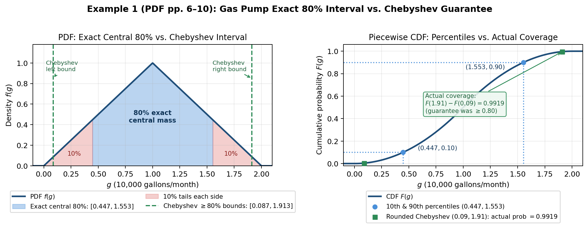
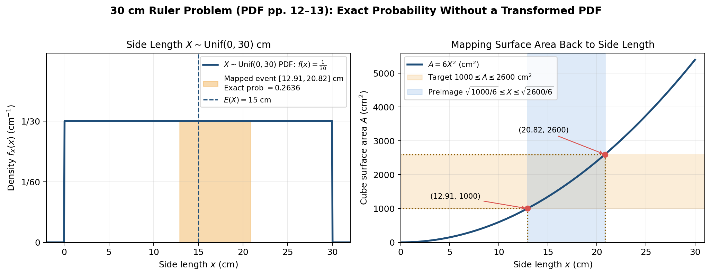
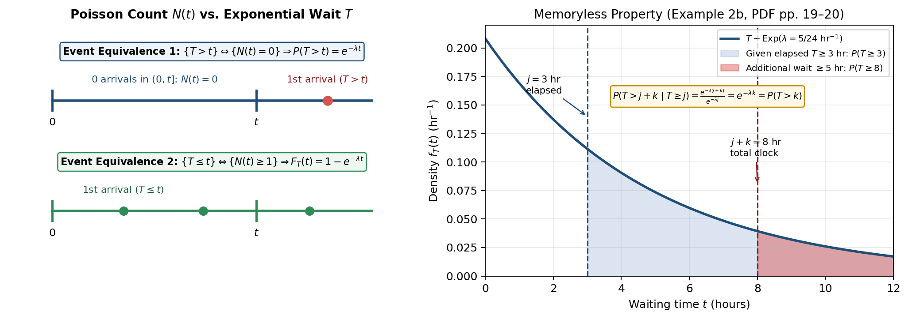
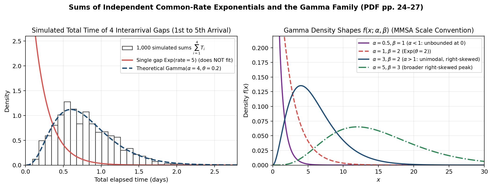

# STA237 Week 8 Study Notes: Named Continuous Distributions

## Contents

- [Scope, Notation, Units, and Parameter Conventions](#scope-notation-units-and-parameter-conventions)
  - [Source Scope and Core vs. Supplementary Classification](#source-scope-and-core-vs-supplementary-classification)
  - [Variables, Physical Units, and Scaling Rules](#variables-physical-units-and-scaling-rules)
  - [Master Parameter Convention Table Across Sources and R](#master-parameter-convention-table-across-sources-and-r)
  - [Method Selection Guide: Recognizing the Experiment and Choosing the Random Variable](#method-selection-guide-recognizing-the-experiment-and-choosing-the-random-variable)
- [Concept C-01: Density, Cumulative Probability, Moments, and Chebyshev's Inequality](#concept-c-01-density-cumulative-probability-moments-and-chebyshevs-inequality)
  - [Problem Type PT-01: Computing Expected Value, Variance, and Standard Deviation from a Piecewise Continuous PDF (and Functions $g(X)$)](#problem-type-pt-01-computing-expected-value-variance-and-standard-deviation-from-a-piecewise-continuous-pdf-and-functions-gx)
  - [Problem Type PT-02: Deriving a Piecewise CDF and Finding Exact Probability Intervals or Percentiles](#problem-type-pt-02-deriving-a-piecewise-cdf-and-finding-exact-probability-intervals-or-percentiles)
  - [Problem Type PT-03: Constructing or Evaluating a Chebyshev Probability Bound and Comparing It with Exact Coverage](#problem-type-pt-03-constructing-or-evaluating-a-chebyshev-probability-bound-and-comparing-it-with-exact-coverage)
- [Concept C-02: The Continuous Uniform Distribution](#concept-c-02-the-continuous-uniform-distribution)
  - [Problem Type PT-04: Modeling with a Continuous Uniform Distribution, Computing Moments of $X$ and $g(X)$, and Finding Exact Event Probabilities by Domain Mapping](#problem-type-pt-04-modeling-with-a-continuous-uniform-distribution-computing-moments-of-x-and-gx-and-finding-exact-event-probabilities-by-domain-mapping)
- [Concept C-03: Counts vs. Waiting Times — The Exponential Distribution](#concept-c-03-counts-vs-waiting-times--the-exponential-distribution)
  - [Problem Type PT-05: Computing Event Probabilities by Translating Between Poisson Counts and Exponential Waiting Times (with Unit Conversion)](#problem-type-pt-05-computing-event-probabilities-by-translating-between-poisson-counts-and-exponential-waiting-times-with-unit-conversion)
  - [Problem Type PT-06: Finding an Exponential Parameter ($\theta$ or $\lambda$) from a Specified Event Probability](#problem-type-pt-06-finding-an-exponential-parameter-theta-or-lambda-from-a-specified-event-probability)
  - [Problem Type PT-07: Computing Exponential Probabilities in R Using Rate Parameterization (`pexp`)](#problem-type-pt-07-computing-exponential-probabilities-in-r-using-rate-parameterization-pexp)
- [Concept C-04: Memorylessness and Model Assumptions](#concept-c-04-memorylessness-and-model-assumptions)
  - [Problem Type PT-08: Evaluating Conditional Waiting-Time Probabilities and Verifying the Memoryless Property](#problem-type-pt-08-evaluating-conditional-waiting-time-probabilities-and-verifying-the-memoryless-property)
- [Concept C-05: Several Arrivals and the Gamma Distribution](#concept-c-05-several-arrivals-and-the-gamma-distribution)
  - [Problem Type PT-09: Identifying and Simulating the Distribution of a Sum of Independent, Common-Rate Exponential Waiting Times](#problem-type-pt-09-identifying-and-simulating-the-distribution-of-a-sum-of-independent-common-rate-exponential-waiting-times)
  - [Problem Type PT-10: Computing Gamma Event Probabilities Using the Incomplete Gamma CDF or R (`pgamma`)](#problem-type-pt-10-computing-gamma-event-probabilities-using-the-incomplete-gamma-cdf-or-r-pgamma)
  - [Problem Type PT-11: Recovering Gamma Shape and Scale/Rate Parameters from Mean and Variance to Compute Event Probabilities](#problem-type-pt-11-recovering-gamma-shape-and-scalerate-parameters-from-mean-and-variance-to-compute-event-probabilities)

---

## Scope, Notation, Units, and Parameter Conventions

### Source Scope and Core vs. Supplementary Classification

This guide is built directly from the Week 8 lecture deck (`W8/week8-L0401-full.pdf`, 30 PDF pages including inserted handwritten work), the Canvas Week 8 page (Course ID `465634`, Page ID `2590934`), and the two course textbooks: *Modern Mathematical Statistics with Applications*, 3rd edition (**MMSA**, Sections 4.1–4.2 and 4.4), and *Probability* by Wagaman and Dobrow (**PAR**, Sections 6.4–6.5 and 7.2, with Section 7.3 consulted as supporting reading for Poisson processes).

Because an unnumbered handwritten roadmap page is inserted right after Slide 9 as **PDF page 10**, printed slide numbers and one-based PDF page numbers diverge from that point onward (`PDF page = printed slide number + 1` for PDF pp. 11–30). Every lecture citation in these notes uses **one-based PDF page numbers** (`PDF p. k`).

| Classification | What It Means | Week 8 Topics Included |
| :--- | :--- | :--- |
| **Core** | Concepts, derivations, R simulations, and tasks actually taught or worked in `W8/week8-L0401-full.pdf` (PDF pp. 1–28), plus basic Exponential/Uniform skills directly matching the deck. | Continuous PDF/CDF/moments & LOTUS recap (PDF pp. 3–8); Chebyshev's inequality & exact central percentile intervals (PDF pp. 9–11); **Continuous Uniform** distribution & moments (PDF pp. 12–14); Poisson count vs. Exponential wait duality (PDF pp. 15–18); Exponential parameterizations, memorylessness & Geometric analogy (PDF pp. 18–22); sums of i.i.d. common-rate Exponentials leading to **Gamma** via simulation (`rexp`, `dexp`) & shape plots (PDF pp. 23–28); Exponential CDF probability math underlying `PT-07`. |
| **Supplementary** | Substantive textbook-only formulas, derivations, R commands, or problem techniques required by assigned exercises but **not** covered in the Week 8 slides (note that on PDF p. 28, Gamma event-probability calculations and Gamma properties remain unchecked $\square$). | Explicit Gamma function $\Gamma(\alpha)$ and recurrence $\Gamma(\alpha) = (\alpha - 1)\Gamma(\alpha - 1)$; Gamma PDF/CDF formulas and Incomplete Gamma table $G(x/\beta; \alpha)$ (MMSA #72–#74); Gamma mean/variance formulas & integration derivations (MMSA #83, PAR #7.23); Erlang–Poisson CDF identity (MMSA #78c); R Exponential CDF command `pexp` (PAR #6.20—slides demonstrate `rexp` and `dexp` rather than `pexp`); integration-by-parts derivations of Exponential mean/variance (PAR #6.18–#6.19); integral evaluation without calculus via density recognition (PAR #6.24, #7.26); minimum of i.i.d. Exponentials in a series system (MMSA #79); conditional Binomial arrival counts in a Poisson process (PAR #7.25d). |

> **Week 8 Scope Boundaries:**
>
> 1. **Uniform is Core this week.** Even if Uniform was treated as Supplementary earlier, it is explicitly taught in Week 8 (PDF pp. 12–13) and checked off on PDF p. 14.
> 2. **Gamma is split into Core vs. Supplementary.** The deck teaches **only** that summing independent, common-rate Exponential waiting times produces a non-exponential, right-skewed two-parameter **Gamma** distribution (via R simulation and density shape plots, PDF pp. 23–28). On PDF p. 28, *"Use it to compute event probabilities"* and *"Describe properties of the Gamma distribution"* are still unchecked ($\square$). Accordingly, all Gamma PDF/CDF equations, Incomplete Gamma lookups, moment formulas, and Gamma probability calculations are labelled **Supplementary**.
> 3. **No full extraneous chapters are imported.** Techniques from Normal distributions, transformed-variable Jacobians, moment generating functions (MGFs), reliability theory, or queueing theory are **not** taught globally; whenever an assigned exercise needs one specific idea (such as matching a Normal kernel in PAR #7.26(a–b)), that single idea is explained locally right inside the worked solution.

### Variables, Physical Units, and Scaling Rules

Keeping physical units explicit is one of the fastest ways to prevent scaling errors on continuous distribution problems (emphasized heavily in the Week 8 annotations on PDF pp. 6, 8, 13, 18, and 21).

- **Scaling a random variable's unit changes variance quadratically.** In Example 1 (PDF pp. 6–8), $G$ is defined in units of **$10{,}000\text{ gallons}$**. Therefore:
  - $E(G) = 1$ means $1 \times 10{,}000\text{ gallons} = 10{,}000\text{ gallons}$.
  - $V(G) = \frac{1}{6}$ is in **$(10{,}000\text{ gallons})^2 = 10^8\text{ gallons}^2$**, so you must take the square root **first** to get back to linear units: $SD(G) = \sqrt{1/6}\text{ }(10{,}000\text{ gallons}) \approx 4{,}082.48\text{ gallons}$.
- **Transforming a random variable changes its units.** In the $30\text{ cm}$ ruler problem (PDF p. 13), side length $X$ is measured in $\text{cm}$, so $V(X) = 75\text{ cm}^2$. Surface area $A = 6X^2$ is measured in $\text{cm}^2$, which means $E(A)$ has units $\text{cm}^2$, $E(X^4)$ and $V(A)$ have units $\text{cm}^4$, and $SD(A) = \sqrt{V(A)}$ has units $\text{cm}^2$.
- **Poisson/Exponential rate and mean parameters carry reciprocal units.**
  - Rate parameter $\lambda$ has units **events per unit time (or space)**, e.g., $5\text{ shibas/hour}$ or $1\text{ tree/km}^2$.
  - Mean waiting parameter $\theta = 1/\lambda$ has units **time (or space) per event**, e.g., $\frac{1}{5}\text{ hour/shiba} = 12\text{ minutes/shiba}$, or $1\text{ km}^2\text{/tree} = 1(1000\text{ m})^2\text{/tree}$.
  - Always convert $\lambda$ (or $\theta$) to match the time or distance unit of the question **before** substituting into $e^{-\lambda t}$ or $e^{-t/\theta}$.

### Master Parameter Convention Table Across Sources and R

Different textbooks and R functions use different symbols—and sometimes **reciprocal** second parameters—for the exact same Exponential or Gamma distribution. Always identify which convention a problem uses before plugging in numbers.

| Distribution | Week 8 Slides | MMSA (Devore, Berk, Carlton) | PAR (Wagaman & Dobrow) | R Built-in Functions |
| :--- | :--- | :--- | :--- | :--- |
| **Uniform** on $[a, b]$ | $X \sim \text{Unif}[a,b]$ or $U(a,b)$; $f(x)=\frac{1}{b-a}$ ($a \le x \le b$) | $X \sim \text{Unif}[A, B]$; $f(x)=\frac{1}{B-A}$ ($A \le x \le B$) | $X \sim \text{Unif}(a, b)$; $f(x)=\frac{1}{b-a}$ ($a < x < b$) | `dunif(x, min = a, max = b)`, `punif(x, a, b)`, `runif(n, a, b)` |
| **Exponential** | **Mean** $\theta > 0$: $f(x)=\frac{1}{\theta}e^{-x/\theta}$ **Rate** $\lambda = \frac{1}{\theta}$: $f(x)=\lambda e^{-\lambda x}$ $E(X)=\theta=\frac{1}{\lambda}$, $V(X)=\theta^2=\frac{1}{\lambda^2}$ | **Rate** $\lambda > 0$: $f(x; \lambda)=\lambda e^{-\lambda x}$ ($x \ge 0$) (Special case of Gamma with $\alpha = 1, \beta = 1/\lambda$) | **Rate** $\lambda > 0$: $f(x)=\lambda e^{-\lambda x}$ ($x > 0$) (Notes alternative scale $\beta = 1/\lambda$) | `dexp(x, rate = lambda)`, `pexp(x, rate = lambda)`, `qexp(p, rate = lambda)`, `rexp(n, rate = lambda)` **Warning:** `pexp` takes `rate`, **not** `scale=`! |
| **Gamma** *(PDF formulas Supplementary)* | Two-parameter notation $\Gamma(\alpha, \beta)$ on PDF p. 27 (plots match scale convention on panels 1–3; see Appendix note on panel 4) | **Shape $\alpha > 0$, Scale $\beta > 0$**: $f(x; \alpha, \beta)=\frac{1}{\beta^\alpha\Gamma(\alpha)}x^{\alpha-1}e^{-x/\beta}$ ($x>0$) $E(X)=\alpha\beta$, $V(X)=\alpha\beta^2$ **Standard Gamma means $\beta = 1$** (NOT $\alpha = 1$) | **Shape $a > 0$, Rate $\lambda > 0$**: $f(x)=\frac{\lambda^a}{\Gamma(a)}x^{a-1}e^{-\lambda x}$ ($x>0$) $E(X)=a/\lambda$, $V(X)=a/\lambda^2$ | `pgamma(x, shape = alpha, rate = lambda)` (3rd positional arg is `rate`!) OR explicitly `pgamma(x, shape = alpha, scale = beta)` where $\lambda = 1/\beta$. Same for `dgamma`, `qgamma`, `rgamma`. |

> **Critical Warning on "Standard Gamma" vs. Exponential:**
> In MMSA Section 4.4 (printed p. 231, PDF p. 243) and MMSA #72, a **standard Gamma** distribution sets the **scale parameter** $\beta = 1$, leaving $\alpha > 0$ free ($f(x; \alpha) = \frac{1}{\Gamma(\alpha)}x^{\alpha-1}e^{-x}$). Setting the **shape parameter** $\alpha = 1$ gives the **Exponential** distribution with mean $\beta = 1/\lambda$. Only when **both** $\alpha = 1$ and $\beta = 1$ (as in MMSA #75) do standard Gamma and Exponential($\lambda=1$) coincide.

### Method Selection Guide: Recognizing the Experiment and Choosing the Random Variable

When reading an unfamiliar probability question for the first time, follow this four-step translation workflow before writing any integral or formula:

1. **Identify the physical experiment and what is being measured:**
   - Are you counting discrete arrivals in a fixed window? $\longrightarrow$ **Count RV $N(t)$**.
   - Are you measuring a continuous quantity (length, time, distance, lifetime)? $\longrightarrow$ **Continuous RV $X$ or $T$**.
2. **Look for the distribution cue in the problem statement:**

| Wording / Experimental Cue | Random Variable to Define (with Units!) | Distribution & Key Formula | Primary Concept & PT |
| :--- | :--- | :--- | :--- |
| Explicit piecewise PDF $f(x)$ given (not a named family) | $X$ = measured quantity in problem's scaled units | Integrate $f(x)$ for $F(x)$ and moments; invert $F(x)=p$ for quantiles | [C-01](#concept-c-01-density-cumulative-probability-moments-and-chebyshevs-inequality) (`PT-01`, `PT-02`) |
| "Construct an interval that holds at least $100(1-\alpha)\%$ of outcomes" OR "bound the probability within $\pm d$ of $\mu$" (especially when full distribution of $g(X)$ is unknown) | $X$ (or transformed $Y=g(X)$) with known mean $\mu$ and SD $\sigma$ | $P(\|X - \mu\| < k\sigma) \ge 1 - \frac{1}{k^2}$ (or $P(\|X - \mu\| \ge k\sigma) \le \frac{1}{k^2}$) | [C-01](#concept-c-01-density-cumulative-probability-moments-and-chebyshevs-inequality) (`PT-03`) |
| "Equally likely in any subinterval of equal length" on $[a, b]$ | $X$ = random measurement/position on $[a, b]$ | $X \sim \text{Unif}[a, b]$, $f(x)=\frac{1}{b-a}$, $E(X)=\frac{a+b}{2}$, $V(X)=\frac{(b-a)^2}{12}$ | [C-02](#concept-c-02-the-continuous-uniform-distribution) (`PT-04`) |
| Poisson arrivals with constant rate $\lambda$; question asks about **number of arrivals** in interval of length $t$ | $N(t)$ = discrete count in $(0, t]$ | $N(t) \sim \text{Pois}(\mu = \lambda t)$ | [C-03](#concept-c-03-counts-vs-waiting-times--the-exponential-distribution) (`PT-05`) |
| Poisson arrivals with rate $\lambda$; question asks for **time until next arrival** or **time between two consecutive arrivals** | $T$ = continuous wait to next event (units matching $1/\lambda$) | $T \sim \text{Exp}(\lambda)$ (or $\theta = 1/\lambda$), $P(T > t) = e^{-\lambda t}$, $F(t) = 1 - e^{-\lambda t}$ | [C-03](#concept-c-03-counts-vs-waiting-times--the-exponential-distribution) (`PT-05`; R `pexp`: `PT-07`) |
| Known Exponential distribution and a given event probability $P(Y < t_0) = p$, asking for $\theta$ or $\lambda$ | $Y \sim \text{Exp}(\theta)$ (units matching $t_0$) | $1 - e^{-t_0/\theta} = p \implies \theta = -\dfrac{t_0}{\ln(1 - p)}$ | [C-03](#concept-c-03-counts-vs-waiting-times--the-exponential-distribution) (`PT-06`) |
| "Already waited $j$ units with no arrival; what is the chance of waiting at least $k$ more units?" | $T \sim \text{Exp}(\lambda)$ | Memorylessness: $P(T > j + k \mid T \ge j) = P(T > k) = e^{-\lambda k}$ | [C-04](#concept-c-04-memorylessness-and-model-assumptions) (`PT-08`) |
| "Total time elapsed until $n$ independent, constant-rate events occur" OR "time from 1st arrival to 5th arrival" (4 gaps!) | $S_n = \sum_{i=1}^n T_i$ (count the **gaps** carefully!) | $S_n \sim \text{Gamma}(\text{shape}=n, \text{rate}=\lambda)$ (or $\text{scale}=\theta=1/\lambda$) | [C-05](#concept-c-05-several-arrivals-and-the-gamma-distribution) (`PT-09`, `PT-10`, `PT-11`) |

---

## Concept C-01: Density, Cumulative Probability, Moments, and Chebyshev's Inequality

**Classification:** Core (`W8/week8-L0401-full.pdf`, PDF pp. 2–11)

### 1. Density Height vs. Interval Area vs. Cumulative Probability

Suppose a gas station pump can deliver anywhere between $0$ and $20{,}000$ gallons of gas per month, and we let $G$ represent monthly volume measured in **$10{,}000$ gallons** ($0 < G < 2$). Because $G$ can take any real value in $(0, 2)$—not just isolated integers—the probability of hitting any exact number such as $G = 1.00000\dots$ is zero.

Instead of assigning positive probability mass to individual points as a discrete PMF does, a **probability density function (PDF)** $f(x)$ models *concentration per unit length* (PDF p. 3). Think of the physical analogy written at the top of PDF p. 3:

$$\text{probability mass over an interval} = \text{area under the PDF} = \int_a^b f(x)\,dx.$$

A valid continuous PDF $f(x)$ satisfies two axioms:
1. **Non-negativity:** $f(x) \ge 0$ for all $x$ in the **support** of $X$ (the set $\{x : f(x) > 0\}$, with $f(x) = 0$ outside the support). Note that $f(x)$ is a *density height*, **not** a probability, so $f(x)$ can exceed $1$ (for instance, on a short interval $[0, 0.2]$, a uniform density has height $5$) as long as total area equals $1$.
2. **Normalization (Axiom #2):** $\int_{-\infty}^{\infty} f(x)\,dx = 1$.

Because a single point has width $0$, $P(X = c) = \int_c^c f(x)\,dx = 0$ for every $c \in \mathbb{R}$ (PDF pp. 3–4). Consequently, strict and non-strict inequalities give the exact same probability for continuous random variables:

$$P(a \le X \le b) = P(a < X \le b) = P(a \le X < b) = P(a < X < b) = \int_a^b f(x)\,dx.$$

*(Source note: Printed Slide 3 on PDF p. 3 writes $P(a \le X \le B) = \int_a^b f(x)\,dx$ with a minor capitalization typo $B$ for $b$; both endpoints refer to $a \le b$.)*

The **cumulative distribution function (CDF)** $F(x)$ is defined for **every** real number $x \in \mathbb{R}$ (not just on the support!) as the total area accumulated from $-\infty$ up to $x$:

$$F(x) = P(X \le x) = \int_{-\infty}^x f(y)\,dy, \qquad F'(x) = f(x) \text{ wherever } f \text{ is continuous.}$$

Every CDF satisfies $\lim_{x\to -\infty} F(x) = 0$, $\lim_{x\to\infty} F(x) = 1$, right-continuity ($\lim_{x\to c^+} F(x) = F(c)$), and the general interval formula $P(a < X \le b) = F(b) - F(a)$ (because subtracting $F(a) = P(X \le a)$ removes the outcome $X = a$). When $X$ is **continuous**, $P(X = a) = 0$, so the left endpoint may also be written inclusively: $P(a \le X \le b) = F(b) - F(a)$ (PDF p. 4). *(Keep this distinction in mind when working with discrete Poisson counts $N(t)$, where $P(N(t) = a) > 0$!)*

When $f(x)$ is piecewise (like the gas-pump density on PDF p. 6), deriving $F(x)$ requires **splitting the integral at every boundary where the formula for $f$ changes** and adding the completed area from earlier branches:
- To the left of the support ($x < 0$): $F(x) = \int_{-\infty}^x 0\,dy = 0$.
- In the first active branch ($0 \le x < 1$): $F(x) = \int_0^x f_1(y)\,dy$.
- In the second active branch ($1 \le x < 2$): $F(x) = \underbrace{\int_0^1 f_1(y)\,dy}_{\text{entire first branch}} + \int_1^x f_2(y)\,dy$.
- To the right of the support ($x \ge 2$): $F(x) = 1$.

### 2. Expected Value, LOTUS, Variance, and Standard Deviation

To summarize the center and spread of a continuous distribution:

- **Expected value (mean):** $\mu = E(X) = \int_{-\infty}^{\infty} x f(x)\,dx$ (the density-weighted average of $x$).
- **Expected value of a function $g(X)$ (Law of the Unconscious Statistician, LOTUS):**

$$E[g(X)] = \int_{-\infty}^{\infty} g(x)\,f(x)\,dx.$$

  > **Critical Warning (PDF p. 5):** We can compute $E[g(X)]$ using the PDF $f(x)$ of $X$, **but this does NOT mean $g(X)$ has the same PDF as $X$!** If you need probabilities about $g(X)$ itself, you cannot plug $g(x)$ into $f(x)$ without mapping the event back to $X$ (as in Concept C-02) or deriving the transformed distribution.

- **Variance and Standard Deviation:**
  - Definition: $V(X) = \sigma^2 = E[(X - \mu)^2] = \int_{-\infty}^{\infty} (x - \mu)^2 f(x)\,dx$, measured in **$\text{units}^2$** (PDF p. 7).
  - Computational shortcut (proved in [`SQ-02`](Answers-and-Practice.md#sq-02-variance-shortcut-derivation)):

  $$V(X) = E(X^2) - [E(X)]^2.$$

  - **Standard deviation:** $SD(X) = \sigma = \sqrt{V(X)}$, measured in the **same linear units as $X$**. Because variance is in squared units (e.g., $(10{,}000\text{ gallons})^2$), always interpret spread using $SD(X)$, not $V(X)$ (PDF p. 8).

### 3. Three Distinct Interval Questions: Gas Station Pump Synthesis (PDF pp. 6–10)

In **Example 1** (PDF pp. 6–10), monthly gas volume $G$ (in units of $10{,}000$ gallons) has the symmetric triangular PDF:

$$f(g) = \begin{cases} g, & 0 < g < 1, \\ 2 - g, & 1 \le g < 2, \\ 0, & \text{otherwise.} \end{cases}$$

From PDF pp. 6–9 (see canonical working in [`SQ-01`](Answers-and-Practice.md#sq-01-example-1a--gas-station-pump-expected-value), [`SQ-03`](Answers-and-Practice.md#sq-03-example-1b--gas-station-pump-variance-and-standard-deviation), and [`SQ-04`](Answers-and-Practice.md#sq-04-example-1c--handwritten-roadmap--gas-pump-cdf-chebyshev-interval-actual-coverage-and-central-80-interval)):
- $E(G) = 1\text{ }(10{,}000\text{ gal}) = 10{,}000\text{ gallons/month}$.
- $E(G^2) = \frac{7}{6}\text{ }(10{,}000\text{ gal})^2$, so $V(G) = \frac{7}{6} - 1^2 = \frac{1}{6}\text{ }(10{,}000\text{ gal})^2$ and $SD(G) = \sqrt{1/6} \approx 0.4082\text{ }(10{,}000\text{ gal}) \approx 4{,}082\text{ gallons}$.
- Integrating $f(g)$ branch by branch yields the full piecewise CDF:

$$F(g) = \begin{cases} 0, & g < 0, \\ \frac{1}{2}g^2, & 0 \le g < 1, \\ -\frac{1}{2}(g^2 - 4g + 2) = 1 - \frac{1}{2}(2 - g)^2, & 1 \le g < 2, \\ 1, & g \ge 2. \end{cases}$$

The inserted handwritten roadmap on **PDF p. 10** highlights that **three different questions** arise around "80% intervals"—do not confuse them:

| Question Asked | Mathematical Criterion | Result for Gas Pump $G$ (in $10{,}000\text{ gal}$) | Physical Meaning in Gallons |
| :--- | :--- | :--- | :--- |
| **1. Exact central 80% interval** | Solve $F(g_{0.10}) = 0.10$ and $F(g_{0.90}) = 0.90$ (narrowest symmetric central interval leaving $10\%$ in each tail) | $[g_{0.10}, g_{0.90}] = [\sqrt{0.2},\, 2-\sqrt{0.2}] \approx [0.4472, 1.5528]$ (slide rounds to $(0.45, 1.55)$) | $(4{,}472,\, 15{,}528)\text{ gal}$ (slide: $(4{,}500,\, 15{,}500)\text{ gal}$); **exact** probability $= 0.8000$ |
| **2. Chebyshev interval guaranteeing $\ge 80\%$** | Choose $k$ such that $1 - \frac{1}{k^2} = 0.80 \implies k = \sqrt{5}$; build $(\mu - k\sigma, \mu + k\sigma)$ | $(1 - \sqrt{5/6},\, 1 + \sqrt{5/6}) \approx (0.0871, 1.9129)$ (slide rounds to $(0.09, 1.91)$) | $(871,\, 19{,}129)\text{ gal}$; **worst-case guarantee** across *all* distributions with this $\mu, \sigma$ is $\ge 0.80$ |
| **3. Actual coverage of the Chebyshev interval** | Evaluate $P(0.09 < G < 1.91) = F(1.91) - F(0.09)$ under this specific triangular PDF | $0.9919$ using rounded endpoints $(0.09, 1.91)$ ($0.9924$ using exact endpoints) | Under the true triangular PDF, the Chebyshev interval actually captures **$99.19\%$** of months, illustrating why Chebyshev bounds are conservative. |

> **Why Chebyshev's Inequality matters (PDF pp. 2, 9–10, 13):** Chebyshev's inequality,
> $$P(|X - \mu| < k\sigma) \ge 1 - \frac{1}{k^2} \quad \Longleftrightarrow \quad P(|X - \mu| \ge k\sigma) \le \frac{1}{k^2} \qquad (k > 0),$$
> needs **only $\mu$ and $\sigma$**, not the PDF or CDF. Because continuous RVs have $P(X = c) = 0$, strict ($<$) and non-strict ($\le$) interval bounds are identical for continuous RVs (PDF p. 2). When $k \le 1$, $1 - 1/k^2 \le 0$, giving a useless trivial lower bound (since every probability is already $\ge 0$).

---

### Problem Type PT-01: Computing Expected Value, Variance, and Standard Deviation from a Piecewise Continuous PDF (and Functions $g(X)$)

- **Classification:** Core
- **Establishing source(s):** `W8/week8-L0401-full.pdf`, Example 1(a–b) (PDF pp. 6, 8) and Ruler Test Practice (d) (PDF p. 13).
- **Recognition cues.** The question defines a continuous random variable $X$ (often with scaled units like "in 10,000 gallons" or "in cm") and gives an explicit PDF $f(x)$ over one or more intervals. It asks for the expected value $E(X)$, variance $V(X)$, standard deviation $SD(X)$, or the mean/variance of a function $Y = g(X)$.
- **General method.**
  1. Write down the variable $X$, its **support**, and its **physical units**.
  2. Split $\int_{-\infty}^\infty (\cdots)f(x)\,dx$ into subintegrals matching each active branch of $f(x)$ (zero outside the support).
  3. Compute $E(X) = \int x f(x)\,dx$ (or $E[g(X)] = \int g(x) f(x)\,dx$ via LOTUS).
  4. Compute $E(X^2) = \int x^2 f(x)\,dx$ (or $E[g(X)^2] = \int [g(x)]^2 f(x)\,dx$).
  5. Apply $V(X) = E(X^2) - [E(X)]^2$ and take $SD(X) = \sqrt{V(X)}$.
  6. Attach linear units to $E(X)$ and $SD(X)$ and squared units to $V(X)$; convert from scaled units to raw units if requested.
- **Representative question (Paraphrase of Slide Example 1a–b, PDF pp. 6, 8).**
  A gas station operates a pump that can dispense up to $20{,}000$ gallons of gas per month. Let $G$ be the total monthly gas pumped, measured in units of $10{,}000$ gallons, with PDF
  $$f(g) = \begin{cases} g, & 0 < g < 1, \\ 2 - g, & 1 \le g < 2, \\ 0, & \text{otherwise.} \end{cases}$$
  (a) Find the expected number of gallons of gas pumped per month.
  (b) Find the variance (and standard deviation for interpretation) in the amount of gas pumped per month.
  View canonical worked solutions: [`SQ-01` (Expected Value)](Answers-and-Practice.md#sq-01-example-1a--gas-station-pump-expected-value) and [`SQ-03` (Variance & SD)](Answers-and-Practice.md#sq-03-example-1b--gas-station-pump-variance-and-standard-deviation).
- **A complete answer must include.**
  - Clear statement of the variable $G$ and its scaled units ($10{,}000$ gallons).
  - Splitting both $\int_{-\infty}^\infty g f(g)\,dg$ and $\int_{-\infty}^\infty g^2 f(g)\,dg$ across $(0, 1)$ and $[1, 2)$.
  - Separate evaluations of $E(G)$, $E(G^2)$, and $V(G) = E(G^2) - [E(G)]^2$.
  - Explicit units on $E(G)$, $V(G)$, and $SD(G)$, including translation back into gallons.
- **One likely mistake & how to check your answer.**
  - *Mistake:* Forgetting that $G$ is in $10{,}000$-gallon units when interpreting $V(G)$ (multiplying $V(G)$ by $10{,}000$ instead of $10{,}000^2$, or reporting variance in gallons instead of $\text{gallons}^2$).
  - *Check:* Verify $E(G)$ lies inside the support $(0, 2)$ (for a symmetric PDF on $(0, 2)$, $E(G)$ must equal the symmetry center $1$), and verify $V(G) > 0$ so $E(G^2) > [E(G)]^2$.

---

### Problem Type PT-02: Deriving a Piecewise CDF and Finding Exact Probability Intervals or Percentiles

- **Classification:** Core
- **Establishing source(s):** `W8/week8-L0401-full.pdf`, Example 1(c) and handwritten roadmap Steps 2 & 5 (PDF pp. 9–10).
- **Recognition cues.** Given a piecewise PDF $f(x)$, the problem asks to derive the CDF $F(x)$ for all $x \in \mathbb{R}$, evaluate an interval probability $P(a < X < b)$, or find the exact $(100p)$th percentile / central $100(1-\alpha)\%$ interval.
- **General method.**
  1. Partition $\mathbb{R}$ into intervals determined by the breakpoints of $f(x)$ (including $(-\infty, \text{left endpoint})$ and $[\text{right endpoint}, \infty)$).
  2. For a point $x$ inside branch $m$, integrate from $-\infty$ to $x$: add the **full integrals** of all completed branches strictly to the left of branch $m$, plus $\int_{\text{start}_m}^x f_m(y)\,dy$. Always use a dummy variable ($y$) inside the integral when $x$ is the upper limit.
  3. Check continuity at every boundary point and verify $F'(x) = f(x)$ on each open piece.
  4. For an exact central $100(1-\alpha)\%$ interval, split the remaining $\alpha$ probability equally into $\alpha/2$ lower and upper tails: solve $F(x_{\alpha/2}) = \alpha/2$ and $F(x_{1-\alpha/2}) = 1 - \alpha/2$, selecting the root that falls inside that branch's domain.
- **Representative question (Paraphrase of Slide Example 1c, CDF & Central 80% Parts, PDF pp. 9–10).**
  For the monthly gas volume $G$ (in $10{,}000$ gallons) with the triangular PDF from Example 1, derive the full piecewise CDF $F(g)$ for all $g \in \mathbb{R}$ and use it to find the exact central $80\%$ interval of monthly gas pumped.
  [View the canonical worked solution (`SQ-04`)](Answers-and-Practice.md#sq-04-example-1c--handwritten-roadmap--gas-pump-cdf-chebyshev-interval-actual-coverage-and-central-80-interval)
- **A complete answer must include.**
  - All four branches of $F(g)$, including $0$ for $g < 0$ and $1$ for $g \ge 2$.
  - Accumulated area from $[0, 1)$ included in the $[1, 2)$ branch.
  - Identification of the 10th and 90th percentiles ($p = 0.10$ and $p = 0.90$), solving in the appropriate CDF branches and discarding any extraneous quadratic root outside $[1, 2)$.
  - Conversion of the final interval into gallons.
- **One likely mistake & how to check your answer.**
  - *Mistake:* Integrating $\int_1^g (2 - y)\,dy$ without adding the completed first-branch area $\int_0^1 y\,dy = \frac{1}{2}$, which makes $F(g)$ jump downward at $g=1$ and fail to reach $1$ at $g=2$; or keeping the out-of-domain quadratic root ($2 + \sqrt{0.2} \approx 2.45 > 2$) when solving $F(g) = 0.90$.
  - *Check:* Confirm $F(0)=0$, $F(1^-) = F(1^+) = 0.5$, $F(2)=1$, and $F'(g) = f(g)$ on $(0,1)$ and $(1,2)$.

---

### Problem Type PT-03: Constructing or Evaluating a Chebyshev Probability Bound and Comparing It with Exact Coverage

- **Classification:** Core
- **Establishing source(s):** `W8/week8-L0401-full.pdf`, Example 1(c) & PDF p. 10 Steps 3–4 (PDF pp. 9–10), and Ruler Test Practice (e) (PDF p. 13).
- **Recognition cues.** You know (or have just computed) $\mu$ and $\sigma$ for a random variable, and the question asks either: (i) *"Find an interval that captures at least $100(1-\alpha)\%$ of outcomes using Chebyshev's inequality"* (and optionally compare it to the exact probability under $F$), or (ii) *"Bound $P(c \le X \le d)$ using Chebyshev's inequality"* where $(c, d)$ is symmetric around $\mu$.
- **General method.**
  1. **Target probability $\to$ interval:** Set $1 - \frac{1}{k^2} = \text{target probability}$ (for $k > 0$), solve for $k$, and form $(\mu - k\sigma,\, \mu + k\sigma)$.
  2. **Given symmetric interval $(c, d) \to$ probability bound:** Check that $\mu = \frac{c+d}{2}$, let half-width $\varepsilon = \frac{d-c}{2}$, compute $k = \frac{\varepsilon}{\sigma}$, and state $P(|X - \mu| < \varepsilon) \ge 1 - \frac{1}{k^2}$ (noting the bound is vacuous if $k \le 1$).
  3. **Actual coverage check (when the exact distribution is known):** Compute $F(d) - F(c)$ (or map the event back to an underlying Uniform/Exponential RV) and contrast this exact probability with Chebyshev's lower bound.
- **Representative question (Paraphrase of Slide Example 1c, Chebyshev Parts, PDF pp. 9–10).**
  For the gas station pump variable $G$ with $\mu = 1$ and $\sigma = \sqrt{1/6}$ (in $10{,}000$ gallons), construct an interval using Chebyshev's inequality that guarantees monthly sales fall inside it at least $80\%$ of the time. Then compute the actual probability of that interval under the PDF of $G$ and compare it with the $80\%$ guarantee.
  [View the canonical worked solution (`SQ-04`)](Answers-and-Practice.md#sq-04-example-1c--handwritten-roadmap--gas-pump-cdf-chebyshev-interval-actual-coverage-and-central-80-interval)
- **A complete answer must include.**
  - Solving $1 - 1/k^2 = 0.80$ for $k = \sqrt{5}$.
  - Computing the endpoints $\mu \pm k\sigma$ in $10{,}000$-gallon units (and gallons).
  - Evaluating $F(\text{upper}) - F(\text{lower})$ under the derived CDF to find the true coverage.
  - Explicit explanation of why the true coverage exceeds $80\%$ (and differs from the central $80\%$ interval).
- **One likely mistake & how to check your answer.**
  - *Mistake:* Using $\sigma^2 = V(G)$ instead of $\sigma = \sqrt{V(G)}$ in $\mu \pm k\sigma$, or confusing the Chebyshev $\ge 80\%$ interval (whose true probability is $\approx 99.2\%$) with the exact central $80\%$ percentile interval.
  - *Check:* Verify that the Chebyshev interval is strictly wider than the exact central $80\%$ interval and that its actual probability under $F$ satisfies $P_{\text{exact}} \ge 0.80$.

---

## Concept C-02: The Continuous Uniform Distribution

**Classification:** Core (`W8/week8-L0401-full.pdf`, PDF pp. 12–14)

### 1. Why Equal-Length Subintervals Imply Constant Density

Suppose we pick a point at random from a $30\text{ cm}$ ruler so that we are **equally likely to land in any $1\text{ cm}$ subinterval** (PDF p. 13). In general, if every subinterval of equal width inside $[a, b]$ ($a < b$) carries the exact same probability mass, then the density curve $f(x)$ cannot rise in some spots and dip in others—it must be a flat horizontal line of height $c$ on $[a, b]$ (PDF p. 12).

Because the total area under the PDF is a rectangle of base $(b - a)$ and height $c$, Axiom #2 forces:

$$(b - a) \cdot c = 1 \quad \Longrightarrow \quad c = \frac{1}{b - a}.$$

Hence $X \sim \text{Unif}[a, b]$ (also written $\text{Unif}(a, b)$ or $U(a, b)$) has PDF and CDF:

$$f(x) = \begin{cases} \dfrac{1}{b - a}, & a \le x \le b, \\ 0, & \text{elsewhere}, \end{cases} \qquad F(x) = \begin{cases} 0, & x < a, \\ \dfrac{x - a}{b - a}, & a \le x \le b, \\ 1, & x > b. \end{cases}$$

Any subinterval $[c, d] \subseteq [a, b]$ simply has probability equal to its fraction of the total interval length:

$$P(c \le X \le d) = \frac{d - c}{b - a}.$$

### 2. Moments of the Uniform Distribution (PDF p. 12)

Integrating directly (as prompted by *"Finish it!"* on PDF p. 12, worked completely in [`SQ-05`](Answers-and-Practice.md#sq-05-uniform-distribution-moments-derivation-finish-it)):
- **Mean:**

$$E(X) = \int_a^b x \cdot \frac{1}{b - a}\,dx = \frac{1}{b - a}\left[\frac{x^2}{2}\right]_a^b = \frac{b^2 - a^2}{2(b - a)} = \frac{(b - a)(b + a)}{2(b - a)} = \frac{a + b}{2}.$$

*(Note on PDF p. 12 annotation: the instructor's side calculation `=(b-a) x 1/(b-a) = 1` verifies the total rectangle area, whereas the canceled $(b-a)$ in $\frac{(b-a)(b+a)}{2(b-a)}$ gives the midpoint mean $E(X) = \frac{a+b}{2}$.)*

- **Second moment and Variance:**

$$E(X^2) = \frac{1}{b - a}\int_a^b x^2\,dx = \frac{b^3 - a^3}{3(b - a)} = \frac{b^2 + ab + a^2}{3},$$

$$V(X) = E(X^2) - [E(X)]^2 = \frac{b^2 + ab + a^2}{3} - \left(\frac{a + b}{2}\right)^2 = \frac{4(b^2+ab+a^2) - 3(a^2+2ab+b^2)}{12} = \frac{(b - a)^2}{12}.$$

### 3. Nonlinear Transformations Without Finding a Transformed PDF: The 30 cm Ruler Problem (PDF p. 13)

If the random ruler measurement $X \sim \text{Unif}(0, 30)$ represents the **side length of a cube**, the cube's **surface area** is the random variable $A = 6X^2$ ($\text{cm}^2$). Notice how cleanly Week 8 handles both moments and probabilities of $A$ **without** needing transformed-density theory:

1. **Moments of $A$ use LOTUS directly on $f_X(x)$:**
   - $E(A) = E(6X^2) = 6E(X^2) = 6[V(X) + E(X)^2] = 6[75 + 15^2] = 6(300) = 1{,}800\text{ cm}^2$.
   - $V(A) = V(6X^2) = 36\,V(X^2) = 36\big[E(X^4) - [E(X^2)]^2\big]$, where $E(X^4) = \int_0^{30} x^4 \cdot \frac{1}{30}\,dx = \frac{30^4}{5} = 162{,}000\text{ cm}^4$, giving $V(A) = 36(162{,}000 - 300^2) = 2{,}592{,}000\text{ cm}^4$ and $SD(A) = \sqrt{2{,}592{,}000} \approx 1{,}610\text{ cm}^2$.
2. **Chebyshev's bound vs. Exact probability for $P(1000 \le A \le 2600)$:**
   - Because $1{,}800$ is the midpoint of $[1000, 2600]$ with half-width $800$, Chebyshev's inequality uses $k = \frac{800}{SD(A)} \approx \frac{800}{1610} \approx 0.497 < 1$, yielding $1 - \frac{1}{k^2} \approx -3.05$—an uninformative negative lower bound!
   - To find the **exact** probability without deriving the PDF of $A$, rewrite the surface-area event back in terms of the positive side length $X$:

   $$1000 \le 6X^2 \le 2600 \quad \Longleftrightarrow \quad \sqrt{\frac{1000}{6}} \le X \le \sqrt{\frac{2600}{6}},$$

   and integrate the Uniform PDF $f_X(x) = \frac{1}{30}$ (or take interval length over $30$): $P(1000 \le A \le 2600) = \frac{\sqrt{2600/6} - \sqrt{1000/6}}{30} \approx 0.2636$.

---

### Problem Type PT-04: Modeling with a Continuous Uniform Distribution, Computing Moments of $X$ and $g(X)$, and Finding Exact Event Probabilities by Domain Mapping

- **Classification:** Core
- **Establishing source(s):** `W8/week8-L0401-full.pdf`, Uniform Derivation (PDF p. 12) and Test Practice: 30 cm Ruler (a–e) (PDF p. 13).
- **Recognition cues.** Outcomes on a bounded interval $[a, b]$ are described as equally likely over equal-length subintervals; the problem asks for the PDF/sketch, mean and variance of $X$, moments of a geometric or algebraic function $g(X)$ (such as cube surface area), and/or the exact probability of an event involving $g(X)$.
- **General method.**
  1. Define $X \sim \text{Unif}[a, b]$ with units and write $f(x) = \frac{1}{b-a}$ on $[a, b]$ ($0$ elsewhere).
  2. Compute $E(X) = \frac{a+b}{2}$ and $V(X) = \frac{(b-a)^2}{12}$ (showing integrals explicitly if requested).
  3. For $Y = g(X)$, compute $E(Y) = E[g(X)]$ and $V(Y) = E[g(X)^2] - (E[g(X)])^2$ via LOTUS $\int_a^b (\cdots)\frac{1}{b-a}\,dx$ and variance scaling $V(cW) = c^2 V(W)$.
  4. For an event $\{c \le g(X) \le d\}$, solve the inequality directly for $X$ (respecting monotonicity and support $[a, b]$) and evaluate $P(X \in \text{preimage})$ using $\frac{\text{overlap length}}{b-a}$.
- **Representative question (Paraphrase of Slide Test Practice, PDF p. 13).**
  Consider selecting a measurement at random from a $30\text{ cm}$ ruler, meaning you are equally likely to select any number in any $1\text{ cm}$ interval.
  (a) Sketch a reasonable density function for how a measurement is generated and write its PDF.
  (b) Intuitively the average measurement is $15\text{ cm}$; show this using your PDF in (a).
  (c) Find the variance of the randomly selected measurement.
  (d) Suppose the measurement represents the side length of a cube. Find the average and variance of the resulting cube surface area.
  (e) According to Chebyshev's inequality, what can we say about the chances of obtaining a cube with surface area between $1000\text{ cm}^2$ and $2600\text{ cm}^2$? Find the exact probability without using Chebyshev's inequality.
  [View the canonical worked solution (`SQ-06`)](Answers-and-Practice.md#sq-06-test-practice--30-cm-ruler-and-cube-surface-area-parts-ae)
- **A complete answer must include.**
  - Explicit Uniform model $X \sim \text{Unif}(0, 30)$, PDF, and rectangular density sketch.
  - Integral verification of $E(X) = 15\text{ cm}$ and $V(X) = 75\text{ cm}^2$.
  - Definition of $A = 6X^2$, correct factor $6$ in $E(A)$ and $6^2 = 36$ in $V(A)$, and distinct units ($\text{cm}^2$ vs. $\text{cm}^4$).
  - Comparison showing Chebyshev gives a vacuous negative bound ($k < 1$) whereas preimage mapping yields the exact probability.
- **One likely mistake & how to check your answer.**
  - *Mistake:* Assuming $E(X^2) = [E(X)]^2$ (explicitly warned against at the top of PDF p. 12: *"Not true!"*), writing $V(6X^2) = 6V(X^2)$ instead of $36V(X^2)$, or forgetting that $A = 6X^2$ is not uniformly distributed.
  - *Check:* Verify $E(X^2) - [E(X)]^2 = V(X) > 0$, verify units match on both sides of $V(A)$, and verify the exact preimage interval lies strictly inside $[0, 30]\text{ cm}$ so the probability lies in $[0, 1]$.

---

## Concept C-03: Counts vs. Waiting Times — The Exponential Distribution

**Classification:** Core (`W8/week8-L0401-full.pdf`, PDF pp. 15–18), with **Supplementary** textbook derivations and non-calculus integration extensions (PAR §§6.5, 7.2.1).

### 1. Linking Discrete Poisson Counts $N(t)$ to Continuous Waiting Time $T$

In Week 6/7, you learned that a **Poisson distribution** models the **discrete count** of events occurring over a continuous interval of time or space when three Poisson assumptions hold (PDF p. 15):
1. The mean number of occurrences per unit interval, $\lambda$, is fixed.
2. No more than one occurrence can happen at any single instant.
3. Non-overlapping intervals behave independently.

Now flip the question around (PDF pp. 15–16): instead of fixing the interval length $t$ and counting arrivals $N(t)$ (called $S$ on PDF p. 16), **wait for the next arrival** and record the continuous elapsed time $T$ until it appears!

Use the Shiba dog-park experiment (PDF p. 16): suppose Shiba arrivals follow a Poisson process with average rate $\lambda$ per day, and let $T \ge 0$ be the number of days until the next Shiba arrives. Ask yourself: what does it mean in plain English that *"at most $t$ days pass before the next Shiba arrives"* ($\{T \le t\}$)?
- Equivalently, **at least one Shiba arrives during the interval $(0, t]$**: $\{T \le t\} \iff \{N(t) \ge 1\}$.
- Its complement is even simpler: **still waiting after $t$ days** ($\{T > t\}$) is the exact same physical event as **zero Shibas arrived by time $t$** ($\{N(t) = 0\}$)!

Since $N(t) \sim \text{Pois}(\lambda t)$, we immediately obtain the Exponential **survival function**, **CDF**, and **PDF** (PDF p. 16):

$$P(T > t) = P(N(t) = 0) = \frac{e^{-\lambda t}(\lambda t)^0}{0!} = e^{-\lambda t}, \qquad t \ge 0,$$

$$F_T(t) = P(T \le t) = 1 - P(T > t) = \begin{cases} 1 - e^{-\lambda t}, & t \ge 0, \\ 0, & \text{otherwise}, \end{cases}$$

$$f_T(t) = F_T'(t) = \begin{cases} \lambda e^{-\lambda t}, & t \ge 0, \\ 0, & \text{otherwise.} \end{cases}$$

Because non-overlapping intervals in a Poisson process are independent, the **Exponential distribution** models **both** (PDF p. 17):
- the time/distance from $0$ until the **first** Poisson occurrence, and
- the time/distance between **any two consecutive** Poisson occurrences (e.g., between the 2nd and 3rd arrival, or between the 3rd and 4th arrival), **but NOT** across non-consecutive arrivals (such as the 2nd to the 4th arrival, which spans two gaps—see [Concept C-05](#concept-c-05-several-arrivals-and-the-gamma-distribution)).

### 2. Rate Parameter $\lambda$ vs. Mean Waiting Time $\theta = 1/\lambda$ (PDF p. 18)

Pay close attention to the two ways Exponential parameters are written in STA237:

$$\theta = \frac{1}{\lambda}, \qquad f(x) = \begin{cases} \dfrac{1}{\theta}e^{-x/\theta}, & x \ge 0, \\ 0, & \text{otherwise}, \end{cases} \quad \Longleftrightarrow \quad f(x) = \begin{cases} \lambda e^{-\lambda x}, & x \ge 0, \\ 0, & \text{otherwise}, \end{cases}$$

$$E(X) = \theta = \frac{1}{\lambda}, \qquad V(X) = \theta^2 = \frac{1}{\lambda^2}, \qquad SD(X) = \theta = \frac{1}{\lambda}.$$

Notice a remarkable property of the Exponential distribution: its **mean equals its standard deviation**. Always verify which parameter you are given by inspecting the **units** (PDF p. 18):
- **Shiba example:** $\lambda = 5\text{ shibas per hour}$ (count/time) $\iff \theta = \frac{1}{5}\text{ hour per shiba} = 12\text{ minutes per shiba}$ (time/count).
- **Spatial example:** $\lambda = 7\text{ trees per } 7\text{ km}^2 = 1\text{ tree per km}^2$ (count/area) $\iff \theta = 1\text{ km}^2\text{ per tree} = 1(1000\text{ m})^2\text{ per tree} = 10^6\text{ m}^2\text{ per tree}$ (area/count).

### 3. Supplementary Extensions Required by Textbook Exercises

> **[Supplementary — Textbook Calculus & Kernel Extensions (PAR §§6.5, 7.2.1)]**
> The Week 8 slides state $E(X) = \theta = 1/\lambda$ and $V(X) = \theta^2 = 1/\lambda^2$ without integration-by-parts proofs, and do not cover "integration without calculus" by recognizing normalized densities. Both are required by assigned PAR exercises (#6.18, #6.19, #6.24, #7.26).

1. **Integration-by-parts derivations of Exponential mean and variance (PAR #6.18, #6.19):**
   Using $u = x$, $dv = \lambda e^{-\lambda x}\,dx$ gives $E(X) = \int_0^\infty x\lambda e^{-\lambda x}\,dx = \frac{1}{\lambda}$; similarly $u = x^2$, $dv = \lambda e^{-\lambda x}\,dx$ yields $E(X^2) = \frac{2}{\lambda}E(X) = \frac{2}{\lambda^2}$, hence $V(X) = \frac{2}{\lambda^2} - \frac{1}{\lambda^2} = \frac{1}{\lambda^2}$.
2. **Evaluating integrals without calculus via normalized density recognition (PAR #6.24, #7.26):**
   Whenever an integrand matches the *kernel* (variable part) of a known PDF—such as $e^{-\lambda x}$ on $(0, \infty)$, $x^{a-1}e^{-\lambda x}$ on $(0, \infty)$, or $e^{-(x-\mu)^2/(2\sigma^2)}$ on $(-\infty, \infty)$—multiply and divide by the missing normalizing constant so the integral equals $1$ (or equals a known moment $E[X]$ or $E[X^2]$).

---

### Problem Type PT-05: Computing Event Probabilities by Translating Between Poisson Counts and Exponential Waiting Times (with Unit Conversion)

- **Classification:** Core
- **Establishing source(s):** `W8/week8-L0401-full.pdf`, Shiba Derivation (PDF p. 16), Example 2(a) (PDF p. 20), Teller Try it Yourself! #1(a–c) (PDF p. 21), and Basic exercise MMSA #75(a–d) (printed p. 237, PDF p. 249).
- **Recognition cues.** A process generates arrivals at a constant average rate $\lambda$ (or mean interarrival time $\theta = 1/\lambda$) and asks for the probability that the next arrival/duration is less than $t$, more than $t$, or between $t_1$ and $t_2$ (possibly requiring a unit conversion between hours, minutes, days, or meters).
- **General method.**
  1. Define the continuous waiting time $T$ (with explicit units matching your chosen parameter) and/or the discrete count $S = N(t)$ over the target window.
  2. Convert the rate $\lambda$ (or mean $\theta = 1/\lambda$) into the **same units** as the event thresholds $t, t_1, t_2$.
  3. Translate the wording into an Exponential event:
     - $P(T \le t) = P(T < t) = 1 - e^{-\lambda t} = 1 - e^{-t/\theta}$
     - $P(T \ge t) = P(T > t) = e^{-\lambda t} = e^{-t/\theta}$
     - $P(t_1 < T < t_2) = F(t_2) - F(t_1) = e^{-\lambda t_1} - e^{-\lambda t_2}$
  4. When appropriate, verify via the dual Poisson count $S \sim \text{Pois}(\lambda t)$: $P(T \le t) = P(S \ge 1) = 1 - P(S = 0)$.
- **Representative question (Paraphrase of Slide Example 2a, PDF p. 20).**
  The number of Shiba arrivals per day at a dog park follows a Poisson distribution with an average of $5$ arrivals per day. A Shiba just arrived at the dog park. What is the probability that another Shiba will arrive within the next $6$ hours?
  [View the canonical worked solution (`SQ-09(a)`)](Answers-and-Practice.md#sq-09-example-2--shiba-arrivals-at-the-dog-park-parts-ab)
- **A complete answer must include.**
  - Unit alignment between the daily rate ($5/\text{day}$) and the $6$-hour window ($1/4$ day, or $\lambda = 5/24\text{ hr}^{-1}$, $\theta = 24/5\text{ hr}$).
  - Explicit definition of the random variable ($T$ in hours or $S$ in $6$ hours) and model distribution.
  - Exact exponential expression and numerical evaluation.
- **One likely mistake & how to check your answer.**
  - *Mistake:* Mixing rates and means ($5$ vs. $1/5$) or forgetting to convert $6$ hours to $0.25$ days (mistakenly plugging $t = 6$ into $1 - e^{-5(6)}$).
  - *Check:* Compare the threshold $t$ against the mean $\theta$: for $t < \theta$, $P(T \le t)$ must be less than $1 - e^{-1} \approx 0.6321$, whereas for $t > \theta$, $P(T \le t) > 0.6321$.

---

### Problem Type PT-06: Finding an Exponential Parameter ($\theta$ or $\lambda$) from a Specified Event Probability

- **Classification:** Core
- **Establishing source(s):** `W8/week8-L0401-full.pdf`, Try it Yourself! #2 (PDF p. 21).
- **Recognition cues.** You are told $Y \sim \text{Exp}$ and given a specific event probability at a known threshold $t_0$—such as $P(Y < t_0) = p$ or $P(Y > t_0) = q$—and asked to solve backward for the mean parameter $\theta$ (or rate parameter $\lambda = 1/\theta$). *(Note: finding an unknown quantile $\eta_p$ or median given a known $\lambda$—the converse algebraic problem—is not established by this slide or the four Basic exercises, so it is solved locally inside `MMSA #76(c)`, `MMSA #80`, and `PAR #6.22`.)*
- **General method.**
  1. Write the CDF or survival equation $P(Y \le t_0) = 1 - e^{-t_0/\theta} = p$ (equivalently $P(Y > t_0) = e^{-\lambda t_0} = 1 - p$), using continuity ($P(Y < t_0) = P(Y \le t_0)$).
  2. Isolate the exponential term $e^{-t_0/\theta} = 1 - p$, take the natural logarithm $\ln$ of both sides, and solve algebraically for $\theta = -\dfrac{t_0}{\ln(1 - p)}$ (or $\lambda = \dfrac{1}{\theta} = -\dfrac{\ln(1 - p)}{t_0}$).
  3. Keep signs straight: since $0 < 1 - p < 1$, $\ln(1 - p) < 0$, so $-\ln(1 - p) > 0$.
- **Representative question (Paraphrase of Slide Try it Yourself! #2, PDF p. 21).**
  Suppose $Y$ is an exponential random variable satisfying $P(Y < 1) = 0.05$. Find the mean parameter $\theta$ (and note the corresponding rate $\lambda$).
  [View the canonical worked solution (`SQ-11`)](Answers-and-Practice.md#sq-11-try-it-yourself-2--inverse-exponential-parameter-problem)
- **A complete answer must include.**
  - Correct CDF setup $1 - e^{-1/\theta} = 0.05$ (using continuity $P(Y < 1) = P(Y \le 1)$).
  - Exact logarithmic expression for $\theta$ (and $\lambda = 1/\theta$).
  - Numerical decimal value and sign/reasonableness check.
- **One likely mistake & how to check your answer.**
  - *Mistake:* Taking $\ln(0.05)$ instead of $\ln(1 - 0.05) = \ln(0.95)$ when setting up $e^{-1/\theta}$, or dropping the minus sign and reporting a negative $\theta$.
  - *Check:* Plug your solved $\theta$ (or $\lambda$) back into $1 - e^{-t_0/\theta}$ and verify it reproduces the given probability $p$ exactly.

---

### Problem Type PT-07: Computing Exponential Probabilities in R Using Rate Parameterization (`pexp`)

- **Classification:** **Core** for the Exponential CDF probability formulas ($F(x) = 1 - e^{-\lambda x}$); **Supplementary** for the R `pexp` command (required by textbook Basic exercise PAR #6.20; the Week 8 slides show `rexp` and `dexp` rather than `pexp`).
- **Establishing source(s):** PAR Section 6.5 Basic exercise #6.20(a–c) (printed p. 269, PDF p. 287).
- **Recognition cues.** A problem specifies $X \sim \text{Exp}(\lambda)$ (or gives a mean $\theta = 1/\lambda$) and asks for the exact R commands and computed probabilities for $P(X < a)$, $P(a \le X \le b)$, or $P(X \ge b)$.
- **General method.**
  1. First state the mathematical probability equation using the CDF $F(x) = P(X \le x) = 1 - e^{-\lambda x}$ (e.g., $P(X \ge b) = 1 - F(b)$).
  2. Convert the parameter to **rate** $\lambda = 1/\theta$, because R's `pexp(q, rate = ...)` accepts `rate` and does **not** have a `scale=` argument (explicitly noted in MMSA printed p. 237 / PDF p. 249).
  3. Write `pexp(a, rate = lambda)` for lower tails, `pexp(b, rate = lambda) - pexp(a, rate = lambda)` for intervals, and `1 - pexp(b, rate = lambda)` or `pexp(b, rate = lambda, lower.tail = FALSE)` for upper tails.
  4. Distinguish the exact symbolic expression (e.g., $e^{-1.3}$) from the floating-point numerical output returned by R.
- **Representative question (Paraphrase of PAR #6.20a–c, printed p. 269, PDF p. 287).**
  Suppose $X \sim \text{Exp}(1/20)$ (PAR rate convention $\lambda = 1/20$). Provide appropriate R commands and compute the following probabilities: (a) $P(X < 18)$, (b) $P(15 \le X \le 23)$, and (c) $P(X \ge 26)$.
  [View the canonical worked solution (PAR #6.20)](Answers-and-Practice.md#par-620-basic--section-65-printed-p-269-pdf-p-287)
- **A complete answer must include.**
  - Explicit identification that $\lambda = 1/20$ is the **rate** parameter (so mean $\theta = 20$).
  - Mathematical CDF equation before each R command.
  - R command using `pexp(..., rate = 1/20)` and the computed decimal probability.
- **One likely mistake & how to check your answer.**
  - *Mistake:* Passing the mean $20$ instead of the rate $1/20$ into `pexp(x, 20)`, or writing `pexp(x, scale = 20)` (which fails in R).
  - *Check:* Verify that $P(X < 18) < 1 - e^{-1} \approx 0.6321$ since $18 < \theta = 20$, and verify $P(X \ge 26) < e^{-1} \approx 0.3679$ since $26 > 20$.

---

## Concept C-04: Memorylessness and Model Assumptions

**Classification:** Core (`W8/week8-L0401-full.pdf`, PDF pp. 19–21)

### 1. Deriving the Memoryless Property (PDF p. 19)

A random variable $X$ is **memoryless** if, given that you have already waited at least $j$ units of time with no arrival, the probability of waiting **more than $k$ additional units** (total clock time $> j + k$) equals the unconditional probability of waiting more than $k$ units from scratch:

$$P(X > j + k \mid X \ge j) = P(X > k) \qquad \text{for all } j, k > 0.$$

**Derivation for $X \sim \text{Exp}(\theta)$ (PDF p. 19, worked in [`SQ-08(a)`](Answers-and-Practice.md#sq-08-memoryless-property-derivation-for-exponential-and-geometric-rvs)):**
Since $j, k > 0$, the event $\{X > j + k\}$ is a **subset** of $\{X \ge j\}$, so their intersection $\{X > j + k\} \cap \{X \ge j\}$ simplifies to $\{X > j + k\}$. Using $P(X > x) = 1 - F_X(x) = e^{-x/\theta}$:

$$P(X > j + k \mid X \ge j) = \frac{P(X > j + k \cap X \ge j)}{P(X \ge j)} = \frac{P(X > j + k)}{P(X \ge j)} = \frac{e^{-(j+k)/\theta}}{e^{-j/\theta}} = e^{-k/\theta} = P(X > k).$$

**Always keep three time concepts separate:**
- **$j$ (elapsed time):** how long you have already waited (e.g., *"It's been $3$ hours since the last Shiba"*, PDF p. 20).
- **$k$ (additional waiting time):** how much longer you still have to wait from *now* (e.g., *"wait at least $5$ more hours"*).
- **$j + k$ (total waiting time since the last arrival):** $3 + 5 = 8$ hours total. Memorylessness replaces $P(T \ge 8 \mid T \ge 3)$ with $P(T \ge 5)$.

### 2. The Discrete Geometric Analogy (Handwritten Task on PDF p. 19)

The slide mentions that the discrete **Geometric distribution** $\text{Geo}(p)$ (counting failed trials before the first success) is also memoryless, and the instructor adds the handwritten task: *"$\star\text{ Geo}(p)\text{ is also memoryless! Show this!}$"*

For $X \sim \text{Geo}(p)$ defined as the number of failed independent $\text{Bernoulli}(p)$ trials before the first success ($P(X = x) = (1 - p)^x p$ for $x = 0, 1, 2, \dots$, $0 < p < 1$), having *"at least $m$ failures before the first success"* ($\{X \ge m\}$) simply means the first $m$ trials all fail, so $P(X \ge m) = (1 - p)^m$. Given that you have already observed at least $j$ failures ($X \ge j$), the conditional probability of observing at least $k$ additional failures ($X \ge j + k$) is still $(1 - p)^k$:

$$P(X \ge j + k \mid X \ge j) = \frac{P(X \ge j + k \cap X \ge j)}{P(X \ge j)} = \frac{P(X \ge j + k)}{P(X \ge j)} = \frac{(1 - p)^{j+k}}{(1 - p)^j} = (1 - p)^k = P(X \ge k).$$

In other words, once $j$ failures have happened, the chance of at least $k$ more failures equals the unconditional chance of at least $k$ failures from the start (worked in [`SQ-08(b)`](Answers-and-Practice.md#sq-08-memoryless-property-derivation-for-exponential-and-geometric-rvs)). In fact, Exponential is the **only** continuous memoryless distribution, and Geometric is the **only** discrete memoryless distribution.

### 3. Model Assumptions and Where Memorylessness Fails (PDF pp. 19, 21)

The instructor uses memorylessness to **assess the goodness of an Exponential model**:
1. **Wear-out / aging lifetimes (PDF p. 19):** An Exponential model is a **bad fit** for a 7-year-old iPad's remaining lifespan, because memorylessness would insist that a 7-year-old device has the *exact same* chance of lasting another 5 years as a brand-new iPad ($P(X > 12 \mid X \ge 7) = P(X > 5)$), ignoring battery wear and degradation.
2. **Interarrival time vs. service duration (Bank Teller Problem, PDF p. 21):** Knowing that *client arrivals* to a bank teller follow a Poisson process ($\lambda = 5$/hour) tells you the distribution of **time between consecutive client arrivals**, *not* how long a client spends at the counter! Before applying $\text{Exp}(\theta = 12\text{ min})$ to service duration in [`SQ-10`](Answers-and-Practice.md#sq-10-try-it-yourself-1--bank-teller-service-times-parts-ac), you must explicitly state the handwritten assumption on PDF p. 21: **"Assume time b/w clients = time spent w/ client."**
3. **Memorylessness $\ne$ Independence of nested tail events (PAR #6.17):** Even though $P(X > s + t \mid X > t) = P(X > s)$, the events $\{X > s + t\}$ and $\{X > t\}$ are **not independent** (for $s, t > 0$), because $P(X > s + t \mid X > t) = e^{-\lambda s} \ne e^{-\lambda(s+t)} = P(X > s + t)$.

---

### Problem Type PT-08: Evaluating Conditional Waiting-Time Probabilities and Verifying the Memoryless Property

- **Classification:** Core
- **Establishing source(s):** `W8/week8-L0401-full.pdf`, Memoryless Derivation (PDF p. 19) and Example 2(b) (PDF p. 20).
- **Recognition cues.** A scenario modeled by an Exponential (or Geometric) waiting time states that $j$ units of time have **already elapsed** without an event occurring, and asks for the conditional probability that **at least $k$ additional units** (or up to a later clock time) elapse before the next event; or asks to prove memorylessness from $P(A \mid B) = P(A \cap B)/P(B)$.
- **General method.**
  1. Identify the elapsed time $j$ (the condition $\{T \ge j\}$ or $\{T > j\}$) and the **additional** wait $k$ from the current clock time.
  2. Write the conditional event carefully in terms of total wait from the start: $\{T \ge j + k \mid T \ge j\}$ (or compute $P(T \le j + k \mid T \ge j) = 1 - P(T > j + k \mid T \ge j)$).
  3. Apply memorylessness: $P(T > j + k \mid T \ge j) = P(T > k) = e^{-\lambda k} = e^{-k/\theta}$.
  4. Check whether the physical context makes memorylessness plausible (e.g., Poisson arrivals yes; aging electronics no).
- **Representative question (Paraphrase of Slide Example 2b, PDF p. 20).**
  Shiba arrivals at a dog park follow a Poisson distribution with an average rate of $5$ per day. Suppose it has already been $3$ hours since you last saw a Shiba at the park. What is the probability that you will have to wait at least $5$ more hours before a Shiba shows up?
  [View the canonical worked solution (`SQ-09(b)`)](Answers-and-Practice.md#sq-09-example-2--shiba-arrivals-at-the-dog-park-parts-ab)
- **A complete answer must include.**
  - Clear identification of elapsed time $j = 3$ hr, additional wait $k = 5$ hr, and total wait $j + k = 8$ hr.
  - Explicit conditional statement $P(T \ge 8 \mid T \ge 3) = P(T \ge 5)$.
  - Consistent hourly rate $\lambda = 5/24\text{ hr}^{-1}$ (or $\theta = 24/5\text{ hr}$) substituted into $e^{-\lambda k}$.
- **One likely mistake & how to check your answer.**
  - *Mistake:* Confusing total clock time with additional time (writing $P(T \ge 5 \mid T \ge 3) = P(T \ge 2)$ when the problem asks for $5$ *more* hours), or multiplying by $P(T \ge 3)$ instead of dividing out $e^{-3\lambda}$.
  - *Check:* Verify that the conditional probability depends **only** on the additional wait $k$ (not on $j$) and lies strictly between $0$ and $1$.

---

## Concept C-05: Several Arrivals and the Gamma Distribution

**Classification:** **Core** for the sum-of-exponentials relationship, gap counting, R simulation, and qualitative shape plots (`W8/week8-L0401-full.pdf`, PDF pp. 23–28); **Supplementary** for explicit Gamma PDF/CDF formulas, Incomplete Gamma calculations, and moment derivations (MMSA §4.4, PAR §§7.2–7.3).

### 1. Core: Counting Interarrival Gaps and Why Sums of Exponentials Are Gamma, Not Exponential (PDF pp. 23–28)

Suppose Shibas arrive as a Poisson process at rate $\lambda = 5$ per day ($\theta = 0.2\text{ days}$). On PDF p. 23, the instructor asks:
> *"What would be the distribution that we can use to model the total time elapsed between the **first** and **fifth** shiba arrival? Is it also exponential?"*

**First, count the gaps, not the arrivals!**
- From the **1st arrival to the 5th arrival**, there are **$4$** consecutive interarrival intervals:
  $$T_1 \text{ (1st}\to\text{2nd)} + T_2 \text{ (2nd}\to\text{3rd)} + T_3 \text{ (3rd}\to\text{4th)} + T_4 \text{ (4th}\to\text{5th)} = \sum_{i=1}^4 T_i.$$
- Contrast that with **starting a stopwatch at $t = 0$ and waiting for the 5th arrival**: that experiment spans **$5$** interarrival gaps ($E_1 + E_2 + E_3 + E_4 + E_5$, where $E_1$ is the wait from $t = 0$ to the 1st arrival). Always check whether your clock starts at $t = 0$ or at the 1st arrival!

**Second, check the two sufficient conditions behind this Gamma result (PDF pp. 23–27):**
Each individual gap $T_i$ has an $\text{Exp}(\theta = 0.2)$ distribution. In this experiment, we can conclude that the sum $S = T_1 + T_2 + T_3 + T_4$ follows a Gamma distribution **because two sufficient conditions hold**:
1. The interarrival waiting times $T_1, T_2, T_3, T_4$ are **mutually independent** (from independent non-overlapping Poisson intervals).
2. They share the **same common exponential rate $\lambda$** (equivalently the same mean $\theta = 1/\lambda$).

*(If either condition fails—for example, if the Exponential waiting times are dependent or have different rates—you cannot apply this rule to conclude the sum is Gamma; conversely, removing these conditions removes the theorem guarantee, rather than proving that no other sum could ever be Gamma.)*

**Third, understand what the R simulation on PDF pp. 24–26 illustrates (and does not prove):**
- **Single-trial plot (PDF p. 24):** `x1 <- rexp(4, 5)` generates $4$ independent draws from $\text{Exp}(\text{rate}=5)$ (blue dots), and `sum(x1)` computes one realization of the total $4$-gap time (`1.20587` days under `set.seed(237114)`).
- **1,000-repetition simulation (PDF pp. 25–26):** Inside the loop `for (i in 1:1000) { sums[i] <- sum(rexp(4, rate = 5)) }`, **each repetition records one total elapsed time across 4 consecutive gaps** (e.g., `0.3713413` under `set.seed(113)`). Plotting `geom_histogram(aes(x = sums, y = after_stat(density)))` shows the **empirical density** of that 4-gap sum.
- **What the red Exponential curve shows—and does NOT show (PDF p. 26):** `geom_function(fun = dexp, args = list(rate = 5), colour = 'red')` overlays the density of a **single** gap $\text{Exp}(\text{rate}=5)$. That red curve starts high at $f(0) = 5$ and decreases strictly. By contrast, the simulated sum histogram starts near $0$ at $t = 0$ (it is rare for 4 independent waits to *all* finish almost instantly), rises to an interior peak near $t \approx 0.6$, and decays in a right-skewed tail. This empirical histogram **visually illustrates why** the sum of four gaps behaves nothing like a single $\text{Exp}(5)$ waiting time—motivating the two-parameter **Gamma** family ($\text{Gamma}(\alpha = 4, \theta = 0.2)$, PDF p. 27)—without itself constituting a mathematical proof of the Gamma distribution family.

**Shape flexibility (PDF p. 27):** The Gamma family uses two parameters (allowing right-skewed shapes that can either decrease monotonically when shape $\le 1$ or rise to an interior peak when shape $> 1$). *(Visual note from inspecting PDF p. 27: the fourth panel on Slide 26 is titled `X ~ \Gamma(5,5)`, though the curve plotted there peaks around $x \approx 12\text{–}14$ rather than at $(5-1)\cdot 5 = 20$; the qualitative takeaway—a broader, shifted unimodal right-skewed density—is unaffected.)*

### 2. Supplementary: Textbook Gamma Formulas, Incomplete Gamma CDF, Moments, and Erlang–Poisson Link

> **[Supplementary — Textbook Material (MMSA §4.4, PAR §§7.2–7.3)]**
> On PDF p. 28, *"Use it to compute event probabilities"* and *"Describe properties of the Gamma distribution"* remain unchecked ($\square$). Everything below is **Supplementary** textbook theory needed for MMSA #72–#74, #78(c), #83 and PAR #7.23–#7.25.

- **The Gamma Function:** For $\alpha > 0$, $\Gamma(\alpha) = \int_0^\infty t^{\alpha - 1} e^{-t}\,dt$. Key identities:
  $$\Gamma(\alpha) = (\alpha - 1)\Gamma(\alpha - 1) \quad (\alpha > 1), \qquad \Gamma(n) = (n - 1)! \quad (n \in \mathbb{Z}^+), \qquad \Gamma\!\left(\tfrac{1}{2}\right) = \sqrt{\pi}.$$
- **Gamma PDF, Mean, and Variance (two conventions—never mix them!):**
  - **MMSA (shape $\alpha > 0$, scale $\beta > 0$):**
    $$f(x; \alpha, \beta) = \frac{1}{\beta^\alpha \Gamma(\alpha)}x^{\alpha - 1}e^{-x/\beta} \quad (x > 0), \qquad E(X) = \alpha\beta, \qquad V(X) = \alpha\beta^2.$$
    Setting $\beta = 1$ gives the **standard Gamma distribution** $f(x; \alpha) = \frac{1}{\Gamma(\alpha)}x^{\alpha-1}e^{-x}$.
  - **PAR (shape $a > 0$, rate $\lambda = 1/\beta > 0$):**
    $$f(x) = \frac{\lambda^a}{\Gamma(a)}x^{a - 1}e^{-\lambda x} \quad (x > 0), \qquad E(X) = \frac{a}{\lambda}, \qquad V(X) = \frac{a}{\lambda^2}.$$
- **Moments via Density Recognition (MMSA #83 & PAR #7.23):** Using MMSA Expression (4.5), $\int_0^\infty x^{\alpha - 1}e^{-x/\beta}\,dx = \beta^\alpha\Gamma(\alpha)$ (equivalently normalizing a Gamma density), multiplying $f(x; \alpha, \beta)$ by $x^k$ raises the shape parameter to $\alpha + k$, giving $E(X^k) = \frac{\beta^k \Gamma(\alpha + k)}{\Gamma(\alpha)}$. Setting $k = 1, 2$ proves $E(X) = \alpha\beta$ and $E(X^2) = \alpha(\alpha + 1)\beta^2$, so $V(X) = \alpha\beta^2$.
- **Incomplete Gamma CDF & R Evaluation (MMSA #72–#74):**
  For a standard Gamma($\alpha$) variable, $G(x; \alpha) = \int_0^x \frac{y^{\alpha-1}e^{-y}}{\Gamma(\alpha)}\,dy$ (tabulated in MMSA Table A.4). For general $\beta > 0$, rescaling $u = x/\beta$ gives:
  $$P(X \le x) = G\!\left(\frac{x}{\beta}; \alpha\right) \quad \text{in R: } \texttt{pgamma(x, shape = alpha, scale = beta)} = \texttt{pgamma(x, shape = alpha, rate = 1/beta)}.$$
  Percentiles are found with `qgamma(p, shape = alpha, scale = beta)` (or `rate = lambda`).
- **Erlang–Poisson Duality (MMSA #78c, PAR §7.3):** When $\alpha = n$ is a positive integer, Gamma($n, \text{rate}=\lambda$) is the **Erlang** distribution for the $n$-th Poisson arrival time $S_n = \sum_{i=1}^n E_i$. The $n$-th arrival happens by time $t$ if and only if at least $n$ arrivals occur in $(0, t]$:
  $$P(S_n \le t) = P(N(t) \ge n) = 1 - \sum_{k=0}^{n-1}\frac{e^{-\lambda t}(\lambda t)^k}{k!} \qquad \Longleftrightarrow \qquad P(S_n > t) = P(N(t) \le n - 1).$$

---

### Problem Type PT-09: Identifying and Simulating the Distribution of a Sum of Independent, Common-Rate Exponential Waiting Times

- **Classification:** Core
- **Establishing source(s):** `W8/week8-L0401-full.pdf`, Sums of Exponential RVs & Simulation (PDF pp. 23–27).
- **Recognition cues.** A Poisson process has rate $\lambda$ (or mean interarrival time $\theta = 1/\lambda$), and the question asks for the distribution, R simulation, or expected value/variance of the **total elapsed time across multiple consecutive arrivals** (either from $t = 0$ to the $n$-th arrival, or from the $m$-th arrival to the $(m+k)$-th arrival).
- **General method.**
  1. **Count the exact number of Exponential gaps $n$:** $t = 0$ to $n$-th arrival has $n$ gaps; $m$-th arrival to $(m+k)$-th arrival has $(m+k) - m = k$ gaps.
  2. Verify both model assumptions: the $n$ interarrival gaps must be **independent** and share the **same common rate $\lambda$** (same $\theta = 1/\lambda$).
  3. Identify the total wait as $S_n = \sum_{i=1}^n T_i \sim \text{Gamma}(\text{shape} = n,\, \text{rate} = \lambda)$ (or $\text{scale} = \theta = 1/\lambda$).
  4. In R, simulate one trial via `sum(rexp(n, rate = lambda))` and $R$ trials via `replicate(R, sum(rexp(n, rate = lambda)))`, plotting a density histogram (`after_stat(density)` or `prob = TRUE`) rather than raw counts.
- **Representative question (Paraphrase of Slide Sums of Exponential RVs, PDF pp. 23–26).**
  Shiba arrivals at a dog park follow a Poisson process with mean interarrival time $\theta = 0.2$ days ($\lambda = 5$ arrivals/day). What distribution models the total time elapsed between the **first** and **fifth** Shiba arrival? Explain how to simulate this quantity in R, what one repetition records, and what comparing the 1,000-trial density histogram against `dexp(t, rate = 5)` visually illustrates.
  [View the canonical worked solution (`SQ-12`)](Answers-and-Practice.md#sq-12-sums-of-exponential-rvs--elapsed-time-between-1st-and-5th-shiba-arrival--simulation)
- **A complete answer must include.**
  - Counting $5 - 1 = 4$ interarrival gaps (distinguished from 5 gaps starting at $t=0$).
  - Explicit statement of independence and common rate $\lambda = 5\text{ day}^{-1}$ ($\theta = 0.2\text{ days}$).
  - Identification of $\text{Gamma}(\text{shape} = 4, \text{scale} = 0.2)$ (or $\text{rate} = 5$), explicitly noting it is **not** Exponential.
  - Clear interpretation of one `sum(rexp(4, rate = 5))` draw, the density histogram, and the mismatch with the red `dexp` curve.
- **One likely mistake & how to check your answer.**
  - *Mistake:* Using $n = 5$ gaps instead of $5 - 1 = 4$ gaps when measuring between the 1st and 5th arrival, or believing a sum of Exponentials remains Exponential.
  - *Check:* Verify the mean of the 4-gap sum is $4 \times 0.2 = 0.8$ days (matching the histogram center on PDF p. 26), whereas a single $\text{Exp}(5)$ has mean $0.2$ days and strictly decreases from $0$.

---

### Problem Type PT-10: Computing Gamma Event Probabilities Using the Incomplete Gamma CDF or R (`pgamma`)

- **Classification:** **Supplementary** (established by Basic textbook exercise, unchecked on PDF p. 28).
- **Establishing source(s):** MMSA Section 4.4 Basic exercise #72(a–f) (printed p. 237, PDF p. 249).
- **Recognition cues.** A random variable $X$ is explicitly given as Gamma (or standard Gamma, meaning **scale $\beta = 1$**) with known shape and scale/rate parameters, and you are asked to compute $P(X \le x)$, $P(X > x)$, $P(a \le X \le b)$, or a union of tails.
- **General method.**
  1. Identify the convention: MMSA gives $(\alpha, \beta)$ with **scale $\beta$** (`standard Gamma` $\implies \beta = 1$); PAR gives $(a, \lambda)$ with **rate $\lambda = 1/\beta$**.
  2. Standardize by dividing thresholds by $\beta$: $P(X \le x) = G(x/\beta; \alpha)$.
  3. Look up $G(x/\beta; \alpha)$ in MMSA Table A.4 (or evaluate `pgamma(x, shape = alpha, scale = beta)` / `pgamma(x, shape = a, rate = lambda)` in R). Use continuity ($P(X=c)=0$) and complements $P(X > b) = 1 - P(X \le b)$ cleanly.
- **Representative question (Paraphrase of MMSA #72a–f, printed p. 237, PDF p. 249).**
  Let $X$ have a **standard Gamma** distribution ($\beta = 1$) with shape parameter $\alpha = 7$. Evaluate: (a) $P(X \le 5)$, (b) $P(X < 5)$, (c) $P(X > 8)$, (d) $P(3 \le X \le 8)$, (e) $P(3 < X < 8)$, and (f) $P(X < 4 \text{ or } X > 6)$.
  [View the canonical worked solution (MMSA #72)](Answers-and-Practice.md#mmsa-72-basic--section-44-printed-p-237-pdf-p-249)
- **A complete answer must include.**
  - Explicit verification that standard Gamma sets $\beta = 1$ (NOT $\alpha = 1$).
  - Incomplete Gamma CDF expressions $G(x; 7)$ and complements/differences.
  - Both Table A.4 values (to 3 decimal places) and explicit R `pgamma(..., shape = 7, scale = 1)` commands/outputs.
  - Statement that strict and non-strict inequalities agree because $X$ is continuous.
- **One likely mistake & how to check your answer.**
  - *Mistake:* Interpreting "standard Gamma" as $\alpha = 1$ (Exponential), or subtracting in the wrong order on unions such as $P(X < 4 \text{ or } X > 6)$.
  - *Check:* Verify disjointness of $\{X < 4\}$ and $\{X > 6\}$ so $P(X < 4 \text{ or } X > 6) = 1 - P(4 \le X \le 6)$, and check that probabilities near the mean $\mu = \alpha\beta = 7$ behave sensibly.

---

### Problem Type PT-11: Recovering Gamma Shape and Scale/Rate Parameters from Mean and Variance to Compute Event Probabilities

- **Classification:** **Supplementary** (established by Basic textbook exercise, unchecked on PDF p. 28).
- **Establishing source(s):** MMSA Section 4.4 Basic exercise #73(a–c) (printed p. 237, PDF p. 249).
- **Recognition cues.** A continuous quantity follows a Gamma distribution and the problem supplies its **mean $\mu$** and **variance $\sigma^2$ (or standard deviation $\sigma$)** instead of giving $\alpha$ and $\beta$ directly, then asks for the parameters and event probabilities.
- **General method.**
  1. Write the system of two moment equations in the source's convention:
     - MMSA scale convention: $\mu = \alpha\beta$ and $\sigma^2 = \alpha\beta^2 \implies \beta = \dfrac{\sigma^2}{\mu}$ and $\alpha = \dfrac{\mu}{\beta} = \dfrac{\mu^2}{\sigma^2}$.
     - PAR rate convention: $\mu = \dfrac{a}{\lambda}$ and $\sigma^2 = \dfrac{a}{\lambda^2} \implies \lambda = \dfrac{\mu}{\sigma^2}$ and $a = \mu\lambda = \dfrac{\mu^2}{\sigma^2}$.
  2. Check physical units: $\beta$ (scale) has the same units as $\mu$; $\lambda$ (rate) has reciprocal units; shape $\alpha$ (or $a$) is **dimensionless**.
  3. Apply `PT-10` using the recovered parameters to compute the requested probabilities via $G(x/\beta; \alpha)$ or R `pgamma`.
- **Representative question (Paraphrase of MMSA #73a–c, printed p. 237, PDF p. 249).**
  The time $X$ spent by a randomly selected student at a campus computer laboratory has a Gamma distribution with mean $20\text{ min}$ and variance $80\text{ min}^2$.
  (a) Find the values of $\alpha$ and $\beta$ (under MMSA's shape-scale convention).
  (b) Find the probability that a student uses the lab for at most $24\text{ min}$.
  (c) Find the probability that a student spends between $20$ and $40\text{ min}$ at the lab.
  [View the canonical worked solution (MMSA #73)](Answers-and-Practice.md#mmsa-73-basic--section-44-printed-p-237-pdf-p-249)
- **A complete answer must include.**
  - Clear setup of $\alpha\beta = \mu$ and $\alpha\beta^2 = \sigma^2$ (squaring SD first if SD is given instead of variance!).
  - Recovered $\alpha$ and $\beta$ with units checked ($\alpha$ unitless, $\beta$ in minutes).
  - Rescaled Incomplete Gamma evaluations $G(24/\beta; \alpha)$ and $G(40/\beta; \alpha) - G(20/\beta; \alpha)$ (plus R `pgamma(..., scale = beta)` verification).
- **One likely mistake & how to check your answer.**
  - *Mistake:* Forgetting to square standard deviation $\sigma$ into variance $\sigma^2$ before dividing $\sigma^2/\mu$, or passing scale $\beta$ into the 3rd positional argument of `pgamma(x, alpha, beta)` without naming `scale = beta` (which makes R treat $\beta$ as a rate!).
  - *Check:* Substitute $\alpha$ and $\beta$ back into $\alpha\beta$ and $\alpha\beta^2$ to confirm they reproduce the given mean and variance exactly.
