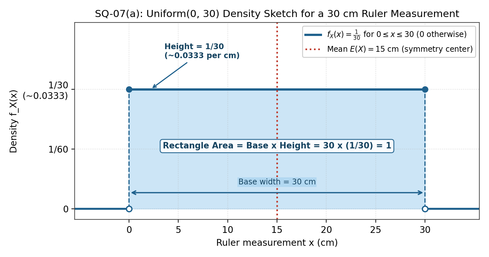

# STA237 Week 9 Answers and Practice

## Contents

- [A. Problem-Type Representative Solutions Index (`PT-01` to `PT-07`)](#a-problem-type-representative-solutions-index-pt-01-to-pt-07)
- [B. Complete Inventory of Week 9 Slide Tasks and Solutions (`SQ-01` to `SQ-08`)](#b-complete-inventory-of-week-9-slide-tasks-and-solutions-sq-01-to-sq-08)
- [C. Requested MMSA Textbook Exercises and Solutions (14 Exercises: 5 Basic, 5 Medium, 4 Test Level)](#c-requested-mmsa-textbook-exercises-and-solutions-14-exercises-5-basic-5-medium-4-test-level)
  - [MMSA Section 4.3 Normal Distribution Exercises — Use R (9 Exercises)](#mmsa-section-43-normal-distribution-exercises--use-r-9-exercises)
  - [MMSA Section 4.7 Transformation Exercises — Use the Course CDF Method (5 Exercises)](#mmsa-section-47-transformation-exercises--use-the-course-cdf-method-5-exercises)
- [D. Structured Revision Route Using Existing Source Questions](#d-structured-revision-route-using-existing-source-questions)
- [E. Coverage and Unresolved-Items Appendix](#e-coverage-and-unresolved-items-appendix)

> **Single-Canonical-Solution Policy:** Every source task (`SQ-01`–`SQ-08` in Section B) and every assigned MMSA exercise (all 14 exercises in Section C) has **one full canonical worked solution** below. Section A indexes each Problem Type (`PT-01`–`PT-07`), links back to its concept and PT explanation in [Study-Notes.md](Study-Notes.md), and links directly to its single canonical solution. No external self-tests, PAR exercises, or Transformation Theorem formulas appear in this document.

---

## A. Problem-Type Representative Solutions Index (`PT-01` to `PT-07`)

### Problem Type PT-01: Modeling a Sum of Independent Exponential Durations or Distances as a Gamma Distribution and Computing Tail Probabilities

- **Owning concept & classification:** [Concept C-01](Study-Notes.md#concept-c-01-the-gamma-distribution-and-sums-of-independent-exponential-waiting-times) (**Core**)
- **Question reference:** [PT-01 in Study-Notes.md](Study-Notes.md#problem-type-pt-01-modeling-a-sum-of-independent-exponential-durations-or-distances-as-a-gamma-distribution-and-computing-tail-probabilities) (Paraphrase of Slide Example 1, `W9/Week9-L0401-annotated.pdf`, PDF pp. 7–8; also established by Try it yourself!, PDF p. 10)
- **Canonical worked solution:** [`SQ-03` (Example 1: Support Centre Technician)](#sq-03-example-1--support-centre-technician-service-requests) (and [`SQ-05` (Try it yourself!: Two Cars)](#sq-05-try-it-yourself--olivers-two-cars-combined-distance-parts-ac))
- **Summary of result:** $T = T_1 + T_2 \sim \Gamma(\alpha = 2,\, \text{scale }\beta = 0.8\text{ hr})$ (rate $\lambda = 1.25\text{ hr}^{-1}$); $P(T > 3) = \frac{1}{0.8^2}\!\left(\frac{3}{1.25} + \frac{1}{1.25^2}\right)e^{-3.75} = 0.1117093$.

### Problem Type PT-02: Constructing a Chebyshev Interval for a Nonnegative Gamma Random Variable and Computing Its Exact Coverage Probability

- **Owning concept & classification:** [Concept C-01](Study-Notes.md#concept-c-01-the-gamma-distribution-and-sums-of-independent-exponential-waiting-times) (**Core**)
- **Question reference:** [PT-02 in Study-Notes.md](Study-Notes.md#problem-type-pt-02-constructing-a-chebyshev-interval-for-a-nonnegative-gamma-random-variable-and-computing-its-exact-coverage-probability) (Paraphrase of Slide Example 2, `W9/Week9-L0401-annotated.pdf`, PDF p. 9)
- **Canonical worked solution:** [`SQ-04` (Example 2: TikTok Video Lengths)](#sq-04-example-2--exact-vs-chebyshevs-inequality-for-tiktok-video-lengths)
- **Summary of result:** Raw Chebyshev interval $(-3.49,\, 15.49)\text{ min}$ truncates to $[0,\, 15.49)\text{ min}$ on the support $[0, \infty)$; Chebyshev guarantees $\ge 80\%$, while exact coverage is $P(0 \le T < 15.49) = 0.96473$ ($0.96470$ unrounded).

### Problem Type PT-03: Computing One-Sided, Interval, Central, and Two-Tailed Normal Probabilities via Standardization and `pnorm`

- **Owning concept & classification:** [Concept C-02](Study-Notes.md#concept-c-02-the-normal-distribution-standardization-and-probabilityquantile-calculations-in-r) (**Core**)
- **Question reference:** [PT-03 in Study-Notes.md](Study-Notes.md#problem-type-pt-03-computing-one-sided-interval-central-and-two-tailed-normal-probabilities-via-standardization-and-pnorm) (Paraphrase of MMSA Basic `#39(h, i, j)`, printed p. 225, PDF p. 237; also established by Slide Example 3(a), PDF p. 14)
- **Canonical worked solution:** [`MMSA #39(h–j)`](#mmsa-39h-i-j-basic--section-43-printed-p-225-pdf-p-237) (and [`SQ-06(a)`](#sq-06-example-3--distilled-water-dispenser-parts-ab))
- **Summary of result:** (h) $0.07913$; (i) $0.06681$; (j) $0.98758$.

### Problem Type PT-04: Finding Normal Percentiles, Cutoffs, and Upper-Tail Critical Values from Specified Probabilities Using `qnorm`

- **Owning concept & classification:** [Concept C-02](Study-Notes.md#concept-c-02-the-normal-distribution-standardization-and-probabilityquantile-calculations-in-r) (**Core** for percentiles and probability cutoffs; **Supplementary** for MMSA critical-value symbol $z_\alpha$ in `#42`)
- **Question reference:** [PT-04 in Study-Notes.md](Study-Notes.md#problem-type-pt-04-finding-normal-percentiles-cutoffs-and-upper-tail-critical-values-from-specified-probabilities-using-qnorm) (Paraphrase of Slide Example 3(b), `W9/Week9-L0401-annotated.pdf`, PDF p. 14; also established by MMSA Basic `#40`, `#41`, `#42`, printed pp. 225–226 / PDF pp. 237–238)
- **Canonical worked solution:** [`SQ-06(b)`](#sq-06-example-3--distilled-water-dispenser-parts-ab) (and [`MMSA #40`](#mmsa-40-basic--section-43-printed-p-225-pdf-p-237), [`#41`](#mmsa-41-basic--section-43-printed-pp-225226-pdf-pp-237238), [`#42`](#mmsa-42-basic--section-43-printed-p-226-pdf-p-238))
- **Summary of result:** $c = \text{qnorm}(0.995,\, \text{mean} = 64,\, \text{sd} = 0.78) = 66.00915\text{ oz} \approx 66.01\text{ oz}$.

### Problem Type PT-05: Computing Moments and Exact vs. Chebyshev Event Probabilities for a Transformed Random Variable by Domain Mapping

- **Owning concept & classification:** [Concept C-03](Study-Notes.md#concept-c-03-functions-and-transformations-of-continuous-random-variables--moments-domain-mapping-and-the-distribution-cdf-method) (**Core**)
- **Question reference:** [PT-05 in Study-Notes.md](Study-Notes.md#problem-type-pt-05-computing-moments-and-exact-vs-chebyshev-event-probabilities-for-a-transformed-random-variable-by-domain-mapping) (Paraphrase of Slide Example 5(a–e), `W9/Week9-L0401-annotated.pdf`, PDF p. 16 / printed Slide 18)
- **Canonical worked solution:** [`SQ-07` (Example 5: 30 cm Ruler & Cube Surface Area)](#sq-07-example-5--30-cm-ruler-and-cube-surface-area-parts-ae)
- **Summary of result:** $E(X)=15\text{ cm}$, $V(X)=75\text{ cm}^2$; $E(A)=1{,}800\text{ cm}^2$, $V(A)=2{,}592{,}000\text{ cm}^4$; Chebyshev bound $-3.05$ (uninformative since $k \approx 0.4969 < 1$); exact mapped probability $P(1000 < A < 2600) = 0.26356$.

### Problem Type PT-06: Deriving the CDF and PDF of a Transformed Continuous Random Variable Using the Distribution (CDF) Method (Increasing on Support)

- **Owning concept & classification:** [Concept C-03](Study-Notes.md#concept-c-03-functions-and-transformations-of-continuous-random-variables--moments-domain-mapping-and-the-distribution-cdf-method) (**Core**)
- **Question reference:** [PT-06 in Study-Notes.md](Study-Notes.md#problem-type-pt-06-deriving-the-cdf-and-pdf-of-a-transformed-continuous-random-variable-using-the-distribution-cdf-method-increasing-on-support) (Paraphrase of Slide Example 6, `W9/Week9-L0401-annotated.pdf`, PDF p. 19 / printed Slide 21)
- **Canonical worked solution:** [`SQ-08` (Example 6: $Y = X^2$ for $X \sim \text{Exp}(\theta = 2)$)](#sq-08-example-6--transformation-of-exponential-mean-2-by-squaring)
- **Summary of result:** $P(Y \le 100) = 1 - e^{-5} = 0.99326$; $F_Y(y) = 1 - e^{-\sqrt{y}/2}$ for $y \ge 0$ ($0$ for $y < 0$); $f_Y(y) = \frac{1}{4\sqrt{y}}e^{-\sqrt{y}/2}$ for $y > 0$ ($0$ otherwise).

### Problem Type PT-07: Deriving the CDF and PDF of a Strictly Decreasing Transformation via Inequality Reversal in the Distribution Method

- **Owning concept & classification:** [Concept C-03](Study-Notes.md#concept-c-03-functions-and-transformations-of-continuous-random-variables--moments-domain-mapping-and-the-distribution-cdf-method) (**Core** CDF Method + **Supplementary** inequality-reversal step)
- **Question reference:** [PT-07 in Study-Notes.md](Study-Notes.md#problem-type-pt-07-deriving-the-cdf-and-pdf-of-a-strictly-decreasing-transformation-via-inequality-reversal-in-the-distribution-method) (Paraphrase of MMSA Basic `#116`, Section 4.7, printed p. 263, PDF p. 275)
- **Canonical worked solution:** [`MMSA #116`](#mmsa-116-basic--section-47-printed-p-263-pdf-p-275)
- **Summary of result:** $F_Y(y) = 1 - e^{-y}$ for $y > 0$ ($0$ for $y \le 0$); $f_Y(y) = e^{-y}$ for $y > 0$ ($0$ otherwise), i.e., $Y \sim \text{Exp}(\lambda = 1)$.

---

## B. Complete Inventory of Week 9 Slide Tasks and Solutions (`SQ-01` to `SQ-08`)

Every fill-in-the-blank prompt, derivation, worked slide example, and "Try it yourself!" question in `W9/Week9-L0401-annotated.pdf` is preserved below with its exact slide naming (note there is no Example 4 in the slide deck).

### SQ-01: About Gamma Distribution — Properties and Gamma(4) Check

- **Locator:** `W9/Week9-L0401-annotated.pdf`, PDF p. 5 (printed Slide 5)
- **Classification & PT:** `Core` | Concept development (`C-01`, no separate PT)
- **Problem statement (paraphrase):** Complete the properties of the gamma function $\Gamma(\alpha) = \int_0^\infty x^{\alpha-1}e^{-x}\,dx$ and its relation to Exponential waiting times on Slide 5 (items 1–7), and verify $\Gamma(4) = 3!$ using the recurrence relation and $\Gamma(1) = \int_0^\infty e^{-x}\,dx = 1$.
- **Worked solution:**
  1. Definition: $\Gamma(\alpha) = \int_0^\infty x^{\alpha-1}e^{-x}\,dx$ for $\alpha > 0$.
  2. For $\alpha > 1$: integrating by parts with $u = x^{\alpha-1}$, $dv = e^{-x}\,dx$ gives $\Gamma(\alpha) = (\alpha - 1)\Gamma(\alpha - 1)$.
  3. For integer $\alpha = n \in \mathbb{Z}_+$: repeating the recurrence gives $\Gamma(\alpha) = (\alpha - 1)!$.
     - *Handwritten slide check ($\alpha = 4$):* $\Gamma(4) = 3\Gamma(3) = 3 \times 2 \times \Gamma(2) = 3 \times 2 \times 1 \times \Gamma(1)$, where $\Gamma(1) = \int_0^\infty x^{1-1}e^{-x}\,dx = \int_0^\infty e^{-x}\,dx = 1$ (since $e^{-x}$ on $(0,\infty)$ is the $\text{Exp}(\lambda=1)$ PDF), so $\Gamma(4) = 6 = 3!$.
  4. Stated half-integer value: $\Gamma(1/2) = \sqrt{\pi}$.
  5. Special case $\alpha = 1$: $\Gamma(1, \beta) = \text{Exp}(\theta = \beta)$ (exponential mean parameter $\beta$).
  6. Sum of $n$ i.i.d. $\text{Exp}(\theta)$ random variables: $T = X_1 + X_2 + \dots + X_n$, where $X_i \stackrel{\text{i.i.d.}}{\sim} \text{Exp}(\theta)$ represents the $i$-th waiting interval (e.g., time between consecutive Poisson arrivals with mean $\theta$), results in a **Gamma** random variable with $T \sim \text{Gamma}(\alpha = n,\, \beta = \theta)$.
  7. Elementary closed-form CDF limitation: when $\alpha$ is not a positive integer ($\alpha \notin \mathbb{Z}_+$, written $\alpha, \beta \notin \mathbb{Z}_+$ on Slide 5), the incomplete Gamma integral cannot be evaluated in elementary closed form by repeated integration by parts, so probability calculations use R (`pgamma`).
- **Answer:** Completed formulas and identities match items 1–7 above, with $\Gamma(4) = 6$.

### SQ-02: Gamma Expected Value Derivation

- **Locator:** `W9/Week9-L0401-annotated.pdf`, PDF p. 6 (printed Slide 6)
- **Classification & PT:** `Core` | Concept derivation (`C-01`)
- **Problem statement (paraphrase):** Starting from $E(X) = \int_0^\infty x \cdot f(x)\,dx$, derive the expected value formula $E(X) = \alpha\beta$ for $X \sim \Gamma(\alpha, \beta)$ using the Gamma function.
- **Setup & working:** Substitute $f(x) = \frac{1}{\Gamma(\alpha)\beta^\alpha}x^{\alpha-1}e^{-x/\beta}$ for $x > 0$:
  $$E(X) = \int_0^\infty x \cdot \frac{1}{\Gamma(\alpha)\beta^\alpha}x^{\alpha-1}e^{-x/\beta}\,dx = \frac{1}{\Gamma(\alpha)\beta^\alpha}\int_0^\infty x^{(\alpha+1)-1}e^{-x/\beta}\,dx.$$
  Make the substitution $u = x/\beta$, so $x = \beta u$ and $dx = \beta\,du$ (as $x: 0 \to \infty$, $u: 0 \to \infty$):
  $$E(X) = \frac{1}{\Gamma(\alpha)\beta^\alpha}\int_0^\infty (\beta u)^{\alpha} e^{-u}\,\beta\,du = \frac{\beta^{\alpha+1}}{\Gamma(\alpha)\beta^\alpha}\int_0^\infty u^{(\alpha+1)-1}e^{-u}\,du = \frac{\beta^{\alpha+1}\Gamma(\alpha+1)}{\Gamma(\alpha)\beta^\alpha}.$$
  Since $\alpha + 1 > 1$, apply the recurrence property $\Gamma(\alpha+1) = \alpha\Gamma(\alpha)$:
  $$E(X) = \frac{\beta \cdot \alpha\Gamma(\alpha)}{\Gamma(\alpha)} = \alpha\beta.$$
  In rate parameterization ($\lambda = 1/\beta$), $E(X) = \alpha/\lambda$.
- **Answer:** $E(X) = \alpha\beta = \alpha/\lambda$.

### SQ-03: Example 1 — Support Centre Technician Service Requests

- **Locator:** `W9/Week9-L0401-annotated.pdf`, PDF pp. 7–8 (printed Slides 7–8; handwritten *"Test/exam level"*)
- **Classification & PT:** `Core` | **`PT-01`**
- **Problem statement (paraphrase):** The number of service requests fulfilled by a technician at a support centre follows a Poisson distribution with an average of $10$ requests per $8$-hour workday. How would you model the random time it takes for two unrelated and independent service requests to be fulfilled? Use your model to find the probability that two service requests take more than $3$ hours to fulfill, and verify the result in R.
- **Model & assumptions:**
  - *Unit conversion:* $10\text{ requests}$ per $8\text{ hours}$ gives an hourly rate $\lambda = \frac{10}{8} = 1.25\text{ requests/hour}$, and a mean completion time per request of $\theta = \frac{1}{\lambda} = \frac{8}{10} = 0.8\text{ hours/request}$.
  - *Variable definition & why the model fits:* Let $T_i$ be the time (in hours) to complete the $i$-th service request for $i = 1, 2$, and let $T = T_1 + T_2$ be the combined completion time (in hours). Notice that a Poisson count average of $10$ per $8$ hours alone is not enough—we rely on two conditions:
    1. Completions occur as a **Poisson process** at constant rate $\lambda = 1.25\text{ hr}^{-1}$ (making each wait $T_i \sim \text{Exp}(\theta = 0.8\text{ hr})$).
    2. The problem explicitly states that the two requests are **unrelated and independent**, so $T_1, T_2 \stackrel{\text{i.i.d.}}{\sim} \text{Exp}(\theta = 0.8)$.
    Therefore:
    $$T = T_1 + T_2 \sim \Gamma(\alpha = 2,\, \text{scale }\beta = 0.8\text{ hr}), \qquad f_T(t) = \frac{1}{\Gamma(2)(0.8)^2}\,t^{2-1}e^{-t/0.8} = \frac{1}{0.8^2}\,t\,e^{-1.25t}, \quad t \ge 0.$$
- **Working (Upper-tail integral matching tabular integration by parts on PDF p. 7):**
  $$P(T > 3) = \int_3^\infty \frac{1}{\Gamma(2)(0.8)^2}\,t\,e^{-t/0.8}\,dt = \frac{1}{0.8^2}\int_3^\infty t\,e^{-1.25t}\,dt.$$
  Set up tabular integration by parts (differentiate $D$: $t \to 1 \to 0$; integrate $I$: $e^{-1.25t} \to -\frac{1}{1.25}e^{-1.25t} \to \frac{1}{1.25^2}e^{-1.25t}$ with alternating signs $+, -$):
  $$P(T > 3) = \frac{1}{0.8^2}\left[-\frac{t}{1.25}e^{-1.25t} - \frac{1}{1.25^2}e^{-1.25t}\right]_3^\infty.$$
  Since $\lim_{t\to\infty} t e^{-1.25t} = 0$ and $\lim_{t\to\infty} e^{-1.25t} = 0$, the upper limit gives $0$, leaving:
  $$P(T > 3) = \frac{1}{0.8^2}\left(\frac{3}{1.25}e^{-3.75} + \frac{1}{1.25^2}e^{-3.75}\right) = (1 + 3.75)e^{-3.75} = 4.75\,e^{-3.75} \approx 0.1117093.$$
- **R verification (actually executed in R 4.5.1, matching Slide 8):**
  ```r
  pgamma(3, shape = 2, scale = 0.8, lower.tail = FALSE)
  # [1] 0.1117093
  ```
  *(Equivalently in rate parameterization: `pgamma(3, shape = 2, rate = 1.25, lower.tail = FALSE)` $\to 0.1117093$. Here `lower.tail = FALSE` directly requests the upper tail $P(T > 3)$ rather than $P(T \le 3)$.)*
- **Answer:** $T = T_1 + T_2 \sim \Gamma(\alpha = 2, \text{scale } \beta = 0.8\text{ hr})$, and $P(T > 3) \approx 0.1117$ ($11.17\%$).

### SQ-04: Example 2 — Exact vs. Chebyshev's Inequality for TikTok Video Lengths

- **Locator:** `W9/Week9-L0401-annotated.pdf`, PDF p. 9 (printed Slide 9; handwritten *"Test/exam level difficulty"*)
- **Classification & PT:** `Core` | **`PT-02`**
- **Problem statement (paraphrase):** Suppose the distribution of TikTok video lengths (in minutes) is approximately gamma distributed with parameters $\alpha = 2$ and $\beta = 3$.
  (1) Why does the problem say only *"approximately"* gamma distributed?
  (2) According to Chebyshev's inequality, what interval of video lengths makes up at least $80\%$ of TikTok videos?
  (3) Find the exact probability of the computed interval under the Gamma distribution. *(Marked as a "Practice" handwritten exercise on PDF p. 9.)*
- **Worked solution:**
  1. **Why "approximately"?** Real TikTok video durations are strictly nonnegative and heavily right-skewed, which matches the qualitative shape of a Gamma distribution on $[0, \infty)$; however, observed platform durations come from empirical data (discrete second increments, user behavior, and editing patterns) that will not match a smooth idealized theoretical curve everywhere, without needing to claim any single fixed platform-wide maximum duration.
  2. **Chebyshev's at-least-$80\%$ interval:** Let $T$ be the length of a video in minutes, modeled as $T \sim \Gamma(\alpha = 2,\, \text{scale }\beta = 3)$ with support $[0, \infty)$. Compute the mean and variance:
     $$\mu = E(T) = \alpha\beta = 2 \times 3 = 6\text{ min}, \qquad \sigma^2 = V(T) = \alpha\beta^2 = 2 \times 3^2 = 18\text{ min}^2, \qquad \sigma = \sqrt{18} \approx 4.2426\text{ min}.$$
     Set Chebyshev's lower bound to $0.80$:
     $$P(|T - \mu| < k\sigma) \ge 1 - \frac{1}{k^2} = 0.80 \implies \frac{1}{k^2} = 0.20 \implies k^2 = 5 \implies k = \sqrt{5} \approx 2.2361.$$
     Computing the raw Chebyshev endpoints gives:
     $$(\mu - \sqrt{5}\sigma,\, \mu + \sqrt{5}\sigma) = (6 - \sqrt{90},\, 6 + \sqrt{90}) \approx (-3.4868,\, 15.4868)\text{ min},$$
     rounded on PDF p. 9 to $(-3.49,\, 15.49)$. **Accounting for nonnegative support:** video length cannot be negative ($P(T < 0) = 0$ because the support of $T$ is $[0, \infty)$), so the physically meaningful interval capturing at least $80\%$ of videos is **$[0,\, 15.49)$ minutes** (note $(0, 15.49)$ and $[0, 15.49)$ carry the exact same probability since $T$ is continuous).
  3. **Exact Gamma probability on $[0, 15.49)$:** Under $T \sim \Gamma(2, 3)$, $f_T(t) = \frac{1}{\Gamma(2)3^2}te^{-t/3} = \frac{1}{9}te^{-t/3}$ for $t \ge 0$. Integrating by parts ($u = t$, $dv = \frac{1}{9}e^{-t/3}dt \implies v = -\frac{1}{3}e^{-t/3}$) up to $U = 15.49$:
     $$P(0 \le T < 15.49) = \int_0^{15.49} \frac{t}{9}e^{-t/3}\,dt = \left[-\frac{t}{3}e^{-t/3} - e^{-t/3}\right]_0^{15.49} = 1 - \left(1 + \frac{15.49}{3}\right)e^{-15.49/3} \approx 0.96473.$$
     *(Using unrounded upper endpoint $6 + \sqrt{90} \approx 15.48683$ gives $0.96470$.)*
  - **R verification (actually executed in R 4.5.1):**
    ```r
    pgamma(15.49, shape = 2, scale = 3)          # [1] 0.9647298
    pgamma(6 + sqrt(90), shape = 2, scale = 3)   # [1] 0.9646985
    ```
- **Answer:** (1) An idealized smooth Gamma curve only approximates empirical skewed nonnegative video durations; (2) Chebyshev guarantees at least $80\%$ of videos fall in **$[0,\, 15.49)$ minutes** (raw formula $(-3.49,\, 15.49)$ clipped to support $[0, \infty)$); (3) the **exact** Gamma probability for $[0, 15.49)$ is **$0.9647$** ($96.47\%$, strictly larger than Chebyshev's worst-case $80\%$ lower bound).

### SQ-05: Try it yourself! — Oliver's Two Cars Combined Distance (Parts a–c)

- **Locator:** `W9/Week9-L0401-annotated.pdf`, PDF p. 10 (printed Slide 10)
- **Classification & PT:** `Core` | **`PT-01`**
- **Problem statement (paraphrase):** Suppose the distance driven before maintenance is required can be modeled with an exponential distribution $D \sim \text{Exp}(3)$, where $D$ is measured in units of $1000\text{ km}$. Oliver owns two cars and wants to model the combined distance he can get between his two cars before they both require maintenance.
  (a) Define an appropriate random variable for the distance driven for each of his two cars, define a new random variable $Y$ representing the combined distance, and determine what distribution $Y$ has.
  (b) What is the probability that the combined distance will exceed $70{,}000\text{ km}$?
  (c) Briefly explain why we need the combined random variable $Y$ to answer (b)—that is, why can we not work directly with the distribution of individual car distances?
- **Source ambiguity note (`Exp(3)` convention):** The slide writes bare $D \sim \text{Exp}(3)$ without naming whether $3$ is the **mean parameter $\theta$** or the **rate parameter $\lambda$**.
  - On Slide 4–5 (`PDF pp. 4–5`), Prof. Wong writes `Exp(theta)` using the **mean/scale parameter** ($\theta = 3$, meaning each car averages $3{,}000\text{ km}$ before maintenance).
  - By contrast, MMSA (§4.4) parameterizes Exponential by **rate $\lambda$** ($\lambda = 3$, meaning $3$ maintenance events per $1000\text{ km}$, so mean distance is only $1/3 \times 1000\text{ km} \approx 333.3\text{ km}$).
  We report part (a) clearly with both conventions noted and solve (b) under **both** conventions, highlighting the primary Week 9 slide convention ($\theta = 3$) first.
- **Worked solution:**
  - **(a) Variables, independence assumption, and distribution of $Y$:**
    Let $D_1$ and $D_2$ be the distances driven before maintenance is required (each measured in **$1000\text{ km}$**) for Car 1 and Car 2, respectively, and let
    $$Y = D_1 + D_2 \quad \text{(in units of } 1000\text{ km)}$$
    be their combined distance. Assuming **$D_1$ and $D_2$ are independent** and identically distributed as $\text{Exp}(3)$, summing two independent common-parameter Exponential variables (`PDF p. 5`, item 6) yields a Gamma distribution with shape $\alpha = 2$:
    - *Under the Week 9 slide mean/scale convention ($\theta = 3 \implies E(D_i) = 3{,}000\text{ km}$):* $Y \sim \Gamma(\alpha = 2,\, \text{scale }\beta = 3)$, PDF $f_Y(y) = \frac{1}{9}y e^{-y/3}$ for $y \ge 0$ (mean $E(Y) = 6{,}000\text{ km}$).
    - *Under the MMSA rate convention ($\lambda = 3 \implies E(D_i) = 1/3 \times 1000\text{ km}$):* $Y \sim \Gamma(\alpha = 2,\, \text{rate }\lambda = 3)$ (scale $\beta = 1/3$), PDF $f_Y(y) = 9y e^{-3y}$ for $y \ge 0$ (mean $E(Y) = \frac{2}{3} \times 1000\text{ km} \approx 667\text{ km}$).
  - **(b) Combined distance exceeding $70{,}000\text{ km}$:** Convert the threshold to the variable's units of $1000\text{ km}$:
    $$70{,}000\text{ km} \div 1000\text{ km} = 70 \implies \text{compute } P(Y > 70).$$
    *Under primary Slide scale convention ($\beta = 3$):* Using tabular integration by parts (or $f_Y(y) = \frac{1}{9}ye^{-y/3}$):
    $$P(Y > 70) = \int_{70}^\infty \frac{1}{9}y e^{-y/3}\,dy = \left[-\frac{y}{3}e^{-y/3} - e^{-y/3}\right]_{70}^\infty = \left(1 + \frac{70}{3}\right)e^{-70/3} = \frac{73}{3}e^{-70/3} \approx 1.7892 \times 10^{-9}.$$
    *Under alternative MMSA rate convention ($\lambda = 3$):*
    $$P(Y > 70) = \int_{70}^\infty 9y e^{-3y}\,dy = \left[-3ye^{-3y} - e^{-3y}\right]_{70}^\infty = (1 + 210)e^{-210} = 211\,e^{-210} \approx 1.3257 \times 10^{-89}.$$
    - *R verification (actually executed in R 4.5.1):*
      ```r
      pgamma(70, shape = 2, scale = 3, lower.tail = FALSE)  # [1] 1.78922e-09  (slide theta=3)
      pgamma(70, shape = 2, rate = 3, lower.tail = FALSE)   # [1] 1.325688e-89 (MMSA lambda=3)
      ```
  - **(c) Why we need the combined RV $Y = D_1 + D_2$ instead of individual car distributions:**
    Two distinct issues explain why individual car distributions cannot answer (b) directly:
    1. **Marginal distributions vs. independence for joint events:** Knowing only the marginal distribution of each single car ($D_i \sim \text{Exp}(3)$) only gives single-car probabilities such as $P(D_1 > 70)$ or $P(D_1 > 35)$. Even to evaluate a joint rectangular event like *"both cars exceed $35$,"* $P(D_1 > 35 \text{ and } D_2 > 35) = P(D_1 > 35)P(D_2 > 35)$, marginal distributions alone are not enough—you must invoke the **independence assumption** between the two cars.
    2. **$\{D_1 > 35 \text{ and } D_2 > 35\}$ and $\{D_1 + D_2 > 70\}$ are two different events:** Even under independence, having *both* cars exceed $35$ is a strictly smaller event than their sum exceeding $70$: for instance, $D_1 = 50$ and $D_2 = 25$ achieves $D_1 + D_2 = 75 > 70$ even though $D_2 \le 35$ and neither car alone exceeds $70$. Because the threshold $70$ applies to the **sum** $Y = D_1 + D_2$ across all pairs $\{(d_1, d_2) : d_1 + d_2 > 70\}$—and adding two independent Exponential RVs changes the family (`Exp` $\to$ `Gamma`)—we model the combined variable $Y \sim \Gamma(\alpha = 2, \dots)$.
- **Answer:**
  - **(a)** $D_1, D_2 \stackrel{\text{i.i.d.}}{\sim} \text{Exp}(3)$, so $Y = D_1 + D_2 \sim \Gamma(\alpha=2,\, \beta=3)$ under the slide mean convention (or $\Gamma(\alpha=2,\, \lambda=3)$ under the rate convention).
  - **(b)** $P(Y > 70) = \frac{73}{3}e^{-70/3} \approx 1.789 \times 10^{-9}$ under $\theta=3$ (or $211 e^{-210} \approx 1.326 \times 10^{-89}$ under $\lambda=3$).
  - **(c)** Marginal single-car distributions do not specify joint dependence on their own, and even with independence, $\{D_1 > 35 \text{ and } D_2 > 35\}$ differs from the sum event $\{D_1 + D_2 > 70\}$, which requires the Gamma distribution of $Y = D_1 + D_2$.

### SQ-06: Example 3 — Distilled Water Dispenser (Parts a–b)

- **Locator:** `W9/Week9-L0401-annotated.pdf`, PDF p. 14 (printed Slide 14; labelled *MMSA Ex. 4.24* on slide)
- **Classification & PT:** `Core` | **(a) `PT-03`**, **(b) `PT-04`**
- **Problem statement (paraphrase):** The amount of distilled water $D$ (in oz) dispensed by a machine is normally distributed with mean $\mu = 64\text{ oz}$ and standard deviation $\sigma = 0.78\text{ oz}$ (i.e., $D \sim N(64,\, 0.78^2)$ in variance notation).
  (a) What is the probability that the amount dispensed is within $1$ standard deviation of the mean of $64\text{ oz}$?
  (b) What container size $c$ (in oz) will ensure that overflow occurs only $0.5\%$ of the time?
- **Worked solution:**
  - **(a) Probability within 1 SD (`PT-03`):**
    By the empirical rule (`PDF p. 13`), this should be approximately $68\%$. Writing the exact event with endpoints $64 \pm 0.78$:
    $$P(63.22 < D < 64.78) = P\!\left(-1 < \frac{D - 64}{0.78} < 1\right) = P(-1 < Z < 1) = \Phi(1) - \Phi(-1) = 1 - 2\Phi(-1).$$
    In R (executed in R 4.5.1):
    ```r
    pnorm(64.78, mean = 64, sd = 0.78) - pnorm(63.22, mean = 64, sd = 0.78)
    # [1] 0.6826895
    1 - 2 * pnorm(-1, mean = 0, sd = 1)
    # [1] 0.6826895
    ```
  - **(b) Container size for 0.5% overflow (`PT-04`):**
    Overflow means dispensed volume exceeds container capacity $c$: $P(D > c) = 0.005 \iff P(D \le c) = 0.995$. Thus $c$ is the **$99.5$th percentile** of $N(64, 0.78^2)$ (using `lower.tail = FALSE` directly targets the upper tail $0.005$):
    ```r
    qnorm(0.995, mean = 64, sd = 0.78)
    # [1] 66.00915
    qnorm(0.005, mean = 64, sd = 0.78, lower.tail = FALSE)
    # [1] 66.00915
    ```
    Equivalently via standardization (matching Slide 14's handwriting): `qnorm(0.995, mean = 0, sd = 1) = 2.575829` $\approx 2.58$, so $c \approx 64 + 2.58(0.78) = 66.0124\text{ oz}$ (exact unrounded $66.00915\text{ oz}$). *(Handwritten note on PDF p. 14 also marks the symmetric lower $0.5$th percentile $\mu - 2.58\sigma$ on the left tail.)*
- **Answer:** (a) $0.6827$ ($68.27\%$); (b) $c \approx 66.01\text{ oz}$.

### SQ-07: Example 5 — 30 cm Ruler and Cube Surface Area (Parts a–e)

- **Locator:** `W9/Week9-L0401-annotated.pdf`, PDF p. 16 (printed Slide 18; note there is no Example 4 in the deck)
- **Classification & PT:** `Core` | **(a–e) `PT-05`**, **handwritten general CDF/PDF derivation of $A$ `PT-06`**
- **Problem statement (paraphrase):** Consider selecting a measurement at random from a $30\text{ cm}$ ruler, meaning we are equally likely to select any number in any $1\text{ cm}$ interval.
  (a) Sketch a reasonable density function that can model how a measurement is randomly generated, and find its PDF.
  (b) Intuitively, the average measurement should be $15\text{ cm}$. Show this using your PDF from (a).
  (c) Find the variance in measurements that are randomly selected.
  (d) Suppose the measurement represents the side length of a cube. Find the average and variance of the random surface area that arises from this measurement selection.
  (e) According to Chebyshev's inequality, what are the chances that we end up with a cube with surface area between $1000\text{ cm}^2$ and $2600\text{ cm}^2$? Can you think of another way to find this probability without using Chebyshev's inequality? *(Also include the handwritten work on `PDF p. 16` showing $P(A \le 2400)$ and the general CDF/PDF of $A = 6X^2$.)*
- **Worked solution:**
  - **(a) Uniform model, density sketch & PDF:** Let $X$ be the randomly selected measurement in $\text{cm}$. Because all subintervals of equal length in $[0, 30]$ are equally likely, $X \sim \text{Unif}(0, 30)$, whose density is a flat rectangle of base $30\text{ cm}$ and height $1/30$:
    $$f_X(x) = \begin{cases} \dfrac{1}{30}, & 0 \le x \le 30, \\ 0, & \text{otherwise.} \end{cases}$$

    
  - **(b) Expected side length:**
    $$E(X) = \int_0^{30} x \cdot \frac{1}{30}\,dx = \left[\frac{x^2}{60}\right]_0^{30} = \frac{900}{60} = 15\text{ cm}.$$
  - **(c) Variance of side length:** First $E(X^2) = \int_0^{30} x^2 \frac{1}{30}\,dx = \left[\frac{x^3}{90}\right]_0^{30} = \frac{27{,}000}{90} = 300\text{ cm}^2$, so
    $$V(X) = E(X^2) - [E(X)]^2 = 300 - 15^2 = 75\text{ cm}^2.$$
    *(Matches $\frac{(30-0)^2}{12} = \frac{900}{12} = 75\text{ cm}^2$.)*
  - **(d) Expected value and variance of cube surface area $A = 6X^2$:**
    A cube of side length $X\text{ cm}$ has $6$ square faces, so total surface area is $A = 6X^2$ (measured in **$\text{cm}^2$**). Using LOTUS:
    $$E(A) = E(6X^2) = 6E(X^2) = 6(300) = 1{,}800\text{ cm}^2,$$
    $$E(A^2) = E(36X^4) = \int_0^{30} 36x^4\cdot \frac{1}{30}\,dx = \frac{36}{30}\left[\frac{x^5}{5}\right]_0^{30} = \frac{6}{5}\cdot \frac{30^5}{5} = \frac{36 \cdot 30^4}{5} = 5{,}832{,}000\text{ cm}^4,$$
    $$V(A) = E(A^2) - [E(A)]^2 = 5{,}832{,}000 - 1{,}800^2 = 5{,}832{,}000 - 3{,}240{,}000 = 2{,}592{,}000\text{ cm}^4,$$
    $$SD(A) = \sqrt{2{,}592{,}000} \approx 1{,}609.97\text{ cm}^2.$$
  - **(e) Chebyshev bound vs. exact domain-mapped probability for $1000 < A < 2600$:**
    - *Chebyshev's inequality:* Notice $(1000, 2600)$ is symmetric around $\mu_A = 1{,}800$ with half-width $\varepsilon = 800\text{ cm}^2$. Dividing by $SD(A)$ gives
      $$k = \frac{800}{SD(A)} = \frac{800}{\sqrt{2{,}592{,}000}} \approx 0.4969 < 1.$$
      Plugging into Chebyshev's lower bound $P(|A - 1800| < 800) \ge 1 - \frac{1}{k^2}$ yields $1 - \frac{2{,}592{,}000}{640{,}000} = -3.05$. Because $k \le 1$, Chebyshev's inequality gives a negative lower bound and is **completely uninformative** (it provides no guarantee beyond the trivial $P \ge 0$).
    - *Exact probability by mapping $(1000 < A < 2600)$ back to $X$ (`PT-05`):* Since $X \ge 0$, $A = 6X^2$ is strictly increasing on $[0, 30]$:
      $$P(1000 < A < 2600) = P(1000 < 6X^2 < 2600) = P\!\left(\sqrt{\frac{1000}{6}} < X < \sqrt{\frac{2600}{6}}\right) = \frac{\sqrt{2600/6} - \sqrt{1000/6}}{30} \approx \frac{20.8167 - 12.9099}{30} \approx 0.26356.$$
    - *Additional handwritten work on PDF p. 16 (flagged separately from typed interval):*
      1. Bottom-left handwritten checkpoint uses a different upper threshold $2400$: $P(A \le 2400) = P(6X^2 \le 2400) = P(X \le \sqrt{400}) = P(X \le 20) = \int_0^{20}\frac{1}{30}\,dx = \frac{20}{30} = \frac{2}{3} \approx 0.6667$.
      2. Bottom-right handwritten work derives the **general CDF and PDF of $A$** via `PT-06`: for $0 \le a \le 5400$ ($= 6 \cdot 30^2$),
         $$F_A(a) = P(A \le a) = P(6X^2 \le a) = P\!\left(X \le \sqrt{\frac{a}{6}}\right) = \int_0^{\sqrt{a/6}} \frac{1}{30}\,dx = \frac{1}{30}\sqrt{\frac{a}{6}},$$
         with $F_A(a) = 0$ for $a < 0$ and $F_A(a) = 1$ for $a > 5400$; differentiating on $(0, 5400]$ gives
         $$f_A(a) = \frac{1}{30}\cdot \frac{1}{2}\left(\frac{a}{6}\right)^{-1/2}\cdot \frac{1}{6} = \frac{1}{60\sqrt{6a}}, \qquad 0 < a \le 5400 \quad (0\text{ otherwise}).$$
- **Answer:** (a) $f_X(x)=1/30$ on $[0, 30]$; (b) $E(X)=15\text{ cm}$; (c) $V(X)=75\text{ cm}^2$; (d) $E(A)=1{,}800\text{ cm}^2$, $V(A)=2{,}592{,}000\text{ cm}^4$; (e) Chebyshev bound $1 - 1/k^2 = -3.05$ is uninformative ($k < 1$), whereas exact domain mapping gives $P(1000 < A < 2600) \approx 0.2636$ (and handwritten $P(A \le 2400) = 2/3$).

### SQ-08: Example 6 — Transformation of Exponential Mean 2 by Squaring

- **Locator:** `W9/Week9-L0401-annotated.pdf`, PDF p. 19 (printed Slide 21)
- **Classification & PT:** `Core` | **`PT-06`**
- **Problem statement (paraphrase):** Suppose $X \sim \text{Exp}(\theta = 2)$ and let $Y = X^2$. Find $P(Y \le 100)$. Generalize this calculation to compute $F_Y(y) = P(Y \le y)$ for all $y \in \mathbb{R}$, and obtain the PDF $f_Y(y)$.
- **Base distribution:** On PDF p. 19 (mean convention $\theta = 2$), $X$ has support $[0, \infty)$, PDF
  $$f_X(x) = \begin{cases} \frac{1}{2}e^{-x/2}, & x \ge 0, \\ 0, & \text{otherwise}, \end{cases} \qquad \text{and CDF} \qquad F_X(x) = \begin{cases} 1 - e^{-x/2}, & x \ge 0, \\ 0, & x < 0. \end{cases}$$
- **Worked solution (Course CDF Method):**
  1. **Particular value $P(Y \le 100)$:** Because $X \ge 0$ on its entire support, $X^2 \le 100 \iff -\sqrt{100} \le X \le \sqrt{100} \iff X \le 10$ (the negative side $(-\infty, 0)$ carries zero probability):
     $$P(Y \le 100) = P(X^2 \le 100) = P(X \le 10) = F_X(10) = 1 - e^{-10/2} = 1 - e^{-5} \approx 0.99326.$$
  2. **Support & general piecewise CDF $F_Y(y)$:** As $X$ ranges over $[0, \infty)$, $Y = X^2$ ranges over $[0, \infty)$.
     - For $y < 0$: since $Y = X^2 \ge 0$ always, $P(Y \le y) = 0$.
     - For $y \ge 0$: only the nonnegative root $\sqrt{y}$ lies in $[0, \infty)$, so $\{X^2 \le y\} = \{0 \le X \le \sqrt{y}\}$:
       $$F_Y(y) = P(Y \le y) = P(X^2 \le y) = P(X \le \sqrt{y}) = F_X(\sqrt{y}) = 1 - e^{-\sqrt{y}/2}.$$
     Combining both branches gives the complete piecewise CDF:
     $$F_Y(y) = \begin{cases} 1 - e^{-\sqrt{y}/2}, & y \ge 0, \\ 0, & y < 0. \end{cases}$$
  3. **PDF $f_Y(y)$ & behavior at $y = 0$:** Differentiating the active branch of $F_Y(y)$ for $y > 0$ using the Chain Rule ($\frac{d}{dy}\sqrt{y} = \frac{1}{2\sqrt{y}}$) gives
     $$f_Y(y) = \frac{d}{dy}\!\left(1 - e^{-\sqrt{y}/2}\right) = -e^{-\sqrt{y}/2}\cdot \left(-\frac{1}{2}\cdot \frac{1}{2\sqrt{y}}\right) = \frac{1}{4\sqrt{y}}\,e^{-\sqrt{y}/2}, \qquad y > 0,$$
     leading to the complete piecewise density
     $$f_Y(y) = \begin{cases} \dfrac{1}{4\sqrt{y}}\,e^{-\sqrt{y}/2}, & y > 0, \\ 0, & \text{otherwise ($y \le 0$).} \end{cases}$$
     Separate three distinct facts at the boundary point $y = 0$ (marked **"excludes $0$!"** in red on `PDF p. 19`):
     - **Right-hand blowup of the density formula:** as $y \to 0^+$, the positive-branch formula $\frac{1}{4\sqrt{y}}e^{-\sqrt{y}/2}$ diverges to $+\infty$.
     - **No finite derivative of $F_Y$ at $0$:** because the right-hand derivative is $+\infty$ while the left-hand derivative is $0$, $F_Y(y)$ has no finite derivative at $y = 0$.
     - **Single-point convention $f_Y(0) = 0$ vs. $P(Y = 0) = 0$:** placing $y = 0$ inside the `otherwise` ($y \le 0$) branch is a harmless single-point convention that never alters any probability integral, while **$P(Y = 0) = 0$ follows directly from CDF continuity at $0$** ($\lim_{y\to 0^+} F_Y(y) = 1 - e^0 = 0 = F_Y(0) = \lim_{y\to 0^-} F_Y(y)$), showing there is no point mass at $0$.
- **Check:** Substituting $u = \sqrt{y}$ ($du = \frac{dy}{2\sqrt{y}}$) gives $\int_0^\infty \frac{1}{4\sqrt{y}}e^{-\sqrt{y}/2}\,dy = \int_0^\infty \frac{1}{2}e^{-u/2}\,du = 1$.
- **Answer:** $P(Y \le 100) = 1 - e^{-5} \approx 0.9933$; full piecewise $F_Y(y)$ and $f_Y(y)$ as above.

---

## C. Requested MMSA Textbook Exercises and Solutions (14 Exercises: 5 Basic, 5 Medium, 4 Test Level)

All 14 exercises below come strictly from *Modern Mathematical Statistics with Applications*, 3rd ed. (**MMSA**), matching the instructor's highlighted **"MMSA only this week"** table on Canvas (`Page ID 2593472`). **One R note:** All numerical outputs below were verified by running **R 4.5.1**; in commands for a concrete problem we give the exact command run, while any generic symbolic parameters (as in `#114`) are clearly marked as algebraic expressions rather than numeric R calls.

### MMSA Section 4.3 Normal Distribution Exercises — Use R (9 Exercises)

#### MMSA #39(h, i, j) [Basic — Section 4.3, printed p. 225, PDF p. 237]

- **Instructor locator:** p. 225 [Use R]: `#39hij` only (do **not** assign `#39(a–g)`)
- **Classification & PT:** `Core` | Establishes **`PT-03`**
- **Question (faithful paraphrase, preserving shared prompt):** Let $Z$ be a standard normal random variable ($Z \sim N(0, 1)$, i.e., `mean = 0, sd = 1`). Using appropriate probability decompositions and R, calculate:
  - **(h)** $P(1.37 \le Z \le 2.50)$
  - **(i)** $P(1.50 \le Z)$
  - **(j)** $P(|Z| \le 2.50)$
- **Worked solutions:**
  - **(h) $P(1.37 \le Z \le 2.50)$:**
    - *Probability equation:* Write the interval area as the difference of two left-tail cumulative probabilities:
      $$P(1.37 \le Z \le 2.50) = \Phi(2.50) - \Phi(1.37).$$
    - *R command & output (executed in R 4.5.1):*
      ```r
      pnorm(2.50, mean = 0, sd = 1) - pnorm(1.37, mean = 0, sd = 1)
      # [1] 0.07913379
      ```
    - *Interpretation:* Roughly $7.91\%$ of standard normal outcomes fall between $+1.37$ and $+2.50$ standard deviations above the mean.
  - **(i) $P(1.50 \le Z)$:**
    - *Probability equation:* Equivalently $P(Z \ge 1.50) = 1 - \Phi(1.50)$. Using `lower.tail = FALSE` tells `pnorm` to return the right-tail probability $P(Z > 1.50)$ directly instead of the default left tail $P(Z \le 1.50)$.
    - *R command & output (executed in R 4.5.1):*
      ```r
      pnorm(1.50, mean = 0, sd = 1, lower.tail = FALSE)
      # [1] 0.0668072
      ```
    - *Interpretation:* About $6.68\%$ of standard normal observations lie at least $1.50$ SDs above the mean.
  - **(j) $P(|Z| \le 2.50)$:**
    - *Probability equation:* Expand the absolute-value inequality into a central symmetric interval:
      $$P(|Z| \le 2.50) = P(-2.50 \le Z \le 2.50) = \Phi(2.50) - \Phi(-2.50).$$
    - *R command & output (executed in R 4.5.1):*
      ```r
      pnorm(2.50, mean = 0, sd = 1) - pnorm(-2.50, mean = 0, sd = 1)
      # [1] 0.9875807
      ```
    - *Interpretation:* Approximately $98.76\%$ of standard normal observations lie within $\pm 2.50$ standard deviations of the mean (consistent with lying cleanly between the empirical rule's $2\sigma$ mark of $95\%$ and $3\sigma$ mark of $99.7\%$).
- **Answer:** (h) $0.0791$; (i) $0.0668$; (j) $0.9876$.

#### MMSA #40 [Basic — Section 4.3, printed p. 225, PDF p. 237]

- **Instructor locator:** p. 225 [Use R]: `#40`
- **Classification & PT:** `Core` | Contributes to **`PT-04`**
- **Question (faithful paraphrase):** In each case, determine the value of the constant $c$ for $Z \sim N(0, 1)$ that makes the probability statement correct:
  - **(a)** $\Phi(c) = 0.9838$
  - **(b)** $P(0 \le Z \le c) = 0.291$
  - **(c)** $P(c \le Z) = 0.121$
  - **(d)** $P(-c \le Z \le c) = 0.668$
  - **(e)** $P(c \le |Z|) = 0.016$
- **Worked solutions:**
  - **(a)** Quantile equation: $P(Z \le c) = \Phi(c) = 0.9838 \implies c = \Phi^{-1}(0.9838)$.
    ```r
    qnorm(0.9838, mean = 0, sd = 1)
    # [1] 2.139441
    ```
    *Interpretation:* $c \approx 2.139$ is the $98.38$th percentile of $Z$.
  - **(b)** Quantile equation: Since $\Phi(0) = 0.50$, $P(0 \le Z \le c) = \Phi(c) - 0.5 = 0.291 \implies \Phi(c) = 0.791$.
    ```r
    qnorm(0.791, mean = 0, sd = 1)
    # [1] 0.8098959
    ```
    *Interpretation:* $c \approx 0.810$ puts $29.1\%$ of area between $0$ and $c$.
  - **(c)** Quantile equation: $P(Z \ge c) = 0.121 \iff \Phi(c) = 0.879$. Passing `lower.tail = FALSE` finds the cutoff whose **upper-tail** probability equals $0.121$ directly:
    ```r
    qnorm(0.121, mean = 0, sd = 1, lower.tail = FALSE)
    # [1] 1.170002
    ```
    *Interpretation:* $c \approx 1.170$ leaves $12.1\%$ area to its right.
  - **(d)** Quantile equation: By symmetry, $1 - 0.668 = 0.332$ splits equally into $0.166$ in each outer tail, so $\Phi(c) = 0.668 + 0.166 = 0.834$ (equivalently $\frac{1 + 0.668}{2} = 0.834$).
    ```r
    qnorm(0.834, mean = 0, sd = 1)
    # [1] 0.9700933
    ```
    *Interpretation:* $[-0.970, +0.970]$ captures the central $66.8\%$ of standard normal outcomes.
  - **(e)** Quantile equation: $\{|Z| \ge c\} = \{Z \le -c\} \cup \{Z \ge c\}$ (requires $c \ge 0$), so by symmetry each tail holds half of $0.016$: $P(Z \ge c) = 0.008$. Using `lower.tail = FALSE` returns the upper-tail quantile directly:
    ```r
    qnorm(0.008, mean = 0, sd = 1, lower.tail = FALSE)
    # [1] 2.408916
    ```
    *Interpretation:* Only $1.6\%$ of standard normal outcomes lie more than $c \approx 2.409$ units away from $0$ ($0.8\%$ in each tail).
- **Answer:** (a) $2.139$ ($2.14$); (b) $0.810$ ($0.81$); (c) $1.170$ ($1.17$); (d) $0.970$ ($0.97$); (e) $2.409$ ($2.41$).

#### MMSA #41 [Basic — Section 4.3, printed pp. 225–226, PDF pp. 237–238]

- **Instructor locator:** p. 225 [Use R]: `#41` (starts at bottom of printed p. 225 and continues onto printed p. 226)
- **Classification & PT:** `Core` | Contributes to **`PT-04`**
- **Question (faithful paraphrase):** Find the following percentiles for the standard normal distribution $Z \sim N(0, 1)$ (using R; textbook also notes interpolating from Table A.3):
  **(a)** $91$st, **(b)** $9$th, **(c)** $75$th, **(d)** $25$th, **(e)** $6$th.
- **Worked solutions:** By definition, the $(100p)$th percentile of $Z$ is the left-tail quantile solving $P(Z \le c) = \Phi(c) = p$, written **$c = \Phi^{-1}(p)$**. *(Notation caution: to avoid sign confusion with MMSA's upper-tail critical-value symbol $z_\alpha$ in `#42` below, where $P(Z \ge z_\alpha) = \alpha$, we write $\Phi^{-1}(p)$ for left-tail percentiles and reserve $z_\alpha$ exclusively for right-tail probabilities!)* Executed in R 4.5.1:
  - **(a) $91$st percentile ($p = 0.91$):** $\Phi^{-1}(0.91) =$ `qnorm(0.91, mean = 0, sd = 1)` $= 1.340755 \approx 1.341$.
  - **(b) $9$th percentile ($p = 0.09$):** $\Phi^{-1}(0.09) =$ `qnorm(0.09, mean = 0, sd = 1)` $= -1.340755 \approx -1.341$ (by symmetry around $0$, $\Phi^{-1}(0.09) = -\Phi^{-1}(0.91)$).
  - **(c) $75$th percentile ($p = 0.75$):** $\Phi^{-1}(0.75) =$ `qnorm(0.75, mean = 0, sd = 1)` $= 0.6744898 \approx 0.6745$ (upper quartile).
  - **(d) $25$th percentile ($p = 0.25$):** $\Phi^{-1}(0.25) =$ `qnorm(0.25, mean = 0, sd = 1)` $= -0.6744898 \approx -0.6745$ (lower quartile; by symmetry, $-\Phi^{-1}(0.75)$).
  - **(e) $6$th percentile ($p = 0.06$):** $\Phi^{-1}(0.06) =$ `qnorm(0.06, mean = 0, sd = 1)` $= -1.554774 \approx -1.555$.
  - *Interpretation:* Negative values correspond to left-tail percentiles below the median ($50$th percentile $= \Phi^{-1}(0.50) = 0$), while complementary ranks like $9$th and $91$st are exact negatives of each other.
- **Answer:** (a) $1.341$; (b) $-1.341$; (c) $0.6745$; (d) $-0.6745$; (e) $-1.555$.

#### MMSA #42 [Basic — Section 4.3, printed p. 226, PDF p. 238]

- **Instructor locator:** p. 225 [Use R]: `#42` (actual location: printed p. 226, PDF p. 238)
- **Classification & PT:** **Core** quantile calculation (`PT-04`) + **Supplementary** MMSA upper-tail critical value notation $z_\alpha$ (MMSA pp. 216–217)
- **Question (faithful paraphrase, restoring shared MMSA definition):** In MMSA notation, $z_\alpha$ denotes the value on the standard normal axis having upper-tail area $\alpha$ to its right, i.e., $P(Z \ge z_\alpha) = \alpha$ (or $z_\alpha = \Phi^{-1}(1 - \alpha)$). Determine $z_\alpha$ for:
  **(a)** $\alpha = 0.0055$, **(b)** $\alpha = 0.09$, **(c)** $\alpha = 0.663$.
- **Worked solutions:** Since $P(Z \ge z_\alpha) = \alpha$, `qnorm(alpha, mean = 0, sd = 1, lower.tail = FALSE)` directly solves for the cutoff with upper-tail area $\alpha$ (avoiding $1 - \alpha$ subtraction). Executed in R 4.5.1:
  - **(a)** $P(Z \ge z_{0.0055}) = 0.0055$: `qnorm(0.0055, mean = 0, sd = 1, lower.tail = FALSE)` $= 2.542699 \approx 2.543$.
  - **(b)** $P(Z \ge z_{0.09}) = 0.09$: `qnorm(0.09, mean = 0, sd = 1, lower.tail = FALSE)` $= 1.340755 \approx 1.341$. Contrast `#42(b)` carefully with `#41(b)`: the $9$th left-tail percentile is $\Phi^{-1}(0.09) = -1.341$, whereas MMSA's right-tail critical value $z_{0.09}$ leaves $0.09$ in the *upper* tail (matching the $91$st left-tail percentile $\Phi^{-1}(0.91) = +1.341$)!
  - **(c)** $P(Z \ge z_{0.663}) = 0.663$: `qnorm(0.663, mean = 0, sd = 1, lower.tail = FALSE)` $= -0.4206646 \approx -0.421$. Because $\alpha = 0.663 > 0.50$, more than half the standard normal curve lies to the right of $z_{0.663}$, forcing $z_{0.663} < 0$.
- **Answer:** (a) $2.543$; (b) $1.341$; (c) $-0.421$.

#### MMSA #46 [Medium — Section 4.3, printed p. 226, PDF p. 238]

- **Instructor locator:** p. 226 [Use R]: `#46`
- **Classification & PT:** **Core** via `PT-03` (`(a–c)`) and `PT-04` (`(d)`); **Supplementary** multi-trial independence step in `(e)` (`No matching PT established by the slide/Basic source set`)
- **Question (faithful paraphrase):** Suppose the diameter at breast height (in inches) of a certain species of tree is normally distributed with $\mu = 8.8\text{ in.}$ and $\sigma = 2.8\text{ in.}$ (so $X \sim N(\text{mean}=8.8,\, \text{sd}=2.8)$ in MMSA's convention).
  - **(a)** What is the probability that a randomly selected tree has diameter at least $10\text{ in.}$? Exceeds $10\text{ in.}$?
  - **(b)** What is the probability that the diameter of a randomly selected tree exceeds $20\text{ in.}$?
  - **(c)** What is the probability that the diameter of a randomly selected tree is between $5\text{ in.}$ and $10\text{ in.}$?
  - **(d)** What value $c$ is such that the interval $(8.8 - c,\, 8.8 + c)$ includes $98\%$ of all diameter values?
  - **(e)** If four trees are independently selected, what is the probability that at least one has a diameter exceeding $10\text{ in.}$?
- **Worked solutions:**
  - **(a) (`PT-03`):** Because $X$ is continuous, $P(X = 10) = 0$, so $P(X \ge 10) = P(X > 10) = 1 - \Phi\!\left(\frac{10 - 8.8}{2.8}\right)$. Using `lower.tail = FALSE` returns the right-tail probability $P(X > 10)$ directly:
    ```r
    pnorm(10, mean = 8.8, sd = 2.8, lower.tail = FALSE)
    # [1] 0.3341176
    ```
    Both probabilities equal $0.3341$.
  - **(b) (`PT-03`):** $P(X > 20) = 1 - \Phi\!\left(\frac{20 - 8.8}{2.8}\right) = 1 - \Phi(4)$. Using `lower.tail = FALSE` avoids precision loss near $1$:
    ```r
    pnorm(20, mean = 8.8, sd = 2.8, lower.tail = FALSE)
    # [1] 3.167124e-05
    ```
    Only about $0.00317\%$ of trees exceed $20\text{ in.}$ (a $4\sigma$ event).
  - **(c) (`PT-03`):** $P(5 < X < 10) = \Phi\!\left(\frac{10 - 8.8}{2.8}\right) - \Phi\!\left(\frac{5 - 8.8}{2.8}\right)$:
    ```r
    pnorm(10, mean = 8.8, sd = 2.8) - pnorm(5, mean = 8.8, sd = 2.8)
    # [1] 0.5785145
    ```
    Roughly $57.85\%$ of trees fall between $5\text{ in.}$ and $10\text{ in.}$
  - **(d) (`PT-04`):** Symmetry leaves $2\%$ outside $(8.8 - c,\, 8.8 + c)$, i.e., $1\%$ above $8.8 + c$, so $8.8 + c$ is the $99$th percentile: $P(X \le 8.8 + c) = 0.99$:
    ```r
    qnorm(0.99, mean = 8.8, sd = 2.8) - 8.8
    # [1] 6.513774
    ```
    *(Equivalently $2.8 \times \text{qnorm}(0.99, \text{mean}=0, \text{sd}=1) = 6.513774\text{ in.}$)* Thus $(8.8 - 6.514,\, 8.8 + 6.514) = (2.286,\, 15.314)\text{ in.}$ covers $98\%$ of tree diameters.
  - **(e) [`Supplementary` multi-trial independence step — `No matching PT established by the slide/Basic source set`]:** Let $p = P(X > 10) = 0.3341176$ from (a). By independence across $4$ trees, *"at least one exceeds $10$"* is the complement of *"none of the $4$ exceed $10$ (all $4$ have $X_i \le 10$)"*:
    $$P(\text{at least one } X_i > 10) = 1 - [P(X \le 10)]^4 = 1 - (1 - p)^4.$$
    ```r
    1 - (pnorm(10, mean = 8.8, sd = 2.8))^4
    # [1] 0.803397
    ```
    There is an $80.34\%$ chance that at least one of the four trees exceeds $10\text{ in.}$
- **Answer:** (a) Both equal $0.3341$; (b) $3.167 \times 10^{-5}$; (c) $0.5785$; (d) $c \approx 6.514\text{ in.}$; (e) $0.8034$.

#### MMSA #48 [Medium — Section 4.3, printed p. 226, PDF p. 238]

- **Instructor locator:** p. 226 [Use R]: `#48`
- **Classification & PT:** `Core` | **`PT-04`**
- **Question (faithful paraphrase):** Human body temperatures for healthy individuals follow approximately a normal distribution with mean $\mu = 98.25\,^\circ\text{F}$ and standard deviation $\sigma = 0.75\,^\circ\text{F}$.
  - **(a)** Find the $90$th percentile of the distribution.
  - **(b)** Find the $5$th percentile of the distribution.
  - **(c)** What temperature separates the coolest $25\%$ from the others?
- **Worked solutions (`PT-04`):** Here $T \sim N(\text{mean} = 98.25,\, \text{sd} = 0.75)$. Each subpart solves $P(T \le t_p) = p$ via `qnorm`. Executed in R 4.5.1:
  - **(a)** $P(T \le t_{0.90}) = 0.90$: `qnorm(0.90, mean = 98.25, sd = 0.75)` $= 99.21116\,^\circ\text{F} \approx 99.21\,^\circ\text{F}$ ($90\%$ of healthy adults have temperatures at or below $99.21\,^\circ\text{F}$).
  - **(b)** $P(T \le t_{0.05}) = 0.05$: `qnorm(0.05, mean = 98.25, sd = 0.75)` $= 97.01636\,^\circ\text{F} \approx 97.02\,^\circ\text{F}$ ($5\%$ lie at or below $97.02\,^\circ\text{F}$).
  - **(c)** The coolest $25\%$ lie in the bottom $25\%$ left tail, so the separator is the $25$th percentile ($P(T \le t_{0.25}) = 0.25$): `qnorm(0.25, mean = 98.25, sd = 0.75)` $= 97.74413\,^\circ\text{F} \approx 97.74\,^\circ\text{F}$.
- **Answer:** (a) $99.21\,^\circ\text{F}$; (b) $97.02\,^\circ\text{F}$; (c) $97.74\,^\circ\text{F}$.

#### MMSA #59 [Medium — Section 4.3, printed p. 228, PDF p. 240]

- **Instructor locator:** p. 226 [Use R]: `#59` (actual location: printed p. 228, PDF p. 240)
- **Classification & PT:** **Core** via `PT-03`/`PT-04` (`(a, b, c, e)`); **Supplementary** multi-trial independence step in `(d)` (`No matching PT established by the slide/Basic source set`)
- **Question (faithful paraphrase):** Free vehicle speeds on an urban freeway near Toronto are modeled by a normal distribution with mean $\mu = 119\text{ km/h}$ and standard deviation $\sigma = 13.1\text{ km/h}$.
  - **(a)** What is the probability that the speed of a randomly selected vehicle is between $100$ and $120\text{ km/h}$?
  - **(b)** What speed characterizes the fastest $10\%$ of all speeds?
  - **(c)** The posted speed limit was $100\text{ km/h}$. What percentage of vehicles traveled at speeds exceeding this limit?
  - **(d)** If five vehicles are randomly and independently selected, what is the probability that at least one is *not* exceeding the posted limit?
  - **(e)** What is the probability that the speed of a randomly selected vehicle exceeds $70\text{ miles per hour}$?
- **Worked solutions:** Let $X \sim N(\text{mean}=119,\, \text{sd}=13.1)$ in $\text{km/h}$.
  - **(a) (`PT-03`):** $P(100 < X < 120) = \Phi\!\left(\frac{120 - 119}{13.1}\right) - \Phi\!\left(\frac{100 - 119}{13.1}\right)$:
    ```r
    pnorm(120, mean = 119, sd = 13.1) - pnorm(100, mean = 119, sd = 13.1)
    # [1] 0.456948
    ```
    About $45.69\%$ of vehicles travel between $100$ and $120\text{ km/h}$.
  - **(b) (`PT-04`):** The fastest $10\%$ lie in the upper $10\%$ tail, so $P(X > c) = 0.10 \iff P(X \le c) = 0.90$. Using `lower.tail = FALSE` finds the $10\%$ upper-tail cutoff directly:
    ```r
    qnorm(0.10, mean = 119, sd = 13.1, lower.tail = FALSE)
    # [1] 135.7883
    ```
    *(Equivalently `qnorm(0.90, mean = 119, sd = 13.1) = 135.7883`.)* Speeds of **$135.79\text{ km/h}$ or faster** make up the fastest $10\%$.
  - **(c) (`PT-03`):** $P(X > 100) = 1 - \Phi\!\left(\frac{100 - 119}{13.1}\right)$. With `lower.tail = FALSE` giving the right-tail probability:
    ```r
    pnorm(100, mean = 119, sd = 13.1, lower.tail = FALSE)
    # [1] 0.9265239
    ```
    Approximately **$92.65\%$** of vehicles exceed $100\text{ km/h}$.
  - **(d) [`Supplementary` multi-trial independence step — `No matching PT established by the slide/Basic source set`]:** Notice the negation: *"at least one is NOT exceeding $100\text{ km/h}$"* is the complement of *"all $5$ independently exceed $100\text{ km/h}$."* Using $p = P(X > 100) = 0.9265239$ from (c):
    $$P(\text{at least one } X_i \le 100) = 1 - [P(X > 100)]^5.$$
    ```r
    1 - (pnorm(100, mean = 119, sd = 13.1, lower.tail = FALSE))^5
    # [1] 0.3172162
    ```
    There is a $31.72\%$ chance that at least one of the five vehicles is at or below $100\text{ km/h}$.
  - **(e) Unit conversion + (`PT-03`):** Using the exact international conversion $1\text{ mile} = 1.609344\text{ km}$, $70\text{ mph} = 70 \times 1.609344 = 112.65408\text{ km/h}$ (with $1\text{ mi} \approx 1.609\text{ km}$ giving $112.63\text{ km/h}$). We want $P(X > 112.65408)$ (`lower.tail = FALSE` returns the upper tail):
    ```r
    pnorm(70 * 1.609344, mean = 119, sd = 13.1, lower.tail = FALSE)
    # [1] 0.685957
    ```
    *(Equivalently, rescaling $X_{\text{mph}} = X / 1.609344 \sim N(\text{mean} = 73.943,\text{ sd} = 8.140)$ gives the exact same value `pnorm(70, mean = 119/1.609344, sd = 13.1/1.609344, lower.tail = FALSE)` $= 0.685957$. Using rounded $1.609$ gives $0.6866$, and $1.61$ gives $0.6847$.)*
- **Answer:** (a) $0.4569$; (b) $\ge 135.79\text{ km/h}$; (c) $92.65\%$; (d) $0.3172$; (e) $0.6860$ ($0.6866$ if using $1\text{ mi} \approx 1.609\text{ km}$).

#### MMSA #61 [Test Level — Section 4.3, printed p. 229, PDF p. 241]

- **Instructor locator:** p. 226 [Use R]: `#61` (actual location: printed p. 229, PDF p. 241)
- **Classification & PT:** **`Supplementary`** (continuity correction for discrete integer events) | **No matching PT established by the slide/Basic source set**
- **Question (faithful paraphrase):** Let $X$ denote the number of flaws along a $100\text{-m}$ reel of magnetic tape (an integer-valued variable). Suppose $X$ has approximately a normal distribution with $\mu = 25$ and $\sigma = 5$. Use the continuity correction to calculate the approximate probability that the number of flaws is:
  - **(a)** Between $20$ and $30$, inclusive.
  - **(b)** At most $30$. Less than $30$.
- **Local `Supplementary` technique (continuity correction):** Because $X$ only takes integer values, each integer $k$ occupies $[k - 0.5, k + 0.5]$ in the histogram. Always express the event in **inclusive integer bounds first**, then shift the lower integer bound down by $0.5$ and the upper integer bound up by $0.5$ before evaluating the approximating continuous normal variable $Y \sim N(\text{mean}=25,\, \text{sd}=5)$.
- **Worked solutions (executed in R 4.5.1):**
  - **(a) Between $20$ and $30$, inclusive:** $\{20 \le X \le 30\}$ includes integers $20, 21, \dots, 30$, whose bars span $[19.5,\, 30.5]$:
    $$P(20 \le X \le 30) \approx P(19.5 \le Y \le 30.5) = \Phi\!\left(\frac{30.5 - 25}{5}\right) - \Phi\!\left(\frac{19.5 - 25}{5}\right) = \Phi(1.1) - \Phi(-1.1).$$
    ```r
    pnorm(30.5, mean = 25, sd = 5) - pnorm(19.5, mean = 25, sd = 5)
    # [1] 0.7286679
    ```
  - **(b1) At most $30$:** $\{X \le 30\}$ includes integer $30$, whose bar extends up to $30.5$:
    $$P(X \le 30) \approx P(Y \le 30.5) = \Phi\!\left(\frac{30.5 - 25}{5}\right) = \Phi(1.1).$$
    ```r
    pnorm(30.5, mean = 25, sd = 5)
    # [1] 0.8643339
    ```
  - **(b2) Less than $30$:** For an integer RV $X$, $\{X < 30\}$ is **not** $\{Y < 30\}$—it excludes the integer $30$, meaning $\{X \le 29\}$, whose bars end at $29.5$:
    $$P(X < 30) = P(X \le 29) \approx P(Y \le 29.5) = \Phi\!\left(\frac{29.5 - 25}{5}\right) = \Phi(0.9).$$
    ```r
    pnorm(29.5, mean = 25, sd = 5)
    # [1] 0.8159399
    ```
- **Answer:** (a) $0.7287$; (b) at most $30$: $0.8643$; less than $30$: $0.8159$.

#### MMSA #67(a) ONLY [Test Level — Section 4.3, printed p. 230, PDF p. 242]

- **Instructor locator:** p. 226 [Use R]: `#67a` only (actual location: printed p. 230, PDF p. 242; do **not** include `#67(b)`)
- **Classification & PT:** **`Supplementary`** (analytical calculus proof) | **No matching PT established by the slide/Basic source set**
- **Question (faithful paraphrase):** Suppose $X \sim N(\mu, \sigma)$ (MMSA's mean/SD convention, with $\mu \in \mathbb{R}$ and $\sigma > 0$). Show **via integration** that $E(X) = \mu$. *(Include the substitution $u = (x - \mu)/\sigma$, splitting into two integrals, odd-function symmetry, and standard normal normalization $\int_{-\infty}^\infty \phi(u)\,du = 1$.)*
- **Proof by integration:**
  1. Write the definition of $E(X)$ for $X \sim N(\mu, \sigma)$ (with PDF $f(x) = \frac{1}{\sigma\sqrt{2\pi}}e^{-(x-\mu)^2/(2\sigma^2)}$ on $(-\infty, \infty)$):
     $$E(X) = \int_{-\infty}^{\infty} x \cdot \frac{1}{\sigma\sqrt{2\pi}}e^{-(x - \mu)^2/(2\sigma^2)}\,dx.$$
  2. Apply the linear substitution
     $$u = \frac{x - \mu}{\sigma} \quad \Longrightarrow \quad x = \mu + \sigma u, \qquad dx = \sigma\,du.$$
     Because $\sigma > 0$, as $x \to -\infty$, $u \to -\infty$, and as $x \to +\infty$, $u \to +\infty$. The factor $\sigma$ in $dx = \sigma\,du$ cancels $\frac{1}{\sigma}$ in the normal density:
     $$E(X) = \int_{-\infty}^{\infty} (\mu + \sigma u)\,\frac{1}{\sqrt{2\pi}}e^{-u^2/2}\,du = \mu \int_{-\infty}^{\infty} \frac{1}{\sqrt{2\pi}}e^{-u^2/2}\,du \;+\; \sigma \int_{-\infty}^{\infty} u\,\frac{1}{\sqrt{2\pi}}e^{-u^2/2}\,du.$$
  3. **Verify convergence of both integrals before splitting:**
     - **First integral:** $\phi(u) = \frac{1}{\sqrt{2\pi}}e^{-u^2/2}$ is the standard normal $N(0, 1)$ PDF, which integrates to $1$:
       $$\int_{-\infty}^{\infty} \frac{1}{\sqrt{2\pi}}e^{-u^2/2}\,du = 1.$$
     - **Second integral:** Check absolute convergence first on $[0, \infty)$ via $v = u^2/2$ ($dv = u\,du$):
       $$\int_0^{\infty} u\,\frac{1}{\sqrt{2\pi}}e^{-u^2/2}\,du = \frac{1}{\sqrt{2\pi}}\int_0^\infty e^{-v}\,dv = \frac{1}{\sqrt{2\pi}} < \infty.$$
       Because the integral converges absolutely on $\mathbb{R}$, the improper integral exists in the Lebesgue/standard sense (not merely principal value), and the integrand $h(u) = \frac{u}{\sqrt{2\pi}}e^{-u^2/2}$ is an **odd function** ($h(-u) = -h(u)$) symmetric around $u = 0$:
       $$\int_{-\infty}^{\infty} u\,\frac{1}{\sqrt{2\pi}}e^{-u^2/2}\,du = \int_{-\infty}^0 h(u)\,du + \int_0^\infty h(u)\,du = -\frac{1}{\sqrt{2\pi}} + \frac{1}{\sqrt{2\pi}} = 0.$$
  4. Combine both terms:
     $$E(X) = \mu(1) + \sigma(0) = \mu. \qquad \blacksquare$$
- **Supporting numerical R check (cannot replace the proof):** For any concrete parameter pair such as $\mu = 5, \sigma = 2$, numeric quadrature confirms the identity (`integrate` executed in R 4.5.1):
  ```r
  integrate(function(x) x * dnorm(x, mean = 5, sd = 2), lower = -Inf, upper = Inf)$value
  # [1] 5
  ```
  *(To test other numerical examples, substitute your chosen numeric values for `mu` and `sd` into `dnorm(x, mean = mu, sd = sd)`.)*
- **Answer:** Proof established by substitution $u = (x-\mu)/\sigma$, normalization $\int_{-\infty}^\infty \phi(u)\,du = 1$, and odd-symmetry cancellation $\int_{-\infty}^\infty u\phi(u)\,du = 0$, giving $E(X) = \mu$.

---

### MMSA Section 4.7 Transformation Exercises — Use the Course CDF Method (5 Exercises)

All five solutions below use the **Course Distribution (CDF) Method** strictly as taught on `PDF pp. 17–19` (never the excluded MMSA Transformation Theorem or Jacobian shortcut).

#### MMSA #116 [Basic — Section 4.7, printed p. 263, PDF p. 275]

- **Instructor locator:** p. 262: `#116` (actual location: printed p. 263, PDF p. 275)
- **Classification & PT:** `Core` CDF method + **`Supplementary`** decreasing-function inequality reversal step | Establishes **`PT-07`**
- **Question (faithful paraphrase):** Let $X \sim \text{Unif}(0, 1)$. Using the course CDF method, determine the PDF of $Y = -\ln(X)$.
- **Worked solution:**
  1. **Base distribution & support of $Y$:** $X \sim \text{Unif}(0, 1)$ has support $0 < x < 1$, PDF $f_X(x) = 1$ ($0 < x < 1$), and CDF $F_X(x) = x$ for $0 \le x \le 1$ ($0$ for $x < 0$, $1$ for $x > 1$). Since $g(x) = -\ln(x)$ is continuous and **strictly decreasing** on $(0, 1)$ with $\lim_{x\to 0^+}(-\ln x) = +\infty$ and $\lim_{x\to 1^-}(-\ln x) = 0$, the **support of $Y$ is $(0, \infty)$**.
  2. **Derive $F_Y(y)$ (`Supplementary` inequality reversal step):**
     - For $y \le 0$: since $X < 1 \implies -\ln(X) > 0$, $\{Y \le y\} = \emptyset$, so $F_Y(y) = 0$.
     - For $y > 0$: start from $F_Y(y) = P(Y \le y) = P(-\ln X \le y)$. Multiplying by $-1$ **reverses the inequality** ($-\ln X \le y \iff \ln X \ge -y$), and applying the strictly increasing exponential function $e^{(\cdot)}$ preserves the reversed inequality:
       $$F_Y(y) = P(-\ln X \le y) = P(\ln X \ge -y) = P(X \ge e^{-y}).$$
       Because $e^{-y} \in (0, 1)$ whenever $y > 0$ and $X \sim \text{Unif}(0, 1)$ is continuous:
       $$F_Y(y) = 1 - P(X < e^{-y}) = 1 - F_X(e^{-y}) = 1 - e^{-y}, \qquad y > 0.$$
     Hence the complete CDF is $F_Y(y) = 1 - e^{-y}$ for $y > 0$ and $0$ for $y \le 0$.
  3. **Differentiate to obtain $f_Y(y)$:** On $(0, \infty)$,
     $$f_Y(y) = \frac{d}{dy}\left(1 - e^{-y}\right) = e^{-y}, \qquad y > 0,$$
     and $f_Y(y) = 0$ for $y \le 0$.
  - **Check (executed in R 4.5.1):** At $y = 2$, $F_Y(2) = 1 - e^{-2} = 0.8646647$, matching `pexp(2, rate = 1) = 0.8646647`.
- **Answer:** $f_Y(y) = e^{-y}$ for $y > 0$ and $0$ otherwise ($Y \sim \text{Exp}(\lambda = 1)$, i.e., standard exponential with mean $1$).

#### MMSA #113 [Medium — Section 4.7, printed pp. 262–263, PDF pp. 274–275]

- **Instructor locator:** p. 262: `#113` (starts on printed p. 262, PDF p. 274, and continues onto printed p. 263, PDF p. 275)
- **Classification & PT:** `Core` | **`PT-06`**
- **Question (faithful paraphrase, preserving explanatory note):** Let $X$ have an exponential distribution with mean $2$, so $f_X(x) = \frac{1}{2}e^{-x/2}$ for $x > 0$ ($0$ otherwise). Find the PDF of $Y = \sqrt{X}$. *(Text note: If $(Z_1, Z_2)$ are independent standard normal coordinates of a random 2D point, $X$ is the squared distance from the origin and $Y = \sqrt{X}$ is the distance from the origin, which follows a Rayleigh distribution.)*
- **Worked solution (Course CDF Method — notice `#113` takes the square root $Y = \sqrt{X}$, the inverse direction of Slide Example 6's $Y = X^2$):**
  1. **Base CDF & support of $Y$:** For $X \sim \text{Exp}(\theta = 2)$, $F_X(x) = \int_0^x \frac{1}{2}e^{-u/2}\,du = 1 - e^{-x/2}$ for $x > 0$ ($0$ for $x \le 0$). As $X$ ranges over $(0, \infty)$, $g(x) = \sqrt{x}$ is continuous and **strictly increasing** from $0$ to $\infty$, so the **support of $Y$ is $(0, \infty)$**.
  2. **Derive $F_Y(y)$:**
     - For $y \le 0$: since $Y = \sqrt{X} > 0$, $F_Y(y) = P(Y \le y) = 0$.
     - For $y > 0$: since both $\sqrt{X} > 0$ and $y > 0$, squaring both sides is strictly order-preserving ($\sqrt{X} \le y \iff X \le y^2$):
       $$F_Y(y) = P(Y \le y) = P(\sqrt{X} \le y) = P(X \le y^2) = F_X(y^2) = 1 - e^{-y^2/2}, \qquad y > 0.$$
     Thus $F_Y(y) = 1 - e^{-y^2/2}$ for $y > 0$ ($0$ for $y \le 0$).
  3. **Differentiate to obtain $f_Y(y)$:** On $(0, \infty)$, by the Chain Rule ($\frac{d}{dy}(-y^2/2) = -y$):
     $$f_Y(y) = \frac{d}{dy}\left(1 - e^{-y^2/2}\right) = -e^{-y^2/2}\cdot (-y) = y\,e^{-y^2/2}, \qquad y > 0,$$
     and $f_Y(y) = 0$ for $y \le 0$.
  - **Check (executed in R 4.5.1):** `integrate(function(y) y * exp(-y^2/2), 0, Inf)$value = 1`, and $P(1 \le Y \le 2) = 0.4711954$ matches `pexp(4, rate = 0.5) - pexp(1, rate = 0.5) = 0.4711954`.
- **Answer:** $f_Y(y) = y e^{-y^2/2}$ for $y > 0$ and $0$ otherwise ($F_Y(y) = 1 - e^{-y^2/2}$ for $y > 0$, $0$ for $y \le 0$).

#### MMSA #114 [Medium — Section 4.7, printed p. 263, PDF p. 275]

- **Instructor locator:** p. 262: `#114` (actual location: printed p. 263, PDF p. 275)
- **Classification & PT:** **Core** CDF method (`PT-06`) + **Supplementary** Lognormal PDF verification against MMSA §4.5 (printed p. 242, PDF p. 254; note MMSA prints *"Section 3.5"*, a cross-reference typo in the textbook)
- **Question (faithful paraphrase):** If $X$ is distributed as $N(\mu, \sigma)$ (MMSA's mean/SD convention, $\mu \in \mathbb{R}, \sigma > 0$), find the PDF of $Y = e^X$, and verify that the distribution of $Y$ matches the lognormal PDF provided in the textbook *(textbook prints "Section 3.5"; the Lognormal distribution appears in Section 4.5, printed p. 242 / PDF p. 254)*.
- **Worked solution (Course CDF Method):**
  1. **Support of $Y$:** $X$ takes all values in $(-\infty, \infty)$, and $g(x) = e^x$ is strictly increasing with range $(0, \infty)$, so the **support of $Y$ is $(0, \infty)$**.
  2. **Derive $F_Y(y)$ (`PT-06`):**
     - For $y \le 0$: since $e^X > 0$ always, $P(e^X \le y) = 0$, so $F_Y(y) = 0$.
     - For $y > 0$: because $\ln(\cdot)$ is strictly increasing on $(0, \infty)$, $e^X \le y \iff X \le \ln y$. Standardizing $X \sim N(\mu, \sigma)$ to $Z = \frac{X - \mu}{\sigma} \sim N(0, 1)$ gives:
       $$F_Y(y) = P(Y \le y) = P(e^X \le y) = P(X \le \ln y) = P\!\left(\frac{X - \mu}{\sigma} \le \frac{\ln y - \mu}{\sigma}\right) = \Phi\!\left(\frac{\ln y - \mu}{\sigma}\right), \qquad y > 0.$$
  3. **Differentiate to obtain $f_Y(y)$:** On $(0, \infty)$, since $\Phi'(z) = \phi(z) = \frac{1}{\sqrt{2\pi}}e^{-z^2/2}$ and $\frac{d}{dy}\!\left(\frac{\ln y - \mu}{\sigma}\right) = \frac{1}{\sigma y}$, the Chain Rule yields:
     $$f_Y(y) = \frac{d}{dy}\Phi\!\left(\frac{\ln y - \mu}{\sigma}\right) = \phi\!\left(\frac{\ln y - \mu}{\sigma}\right)\cdot \frac{1}{\sigma y} = \frac{1}{\sqrt{2\pi}\,\sigma y}\exp\!\left(-\frac{(\ln y - \mu)^2}{2\sigma^2}\right), \qquad y > 0,$$
     and $f_Y(y) = 0$ for $y \le 0$.
  4. **Verification against MMSA Lognormal PDF (`Supplementary`, Section 4.5, printed p. 242, PDF p. 254):** MMSA defines a nonnegative RV $Y$ to have a **lognormal distribution** when $\ln(Y) \sim N(\mu, \sigma)$ (matching $Y = e^X \iff \ln(Y) = X \sim N(\mu, \sigma)$), with PDF
     $$f(y; \mu, \sigma) = \frac{1}{\sqrt{2\pi}\,\sigma y}e^{-[\ln(y) - \mu]^2/(2\sigma^2)}, \qquad y > 0,$$
     which matches our derived PDF identically!
  - **Check (executed in R 4.5.1 for concrete choice $\mu = 1, \sigma = 0.5$ at $y = 2$):** `integrate(function(y) dnorm(log(y), mean=1, sd=0.5)/y, 0, Inf)$value = 1`, and `dnorm(log(2), mean=1, sd=0.5)/2 = 0.3304646` matches `dlnorm(2, meanlog=1, sdlog=0.5) = 0.3304646`. *(Replace `mean=1, sd=0.5` with other numeric $(\mu, \sigma)$ values to check other cases.)*
- **Answer:** $f_Y(y) = \frac{1}{\sqrt{2\pi}\,\sigma y}\exp\!\left(-\frac{(\ln y - \mu)^2}{2\sigma^2}\right)$ for $y > 0$ ($0$ otherwise), matching MMSA's Lognormal PDF in Section 4.5.

#### MMSA #118 [Test Level — Section 4.7, printed p. 263, PDF p. 275]

- **Instructor locator:** p. 262: `#118` (actual location: printed p. 263, PDF p. 275)
- **Classification & PT:** **Core** via `PT-06` for the increasing solution ($c > 0$); **Supplementary** via `PT-07` for the decreasing solution ($c < 0$), plus local linear parameter-matching reasoning
- **Question (faithful paraphrase):** If $X \sim \text{Unif}[0, 1]$, find a linear transformation $Y = cX + d$ such that $Y$ is uniformly distributed on $[A, B]$, where $A$ and $B$ are any two numbers with $A < B$. Is there any other solution? Explain.
- **Worked solution (Course CDF Method):**
  First note that $c = 0$ would make $Y = d$ a constant, which cannot be continuous uniform on $[A, B]$ (since $A < B$). Thus $c \ne 0$, giving two monotonic cases:
  1. **Case 1: $c > 0$ (strictly increasing, `PT-06`):** As $x$ goes from $0$ to $1$, $y = cx + d$ increases from $d$ to $c + d$. Matching the target support $[A, B]$ requires $d = A$ and $c + d = B \implies c = B - A > 0$. This gives
     $$Y_1 = (B - A)X + A.$$
     *CDF verification:* Below $A$, $F_{Y_1}(y) = 0$; above $B$, $F_{Y_1}(y) = 1$; for $A \le y \le B$, since $B - A > 0$:
     $$F_{Y_1}(y) = P((B - A)X + A \le y) = P\!\left(X \le \frac{y - A}{B - A}\right) = F_X\!\left(\frac{y - A}{B - A}\right) = \frac{y - A}{B - A}.$$
     Differentiating gives $f_{Y_1}(y) = \frac{1}{B - A}$ for $A \le y \le B$ ($0$ otherwise), so $Y_1 \sim \text{Unif}[A, B]$.
  2. **Case 2: $c < 0$ (strictly decreasing — answers *"Is there any other solution?"*, `Supplementary` via `PT-07`):** Yes! When $c < 0$, $g(x) = cx + d$ is strictly decreasing on $[0, 1]$, mapping $x = 0$ to the upper endpoint $B$ and $x = 1$ to the lower endpoint $A$:
     $$d = B \quad \text{and} \quad c + d = A \implies c = -(B - A) < 0,$$
     giving the second linear transformation
     $$Y_2 = -(B - A)X + B = A + (B - A)(1 - X).$$
     *CDF verification with inequality reversal (`PT-07`):* Dividing an inequality by $c = -(B-A) < 0$ reverses its sign! For $A \le y \le B$:
     $$F_{Y_2}(y) = P(-(B - A)X + B \le y) = P\!\left(-(B - A)X \le y - B\right) = P\!\left(X \ge \frac{B - y}{B - A}\right).$$
     Since $0 \le \frac{B - y}{B - A} \le 1$ and $X \sim \text{Unif}[0, 1]$ is continuous:
     $$F_{Y_2}(y) = 1 - F_X\!\left(\frac{B - y}{B - A}\right) = 1 - \frac{B - y}{B - A} = \frac{y - A}{B - A},$$
     (with $F_{Y_2}(y) = 0$ for $y < A$ and $1$ for $y > B$). Differentiating again yields $f_{Y_2}(y) = \frac{1}{B - A}$ on $[A, B]$ ($0$ otherwise).
  3. **Why there are no further linear solutions:** Because $c = 0$ is impossible and any continuous bijection of $[0, 1]$ onto $[A, B]$ by a linear function $cx + d$ must send $\{0, 1\}$ onto $\{A, B\}$ in either preserving order ($c > 0 \implies (B-A, A)$) or reversing order ($c < 0 \implies (-(B-A), B)$), these are the **only two** linear solutions.
- **Answer:** $Y = (B - A)X + A$ (so $c = B - A,\, d = A$), and **yes, there is exactly one other linear solution**: $Y = -(B - A)X + B$ (so $c = -(B - A),\, d = B$), because $1 - X \sim \text{Unif}[0, 1]$ as well.

#### MMSA #121 [Test Level — Section 4.7, printed p. 263, PDF p. 275]

- **Instructor locator:** p. 262: `#121` (actual location: printed p. 263, PDF p. 275)
- **Classification & PT:** `Core` CDF method + **`Supplementary`** two-sided non-monotonic event translation (`{|X| <= y} <=> {-y <= X <= y}`) | **No matching PT established by the slide/Basic source set**
- **Question (faithful paraphrase):** If a measurement error $X$ is distributed as $N(0, 1)$, use the course CDF method to find the PDF of $Y = |X|$ (the magnitude of the measurement error).
- **Worked solution (Course CDF Method without Transformation Theorem):**
  1. **Support of $Y = |X|$:** Since $X \in (-\infty, \infty)$ and $|x| \ge 0$ achieves every value $\ge 0$, the **support of $Y$ is $[0, \infty)$**. Notice $g(x) = |x|$ is **not monotonic** on $(-\infty, \infty)$ (decreasing for $x < 0$, increasing for $x > 0$), so we **must** translate $\{|X| \le y\}$ from first principles rather than using a one-sided inverse formula.
  2. **Derive the complete piecewise CDF $F_Y(y)$:**
     - For $y < 0$: since $|X| \ge 0$ always, $\{|X| \le y\} = \emptyset$, so $F_Y(y) = 0$.
     - For $y \ge 0$: the absolute-value inequality $|X| \le y$ means $-y \le X \le y$:
       $$F_Y(y) = P(Y \le y) = P(|X| \le y) = P(-y \le X \le y) = \Phi(y) - \Phi(-y).$$
       Using standard normal symmetry $\Phi(-y) = 1 - \Phi(y)$:
       $$F_Y(y) = \Phi(y) - [1 - \Phi(y)] = 2\Phi(y) - 1, \qquad y \ge 0.$$
     Putting both branches together:
     $$F_Y(y) = \begin{cases} 2\Phi(y) - 1, & y \ge 0, \\ 0, & y < 0. \end{cases}$$
  3. **Differentiate to obtain $f_Y(y)$:** On $(0, \infty)$, using $\Phi'(y) = \phi(y) = \frac{1}{\sqrt{2\pi}}e^{-y^2/2}$ (equivalently differentiating $\Phi(y) - \Phi(-y)$ gives $\phi(y) + \phi(-y) = 2\phi(y)$):
     $$f_Y(y) = \frac{d}{dy}\left[2\Phi(y) - 1\right] = 2\phi(y) = \frac{2}{\sqrt{2\pi}}e^{-y^2/2} = \sqrt{\frac{2}{\pi}}\,e^{-y^2/2}, \qquad y \ge 0 \text{ (or } y > 0\text{)},$$
     and $f_Y(y) = 0$ for $y < 0$. *(This is the half-normal / folded standard normal distribution; notice $F_Y(0) = 2(0.5) - 1 = 0$, so $F_Y$ is continuous at $0$ and $P(Y=0)=0$.)*
  - **Check (executed in R 4.5.1):** `integrate(function(y) sqrt(2/pi)*exp(-y^2/2), 0, Inf)$value = 1`, and at $y = 1.5$, $\int_0^{1.5} f_Y(y)\,dy = 0.8663856$ matches `2 * pnorm(1.5, mean = 0, sd = 1) - 1 = 0.8663856`.
- **Answer:** $f_Y(y) = \sqrt{\frac{2}{\pi}}\,e^{-y^2/2}$ for $y \ge 0$ (or $y > 0$), and $0$ for $y < 0$.

---

## D. Structured Revision Route Using Existing Source Questions

Follow this sequence to master every skill from scratch without peeking at solutions first:

1. **Gamma foundations & exponential sums (`C-01`):**
   - Start with concept checks [`SQ-01`](#sq-01-about-gamma-distribution--properties-and-gamma4-check) and the expectation integral [`SQ-02`](#sq-02-gamma-expected-value-derivation).
   - Practice translating count rates to Exponential/Gamma waits on [`SQ-03`](#sq-03-example-1--support-centre-technician-service-requests) (`PT-01`) and [`SQ-05`](#sq-05-try-it-yourself--olivers-two-cars-combined-distance-parts-ac) (watch units and rate vs. mean convention).
   - Contrast Chebyshev vs. exact Gamma coverage on [`SQ-04`](#sq-04-example-2--exact-vs-chebyshevs-inequality-for-tiktok-video-lengths) (`PT-02`).
2. **Normal models & R (`C-02`):**
   - Drill standard normal forward probabilities (`PT-03`) in [`MMSA #39(h–j)`](#mmsa-39h-i-j-basic--section-43-printed-p-225-pdf-p-237) and inverse cutoffs (`PT-04`) in [`MMSA #40`](#mmsa-40-basic--section-43-printed-p-225-pdf-p-237), [`#41`](#mmsa-41-basic--section-43-printed-pp-225226-pdf-pp-237238), and [`#42`](#mmsa-42-basic--section-43-printed-p-226-pdf-p-238).
   - Combine forward & inverse reasoning on applied normal problems: [`SQ-06`](#sq-06-example-3--distilled-water-dispenser-parts-ab), [`MMSA #48`](#mmsa-48-medium--section-43-printed-p-226-pdf-p-238), [`#46`](#mmsa-46-medium--section-43-printed-p-226-pdf-p-238), and [`#59`](#mmsa-59-medium--section-43-printed-p-228-pdf-p-240) (unit conversion + multi-trial independence).
   - Tackle the two `Supplementary` Test Level normal items: [`MMSA #61`](#mmsa-61-test-level--section-43-printed-p-229-pdf-p-241) (continuity correction) and [`MMSA #67(a)`](#mmsa-67a-only-test-level--section-43-printed-p-230-pdf-p-242) (integration proof).
3. **Transformations via the Course CDF Method (`C-03`):**
   - Review moments, units, Chebyshev vs. domain mapping, and CDF derivation together on [`SQ-07`](#sq-07-example-5--30-cm-ruler-and-cube-surface-area-parts-ae) (`PT-05`).
   - Practice increasing CDF derivations (`PT-06`) on [`SQ-08`](#sq-08-example-6--transformation-of-exponential-mean-2-by-squaring), [`MMSA #113`](#mmsa-113-medium--section-47-printed-pp-262263-pdf-pp-274275) ($\sqrt{X}$ direction), and [`MMSA #114`](#mmsa-114-medium--section-47-printed-p-263-pdf-p-275) ($e^X$ + Lognormal check).
   - Master inequality reversal (`PT-07`) on [`MMSA #116`](#mmsa-116-basic--section-47-printed-p-263-pdf-p-275) and [`MMSA #118`](#mmsa-118-test-level--section-47-printed-p-263-pdf-p-275), then finish with the non-monotonic two-sided magnitude mapping on [`MMSA #121`](#mmsa-121-test-level--section-47-printed-p-263-pdf-p-275).

---

## E. Coverage and Unresolved-Items Appendix

### 1. Lecture Deck (`W9/Week9-L0401-annotated.pdf`) & Learning Objectives Map

| PDF Page(s) | Printed Slide(s) | Slide Content / Canvas Objective | Mapped Concept & Items |
| :--- | :--- | :--- | :--- |
| PDF pp. 1–2 | Slides 1–2 | Title & Learning Outcomes overview | Scope & `C-01`–`C-03` |
| PDF pp. 3–6 | Slides 3–6 | Gamma plots, PDF/moments/MMSA-vs-PAR table, Gamma function properties, $E(X)$ derivation | `C-01`; `SQ-01`, `SQ-02` |
| PDF pp. 7–10 | Slides 7–10 | Ex 1 (Technician + R `pgamma`), Ex 2 (TikTok Chebyshev vs. exact), Try it yourself! (Two cars) | `C-01`; `PT-01`, `PT-02`; `SQ-03`–`SQ-05` |
| PDF pp. 11–14 | Slides 11–14 | Progress Check (`Select and justify distribution` checked), Normal PDF/properties, Ex 3 (Dispenser) | `C-02`; `PT-03`, `PT-04`; `SQ-06` |
| PDF p. 15 | Slide 17 | Progress Check (before Transformations; Slides 15–16 absent from annotated export) | Scope & navigation |
| PDF p. 16 | Slide 18 | Example 5 (30 cm ruler, cube area $A=6X^2$, Chebyshev vs. exact, handwritten CDF/PDF) | `C-03`; `PT-05`, `PT-06`; `SQ-07` |
| PDF pp. 17–19 | Slides 19–21 | Distribution Method of Transformations + Example 6 ($X \sim \text{Exp}(\theta=2), Y = X^2$) | `C-03`; `PT-06`; `SQ-08` |
| PDF p. 20 | Slide 25 | Final Progress Check (all 5 Week 9 learning outcomes checked $\boxtimes$; Slides 22–24 absent from export) | Scope & completion verification |

### 2. MMSA Assigned Exercise Coverage (All 14 Assigned Exercises)

| Exercise | Instructor Locator | Actual MMSA Printed / PDF Page | Difficulty | Classification & PT Mapping |
| :--- | :--- | :--- | :--- | :--- |
| MMSA `#39(h, i, j)` only | p. 225 [Use R] | p. 225 / PDF p. 237 | Basic | `Core` — Establishes `PT-03` |
| MMSA `#40(a–e)` | p. 225 [Use R] | p. 225 / PDF p. 237 | Basic | `Core` — Contributes to `PT-04` |
| MMSA `#41(a–e)` | p. 225 [Use R] | pp. 225–226 / PDF pp. 237–238 | Basic | `Core` — Contributes to `PT-04` |
| MMSA `#42(a–c)` | p. 225 [Use R] | p. 226 / PDF p. 238 | Basic | `Core` (`qnorm`) + `Supplementary` ($z_\alpha$) — Contributes to `PT-04` |
| MMSA `#116` | p. 262 | p. 263 / PDF p. 275 | Basic | `Core` (CDF method) + `Supplementary` (reversal) — Establishes `PT-07` |
| MMSA `#46(a–e)` | p. 226 [Use R] | p. 226 / PDF p. 238 | Medium | `Core` (`PT-03`/`PT-04` for a–d) + `Supplementary` (e: No matching PT) |
| MMSA `#48(a–c)` | p. 226 [Use R] | p. 226 / PDF p. 238 | Medium | `Core` — `PT-04` |
| MMSA `#59(a–e)` | p. 226 [Use R] | p. 228 / PDF p. 240 | Medium | `Core` (`PT-03`/`PT-04` for a–c,e) + `Supplementary` (d: No matching PT) |
| MMSA `#113` | p. 262 | pp. 262–263 / PDF pp. 274–275 | Medium | `Core` — `PT-06` |
| MMSA `#114` | p. 262 | p. 263 / PDF p. 275 (Lognormal §4.5 p. 242 / PDF p. 254) | Medium | `Core` (`PT-06`) + `Supplementary` (§4.5 verification) |
| MMSA `#61(a–b)` | p. 226 [Use R] | p. 229 / PDF p. 241 | Test Level | `Supplementary` (continuity correction) — No matching PT |
| MMSA `#67(a)` only | p. 226 [Use R] | p. 230 / PDF p. 242 | Test Level | `Supplementary` (integration proof) — No matching PT |
| MMSA `#118` | p. 262 | p. 263 / PDF p. 275 | Test Level | `Core` (`PT-06` $c>0$) + `Supplementary` (`PT-07` $c<0$ + local match) |
| MMSA `#121` | p. 262 | p. 263 / PDF p. 275 | Test Level | `Core` (CDF) + `Supplementary` ($\lvert X \rvert \le y$) — No matching PT |

### 3. Supporting Readings, Discrepancies, and Unresolved Source Ambiguities

- **Supporting reading:** MMSA §§4.3 (pp. 213–230), 4.4 (pp. 230–239), 4.5 (p. 242 for Lognormal in `#114`), and 4.7 (pp. 258–263, CDF method only; **Transformation Theorem on p. 259 excluded**). Canvas Week 9 (`Page ID 2593472`) verified directly; its PAR row (`Ch. 7.1, 7.2, 8.1`) is excluded by the **"MMSA only this week"** instruction. *(Unverified Canvas attachments not present locally: `Week9-Rdemo-L0401.Rmd`/`.pdf` and slides `15–16, 22–24` omitted from the 20-page exported annotated PDF; note that `SQ-01`–`SQ-08` and all 14 MMSA exercises are completely readable without them.)*
- **Recorded source ambiguities & errata (not hidden):**
  1. **Bare `Exp(3)` notation in `SQ-05` (`PDF p. 10`):** Whether $3$ represents mean distance $\theta = 3$ (Week 9 slide convention) or rate $\lambda = 3$ (MMSA convention) is unstated; both results are explicitly derived and distinguished in [`SQ-05`](#sq-05-try-it-yourself--olivers-two-cars-combined-distance-parts-ac).
  2. **Slide 4 R default remark vs. actual R signature (`PDF p. 4` vs. R 4.5.1):** Slide 4 writes *"R by default also uses the scale parameter"*, whereas `pgamma(q, shape, rate = 1, scale = 1/rate, ...)` takes `rate` positionally in slot 3. Always use named `scale =` or `rate =`.
  3. **Slide 13 $\Phi(c)$ notation (`PDF p. 13`):** Item 4 introduces $\Phi(c)$ right next to $P(X \le c)$ for general $N(\mu, \sigma^2)$ before defining standard normal $Z \sim N(0, 1)$ in item 5; following MMSA, reserve $\Phi(z)$ strictly for $Z \sim N(0, 1)$.
  4. **Slide Example 5 (`PDF p. 16`):** Typed part (e) asks for $P(1000 < A < 2600)$, while bottom-left handwriting evaluates $P(A \le 2400) = 2/3$; both are solved and labeled distinctly in [`SQ-07`](#sq-07-example-5--30-cm-ruler-and-cube-surface-area-parts-ae).
  5. **Numbering gaps (`PDF pp. 15–20`):** Printed slide numbers jump from Slide 14 to Slide 17, Example numbering jumps from Example 3 (`PDF p. 14`) to Example 5 (`PDF p. 16`), and Slide 21 (`PDF p. 19`) jumps to Slide 25 (`PDF p. 20`); actual names and one-based PDF pages are preserved without inventing missing items.
  6. **MMSA `#114` print typo (`PDF p. 275`):** Prompts *"matches the lognormal pdf provided in Section 3.5"*—actually in **Section 4.5** (printed p. 242, PDF p. 254).
