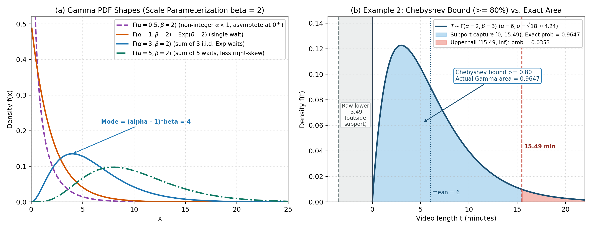
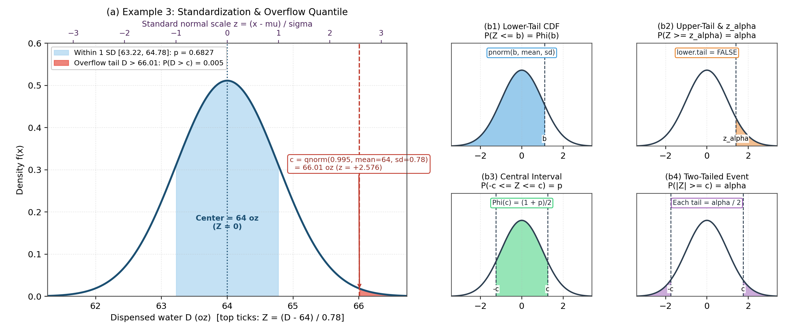
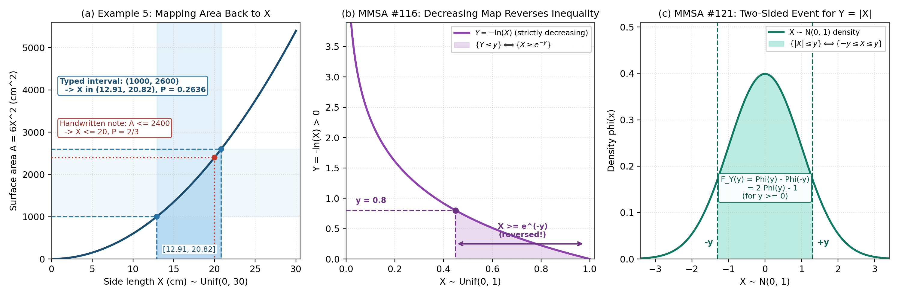

# STA237 Week 9 Study Notes: Named Continuous Distributions & Transformations

## Contents

- [Scope, Notation, Parameter Conventions, and Method Selection](#scope-notation-parameter-conventions-and-method-selection)
  - [Source Scope and Printed Slide vs. PDF Page Mapping](#source-scope-and-printed-slide-vs-pdf-page-mapping)
  - [Core vs. Supplementary Classification](#core-vs-supplementary-classification)
  - [Physical Units, Scaling Rules, and Model Assumptions](#physical-units-scaling-rules-and-model-assumptions)
  - [Master Parameter Convention Table Across Sources and R](#master-parameter-convention-table-across-sources-and-r)
  - [Method Selection Guide: From Question Wording to Model, Event, and Calculation](#method-selection-guide-from-question-wording-to-model-event-and-calculation)
- [Concept C-01: The Gamma Distribution and Sums of Independent Exponential Waiting Times](#concept-c-01-the-gamma-distribution-and-sums-of-independent-exponential-waiting-times)
  - [Problem Type PT-01: Modeling a Sum of Independent Exponential Durations or Distances as a Gamma Distribution and Computing Tail Probabilities](#problem-type-pt-01-modeling-a-sum-of-independent-exponential-durations-or-distances-as-a-gamma-distribution-and-computing-tail-probabilities)
  - [Problem Type PT-02: Constructing a Chebyshev Interval for a Nonnegative Gamma Random Variable and Computing Its Exact Coverage Probability](#problem-type-pt-02-constructing-a-chebyshev-interval-for-a-nonnegative-gamma-random-variable-and-computing-its-exact-coverage-probability)
- [Concept C-02: The Normal Distribution, Standardization, and Probability/Quantile Calculations in R](#concept-c-02-the-normal-distribution-standardization-and-probabilityquantile-calculations-in-r)
  - [Problem Type PT-03: Computing One-Sided, Interval, Central, and Two-Tailed Normal Probabilities via Standardization and `pnorm`](#problem-type-pt-03-computing-one-sided-interval-central-and-two-tailed-normal-probabilities-via-standardization-and-pnorm)
  - [Problem Type PT-04: Finding Normal Percentiles, Cutoffs, and Upper-Tail Critical Values from Specified Probabilities Using `qnorm`](#problem-type-pt-04-finding-normal-percentiles-cutoffs-and-upper-tail-critical-values-from-specified-probabilities-using-qnorm)
- [Concept C-03: Functions and Transformations of Continuous Random Variables — Moments, Domain Mapping, and the Distribution (CDF) Method](#concept-c-03-functions-and-transformations-of-continuous-random-variables--moments-domain-mapping-and-the-distribution-cdf-method)
  - [Problem Type PT-05: Computing Moments and Exact vs. Chebyshev Event Probabilities for a Transformed Random Variable by Domain Mapping](#problem-type-pt-05-computing-moments-and-exact-vs-chebyshev-event-probabilities-for-a-transformed-random-variable-by-domain-mapping)
  - [Problem Type PT-06: Deriving the CDF and PDF of a Transformed Continuous Random Variable Using the Distribution (CDF) Method (Increasing on Support)](#problem-type-pt-06-deriving-the-cdf-and-pdf-of-a-transformed-continuous-random-variable-using-the-distribution-cdf-method-increasing-on-support)
  - [Problem Type PT-07: Deriving the CDF and PDF of a Strictly Decreasing Transformation via Inequality Reversal in the Distribution Method](#problem-type-pt-07-deriving-the-cdf-and-pdf-of-a-strictly-decreasing-transformation-via-inequality-reversal-in-the-distribution-method)

---

## Scope, Notation, Parameter Conventions, and Method Selection

### Source Scope and Printed Slide vs. PDF Page Mapping

This guide is designed as a self-contained primary study resource for **STA237 Week 9: Named Continuous Distributions & Transformations**. It draws directly from three verified course sources:

1. **Primary Lecture Source:** `W9/Week9-L0401-annotated.pdf` (20 one-based PDF pages, Prof. Karen Huynh Wong, including typed slides, R output, and handwritten annotations).
2. **Course Platform Verification:** Canvas Week 9 Page (`Course ID 465634`, `Page ID 2593472`, URL slug `week-9`), whose highlighted practice header explicitly states **"Suggested Problems (MMSA only this week)"** and notes for Section 4.7: **"Excludes Transformation Theorem. Follow course content, not textbook."** Although a bottom row listing PAR chapters and numbers is visible on Canvas, **zero PAR exercises are assigned, solved, or used to establish Problem Types (`PT-01`–`PT-07`) this week.**
3. **Textbook Exercise Source:** *Modern Mathematical Statistics with Applications*, 3rd edition (**MMSA**, Devore, Berk, Carlton; relevant sections **4.3, 4.4, and 4.7**, where `PDF page = printed page + 12`). Only the 14 explicitly assigned exercises (5 Basic, 5 Medium, 4 Test Level, respecting exact subpart restrictions on `#39(h, i, j)` and `#67(a)`) are covered; Gamma practice comes exclusively from the Week 9 slides.

> **Important Page-Number Warning:** In `W9/Week9-L0401-annotated.pdf`, printed slide numbers match one-based PDF page numbers on PDF pp. 1–14, then skip ahead on the footer starting at PDF p. 15 (printed Slide 17). To avoid confusion, every lecture citation in both files uses **one-based PDF page numbers (`PDF p. k`)**, alongside printed slide numbers where they differ:
>
> - **PDF pp. 1–14** = Printed Slides 1–14 (Gamma distribution, Example 1, Example 2, Try it yourself!, Normal distribution summary & properties, Example 3).
> - **PDF p. 15** = Printed Slide 17 (Progress Check).
> - **PDF p. 16** = Printed Slide 18 (Example 5 — 30 cm ruler & cube surface area; note there is **no "Example 4"** in this deck).
> - **PDF pp. 17–18** = Printed Slides 19–20 (Distribution Method of Transformations).
> - **PDF p. 19** = Printed Slide 21 (Example 6 — $X \sim \text{Exp}(\theta=2), Y = X^2$).
> - **PDF p. 20** = Printed Slide 25 (Final Progress Check — all 5 outcomes checked).

### Core vs. Supplementary Classification

Material actually taught, proved, or explicitly requested in `W9/Week9-L0401-annotated.pdf` is classified as **Core**. Substantive textbook techniques or notations required by an assigned MMSA exercise but absent from the slides are marked **Supplementary** at first appearance and inside each relevant solution.

- **Core:**
  - **Gamma & Exponential waits (`PDF pp. 3–10`):**
    - Sum of $n$ i.i.d. common-rate Exponential waits $T = X_1 + \dots + X_n \sim \Gamma(\alpha = n,\, \beta = \theta)$ (`PDF pp. 3–5`).
    - General Gamma family ($\alpha > 0$ shape, $\beta > 0$ scale, $\lambda = 1/\beta$ rate), PDF, $E(X) = \alpha\beta$, $V(X) = \alpha\beta^2$, and $\Gamma(1, \beta) = \text{Exp}(\beta)$.
    - Gamma function $\Gamma(\alpha)$, recurrence $\Gamma(\alpha) = (\alpha-1)\Gamma(\alpha-1)$, $\Gamma(n) = (n-1)!$, $\Gamma(1/2) = \sqrt{\pi}$, and derivation of $E(X) = \alpha\beta$ (`PDF pp. 5–6`).
    - Applications & R: tabular integration by parts & `pgamma` (`PDF pp. 7–8`), Chebyshev vs. exact Gamma interval (`PDF p. 9`), and two-car combined distance (`PDF p. 10`).
  - **Normal models & R (`PDF pp. 11–15`):**
    - Normal PDF $N(\mu, \sigma^2)$, location $\mu$, spread $\sigma^2$ vs. $\sigma$, symmetry, and the empirical rule ($68\% / 95\% / 99.7\%$).
    - Standardization $Z = (X - \mu)/\sigma \sim N(0, 1)$, unstandardization $X = \mu + \sigma Z$, affine rescaling $aX + b \sim N(a\mu + b,\, a^2\sigma^2)$, `pnorm`, and `qnorm`.
  - **Transformations (`PDF pp. 16–20`):**
    - $Y = g(X) \not\sim F$ in general; moments & units of $A = 6X^2$; Chebyshev vs. exact domain mapping (`PDF p. 16`).
    - **Distribution (CDF) Method** starting from $F_Y(y) = P(g(X) \le y)$ for strictly increasing transformations on nonnegative/monotone supports (`PDF pp. 17–19`) and differentiating $f_Y(y) = F_Y'(y)$.
- **Supplementary (textbook notations & extensions required by specific assigned MMSA exercises):**
  1. MMSA upper-tail critical value notation $z_\alpha$ ($P(Z \ge z_\alpha) = \alpha$, MMSA §4.3 pp. 216–217; Basic `#42`).
  2. Multi-trial independent normal event probability $1 - (1-p)^n$ (`#46(e)`, `#59(d)`), plus the **joint normality / independence qualification** for two-variable normal linear combinations (`Concept C-02 §2`).
  3. Continuity correction ($\pm 0.5$ endpoint expansion) for normal approximation to an integer-valued RV (`MMSA #61`, printed p. 229).
  4. Calculus integration proof of $E(X) = \mu$ via $u = (x-\mu)/\sigma$ and odd-function symmetry (`MMSA #67(a)`, printed p. 230).
  5. Decreasing-function inequality reversal $\{g(X) \le y\} \iff \{X \ge g^{-1}(y)\}$ (`MMSA #116`, `#118` second solution) and two-sided event translation $\{|X| \le y\} \iff \{-y \le X \le y\}$ (`MMSA #121`) inside the Course CDF Method.
  6. Lognormal PDF verification against MMSA §4.5 (`MMSA #114`, printed p. 263).
- **Excluded by Course Policy:** Textbook **Transformation Theorem**, Jacobian shortcuts, and multi-branch inverse density formulas (explicitly excluded on Canvas Week 9; **never used**, even as an alternative solution). Also excluded: unassigned MGF proofs, general reliability/queueing chapters, and all PAR exercises.

> [!TIP]
> **First-Time Learner Reading Path:** If you are learning Week 9 for the first time, read the scope notes above and then jump directly to **[Concept C-01: The Gamma Distribution and Sums of Independent Exponential Waiting Times](#concept-c-01-the-gamma-distribution-and-sums-of-independent-exponential-waiting-times)** to see *why* adding waiting times produces a Gamma distribution. Treat the next three sections (*Physical Units*, *Master Parameter Convention Table*, and *Method Selection Guide*) as quick-reference lookup sheets to consult while solving exercises.

### Physical Units, Scaling Rules, and Model Assumptions

A beginner solving continuous distribution problems should always write **units** and **assumptions** before computing:

1. **Expectation vs. variance units:** If a random variable $X$ is measured in $\text{cm}$, oz, hours, or $1000\text{ km}$, then $E(X)$ and $SD(X) = \sqrt{V(X)}$ carry the **same linear unit**, whereas variance $V(X)$ carries the **squared unit** ($\text{cm}^2$, $\text{oz}^2$, $\text{hr}^2$, $(1000\text{ km})^2$).
2. **Nonlinear transformation units (`PDF p. 16`):** When ruler side length $X$ is in $\text{cm}$, surface area $A = 6X^2$ is in $\text{cm}^2$, $E(A)$ and $SD(A)$ are in $\text{cm}^2$, and $V(A) = E(A^2) - [E(A)]^2$ is in **$\text{cm}^4$**.
3. **Linear rescaling of Normal variables:** Changing measurement units via $Y = aX + b$ ($a \ne 0$, such as converting $\text{km/h}$ to $\text{mph}$) multiplies the mean by $a$ (plus $b$) and multiplies the **standard deviation** by $|a|$: $\mu_Y = a\mu_X + b$, $\sigma_Y = |a|\sigma_X$, and variance scales by $a^2$: $V(Y) = a^2\sigma_X^2$.
4. **Rate vs. mean/scale units (`PDF p. 4`):**
   - **Rate parameter $\lambda$** has units **$\text{count} / \text{interval}$** (e.g., $1.25\text{ requests/hour}$).
   - **Mean/scale parameter $\theta = \beta = 1/\lambda$** has reciprocal units **$\text{interval} / \text{count}$** (e.g., $0.8\text{ hours/request}$).
   - Always make sure the threshold $t$ (e.g., $3\text{ hours}$ or $70\text{ [in 1000 km]}$) uses the **exact same unit** as $\theta$ (or $1/\lambda$) before plugging into $e^{-t/\theta}$ or `pgamma`.

### Master Parameter Convention Table Across Sources and R

Slide 4 (`PDF p. 4`) and Slide 12 (`PDF p. 12`) explicitly warn students not to mix parameterizations across the slides, the textbooks (**MMSA** vs. **PAR**), and **R**:

| Distribution | Week 9 Slides | MMSA (3rd ed.) | PAR (Slide 4 comparison only) | R Functions (Verified Signatures) |
| :--- | :--- | :--- | :--- | :--- |
| **Exponential** | **Mean** $\theta > 0$: $f(x) = \frac{1}{\theta}e^{-x/\theta}$ ($x \ge 0$) **Rate** $\lambda = \frac{1}{\theta}$: $f(x) = \lambda e^{-\lambda x}$ $E(X)=\theta=\frac{1}{\lambda}$, $V(X)=\theta^2$ | **Rate** $\lambda > 0$: $f(x;\lambda) = \lambda e^{-\lambda x}$ ($x \ge 0$) Mean $E(X)=1/\lambda$ (e.g., Ex. 4.39 & `#113` state "mean 2" $\Rightarrow \lambda = 1/2$) | **Rate** $\lambda > 0$: $f(x) = \lambda e^{-\lambda x}$ ($x > 0$) | `pexp(q, rate = lambda, lower.tail = TRUE)` Always pass `rate = 1/theta` explicitly (`pexp` has no `scale=` argument!). |
| **Gamma** | **Shape $\alpha > 0$, Scale $\beta = \theta > 0$** (`PDF p. 4`): $f(x) = \frac{1}{\Gamma(\alpha)\beta^\alpha}x^{\alpha-1}e^{-x/\beta}$ ($x \ge 0$) Also annotated in rate form: $f(x) = \frac{\lambda^\alpha}{\Gamma(\alpha)}x^{\alpha-1}e^{-\lambda x}$ $E(X) = \alpha\beta = \frac{\alpha}{\lambda}$, $V(X) = \alpha\beta^2 = \frac{\alpha}{\lambda^2}$ | **Shape $\alpha > 0$, Scale $\beta > 0$** (§4.4, printed p. 231): $f(x;\alpha,\beta) = \frac{1}{\beta^\alpha\Gamma(\alpha)}x^{\alpha-1}e^{-x/\beta}$ ($x > 0$) $E(X)=\alpha\beta$, $V(X)=\alpha\beta^2$ | **Shape $\alpha > 0$, Rate $\lambda = 1/\beta > 0$** (`PDF p. 4` comparison): $f(x) = \frac{\lambda^\alpha}{\Gamma(\alpha)}x^{\alpha-1}e^{-\lambda x}$ $E(X)=\alpha/\lambda$, $V(X)=\alpha/\lambda^2$ | `pgamma(q, shape, rate = 1, scale = 1/rate, lower.tail = TRUE)` **Critical R Trap:** Slide 4 notes *"R by default also uses the scale parameter"*, yet in actual R 4.5.1, the **3rd positional argument of `pgamma` is `rate = 1`**! Calling `pgamma(3, 2, 0.8)` gives $0.6916$ (`rate = 0.8`), NOT the scale-$0.8$ value. Always use **named arguments** (`shape = ..., scale = ...` or `shape = ..., rate = ...`). |
| **Normal** | **Mean $\mu$, Variance $\sigma^2$** (`PDF p. 12`): $X \sim N(\mu, \sigma^2)$ $f(x) = \frac{1}{\sigma\sqrt{2\pi}}e^{-(x-\mu)^2/(2\sigma^2)}$ ($-\infty < x < \infty$) Note: handwritten `PDF p. 14` also writes $N(\mu=64, \sigma=0.78)$ explicitly labelling $\sigma$. | **Mean $\mu$, Standard Deviation $\sigma$** (§4.3, printed p. 213): $X \sim N(\mu, \sigma)$ **Warning:** The second slot in MMSA is **$\sigma$**, whereas in our slides it is **$\sigma^2$**! | *(Not used for exercises this week)* | `pnorm(q, mean = 0, sd = 1, lower.tail = TRUE)` `qnorm(p, mean = 0, sd = 1, lower.tail = TRUE)` Always pass **named `mean =` and `sd =`** using the **standard deviation** $\sigma$, never the variance $\sigma^2$! |

> **Notation Check on $\Phi$ (`PDF p. 13` vs. MMSA §4.3):**
> - **MMSA standard normal definition:** $\Phi(z) = P(Z \le z) = \int_{-\infty}^z \frac{1}{\sqrt{2\pi}}e^{-y^2/2}\,dy$ is reserved strictly for a **standard normal** variable $Z \sim N(0, 1)$, so for general $X \sim N(\mu, \sigma)$, $F_X(x) = P(X \le x) = \Phi\!\left(\frac{x-\mu}{\sigma}\right)$.
> - **Slide 13 notation note:** On `PDF p. 13` (item 4), the typed line writes $P(X \le c)$ and says *"Instead, it is denoted by $\Phi(c)$"* just before introducing $Z \sim N(0, 1)$ in item 5; in practice (`PDF p. 14`), always distinguish the general normal CDF $F_X(x) = P(X \le x)$ from the standardized CDF $\Phi(z) = P(Z \le z)$.

### Method Selection Guide: From Question Wording to Model, Event, and Calculation

Before computing anything, translate every word problem through three questions: **(1) What is the random variable and its unit?** $\longrightarrow$ **(2) Which named distribution (or $g(X)$) fits?** $\longrightarrow$ **(3) What exact event inequality determines the integral or R call?**

| Wording / Experimental Cue in Question | Define RV (with Units) | Distribution / Transformation Model | Calculation Setup | Concept & PT |
| :--- | :--- | :--- | :--- | :--- |
| "Independent, constant-rate Poisson events occur at average rate $\lambda$; find total time until $n$ occurrences" OR "combined distance/lifetime of $n$ identical independent $\text{Exp}$ components" | $T = \sum_{i=1}^n X_i$ (convert rates to matching unit first!) | $X_i \stackrel{\text{i.i.d.}}{\sim} \text{Exp}(\theta = 1/\lambda) \implies T \sim \Gamma(\alpha=n, \beta=\theta)$ | Upper tail $P(T > t)$ via integration by parts (integer $\alpha$) or `pgamma(t, shape=n, scale=theta, lower.tail=FALSE)` | [C-01](#concept-c-01-the-gamma-distribution-and-sums-of-independent-exponential-waiting-times) (`PT-01`) |
| "What interval contains at least $100p\%$ according to Chebyshev's inequality?" (followed by "exact probability of that interval") | $T$ with finite mean $\mu$, SD $\sigma$, and support (often $[0, \infty)$) | Set $1 - \frac{1}{k^2} = p$ to find $k$, build $(\mu - k\sigma, \mu + k\sigma)$, intersect with support | Intersect $(\mu-k\sigma, \mu+k\sigma) \cap [0,\infty)$, then integrate $f_T(t)$ or use `pgamma` | [C-01](#concept-c-01-the-gamma-distribution-and-sums-of-independent-exponential-waiting-times) (`PT-02`) |
| Variable is normal $N(\mu, \sigma^2)$ *(or MMSA $N(\mu, \sigma)$)*; asks *"What is the probability / percentage..."* | $X$ in problem units ($Z = \frac{X-\mu}{\sigma}$ if standardizing) | $X \sim N(\mu, \sigma^2)$ (note integer approximations require continuity correction $\pm 0.5$) | Probability statement $\to$ `pnorm(..., mean=, sd=)` (use `lower.tail=FALSE` for $P(X > a)$) | [C-02](#concept-c-02-the-normal-distribution-standardization-and-probabilityquantile-calculations-in-r) (`PT-03`) |
| Variable is normal; asks *"What value / cutoff / percentile / $c$ / $z_\alpha$ gives probability $p$ or tail area $\alpha$?"* | Cutoff $c$ (or critical value $z_\alpha$) | Solve $F_X(c) = p$ or $P(X > c) = \alpha$ | Rearrange to a left-tail $p$ or upper-tail $\alpha$ $\to$ `qnorm(..., mean=, sd=)` | [C-02](#concept-c-02-the-normal-distribution-standardization-and-probabilityquantile-calculations-in-r) (`PT-04`) |
| Transformed variable $Y = g(X)$ asks only for **$E(Y)$, $V(Y)$, or an event probability $P(c < Y < d)$** (not full PDF) | $X$ (known model) and $Y = g(X)$ with transformed units | Use LOTUS ($E[g(X)] = \int g(x)f_X(x)\,dx$) and map $\{c < g(X) < d\}$ back to $X$ | Domain mapping avoids deriving $f_Y(y)$ when only a probability is needed | [C-03](#concept-c-03-functions-and-transformations-of-continuous-random-variables--moments-domain-mapping-and-the-distribution-cdf-method) (`PT-05`) |
| Transformed variable $Y = g(X)$ asks to **derive the CDF or PDF $f_Y(y)$** ($g$ increasing on support) | Support of $X \mapsto$ support of $Y$ | **Course CDF Method:** $\{g(X) \le y\} \iff \{X \le g^{-1}(y)\}$ | $F_Y(y) = F_X(g^{-1}(y))$ on support ($0$ below, $1$ above if bounded), then $f_Y(y) = F_Y'(y)$ | [C-03](#concept-c-03-functions-and-transformations-of-continuous-random-variables--moments-domain-mapping-and-the-distribution-cdf-method) (`PT-06`) |
| Transformed variable $Y = g(X)$ asks for **PDF $f_Y(y)$** and $g$ is **decreasing** on support (e.g., $-\ln X$, $cX+d$ with $c<0$) | Support of $X \mapsto$ reversed endpoints for $Y$ | **Course CDF Method (`Supplementary` step):** $\{g(X) \le y\} \iff \{X \ge g^{-1}(y)\}$ | $F_Y(y) = 1 - F_X(g^{-1}(y))$ (continuous $X$), then $f_Y(y) = F_Y'(y)$ | [C-03](#concept-c-03-functions-and-transformations-of-continuous-random-variables--moments-domain-mapping-and-the-distribution-cdf-method) (`PT-07`) |
| Transformed variable $Y = \lvert X \rvert$ (absolute value on real/symmetric support) | Map support of $X$ through $\lvert x \rvert$ (e.g., $[0, \infty)$ if $X \in \mathbb{R}$ as in `#121`, or $[0, M]$ if $X \in [-M, M]$) | **Course CDF Method (`Supplementary` step):** $\{\lvert X \rvert \le y\} \iff \{-y \le X \le y\}$ on active support $y \ge 0$ | $F_Y(y) = F_X(y) - F_X(-y)$ on active support ($0$ for $y < 0$; $1$ above any finite upper bound), then $f_Y(y) = F_Y'(y)$ | [C-03](#concept-c-03-functions-and-transformations-of-continuous-random-variables--moments-domain-mapping-and-the-distribution-cdf-method) (local extension in `#121`) |

---

## Concept C-01: The Gamma Distribution and Sums of Independent Exponential Waiting Times

**Classification:** Core (`W9/Week9-L0401-annotated.pdf`, PDF pp. 3–10)

### 1. From One Exponential Wait to a Sum of Exponential Waits

In a Poisson process running at constant rate $\lambda$ arrivals per unit time (mean wait $\theta = 1/\lambda$ time units per arrival), the waiting time $X_1$ until the **first** arrival—or the gap $X_i$ between consecutive arrivals—follows an **Exponential distribution** $X_i \sim \text{Exp}(\theta)$ (`PDF pp. 4–5`). When $n = 1$, $T = X_1$ is just a single waiting time and therefore **still follows the Exponential distribution** $\text{Exp}(\theta) = \Gamma(\alpha = 1, \beta = \theta)$ (whose density peaks at $x = 0$ and decays monotonically). However, if you sum **$n \ge 2$** independent, identically distributed waiting times $X_1, \dots, X_n \stackrel{\text{i.i.d.}}{\sim} \text{Exp}(\theta)$,

$$T = X_1 + X_2 + \dots + X_n,$$

the sum $T$ is **no longer exponentially distributed** (`PDF p. 3`). Why intuitively? Waiting for *multiple* independent events to finish ($n \ge 2$) makes an almost-zero total wait extremely unlikely—all $n$ gaps would simultaneously have to be tiny—so the density starts at $f_T(0) = 0$, rises to a single hump, and trails off to the right (`PDF p. 3`). In general (for any integer $n \ge 1$), that sum $T$ follows a **Gamma distribution** with **shape $\alpha = n$** and **scale $\beta = \theta$** (`PDF p. 5`):

$$T = X_1 + X_2 + \dots + X_n \sim \Gamma(\alpha = n,\, \beta = \theta) \quad \text{(when } X_i \stackrel{\text{i.i.d.}}{\sim} \text{Exp}(\theta)\text{)}.$$

**When does the shape $\alpha$ represent a wait count, and why can $\alpha$ be non-integer?**
- Whenever $T$ arises as the sum of $n$ independent, common-rate Exponential interarrival times (e.g., total time for $2$ technician requests in Example 1, or combined mileage of $2$ identical cars in Try it yourself!), the shape $\alpha = n \in \mathbb{Z}_+$ literally counts the number of Exponential segments being summed (`PDF p. 5`, `*` highlight).
- However, the general Gamma PDF only requires $\alpha > 0$ so that the normalizing integral $\Gamma(\alpha) = \int_0^\infty u^{\alpha-1}e^{-u}\,du$ converges (`PDF pp. 3–5`). Thus **$\alpha$ need not be an integer**! Allowing fractional shapes such as $\alpha = 0.5$ (`PDF p. 3`, third panel) turns the Gamma family into a flexible two-parameter family for modeling general nonnegative, right-skewed quantities (waiting times, storm durations, video lengths, incomes) even when the phenomenon is not literally a sum of discrete Poisson gaps.

### 2. Parameters, PDF, Support, and Moments in Both Conventions

Let $\alpha > 0$ be the **shape parameter**, $\beta = \theta > 0$ be the **scale parameter** (matching the Exponential mean parameter $\theta$), and $\lambda = \frac{1}{\beta} > 0$ be the **rate parameter** (`PDF p. 4`). A continuous random variable $X \sim \Gamma(\alpha, \beta)$ (scale convention) or $X \sim \Gamma(\alpha, \lambda)$ (rate convention) has **support $[0, \infty)$** (equivalently $(0, \infty)$ for continuous probability integrals), with behavior at the left endpoint $x = 0$ depending on $\alpha$:
- **$0 < \alpha < 1$:** the $x > 0$ density formula diverges to $+\infty$ as $x \to 0^+$ while remaining integrable on $(0, \infty)$, and by single-point convention we may set $f(0) = 0$.
- **$\alpha = 1$ (Exponential case):** $f(0) = 1/\beta = \lambda$.
- **$\alpha > 1$:** $f(0) = 0$.

| Quantity | Scale Parameterization $(\alpha, \beta)$ *(Slides & MMSA)* | Rate Parameterization $(\alpha, \lambda = 1/\beta)$ *(PDF p. 4 annotation & PAR)* |
| :--- | :--- | :--- |
| **PDF $f(x)$ for $x > 0$** ($0$ otherwise) | $f(x) = \dfrac{1}{\Gamma(\alpha)\beta^\alpha} x^{\alpha-1} e^{-x/\beta}$ | $f(x) = \dfrac{\lambda^\alpha}{\Gamma(\alpha)} x^{\alpha-1} e^{-\lambda x}$ |
| **Expected value $E(X)$** | $E(X) = \alpha\beta$ | $E(X) = \dfrac{\alpha}{\lambda}$ |
| **Variance $V(X)$** | $V(X) = \alpha\beta^2$ | $V(X) = \dfrac{\alpha}{\lambda^2}$ |
| **Special case $\alpha = 1$** (`PDF p. 5`) | $\Gamma(1, \beta) = \text{Exp}(\text{mean } \theta = \beta)$ | $\Gamma(1, \lambda) = \text{Exp}(\text{rate } \lambda)$ |
| **Explicit R CDF / PDF syntax** | `pgamma(x, shape = alpha, scale = beta)` `dgamma(x, shape = alpha, scale = beta)` | `pgamma(x, shape = alpha, rate = lambda)` `dgamma(x, shape = alpha, rate = lambda)` |

> **Remember the R Naming Rule:** In R's actual definition (`pgamma(q, shape, rate = 1, scale = 1/rate, lower.tail = TRUE)`), the third positional argument is **`rate`**, NOT `scale` (contradicting Slide 4's remark that *"R by default also uses the scale parameter"*):
> - **Trap (unnamed):** `pgamma(3, 2, 0.8)` sets `rate = 0.8` (i.e., `scale = 1.25`), returning the wrong tail value!
> - **Safe (explicitly named):** always name `shape =` and either `scale =` or `rate =` explicitly, e.g. `pgamma(3, shape = 2, scale = 0.8, lower.tail = FALSE)` (`PDF p. 8`).

### 3. The Gamma Function $\Gamma(\alpha)$ and Deriving $E(X) = \alpha\beta$

On `PDF p. 5`, the **gamma function** is defined for $\alpha > 0$ by the improper integral

$$\Gamma(\alpha) = \int_0^\infty x^{\alpha - 1} e^{-x}\,dx.$$

Its key properties taught on `PDF p. 5` (see [`SQ-01`](Answers-and-Practice.md#sq-01-about-gamma-distribution--properties-and-gamma4-check) for complete worked steps) are:
1. **Recurrence relation:** For $\alpha > 1$, integration by parts gives $\Gamma(\alpha) = (\alpha - 1)\Gamma(\alpha - 1)$.
2. **Integer factorial identity:** For every positive integer $n \in \mathbb{Z}_+$, repeating the recurrence down to $\Gamma(1) = \int_0^\infty e^{-x}\,dx = 1$ (notice $\int_0^\infty e^{-x}\,dx = 1$ because $e^{-x}$ is the $\text{Exp}(\lambda=1)$ PDF!) gives $\Gamma(n) = (n - 1)!$. For example (`PDF p. 5` check), $\Gamma(4) = 3\Gamma(3) = 3 \times 2 \times 1 \times \Gamma(1) = 6 = 3!$.
3. **Stated half-integer value:** $\Gamma(1/2) = \sqrt{\pi}$ (stated directly on `PDF p. 5` as a reference fact—no advanced Gaussian-integral proof is needed in Week 9).
4. **No elementary closed-form CDF in general:** When $\alpha \notin \mathbb{Z}_+$ (`PDF p. 5`, item 7 notes $\alpha, \beta \notin \mathbb{Z}_+$ prevents simple closed-form evaluation by hand; specifically, non-integer $\alpha$ leaves an incomplete Gamma integral that cannot be simplified by finite integration by parts, requiring `pgamma` in R). When $\alpha \in \mathbb{Z}_+$, integrating the PDF by parts $\alpha - 1$ times *does* give an exact elementary formula!

**How the Gamma function gives $E(X) = \alpha\beta$ (`PDF p. 6`, [`SQ-02`](Answers-and-Practice.md#sq-02-gamma-expected-value-derivation)):**

Start from the definition of expectation for $X \sim \Gamma(\alpha, \beta)$:

$$E(X) = \int_0^\infty x \cdot f(x)\,dx = \int_0^\infty x \cdot \frac{1}{\Gamma(\alpha)\beta^\alpha} x^{\alpha-1} e^{-x/\beta}\,dx = \frac{1}{\Gamma(\alpha)\beta^\alpha}\int_0^\infty x^{(\alpha+1)-1} e^{-x/\beta}\,dx.$$

Substitute $u = x/\beta$ ($x = \beta u$, $dx = \beta\,du$, limits remain $0$ to $\infty$):

$$\int_0^\infty x^{(\alpha+1)-1} e^{-x/\beta}\,dx = \int_0^\infty (\beta u)^{\alpha} e^{-u}\,\beta\,du = \beta^{\alpha+1}\int_0^\infty u^{(\alpha+1)-1} e^{-u}\,du = \beta^{\alpha+1}\Gamma(\alpha+1).$$

Substituting this back and applying the recurrence $\Gamma(\alpha+1) = \alpha\Gamma(\alpha)$ yields:

$$E(X) = \frac{\beta^{\alpha+1}\Gamma(\alpha+1)}{\Gamma(\alpha)\beta^\alpha} = \frac{\beta \cdot \alpha\Gamma(\alpha)}{\Gamma(\alpha)} = \alpha\beta = \frac{\alpha}{\lambda}.$$

*(Alternatively, instead of substituting $u = x/\beta$ explicitly, once you recognize that $x^{(\alpha+1)-1}e^{-x/\beta}$ is the kernel of a $\Gamma(\alpha+1, \beta)$ PDF—whose total integral must equal $1$—its unnormalized integral immediately equals $\Gamma(\alpha+1)\beta^{\alpha+1}$.)*

### 4. Key Modelling Lessons from Examples 1, 2, and the Two-Car Exercise (`PDF pp. 7–10`)

- **Example 1 — Support Centre Technician (`PDF pp. 7–8`, [`SQ-03`](Answers-and-Practice.md#sq-03-example-1--support-centre-technician-service-requests)):**
  - *Rate & mean conversion:* Daily count average $\lambda_{\text{day}} = 10$ per $8$-hour workday converts to hourly rate $\lambda = 10/8 = 1.25\text{ requests/hour}$, i.e., mean wait $\theta = 1/\lambda = 0.8\text{ hours/request}$.
  - *Why the Gamma model holds:* **A count average alone does not guarantee independent Exponential completion times.** Here $T = T_1 + T_2 \sim \Gamma(\alpha = 2, \beta = 0.8)$ holds because:
    1. Requests arrive/complete according to a **Poisson process** (stationary, independent increments $\Rightarrow T_1, T_2 \sim \text{Exp}(\theta = 0.8)$).
    2. The problem explicitly specifies **"two unrelated and independent service requests."**
  - *Tail probability & R check:* $P(T > 3) = \int_3^\infty \frac{1}{\Gamma(2)(0.8)^2} t e^{-1.25t}\,dt = 0.1117093$, verified by `pgamma(3, shape = 2, scale = 0.8, lower.tail = FALSE)`.

- **Example 2 — TikTok Video Lengths & Chebyshev (`PDF p. 9`, [`SQ-04`](Answers-and-Practice.md#sq-04-example-2--exact-vs-chebyshevs-inequality-for-tiktok-video-lengths)):**
  - *Why only "approximately" Gamma:* Real video durations are right-skewed and strictly nonnegative, but empirical platform data (discretized/rounded in seconds and shaped by user/editing habits near $0$ or long tails) only follow an idealized smooth $\Gamma(\alpha=2, \beta=3)$ curve approximately (without needing to assume any fixed platform-wide maximum cap).
  - *Chebyshev $80\%$ bound & support truncation:* Setting $1 - \frac{1}{k^2} = 0.80 \implies k = \sqrt{5}$ with $\mu = \alpha\beta = 6$ and $\sigma = \sqrt{\alpha\beta^2} = \sqrt{18} \approx 4.2426$ produces the raw formula $(\mu - \sqrt{5}\sigma, \mu + \sqrt{5}\sigma) \approx (-3.49, 15.49)$. Truncating below at the Gamma lower support bound $0$ gives **$[0, 15.49)$ minutes**.
  - *Distribution-free bound vs. exact Gamma area:* Chebyshev guarantees **at least $80\%$** across *any* distribution with $\mu = 6, \sigma = \sqrt{18}$; under $\Gamma(2, 3)$, the **exact** coverage is $P(0 \le T < 15.49) = 0.96473$ ($0.96470$ using unrounded $6 + \sqrt{90}$).

- **Try it yourself! — Oliver's Two Cars (`PDF p. 10`, [`SQ-05`](Answers-and-Practice.md#sq-05-try-it-yourself--olivers-two-cars-combined-distance-parts-ac)):**
  - *Model & unit conversion:* Assuming each car's distance before maintenance ($D_1, D_2$, measured in **$1000\text{ km}$**) is independent and identically distributed as $\text{Exp}(3)$, combined distance $Y = D_1 + D_2$ follows $\Gamma(\alpha = 2, \dots)$, and the threshold $70{,}000\text{ km}$ converts to **$y = 70$**.
  - *Parameter-convention trap (`Exp(3)` is ambiguous):* Always state your parameter convention explicitly!
    - **Slide mean/scale convention ($\theta = \beta = 3$, mean $3{,}000\text{ km}$):** $P(Y > 70) = \frac{73}{3}e^{-70/3} \approx 1.79 \times 10^{-9}$.
    - **MMSA rate convention ($\lambda = 3$ breakdowns per $1000\text{ km}$):** $P(Y > 70) = 211 e^{-210} \approx 1.33 \times 10^{-89}$.
  - *Why single-car distributions cannot answer part (b) (two logical steps for part c):*
    1. **Marginals vs. independence:** Marginal distributions describe only one car ($P(D_1 > 70)$ or $P(D_1 > 35)$)—even computing the joint probability $P(D_1 > 35 \text{ and } D_2 > 35) = P(D_1 > 35)P(D_2 > 35)$ already requires assuming **independence** between the cars.
    2. **Different events:** $\{D_1 > 35 \text{ and } D_2 > 35\}$ is *not* the sum event $\{D_1 + D_2 > 70\}$ (e.g., $D_1 = 50, D_2 = 25$ gives $D_1 + D_2 = 75 > 70$ even though $D_2 \le 35$).

---

### Problem Type PT-01: Modeling a Sum of Independent Exponential Durations or Distances as a Gamma Distribution and Computing Tail Probabilities

- **Classification:** Core
- **Owning concept:** [Concept C-01](#concept-c-01-the-gamma-distribution-and-sums-of-independent-exponential-waiting-times)
- **Establishing source(s):** `W9/Week9-L0401-annotated.pdf`, Example 1 (`PDF pp. 7–8`, [`SQ-03`](Answers-and-Practice.md#sq-03-example-1--support-centre-technician-service-requests)) and Try it yourself! parts (a–c) (`PDF p. 10`, [`SQ-05`](Answers-and-Practice.md#sq-05-try-it-yourself--olivers-two-cars-combined-distance-parts-ac)).

**Recognition cues.**
The prompt gives a Poisson arrival/completion rate (or an individual Exponential waiting time/distance distribution), defines $n$ independent, unrelated events or components, and asks for the distribution and an event probability for the **combined** time or total distance $T = X_1 + \dots + X_n$.

**Why this method fits & reusable steps.**
1. **Define each component RV $X_i$ and the combined RV $T = \sum_{i=1}^n X_i$** with explicit units (e.g., hours, or $1000\text{ km}$).
2. **Convert rate/mean and threshold to identical units** ($\lambda = \text{count}/\text{unit time}$, $\theta = 1/\lambda = \text{unit time}/\text{count}$; convert $70{,}000\text{ km} \to 70$).
3. **Justify the Gamma model:** State why $X_1, \dots, X_n$ are i.i.d. $\text{Exp}(\theta)$ (Poisson-process interarrivals plus explicit independence), giving $T \sim \Gamma(\alpha = n, \text{scale } \beta = \theta)$ (equivalently $\text{rate } \lambda$).
4. **Compute the requested tail probability:** Write the event ($P(T > t)$ or $P(T \le t)$) as an integral of $f_T(t) = \frac{1}{\Gamma(n)\beta^n} t^{n-1}e^{-t/\beta}$ using (tabular) integration by parts when $n \in \mathbb{Z}_+$ is small, and verify in R with `pgamma(t, shape = n, scale = beta, lower.tail = ...)` using **named** arguments.

**Representative question (Paraphrase of Slide Example 1, `PDF pp. 7–8`).**
The number of service requests fulfilled by a technician at a support centre follows a Poisson distribution with an average of $10$ requests per $8$-hour workday. How would you model the random time it takes for this technician to complete two unrelated and independent service requests? Use this model to find the probability that fulfilling two service requests takes more than $3$ hours, and verify your calculation in R.
- [View canonical worked solution (`SQ-03`)](Answers-and-Practice.md#sq-03-example-1--support-centre-technician-service-requests)

**A complete answer must include.**
- Definitions of individual completion times $T_1, T_2$ and total time $T = T_1 + T_2$ with explicit hour units.
- Conversion of $10\text{ requests} / 8\text{ hours}$ to hourly rate $\lambda = 1.25\text{ hr}^{-1}$ and mean wait $\theta = 0.8\text{ hr}$.
- Explicit statement of the i.i.d. / Poisson-process assumptions yielding $T \sim \Gamma(\alpha = 2, \beta = 0.8)$.
- Upper-tail integral $\int_3^\infty f_T(t)\,dt$ evaluated cleanly, plus the matching R call `pgamma(3, shape = 2, scale = 0.8, lower.tail = FALSE)`.

**Common mistake & check.**
- *Mistake:* Leaving $\lambda = 10$ (per 8 hours) while integrating from $3$ to $\infty$ in hours, or calling `pgamma(3, 2, 0.8, lower.tail = FALSE)` without naming `scale = 0.8`.
- *Check:* Confirm $E(T) = 2(0.8) = 1.6\text{ hr}$; since $3\text{ hr}$ is well above the mean $1.6\text{ hr}$, $P(T > 3) \approx 0.1117$ is sensibly small and positive, and analytical integration matches `pgamma`.

---

### Problem Type PT-02: Constructing a Chebyshev Interval for a Nonnegative Gamma Random Variable and Computing Its Exact Coverage Probability

- **Classification:** Core
- **Owning concept:** [Concept C-01](#concept-c-01-the-gamma-distribution-and-sums-of-independent-exponential-waiting-times)
- **Establishing source(s):** `W9/Week9-L0401-annotated.pdf`, Example 2 (`PDF p. 9`, [`SQ-04`](Answers-and-Practice.md#sq-04-example-2--exact-vs-chebyshevs-inequality-for-tiktok-video-lengths)).

**Recognition cues.**
A nonnegative continuous RV is modeled by a Gamma distribution $\Gamma(\alpha, \beta)$, and the prompt asks for (i) an interval containing **at least $100p\%$** of outcomes using **Chebyshev's inequality**, and (ii) the **exact probability** that the RV lies in that interval.

**Why this method fits & reusable steps.**
1. Compute $\mu = E(T) = \alpha\beta$ and $\sigma = \sqrt{V(T)} = \sqrt{\alpha\beta^2}$ from the Gamma parameters.
2. Solve Chebyshev's lower bound $1 - \frac{1}{k^2} = p$ for $k > 0$, then compute the raw symmetric interval $(\mu - k\sigma,\, \mu + k\sigma)$.
3. **Intersect with the Gamma support $[0, \infty)$:** set the effective lower bound to **$L = \max(0,\, \mu - k\sigma)$** and the upper bound to **$U = \mu + k\sigma$** (truncating to $L = 0$ whenever $\mu - k\sigma \le 0$ because negative outcomes have probability $0$).
4. **Compute the exact Gamma probability over $[L, U)$:** evaluate the two-endpoint difference
   $$P(L \le T < U) = F_T(U) - F_T(L) = \int_L^U f_T(t)\,dt,$$
   or in R: `pgamma(U, shape = alpha, scale = beta) - pgamma(L, shape = alpha, scale = beta)`, and verify it is $\ge p$. Only when $\mu - k\sigma \le 0$ (so $L = 0$, as in Slide Example 2 where $\mu - \sqrt{5}\sigma \approx -3.49 < 0$) does $F_T(L) = F_T(0) = 0$ vanish and leave `pgamma(U, shape = alpha, scale = beta)` alone; whenever $L = \mu - k\sigma > 0$, omitting $- F_T(L)$ would wrongly include the left-tail area $[0, L)$.

**Representative question (Paraphrase of Slide Example 2, `PDF p. 9`).**
Suppose the distribution of TikTok video lengths (in minutes) is approximately gamma distributed with parameters $\alpha = 2$ and $\beta = 3$. Why is the gamma model only "approximate"? According to Chebyshev's inequality, what interval of video lengths makes up at least $80\%$ of TikTok videos? Then find the exact probability of that computed interval under the Gamma distribution.
- [View canonical worked solution (`SQ-04`)](Answers-and-Practice.md#sq-04-example-2--exact-vs-chebyshevs-inequality-for-tiktok-video-lengths)

**A complete answer must include.**
- Brief statistical explanation of "approximately" (skewed nonnegative real data vs. idealized continuous model).
- Moment formulas $\mu = \alpha\beta$ and $\sigma = \sqrt{\alpha\beta^2}$.
- Solving $1 - 1/k^2 = 0.80$ to get $k = \sqrt{5}$, and truncating $(\mu - k\sigma, \mu + k\sigma)$ at $0$.
- Exact Gamma probability over $[0, 15.49)$ compared explicitly with the $0.80$ Chebyshev lower bound.

**Common mistake & check.**
- *Mistake:* Leaving a negative lower bound (like $-3.49$ minutes) unaddressed, or integrating from $-3.49$ using the formula $\frac{1}{9}te^{-t/3}$ where $t < 0$ is outside the support!
- *Check:* Every exact probability for a Chebyshev at-least-$80\%$ interval must satisfy $0.80 \le P_{\text{exact}} \le 1.00$ (here $0.9647 \ge 0.80$).

---

## Concept C-02: The Normal Distribution, Standardization, and Probability/Quantile Calculations in R

**Classification:** Core (`W9/Week9-L0401-annotated.pdf`, PDF pp. 11–15), with four explicitly marked **Supplementary** textbook extensions from MMSA §4.3.

### 1. Shape, Location $\mu$, Spread $\sigma^2$ vs. $\sigma$, and Symmetry

A continuous random variable $X$ with **normal distribution** (`PDF pp. 12–13`) has support $(-\infty, \infty)$ and probability density function

$$f(x) = \frac{1}{\sigma\sqrt{2\pi}} \exp\!\left(-\frac{(x - \mu)^2}{2\sigma^2}\right), \qquad -\infty < x < \infty.$$

- **Location parameter $\mu = E(X) \in (-\infty, \infty)$:** shifts the center (also the median and mode) left or right along the horizontal axis.
- **Scale/spread parameter:** Our slides denote $X \sim N(\mu, \sigma^2)$ using **variance $\sigma^2 = V(X) > 0$**, whereas MMSA writes $X \sim N(\mu, \sigma)$ using **standard deviation $\sigma = SD(X) > 0$** (`PDF p. 12`; MMSA §4.3, printed p. 213). Increasing $\sigma^2$ makes the bell curve **flatter and wider**; decreasing $\sigma^2$ makes it **taller and narrower** (`PDF p. 13`).
- **Symmetry:** The normal PDF is symmetric about $x = \mu$: $f(\mu - u) = f(\mu + u)$ for all $u$.
- **Why we need standardization or R:** The integral $\int_{-\infty}^c \frac{1}{\sigma\sqrt{2\pi}}e^{-(x-\mu)^2/(2\sigma^2)}\,dx$ has **no elementary closed-form antiderivative** (`PDF p. 13`). Therefore probabilities and cutoffs are computed via the **standard normal** CDF $\Phi(z)$ (or directly via `pnorm` and `qnorm` in R).

### 2. Standard Normal $Z \sim N(0, 1)$, Standardization, Affine Scaling, and the Empirical Rule

The **standard normal distribution** (`PDF pp. 13–14`) has mean $0$ and variance $1$, written $Z \sim N(0, 1)$, with PDF $\phi(z) = \frac{1}{\sqrt{2\pi}}e^{-z^2/2}$ and CDF $\Phi(z) = P(Z \le z)$. Any general normal RV $X \sim N(\mu, \sigma^2)$ connects to $Z$ in both directions:

$$\text{Standardize (units of SD from }\mu\text{):} \quad Z = \frac{X - \mu}{\sigma} \sim N(0, 1), \qquad \text{Unstandardize:} \quad X = \mu + \sigma Z \sim N(\mu, \sigma^2).$$

Consequently, for any real thresholds $a < b$:
$$P(X \le b) = \Phi\!\left(\frac{b - \mu}{\sigma}\right), \qquad P(a \le X \le b) = \Phi\!\left(\frac{b - \mu}{\sigma}\right) - \Phi\!\left(\frac{a - \mu}{\sigma}\right),$$
and by symmetry around $0$, $\Phi(-z) = 1 - \Phi(z)$, so $P(|Z| \le c) = P(-c \le Z \le c) = 2\Phi(c) - 1 = 1 - 2\Phi(-c)$ (`PDF pp. 13–14`).

**Empirical rule (`PDF p. 13`, verified on Example 3(a) `PDF p. 14`):** For any normal distribution, approximately **$68\%$** ($68.27\%$) of values fall within $\mu \pm 1\sigma$, **$95\%$** ($95.45\%$) within $\mu \pm 2\sigma$, and **$99.7\%$** ($99.73\%$) within $\mu \pm 3\sigma$.

**Important qualification on linear transformations (`PDF p. 13`, item 6):**
Slide 13 states broadly that *"Any linear combination of normal random variables is also normally distributed"* and annotates the single-variable affine rule:

$$\text{If } X \sim N(\mu, \sigma^2) \text{ and } a \ne 0, \text{ then } Y = aX + b \sim N(a\mu + b,\, a^2\sigma^2).$$

Be careful with two variables (`Supplementary` qualification — joint normality is beyond the Week 9 slides): while **every affine transformation $aX + b$ of a single normal variable is always normal**, a linear combination $a_1 X_1 + a_2 X_2$ of two variables is guaranteed normal when $(X_1, X_2)$ are **independent normal** (or more generally **jointly normal**, which is not taught in Week 9); having normal *marginal* distributions alone without independence or joint normality does not guarantee normality of $X_1 + X_2$.

### 3. Forward Probability (`pnorm`) vs. Inverse Cutoff (`qnorm`) — Water Dispenser Example (`PDF p. 14`)

Always ask first whether the question gives an **$x$-value and asks for an area** (`pnorm`), or gives an **area (probability) and asks for an $x$-value** (`qnorm`):

- **Forward (`pnorm`, Example 3a, `PDF p. 14`, [`SQ-06`](Answers-and-Practice.md#sq-06-example-3--distilled-water-dispenser-parts-ab)):** $D \sim N(\mu = 64,\, \sigma^2 = 0.78^2)$. Asking for the probability within $1$ SD means evaluating $P(63.22 < D < 64.78) = P(-1 < Z < 1)$:
  - R command: `pnorm(64.78, mean = 64, sd = 0.78) - pnorm(63.22, mean = 64, sd = 0.78)` $= 0.6826895$ (matching `1 - 2 * pnorm(-1, mean = 0, sd = 1)`).
- **Inverse (`qnorm`, Example 3b, `PDF p. 14`, [`SQ-06`](Answers-and-Practice.md#sq-06-example-3--distilled-water-dispenser-parts-ab)):** *"What container size $c$ will ensure overflow occurs only $0.5\%$ of the time?"* Overflow happens when dispensed water exceeds capacity: $D > c$. Thus $P(D > c) = 0.005 \iff P(D \le c) = 0.995$, so $c$ is the **$99.5$th percentile**:
  - R command: `qnorm(0.995, mean = 64, sd = 0.78)` $= 66.00915\text{ oz} \approx 66.01\text{ oz}$ (equivalently `qnorm(0.005, mean = 64, sd = 0.78, lower.tail = FALSE)` $= 66.00915\text{ oz}$, or unstandardizing $64 + \Phi^{-1}(0.995)(0.78) \approx 64 + 2.5758(0.78) = 66.01\text{ oz}$).
- **How `lower.tail = FALSE` works in R:**
  - *Default (`lower.tail = TRUE`):* `pnorm(x, mean = mu, sd = sd)` returns the **left-tail** area $P(X \le x)$, and `qnorm(p, mean = mu, sd = sd)` finds $c$ with **left-tail** area $P(X \le c) = p$.
  - *Upper tail (`lower.tail = FALSE`):* flips both to the **right (upper) tail**, so `pnorm(x, mean = mu, sd = sd, lower.tail = FALSE)` returns $P(X > x) = P(X \ge x)$ and `qnorm(alpha, mean = mu, sd = sd, lower.tail = FALSE)` returns $c$ with **upper-tail** area $P(X \ge c) = \alpha$ (avoiding $1 - p$ subtraction rounding errors in extreme tails).

### 4. Textbook Extensions Needed for Week 9 MMSA Exercises (`Supplementary`)

The following four techniques are not shown in `W9/Week9-L0401-annotated.pdf` and are classified as **Supplementary** whenever used in MMSA §4.3 solutions:

1. **MMSA Critical-Value Notation $z_\alpha$ (`Supplementary`, MMSA §4.3, printed pp. 216–217, PDF pp. 228–229; used in Basic `#42`):** MMSA defines **$z_\alpha$** as the value on the standard normal axis having **upper-tail area $\alpha$** to its right:
   $$P(Z \ge z_\alpha) = \alpha \quad \Longleftrightarrow \quad \Phi(z_\alpha) = 1 - \alpha \quad \Longleftrightarrow \quad z_\alpha = \Phi^{-1}(1 - \alpha).$$
   In R, compute this directly with `qnorm(alpha, mean = 0, sd = 1, lower.tail = FALSE)` (equivalent to `qnorm(1 - alpha, mean = 0, sd = 1)`). Notice that when $\alpha > 0.5$ (as in `#42(c)`, $\alpha = 0.663$), more than half the curve lies to the right of $z_\alpha$, so $z_\alpha < 0$!
2. **Independent Multi-Trial Normal Events (`Supplementary`, used in Medium `#46(e)` & `#59(d)`):** After computing a single-item normal probability $p$, if $n$ items are selected **independently**, find *"at least one has property $A$"* via the complement rule $1 - [P(\text{not } A)]^n$.
3. **Continuity Correction for Integer-Valued Variables (`Supplementary`, MMSA §4.3, printed pp. 222–224, PDF pp. 234–236; used in Test Level `#61`):** When an integer-valued count $X$ is approximated by a continuous normal distribution $Y \sim N(\mu, \sigma)$, each integer $k$ occupies a histogram rectangle over $[k - 0.5, k + 0.5]$. Therefore **first translate any strict integer inequality to inclusive integer bounds**, and **then expand by $\pm 0.5$**:
   - $P(a \le X \le b) \approx P(a - 0.5 \le Y \le b + 0.5)$
   - $P(X \le k) \approx P(Y \le k + 0.5)$
   - $P(X < k) = P(X \le k - 1) \approx P(Y \le k - 0.5)$ (notice how $\le 30$ vs. $< 30$ differ by an entire bar $[29.5, 30.5]$ in `#61(b)`!).
4. **Calculus Proof that $E(X) = \mu$ for $X \sim N(\mu, \sigma)$ (`Supplementary`, MMSA Test Level `#67(a)`, printed p. 230):** Evaluates $\int_{-\infty}^\infty x\,f(x)\,dx$ via $u = (x - \mu)/\sigma$, splitting into $\mu \int_{-\infty}^\infty \phi(u)\,du + \sigma \int_{-\infty}^\infty u\phi(u)\,du$ and using odd symmetry of $u\phi(u)$ together with $\int_{-\infty}^\infty \phi(u)\,du = 1$ (R can verify numerically with `integrate()`, but cannot replace the proof).

---

### Problem Type PT-03: Computing One-Sided, Interval, Central, and Two-Tailed Normal Probabilities via Standardization and `pnorm`

- **Classification:** Core
- **Owning concept:** [Concept C-02](#concept-c-02-the-normal-distribution-standardization-and-probabilityquantile-calculations-in-r)
- **Establishing source(s):** `W9/Week9-L0401-annotated.pdf`, Example 3(a) (`PDF p. 14`, [`SQ-06(a)`](Answers-and-Practice.md#sq-06-example-3--distilled-water-dispenser-parts-ab)) and MMSA Basic `#39(h, i, j)` (printed p. 225, PDF p. 237, [`MMSA #39(h–j)`](Answers-and-Practice.md#mmsa-39h-i-j-basic--section-43-printed-p-225-pdf-p-237)).

**Recognition cues.**
The distribution $X \sim N(\mu, \sigma^2)$ (or $Z \sim N(0, 1)$) and numerical endpoints are given, and you must compute the probability (or proportion/percentage) of a left-tail ($X \le b$), right-tail ($X \ge a$), bounded interval ($a \le X \le b$), central symmetric interval ($|X - \mu| \le d$), or two-tailed ($|X - \mu| \ge d$) event.

**Why this method fits & reusable steps.**
1. Identify $\mu$ and **standard deviation** $\sigma$ (taking $\sqrt{\sigma^2}$ if slides give variance; converting units if needed before computing).
2. Rewrite any absolute-value or verbal event cleanly:
   - Interval $[a, b]$: $P(a \le X \le b) = P(X \le b) - P(X \le a) \longrightarrow$ `pnorm(b, mean = mu, sd = sd) - pnorm(a, mean = mu, sd = sd)`.
   - Upper tail $[a, \infty)$: $P(X \ge a) \longrightarrow$ `pnorm(a, mean = mu, sd = sd, lower.tail = FALSE)`.
   - Two-tailed $|Z| \ge c$: $P(Z \le -c) + P(Z \ge c) = 2\Phi(-c)$ (or $1 - P(|Z| \le c)$).
3. Write the standardized $\Phi(\cdot)$ expression first, then evaluate in R with named `mean=` and `sd=`.

**Representative question (Paraphrase of MMSA Basic `#39(h, i, j)`, Section 4.3, printed p. 225 / PDF p. 237).**
Let $Z$ be a standard normal random variable ($Z \sim N(0, 1)$). Using a sketch/probability decomposition and R, calculate the following probabilities:
(h) $P(1.37 \le Z \le 2.50)$
(i) $P(1.50 \le Z)$
(j) $P(|Z| \le 2.50)$
- [View canonical worked solution (`MMSA #39(h–j)`)](Answers-and-Practice.md#mmsa-39h-i-j-basic--section-43-printed-p-225-pdf-p-237)

**A complete answer must include.**
- Probability rewriting into standard CDF differences or upper-tail expressions before coding.
- Named R `pnorm(..., mean = 0, sd = 1)` commands (and `lower.tail = FALSE` explanation for upper tails).
- Exact/4-decimal numeric outputs and brief interpretation.

**Common mistake & check.**
- *Mistake:* Forgetting `lower.tail = FALSE` (or `1 - ...`) on $P(Z \ge 1.50)$ and reporting $0.9332$ instead of $0.0668$; passing variance $\sigma^2$ instead of `sd = sigma` to `pnorm`; or confusing $|Z| \le 2.50$ (central $98.76\%$) with $|Z| \ge 2.50$ (two-tailed $1.24\%$).
- *Check:* Compare with the empirical rule ($\approx 68\%$ inside $\pm 1\sigma$, $\approx 95\%$ inside $\pm 2\sigma$, $\approx 99.7\%$ inside $\pm 3\sigma$) and verify tail probabilities past $\mu + 1\sigma$ are $< 0.16$.

---

### Problem Type PT-04: Finding Normal Percentiles, Cutoffs, and Upper-Tail Critical Values from Specified Probabilities Using `qnorm`

- **Classification:** **Core** for percentiles and probability cutoffs (`PDF p. 14`, `#40`, `#41`); **Supplementary** for MMSA's upper-tail critical-value symbol $z_\alpha$ (`#42`).
- **Owning concept:** [Concept C-02](#concept-c-02-the-normal-distribution-standardization-and-probabilityquantile-calculations-in-r)
- **Establishing source(s):** `W9/Week9-L0401-annotated.pdf`, Example 3(b) (`PDF p. 14`, [`SQ-06(b)`](Answers-and-Practice.md#sq-06-example-3--distilled-water-dispenser-parts-ab)), MMSA Basic `#40(a–e)` (printed p. 225 / PDF p. 237), MMSA Basic `#41(a–e)` (printed pp. 225–226 / PDF pp. 237–238), and MMSA Basic `#42(a–c)` (printed p. 226 / PDF p. 238, Supplementary $z_\alpha$ notation).

**Recognition cues.**
A target probability, percentage, percentile rank, or upper-tail $\alpha$ is given, and the question asks for the boundary value $c$ (or $z_\alpha$, or half-width $c$ around $\mu$) on the measurement axis.

**Why this method fits & reusable steps.**
1. Sketch the curve and shade the **given probability** (left tail, right tail, center-to-$c$, central symmetric interval $[-c, c]$, or two tails $|Z| \ge c$).
2. Convert that shaded region into a **single cumulative left-tail probability $p = \Phi(z)$** (or single **right-tail probability $\alpha = P(Z \ge z)$**):
   - $P(0 \le Z \le c) = q \implies \Phi(c) = 0.5 + q$.
   - $P(-c \le Z \le c) = p_{\text{mid}} \implies \Phi(c) = \frac{1 + p_{\text{mid}}}{2}$ (half of the outer $1 - p_{\text{mid}}$ lies below $-c$).
   - $P(|Z| \ge c) = \alpha \implies P(Z \ge c) = \alpha / 2$.
3. Invert via `qnorm(p, mean = mu, sd = sd)` (or `qnorm(alpha, mean = mu, sd = sd, lower.tail = FALSE)` for an upper tail), and interpret in the variable's physical units.

**Representative question (Paraphrase of Slide Example 3(b), `PDF p. 14`).**
The amount of distilled water $D$ dispensed by a machine is normally distributed with mean $\mu = 64\text{ oz}$ and standard deviation $\sigma = 0.78\text{ oz}$. What container size $c$ (in ounces) will ensure that overflow occurs only $0.5\%$ of the time?
- [View canonical worked solution (`SQ-06(b)`)](Answers-and-Practice.md#sq-06-example-3--distilled-water-dispenser-parts-ab)

**A complete answer must include.**
- Translation of "overflow $0.5\%$ of the time" into the upper-tail event $P(D > c) = 0.005$ and cumulative quantile equation $P(D \le c) = 0.995$.
- Named `qnorm(0.995, mean = 64, sd = 0.78)` (or `qnorm(0.005, mean = 64, sd = 0.78, lower.tail = FALSE)`) command.
- Final numerical container capacity in ounces ($66.01\text{ oz}$), optionally cross-checked via $\mu + z_{0.005}\sigma$.

**Common mistake & check.**
- *Mistake:* Passing the upper-tail probability $0.005$ into `qnorm(0.005, mean = 64, sd = 0.78)` without `lower.tail = FALSE` (producing the $0.5$th percentile $61.99\text{ oz} < 64\text{ oz}$, which would overflow $99.5\%$ of the time!), or forgetting to split two-tailed probability $\alpha$ into $\alpha/2$ per tail (`#40(e)`).
- *Check:* Ask whether the cutoff should lie **above $\mu$** ($p > 0.5$) or **below $\mu$** ($p < 0.5$), and plug your cutoff back into `pnorm(...)` to recover the original target probability.

---

## Concept C-03: Functions and Transformations of Continuous Random Variables — Moments, Domain Mapping, and the Distribution (CDF) Method

**Classification:** Core (`W9/Week9-L0401-annotated.pdf`, PDF pp. 16–20), with **Supplementary** extensions for decreasing-function inequality reversal and two-sided $|X|$ events from MMSA §4.7.

### 1. Why Transforming $X$ Changes the Distribution ($Y = g(X) \not\sim F$)

When $X$ follows distribution $F$ and you apply a nonlinear function $Y = g(X)$—for instance, squaring side length $X$ to get cube surface area $A = 6X^2$ (`PDF p. 16`), squaring an Exponential wait $Y = X^2$ (`PDF p. 19`), or taking a square root $Y = \sqrt{X}$ (`#113`)—the **distribution family almost always changes** (`PDF p. 2, 16`): $Y \not\sim F$. Specifically:
- The **support** changes by mapping $X$'s support through $g$.
- **Equal-width intervals in $X$ map to unequal-width intervals in $Y$**, stretching or compressing density height so total probability remains $1$.
- Even **linear** transformations $Y = cX + d$ preserve families like Uniform and Normal only when parameters are updated cleanly ($cX+d$ transforms support $[0, 1]$ to $[A, B]$ in `#118`).

### 2. Moments and Domain Mapping Without Deriving a New PDF — Example 5 (`PDF p. 16`)

Suppose $X \sim \text{Unif}(0, 30)$ represents a random measurement in $\text{cm}$ on a $30\text{ cm}$ ruler (`SQ-07`, `PDF p. 16`, printed Slide 18), and $A = 6X^2$ is the surface area (in $\text{cm}^2$) of a cube of side $X$:

1. **Moments of $X$ and $A$ (`PDF p. 16`, parts a–d):** Modeling the $30\text{ cm}$ ruler measurement by the rectangular Uniform density $f_X(x) = \frac{1}{30}$ on $[0, 30]$ (see the plotted rectangle in [`SQ-07(a)`](Answers-and-Practice.md#sq-07-example-5--30-cm-ruler-and-cube-surface-area-parts-ae)):
   - $E(X) = 15\text{ cm}$ and $V(X) = 75\text{ cm}^2$.
   - By LOTUS: $E(A) = E(6X^2) = \int_0^{30} 6x^2\frac{1}{30}\,dx = 1{,}800\text{ cm}^2$ (notice $E(6X^2) = 1{,}800 \ne 6[E(X)]^2 = 1{,}350$!), and $V(A) = E(A^2) - [E(A)]^2 = 5{,}832{,}000 - 1{,}800^2 = 2{,}592{,}000\text{ cm}^4$, so $SD(A) = \sqrt{2{,}592{,}000} \approx 1{,}609.97\text{ cm}^2$.
2. **Chebyshev vs. exact event probability by domain mapping (`PDF p. 16`, part e):**
   - **Typed interval $(1000\text{ cm}^2, 2600\text{ cm}^2)$:** Centered at $\mu_A = 1{,}800$ with half-width $\varepsilon = 800\text{ cm}^2$, so $k = \frac{800}{SD(A)} = \frac{800}{\sqrt{2{,}592{,}000}} \approx 0.4969 < 1$. Chebyshev's formula gives $1 - \frac{1}{k^2} \approx -3.05$, which is **completely uninformative** (because $k \le 1$ yields a negative lower bound, while every probability is already $\ge 0$).
   - **Exact probability by mapping back to $X$:** Since $X > 0$ on $(0, 30)$, $1000 < 6X^2 < 2600 \iff \sqrt{\frac{1000}{6}} < X < \sqrt{\frac{2600}{6}}$, i.e., $12.9099 < X < 20.8167$, giving exact probability $\frac{20.8167 - 12.9099}{30} = 0.26356$.
   - *(Source discrepancy recorded on `PDF p. 16`: the typed slide asks for $1000 < A < 2600$, while the bottom-left handwriting evaluates a separate checkpoint $P(A \le 2400) = P(X \le 20) = 20/30 = 2/3$, and the bottom-right handwriting uses the distribution method to find $F_A(a) = \frac{1}{30}\sqrt{a/6}$ and $f_A(a) = \frac{1}{60\sqrt{6a}}$ on $(0, 5400]$.)*

### 3. The Distribution (CDF) Method for Deriving $F_Y(y)$ and $f_Y(y)$ (`PDF pp. 17–19`)

> **Course Method Requirement:** In STA237 Week 9, we derive transformed densities **exclusively via the Distribution (CDF) Method**, NOT via the textbook's Transformation Theorem / Jacobian formula. Differentiating your derived CDF $F_Y(y)$ at the final step (`d/dy`) is an integral part of the Course CDF Method.

**The Three-Step Course CDF Method:**

1. **Step 1 — Support of $Y$:** Determine the exact range of possible values $y = g(x)$ as $x$ varies over the support of $X$.
2. **Step 2 — Derive the piecewise CDF $F_Y(y)$ for ALL $y \in \mathbb{R}$:** Start directly from the definition of CDF, substitute $Y = g(X)$, and carefully rewrite the inequality $\{g(X) \le y\}$ as an equivalent event in terms of $X$ using the support of $X$:
   $$F_Y(y) = P(Y \le y) = P(g(X) \le y).$$
   Watch carefully which of three cases occurs when solving $g(X) \le y$ for $X$:
   - **Case A — $g$ is strictly increasing on the support of $X$ (`Core`, `PDF pp. 17–19`):**
     Applying $g^{-1}$ **preserves** the inequality direction:
     $$\{g(X) \le y\} \iff \{X \le g^{-1}(y)\} \quad \Longrightarrow \quad F_Y(y) = F_X(g^{-1}(y)) \quad \text{for } y \text{ in the support of } Y,$$
     with $F_Y(y) = 0$ below the lower support bound of $Y$ and $F_Y(y) = 1$ above the upper support bound.
     *(Important check on `PDF p. 19`, Example 6: $X \sim \text{Exp}(\theta = 2)$ has nonnegative support $[0, \infty)$ and $Y = X^2$. Even though $x^2 \le y$ solves to $-\sqrt{y} \le x \le \sqrt{y}$ on all of $\mathbb{R}$, because $X \ge 0$ always, the negative branch contributes zero probability and $\{X^2 \le y\} = \{0 \le X \le \sqrt{y}\}$, so only the nonnegative root $\sqrt{y}$ matters!)*
   - **Case B — $g$ is strictly decreasing on the support of $X$ (`Supplementary` extension established by MMSA `#116`):**
     Applying $g^{-1}$ **reverses** the inequality direction! Wait—why? Because a decreasing function flips order ($x_1 < x_2 \iff g(x_1) > g(x_2)$). For example, if $Y = -\ln X$ on $X \in (0, 1)$, then
     $$\{-\ln X \le y\} \iff \{\ln X \ge -y\} \iff \{X \ge e^{-y}\}.$$
     Therefore, for continuous $X$:
     $$F_Y(y) = P(X \ge g^{-1}(y)) = 1 - P(X < g^{-1}(y)) = 1 - F_X(g^{-1}(y)).$$
     Never apply Case A mechanically when $g'(x) < 0$ (or $c < 0$ in $Y = cX + d$, `#118`)!
   - **Case C — $g$ is two-to-one / non-monotonic on symmetric support, e.g. $Y = |X|$ (`Supplementary` extension for MMSA `#121`):**
     First map the support of $X$ through $|x|$ to get the exact support of $Y$ (e.g., $[0, \infty)$ when $X \in (-\infty, \infty)$ as in `#121`, or $[0, M]$ when $X \in [-M, M]$). On that active support ($y \ge 0$ inside $|X|$'s range), $\{|X| \le y\}$ expands into a **two-sided interval** in $X$:
     $$F_Y(y) = P(|X| \le y) = P(-y \le X \le y) = F_X(y) - F_X(-y),$$
     with $F_Y(y) = 0$ for $y < 0$ (and $F_Y(y) = 1$ above any finite upper bound $M$).
3. **Step 3 — Differentiate to obtain $f_Y(y)$ (`PDF pp. 17–19`):**
   On each open piece of the support where $F_Y(y)$ is differentiable, compute
   $$f_Y(y) = \frac{d}{dy} F_Y(y),$$
   and set $f_Y(y) = 0$ elsewhere! Always check that $f_Y(y) \ge 0$ and $\int_{-\infty}^\infty f_Y(y)\,dy = 1$.

**Behavior of $f_Y(y)$ and $F_Y(y)$ at $y = 0$ (`PDF p. 19`, Example 6 annotation):**
In Slide Example 6 (`SQ-08`), for $Y = X^2$ with $X \sim \text{Exp}(\theta = 2)$, the full piecewise CDF is
$$F_Y(y) = \begin{cases} 0, & y < 0, \\ 1 - e^{-\sqrt{y}/2}, & y \ge 0, \end{cases}$$
and differentiating the active branch gives
$$f_Y(y) = \begin{cases} \dfrac{1}{4\sqrt{y}}\,e^{-\sqrt{y}/2}, & y > 0, \\ 0, & \text{otherwise ($y \le 0$).} \end{cases}$$
Separate three distinct facts carefully around the boundary point $y = 0$ (where Prof. Wong wrote **"excludes $0$!"** in red next to $y > 0$ on `PDF p. 19`):
1. **Density formula blows up from the right:** On the open interior $y > 0$, $\lim_{y \to 0^+} \frac{1}{4\sqrt{y}}e^{-\sqrt{y}/2} = +\infty$, so the expression $\frac{1}{4\sqrt{y}}e^{-\sqrt{y}/2}$ cannot be evaluated at $y = 0$.
2. **$F_Y$ has no finite derivative at $y = 0$:** Because the left-hand derivative of $F_Y$ at $0$ is $0$ while the right-hand derivative diverges to $+\infty$, $F_Y'(0)$ does not exist as a finite number.
3. **Why setting $f_Y(0) = 0$ by convention works AND why $P(Y = 0) = 0$:** Changing a continuous PDF at a single point never changes any integral $\int_a^b f_Y(y)\,dy$, so placing $y = 0$ into the `otherwise` ($y \le 0$) branch simply assigns the convenient convention $f_Y(0) = 0$. Crucially, **$P(Y = 0) = 0$ follows from the continuity of $F_Y(y)$ at $y = 0$** ($\lim_{y \to 0^+} F_Y(y) = 1 - e^0 = 0 = F_Y(0) = \lim_{y \to 0^-} F_Y(y)$)—an integrable unbounded right-hand density limit is **not** a discrete point mass at $0$.

---

### Problem Type PT-05: Computing Moments and Exact vs. Chebyshev Event Probabilities for a Transformed Random Variable by Domain Mapping

- **Classification:** Core
- **Owning concept:** [Concept C-03](#concept-c-03-functions-and-transformations-of-continuous-random-variables--moments-domain-mapping-and-the-distribution-cdf-method)
- **Establishing source(s):** `W9/Week9-L0401-annotated.pdf`, Example 5(a–e) (`PDF p. 16`, printed Slide 18, [`SQ-07`](Answers-and-Practice.md#sq-07-example-5--30-cm-ruler-and-cube-surface-area-parts-ae)).

**Recognition cues.**
A base continuous RV $X$ (such as a uniform measurement) defines a physical function $Y = g(X)$ (such as cube surface area $6X^2$). The problem asks for $E(X)$, $V(X)$, $E(Y)$, $V(Y)$, a Chebyshev bound for an interval in $Y$, and the exact probability of that $Y$-interval without first deriving $f_Y(y)$.

**Why this method fits & reusable steps.**
1. Identify the base distribution $f_X(x)$ and compute $E(X), V(X)$ (linear and squared base units).
2. Apply LOTUS for $E(Y) = \int g(x)f_X(x)\,dx$ and $E(Y^2) = \int [g(x)]^2 f_X(x)\,dx$, then $V(Y) = E(Y^2) - [E(Y)]^2$ and $SD(Y) = \sqrt{V(Y)}$, tracking transformed units carefully.
3. For a symmetric interval $(\mu_Y - \varepsilon, \mu_Y + \varepsilon)$, compute $k = \varepsilon / SD(Y)$; apply Chebyshev's bound $1 - 1/k^2$ (explicitly stating it is uninformative/trivial if $k \le 1$).
4. Rewrite $\{c < g(X) < d\}$ in terms of $X$ using monotonicity of $g$ on $X$'s support, then integrate $f_X(x)$ (or evaluate $F_X$) to get the exact probability.

**Representative question (Paraphrase of Slide Example 5(a–e), `PDF p. 16`).**
Consider selecting a measurement at random from a $30\text{ cm}$ ruler, meaning any number in any $1\text{ cm}$ interval is equally likely.
(a) Sketch a reasonable density function that can model how a measurement is randomly generated and find its PDF.
(b) Intuitively, the average measurement should be $15\text{ cm}$. Show this using your PDF in (a).
(c) Find the variance in measurements that are randomly selected.
(d) Suppose the measurement represents the side length of a cube. Find the average and variance of the random surface area $A$ that arises from this selection.
(e) According to Chebyshev's inequality, what are the chances that we end up with a cube with surface area between $1000\text{ cm}^2$ and $2600\text{ cm}^2$? Find this probability using another way without Chebyshev's inequality. *(Note: `PDF p. 16` also includes handwritten $P(A \le 2400)$ and the full CDF/PDF of $A$; see canonical solution.)*
- [View canonical worked solution (`SQ-07`)](Answers-and-Practice.md#sq-07-example-5--30-cm-ruler-and-cube-surface-area-parts-ae)

**A complete answer must include.**
- Explicit model $X \sim \text{Unif}(0, 30)$ and PDF $f_X(x) = 1/30$ on $[0, 30]$ (`0` otherwise).
- $E(X) = 15\text{ cm}$, $V(X) = 75\text{ cm}^2$, $E(A) = 1{,}800\text{ cm}^2$, $V(A) = 2{,}592{,}000\text{ cm}^4$.
- Recognition that $k \approx 0.4969 < 1$ makes Chebyshev's bound $1 - 1/k^2 = -3.05$ uninformative.
- Exact mapped event $\sqrt{1000/6} < X < \sqrt{2600/6}$ giving $0.2636$.

**Common mistake & check.**
- *Mistake:* Claiming $E(6X^2) = 6[E(X)]^2$ ($1350 \ne 1800$), omitting units ($\text{cm}^4$ for $V(A)$), or claiming Chebyshev gives probability $-3.05$ without noting that negative lower bounds give zero guarantee beyond $P \ge 0$.
- *Check:* By Jensen's inequality / nonnegative variance, $E(X^2) = [E(X)]^2 + V(X) = 225 + 75 = 300 > 225$, so $E(6X^2) = 1800 > 1350$.

---

### Problem Type PT-06: Deriving the CDF and PDF of a Transformed Continuous Random Variable Using the Distribution (CDF) Method (Increasing on Support)

- **Classification:** Core
- **Owning concept:** [Concept C-03](#concept-c-03-functions-and-transformations-of-continuous-random-variables--moments-domain-mapping-and-the-distribution-cdf-method)
- **Establishing source(s):** `W9/Week9-L0401-annotated.pdf`, Example 6 (`PDF p. 19`, printed Slide 21, [`SQ-08`](Answers-and-Practice.md#sq-08-example-6--transformation-of-exponential-mean-2-by-squaring)) and Example 5 handwritten CDF/PDF (`PDF p. 16`).

**Recognition cues.**
Given a continuous RV $X$ with known CDF/PDF and a strictly **increasing** transformation $Y = g(X)$ on the support of $X$ (such as $X^2$ on $x \ge 0$, $\sqrt{X}$ on $x > 0$, $e^X$, or $cX + d$ with $c > 0$), the problem asks for a specific probability $P(Y \le y_0)$, the general CDF $F_Y(y)$, or the PDF $f_Y(y)$ using the Course CDF Method.

**Why this method fits & reusable steps.**
1. Find the **support** of $Y$ by applying $g$ to the support of $X$.
2. For $y$ in the support of $Y$, write $F_Y(y) = P(Y \le y) = P(g(X) \le y) = P(X \le g^{-1}(y)) = F_X(g^{-1}(y))$, and complete all piecewise branches ($F_Y(y) = 0$ below the support, $F_Y(y) = 1$ above any finite upper endpoint).
3. Differentiate $f_Y(y) = \frac{d}{dy}F_Y(y)$ on the open support (and set $f_Y(y) = 0$ elsewhere, carefully excluding boundary points like $y=0$ where $f_Y$ blows up or jumps).

**Representative question (Paraphrase of Slide Example 6, `PDF p. 19`, printed Slide 21).**
Suppose $X \sim \text{Exp}(\theta = 2)$ and let $Y = X^2$. Find $P(Y \le 100)$, and generalize this calculation to derive the complete CDF $F_Y(y) = P(Y \le y)$ and PDF $f_Y(y)$ of $Y$.
- [View canonical worked solution (`SQ-08`)](Answers-and-Practice.md#sq-08-example-6--transformation-of-exponential-mean-2-by-squaring)

**A complete answer must include.**
- Support $X \in [0, \infty) \implies Y \in [0, \infty)$ and explicit explanation that $X^2 \le y \iff X \le \sqrt{y}$ because $X \ge 0$.
- Particular value $P(Y \le 100) = 1 - e^{-5} \approx 0.9933$.
- Complete piecewise CDF $F_Y(y)$ (both $y < 0$ and $y \ge 0$) and PDF $f_Y(y)$ ($y > 0$ excluding $0$ from the diverging formula, $0$ for $y \le 0$ by convention), noting continuity of $F_Y$ at $0$ gives $P(Y = 0) = 0$.

**Common mistake & check.**
- *Mistake:* Forgetting the Chain Rule factor $\frac{d}{dy}(\sqrt{y}) = \frac{1}{2\sqrt{y}}$ when differentiating $1 - e^{-\sqrt{y}/2}$, including $y = 0$ inside the $\frac{1}{4\sqrt{y}}e^{-\sqrt{y}/2}$ formula (where $1/\sqrt{0}$ diverges), or omitting the $y < 0$ branch of $F_Y(y)$.
- *Check:* Confirm $f_Y(y) > 0$ on the interior support, $\lim_{y \to a^+} F_Y(y) = 0$, $\lim_{y \to b^-} F_Y(y) = 1$, and $\int f_Y(y)\,dy = 1$ by substituting $u = g^{-1}(y)$.

---

### Problem Type PT-07: Deriving the CDF and PDF of a Strictly Decreasing Transformation via Inequality Reversal in the Distribution Method

- **Classification:** **Core** for the Course Distribution (CDF) Method framework (`PDF pp. 17–18`); **Supplementary** for the decreasing-function inequality reversal step established by MMSA Basic `#116`.
- **Owning concept:** [Concept C-03](#concept-c-03-functions-and-transformations-of-continuous-random-variables--moments-domain-mapping-and-the-distribution-cdf-method)
- **Establishing source(s):** MMSA Section 4.7, Basic Exercise `#116` (printed p. 263, PDF p. 275; instructor locator p. 262, [`MMSA #116`](Answers-and-Practice.md#mmsa-116-basic--section-47-printed-p-263-pdf-p-275)).

**Recognition cues.**
Given a continuous RV $X$ with known CDF $F_X$ and a strictly **decreasing** transformation $Y = g(X)$ on the support of $X$ (such as $Y = -\ln X$ on $X \in (0, 1)$, or $Y = cX + d$ with $c < 0$), the prompt asks for the PDF (or CDF) of $Y$.

**Why this method fits & reusable steps.**
1. Determine the **support** of $Y$ by applying $g$ to the endpoints of $X$'s support (the left endpoint of $X$ becomes the *upper* limit of $Y$, and the right endpoint becomes the *lower* limit!).
2. Start from $F_Y(y) = P(Y \le y) = P(g(X) \le y)$ and **reverse the inequality** because $g$ is strictly decreasing:
   $$\{g(X) \le y\} \iff \{X \ge g^{-1}(y)\} \quad \Longrightarrow \quad F_Y(y) = 1 - P(X < g^{-1}(y)) = 1 - F_X(g^{-1}(y))$$
   for $y$ in the support of $Y$ (with $0$ below and $1$ above).
3. Differentiate $f_Y(y) = \frac{d}{dy}[1 - F_X(g^{-1}(y))] = -f_X(g^{-1}(y))\frac{d}{dy}g^{-1}(y)$ on the open support. Because $g^{-1}$ is also decreasing ($\frac{d}{dy}g^{-1}(y) < 0$), the two minus signs cancel so $f_Y(y) > 0$.

**Representative question (Paraphrase of MMSA Basic `#116`, Section 4.7, printed p. 263 / PDF p. 275).**
Let $X \sim \text{Unif}(0, 1)$. Using the course CDF method, determine the PDF of $Y = -\ln(X)$.
- [View canonical worked solution (`MMSA #116`)](Answers-and-Practice.md#mmsa-116-basic--section-47-printed-p-263-pdf-p-275)

**A complete answer must include.**
- Explicit support derivation: $0 < X < 1 \implies -\ln(X) \in (0, \infty)$.
- Explicit inequality reversal step $\{-\ln X \le y\} \iff \{X \ge e^{-y}\}$ leading to $F_Y(y) = 1 - e^{-y}$ for $y > 0$ ($0$ for $y \le 0$).
- Differentiation yielding $f_Y(y) = e^{-y}$ for $y > 0$ ($0$ otherwise), plus identification of $\text{Exp}(\lambda = 1)$.

**Common mistake & check.**
- *Mistake:* Applying the increasing-case slide formula mechanically to write $F_Y(y) = P(X \le e^{-y}) = e^{-y}$, whose derivative $-e^{-y}$ is negative (and which fails $F_Y(0) = 0$, $F_Y(\infty) = 1$).
- *Check:* Verify $F_Y$ increases from $0$ to $1$ over its support and verify a single numerical test probability directly in terms of $X$ (e.g., $P(Y \le 2) = 1 - e^{-2} = P(X \ge e^{-2})$).
